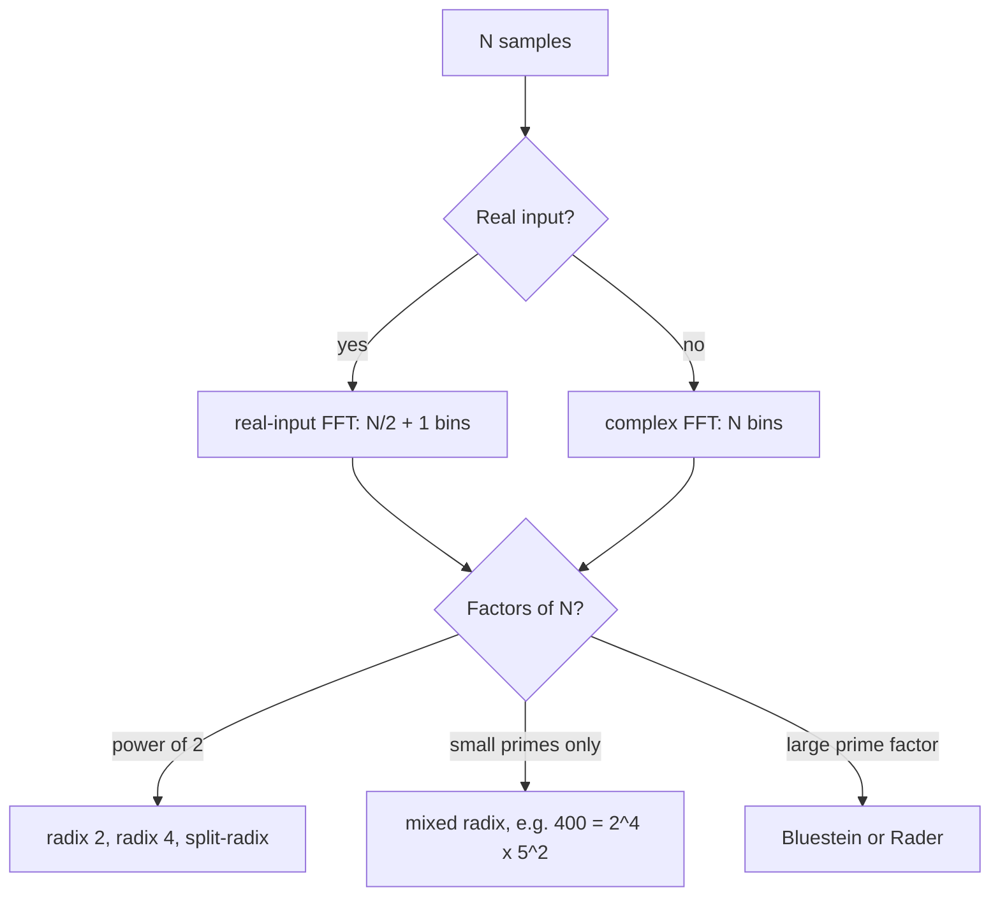

## 1. The question this idea answers

The radix-2 FFT of lessons [L15](/notes/maths/fft-signal-processing/04-fft/l15-even-odd-split) to [L21](/notes/maths/fft-signal-processing/04-fft/l21-why-it-is-fast) needs N to be a power of 2. Real audio code often uses other sizes. Whisper, a speech-to-text model, cuts its 16 kHz audio into frames of 400 samples (25 ms). 400 is not a power of 2.

Can the FFT handle N = 400? What about a prime N, such as 401? And what do NumPy and the other libraries do inside?

This lesson is an overview. It shows that the idea of lesson L15 works for any N with factors, and that two tricks handle prime N. It also shows the real-input FFT, which audio front ends often use.

## 2. Mental model

> [!analogy] Cutting a cake into equal pieces
> To cut a cake into 8 equal pieces, cut it in half three times. To cut it into 400 pieces, cut it into 16 equal parts, then cut each part into 25. Any number with factors allows equal cuts. A prime number of pieces, such as 401, does not: no equal cut exists. Then you need a trick. You can change the problem into one of 400 pieces (Rader), or into one of a convenient larger size (Bluestein).
>
> **Where it stops working:** a cake cut into more pieces is still the same cake. A DFT of a padded signal is not. Bluestein's trick pads an internal convolution, not the signal. So it still gives the exact 401-point DFT. Zero padding the signal to 512 samples gives a different transform with different bins.

## 3. Terms

| Term | Plain meaning |
|---|---|
| composite number | A whole number with a factor other than 1 and itself, for example 400 = 16 × 25. |
| prime number | A whole number greater than 1 with no factor other than 1 and itself, for example 401. |
| radix | The size of the small DFTs that one stage of the FFT combines. Radix 2 combines pairs. Radix 4 combines groups of 4. |
| Cooley–Tukey FFT | The family of FFTs that split a DFT of size $N = N_1 N_2$ into smaller DFTs of sizes $N_1$ and $N_2$, with twiddles between them. |
| radix-4 FFT | A Cooley–Tukey FFT that splits into 4 groups at each stage. Its small 4-point DFTs need only the trivial twiddles 1, −i, −1 and i. |
| split-radix FFT | An FFT that uses radix 2 for the even samples and radix 4 for the odd samples. It needs fewer real operations than radix 2. |
| mixed radix | An FFT that uses different radixes in different stages, for example radix 2 and radix 5 for N = 400. |
| convolution | A sliding sum of products of two lists. Lesson [L32](/notes/maths/fft-signal-processing/06-fourier-family-and-duality/l32-convolution-theorem) shows that FFTs compute it fast. |
| Rader's algorithm | An FFT for prime N. It reorders the samples and changes the DFT into a convolution of length N − 1. |
| Bluestein's algorithm | An FFT for any N, also called the chirp-z method. It changes the DFT into a convolution, and computes that convolution with power-of-2 FFTs. |
| real-input FFT | An FFT for real samples. It computes only the N/2 + 1 outputs that the mirror of lesson [L24](/notes/maths/fft-signal-processing/05-reading-spectra/l24-the-mirror) does not repeat. NumPy calls it `rfft`. |
| flop | One real addition or one real multiplication, counted in operation counts. |

## 4. Cooley–Tukey for any composite N

### 4.1 The index map

Let $N = N_1 N_2$. Write each sample index n and each bin index k with two smaller indices:

$$
n = N_2 n_1 + n_2, \qquad k = k_1 + N_1 k_2,
$$

with $n_1, k_1 = 0, \dots, N_1 - 1$ and $n_2, k_2 = 0, \dots, N_2 - 1$. Each n and each k appears exactly once. For fixed $n_2$, the samples $x[N_2 n_1 + n_2]$ are every $N_2$-th sample, starting at $n_2$.

### 4.2 The exponent splits into four parts

Put the index map into $W_N^{kn}$ and expand the exponent:

$$
(N_2 n_1 + n_2)(k_1 + N_1 k_2) = N_2 n_1 k_1 + N\, n_1 k_2 + n_2 k_1 + N_1 n_2 k_2.
$$

Simplify each part:

1. $W_N^{N_2 n_1 k_1} = W_{N_1}^{n_1 k_1}$, because $W_N^{N_2} = e^{-i2\pi N_2/N} = e^{-i2\pi/N_1} = W_{N_1}$.
2. $W_N^{N n_1 k_2} = 1$, because $W_N^{N} = 1$ (full turns).
3. $W_N^{n_2 k_1}$ stays as it is. This is the twiddle factor.
4. $W_N^{N_1 n_2 k_2} = W_{N_2}^{n_2 k_2}$, for the same reason as part 1.

So the DFT becomes

$$
X[k_1 + N_1 k_2] = \sum_{n_2=0}^{N_2-1} W_{N_2}^{n_2 k_2} \left[ W_N^{n_2 k_1} \sum_{n_1=0}^{N_1-1} x[N_2 n_1 + n_2]\, W_{N_1}^{n_1 k_1} \right].
$$

Read it from the inner sum to the outer sum:

1. **Inner DFTs.** For each $n_2$, compute the $N_1$-point DFT of the samples $x[N_2 n_1 + n_2]$. That is $N_2$ DFTs of size $N_1$.
2. **Twiddles.** Multiply each result by $W_N^{n_2 k_1}$.
3. **Outer DFTs.** For each $k_1$, compute the $N_2$-point DFT over $n_2$. That is $N_1$ DFTs of size $N_2$.

> [!key] Radix 2 is the case $N_2 = 2$
> With $N_2 = 2$: $n_2 = 0$ picks the even samples and $n_2 = 1$ picks the odd samples. The inner DFTs are E and O, of size N/2. The twiddle is $W_N^{k_1}$ for the odd half. The outer DFTs have size 2: they are the butterflies $E[k_1] \pm W_N^{k_1} O[k_1]$ of lesson [L17](/notes/maths/fft-signal-processing/04-fft/l17-the-butterfly).

> [!example] Worked example: N = 6 = 3 × 2
> Take $N_1 = 3$ and $N_2 = 2$.
>
> 1. Inner DFTs: $n_2 = 0$ gives x[0], x[2], x[4]. $n_2 = 1$ gives x[1], x[3], x[5]. These are two 3-point DFTs: an even–odd split with E and O of size 3.
> 2. Twiddles: $W_6^{k_1}$ multiplies the odd results, for $k_1 = 0, 1, 2$.
> 3. Outer DFTs: three 2-point DFTs, one for each $k_1$. Bin $k = k_1 + 3k_2$: for $k_1 = 2$, $k_2 = 1$, the output is X[5].
>
> 3 is prime, so the 3-point DFTs use the direct method.

### 4.3 What one split saves

Count the multiplications when the direct method computes the small DFTs:

1. $N_2$ DFTs of size $N_1$ cost $N_2 \cdot N_1^2 = N \cdot N_1$.
2. The twiddles cost N (some are 1).
3. $N_1$ DFTs of size $N_2$ cost $N_1 \cdot N_2^2 = N \cdot N_2$.

The total is $N(N_1 + N_2 + 1)$, against $N^2$ for the direct DFT. For N = 400 = 16 × 25: $400 \times (16 + 25 + 1) = 16{,}800$ against $160{,}000$. The small DFTs of size 16 and 25 split again in the same way: 16 = 2 · 2 · 2 · 2 and 25 = 5 · 5.

Cooley and Tukey published this method in 1965. The NumPy documentation of `numpy.fft.fft` cites their paper.

## 5. Radix-4 and split-radix

### 5.1 Radix-4

Radix 4 uses $N_2 = 4$. It splits the samples into 4 groups: n mod 4 = 0, 1, 2, 3. Its outer DFTs have size 4, and their twiddles are the powers of $W_4$: 1, −i, −1 and i. These cost no real multiplication (lesson L17). A radix-4 FFT has $\log_4 N = \tfrac{1}{2}\log_2 N$ stages. For N = 1024 = $4^5$, it has 5 stages instead of 10, and fewer twiddle multiplications than radix 2.

### 5.2 Split-radix

Split-radix uses radix 2 for the even samples and radix 4 for the odd samples. Johnson and Frigo (2007) compared the operation counts in flops, for N a power of 2:

| algorithm | real flops | N = 1024 |
|---|---|---|
| radix-2 (Cooley and Tukey) | about $5N\log_2 N$ | about 51,200 |
| split-radix (Yavne, 1968) | $4N\log_2 N - 6N + 8$ | 34,824 |
| modified split-radix (Johnson and Frigo, 2007) | leading term $\tfrac{34}{9}N\log_2 N$: for large N, about 6% fewer than split-radix | see the paper |

> [!note] Sources for this section
> The flop counts come from S. G. Johnson and M. Frigo, "A modified split-radix FFT with fewer arithmetic operations", IEEE Transactions on Signal Processing 55(1), 2007 (the authors' text at fftw.org). The saving of the modified algorithm is smaller for small N, so the table gives no value for N = 1024.

## 6. Mixed radix and the 400-point frame

$400 = 2^4 \cdot 5^2$. A mixed-radix FFT for N = 400 uses four radix-2 stages and two radix-5 stages. The radix-5 stages use 5-point DFTs as their small DFTs.

Whisper fixes these values in its audio code (`whisper/audio.py` in the openai/whisper repository, checked on 2026-10-19):

| constant | value | meaning |
|---|---|---|
| `SAMPLE_RATE` | 16000 | samples per second |
| `N_FFT` | 400 | samples per frame: 400 / 16000 s = 25 ms |
| `HOP_LENGTH` | 160 | samples between frame starts: 10 ms |

The code passes these values and a Hann window to `torch.stft`. The frame has real samples, so a real-input FFT gives 400/2 + 1 = 201 bins, 16000/400 = 40 Hz apart. Lessons [L34](/notes/maths/fft-signal-processing/07-speech-time-frequency/l34-stft-and-spectrogram) and [L39](/notes/maths/fft-signal-processing/08-voice-agents/l39-speech-to-text-front-end) explain frames, hops and windows.

## 7. Prime N: Rader and Bluestein

A prime N has no factors, so the Cooley–Tukey split does not apply. Two methods change the DFT into a convolution. A convolution of a convenient length is fast with FFTs (lesson L32).

### 7.1 Rader's algorithm

For a prime N, the numbers 1 to N − 1 have a special order. There is a number g, called a generator, whose powers $g^0, g^1, \dots, g^{N-2}$ mod N visit every number from 1 to N − 1 exactly once. For N = 401, g = 3 works. Rader reorders the samples 1 to N − 1 and the bins 1 to N − 1 by these powers. Then the DFT becomes a cyclic convolution of length N − 1, plus the simple terms for n = 0 and k = 0.

For N = 401, the convolution has length 400 = $2^4 \cdot 5^2$, a size with small factors. A numerical check for these notes confirmed that this route gives the same 401 values as `np.fft.fft`.

### 7.2 Bluestein's algorithm

Bluestein starts from an identity for the exponent. Expand $(k - n)^2 = k^2 - 2kn + n^2$. So

$$
kn = \frac{k^2 + n^2 - (k-n)^2}{2}.
$$

Put it into the probe value, with $W_N^{a/2}$ meaning $e^{-i\pi a/N}$:

$$
X[k] = W_N^{k^2/2} \sum_{n=0}^{N-1} \left( x[n]\, W_N^{n^2/2} \right) W_N^{-(k-n)^2/2}.
$$

The sum depends on k only through $k - n$. So it is a convolution of the list $x[n]\,W_N^{n^2/2}$ with the list $W_N^{-m^2/2}$. Bluestein computes this convolution with FFTs of a power-of-2 length of at least 2N − 1. For N = 401, that is 1024. A numerical check for these notes confirmed the result against `np.fft.fft`.

> [!trap] Bluestein is not zero padding of the signal
> Zero padding x from 401 to 512 samples gives a 512-point DFT. Its bins sit at multiples of $f_s/512$, not $f_s/401$, and it has 512 bins. Bluestein pads an internal convolution and returns the exact 401-point DFT.

### 7.3 What the libraries say

| library | prime sizes | source |
|---|---|---|
| NumPy | "For FFT lengths containing large prime factors, pocketfft uses Bluestein's algorithm, which maintains O(N log N) run time complexity …" | NumPy 1.17.0 release notes |
| pocketfft | Bluestein for large prime factors, so the worst case is N log N | pocketfft README |
| FFTW | "FFTW employs O(n log n) algorithms for all lengths, including prime numbers." | FFTW manual, Introduction |
| cuFFT | "An O(n log n) algorithm for every input data size". Bluestein when the length has a prime factor above 127. | cuFFT documentation |

In one timing run for these notes, `np.fft.fft` took about 12 µs for N = 1024 and about 61 µs for the prime N = 1021. For N = 65536 and the prime 65537, it took about 0.9 ms and 5.6 ms. A prime size is a few times slower, not hundreds of times.

## 8. The real-input FFT

Audio samples are real numbers. For real input, the DFT has a mirror: $X[N-k] = \overline{X[k]}$ (lesson L24). So the bins N/2 + 1 to N − 1 repeat information. A real-input FFT computes only the bins 0 to N/2. NumPy's `np.fft.rfft` returns `N // 2 + 1` values: 201 for N = 400, and also 201 for N = 401.

```python
X = np.fft.rfft(x)          # bins 0 .. N//2 of the DFT of a real x
```

The FFTW manual says that real input allows "roughly a factor of two improvement in both speed and memory usage". In one timing run for these notes, `fft` took 1.3 to 4.4 times as long as `rfft`, for N from 400 to $2^{20}$.

### 8.1 Where the factor two comes from

One classic method packs the real samples into a complex list of half the length, then uses one complex FFT of size N/2.

1. **Pack.** $z[m] = x[2m] + i\,x[2m+1]$, for m = 0 to N/2 − 1. The even samples become the real part and the odd samples the imaginary part.
2. **Transform.** Compute $Z = $ the N/2-point FFT of z. By linearity, $Z[k] = E[k] + i\,O[k]$, with E and O from lesson L15.
3. **Unpack.** E and O are DFTs of real lists, so each has the mirror. With M = N/2, this gives $\overline{Z[M-k]} = E[k] - i\,O[k]$. Add and subtract:
   $$
   E[k] = \frac{Z[k] + \overline{Z[M-k]}}{2}, \qquad O[k] = \frac{Z[k] - \overline{Z[M-k]}}{2i}.
   $$
   Take the index $M - k$ mod M, so for k = 0 it is 0.
4. **Combine.** $X[k] = E[k] + W_N^{k}\,O[k]$ for k = 0 to N/2, as in lesson L15. For k = N/2, use E[0] and O[0] (fact 1 of lesson [L16](/notes/maths/fft-signal-processing/04-fft/l16-two-facts)).

> [!example] Worked example: the teaching signal
> z = [1 + 1.2071i, 0 − 1.2071i, −1 − 0.2071i, 0 + 0.2071i]. One 4-point FFT of z and the unpack step give E = [0, 2, 0, 2] and O = [0, 1.41 + 1.41i, 2, 1.41 − 1.41i]. The combine step gives X[0..4] = [0, 4, −2i, 0, 0]. These are the first 5 values of the 8-point DFT, and `np.fft.rfft` returns the same 5 values.

## 9. Libraries

| library | where it runs | sizes | source checked |
|---|---|---|---|
| NumPy `numpy.fft` | CPU | any N. Its module is `numpy/fft/_pocketfft.py`. Since NumPy 2.0, it computes natively in float32, float64 or long double. | NumPy 1.17.0 and 2.0.0 release notes, NumPy source |
| pocketfft | CPU, inside NumPy | fast small DFTs for the factors 2, 3, 4, 5, 7, 8, 11 (complex) and 2, 3, 4, 5 (real). Larger primes use generic code, very large ones Bluestein. | pocketfft README |
| FFTW | CPU, C library | any length. "Sizes that are products of small factors are transformed most efficiently." | FFTW manual, sections 1, 2.1, 2.3 |
| cuFFT | NVIDIA GPU | highly optimized for $2^a 3^b 5^c 7^d$. "Powers of two are fastest." | cuFFT documentation |
| PyTorch `torch.fft` | CPU or GPU | on CUDA tensors, it uses cuFFT plans, with a plan cache. | PyTorch docs, "CUDA semantics" |



> [!note] Sources checked on 2026-10-19
> - numpy.org: the `numpy.fft.fft` page (version 2.3) and the `numpy.fft` module page, section "Real and Hermitian transforms".
> - numpy.org: the release notes of NumPy 1.17.0 and 2.0.0.
> - github.com/numpy/numpy: the file `numpy/fft/_pocketfft.py`.
> - github.com/scipy/pocketfft: the README.
> - fftw.org: the manual sections "Introduction", "2.1 Complex One-Dimensional DFTs" and "2.3 One-Dimensional DFTs of Real Data".
> - fftw.org: Johnson and Frigo (2007).
> - docs.nvidia.com: the cuFFT documentation, sections 1 and 2.13.
> - docs.pytorch.org: "CUDA semantics", the cuFFT plan cache.
> - github.com/openai/whisper: the file `whisper/audio.py`.
>
> A sandbox with NumPy 2.5.3 checked the `rfft` lengths, the Rader and Bluestein results, and the timings.

## 10. Graphs

The real-input FFT of one 400-sample frame. The frame holds a 1 kHz sine with amplitude 1 and a 3 kHz sine with amplitude 0.5, sampled at 16 kHz. `np.fft.rfft` returns 201 bins, 40 Hz apart. The peaks sit at bin 1000/40 = 25 and bin 3000/40 = 75, with heights 200 and 100.

```plot
{
  "title": "rfft magnitude of a 400-sample frame (ink)",
  "xAxis": {"label": "bin k (40 Hz apart)", "domain": [-5, 205]},
  "yAxis": {"label": "magnitude", "domain": [-10, 220]},
  "disableZoom": true,
  "data": [
    {"points": [[0.0, 0.0], [1.0, 0.0], [2.0, 0.0], [3.0, 0.0], [4.0, 0.0], [5.0, 0.0], [6.0, 0.0], [7.0, 0.0], [8.0, 0.0], [9.0, 0.0], [10.0, 0.0], [11.0, 0.0], [12.0, 0.0], [13.0, 0.0], [14.0, 0.0], [15.0, 0.0], [16.0, 0.0], [17.0, 0.0], [18.0, 0.0], [19.0, 0.0], [20.0, 0.0], [21.0, 0.0], [22.0, 0.0], [23.0, 0.0], [24.0, 0.0], [25.0, 200.0], [26.0, 0.0], [27.0, 0.0], [28.0, 0.0], [29.0, 0.0], [30.0, 0.0], [31.0, 0.0], [32.0, 0.0], [33.0, 0.0], [34.0, 0.0], [35.0, 0.0], [36.0, 0.0], [37.0, 0.0], [38.0, 0.0], [39.0, 0.0], [40.0, 0.0], [41.0, 0.0], [42.0, 0.0], [43.0, 0.0], [44.0, 0.0], [45.0, 0.0], [46.0, 0.0], [47.0, 0.0], [48.0, 0.0], [49.0, 0.0], [50.0, 0.0], [51.0, 0.0], [52.0, 0.0], [53.0, 0.0], [54.0, 0.0], [55.0, 0.0], [56.0, 0.0], [57.0, 0.0], [58.0, 0.0], [59.0, 0.0], [60.0, 0.0], [61.0, 0.0], [62.0, 0.0], [63.0, 0.0], [64.0, 0.0], [65.0, 0.0], [66.0, 0.0], [67.0, 0.0], [68.0, 0.0], [69.0, 0.0], [70.0, 0.0], [71.0, 0.0], [72.0, 0.0], [73.0, 0.0], [74.0, 0.0], [75.0, 100.0], [76.0, 0.0], [77.0, 0.0], [78.0, 0.0], [79.0, 0.0], [80.0, 0.0], [81.0, 0.0], [82.0, 0.0], [83.0, 0.0], [84.0, 0.0], [85.0, 0.0], [86.0, 0.0], [87.0, 0.0], [88.0, 0.0], [89.0, 0.0], [90.0, 0.0], [91.0, 0.0], [92.0, 0.0], [93.0, 0.0], [94.0, 0.0], [95.0, 0.0], [96.0, 0.0], [97.0, 0.0], [98.0, 0.0], [99.0, 0.0], [100.0, 0.0], [101.0, 0.0], [102.0, 0.0], [103.0, 0.0], [104.0, 0.0], [105.0, 0.0], [106.0, 0.0], [107.0, 0.0], [108.0, 0.0], [109.0, 0.0], [110.0, 0.0], [111.0, 0.0], [112.0, 0.0], [113.0, 0.0], [114.0, 0.0], [115.0, 0.0], [116.0, 0.0], [117.0, 0.0], [118.0, 0.0], [119.0, 0.0], [120.0, 0.0], [121.0, 0.0], [122.0, 0.0], [123.0, 0.0], [124.0, 0.0], [125.0, 0.0], [126.0, 0.0], [127.0, 0.0], [128.0, 0.0], [129.0, 0.0], [130.0, 0.0], [131.0, 0.0], [132.0, 0.0], [133.0, 0.0], [134.0, 0.0], [135.0, 0.0], [136.0, 0.0], [137.0, 0.0], [138.0, 0.0], [139.0, 0.0], [140.0, 0.0], [141.0, 0.0], [142.0, 0.0], [143.0, 0.0], [144.0, 0.0], [145.0, 0.0], [146.0, 0.0], [147.0, 0.0], [148.0, 0.0], [149.0, 0.0], [150.0, 0.0], [151.0, 0.0], [152.0, 0.0], [153.0, 0.0], [154.0, 0.0], [155.0, 0.0], [156.0, 0.0], [157.0, 0.0], [158.0, 0.0], [159.0, 0.0], [160.0, 0.0], [161.0, 0.0], [162.0, 0.0], [163.0, 0.0], [164.0, 0.0], [165.0, 0.0], [166.0, 0.0], [167.0, 0.0], [168.0, 0.0], [169.0, 0.0], [170.0, 0.0], [171.0, 0.0], [172.0, 0.0], [173.0, 0.0], [174.0, 0.0], [175.0, 0.0], [176.0, 0.0], [177.0, 0.0], [178.0, 0.0], [179.0, 0.0], [180.0, 0.0], [181.0, 0.0], [182.0, 0.0], [183.0, 0.0], [184.0, 0.0], [185.0, 0.0], [186.0, 0.0], [187.0, 0.0], [188.0, 0.0], [189.0, 0.0], [190.0, 0.0], [191.0, 0.0], [192.0, 0.0], [193.0, 0.0], [194.0, 0.0], [195.0, 0.0], [196.0, 0.0], [197.0, 0.0], [198.0, 0.0], [199.0, 0.0], [200.0, 0.0]], "fnType": "points", "graphType": "polyline", "color": "#100D12", "skipTip": true},
    {"points": [[0.0, 0.0], [1.0, 0.0], [2.0, 0.0], [3.0, 0.0], [4.0, 0.0], [5.0, 0.0], [6.0, 0.0], [7.0, 0.0], [8.0, 0.0], [9.0, 0.0], [10.0, 0.0], [11.0, 0.0], [12.0, 0.0], [13.0, 0.0], [14.0, 0.0], [15.0, 0.0], [16.0, 0.0], [17.0, 0.0], [18.0, 0.0], [19.0, 0.0], [20.0, 0.0], [21.0, 0.0], [22.0, 0.0], [23.0, 0.0], [24.0, 0.0], [25.0, 200.0], [26.0, 0.0], [27.0, 0.0], [28.0, 0.0], [29.0, 0.0], [30.0, 0.0], [31.0, 0.0], [32.0, 0.0], [33.0, 0.0], [34.0, 0.0], [35.0, 0.0], [36.0, 0.0], [37.0, 0.0], [38.0, 0.0], [39.0, 0.0], [40.0, 0.0], [41.0, 0.0], [42.0, 0.0], [43.0, 0.0], [44.0, 0.0], [45.0, 0.0], [46.0, 0.0], [47.0, 0.0], [48.0, 0.0], [49.0, 0.0], [50.0, 0.0], [51.0, 0.0], [52.0, 0.0], [53.0, 0.0], [54.0, 0.0], [55.0, 0.0], [56.0, 0.0], [57.0, 0.0], [58.0, 0.0], [59.0, 0.0], [60.0, 0.0], [61.0, 0.0], [62.0, 0.0], [63.0, 0.0], [64.0, 0.0], [65.0, 0.0], [66.0, 0.0], [67.0, 0.0], [68.0, 0.0], [69.0, 0.0], [70.0, 0.0], [71.0, 0.0], [72.0, 0.0], [73.0, 0.0], [74.0, 0.0], [75.0, 100.0], [76.0, 0.0], [77.0, 0.0], [78.0, 0.0], [79.0, 0.0], [80.0, 0.0], [81.0, 0.0], [82.0, 0.0], [83.0, 0.0], [84.0, 0.0], [85.0, 0.0], [86.0, 0.0], [87.0, 0.0], [88.0, 0.0], [89.0, 0.0], [90.0, 0.0], [91.0, 0.0], [92.0, 0.0], [93.0, 0.0], [94.0, 0.0], [95.0, 0.0], [96.0, 0.0], [97.0, 0.0], [98.0, 0.0], [99.0, 0.0], [100.0, 0.0], [101.0, 0.0], [102.0, 0.0], [103.0, 0.0], [104.0, 0.0], [105.0, 0.0], [106.0, 0.0], [107.0, 0.0], [108.0, 0.0], [109.0, 0.0], [110.0, 0.0], [111.0, 0.0], [112.0, 0.0], [113.0, 0.0], [114.0, 0.0], [115.0, 0.0], [116.0, 0.0], [117.0, 0.0], [118.0, 0.0], [119.0, 0.0], [120.0, 0.0], [121.0, 0.0], [122.0, 0.0], [123.0, 0.0], [124.0, 0.0], [125.0, 0.0], [126.0, 0.0], [127.0, 0.0], [128.0, 0.0], [129.0, 0.0], [130.0, 0.0], [131.0, 0.0], [132.0, 0.0], [133.0, 0.0], [134.0, 0.0], [135.0, 0.0], [136.0, 0.0], [137.0, 0.0], [138.0, 0.0], [139.0, 0.0], [140.0, 0.0], [141.0, 0.0], [142.0, 0.0], [143.0, 0.0], [144.0, 0.0], [145.0, 0.0], [146.0, 0.0], [147.0, 0.0], [148.0, 0.0], [149.0, 0.0], [150.0, 0.0], [151.0, 0.0], [152.0, 0.0], [153.0, 0.0], [154.0, 0.0], [155.0, 0.0], [156.0, 0.0], [157.0, 0.0], [158.0, 0.0], [159.0, 0.0], [160.0, 0.0], [161.0, 0.0], [162.0, 0.0], [163.0, 0.0], [164.0, 0.0], [165.0, 0.0], [166.0, 0.0], [167.0, 0.0], [168.0, 0.0], [169.0, 0.0], [170.0, 0.0], [171.0, 0.0], [172.0, 0.0], [173.0, 0.0], [174.0, 0.0], [175.0, 0.0], [176.0, 0.0], [177.0, 0.0], [178.0, 0.0], [179.0, 0.0], [180.0, 0.0], [181.0, 0.0], [182.0, 0.0], [183.0, 0.0], [184.0, 0.0], [185.0, 0.0], [186.0, 0.0], [187.0, 0.0], [188.0, 0.0], [189.0, 0.0], [190.0, 0.0], [191.0, 0.0], [192.0, 0.0], [193.0, 0.0], [194.0, 0.0], [195.0, 0.0], [196.0, 0.0], [197.0, 0.0], [198.0, 0.0], [199.0, 0.0], [200.0, 0.0]], "fnType": "points", "graphType": "scatter", "attr": {"r": 3}, "color": "#100D12", "skipTip": true}
  ]
}
```

The heights follow the rule of lesson [L23](/notes/maths/fft-signal-processing/05-reading-spectra/l23-hertz-and-amplitude). A sine with amplitude A and a whole number of cycles in the frame gives a peak of height $A \cdot N/2$. Here 1 × 200 = 200 and 0.5 × 200 = 100.

## 11. Code

A short exercise. Build it in a lab.

1. **Factors.** Write `prime_factors(n)`. It returns the list of prime factors of n, smallest first.
2. **The real-input FFT.** For random real x with N = 400 and N = 401, compare `np.fft.rfft(x)` with `np.fft.fft(x)`.
3. **The mirror.** For the same x, check $X[N-k] = \overline{X[k]}$ for k = 1 to N − 1.
4. **Prime sizes.** Time `np.fft.fft` for N = 1024 and 1021, and for N = 4096 and 4093. Repeat each call 100 times and keep the shortest time.

Acceptance tests:

- `prime_factors(400) == [2, 2, 2, 2, 5, 5]`, `prime_factors(401) == [401]`, `prime_factors(1000) == [2, 2, 2, 5, 5, 5]`, `prime_factors(1021) == [1021]`.
- `len(np.fft.rfft(x)) == N // 2 + 1` for N = 400 and 401.
- `np.allclose(np.fft.rfft(x), np.fft.fft(x)[:N // 2 + 1])` is True for N = 400 and 401.
- The mirror test passes with `np.allclose`.
- The prime sizes are slower, but by a factor of a few, not hundreds.

[Open a lab for this lesson](/labs/new?note=maths/fft-signal-processing/04-fft/l22-other-ffts) · [FFT explorer lab](/labs/new?template=fft-explorer)

```check
{
  "question": "Hint for `prime_factors(n)`: how do I find the factors?",
  "hint": "Hint level 1 (idea): divide by 2 while you can, then by 3, then by 5, and so on. Stop when the divisor squared is larger than what is left.",
  "answer": "Hint level 2 (pseudocode): factors ← empty. d ← 2. While d·d ≤ n: while n mod d = 0: append d, n ← n / d. Then d ← d + 1. If n > 1 at the end: append n (it is a prime). Return factors."
}
```

## 12. Common mistakes

1. **"The FFT needs a power of 2."** Radix 2 does. Cooley–Tukey works for any composite N, and Rader and Bluestein handle primes.
2. **Zero padding to fix a prime size.** Padding changes the transform: more bins at other frequencies. Use the exact size, or choose a frame length with small factors.
3. **"rfft gives N/2 bins."** It gives N // 2 + 1 bins: bin 0 and bin N/2 are both included for even N.
4. **"A prime size costs N²."** Good libraries keep O(N log N) for every size. A prime size is a few times slower, not N/log N times slower.
5. **"Radix 4 is a different transform."** Every FFT in this lesson computes the same DFT. Only the order of the operations differs.

## 13. One-minute explanation

For any N = N₁ × N₂, the Cooley–Tukey FFT does N₂ small DFTs of size N₁, twiddles, then N₁ small DFTs of size N₂. Radix 2 is the case N₂ = 2, and radix 4, split-radix and mixed radix choose other factors, such as 400 = 2⁴ × 5² for Whisper. For a prime N, Rader and Bluestein change the DFT into a convolution of a convenient length, so the cost stays N log N. For real audio, the real-input FFT returns only the N/2 + 1 bins that the mirror does not repeat, at about half the cost. NumPy uses pocketfft, and PyTorch uses cuFFT on NVIDIA GPUs.

## 14. Check questions

```check
{
  "question": "How many values does `np.fft.rfft` return for N = 400? For N = 401? Which bins are they?",
  "hint": "The rule is N // 2 + 1.",
  "answer": "N = 400: 400 // 2 + 1 = 201 values, bins 0 to 200. N = 401: 401 // 2 + 1 = 201 values, bins 0 to 200. The other bins are mirror copies (conjugates) of these."
}
```

```check
{
  "question": "Use Cooley–Tukey with N = 6, $N_1 = 3$, $N_2 = 2$. Which samples go into each inner DFT? Which bin k does the pair $k_1 = 1$, $k_2 = 1$ give?",
  "hint": "$n = N_2 n_1 + n_2$ and $k = k_1 + N_1 k_2$.",
  "answer": "$n_2 = 0$: n = 0, 2, 4. $n_2 = 1$: n = 1, 3, 5. So the inner DFTs are the 3-point DFTs of the even and the odd samples. The bin is $k = 1 + 3 \\cdot 1 = 4$."
}
```

```check
{
  "question": "A frame has 401 samples. A colleague pads it with zeros to 512 samples and uses a radix-2 FFT. Does this give the 401-point DFT? Why or why not?",
  "hint": "Compare the number of bins and the bin spacing.",
  "answer": "No. The result is a 512-point DFT of a padded signal. It has 512 bins, spaced $f_s/512$ apart, not 401 bins spaced $f_s/401$ apart. Its values are different numbers. Bluestein's method also uses a power-of-2 length, but it pads an internal convolution and returns the exact 401-point DFT."
}
```

```check
{
  "question": "Which kind of FFT fits each size: 1024, 1000, 480 and 1021?",
  "hint": "Factor each number first.",
  "answer": "1024 = $2^{10}$: radix 2, radix 4 or split-radix. 1000 = $2^3 \\cdot 5^3$: mixed radix (2 and 5). 480 = $2^5 \\cdot 3 \\cdot 5$: mixed radix (2, 3 and 5). 1021 is prime: Rader (a convolution of length 1020 = $2^2 \\cdot 3 \\cdot 5 \\cdot 17$) or Bluestein (power-of-2 FFTs of length 2048 or more)."
}
```

```check
{
  "question": "Why can a real-input FFT be about twice as fast as a complex FFT of the same N?",
  "hint": "What does the mirror $X[N-k] = \\overline{X[k]}$ say about half of the outputs?",
  "answer": "For real input, the bins N/2 + 1 to N − 1 are conjugates of the bins below N/2, so they carry no new information. A real-input FFT computes only N/2 + 1 bins. One method packs the N real samples into N/2 complex numbers. It does one FFT of size N/2. Then it separates E and O with the mirror. That is about half the work and half the memory."
}
```

## 15. Links

- Previous: [L21: Why the FFT is fast](/notes/maths/fft-signal-processing/04-fft/l21-why-it-is-fast)
- Next part: [L23: Hertz and amplitude](/notes/maths/fft-signal-processing/05-reading-spectra/l23-hertz-and-amplitude)
- The mirror for real input: [L24: The mirror](/notes/maths/fft-signal-processing/05-reading-spectra/l24-the-mirror)
- Convolution: [L32: The convolution theorem](/notes/maths/fft-signal-processing/06-fourier-family-and-duality/l32-convolution-theorem)
- Frames and hops: [L34: The STFT and the spectrogram](/notes/maths/fft-signal-processing/07-speech-time-frequency/l34-stft-and-spectrogram)
- Whisper's front end: [L39: The speech-to-text front end](/notes/maths/fft-signal-processing/08-voice-agents/l39-speech-to-text-front-end)
- [04 FFT](/notes/maths/fft-signal-processing/04-fft)
- [Glossary](/notes/maths/fft-signal-processing/glossary)
