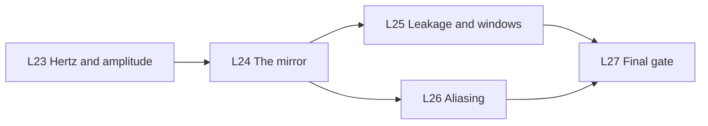

This part answers the question of chapter 1 with real units. It changes the output of the FFT into hertz, amplitudes and phases. It also shows the two limits of every spectrum: the window (leakage) and the sampling (aliasing). The part ends with the gate before part 06.

| Code | Lesson | Core idea | Course video | Status |
|---|---|---|---|---|
| L23 | [Hertz and amplitude](/notes/maths/fft-signal-processing/05-reading-spectra/l23-hertz-and-amplitude) | $f_k = k f_s / N$ and $A = 2\lvert X[k]\rvert / N$ | ch 11, 0:38–1:04 | not started |
| L24 | [The mirror](/notes/maths/fft-signal-processing/05-reading-spectra/l24-the-mirror) | Real input gives $X[N-k] = \overline{X[k]}$. | ch 11, 0:00–0:38 | not started |
| L25 | [Leakage and windows](/notes/maths/fft-signal-processing/05-reading-spectra/l25-leakage-and-windows) | The Hann window. Zero padding gives more points, not more resolution. | ch 11, 1:04–1:30 | not started |
| L26 | [Aliasing](/notes/maths/fft-signal-processing/05-reading-spectra/l26-aliasing) | A 7 Hz cosine sampled at 8 Hz gives the same samples as a 1 Hz cosine. | none | not started |
| L27 | [Final gate](/notes/maths/fft-signal-processing/05-reading-spectra/l27-final-gate) | Five ideas, six questions, and the full pipeline with no notes | ch 12, full | not started |

## How the lessons connect

L23 reads bins 0 to N/2 and says that the factor 2 comes from a mirror bin. L24 proves the mirror. L25 and L26 show the two limits: a tone that does not fit the window leaks, and a tone above $f_s/2$ aliases. L26 uses the negative frequencies of L24. L27 reviews parts 02 to 05.

> [!note] Two meanings of "window"
> In this part, the window is the stretch of N samples that one DFT uses. A window function, for example the Hann window, is a list of weights that multiplies the samples in the window.
