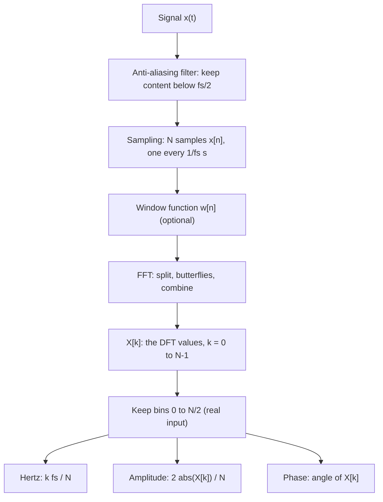

## 1. The question this page answers

Chapter 1 of the course asked one question. We receive only the mixture. Can we find the ingredients: which frequencies, how strong, and how shifted? Parts 02 to 05 built the full answer, one step at a time.

This page asks a new question: can you now go from a raw list of samples to that answer, with no notes? This page is the gate before part 06. Part 06 leaves the finite sum and moves to the Fourier series and the Fourier transform. Every idea there uses the pipeline of this page.

Use this page in this order:

1. Watch the chapter 12 video (section 7).
2. Draw the pipeline from memory. Then compare your drawing with section 5.
3. Answer the ten gate questions in section 11, one at a time and in your own words. Open an answer only after you answer.
4. Write the code of section 8 in an empty lab, with no notes.

The previous lesson is [L26: Aliasing](/notes/maths/fft-signal-processing/05-reading-spectra/l26-aliasing).

## 2. Mental model

> [!analogy] Reading the recipe back from a smoothie
> A smoothie is a mixture of fruits. The DFT reads the recipe back from the mixture: which fruits (frequencies), how much of each (magnitude), and where each one starts (phase). It compares the mixture with one reference fruit at a time and gives each comparison a score (the matching score). The FFT gets all the scores at once, because the comparisons share work.
>
> **Where it stops working:** a real smoothie cannot become fruit again, but the inverse DFT rebuilds the samples exactly. Also, the recipe is clean only in two cases. Each fruit must fit the window, or its energy leaks. No fruit may be above $f_s/2$, or it appears as a different fruit (aliasing).

## 3. Terms

This page adds no new term. It uses the terms below. Say each one in your own words before you read its meaning.

| Term | Plain meaning |
|---|---|
| sample $x[n]$ | One value of the signal at one instant. $n$ = 0 to $N - 1$. |
| sample rate $f_s$ | The number of samples in one second. $\Delta t = 1/f_s$. |
| probe | A candidate wave that you match against the signal. |
| matching score | Multiply point by point, then add. Mathematicians call it the inner product. |
| orthogonal | Two patterns are orthogonal when their matching score is 0. |
| DFT | The definition $X[k] = \sum_{n=0}^{N-1} x[n]\, e^{-i 2\pi k n / N}$. It says what to compute. |
| FFT | A fast algorithm that computes the same $X[k]$. |
| twiddle factor $W_N^k$ | $e^{-i 2\pi k / N}$. It turns $O[k]$ before it joins $E[k]$. |
| butterfly | Two inputs, one twiddle multiplication, one sum and one difference, two outputs. |
| magnitude $\lvert X[k] \rvert$ | How strong the frequency of bin $k$ is. |
| phase of $X[k]$ | Where the component starts in its cycle, measured from a cosine. |
| bin spacing $\Delta f$ | $f_s / N$, the step in hertz from one bin to the next. |
| conjugate symmetry | For real input, $X[N-k] = \overline{X[k]}$. |
| spectral leakage | Energy that spreads into many bins when a tone does not fit the window. |
| Nyquist frequency | $f_s / 2$. Content above it aliases. |

## 4. The five ideas

Chapter 12 says that five ideas carry the whole story. Each idea below has the exact numbers that prove it.

1. **A signal is a sequence of samples.** The spectrum signal is 64 samples at $f_s$ = 128 Hz, so it covers 0.5 s. The computer stores only these 64 numbers. Lessons L1 to L6.
2. **Fourier analysis measures alignment with frequency basis patterns.** For the teaching signal, the cosine probe with 1 cycle gives the matching score 4. The cosine probe with 3 cycles gives 0. The sine probe with 2 cycles gives 2. Lessons L7 to L9.
3. **The DFT gives complex $X[k]$: magnitude = how much, phase = where.** The teaching signal gives $X[2] = -2i$. Its magnitude is 2, so $A$ = 2 × 2 / 8 = 0.5. Its phase is −90°, so the component is a sine. Lessons L10 to L13.
4. **The FFT computes the same $X[k]$ in $O(N \log N)$: split, reuse, combine.** $X[k] = E[k] + W_8^k O[k]$ and $X[k+4] = E[k] - W_8^k O[k]$. For N = 1024, the work drops from 1,048,576 to 10,240 operations, about 102 times less. The results agree with the direct DFT to about 12 significant digits. Lessons L14 to L22.
5. **The spectrum $\lvert X[k] \rvert$ shows frequency content, within the limits of the window.** Bins 3, 7 and 12 become 6, 14 and 24 Hz, with amplitudes 1.0, 0.6 and 0.4. A sine with 3.5 cycles in the window leaks into 23 of 33 bins. Lessons L23 to L26.

> [!key] Two limits on every spectrum
> The window limits the spectrum: a tone that does not fit the window leaks (lesson L25). The sampling limits the spectrum: a tone above $f_s/2$ aliases (lesson L26). A real signal also shows a mirror half, which adds no new information (lesson L24).

## 5. The full pipeline



The DFT says what to compute. The FFT is how to compute it fast. Both give the same $X[k]$.

> [!example] The spectrum signal through the pipeline
> | Stage | What it holds | The spectrum signal |
> |---|---|---|
> | Signal | $x(t)$ | $1.0\sin(2\pi \cdot 6t) + 0.6\sin(2\pi \cdot 14t) + 0.4\sin(2\pi \cdot 24t)$ |
> | Alias check | Is all content below $f_s/2$? | 24 Hz < 64 Hz, so no aliasing |
> | Samples | N = 64 values, $\Delta t$ = 1/128 s | $x[0]$ = 0, $x[1]$ = 1.04, $x[2]$ = 1.43 (rounded) |
> | Window | Does each component fit? | 3, 7 and 12 whole cycles, so no window function is necessary |
> | FFT | $\log_2 64$ = 6 stages, 32 butterflies in each stage | (N/2) × 6 = 192 twiddle multiplications |
> | Coefficients | 64 complex values | $X[3] = -32i$, $X[7] = -19.2i$, $X[12] = -12.8i$, and the mirrors at bins 61, 57 and 52 |
> | One-sided | Bins 0 to 32 | 33 values |
> | Hertz | $f_k = 2k$ Hz | 6, 14 and 24 Hz |
> | Amplitude | $2\lvert X[k] \rvert / 64$ | 1.0, 0.6 and 0.4 |
> | Phase | Angle of $X[k]$ | −90° for all three, so all three are sines |

## 6. Graphs

The pipeline changes the first picture into the second picture.

```plot
{
  "title": "Input: 64 samples (blue) of the spectrum signal, fs = 128 Hz",
  "xAxis": {"label": "time (s)", "domain": [-0.01, 0.51]},
  "yAxis": {"label": "sample value", "domain": [-2, 2]},
  "disableZoom": true,
  "data": [
    {"points": [[0, 0], [0.0078, 1.0405], [0.0156, 1.4269], [0.0234, 1.1491], [0.0312, 0.7535], [0.0391, 0.6679], [0.0469, 0.7647], [0.0547, 0.6544], [0.0625, 0.2828], [0.0703, 0.043], [0.0781, 0.2456], [0.0859, 0.6292], [0.0938, 0.5716], [0.1016, -0.1985], [0.1094, -1.2314], [0.1172, -1.7903], [0.125, -1.6], [0.1328, -1.0512], [0.1406, -0.6657], [0.1484, -0.5046], [0.1562, -0.2284], [0.1641, 0.3231], [0.1719, 0.8113], [0.1797, 0.7821], [0.1875, 0.2828], [0.1953, -0.0847], [0.2031, 0.1991], [0.2109, 0.9741], [0.2188, 1.5535], [0.2266, 1.4552], [0.2344, 0.8612], [0.2422, 0.3014], [0.25, 0], [0.2578, -0.3014], [0.2656, -0.8612], [0.2734, -1.4552], [0.2812, -1.5535], [0.2891, -0.9741], [0.2969, -0.1991], [0.3047, 0.0847], [0.3125, -0.2828], [0.3203, -0.7821], [0.3281, -0.8113], [0.3359, -0.3231], [0.3438, 0.2284], [0.3516, 0.5046], [0.3594, 0.6657], [0.3672, 1.0512], [0.375, 1.6], [0.3828, 1.7903], [0.3906, 1.2314], [0.3984, 0.1985], [0.4062, -0.5716], [0.4141, -0.6292], [0.4219, -0.2456], [0.4297, -0.043], [0.4375, -0.2828], [0.4453, -0.6544], [0.4531, -0.7647], [0.4609, -0.6679], [0.4688, -0.7535], [0.4766, -1.1491], [0.4844, -1.4269], [0.4922, -1.0405]], "fnType": "points", "graphType": "polyline", "color": "#1E6091", "skipTip": true},
    {"points": [[0, 0], [0.0078, 1.0405], [0.0156, 1.4269], [0.0234, 1.1491], [0.0312, 0.7535], [0.0391, 0.6679], [0.0469, 0.7647], [0.0547, 0.6544], [0.0625, 0.2828], [0.0703, 0.043], [0.0781, 0.2456], [0.0859, 0.6292], [0.0938, 0.5716], [0.1016, -0.1985], [0.1094, -1.2314], [0.1172, -1.7903], [0.125, -1.6], [0.1328, -1.0512], [0.1406, -0.6657], [0.1484, -0.5046], [0.1562, -0.2284], [0.1641, 0.3231], [0.1719, 0.8113], [0.1797, 0.7821], [0.1875, 0.2828], [0.1953, -0.0847], [0.2031, 0.1991], [0.2109, 0.9741], [0.2188, 1.5535], [0.2266, 1.4552], [0.2344, 0.8612], [0.2422, 0.3014], [0.25, 0], [0.2578, -0.3014], [0.2656, -0.8612], [0.2734, -1.4552], [0.2812, -1.5535], [0.2891, -0.9741], [0.2969, -0.1991], [0.3047, 0.0847], [0.3125, -0.2828], [0.3203, -0.7821], [0.3281, -0.8113], [0.3359, -0.3231], [0.3438, 0.2284], [0.3516, 0.5046], [0.3594, 0.6657], [0.3672, 1.0512], [0.375, 1.6], [0.3828, 1.7903], [0.3906, 1.2314], [0.3984, 0.1985], [0.4062, -0.5716], [0.4141, -0.6292], [0.4219, -0.2456], [0.4297, -0.043], [0.4375, -0.2828], [0.4453, -0.6544], [0.4531, -0.7647], [0.4609, -0.6679], [0.4688, -0.7535], [0.4766, -1.1491], [0.4844, -1.4269], [0.4922, -1.0405]], "fnType": "points", "graphType": "scatter", "attr": {"r": 3}, "color": "#1E6091", "skipTip": true}
  ]
}
```

```plot
{
  "title": "Output: 6, 14, 24 Hz with amplitudes 1.0, 0.6, 0.4 (ink)",
  "xAxis": {"label": "frequency (Hz)", "domain": [-2, 66]},
  "yAxis": {"label": "amplitude A", "domain": [-0.1, 1.2]},
  "disableZoom": true,
  "data": [
    {"points": [[2, 0], [4, 0], [6, 0], [6, 1], [6, 0], [8, 0], [10, 0], [12, 0], [14, 0], [14, 0.6], [14, 0], [16, 0], [18, 0], [20, 0], [22, 0], [24, 0], [24, 0.4], [24, 0], [26, 0], [28, 0], [30, 0], [32, 0], [34, 0], [36, 0], [38, 0], [40, 0], [42, 0], [44, 0], [46, 0], [48, 0], [50, 0], [52, 0], [54, 0], [56, 0], [58, 0], [60, 0], [62, 0]], "fnType": "points", "graphType": "polyline", "color": "#100D12", "skipTip": true},
    {"points": [[2, 0], [4, 0], [6, 1], [8, 0], [10, 0], [12, 0], [14, 0.6], [16, 0], [18, 0], [20, 0], [22, 0], [24, 0.4], [26, 0], [28, 0], [30, 0], [32, 0], [34, 0], [36, 0], [38, 0], [40, 0], [42, 0], [44, 0], [46, 0], [48, 0], [50, 0], [52, 0], [54, 0], [56, 0], [58, 0], [60, 0], [62, 0]], "fnType": "points", "graphType": "scatter", "attr": {"r": 3}, "color": "#100D12", "skipTip": true}
  ]
}
```

## 7. Video

Watch the opening and the five ideas. The caption at 0:16 introduces them.

```video
{
  "src": "/notes/media/fft-signal-processing/course/12_The_Final_Mental_Model.mp4",
  "start": "0:00",
  "end": "0:26",
  "caption": "Five ideas carry the whole story."
}
```

Watch the full pipeline in one picture: signal, samples, DFT, FFT butterflies, spectrum.

```video
{
  "src": "/notes/media/fft-signal-processing/course/12_The_Final_Mental_Model.mp4",
  "start": "0:26",
  "end": "0:35",
  "caption": "Composite signal, sampled into numbers, measured against frequency patterns, computed by the FFT, read as a spectrum."
}
```

Watch the six questions. Pause and answer each one before you open section 11.

```video
{
  "src": "/notes/media/fft-signal-processing/course/12_The_Final_Mental_Model.mp4",
  "start": "0:35",
  "end": "0:45",
  "caption": "Pause and try to answer these in your own words."
}
```

## 8. Code

This is the gate exercise. Use an empty lab. Do not open the notes or earlier labs.

Write `spectrum_report(x, fs, window="none")`. It returns three arrays for bins 0 to N/2: the frequencies in hertz, the amplitudes and the phases in degrees.

1. Use your own FFT from lesson L19 or L20 inside it. Do not call `np.fft`.
2. Use the correct amplitude rule for bin 0, for bin N/2 and for all other bins.
3. For `window="hann"`, multiply by the periodic Hann window, and correct with the sum of its weights.

Acceptance tests:

1. Your FFT matches `np.fft.fft` (`np.allclose`) for 5 random real inputs of length 64.
2. The spectrum signal (`fs = 128`) gives amplitudes close to 1.0, 0.6 and 0.4 at 6, 14 and 24 Hz, with phases close to −90°. All other amplitudes are below `1e-9`.
3. The teaching signal with `fs = 8` gives amplitude 1.0 and phase 0° at 1 Hz, and amplitude 0.5 and phase −90° at 2 Hz.
4. With `window="hann"`, the spectrum signal still gives 1.0, 0.6 and 0.4 at 6, 14 and 24 Hz.
5. The 3.5-cycle sine ($f$ = 7 Hz, `fs = 128`, N = 64) gives its largest amplitude at 6 Hz, and that amplitude is below 1.
6. A 100 Hz cosine with `fs = 128` and N = 64 gives its largest amplitude at 28 Hz.

[Open a lab for this lesson](/labs/new?note=maths/fft-signal-processing/05-reading-spectra/l27-final-gate)

The [FFT explorer lab](/labs/new?template=fft-explorer) is useful after the gate, to test your answers with the controls.

```check
{
  "question": "Stuck on the gate exercise? This page gives no code hints on purpose.",
  "hint": "Return to the lesson that owns the stuck step. L19 owns the FFT, L23 owns hertz and amplitude, and L25 owns the window.",
  "answer": "Read that one lesson, close it, and write the step again from memory. A gate passes only when you can write the code with no notes."
}
```

## 9. Common mistakes

1. **A score of 0 read as "no signal".** A score of 0 means no alignment with this probe only. A cosine probe misses a sine at the same frequency.
2. **The imaginary part read as a second frequency.** The real part and the imaginary part are two views of one oscillation. Together they give its phase.
3. **The FFT read as an approximation.** The FFT gives the same values as the DFT. Only the rounding differs.
4. **The bin number read as hertz, or the magnitude read as amplitude.** Multiply by $f_s/N$. Divide by $N/2$, except at bins 0 and $N/2$.
5. **The mirror peaks counted as components.** For real input, bins above $N/2$ repeat the lower half.
6. **Clean peaks expected for every signal.** Clean peaks need components that fit the window. Real signals usually leak.
7. **Zero padding used for resolution.** Only a longer window separates close tones.
8. **Aliasing expected to show in the spectrum.** An alias looks exactly like a real low frequency. Filter before you sample.

## 10. One-minute explanation

A signal reaches the computer as N samples, taken $f_s$ times per second, after a filter removes everything above $f_s/2$. To find a frequency in it, match the samples against a probe wave: multiply point by point and add. Probes with whole numbers of cycles are orthogonal, so each score sees only its own frequency. One complex probe does the cosine match and the sine match at once. So each score $X[k]$ is a complex number. Its magnitude says how much, and its phase says where the component starts. The DFT is the list of all N scores. The FFT computes the same list with $N \log_2 N$ work instead of $N^2$. It splits the samples into even and odd halves, and it reuses each half-size result for two outputs. Finally, bin $k$ is $k f_s / N$ hertz, the amplitude is $2\lvert X[k] \rvert / N$, and the upper half is a mirror. The spectrum is clean only when each component fits the window.

## 11. Gate questions

Answer each question in your own words before you open the answer. Questions 1 to 6 are the six questions of chapter 12. Questions 7 to 10 need a calculation by hand.

```check
{
  "question": "Gate 1. Why does a probe that does not match give a sum near zero?",
  "hint": "Examine the signs of the products over the whole window. Lessons L8 and L9.",
  "answer": "The products cancel over the window: some are positive and some are negative, and they add to 0. Example: the cosine probe with 3 cycles against the teaching signal gives exactly 0. The reason is orthogonality. Two patterns with different whole numbers of cycles in the window have a matching score of exactly 0. So each probe sees only its own frequency."
}
```

```check
{
  "question": "Gate 2. What do the magnitude and the phase of $X[k]$ tell you?",
  "hint": "Use $X[2] = -2i$ of the teaching signal (N = 8) as an example.",
  "answer": "The magnitude says how strong the frequency is: $\\lvert X[k] \\rvert = A \\cdot N/2$ for a sinusoid that fits the window ($0 < k < N/2$). The phase says where in its cycle the component starts, measured from a cosine. For $X[2] = -2i$: magnitude 2, so $A$ = 2 × 2 / 8 = 0.5. Phase −90°, so the component is a sine. It is still one frequency, not two."
}
```

```check
{
  "question": "Gate 3. Does the FFT compute a different result from the DFT?",
  "hint": "Compare the values, then compare the work. Lessons L14 and L21.",
  "answer": "No. It gives the same values, up to rounding. For N = 1024 random numbers, the largest difference is about $2.7 \\times 10^{-11}$, so about 12 significant digits agree. It saves work: about $N \\log_2 N$ instead of $N^2$, which is 10,240 against 1,048,576 for N = 1024. The saving comes from reuse: the FFT computes the half-size DFTs once, and each intermediate value feeds two outputs."
}
```

```check
{
  "question": "Gate 4. Why does $W^{k+N/2} = -W^k$ let one butterfly give two outputs? Use $E[1] = 2$, $O[1] = 1.41 + 1.41i$ and $W_8^1 = 0.71 - 0.71i$ as an example.",
  "hint": "Write $X[k+N/2]$ with the split formula. Which parts repeat, and which part changes its sign?",
  "answer": "$X[k] = E[k] + W^k O[k]$. For $k + N/2$: $E$ and $O$ repeat with period $N/2$, so $E[k+N/2] = E[k]$ and $O[k+N/2] = O[k]$. The twiddle makes an extra half turn, so $W^{k+N/2} = -W^k$. So $X[k+N/2] = E[k] - W^k O[k]$. One product $W^k O[k]$ gives both outputs, with one sum and one difference. Example: $(0.71 - 0.71i)(1.41 + 1.41i) = 2$ (0.71 and 1.41 are rounded, and the product is exactly 2). So $X[1] = 2 + 2 = 4$ and $X[5] = 2 - 2 = 0$."
}
```

```check
{
  "question": "Gate 5. $f_s$ = 1000 Hz and N = 500. Which frequency does bin 20 hold?",
  "hint": "Bin spacing first.",
  "answer": "Bin spacing: 1000 / 500 = 2 Hz. Bin 20: 20 × 2 = 40 Hz."
}
```

```check
{
  "question": "Gate 6. Why does a sinusoid with 3.5 cycles in the window spread over many bins?",
  "hint": "What signal does the DFT assume outside the window? Lesson L25.",
  "answer": "The DFT treats the window as one period of a signal that repeats forever. 3.5 cycles do not fit the window, so the periodic extension has a kink at every seam: the value matches, but the direction does not. A kink needs many frequencies, so the projection spreads over many bins. For the course example, 23 of the 33 one-sided bins are above 1% of the peak. A Hann window reduces this to 7 bins."
}
```

```check
{
  "question": "Gate 7. Compute the 4-point DFT of $x = [1, 0, -1, 0]$ by hand. Check the mirror rule. Which wave is $x$, and what is its amplitude?",
  "hint": "For N = 4, the probe values of bin $k$ are $e^{-i\\pi k n / 2}$: powers of $-i$.",
  "answer": "$X[0]$ = 1 + 0 − 1 + 0 = 0. $X[1] = 1 \\cdot 1 + 0 \\cdot (-i) + (-1)(-1) + 0 \\cdot i = 2$. $X[2] = 1 \\cdot 1 + 0 \\cdot (-1) + (-1) \\cdot 1 + 0 \\cdot (-1) = 0$. $X[3] = 1 \\cdot 1 + 0 \\cdot i + (-1)(-1) + 0 \\cdot (-i) = 2$. So $X = [0, 2, 0, 2]$. Mirror: $X[3] = \\overline{X[1]} = 2$. Amplitude: 2 × 2 / 4 = 1, phase 0°. So $x[n] = \\cos(2\\pi n / 4)$, one cycle in the window."
}
```

```check
{
  "question": "Gate 8. Compute the FFT of $x = [1, 2, 3, 4]$ by hand with one even–odd split and two butterflies.",
  "hint": "Even samples [1, 3], odd samples [2, 4]. A 2-point DFT is a sum and a difference. $W_4^0 = 1$ and $W_4^1 = -i$.",
  "answer": "$E$ = DFT of [1, 3] = [1 + 3, 1 − 3] = [4, −2]. $O$ = DFT of [2, 4] = [6, −2]. Butterfly $k = 0$: $W_4^0 O[0] = 6$, so $X[0] = 4 + 6 = 10$ and $X[2] = 4 - 6 = -2$. Butterfly $k = 1$: $W_4^1 O[1] = (-i)(-2) = 2i$, so $X[1] = -2 + 2i$ and $X[3] = -2 - 2i$. Result: $[10, -2+2i, -2, -2-2i]$. Check: $X[3] = \\overline{X[1]}$, and `np.fft.fft([1, 2, 3, 4])` gives the same values."
}
```

```check
{
  "question": "Gate 9. A speech frame has $f_s$ = 16,000 Hz and N = 400 samples. What is the bin spacing? Which frequency is bin 25? If $\\lvert X[25] \\rvert = 50$ for a tone that fits the window, what is its amplitude? Which bin is the Nyquist bin, and how many values does `rfft` return? Can the radix-2 FFT of part 04 run on N = 400 directly?",
  "hint": "Use the rules of L23 and L24. Is 400 a power of 2?",
  "answer": "Bin spacing: 16000 / 400 = 40 Hz. Bin 25: 25 × 40 = 1000 Hz. Amplitude: 2 × 50 / 400 = 0.25. Nyquist bin: 400 / 2 = 200, at 200 × 40 = 8000 Hz. `rfft` returns 400 // 2 + 1 = 201 values. No: 400 is not a power of 2 (256 < 400 < 512). Use another FFT (lesson L22), or pad to 512 samples, which adds points but no resolution."
}
```

```check
{
  "question": "Gate 10. A system samples at $f_s$ = 100 Hz with no anti-aliasing filter. The input is a 130 Hz cosine. Which frequency does the DFT report? With N = 50, which bin holds it, and does it leak? With N = 64? For N = 64, compare the work of the direct DFT and of the FFT.",
  "hint": "Fold first, then compute $k = f N / f_s$.",
  "answer": "$r$ = 130 mod 100 = 30, and 30 ≤ 50, so the DFT reports 30 Hz with the same phase. N = 50: $k$ = 30 × 50 / 100 = 15, a whole number, so the tone fits and does not leak. N = 64: $k$ = 30 × 64 / 100 = 19.2, so it leaks between bins 19 and 20. Work for N = 64: direct DFT $64^2$ = 4096 multiplications, FFT about $64 \\times \\log_2 64$ = 64 × 6 = 384."
}
```

> [!key] Gate rule
> The gate passes when you answer all ten questions correctly in your own words, with no notes. The code of section 8 must also pass its tests. "I understand" does not pass a gate. A correct answer with a wrong reason does not pass. Then start part 06.

## 12. Links

- Previous lesson: [L26: Aliasing](/notes/maths/fft-signal-processing/05-reading-spectra/l26-aliasing)
- Next lesson: [L28: Fourier series](/notes/maths/fft-signal-processing/06-fourier-family-and-duality/l28-fourier-series), the start of part 06
- Part folder: [05 Reading spectra](/notes/maths/fft-signal-processing/05-reading-spectra)
- The parts that this gate reviews: [02 Signals and frequency](/notes/maths/fft-signal-processing/02-signals-and-frequency), [03 Matching to DFT](/notes/maths/fft-signal-processing/03-matching-to-dft), [04 FFT](/notes/maths/fft-signal-processing/04-fft)
- Key lessons for each gate question: [L9](/notes/maths/fft-signal-processing/03-matching-to-dft/l9-basis-and-orthogonality) (gate 1), [L10](/notes/maths/fft-signal-processing/03-matching-to-dft/l10-the-complex-probe) (gate 2), [L21](/notes/maths/fft-signal-processing/04-fft/l21-why-it-is-fast) (gate 3), [L16](/notes/maths/fft-signal-processing/04-fft/l16-two-facts) and [L17](/notes/maths/fft-signal-processing/04-fft/l17-the-butterfly) (gate 4), [L23](/notes/maths/fft-signal-processing/05-reading-spectra/l23-hertz-and-amplitude) (gates 5 and 9), [L25](/notes/maths/fft-signal-processing/05-reading-spectra/l25-leakage-and-windows) (gate 6), [L11](/notes/maths/fft-signal-processing/03-matching-to-dft/l11-the-dft-formula) and [L24](/notes/maths/fft-signal-processing/05-reading-spectra/l24-the-mirror) (gate 7), [L15](/notes/maths/fft-signal-processing/04-fft/l15-even-odd-split) (gate 8), [L26](/notes/maths/fft-signal-processing/05-reading-spectra/l26-aliasing) (gate 10)
- [00 Progress](/notes/maths/fft-signal-processing/00-progress): record the gate result here
- [Course plan](/notes/maths/fft-signal-processing/course-plan)
- [Glossary](/notes/maths/fft-signal-processing/glossary)
