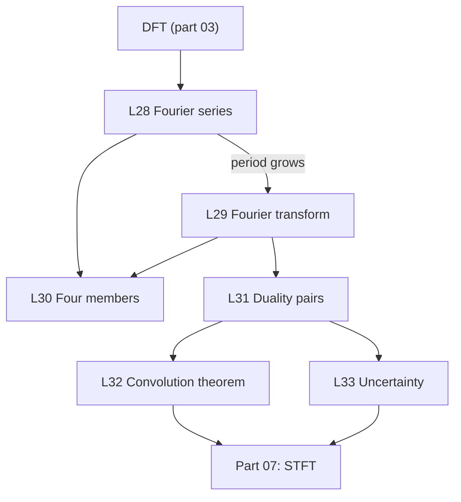

This part goes from discrete to continuous. Each continuous formula is the limit of a DFT-style sum: an integral is a sum of value × $\Delta t$ with a very small $\Delta t$. No course video covers this part, so the lessons use graphs computed in Python.

| Code | Lesson | Core idea | Course video | Status |
|---|---|---|---|---|
| L28 | [Fourier series](/notes/maths/fft-signal-processing/06-fourier-family-and-duality/l28-fourier-series) | A periodic signal is a sum of harmonics. The Gibbs overshoot is about 9% of the jump. | none | not started |
| L29 | [Fourier transform](/notes/maths/fft-signal-processing/06-fourier-family-and-duality/l29-fourier-transform) | The period grows, the harmonics come closer, and the spectrum becomes continuous. | none | not started |
| L30 | [The four members](/notes/maths/fft-signal-processing/06-fourier-family-and-duality/l30-the-four-members) | Discrete in one domain means periodic in the other. | none | not started |
| L31 | [Duality pairs](/notes/maths/fft-signal-processing/06-fourier-family-and-duality/l31-duality-pairs) | Shift ↔ phase rotation. Narrow ↔ wide. Rectangle ↔ sinc. Gaussian ↔ Gaussian. | none | not started |
| L32 | [Convolution theorem](/notes/maths/fft-signal-processing/06-fourier-family-and-duality/l32-convolution-theorem) | Convolution in time = multiplication in frequency | none | not started |
| L33 | [Uncertainty](/notes/maths/fft-signal-processing/06-fourier-family-and-duality/l33-uncertainty) | A 25 ms window gives 40 Hz bin spacing. | none | not started |

## How the lessons connect

1. L28 replaces the sum of the DFT with an integral over one period.
2. L29 lets the period grow without limit.
3. L30 puts the four transforms in one table, with one rule.
4. L31 and L32 give the pairs that predict a spectrum without a new integral.
5. L33 turns "narrow in time, wide in frequency" into a limit, and chooses the frame size for speech.
