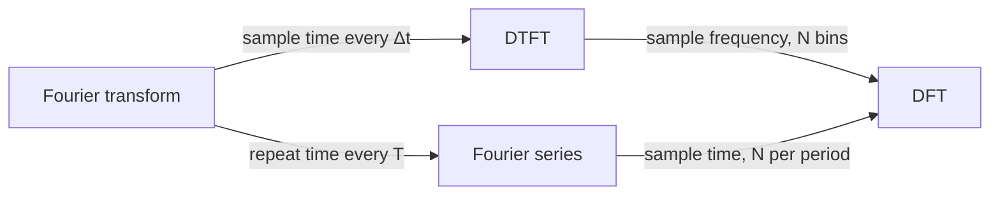

## 1. The question this idea answers

You now have three tools. The DFT (L11) takes a finite list of samples. The Fourier series (L28) takes a continuous signal that repeats. The Fourier transform (L29) takes a continuous signal that happens once. One case is still missing: a list of samples that does not repeat. Its tool is the DTFT.

This lesson puts the four tools side by side. One rule connects all four. The rule also explains two facts from part 05. A sampled spectrum repeats every $f_s$ (L24, L26). The DFT treats its window as one period (L25).

## 2. Mental model

> [!analogy] A strobe light and a loop
> **The strobe light.** A film shows a turning wheel only at its frames. A wheel that turns one frame rate faster looks exactly the same in every frame. Samples do the same thing to a frequency. So a sampled signal has a spectrum that repeats every $f_s$.
>
> **The loop.** A looped bar of music can hold only notes that fit the loop (L28). So a signal that repeats has a spectrum of separate lines.
>
> **Where it stops working:** the two pictures explain which spectra repeat and which spectra are lines. They do not give the scale factors ($\Delta t$, $1/T$, $1/N$). These come only from the formulas.

## 3. Terms

| Term | Plain meaning |
|---|---|
| discrete | Defined only at separate, equally spaced points: samples in time, or bins in frequency. |
| continuous | Defined at every point of the axis. |
| line spectrum | A discrete spectrum: separate values at separate frequencies, as in a Fourier series. |
| DTFT (discrete-time Fourier transform) | The spectrum of a list of samples that does not repeat: $X(f) = \sum_n x[n]\, e^{-i 2\pi f n/f_s}$, for every frequency $f$. |
| geometric sum | $\sum_{n=0}^{M-1} r^n = \frac{1 - r^M}{1 - r}$ for $r \ne 1$. |
| Fourier family | The four transforms: Fourier series, Fourier transform, DTFT and DFT. |
| periodic extension | The infinite repeat of one period. The DFT treats its $N$ samples as one period of a periodic extension. |

## 4. Two questions about a signal

Ask two questions about any signal:

1. **Is time continuous or discrete?** A voltage on a wire is continuous. A list of samples is discrete.
2. **Is the signal periodic or not?** A looped tone repeats. One spoken word does not.

Two questions with two answers give four cases. Each case has one member of the Fourier family.

| | Not periodic in time | Periodic in time |
|---|---|---|
| **Continuous time** | Fourier transform (L29) | Fourier series (L28) |
| **Discrete time** | DTFT (this lesson) | DFT (L11) |


## 5. The missing member: the DTFT

### 5.1 The formula

Take a list of samples $x[n]$ with time step $\Delta t = 1/f_s$. The list does not repeat, and $n$ can run from $-\infty$ to $\infty$. Use the complex probe of the DFT, but allow any frequency $f$, not only the bin frequencies:

$$
X(f) = \sum_{n=-\infty}^{\infty} x[n]\, e^{-i 2\pi f n / f_s}
$$

For a signal with only a few nonzero samples, the sum has only a few terms. So you can compute $X(f)$ at any $f$ you like.

> [!note] Radians per sample
> Many books write the DTFT with $\hat\omega = 2\pi f/f_s$, in radians per sample: $X(\hat\omega) = \sum_n x[n]\, e^{-i\hat\omega n}$. It is the same formula. These notes keep $f$ in hertz.

### 5.2 Why the DTFT repeats every $f_s$

Put $f + f_s$ in place of $f$:

$$
X(f + f_s) = \sum_n x[n]\, e^{-i 2\pi f n/f_s}\, e^{-i 2\pi n} = X(f)
$$

The step uses $e^{-i 2\pi n} = 1$ for every whole number $n$ (F7). So the probes at $f$ and at $f + f_s$ have exactly the same samples. The samples cannot tell them apart. This is aliasing (L26), seen from the frequency side.

### 5.3 The inverse DTFT

One period of $X(f)$ holds all the information. The inverse uses one period:

$$
x[n] = \frac{1}{f_s}\int_{-f_s/2}^{f_s/2} X(f)\, e^{i 2\pi f n/f_s}\, df
$$

The proof uses orthogonality, as in L28, but now over one period of frequency:

1. Put the DTFT sum into the integral. The integral becomes $\sum_m x[m]\, \frac{1}{f_s}\int_{-f_s/2}^{f_s/2} e^{i 2\pi f (n - m)/f_s}\, df$.
2. For $m = n$ the integrand is 1, so the inner part is $\frac{1}{f_s} \cdot f_s = 1$.
3. For $m \ne n$ the integrand makes $n - m$ whole cycles over one period of $f$. Its integral is 0.
4. So only $x[n]$ remains.

A numeric check: the inverse integral of the example below gives 1, 1, 1, 1, 0, 0 for $n$ = 0 to 5.

> [!key] The DTFT is a Fourier series in frequency
> $X(f)$ is periodic in $f$, and the samples $x[n]$ are its Fourier coefficients. The Fourier series has a periodic time signal and line coefficients. The DTFT has the same structure with time and frequency swapped.

## 6. Worked example: four ones

Take $x[n] = 1$ for $n = 0, 1, 2, 3$, and $x[n] = 0$ for all other $n$. Use $f_s$ = 8 Hz.

```plot
{
  "title": "x[n] = 1 for n = 0 to 3, else 0 (blue)",
  "xAxis": {"label": "sample number n", "domain": [-4.5, 8.5]},
  "yAxis": {"label": "x[n]", "domain": [-0.3, 1.4]},
  "disableZoom": true,
  "data": [
    {"points": [[-4, 0], [-3, 0], [-2, 0], [-1, 0], [0, 1], [1, 1], [2, 1], [3, 1], [4, 0], [5, 0], [6, 0], [7, 0], [8, 0]], "fnType": "points", "graphType": "polyline", "color": "#1E6091", "skipTip": true},
    {"points": [[-4, 0], [-3, 0], [-2, 0], [-1, 0], [0, 1], [1, 1], [2, 1], [3, 1], [4, 0], [5, 0], [6, 0], [7, 0], [8, 0]], "fnType": "points", "graphType": "scatter", "attr": {"r": 3}, "color": "#1E6091", "skipTip": true}
  ]
}
```

The DTFT has four terms:

$$
X(f) = 1 + e^{-i 2\pi f/8} + e^{-i 2\pi f \cdot 2/8} + e^{-i 2\pi f \cdot 3/8}
$$

> [!example] One value by hand: f = 1 Hz
> The four probe values are $e^{0} = 1$, $e^{-i\pi/4} = 0.7071 - 0.7071i$, $e^{-i\pi/2} = -i$ and $e^{-i 3\pi/4} = -0.7071 - 0.7071i$.
>
> - Real parts: $1 + 0.7071 + 0 - 0.7071 = 1$.
> - Imaginary parts: $-0.7071 - 1 - 0.7071 = -2.4142$.
>
> So $X(1) = 1 - 2.4142i$, and $\lvert X(1) \rvert = \sqrt{1 + 5.8284} = 2.6131$. This page rounds the decimals, for example $1/\sqrt{2} \approx 0.7071$ (the course writes 0.71).

### 6.1 A closed form

The four terms are a geometric sum with ratio $r = e^{-i\theta}$, where $\theta = 2\pi f/8$.

1. The geometric sum gives $X = \frac{1 - e^{-i 4\theta}}{1 - e^{-i\theta}}$.
2. Write the top with half angles: $1 - e^{-i 4\theta} = e^{-i 2\theta}\left(e^{i 2\theta} - e^{-i 2\theta}\right) = e^{-i 2\theta} \cdot 2i \sin 2\theta$.
3. The same step for the bottom: $1 - e^{-i\theta} = e^{-i\theta/2} \cdot 2i \sin(\theta/2)$.
4. Divide: $X = e^{-i 3\theta/2}\, \frac{\sin 2\theta}{\sin(\theta/2)}$.
5. Use $\theta = \pi f/4$: $\lvert X(f) \rvert = \left\lvert \frac{\sin(\pi f/2)}{\sin(\pi f/8)} \right\rvert$.

| f (Hz) | 0 | 0.5 | 1 | 2 | 3 | 4 | 8 | 9 |
|---|---|---|---|---|---|---|---|---|
| $\lvert X(f) \rvert$ | 4 | 3.6245 | 2.6131 | 0 | 1.0824 | 0 | 4 | 2.6131 |

At $f = 0$ the formula gives 0/0. The limit is 4, the sum of the four ones. The values at 8 Hz and 9 Hz repeat the values at 0 Hz and 1 Hz. The period is $f_s$ = 8 Hz.

```plot
{
  "title": "DTFT magnitude (ink) and 8-point DFT (gold)",
  "xAxis": {"label": "frequency f (Hz)", "domain": [-8, 16]},
  "yAxis": {"label": "magnitude", "domain": [-0.3, 4.5]},
  "disableZoom": true,
  "data": [
    {"points": [[-8, 4], [-7.96, 3.9975], [-7.92, 3.9901], [-7.88, 3.9778], [-7.84, 3.9606], [-7.8, 3.9386], [-7.76, 3.9117], [-7.72, 3.8801], [-7.68, 3.8438], [-7.64, 3.8029], [-7.6, 3.7574], [-7.56, 3.7075], [-7.52, 3.6532], [-7.48, 3.5947], [-7.44, 3.5321], [-7.4, 3.4656], [-7.36, 3.3951], [-7.32, 3.3209], [-7.28, 3.2432], [-7.24, 3.1621], [-7.2, 3.0777], [-7.16, 2.9902], [-7.12, 2.8998], [-7.08, 2.8067], [-7.04, 2.7111], [-7, 2.6131], [-6.96, 2.513], [-6.92, 2.4109], [-6.88, 2.307], [-6.84, 2.2016], [-6.8, 2.0949], [-6.76, 1.987], [-6.72, 1.8782], [-6.68, 1.7687], [-6.64, 1.6587], [-6.6, 1.5484], [-6.56, 1.438], [-6.52, 1.3278], [-6.48, 1.2179], [-6.44, 1.1086], [-6.4, 1], [-6.36, 0.8924], [-6.32, 0.786], [-6.28, 0.681], [-6.24, 0.5775], [-6.2, 0.4758], [-6.16, 0.3761], [-6.12, 0.2784], [-6.08, 0.1831], [-6.04, 0.0902], [-6, 0], [-5.96, 0.0874], [-5.92, 0.1719], [-5.88, 0.2533], [-5.84, 0.3315], [-5.8, 0.4064], [-5.76, 0.4778], [-5.72, 0.5456], [-5.68, 0.6097], [-5.64, 0.67], [-5.6, 0.7265], [-5.56, 0.7791], [-5.52, 0.8277], [-5.48, 0.8722], [-5.44, 0.9126], [-5.4, 0.9488], [-5.36, 0.9809], [-5.32, 1.0088], [-5.28, 1.0325], [-5.24, 1.0521], [-5.2, 1.0674], [-5.16, 1.0786], [-5.12, 1.0856], [-5.08, 1.0886], [-5.04, 1.0875], [-5, 1.0824], [-4.96, 1.0734], [-4.92, 1.0606], [-4.88, 1.044], [-4.84, 1.0238], [-4.8, 1], [-4.76, 0.9728], [-4.72, 0.9422], [-4.68, 0.9085], [-4.64, 0.8717], [-4.6, 0.832], [-4.56, 0.7895], [-4.52, 0.7444], [-4.48, 0.6969], [-4.44, 0.6471], [-4.4, 0.5951], [-4.36, 0.5412], [-4.32, 0.4856], [-4.28, 0.4284], [-4.24, 0.3698], [-4.2, 0.31], [-4.16, 0.2492], [-4.12, 0.1876], [-4.08, 0.1254], [-4.04, 0.0628], [-4, 0], [-3.96, 0.0628], [-3.92, 0.1254], [-3.88, 0.1876], [-3.84, 0.2492], [-3.8, 0.31], [-3.76, 0.3698], [-3.72, 0.4284], [-3.68, 0.4856], [-3.64, 0.5412], [-3.6, 0.5951], [-3.56, 0.6471], [-3.52, 0.6969], [-3.48, 0.7444], [-3.44, 0.7895], [-3.4, 0.832], [-3.36, 0.8717], [-3.32, 0.9085], [-3.28, 0.9422], [-3.24, 0.9728], [-3.2, 1], [-3.16, 1.0238], [-3.12, 1.044], [-3.08, 1.0606], [-3.04, 1.0734], [-3, 1.0824], [-2.96, 1.0875], [-2.92, 1.0886], [-2.88, 1.0856], [-2.84, 1.0786], [-2.8, 1.0674], [-2.76, 1.0521], [-2.72, 1.0325], [-2.68, 1.0088], [-2.64, 0.9809], [-2.6, 0.9488], [-2.56, 0.9126], [-2.52, 0.8722], [-2.48, 0.8277], [-2.44, 0.7791], [-2.4, 0.7265], [-2.36, 0.67], [-2.32, 0.6097], [-2.28, 0.5456], [-2.24, 0.4778], [-2.2, 0.4064], [-2.16, 0.3315], [-2.12, 0.2533], [-2.08, 0.1719], [-2.04, 0.0874], [-2, 0], [-1.96, 0.0902], [-1.92, 0.1831], [-1.88, 0.2784], [-1.84, 0.3761], [-1.8, 0.4758], [-1.76, 0.5775], [-1.72, 0.681], [-1.68, 0.786], [-1.64, 0.8924], [-1.6, 1], [-1.56, 1.1086], [-1.52, 1.2179], [-1.48, 1.3278], [-1.44, 1.438], [-1.4, 1.5484], [-1.36, 1.6587], [-1.32, 1.7687], [-1.28, 1.8782], [-1.24, 1.987], [-1.2, 2.0949], [-1.16, 2.2016], [-1.12, 2.307], [-1.08, 2.4109], [-1.04, 2.513], [-1, 2.6131], [-0.96, 2.7111], [-0.92, 2.8067], [-0.88, 2.8998], [-0.84, 2.9902], [-0.8, 3.0777], [-0.76, 3.1621], [-0.72, 3.2432], [-0.68, 3.3209], [-0.64, 3.3951], [-0.6, 3.4656], [-0.56, 3.5321], [-0.52, 3.5947], [-0.48, 3.6532], [-0.44, 3.7075], [-0.4, 3.7574], [-0.36, 3.8029], [-0.32, 3.8438], [-0.28, 3.8801], [-0.24, 3.9117], [-0.2, 3.9386], [-0.16, 3.9606], [-0.12, 3.9778], [-0.08, 3.9901], [-0.04, 3.9975], [0, 4], [0.04, 3.9975], [0.08, 3.9901], [0.12, 3.9778], [0.16, 3.9606], [0.2, 3.9386], [0.24, 3.9117], [0.28, 3.8801], [0.32, 3.8438], [0.36, 3.8029], [0.4, 3.7574], [0.44, 3.7075], [0.48, 3.6532], [0.52, 3.5947], [0.56, 3.5321], [0.6, 3.4656], [0.64, 3.3951], [0.68, 3.3209], [0.72, 3.2432], [0.76, 3.1621], [0.8, 3.0777], [0.84, 2.9902], [0.88, 2.8998], [0.92, 2.8067], [0.96, 2.7111], [1, 2.6131], [1.04, 2.513], [1.08, 2.4109], [1.12, 2.307], [1.16, 2.2016], [1.2, 2.0949], [1.24, 1.987], [1.28, 1.8782], [1.32, 1.7687], [1.36, 1.6587], [1.4, 1.5484], [1.44, 1.438], [1.48, 1.3278], [1.52, 1.2179], [1.56, 1.1086], [1.6, 1], [1.64, 0.8924], [1.68, 0.786], [1.72, 0.681], [1.76, 0.5775], [1.8, 0.4758], [1.84, 0.3761], [1.88, 0.2784], [1.92, 0.1831], [1.96, 0.0902], [2, 0], [2.04, 0.0874], [2.08, 0.1719], [2.12, 0.2533], [2.16, 0.3315], [2.2, 0.4064], [2.24, 0.4778], [2.28, 0.5456], [2.32, 0.6097], [2.36, 0.67], [2.4, 0.7265], [2.44, 0.7791], [2.48, 0.8277], [2.52, 0.8722], [2.56, 0.9126], [2.6, 0.9488], [2.64, 0.9809], [2.68, 1.0088], [2.72, 1.0325], [2.76, 1.0521], [2.8, 1.0674], [2.84, 1.0786], [2.88, 1.0856], [2.92, 1.0886], [2.96, 1.0875], [3, 1.0824], [3.04, 1.0734], [3.08, 1.0606], [3.12, 1.044], [3.16, 1.0238], [3.2, 1], [3.24, 0.9728], [3.28, 0.9422], [3.32, 0.9085], [3.36, 0.8717], [3.4, 0.832], [3.44, 0.7895], [3.48, 0.7444], [3.52, 0.6969], [3.56, 0.6471], [3.6, 0.5951], [3.64, 0.5412], [3.68, 0.4856], [3.72, 0.4284], [3.76, 0.3698], [3.8, 0.31], [3.84, 0.2492], [3.88, 0.1876], [3.92, 0.1254], [3.96, 0.0628], [4, 0], [4.04, 0.0628], [4.08, 0.1254], [4.12, 0.1876], [4.16, 0.2492], [4.2, 0.31], [4.24, 0.3698], [4.28, 0.4284], [4.32, 0.4856], [4.36, 0.5412], [4.4, 0.5951], [4.44, 0.6471], [4.48, 0.6969], [4.52, 0.7444], [4.56, 0.7895], [4.6, 0.832], [4.64, 0.8717], [4.68, 0.9085], [4.72, 0.9422], [4.76, 0.9728], [4.8, 1], [4.84, 1.0238], [4.88, 1.044], [4.92, 1.0606], [4.96, 1.0734], [5, 1.0824], [5.04, 1.0875], [5.08, 1.0886], [5.12, 1.0856], [5.16, 1.0786], [5.2, 1.0674], [5.24, 1.0521], [5.28, 1.0325], [5.32, 1.0088], [5.36, 0.9809], [5.4, 0.9488], [5.44, 0.9126], [5.48, 0.8722], [5.52, 0.8277], [5.56, 0.7791], [5.6, 0.7265], [5.64, 0.67], [5.68, 0.6097], [5.72, 0.5456], [5.76, 0.4778], [5.8, 0.4064], [5.84, 0.3315], [5.88, 0.2533], [5.92, 0.1719], [5.96, 0.0874], [6, 0], [6.04, 0.0902], [6.08, 0.1831], [6.12, 0.2784], [6.16, 0.3761], [6.2, 0.4758], [6.24, 0.5775], [6.28, 0.681], [6.32, 0.786], [6.36, 0.8924], [6.4, 1], [6.44, 1.1086], [6.48, 1.2179], [6.52, 1.3278], [6.56, 1.438], [6.6, 1.5484], [6.64, 1.6587], [6.68, 1.7687], [6.72, 1.8782], [6.76, 1.987], [6.8, 2.0949], [6.84, 2.2016], [6.88, 2.307], [6.92, 2.4109], [6.96, 2.513], [7, 2.6131], [7.04, 2.7111], [7.08, 2.8067], [7.12, 2.8998], [7.16, 2.9902], [7.2, 3.0777], [7.24, 3.1621], [7.28, 3.2432], [7.32, 3.3209], [7.36, 3.3951], [7.4, 3.4656], [7.44, 3.5321], [7.48, 3.5947], [7.52, 3.6532], [7.56, 3.7075], [7.6, 3.7574], [7.64, 3.8029], [7.68, 3.8438], [7.72, 3.8801], [7.76, 3.9117], [7.8, 3.9386], [7.84, 3.9606], [7.88, 3.9778], [7.92, 3.9901], [7.96, 3.9975], [8, 4], [8.04, 3.9975], [8.08, 3.9901], [8.12, 3.9778], [8.16, 3.9606], [8.2, 3.9386], [8.24, 3.9117], [8.28, 3.8801], [8.32, 3.8438], [8.36, 3.8029], [8.4, 3.7574], [8.44, 3.7075], [8.48, 3.6532], [8.52, 3.5947], [8.56, 3.5321], [8.6, 3.4656], [8.64, 3.3951], [8.68, 3.3209], [8.72, 3.2432], [8.76, 3.1621], [8.8, 3.0777], [8.84, 2.9902], [8.88, 2.8998], [8.92, 2.8067], [8.96, 2.7111], [9, 2.6131], [9.04, 2.513], [9.08, 2.4109], [9.12, 2.307], [9.16, 2.2016], [9.2, 2.0949], [9.24, 1.987], [9.28, 1.8782], [9.32, 1.7687], [9.36, 1.6587], [9.4, 1.5484], [9.44, 1.438], [9.48, 1.3278], [9.52, 1.2179], [9.56, 1.1086], [9.6, 1], [9.64, 0.8924], [9.68, 0.786], [9.72, 0.681], [9.76, 0.5775], [9.8, 0.4758], [9.84, 0.3761], [9.88, 0.2784], [9.92, 0.1831], [9.96, 0.0902], [10, 0], [10.04, 0.0874], [10.08, 0.1719], [10.12, 0.2533], [10.16, 0.3315], [10.2, 0.4064], [10.24, 0.4778], [10.28, 0.5456], [10.32, 0.6097], [10.36, 0.67], [10.4, 0.7265], [10.44, 0.7791], [10.48, 0.8277], [10.52, 0.8722], [10.56, 0.9126], [10.6, 0.9488], [10.64, 0.9809], [10.68, 1.0088], [10.72, 1.0325], [10.76, 1.0521], [10.8, 1.0674], [10.84, 1.0786], [10.88, 1.0856], [10.92, 1.0886], [10.96, 1.0875], [11, 1.0824], [11.04, 1.0734], [11.08, 1.0606], [11.12, 1.044], [11.16, 1.0238], [11.2, 1], [11.24, 0.9728], [11.28, 0.9422], [11.32, 0.9085], [11.36, 0.8717], [11.4, 0.832], [11.44, 0.7895], [11.48, 0.7444], [11.52, 0.6969], [11.56, 0.6471], [11.6, 0.5951], [11.64, 0.5412], [11.68, 0.4856], [11.72, 0.4284], [11.76, 0.3698], [11.8, 0.31], [11.84, 0.2492], [11.88, 0.1876], [11.92, 0.1254], [11.96, 0.0628], [12, 0], [12.04, 0.0628], [12.08, 0.1254], [12.12, 0.1876], [12.16, 0.2492], [12.2, 0.31], [12.24, 0.3698], [12.28, 0.4284], [12.32, 0.4856], [12.36, 0.5412], [12.4, 0.5951], [12.44, 0.6471], [12.48, 0.6969], [12.52, 0.7444], [12.56, 0.7895], [12.6, 0.832], [12.64, 0.8717], [12.68, 0.9085], [12.72, 0.9422], [12.76, 0.9728], [12.8, 1], [12.84, 1.0238], [12.88, 1.044], [12.92, 1.0606], [12.96, 1.0734], [13, 1.0824], [13.04, 1.0875], [13.08, 1.0886], [13.12, 1.0856], [13.16, 1.0786], [13.2, 1.0674], [13.24, 1.0521], [13.28, 1.0325], [13.32, 1.0088], [13.36, 0.9809], [13.4, 0.9488], [13.44, 0.9126], [13.48, 0.8722], [13.52, 0.8277], [13.56, 0.7791], [13.6, 0.7265], [13.64, 0.67], [13.68, 0.6097], [13.72, 0.5456], [13.76, 0.4778], [13.8, 0.4064], [13.84, 0.3315], [13.88, 0.2533], [13.92, 0.1719], [13.96, 0.0874], [14, 0], [14.04, 0.0902], [14.08, 0.1831], [14.12, 0.2784], [14.16, 0.3761], [14.2, 0.4758], [14.24, 0.5775], [14.28, 0.681], [14.32, 0.786], [14.36, 0.8924], [14.4, 1], [14.44, 1.1086], [14.48, 1.2179], [14.52, 1.3278], [14.56, 1.438], [14.6, 1.5484], [14.64, 1.6587], [14.68, 1.7687], [14.72, 1.8782], [14.76, 1.987], [14.8, 2.0949], [14.84, 2.2016], [14.88, 2.307], [14.92, 2.4109], [14.96, 2.513], [15, 2.6131], [15.04, 2.7111], [15.08, 2.8067], [15.12, 2.8998], [15.16, 2.9902], [15.2, 3.0777], [15.24, 3.1621], [15.28, 3.2432], [15.32, 3.3209], [15.36, 3.3951], [15.4, 3.4656], [15.44, 3.5321], [15.48, 3.5947], [15.52, 3.6532], [15.56, 3.7075], [15.6, 3.7574], [15.64, 3.8029], [15.68, 3.8438], [15.72, 3.8801], [15.76, 3.9117], [15.8, 3.9386], [15.84, 3.9606], [15.88, 3.9778], [15.92, 3.9901], [15.96, 3.9975], [16, 4]], "fnType": "points", "graphType": "polyline", "color": "#100D12", "skipTip": true},
    {"points": [[0, 0], [0, 4], [0, 0], [1, 0], [1, 2.6131], [1, 0], [2, 0], [2, 0], [2, 0], [3, 0], [3, 1.0824], [3, 0], [4, 0], [4, 0], [4, 0], [5, 0], [5, 1.0824], [5, 0], [6, 0], [6, 0], [6, 0], [7, 0], [7, 2.6131], [7, 0]], "fnType": "points", "graphType": "polyline", "color": "#B8860B", "skipTip": true},
    {"points": [[0, 4], [1, 2.6131], [2, 0], [3, 1.0824], [4, 0], [5, 1.0824], [6, 0], [7, 2.6131]], "fnType": "points", "graphType": "scatter", "attr": {"r": 3}, "color": "#B8860B", "skipTip": true}
  ]
}
```

## 7. The DFT samples the DTFT

Take a signal that is 0 outside $n = 0 \dots N-1$. Its DTFT has only these $N$ terms. Evaluate it at the bin frequencies $f = k f_s/N$:

$$
X\!\left(\frac{k f_s}{N}\right) = \sum_{n=0}^{N-1} x[n]\, e^{-i 2\pi (k f_s/N)\, n/f_s} = \sum_{n=0}^{N-1} x[n]\, e^{-i 2\pi k n/N} = X[k]
$$

> [!key] The DFT is N samples of the DTFT
> For a signal that lives inside the window, the DFT gives exactly $N$ equally spaced samples of one period of the DTFT, at $f = k f_s/N$.

Check it with the four ones. Add zeros to reach $N$ samples. Python confirms `np.allclose` for $N$ = 4, 8 and 16 (largest difference $6 \times 10^{-15}$).

| N | Bin spacing | $\lvert X[k] \rvert$ |
|---|---|---|
| 4 (no zeros) | 2 Hz | 4, 0, 0, 0 |
| 8 (4 zeros) | 1 Hz | 4, 2.6131, 0, 1.0824, 0, 1.0824, 0, 2.6131 |
| 16 (12 zeros) | 0.5 Hz | 4, 3.6245, 2.6131, 1.2728, 0, 0.8504, 1.0824, 0.7210, 0, … |

The 4-point DFT is a trap. It samples the DTFT at 0, 2, 4 and 6 Hz, and three of these points are zeros. The result $[4, 0, 0, 0]$ is the spectrum of a constant. That is correct for the periodic extension of four ones (section 8), which is a constant. But it hides the shape of the DTFT of the single pulse. The 8-point and 16-point DFTs show more of the same curve.

```plot
{
  "title": "DTFT magnitude (ink) and 16-point DFT (gold)",
  "xAxis": {"label": "frequency f (Hz)", "domain": [-0.2, 8.2]},
  "yAxis": {"label": "magnitude", "domain": [-0.3, 4.5]},
  "disableZoom": true,
  "data": [
    {"points": [[0, 4], [0.01, 3.9998], [0.02, 3.9994], [0.03, 3.9986], [0.04, 3.9975], [0.05, 3.9961], [0.06, 3.9945], [0.07, 3.9924], [0.08, 3.9901], [0.09, 3.9875], [0.1, 3.9846], [0.11, 3.9814], [0.12, 3.9778], [0.13, 3.974], [0.14, 3.9698], [0.15, 3.9654], [0.16, 3.9606], [0.17, 3.9556], [0.18, 3.9502], [0.19, 3.9445], [0.2, 3.9386], [0.21, 3.9323], [0.22, 3.9257], [0.23, 3.9189], [0.24, 3.9117], [0.25, 3.9043], [0.26, 3.8965], [0.27, 3.8884], [0.28, 3.8801], [0.29, 3.8715], [0.3, 3.8625], [0.31, 3.8533], [0.32, 3.8438], [0.33, 3.834], [0.34, 3.8239], [0.35, 3.8135], [0.36, 3.8029], [0.37, 3.7919], [0.38, 3.7807], [0.39, 3.7692], [0.4, 3.7574], [0.41, 3.7453], [0.42, 3.733], [0.43, 3.7204], [0.44, 3.7075], [0.45, 3.6943], [0.46, 3.6809], [0.47, 3.6672], [0.48, 3.6532], [0.49, 3.639], [0.5, 3.6245], [0.51, 3.6098], [0.52, 3.5947], [0.53, 3.5795], [0.54, 3.564], [0.55, 3.5482], [0.56, 3.5321], [0.57, 3.5159], [0.58, 3.4993], [0.59, 3.4826], [0.6, 3.4656], [0.61, 3.4483], [0.62, 3.4308], [0.63, 3.4131], [0.64, 3.3951], [0.65, 3.3769], [0.66, 3.3585], [0.67, 3.3398], [0.68, 3.3209], [0.69, 3.3018], [0.7, 3.2825], [0.71, 3.263], [0.72, 3.2432], [0.73, 3.2232], [0.74, 3.2031], [0.75, 3.1827], [0.76, 3.1621], [0.77, 3.1413], [0.78, 3.1203], [0.79, 3.0991], [0.8, 3.0777], [0.81, 3.0561], [0.82, 3.0343], [0.83, 3.0124], [0.84, 2.9902], [0.85, 2.9679], [0.86, 2.9454], [0.87, 2.9227], [0.88, 2.8998], [0.89, 2.8768], [0.9, 2.8536], [0.91, 2.8303], [0.92, 2.8067], [0.93, 2.7831], [0.94, 2.7592], [0.95, 2.7352], [0.96, 2.7111], [0.97, 2.6868], [0.98, 2.6624], [0.99, 2.6378], [1, 2.6131], [1.01, 2.5883], [1.02, 2.5633], [1.03, 2.5382], [1.04, 2.513], [1.05, 2.4876], [1.06, 2.4622], [1.07, 2.4366], [1.08, 2.4109], [1.09, 2.3851], [1.1, 2.3592], [1.11, 2.3332], [1.12, 2.307], [1.13, 2.2808], [1.14, 2.2545], [1.15, 2.2281], [1.16, 2.2016], [1.17, 2.1751], [1.18, 2.1484], [1.19, 2.1217], [1.2, 2.0949], [1.21, 2.068], [1.22, 2.0411], [1.23, 2.0141], [1.24, 1.987], [1.25, 1.9599], [1.26, 1.9327], [1.27, 1.9055], [1.28, 1.8782], [1.29, 1.8509], [1.3, 1.8235], [1.31, 1.7961], [1.32, 1.7687], [1.33, 1.7412], [1.34, 1.7137], [1.35, 1.6862], [1.36, 1.6587], [1.37, 1.6311], [1.38, 1.6035], [1.39, 1.576], [1.4, 1.5484], [1.41, 1.5208], [1.42, 1.4932], [1.43, 1.4656], [1.44, 1.438], [1.45, 1.4104], [1.46, 1.3828], [1.47, 1.3553], [1.48, 1.3278], [1.49, 1.3002], [1.5, 1.2728], [1.51, 1.2453], [1.52, 1.2179], [1.53, 1.1905], [1.54, 1.1631], [1.55, 1.1358], [1.56, 1.1086], [1.57, 1.0813], [1.58, 1.0542], [1.59, 1.0271], [1.6, 1], [1.61, 0.973], [1.62, 0.9461], [1.63, 0.9192], [1.64, 0.8924], [1.65, 0.8657], [1.66, 0.8391], [1.67, 0.8125], [1.68, 0.786], [1.69, 0.7596], [1.7, 0.7333], [1.71, 0.7071], [1.72, 0.681], [1.73, 0.655], [1.74, 0.629], [1.75, 0.6032], [1.76, 0.5775], [1.77, 0.5519], [1.78, 0.5264], [1.79, 0.5011], [1.8, 0.4758], [1.81, 0.4507], [1.82, 0.4257], [1.83, 0.4008], [1.84, 0.3761], [1.85, 0.3514], [1.86, 0.327], [1.87, 0.3026], [1.88, 0.2784], [1.89, 0.2544], [1.9, 0.2305], [1.91, 0.2067], [1.92, 0.1831], [1.93, 0.1596], [1.94, 0.1363], [1.95, 0.1132], [1.96, 0.0902], [1.97, 0.0674], [1.98, 0.0448], [1.99, 0.0223], [2, 0], [2.01, 0.0221], [2.02, 0.0441], [2.03, 0.0658], [2.04, 0.0874], [2.05, 0.1088], [2.06, 0.1301], [2.07, 0.1511], [2.08, 0.1719], [2.09, 0.1926], [2.1, 0.213], [2.11, 0.2333], [2.12, 0.2533], [2.13, 0.2732], [2.14, 0.2929], [2.15, 0.3123], [2.16, 0.3315], [2.17, 0.3506], [2.18, 0.3694], [2.19, 0.388], [2.2, 0.4064], [2.21, 0.4246], [2.22, 0.4425], [2.23, 0.4603], [2.24, 0.4778], [2.25, 0.4951], [2.26, 0.5121], [2.27, 0.529], [2.28, 0.5456], [2.29, 0.5619], [2.3, 0.5781], [2.31, 0.594], [2.32, 0.6097], [2.33, 0.6251], [2.34, 0.6403], [2.35, 0.6553], [2.36, 0.67], [2.37, 0.6845], [2.38, 0.6988], [2.39, 0.7128], [2.4, 0.7265], [2.41, 0.7401], [2.42, 0.7533], [2.43, 0.7663], [2.44, 0.7791], [2.45, 0.7916], [2.46, 0.8039], [2.47, 0.8159], [2.48, 0.8277], [2.49, 0.8392], [2.5, 0.8504], [2.51, 0.8614], [2.52, 0.8722], [2.53, 0.8827], [2.54, 0.8929], [2.55, 0.9029], [2.56, 0.9126], [2.57, 0.922], [2.58, 0.9312], [2.59, 0.9402], [2.6, 0.9488], [2.61, 0.9573], [2.62, 0.9654], [2.63, 0.9733], [2.64, 0.9809], [2.65, 0.9883], [2.66, 0.9954], [2.67, 1.0023], [2.68, 1.0088], [2.69, 1.0152], [2.7, 1.0212], [2.71, 1.027], [2.72, 1.0325], [2.73, 1.0378], [2.74, 1.0428], [2.75, 1.0476], [2.76, 1.0521], [2.77, 1.0563], [2.78, 1.0603], [2.79, 1.064], [2.8, 1.0674], [2.81, 1.0706], [2.82, 1.0735], [2.83, 1.0762], [2.84, 1.0786], [2.85, 1.0807], [2.86, 1.0826], [2.87, 1.0842], [2.88, 1.0856], [2.89, 1.0867], [2.9, 1.0876], [2.91, 1.0882], [2.92, 1.0886], [2.93, 1.0887], [2.94, 1.0885], [2.95, 1.0881], [2.96, 1.0875], [2.97, 1.0866], [2.98, 1.0854], [2.99, 1.084], [3, 1.0824], [3.01, 1.0805], [3.02, 1.0784], [3.03, 1.076], [3.04, 1.0734], [3.05, 1.0706], [3.06, 1.0675], [3.07, 1.0641], [3.08, 1.0606], [3.09, 1.0568], [3.1, 1.0528], [3.11, 1.0485], [3.12, 1.044], [3.13, 1.0393], [3.14, 1.0343], [3.15, 1.0292], [3.16, 1.0238], [3.17, 1.0182], [3.18, 1.0123], [3.19, 1.0063], [3.2, 1], [3.21, 0.9935], [3.22, 0.9868], [3.23, 0.9799], [3.24, 0.9728], [3.25, 0.9655], [3.26, 0.9579], [3.27, 0.9502], [3.28, 0.9422], [3.29, 0.9341], [3.3, 0.9258], [3.31, 0.9172], [3.32, 0.9085], [3.33, 0.8996], [3.34, 0.8905], [3.35, 0.8812], [3.36, 0.8717], [3.37, 0.8621], [3.38, 0.8522], [3.39, 0.8422], [3.4, 0.832], [3.41, 0.8216], [3.42, 0.8111], [3.43, 0.8004], [3.44, 0.7895], [3.45, 0.7785], [3.46, 0.7673], [3.47, 0.7559], [3.48, 0.7444], [3.49, 0.7328], [3.5, 0.721], [3.51, 0.709], [3.52, 0.6969], [3.53, 0.6846], [3.54, 0.6723], [3.55, 0.6597], [3.56, 0.6471], [3.57, 0.6343], [3.58, 0.6213], [3.59, 0.6083], [3.6, 0.5951], [3.61, 0.5818], [3.62, 0.5684], [3.63, 0.5549], [3.64, 0.5412], [3.65, 0.5275], [3.66, 0.5136], [3.67, 0.4996], [3.68, 0.4856], [3.69, 0.4714], [3.7, 0.4572], [3.71, 0.4428], [3.72, 0.4284], [3.73, 0.4138], [3.74, 0.3992], [3.75, 0.3845], [3.76, 0.3698], [3.77, 0.3549], [3.78, 0.34], [3.79, 0.325], [3.8, 0.31], [3.81, 0.2949], [3.82, 0.2797], [3.83, 0.2645], [3.84, 0.2492], [3.85, 0.2339], [3.86, 0.2185], [3.87, 0.2031], [3.88, 0.1876], [3.89, 0.1721], [3.9, 0.1566], [3.91, 0.141], [3.92, 0.1254], [3.93, 0.1098], [3.94, 0.0941], [3.95, 0.0785], [3.96, 0.0628], [3.97, 0.0471], [3.98, 0.0314], [3.99, 0.0157], [4, 0], [4.01, 0.0157], [4.02, 0.0314], [4.03, 0.0471], [4.04, 0.0628], [4.05, 0.0785], [4.06, 0.0941], [4.07, 0.1098], [4.08, 0.1254], [4.09, 0.141], [4.1, 0.1566], [4.11, 0.1721], [4.12, 0.1876], [4.13, 0.2031], [4.14, 0.2185], [4.15, 0.2339], [4.16, 0.2492], [4.17, 0.2645], [4.18, 0.2797], [4.19, 0.2949], [4.2, 0.31], [4.21, 0.325], [4.22, 0.34], [4.23, 0.3549], [4.24, 0.3698], [4.25, 0.3845], [4.26, 0.3992], [4.27, 0.4138], [4.28, 0.4284], [4.29, 0.4428], [4.3, 0.4572], [4.31, 0.4714], [4.32, 0.4856], [4.33, 0.4996], [4.34, 0.5136], [4.35, 0.5275], [4.36, 0.5412], [4.37, 0.5549], [4.38, 0.5684], [4.39, 0.5818], [4.4, 0.5951], [4.41, 0.6083], [4.42, 0.6213], [4.43, 0.6343], [4.44, 0.6471], [4.45, 0.6597], [4.46, 0.6723], [4.47, 0.6846], [4.48, 0.6969], [4.49, 0.709], [4.5, 0.721], [4.51, 0.7328], [4.52, 0.7444], [4.53, 0.7559], [4.54, 0.7673], [4.55, 0.7785], [4.56, 0.7895], [4.57, 0.8004], [4.58, 0.8111], [4.59, 0.8216], [4.6, 0.832], [4.61, 0.8422], [4.62, 0.8522], [4.63, 0.8621], [4.64, 0.8717], [4.65, 0.8812], [4.66, 0.8905], [4.67, 0.8996], [4.68, 0.9085], [4.69, 0.9172], [4.7, 0.9258], [4.71, 0.9341], [4.72, 0.9422], [4.73, 0.9502], [4.74, 0.9579], [4.75, 0.9655], [4.76, 0.9728], [4.77, 0.9799], [4.78, 0.9868], [4.79, 0.9935], [4.8, 1], [4.81, 1.0063], [4.82, 1.0123], [4.83, 1.0182], [4.84, 1.0238], [4.85, 1.0292], [4.86, 1.0343], [4.87, 1.0393], [4.88, 1.044], [4.89, 1.0485], [4.9, 1.0528], [4.91, 1.0568], [4.92, 1.0606], [4.93, 1.0641], [4.94, 1.0675], [4.95, 1.0706], [4.96, 1.0734], [4.97, 1.076], [4.98, 1.0784], [4.99, 1.0805], [5, 1.0824], [5.01, 1.084], [5.02, 1.0854], [5.03, 1.0866], [5.04, 1.0875], [5.05, 1.0881], [5.06, 1.0885], [5.07, 1.0887], [5.08, 1.0886], [5.09, 1.0882], [5.1, 1.0876], [5.11, 1.0867], [5.12, 1.0856], [5.13, 1.0842], [5.14, 1.0826], [5.15, 1.0807], [5.16, 1.0786], [5.17, 1.0762], [5.18, 1.0735], [5.19, 1.0706], [5.2, 1.0674], [5.21, 1.064], [5.22, 1.0603], [5.23, 1.0563], [5.24, 1.0521], [5.25, 1.0476], [5.26, 1.0428], [5.27, 1.0378], [5.28, 1.0325], [5.29, 1.027], [5.3, 1.0212], [5.31, 1.0152], [5.32, 1.0088], [5.33, 1.0023], [5.34, 0.9954], [5.35, 0.9883], [5.36, 0.9809], [5.37, 0.9733], [5.38, 0.9654], [5.39, 0.9573], [5.4, 0.9488], [5.41, 0.9402], [5.42, 0.9312], [5.43, 0.922], [5.44, 0.9126], [5.45, 0.9029], [5.46, 0.8929], [5.47, 0.8827], [5.48, 0.8722], [5.49, 0.8614], [5.5, 0.8504], [5.51, 0.8392], [5.52, 0.8277], [5.53, 0.8159], [5.54, 0.8039], [5.55, 0.7916], [5.56, 0.7791], [5.57, 0.7663], [5.58, 0.7533], [5.59, 0.7401], [5.6, 0.7265], [5.61, 0.7128], [5.62, 0.6988], [5.63, 0.6845], [5.64, 0.67], [5.65, 0.6553], [5.66, 0.6403], [5.67, 0.6251], [5.68, 0.6097], [5.69, 0.594], [5.7, 0.5781], [5.71, 0.5619], [5.72, 0.5456], [5.73, 0.529], [5.74, 0.5121], [5.75, 0.4951], [5.76, 0.4778], [5.77, 0.4603], [5.78, 0.4425], [5.79, 0.4246], [5.8, 0.4064], [5.81, 0.388], [5.82, 0.3694], [5.83, 0.3506], [5.84, 0.3315], [5.85, 0.3123], [5.86, 0.2929], [5.87, 0.2732], [5.88, 0.2533], [5.89, 0.2333], [5.9, 0.213], [5.91, 0.1926], [5.92, 0.1719], [5.93, 0.1511], [5.94, 0.1301], [5.95, 0.1088], [5.96, 0.0874], [5.97, 0.0658], [5.98, 0.0441], [5.99, 0.0221], [6, 0], [6.01, 0.0223], [6.02, 0.0448], [6.03, 0.0674], [6.04, 0.0902], [6.05, 0.1132], [6.06, 0.1363], [6.07, 0.1596], [6.08, 0.1831], [6.09, 0.2067], [6.1, 0.2305], [6.11, 0.2544], [6.12, 0.2784], [6.13, 0.3026], [6.14, 0.327], [6.15, 0.3514], [6.16, 0.3761], [6.17, 0.4008], [6.18, 0.4257], [6.19, 0.4507], [6.2, 0.4758], [6.21, 0.5011], [6.22, 0.5264], [6.23, 0.5519], [6.24, 0.5775], [6.25, 0.6032], [6.26, 0.629], [6.27, 0.655], [6.28, 0.681], [6.29, 0.7071], [6.3, 0.7333], [6.31, 0.7596], [6.32, 0.786], [6.33, 0.8125], [6.34, 0.8391], [6.35, 0.8657], [6.36, 0.8924], [6.37, 0.9192], [6.38, 0.9461], [6.39, 0.973], [6.4, 1], [6.41, 1.0271], [6.42, 1.0542], [6.43, 1.0813], [6.44, 1.1086], [6.45, 1.1358], [6.46, 1.1631], [6.47, 1.1905], [6.48, 1.2179], [6.49, 1.2453], [6.5, 1.2728], [6.51, 1.3002], [6.52, 1.3278], [6.53, 1.3553], [6.54, 1.3828], [6.55, 1.4104], [6.56, 1.438], [6.57, 1.4656], [6.58, 1.4932], [6.59, 1.5208], [6.6, 1.5484], [6.61, 1.576], [6.62, 1.6035], [6.63, 1.6311], [6.64, 1.6587], [6.65, 1.6862], [6.66, 1.7137], [6.67, 1.7412], [6.68, 1.7687], [6.69, 1.7961], [6.7, 1.8235], [6.71, 1.8509], [6.72, 1.8782], [6.73, 1.9055], [6.74, 1.9327], [6.75, 1.9599], [6.76, 1.987], [6.77, 2.0141], [6.78, 2.0411], [6.79, 2.068], [6.8, 2.0949], [6.81, 2.1217], [6.82, 2.1484], [6.83, 2.1751], [6.84, 2.2016], [6.85, 2.2281], [6.86, 2.2545], [6.87, 2.2808], [6.88, 2.307], [6.89, 2.3332], [6.9, 2.3592], [6.91, 2.3851], [6.92, 2.4109], [6.93, 2.4366], [6.94, 2.4622], [6.95, 2.4876], [6.96, 2.513], [6.97, 2.5382], [6.98, 2.5633], [6.99, 2.5883], [7, 2.6131], [7.01, 2.6378], [7.02, 2.6624], [7.03, 2.6868], [7.04, 2.7111], [7.05, 2.7352], [7.06, 2.7592], [7.07, 2.7831], [7.08, 2.8067], [7.09, 2.8303], [7.1, 2.8536], [7.11, 2.8768], [7.12, 2.8998], [7.13, 2.9227], [7.14, 2.9454], [7.15, 2.9679], [7.16, 2.9902], [7.17, 3.0124], [7.18, 3.0343], [7.19, 3.0561], [7.2, 3.0777], [7.21, 3.0991], [7.22, 3.1203], [7.23, 3.1413], [7.24, 3.1621], [7.25, 3.1827], [7.26, 3.2031], [7.27, 3.2232], [7.28, 3.2432], [7.29, 3.263], [7.3, 3.2825], [7.31, 3.3018], [7.32, 3.3209], [7.33, 3.3398], [7.34, 3.3585], [7.35, 3.3769], [7.36, 3.3951], [7.37, 3.4131], [7.38, 3.4308], [7.39, 3.4483], [7.4, 3.4656], [7.41, 3.4826], [7.42, 3.4993], [7.43, 3.5159], [7.44, 3.5321], [7.45, 3.5482], [7.46, 3.564], [7.47, 3.5795], [7.48, 3.5947], [7.49, 3.6098], [7.5, 3.6245], [7.51, 3.639], [7.52, 3.6532], [7.53, 3.6672], [7.54, 3.6809], [7.55, 3.6943], [7.56, 3.7075], [7.57, 3.7204], [7.58, 3.733], [7.59, 3.7453], [7.6, 3.7574], [7.61, 3.7692], [7.62, 3.7807], [7.63, 3.7919], [7.64, 3.8029], [7.65, 3.8135], [7.66, 3.8239], [7.67, 3.834], [7.68, 3.8438], [7.69, 3.8533], [7.7, 3.8625], [7.71, 3.8715], [7.72, 3.8801], [7.73, 3.8884], [7.74, 3.8965], [7.75, 3.9043], [7.76, 3.9117], [7.77, 3.9189], [7.78, 3.9257], [7.79, 3.9323], [7.8, 3.9386], [7.81, 3.9445], [7.82, 3.9502], [7.83, 3.9556], [7.84, 3.9606], [7.85, 3.9654], [7.86, 3.9698], [7.87, 3.974], [7.88, 3.9778], [7.89, 3.9814], [7.9, 3.9846], [7.91, 3.9875], [7.92, 3.9901], [7.93, 3.9924], [7.94, 3.9945], [7.95, 3.9961], [7.96, 3.9975], [7.97, 3.9986], [7.98, 3.9994], [7.99, 3.9998], [8, 4]], "fnType": "points", "graphType": "polyline", "color": "#100D12", "skipTip": true},
    {"points": [[0, 0], [0, 4], [0, 0], [0.5, 0], [0.5, 3.6245], [0.5, 0], [1, 0], [1, 2.6131], [1, 0], [1.5, 0], [1.5, 1.2728], [1.5, 0], [2, 0], [2, 0], [2, 0], [2.5, 0], [2.5, 0.8504], [2.5, 0], [3, 0], [3, 1.0824], [3, 0], [3.5, 0], [3.5, 0.721], [3.5, 0], [4, 0], [4, 0], [4, 0], [4.5, 0], [4.5, 0.721], [4.5, 0], [5, 0], [5, 1.0824], [5, 0], [5.5, 0], [5.5, 0.8504], [5.5, 0], [6, 0], [6, 0], [6, 0], [6.5, 0], [6.5, 1.2728], [6.5, 0], [7, 0], [7, 2.6131], [7, 0], [7.5, 0], [7.5, 3.6245], [7.5, 0]], "fnType": "points", "graphType": "polyline", "color": "#B8860B", "skipTip": true},
    {"points": [[0, 4], [0.5, 3.6245], [1, 2.6131], [1.5, 1.2728], [2, 0], [2.5, 0.8504], [3, 1.0824], [3.5, 0.721], [4, 0], [4.5, 0.721], [5, 1.0824], [5.5, 0.8504], [6, 0], [6.5, 1.2728], [7, 2.6131], [7.5, 3.6245]], "fnType": "points", "graphType": "scatter", "attr": {"r": 3}, "color": "#B8860B", "skipTip": true}
  ]
}
```

> [!trap] More zeros do not give more detail
> Zero padding gives more samples of the same DTFT. It does not change the DTFT. Two close peaks that merge in the DTFT stay merged with any amount of zero padding (L25, L33).

## 8. Why the DFT is periodic in both domains

The DFT is discrete in time and discrete in frequency. So by the rule, it is periodic in both.

**Periodic in frequency.** Bin $k + N$ uses the probe $e^{-i 2\pi (k + N) n/N} = e^{-i 2\pi k n/N}\, e^{-i 2\pi n}$. The last factor is 1. So $X[k + N] = X[k]$. For the four ones with $N = 8$: $X[1] = X[9] = X[-7] = 1 - 2.4142i$.

**Periodic in time.** The inverse DFT $x[n] = \frac{1}{N}\sum_k X[k]\, e^{i 2\pi k n/N}$ has the same factor. So the inverse gives $x[n + N] = x[n]$. In Python, the inverse formula at $n = 8$ gives 1, the value of $x[0]$.

So the DFT treats its $N$ samples as one period of a periodic extension. This is the reason for leakage (L25). If the end of the window does not join its start smoothly, the periodic extension has a kink.

## 9. The rule and the table

> [!key] The rule of the family
> Discrete in one domain ↔ periodic in the other domain. Continuous in one domain ↔ not periodic in the other domain.

The reasons, in both directions:

1. **Periodic in time → discrete in frequency.** Only harmonics fit a period (L28).
2. **Discrete in time → periodic in frequency.** Probes $f_s$ apart have the same samples (section 5.2).
3. **The other two directions** follow from the same formulas, with time and frequency swapped. The inverse of a line spectrum is a sum of harmonics, so it repeats. The inverse DTFT gives values only at whole $n$.

| Member | Time | Frequency | Forward | Inverse |
|---|---|---|---|---|
| Fourier series | continuous, periodic with $T$ | discrete ($1/T$ apart), not periodic | $c_k = \frac{1}{T}\int_0^T x(t)\, e^{-i 2\pi k t/T}\, dt$ | $x(t) = \sum_k c_k\, e^{i 2\pi k t/T}$ |
| Fourier transform | continuous, not periodic | continuous, not periodic | $X(f) = \int x(t)\, e^{-i 2\pi f t}\, dt$ | $x(t) = \int X(f)\, e^{i 2\pi f t}\, df$ |
| DTFT | discrete ($\Delta t$ apart), not periodic | continuous, periodic with $f_s$ | $X(f) = \sum_n x[n]\, e^{-i 2\pi f n/f_s}$ | $x[n] = \frac{1}{f_s}\int_{-f_s/2}^{f_s/2} X(f)\, e^{i 2\pi f n/f_s}\, df$ |
| DFT | discrete, periodic with $N$ samples | discrete, periodic with $N$ bins | $X[k] = \sum_{n=0}^{N-1} x[n]\, e^{-i 2\pi k n/N}$ | $x[n] = \frac{1}{N}\sum_{k=0}^{N-1} X[k]\, e^{i 2\pi k n/N}$ |

Only the DFT has a finite list on both sides. So it is the only member that a computer can compute completely and exactly (with the FFT). A computer can evaluate a DTFT at any frequency you choose, but not on the whole continuous axis. It reaches the other members through approximations: a fine time step, a long span, or zero padding.

## 10. The bridges between the members



Each arrow makes one domain discrete. The rule then makes the other domain periodic:

1. **Repeat in time** (FT → FS): the spectrum keeps only the values at $k/T$. L29 showed $T c_k = X(k/T)$.
2. **Sample in time** (FT → DTFT): the spectrum repeats every $f_s$. The copies add.
3. **Sample in frequency** (DTFT → DFT): section 7 of this lesson.
4. **Sample one period** (FS → DFT): L28 showed $X[k] = N \sum_m c_{k + mN}$.

### 10.1 Sampling in time adds copies of the spectrum

For a continuous $x(t)$ with transform $X(f)$, and samples $x[n] = x(n\Delta t)$:

$$
\Delta t \sum_n x(n\Delta t)\, e^{-i 2\pi f n \Delta t} = \sum_m X(f - m f_s)
$$

The left side is $\Delta t$ times the DTFT of the samples. The right side is the original spectrum plus copies, $f_s$ apart. Where copies overlap, they add. This overlap is aliasing.

The proof joins L28 and L29:

1. The right side $P(f) = \sum_m X(f - m f_s)$ is periodic in $f$ with period $f_s$. So it has a Fourier series in $f$: $P(f) = \sum_n d_n\, e^{-i 2\pi f n/f_s}$.
2. The coefficient formula of L28, with period $f_s$, gives $d_n = \frac{1}{f_s}\int_0^{f_s} P(f)\, e^{i 2\pi f n/f_s}\, df$.
3. Move each copy to its original place on the axis. The probe $e^{i 2\pi f n/f_s}$ does not change, because a shift by $m f_s$ multiplies it by $e^{i 2\pi m n} = 1$. The copies then cover the whole axis once. So $d_n = \frac{1}{f_s}\int_{-\infty}^{\infty} X(f)\, e^{i 2\pi f n \Delta t}\, df$.
4. This is the inverse Fourier transform (L29) at $t = n\Delta t$, times $1/f_s = \Delta t$. So $d_n = \Delta t\, x(n\Delta t)$.

> [!example] A Gaussian sampled at 2 Hz
> Take $x(t) = e^{-\pi t^2}$ with $X(f) = e^{-\pi f^2}$ (L29). Sample it with $\Delta t$ = 0.5 s, so $f_s$ = 2 Hz.
>
> | f (Hz) | $\Delta t$ × DTFT of the samples | Sum of copies | One copy only |
> |---|---|---|---|
> | 0 | 1.000007 | 1.000007 | 1 |
> | 0.5 | 0.456790 | 0.456790 | 0.455938 |
> | 1.0 | 0.086428 | 0.086428 | 0.043214 |
> | 2.0 | 1.000007 | 1.000007 | 0.000003 |
>
> At 1 Hz = $f_s/2$, two copies meet. Each adds 0.043214, so the sum is twice one copy. At 2 Hz the next copy has its peak.

```plot
{
  "title": "exp(−πf²) (ink) and Δt·DTFT at fs = 2 Hz (gold)",
  "xAxis": {"label": "frequency f (Hz)", "domain": [-3, 3]},
  "yAxis": {"label": "value", "domain": [-0.1, 1.2]},
  "disableZoom": true,
  "data": [
    {"fn": "exp(-3.1416*x^2)", "color": "#100D12"},
    {"fn": "exp(-3.1416*x^2)+exp(-3.1416*(x-2)^2)+exp(-3.1416*(x+2)^2)+exp(-3.1416*(x-4)^2)+exp(-3.1416*(x+4)^2)", "color": "#B8860B"}
  ]
}
```

## 11. Code

Build these functions in a lab.

1. `dtft(x, f, fs)`: return $X(f)$ for an array of frequencies `f`, for samples `x[0..N-1]` (zero outside).
2. A plot of $\lvert X(f) \rvert$ for the four ones from −8 Hz to 16 Hz, with the 8-point DFT as dots.

Acceptance tests:

- `np.allclose(dtft(x, k * fs / N, fs), np.fft.fft(x))` is True for 5 random inputs `x` with `N = 16`.
- `np.allclose(dtft(x, f + fs, fs), dtft(x, f, fs))` is True for 100 random frequencies `f`.
- For `x = [1, 1, 1, 1]` and `fs = 8`, `abs(dtft(x, [1.0], 8))` is close to 2.6131.
- The 32-point DFT of `x` padded with 28 zeros equals `dtft` at `f = k * 8 / 32`.

```check
{
  "question": "Hint for `dtft`: how do you compute the sum for many frequencies at once, without a loop over f?",
  "hint": "Build a matrix with one row for each frequency and one column for each sample.",
  "answer": "Make `n = np.arange(len(x))`. Build the matrix of probe values $e^{-i 2\\pi f n/f_s}$ with `np.outer(f, n)`. Multiply the matrix by the vector `x`. Each row gives one $X(f)$."
}
```

[Open a lab for this lesson](/labs/new?note=maths/fft-signal-processing/06-fourier-family-and-duality/l30-the-four-members)

## 12. Common mistakes

1. **The DFT is the whole spectrum.** The DFT gives only $N$ samples of the DTFT. Between the bins the DTFT can have peaks and zeros that the DFT does not show.
2. **Zero padding adds information.** It gives more samples of the same DTFT. It does not separate merged peaks.
3. **A sampled spectrum that ends at $f_s/2$.** The DTFT repeats forever. One period, from $-f_s/2$ to $f_s/2$, holds all the information.
4. **"The DFT assumes that the signal repeats."** The DFT treats its $N$ samples as one period. The real signal need not repeat. Leakage is the price of this treatment.
5. **Mixed scale factors.** The Fourier series has $1/T$, the inverse DTFT has $1/f_s$, and the inverse DFT has $1/N$. Compare members only with the bridge formulas.

## 13. One-minute explanation

The Fourier family has four members. I pick one with two questions: is time continuous or discrete, and is the signal periodic or not? A continuous, periodic signal gets a Fourier series. A continuous, one-time signal gets a Fourier transform. A sampled, one-time signal gets a DTFT. A finite list of samples gets a DFT. One rule connects them: discrete in one domain means periodic in the other. Samples make the spectrum repeat every $f_s$, which is aliasing. A repeat in time makes the spectrum a set of lines. The DFT is discrete on both sides, so it is periodic on both sides. It is $N$ samples of the DTFT, and it is the only member that a computer can compute completely and exactly.

## 14. Check questions

```check
{
  "question": "Name the family member for each case. (a) A 3-second recording at 16 kHz, analyzed as one block of samples with `np.fft.fft`. (b) The exact spectrum of a 1 ms click, before sampling. (c) A continuous tone that repeats every 5 ms.",
  "hint": "Ask the two questions: continuous or discrete? Periodic or not?",
  "answer": "(a) DFT: a finite list of samples. (b) Fourier transform: continuous time, not periodic. (c) Fourier series: continuous time, periodic with T = 5 ms, so its spectrum has lines at multiples of 200 Hz."
}
```

```check
{
  "question": "x = [1, 1] with $f_s$ = 8 Hz. Compute the DTFT at f = 2 Hz, 4 Hz and 10 Hz.",
  "hint": "$X(f) = 1 + e^{-i 2\\pi f/8}$. Use the periodicity for 10 Hz.",
  "answer": "At 2 Hz: $1 + e^{-i\\pi/2} = 1 - i$, so $\\lvert X \\rvert = \\sqrt{2} \\approx 1.41$. At 4 Hz: $1 + e^{-i\\pi} = 1 - 1 = 0$. At 10 Hz: $10 = 2 + 8$, and the DTFT repeats every 8 Hz, so $X(10) = 1 - i$. Direct check: $e^{-i 2\\pi \\cdot 10/8} = e^{-i 5\\pi/2} = e^{-i\\pi/2} = -i$."
}
```

```check
{
  "question": "Why does the DTFT repeat every $f_s$, but the Fourier transform of the continuous signal does not repeat?",
  "hint": "Compare the probe values at f and at f + $f_s$, first at the sample times, then at all times.",
  "answer": "At the sample times $t = n/f_s$, the probes at $f$ and $f + f_s$ differ by the factor $e^{-i 2\\pi n} = 1$. So the samples cannot tell the two frequencies apart, and the DTFT gives the same value. Between the samples the two probes differ. The continuous transform uses all times, so it can tell them apart, and it does not repeat."
}
```

```check
{
  "question": "A signal has 6 nonzero samples. You compute its 6-point DFT and its 48-point DFT (with 42 zeros). How are the two results related?",
  "hint": "Both are samples of one DTFT. Which frequencies does each one use?",
  "answer": "Both are exact samples of the same DTFT. The 6-point DFT samples it at $k f_s/6$. The 48-point DFT samples it at $k f_s/48$. These points include the 6 old points: bin $k$ of the 6-point DFT equals bin $8k$ of the 48-point DFT. The 48-point DFT shows the shape between the old points. It does not add resolution."
}
```

```check
{
  "question": "A continuous signal with period T = 10 ms is sampled at 1 kHz. You take one period of samples. How many samples is that, which bins can hold harmonics, and how do you get the Fourier series coefficients?",
  "hint": "Count the samples in one period. Use the bridge FS → DFT from L28.",
  "answer": "One period holds $0.010 \\times 1000 = 10$ samples. The bin spacing is $f_s/N = 100$ Hz = $1/T$, so bin $k$ is harmonic $k$. If the signal has no harmonics at or above $N/2 = 5$ (500 Hz), then $c_k = X[k]/10$ for $k = 0 \\dots 4$, and $c_{-k} = X[10 - k]/10$. Higher harmonics would fold onto these bins."
}
```

## 15. Links

- Previous lesson: [L29: The Fourier transform](/notes/maths/fft-signal-processing/06-fourier-family-and-duality/l29-fourier-transform)
- Next lesson: [L31: Duality pairs](/notes/maths/fft-signal-processing/06-fourier-family-and-duality/l31-duality-pairs)
- Part folder: [06 Fourier family and duality](/notes/maths/fft-signal-processing/06-fourier-family-and-duality)
- Fourier series: [L28](/notes/maths/fft-signal-processing/06-fourier-family-and-duality/l28-fourier-series)
- The DFT: [L11](/notes/maths/fft-signal-processing/03-matching-to-dft/l11-the-dft-formula)
- Roots of unity: [F7](/notes/maths/fft-signal-processing/01-math-foundations/f7-roots-of-unity)
- The mirror: [L24](/notes/maths/fft-signal-processing/05-reading-spectra/l24-the-mirror)
- Leakage and zero padding: [L25](/notes/maths/fft-signal-processing/05-reading-spectra/l25-leakage-and-windows)
- Aliasing: [L26](/notes/maths/fft-signal-processing/05-reading-spectra/l26-aliasing)
- [Glossary](/notes/maths/fft-signal-processing/glossary)
