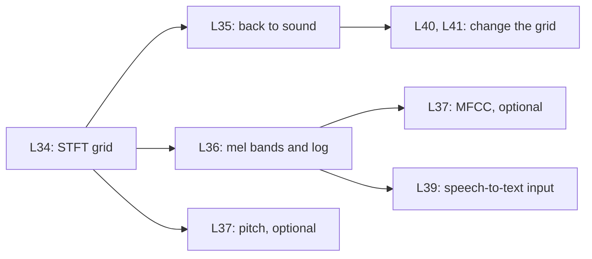

This part turns the FFT into the speech front end. It cuts a signal into short frames, runs one FFT for each frame, and rebuilds the sound with overlap-add. Then it groups the bins into mel bands and takes a log: the input that Whisper reads. The standard settings are 16 kHz, a 400-sample window (25 ms) and a 160-sample hop (10 ms).

| Code | Lesson | Core idea | Course video | Status |
|---|---|---|---|---|
| L34 | [The STFT and the spectrogram](/notes/maths/fft-signal-processing/07-speech-time-frequency/l34-stft-and-spectrogram) | Frames, window, hop. One FFT for each frame. | none | not started |
| L35 | [The inverse STFT](/notes/maths/fft-signal-processing/07-speech-time-frequency/l35-inverse-stft) | Overlap-add | none | not started |
| L36 | [Mel and log-mel](/notes/maths/fft-signal-processing/07-speech-time-frequency/l36-mel-and-log-mel) | Triangle filters on a perceptual scale, then a log | none | not started |
| L37 | [MFCC and pitch](/notes/maths/fft-signal-processing/07-speech-time-frequency/l37-mfcc-and-pitch) | Optional | none | not started |

## How the lessons connect

L34 makes the grid. L35 shows that the grid loses nothing, and why a changed grid does not return exactly. L36 makes the log-mel features from the grid. L37 is optional: it compresses the log-mel values with a DCT, and it finds the pitch.
