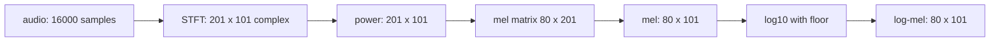

## 1. The question this idea answers

The spectrogram of [L34](/notes/maths/fft-signal-processing/07-speech-time-frequency/l34-stft-and-spectrogram) has 201 rows, 40 Hz apart, for every 10 ms. Two facts make this grid a poor input for a speech model:

1. **The ear does not hear hertz evenly.** A step from 200 Hz to 240 Hz is a large change in pitch: 3.16 semitones. A step from 6000 Hz to 6040 Hz is only 0.12 semitones. Yet both steps are one bin.
2. **Power covers a huge range.** In the chirp frame of L34, the peak bin has more than $10^{13}$ times the power of the weakest bins.

The answer is the log-mel spectrogram. It adds the power of neighbor bins into a few bands, narrow at low frequencies and wide at high frequencies. Then it takes a log. Whisper reads this input: 80 bands for every 10 ms frame (`whisper/audio.py` also supports 128 bands).

The previous lesson, [L35](/notes/maths/fft-signal-processing/07-speech-time-frequency/l35-inverse-stft), went from the grid to sound. This lesson goes the other way: from the grid to features.

## 2. Mental model

> [!analogy] A piano keyboard
> On a piano, the keys are equally spaced, but each step of 12 keys doubles the frequency. So the high keys cover many more hertz than the low keys. A mel filterbank works in the same way. It uses equal steps on a pitch scale, so its bands get wider in hertz as the frequency rises.
>
> **Where it stops working:** a piano is logarithmic at all frequencies. The mel scale is close to linear below 1000 Hz and close to logarithmic above it. Also, piano keys do not overlap. Each mel filter is a triangle that overlaps half of each neighbor.

## 3. Terms

| Term | Plain meaning |
|---|---|
| semitone | One step on a piano. 12 semitones double the frequency: $12 \log_2(f_2/f_1)$ semitones from $f_1$ to $f_2$. |
| mel scale | A scale of pitch from listening tests. Equal steps in mel sound like about equal steps in pitch. |
| HTK mel formula | $m = 2595 \log_{10}(1 + f/700)$. It gives about 1000 mel at 1000 Hz. |
| Slaney mel formula | Linear below 1000 Hz (3 mel per 200 Hz), logarithmic above. It gives 15 mel at 1000 Hz. librosa uses it by default. |
| filterbank | A set of filters. Each filter gives one number from one spectrum. |
| triangle filter | A weight curve that rises in a straight line from 0 to 1, then falls to 0. |
| edge points | The frequencies where the triangles start, peak and stop. $n_{\text{mels}} + 2$ points for $n_{\text{mels}}$ filters. |
| Slaney normalization | A factor $2/(\text{width in Hz})$ on each triangle, so that every triangle has area 1. |
| mel spectrogram | The filterbank applied to every frame of a power spectrogram. Shape $n_{\text{mels}} \times T$. |
| log-mel spectrogram | The log of the mel spectrogram, with a floor. The usual input of speech models. |

## 4. Why a perceptual scale

Musical pitch works in ratios. One octave is a doubling of frequency: 100 Hz to 200 Hz, and 1000 Hz to 2000 Hz, are both one octave. One octave is 12 semitones. The number of semitones from $f_1$ to $f_2$ is

$$
12 \log_2\!\left(\frac{f_2}{f_1}\right)
$$

> [!example] The same 40 Hz step at two places
> - From 200 Hz to 240 Hz: $12 \log_2(240/200) = 12 \log_2(1.2) = 12 \times 0.2630 = 3.16$ semitones.
> - From 6000 Hz to 6040 Hz: $12 \log_2(6040/6000) = 12 \times 0.00959 = 0.12$ semitones (rounded to two decimals).
>
> One bin is a large pitch step at 200 Hz and a tiny one at 6000 Hz.

The mel scale comes from listening tests (Stevens, Volkmann and Newman, 1937). Listeners judged pitch distances, and the results gave a scale that is close to linear at low frequencies and close to logarithmic at high frequencies. A filterbank with equal steps on this scale gives more bands to low frequencies and fewer bands to high frequencies.

## 5. Two mel formulas

### 5.1 The HTK formula

$$
m_{\text{HTK}}(f) = 2595 \log_{10}\!\left(1 + \frac{f}{700}\right)
$$

$f$ is in hertz, and $m$ is in mel. Near 0 Hz the curve is almost a straight line with a slope of $2595/(700 \ln 10) = 1.61$ mel per hertz. At high frequencies, $1 + f/700$ is close to $f/700$, so the curve is close to a log.

### 5.2 The Slaney formula

$$
m_{\text{Slaney}}(f) =
\begin{cases}
\dfrac{3f}{200} & f < 1000 \text{ Hz} \\[2ex]
15 + \dfrac{27}{\ln 6.4} \ln\!\left(\dfrac{f}{1000}\right) & f \ge 1000 \text{ Hz}
\end{cases}
$$

Below 1000 Hz it is exactly linear: 3 mel for each 200 Hz, so 1000 Hz gives 15 mel. Above 1000 Hz it is exactly logarithmic. The factor $27/\ln 6.4 = 14.5451$. Each doubling of frequency adds $14.5451 \times \ln 2 = 10.08$ mel.

### 5.3 Worked numbers

| $f$ (Hz) | HTK: $1 + f/700$ | $\log_{10}$ | HTK mel | Slaney mel |
|---|---|---|---|---|
| 0 | 1 | 0 | 0 | 0 |
| 500 | 1.7143 | 0.23408 | 607.45 | $3 \times 500/200 = 7.5$ |
| 1000 | 2.4286 | 0.38535 | 999.99 | $3 \times 1000/200 = 15$ |
| 4000 | 6.7143 | 0.82700 | 2146.06 | $15 + 14.5451 \times \ln 4 = 15 + 14.5451 \times 1.3863 = 35.16$ |
| 8000 | 12.4286 | 1.09442 | 2840.02 | $15 + 14.5451 \times \ln 8 = 15 + 14.5451 \times 2.0794 = 45.25$ |

The table shows rounded values. For example, the HTK value at 500 Hz is $2595 \times 0.23408 = 607.45$.

> [!trap] Two scales, two units
> HTK gives 999.99 mel at 1000 Hz. Slaney gives 15 mel at the same frequency. Never compare mel numbers from two formulas. A filterbank uses only equal steps on one scale, so only the shape of the curve matters.

The two shapes are close. Scale each curve so that 8000 Hz gives 1. Then 1000 Hz gives 0.3521 on the HTK curve and 0.3315 on the Slaney curve. The first graph in section 10 shows both curves.

> [!note] Which formula do the libraries use?
> - librosa: `librosa.hz_to_mel(frequencies, htk=False)` and `librosa.filters.mel(..., htk=False, norm="slaney")` by default. So librosa uses the Slaney formula and Slaney normalization unless you ask for HTK (librosa documentation, checked with librosa 1.0.0).
> - Whisper: the docstring of `mel_filters` in `whisper/audio.py` says that `np.savez_compressed` saved the file `mel_filters.npz` from `librosa.filters.mel(sr=16000, n_fft=400, n_mels=80)` and `n_mels=128`, with no other arguments. These notes loaded `mel_filters.npz` from the openai/whisper GitHub repository and compared it with librosa 1.0.0 defaults. The largest difference was 0.0 for both sizes. Against the HTK version it was 0.036 (80 filters).
> - torchaudio: `torchaudio.transforms.MelSpectrogram` has the defaults `mel_scale="htk"` and `norm=None` (torchaudio 2.8 documentation). So torchaudio and librosa give different filterbanks with default settings.

## 6. Build the triangle filters step by step

Use a small case with these settings: $f_s$ = 16,000 Hz, $N$ = 400 (201 bins, 40 Hz apart) and $n_{\text{mels}}$ = 10. The filters cover 0 Hz to 8000 Hz on the Slaney scale.

### Step 1: the mel range

$m_{\text{low}} = m(0) = 0$ and $m_{\text{high}} = m(8000) = 45.2456$ mel.

### Step 2: equally spaced mel points

Ten triangles need $10 + 2 = 12$ edge points: each triangle uses three neighbor points, and neighbor triangles share two of them. Space the points equally from 0 to 45.2456. The step is $45.2456 / 11 = 4.1132$ mel.

### Step 3: convert to hertz

Invert the Slaney formula. Below 15 mel: $f = 200m/3$. At 15 mel and above: $f = 1000 \exp\!\left((m - 15) \cdot \ln 6.4 / 27\right)$, with $\ln 6.4/27 = 0.068752$.

> [!example] Two points by hand
> - Point 1: $m$ = 4.1132, below 15. $f = 200 \times 4.1132 / 3 = 274.2$ Hz.
> - Point 4: $m = 4 \times 4.1132 = 16.4530$, above 15. $f = 1000 \exp(1.4530 \times 0.068752) = 1000 \exp(0.09990) = 1105.1$ Hz.

| Point | 0 | 1 | 2 | 3 | 4 | 5 | 6 | 7 | 8 | 9 | 10 | 11 |
|---|---|---|---|---|---|---|---|---|---|---|---|---|
| mel | 0 | 4.11 | 8.23 | 12.34 | 16.45 | 20.57 | 24.68 | 28.79 | 32.91 | 37.02 | 41.13 | 45.25 |
| Hz | 0 | 274.2 | 548.4 | 822.6 | 1105.1 | 1466.2 | 1945.4 | 2581.2 | 3424.9 | 4544.2 | 6029.4 | 8000 |

The first steps are 274.2 Hz each (the linear part). The last step is $8000 - 6029.4 = 1970.6$ Hz.

### Step 4: one triangle per filter

Filter $i$ (from 0 to 9) uses the points $f_i$ (left edge), $f_{i+1}$ (center) and $f_{i+2}$ (right edge). Filter 0 runs from 0 Hz to 548.4 Hz with its center at 274.2 Hz.

### Step 5: the weight of each bin

Bin $k$ is at $f_k = 40k$ Hz. Its weight in filter $i$ is

$$
W_{i,k} = \max\!\left(0,\; \min\!\left(\frac{f_k - f_i}{f_{i+1} - f_i},\; \frac{f_{i+2} - f_k}{f_{i+2} - f_{i+1}}\right)\right)
$$

The first fraction is the rising side: 0 at the left edge, 1 at the center. The second fraction is the falling side: 1 at the center, 0 at the right edge. The minimum picks the side that applies, and the maximum with 0 removes the bins outside the triangle.

> [!example] Weights of filter 0 (edges 0, 274.22, 548.43 Hz)
> - Bin 3 (120 Hz): rising $120/274.22 = 0.4376$. Falling $(548.43 - 120)/274.22 = 1.562$. Weight 0.4376.
> - Bin 7 (280 Hz): rising $280/274.22 = 1.021$. Falling $(548.43 - 280)/274.22 = 268.43/274.22 = 0.9789$. Weight 0.9789.
> - Bin 14 (560 Hz): falling $(548.43 - 560)/274.22 = -0.04$. Weight 0.
>
> No bin sits exactly at 274.22 Hz. So the largest weight of this filter is 0.9789, not 1.

> [!example] A bin in two filters
> Bin 25 (1000 Hz) lies above the center of filter 2 (822.6 Hz) and below the center of filter 3 (1105.1 Hz).
>
> - Filter 2, falling side: $(1105.05 - 1000)/(1105.05 - 822.65) = 105.05/282.40 = 0.3720$.
> - Filter 3, rising side: $(1000 - 822.65)/(1105.05 - 822.65) = 177.35/282.40 = 0.6280$.
>
> The two weights add to exactly 1. Between two centers, the falling side of one triangle and the rising side of the next always add to 1. The reason: both sides use the same two end points.

> [!trap] Rounded edges give another matrix
> Some tutorials round each edge point to a whole bin number before they draw the triangles. That gives a different matrix, and it does not match `librosa.filters.mel`. librosa evaluates the triangles at the exact bin frequencies, as in step 5.

### Step 6: Slaney normalization

The triangles of the high filters are wide, so they collect power from many bins. The Slaney normalization multiplies filter $i$ by

$$
\frac{2}{f_{i+2} - f_i}
$$

A triangle with base $b$ and height $h$ has the area $bh/2$. With $h = 2/b$, the area is exactly 1. So every filter has the same total weight.

| Filter | Width $f_{i+2} - f_i$ (Hz) | Factor $2/\text{width}$ | Bins with weight > 0 |
|---|---|---|---|
| 0 | 548.4 | 0.003647 | 1 to 13 |
| 4 | 840.4 | 0.002380 | 28 to 48 |
| 9 | 3455.8 | 0.000579 | 114 to 199 |

Take a flat power spectrum, with power 1 in every bin. Each normalized filter then gives about $1/40 = 0.025$: the area 1 divided by the bin spacing of 40 Hz. Without the normalization, filter 0 gives 6.85 and filter 9 gives 43.20, because filter 9 is about 6.3 times wider.


> [!note] Check of the small case
> These notes built the 10-filter matrix with the six steps above and compared it with `librosa.filters.mel(sr=16000, n_fft=400, n_mels=10)`. The largest difference was $1.9 \times 10^{-10}$. librosa returns `float32` values, so this is rounding.

### Step 7: the matrix

Put the weights of filter $i$ in row $i$. The filterbank is a matrix $M$ of shape $n_{\text{mels}} \times (N/2 + 1)$: here $10 \times 201$. For Whisper it is $80 \times 201$ (or $128 \times 201$). Most entries are 0, because each filter covers only a few bins.

> [!trap] Empty filters
> A filter narrower than the bin spacing can fall between two bins and catch no bin. With 128 HTK filters, $N$ = 400 and $f_s$ = 16 kHz, the lowest filters are about 28 Hz wide. Four of them (rows 0, 3, 6 and 13) are all zeros, and librosa warns "Empty filters detected". With 128 Slaney filters, the lowest filters are 46.8 Hz wide, and no row is empty.

## 7. Apply the filterbank to the power spectrogram

Let $P$ be the power spectrogram of L34, with shape $201 \times T$. The mel spectrogram is one matrix product:

$$
E = M P, \qquad E_{i,m} = \sum_{k=0}^{N/2} M_{i,k}\, P_{k,m}
$$

$E$ has shape $n_{\text{mels}} \times T$. For 1 s of audio, Whisper settings give $80 \times 101$. Each value $E_{i,m}$ is a weighted sum of the power in the bins of filter $i$, in frame $m$.

> [!example] The 1000 Hz frame of L34 through the 10-filter bank
> The frame has power only in three bins: $P_{24} = 2500$, $P_{25} = 10{,}000$, $P_{26} = 2500$. These bins lie only in filters 2 and 3.
>
> | Bin | Power | Filter 2 weight | Filter 3 weight |
> |---|---|---|---|
> | 24 (960 Hz) | 2500 | 0.5136 | 0.4864 |
> | 25 (1000 Hz) | 10,000 | 0.3720 | 0.6280 |
> | 26 (1040 Hz) | 2500 | 0.2304 | 0.7696 |
>
> With peak-1 weights:
>
> - $E_2 = 0.5136 \times 2500 + 0.3720 \times 10{,}000 + 0.2304 \times 2500 = 1284 + 3720 + 576 = 5580$.
> - $E_3 = 0.4864 \times 2500 + 0.6280 \times 10{,}000 + 0.7696 \times 2500 = 1216 + 6280 + 1924 = 9420$.
> - $E_2 + E_3 = 15{,}000$, the total power of the frame. The weights add to 1 in each bin, so no power is lost or counted twice.
>
> With Slaney normalization: $E_2 = 5580 \times 0.003593 = 20.05$ and $E_3 = 9420 \times 0.003108 = 29.27$. All other filters give 0.

Whisper computes the power exactly so: `magnitudes = stft[..., :-1].abs() ** 2`, then `mel_spec = filters @ magnitudes` (`whisper/audio.py`). Despite the name, `magnitudes` holds power.

## 8. The log

### 8.1 Why a log

1. **Range.** Power values in one recording can differ by a factor of $10^{10}$ or more. The log makes this a difference of 10. A model learns better from numbers of similar size.
2. **Gain becomes a shift.** A louder microphone multiplies all power values by the same factor $g$. The log changes this into an addition: $\log_{10}(gE) = \log_{10} g + \log_{10} E$. For example, 100 times more power adds exactly 2 to every log-mel value.
3. **Decibels.** Audio work measures levels in decibels, a log scale. A $\log_{10}$ mel value is the decibel value divided by 10.

### 8.2 The floor

A filter with no power gives $E = 0$, and $\log_{10} 0 = -\infty$. So code takes $\log_{10} \max(E, 10^{-10})$. The floor $10^{-10}$ gives at least −10 (that is, −100 dB).

> [!example] The log-mel values of the 1000 Hz frame
> - Filter 2: $\log_{10} 20.05 = 1.302$.
> - Filter 3: $\log_{10} 29.27 = 1.466$.
> - The other 8 filters: $\log_{10} 10^{-10} = -10$.

### 8.3 Two library recipes

`librosa.power_to_db(S)` computes $10 \log_{10} \max(S, 10^{-10})$ (defaults `ref=1.0`, `amin=1e-10`). Its default `top_db=80.0` then raises every value below (maximum − 80 dB) to that level. For the frame above: filter 3 gives 14.66 dB, filter 2 gives 13.02 dB. The other filters give $14.66 - 80 = -65.34$ dB, not −100 dB.

Whisper (`whisper/audio.py`) does these steps:

1. `log_spec = torch.clamp(mel_spec, min=1e-10).log10()`: the log with the floor.
2. `log_spec = torch.maximum(log_spec, log_spec.max() - 8.0)`: values more than 8 below the maximum rise to that level. In $\log_{10}$ units, 8 is 80 dB, the same range as `top_db=80`.
3. `log_spec = (log_spec + 4.0) / 4.0`: a shift and a scale.

The maximum in step 2 is over the whole input, not over each frame. If the 1000 Hz frame were the whole input: filter 3 gives $(1.466 + 4)/4 = 1.367$, filter 2 gives $(1.302 + 4)/4 = 1.326$, and the 8 empty filters give $(1.466 - 8 + 4)/4 = -0.633$.

> [!key] The log-mel pipeline
> Frames, window, FFT, power, a mel filterbank matrix, then a log with a floor. Every speech front end in this subject is a variation of these steps. The variations are the settings: pad mode, window, mel formula, normalization, floor and scaling.

## 9. The full pipeline and its shapes



For a 30 s piece, Whisper gives $80 \times 3000$ (or $128 \times 3000$): 3001 STFT frames, minus the last one.

### 9.1 What the bands see

The 80-filter bank of Whisper has its lowest edge points 37.2 Hz apart. So the lowest filters are 74.5 Hz wide, and filter 0 catches only bin 1. A voice at 150 Hz has harmonics 150 Hz apart. So at low frequencies, separate mel bands catch separate harmonics. At high frequencies, one band holds several harmonics, and the log-mel curve becomes smooth. The graph below shows this for one frame of a synthetic vowel (150 Hz, with peaks near 700 Hz and 1200 Hz).

## 10. Graphs

```plot
{
  "title": "Mel against Hz, each curve scaled to 1 at 8000 Hz: HTK (ink) and Slaney (purple)",
  "xAxis": { "label": "frequency (Hz)", "domain": [0, 8000] },
  "yAxis": { "label": "mel / mel(8000 Hz)", "domain": [0, 1.05] },
  "disableZoom": true,
  "data": [
    { "points": [[0, 0.0], [250, 0.1212], [500, 0.2139], [750, 0.289], [1000, 0.3521], [1250, 0.4065], [1500, 0.4544], [1750, 0.4971], [2000, 0.5357], [2250, 0.5708], [2500, 0.6031], [2750, 0.633], [3000, 0.6607], [3250, 0.6867], [3500, 0.711], [3750, 0.734], [4000, 0.7557], [4250, 0.7762], [4500, 0.7958], [4750, 0.8144], [5000, 0.8322], [5250, 0.8492], [5500, 0.8656], [5750, 0.8813], [6000, 0.8963], [6250, 0.9109], [6500, 0.9249], [6750, 0.9384], [7000, 0.9515], [7250, 0.9642], [7500, 0.9765], [7750, 0.9884], [8000, 1.0]], "fnType": "points", "graphType": "polyline", "color": "#100D12", "skipTip": true },
    { "points": [[0, 0.0], [250, 0.0829], [500, 0.1658], [750, 0.2486], [1000, 0.3315], [1250, 0.4033], [1500, 0.4619], [1750, 0.5114], [2000, 0.5543], [2250, 0.5922], [2500, 0.6261], [2750, 0.6567], [3000, 0.6847], [3250, 0.7104], [3500, 0.7342], [3750, 0.7564], [4000, 0.7772], [4250, 0.7967], [4500, 0.815], [4750, 0.8324], [5000, 0.8489], [5250, 0.8646], [5500, 0.8795], [5750, 0.8938], [6000, 0.9075], [6250, 0.9206], [6500, 0.9333], [6750, 0.9454], [7000, 0.9571], [7250, 0.9684], [7500, 0.9793], [7750, 0.9898], [8000, 1.0]], "fnType": "points", "graphType": "polyline", "color": "#6A4C93", "skipTip": true }
  ]
}
```

The purple Slaney curve is a straight line from 0 Hz to 1000 Hz. Both curves rise fast at low frequencies and slowly at high frequencies. Equal steps on the vertical axis are small in hertz at the left and large at the right.

```plot
{
  "title": "Log-mel of one vowel frame, 80 Slaney filters (blue): harmonic ripple below about 2000 Hz",
  "xAxis": { "label": "filter center frequency (Hz)", "domain": [0, 8000] },
  "yAxis": { "label": "log10 of mel energy", "domain": [-5, 3] },
  "disableZoom": true,
  "data": [
    { "points": [[37.0, -4.399], [74.0, -2.883], [112.0, -0.804], [149.0, -0.497], [186.0, -0.841], [223.0, -1.425], [261.0, -0.336], [298.0, -0.068], [335.0, -0.251], [372.0, -0.711], [410.0, 0.185], [447.0, 0.697], [484.0, 0.42], [521.0, -1.729], [559.0, 1.245], [596.0, 1.816], [633.0, 1.363], [670.0, 0.596], [708.0, 1.77], [745.0, 2.12], [782.0, 1.906], [819.0, 0.983], [857.0, 0.753], [894.0, 1.122], [931.0, 1.009], [968.0, -0.11], [1006.0, 0.605], [1045.0, 1.211], [1086.0, 0.863], [1128.0, 0.691], [1173.0, 1.58], [1219.0, 1.664], [1266.0, 0.835], [1316.0, 0.746], [1367.0, 0.916], [1421.0, -0.218], [1476.0, 0.1], [1534.0, -0.074], [1594.0, -0.764], [1657.0, -0.368], [1722.0, -1.009], [1789.0, -0.628], [1859.0, -1.058], [1932.0, -0.761], [2008.0, -1.045], [2086.0, -0.628], [2168.0, -0.813], [2253.0, -0.323], [2341.0, -0.107], [2433.0, 0.124], [2528.0, 0.631], [2627.0, 0.417], [2730.0, 0.444], [2836.0, -0.093], [2947.0, -0.564], [3063.0, -0.857], [3183.0, -1.171], [3307.0, -1.473], [3437.0, -1.712], [3571.0, -1.964], [3711.0, -2.133], [3857.0, -2.312], [4008.0, -2.472], [4164.0, -2.62], [4327.0, -2.758], [4497.0, -2.89], [4673.0, -3.016], [4856.0, -3.155], [5046.0, -3.271], [5244.0, -3.342], [5449.0, -3.493], [5662.0, -3.581], [5884.0, -3.678], [6114.0, -3.78], [6354.0, -3.89], [6602.0, -3.954], [6861.0, -4.071], [7129.0, -4.159], [7409.0, -4.244], [7699.0, -4.33]], "fnType": "points", "graphType": "polyline", "color": "#1E6091", "skipTip": true },
    { "points": [[37.0, -4.399], [74.0, -2.883], [112.0, -0.804], [149.0, -0.497], [186.0, -0.841], [223.0, -1.425], [261.0, -0.336], [298.0, -0.068], [335.0, -0.251], [372.0, -0.711], [410.0, 0.185], [447.0, 0.697], [484.0, 0.42], [521.0, -1.729], [559.0, 1.245], [596.0, 1.816], [633.0, 1.363], [670.0, 0.596], [708.0, 1.77], [745.0, 2.12], [782.0, 1.906], [819.0, 0.983], [857.0, 0.753], [894.0, 1.122], [931.0, 1.009], [968.0, -0.11], [1006.0, 0.605], [1045.0, 1.211], [1086.0, 0.863], [1128.0, 0.691], [1173.0, 1.58], [1219.0, 1.664], [1266.0, 0.835], [1316.0, 0.746], [1367.0, 0.916], [1421.0, -0.218], [1476.0, 0.1], [1534.0, -0.074], [1594.0, -0.764], [1657.0, -0.368], [1722.0, -1.009], [1789.0, -0.628], [1859.0, -1.058], [1932.0, -0.761], [2008.0, -1.045], [2086.0, -0.628], [2168.0, -0.813], [2253.0, -0.323], [2341.0, -0.107], [2433.0, 0.124], [2528.0, 0.631], [2627.0, 0.417], [2730.0, 0.444], [2836.0, -0.093], [2947.0, -0.564], [3063.0, -0.857], [3183.0, -1.171], [3307.0, -1.473], [3437.0, -1.712], [3571.0, -1.964], [3711.0, -2.133], [3857.0, -2.312], [4008.0, -2.472], [4164.0, -2.62], [4327.0, -2.758], [4497.0, -2.89], [4673.0, -3.016], [4856.0, -3.155], [5046.0, -3.271], [5244.0, -3.342], [5449.0, -3.493], [5662.0, -3.581], [5884.0, -3.678], [6114.0, -3.78], [6354.0, -3.89], [6602.0, -3.954], [6861.0, -4.071], [7129.0, -4.159], [7409.0, -4.244], [7699.0, -4.33]], "fnType": "points", "graphType": "scatter", "attr": {"r": 3}, "color": "#1E6091", "skipTip": true }
  ]
}
```

The test vowel has harmonics of 150 Hz with peaks near 700 Hz and 1200 Hz (lesson [L37](/notes/maths/fft-signal-processing/07-speech-time-frequency/l37-mfcc-and-pitch) builds it). Below about 2000 Hz the curve rises and falls from band to band: narrow bands catch a harmonic or miss it. Above that, each band holds several harmonics, and the curve is smooth. Half of the 80 filters have their center below 1700 Hz.

## 11. Code

Use your `stft` from L34. Do not call `librosa.filters.mel` or `librosa.feature.melspectrogram` inside your functions.

**Exercise 1.** Write `hz_to_mel(f, htk=False)` and `mel_to_hz(m, htk=False)` for both formulas. They take NumPy arrays.

Acceptance tests:

1. `hz_to_mel(np.array([0, 500, 1000, 4000, 8000]), htk=True)` gives `[0, 607.45, 999.99, 2146.06, 2840.02]` within 0.01.
2. The same frequencies with `htk=False` give `[0, 7.5, 15, 35.1638, 45.2456]` within $10^{-4}$.
3. `mel_to_hz(hz_to_mel(f, htk), htk)` returns `f` within $10^{-9}$ for 100 random frequencies from 0 to 8000 Hz, for both formulas.

**Exercise 2.** Write `mel_filterbank(sr, n_fft, n_mels, fmin=0.0, fmax=None, norm="slaney")`. It returns a matrix of shape `(n_mels, n_fft // 2 + 1)`. Follow steps 1 to 7 of section 6.

Acceptance tests with `sr=16000, n_fft=400`:

1. `n_mels=10, norm=None`: the shape is `(10, 201)`. Row 0 has weight 0.4376 at bin 3 and 0.9789 at bin 7. Rows 2 and 3 have the weights of the table in section 7 at bins 24 to 26.
2. `n_mels=10, norm="slaney"`: row 0 at bin 7 is 0.0035698, and every row sum times 40 is between 0.9994 and 1.0001.
3. `n_mels=80`: row 0 has only one nonzero value, 0.024863 at bin 1. The sum of all weights is 1.99902 (within $10^{-4}$).
4. Reference on your own computer, librosa: `np.max(np.abs(mel_filterbank(16000, 400, 80) - librosa.filters.mel(sr=16000, n_fft=400, n_mels=80))) < 1e-6`.
5. Reference with the Whisper file: download `whisper/assets/mel_filters.npz` from the openai/whisper GitHub repository. The array `np.load(path)["mel_80"]` matches your 80-filter matrix within $10^{-6}$.

**Exercise 3.** Write `log_mel(x, sr=16000, n_fft=400, hop=160, n_mels=80)`: your STFT, then the power, the filterbank product and $\log_{10}\max(E, 10^{-10})$.

Acceptance tests with `x = np.random.default_rng(0).standard_normal(16000)`:

1. The shape is `(80, 101)`.
2. Reference on your own computer, librosa: compare with `np.log10(np.maximum(librosa.feature.melspectrogram(y=x, sr=16000, n_fft=400, hop_length=160, n_mels=80), 1e-10))`. The largest difference is below $10^{-6}$. The librosa defaults are `center=True`, `pad_mode="constant"`, `window="hann"`, `power=2.0`.
3. Multiply `x` by 10. Every value of `log_mel` grows by exactly 2 (within $10^{-9}$), except values at the floor.

[Open a lab for this lesson](/labs/new?note=maths/fft-signal-processing/07-speech-time-frequency/l36-mel-and-log-mel)

```check
{
  "question": "Hint for Exercise 2: my row 0 for n_mels = 10 peaks at exactly 1.0, but the test wants 0.9789. Why?",
  "hint": "At which frequency does your triangle reach its peak, and is there a bin at that frequency?",
  "answer": "You probably rounded the edge points to whole bins, so the center sits exactly on a bin. Keep the edge points in hertz (274.22 Hz for the center of filter 0) and evaluate the triangle at each bin frequency 40k. Bin 7 (280 Hz) is just past the center, so its weight is (548.43 − 280)/274.22 = 0.9789."
}
```

## 12. Common mistakes

1. **Comparing mel numbers from two formulas.** HTK gives 999.99 mel at 1000 Hz, and Slaney gives 15. Compare only within one formula.
2. **The wrong library defaults.** librosa uses Slaney and area normalization by default. torchaudio `MelSpectrogram` uses HTK and no normalization by default. State both settings in your code.
3. **Edge points rounded to bins.** Evaluate the triangles at the exact bin frequencies, or your matrix will not match librosa.
4. **Magnitude instead of power.** Whisper and `librosa.feature.melspectrogram` (default `power=2.0`) apply the filterbank to $\lvert X \rvert^2$. A filterbank on $\lvert X \rvert$ gives other numbers.
5. **$n_{\text{mels}}$ points instead of $n_{\text{mels}} + 2$.** Each triangle needs a left edge, a center and a right edge. 10 filters need 12 points.
6. **No floor before the log.** An empty band gives $-\infty$. Use $\max(E, 10^{-10})$.
7. **Too many filters for the FFT size.** Filters narrower than the bin spacing can be empty. Check that every row of the matrix has a nonzero value.

## 13. One-minute explanation

The spectrogram has evenly spaced bins. But the ear hears pitch in ratios: 40 Hz is a big step at 200 Hz and a tiny step at 6000 Hz. The mel scale fixes this. It is about linear below 1000 Hz and about logarithmic above. To build a mel filterbank, space $n_{\text{mels}} + 2$ points equally on the mel scale and convert them to hertz. Then draw a triangle over each three neighbor points. The weight of each FFT bin is its height under the triangle. librosa and Whisper use the Slaney formula. They scale each triangle to area 1. As a matrix of shape $n_{\text{mels}} \times 201$, the filterbank turns each power spectrum into 80 band energies. A $\log_{10}$ with a floor of $10^{-10}$ then turns gains into shifts and compresses the huge range of power. The result, 80 numbers per 10 ms, is the log-mel spectrogram that Whisper reads.

## 14. Check questions

```check
{
  "question": "Compute the HTK mel value and the Slaney mel value of 2000 Hz.",
  "hint": "HTK: 2595 log10(1 + f/700). Slaney above 1000 Hz: 15 + 14.5451 ln(f/1000).",
  "answer": "HTK: 1 + 2000/700 = 3.8571. log10(3.8571) = 0.58626. 2595 × 0.58626 = 1521.36 mel. Slaney: ln(2000/1000) = ln 2 = 0.69315. 14.5451 × 0.69315 = 10.08. 15 + 10.08 = 25.08 mel."
}
```

```check
{
  "question": "A filter has edge points 1105.1 Hz, 1466.2 Hz and 1945.4 Hz (filter 4 of the 10-filter bank). What is the peak-1 weight of bin 40 (1600 Hz)? What is its Slaney-normalized weight?",
  "hint": "1600 Hz is above the center. Use the falling side. Then multiply by 2/(right edge − left edge).",
  "answer": "Falling side: (1945.4 − 1600)/(1945.4 − 1466.2) = 345.4/479.2 = 0.7208. Slaney factor: 2/(1945.4 − 1105.1) = 2/840.3 = 0.002380. Normalized weight: 0.7208 × 0.002380 = 0.001716."
}
```

```check
{
  "question": "Why does the mel spectrogram use triangles that overlap half of each neighbor, and not separate rectangles?",
  "hint": "Look at the weights of bin 25 in filters 2 and 3.",
  "answer": "Between two centers, the falling side of one triangle and the rising side of the next add to exactly 1. So every bin gives all of its power to the bands, with no gaps and no double count (5580 + 9420 = 15,000 in the example). A tone that moves slowly from one band to the next also moves its power smoothly from one band to the next. Rectangles would make the band values jump when a tone crosses a band edge."
}
```

```check
{
  "question": "A recording gets 20 dB louder (100 times more power). What happens to its log10 mel values? What happens to its librosa power_to_db values?",
  "hint": "log10(gE) = log10 g + log10 E.",
  "answer": "Every log10 mel value grows by log10(100) = 2 (except values at the floor). Every power_to_db value grows by 10 × 2 = 20 dB. The shape of the log-mel curve does not change. Only its level moves."
}
```

```check
{
  "question": "You use torchaudio.transforms.MelSpectrogram(sample_rate=16000, n_fft=400, hop_length=160, n_mels=80) and compare its output with Whisper's log-mel input. Name three settings that differ.",
  "hint": "Compare the mel formula, the normalization and the steps after the filterbank.",
  "answer": "1. Mel formula: torchaudio uses mel_scale = htk by default. Whisper uses the Slaney formula (librosa defaults). 2. Normalization: torchaudio uses norm = None. Whisper uses Slaney area normalization. 3. After the filterbank: torchaudio gives power with no log. Whisper takes log10 with a floor of 1e-10, raises values to (maximum − 8), then computes (x + 4)/4. Whisper also removes the last STFT frame."
}
```

## 15. Links

- Previous: [L35: The inverse STFT](/notes/maths/fft-signal-processing/07-speech-time-frequency/l35-inverse-stft)
- Next: [L37: MFCC and pitch](/notes/maths/fft-signal-processing/07-speech-time-frequency/l37-mfcc-and-pitch)
- [L34: The STFT and the spectrogram](/notes/maths/fft-signal-processing/07-speech-time-frequency/l34-stft-and-spectrogram)
- [L39: The speech-to-text front end](/notes/maths/fft-signal-processing/08-voice-agents/l39-speech-to-text-front-end)
- [Capstone: An audio front end from scratch](/notes/maths/fft-signal-processing/08-voice-agents/capstone-audio-front-end)
- [07 Speech time–frequency](/notes/maths/fft-signal-processing/07-speech-time-frequency)
- [Glossary](/notes/maths/fft-signal-processing/glossary)
