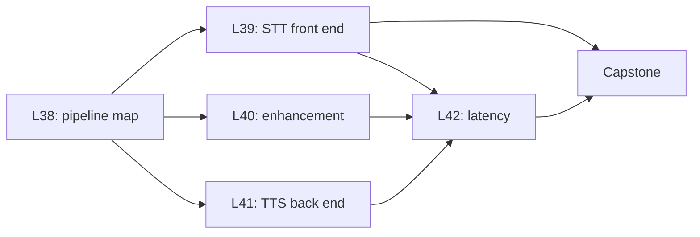

This part puts the subject to work in a voice agent. It follows the sound from the microphone to the speaker. It shows where frames, windows, the FFT and mel features appear, and where they do not. It reads real code (Whisper's log-mel front end) and real papers, and it ends with a latency budget and a capstone project. No course video covers this part.

| Code | Lesson | Core idea | Course video | Status |
|---|---|---|---|---|
| L38 | [Pipeline map](/notes/maths/fft-signal-processing/08-voice-agents/l38-pipeline-map) | Microphone → frames → voice detection → speech-to-text → LLM → text-to-speech → speaker | none | not started |
| L39 | [Speech-to-text front end](/notes/maths/fft-signal-processing/08-voice-agents/l39-speech-to-text-front-end) | Read real log-mel feature code. Confirmed in `whisper/audio.py`: Whisper uses 25 ms frames of 16 kHz audio (400 samples, not a power of 2). | none | not started |
| L40 | [Enhancement](/notes/maths/fft-signal-processing/08-voice-agents/l40-enhancement) | Spectral masks, noise suppression and echo cancellation (overview) | none | not started |
| L41 | [Text-to-speech back end](/notes/maths/fft-signal-processing/08-voice-agents/l41-text-to-speech-back-end) | Mel to waveform needs phase. Griffin-Lim. Vocoders. | none | not started |
| L42 | [Latency](/notes/maths/fft-signal-processing/08-voice-agents/l42-latency) | Frame size, frequency resolution and latency trade against each other. | none | not started |

**Capstone:** an audio front-end package written from scratch. It reads a WAV file, makes frames, applies a window, runs my FFT and computes log-mel features. Tests compare it with a reference library. Specification: [Capstone: An audio front end from scratch](/notes/maths/fft-signal-processing/08-voice-agents/capstone-audio-front-end).

## How the lessons connect

L38 draws the whole pipeline and marks the FFT blocks. L39, L40 and L41 each open one block. L39 shows the features that speech-to-text reads, L40 the masks that clean the input, and L41 the phase that text-to-speech must invent. L42 adds the delays of all blocks. The capstone builds the L39 front end from scratch, with your own FFT.
