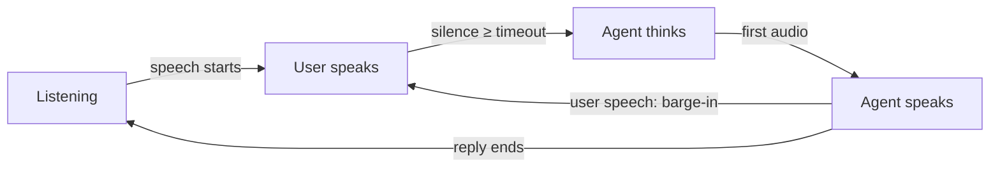

## 1. The question this idea answers

You speak to a voice agent. Some time later, it answers with its own voice. Between these two moments, the sound passes through about ten blocks. Which blocks use the ideas of this subject, and which blocks do not?

An engineer needs this map for three reasons:

1. **Debugging.** A wrong transcript can come from the microphone, the sample rate, the echo, the noise or the model. The map tells you where to measure.
2. **Latency.** Each block adds time. Lesson [L42](/notes/maths/fft-signal-processing/08-voice-agents/l42-latency) adds the times.
3. **Quality.** A block that uses frames and the FFT has a frame size. The frame size fixes a trade between frequency resolution and delay ([L33](/notes/maths/fft-signal-processing/06-fourier-family-and-duality/l33-uncertainty)).

Part 07 ended with features for speech: the STFT, the spectrogram, log-mel and MFCC ([L37](/notes/maths/fft-signal-processing/07-speech-time-frequency/l37-mfcc-and-pitch)). This lesson puts those features into a complete system.

## 2. Mental model

> [!analogy] A relay race with a timer
> Each block is one runner. A runner takes the baton (the data) from the runner before, runs one leg, and gives the baton to the next runner. The timer stops when the agent starts to speak. A slow leg makes the whole race slow.
>
> **Where it stops working:** in a streaming pipeline, the runners do not wait for each other. The microphone keeps sending new frames while the speech-to-text block works on old frames. Also, the listening path never stops. The agent must listen while it speaks, so that you can interrupt it. A relay runner never runs backward to the start.

## 3. Terms

| Term | Plain meaning |
|---|---|
| voice agent | A program that listens to speech, decides what to say, and answers with speech. |
| cascade | A pipeline of separate models: speech-to-text, then a language model, then text-to-speech. |
| DAC (digital-to-analog converter) | The chip that changes samples into a voltage for the speaker. It is the reverse of the ADC of [L6](/notes/maths/fft-signal-processing/02-signals-and-frequency/l6-samples). |
| VAD (voice activity detection) | A block that marks each frame as speech or not speech. |
| turn | One stretch of talk by one speaker. |
| turn detection | Deciding that the user has finished a turn, so the agent can answer. |
| end-of-speech timeout | The silence time that a turn detector waits before it says "the turn has ended". |
| barge-in | The user starts to speak while the agent speaks. The agent must stop and listen. |
| acoustic echo | The agent's own voice, which travels from the speaker through the room into the microphone. |
| echo canceller (AEC) | A block that estimates the acoustic echo and subtracts it from the microphone signal. |
| STT (speech-to-text) | A model that changes speech into text. Also called speech recognition. |
| LLM (large language model) | A model that reads text tokens and writes text tokens. |
| TTS (text-to-speech) | A model that changes text into a speech waveform. |
| streaming | Processing each frame soon after it arrives, before the input ends. |
| batch processing | Processing the whole input after it ends. |
| speech-to-speech model | One model that reads audio and writes audio, with no separate text step between two models. |
| full duplex | Both sides can talk at the same time, and the system hears both. |

> [!note] Numbers on this page
> Python computed every number on this page. The script values are exact unless the text says "about" or "rounded".

## 4. The blocks, one by one

The table follows the sound from your mouth to the agent's reply. The right column links each block to the lesson that explains its math.

| Block | Input | Output | Example numbers | FFT idea | Lessons |
|---|---|---|---|---|---|
| Microphone | air pressure | voltage $x(t)$ | continuous signal | none | [L1](/notes/maths/fft-signal-processing/02-signals-and-frequency/l1-what-a-signal-is) |
| Anti-aliasing filter and ADC | $x(t)$ | samples $x[n]$ | $f_s$ = 16,000 Hz, 16-bit samples | the filter removes content above $f_s/2$ | [L6](/notes/maths/fft-signal-processing/02-signals-and-frequency/l6-samples), [L26](/notes/maths/fft-signal-processing/05-reading-spectra/l26-aliasing) |
| Resampler | $x[n]$ at one rate | $x[n]$ at another rate | 48,000 → 16,000 Hz | a low-pass filter, which is a convolution | [L32](/notes/maths/fft-signal-processing/06-fourier-family-and-duality/l32-convolution-theorem) |
| Echo canceller | microphone and speaker samples | microphone samples without echo | filter of 100 to 500 ms | many designs filter in the frequency domain | [L32](/notes/maths/fft-signal-processing/06-fourier-family-and-duality/l32-convolution-theorem), [L40](/notes/maths/fft-signal-processing/08-voice-agents/l40-enhancement) |
| Noise suppressor | noisy frames | cleaner frames | 20 ms frames | STFT, a gain per bin, ISTFT | [L34](/notes/maths/fft-signal-processing/07-speech-time-frequency/l34-stft-and-spectrogram), [L35](/notes/maths/fft-signal-processing/07-speech-time-frequency/l35-inverse-stft), [L40](/notes/maths/fft-signal-processing/08-voice-agents/l40-enhancement) |
| VAD and turn detector | frames | speech flags, end of turn | 32 ms chunks, 100 to 500 ms timeout | band energies or a neural network | this lesson, [L42](/notes/maths/fft-signal-processing/08-voice-agents/l42-latency) |
| Speech-to-text | samples | text | 25 ms frames, 10 ms hop | STFT, mel filterbank, log | [L36](/notes/maths/fft-signal-processing/07-speech-time-frequency/l36-mel-and-log-mel), [L39](/notes/maths/fft-signal-processing/08-voice-agents/l39-speech-to-text-front-end) |
| LLM | text tokens | text tokens | none | none | none |
| Text-to-speech | text | mel spectrogram, then samples | 80 mel bands | mel targets, a vocoder | [L41](/notes/maths/fft-signal-processing/08-voice-agents/l41-text-to-speech-back-end) |
| DAC and speaker | samples | voltage, then air pressure | same $f_s$ as the TTS output | a smoothing filter removes the mirror images | [L26](/notes/maths/fft-signal-processing/05-reading-spectra/l26-aliasing) |

### 4.1 From air to samples

The microphone changes air pressure into a voltage. This voltage is the continuous signal $x(t)$. Before the ADC, an analog low-pass filter removes content above $f_s/2$. This is the anti-aliasing filter. Without this filter, high frequencies fold into the speech band. This folding is aliasing ([L26](/notes/maths/fft-signal-processing/05-reading-spectra/l26-aliasing)).

The ADC then measures the voltage $f_s$ times per second ([L6](/notes/maths/fft-signal-processing/02-signals-and-frequency/l6-samples)). Each measurement is one sample. Speech systems often store each sample as a 16-bit integer.

> [!example] Data rate of 16 kHz speech
> 16,000 samples per second × 16 bits = 256,000 bits per second = 32,000 bytes per second.
>
> One 20 ms frame holds 0.020 × 16,000 = 320 samples = 640 bytes.

Different blocks expect different sample rates. These rates come from the official sources of each tool:

| Tool | Sample rate it expects | Source |
|---|---|---|
| Whisper (speech-to-text) | 16,000 Hz | `whisper/audio.py`, `SAMPLE_RATE = 16000` |
| Silero VAD | 8,000 or 16,000 Hz | Silero VAD README |
| WebRTC VAD | 8,000, 16,000, 32,000 or 48,000 Hz | py-webrtcvad README |
| RNNoise (noise suppressor) | 48,000 Hz | RNNoise paper, arXiv 1709.08243 |
| Mimi (neural audio codec) | 24,000 Hz | Moshi repository README |

So a real pipeline often resamples: it changes the sample rate, with a low-pass filter first ([L26](/notes/maths/fft-signal-processing/05-reading-spectra/l26-aliasing)). Whisper's `load_audio` calls the `ffmpeg` program with the options `-ac 1` (one channel) and `-ar` with the target rate. It then divides each 16-bit integer by 32768.0, so every sample lies in the range $-1 \le x[n] < 1$.

> [!trap] Resampling cannot restore lost frequencies
> A phone call at 8,000 Hz holds nothing above 4,000 Hz. Resampling it to 16,000 Hz gives more samples, but the band from 4,000 to 8,000 Hz stays empty. The samples cannot hold what the first ADC never measured.

### 4.2 Frames

Most blocks after the ADC work on frames: short lists of samples. A frame of $L$ samples at sample rate $f_s$ lasts $L/f_s$ seconds. The frame size is different in each block:

| Block | Frame | Duration at its rate |
|---|---|---|
| WebRTC VAD | 160, 320 or 480 samples at 16 kHz | 10, 20 or 30 ms |
| Silero VAD | 512 samples at 16 kHz (256 at 8 kHz) | 32 ms |
| Whisper front end | 400 samples, hop 160, at 16 kHz | 25 ms, hop 10 ms |
| RNNoise | 20 ms windows, 50 % overlap, at 48 kHz | 20 ms, hop 10 ms |

> [!note] Sources for the frame sizes
> WebRTC VAD: the py-webrtcvad README ("A frame must be either 10, 20, or 30 ms in duration"). Silero VAD: `src/silero_vad/utils_vad.py`, which accepts 512 samples for 16000 Hz and 256 for 8000 Hz. Whisper: `whisper/audio.py`. RNNoise: Valin, "A Hybrid DSP/Deep Learning Approach to Real-Time Full-Band Speech Enhancement", arXiv 1709.08243. All read on 2026-10-19.

### 4.3 Voice activity detection

A VAD gives one decision for each frame: speech or not speech. Two real designs show the range:

1. **WebRTC VAD** splits each frame into six frequency bands: 80–250, 250–500, 500–1000, 1000–2000, 2000–3000 and 3000–4000 Hz. It uses a tree of filters for this, not an FFT. It computes the log energy in each band and compares the six numbers with two Gaussian models, one for speech and one for noise.
2. **Silero VAD** is a neural network. It reads one chunk of 512 samples at 16 kHz and gives a speech probability. Its helper code marks speech when the probability is above a threshold (default 0.5).

> [!note] Sources for the VAD designs
> WebRTC VAD: the C files `vad_filterbank.c` and `vad_core.c` that ship with py-webrtcvad (a copy of the WebRTC code). For a 16 kHz frame, the code first downsamples to 8 kHz, so the bands stop at 4000 Hz. Silero VAD: `get_speech_timestamps` and `VADIterator` in `utils_vad.py`. This page does not claim what the first layer of the Silero network computes.

The WebRTC design shows a key idea: a band energy does not need an FFT. A band-pass filter is a convolution ([L32](/notes/maths/fft-signal-processing/06-fourier-family-and-duality/l32-convolution-theorem)). The energy of its output measures one band. An FFT gives all bands at once, and a filter tree gives a few bands cheaply.

### 4.4 Speech-to-text, the LLM and text-to-speech

The speech-to-text block makes features from frames. Whisper computes a log-mel spectrogram: 80 mel bands, 100 frames per second ([L39](/notes/maths/fft-signal-processing/08-voice-agents/l39-speech-to-text-front-end)). Then a neural network changes the features into text.

The LLM reads text tokens and writes text tokens. It computes no FFT and sees no frames. The audio math of this subject stops at its input and starts again at its output.

> [!note] A Fourier-like idea without an FFT
> The Whisper encoder adds position codes made of sines and cosines at many frequencies (the function `sinusoids` in `whisper/model.py`). This is a table of sine waves, not a transform of the audio. No FFT runs there.

The text-to-speech block usually works in two steps. An acoustic model changes text into a mel spectrogram. A vocoder changes the mel spectrogram into samples. The mel spectrogram does not keep the phase, so the vocoder must create a phase ([L41](/notes/maths/fft-signal-processing/08-voice-agents/l41-text-to-speech-back-end)).

### 4.5 From samples to air

The DAC changes the samples into a voltage. An analog smoothing filter removes the mirror images of the spectrum above $f_s/2$ ([L24](/notes/maths/fft-signal-processing/05-reading-spectra/l24-the-mirror), [L26](/notes/maths/fft-signal-processing/05-reading-spectra/l26-aliasing)). The speaker changes the voltage into air pressure.

## 5. Where the FFT appears, and where it does not


The figure has three kinds of badge:

1. **FFT.** The designs in lessons L39 to L41 run an FFT in this block. These designs are the frequency-domain echo canceller, the STFT noise suppressor and the log-mel front end.
2. **FFT: some.** Some designs use the FFT and others do not. A neural VAD can read raw samples. A neural vocoder can make samples with no FFT, but Griffin-Lim needs one FFT per frame in each step.
3. **No FFT.** The microphone, the converters, the speaker and the LLM.

> [!key] The FFT lives at the edges of the agent
> The FFT ideas appear where the agent touches sound: at the input (echo, noise, features) and at the output (mel, vocoder). The LLM in the middle works only on text.

## 6. Streaming and batch

In **batch processing**, a block waits for the whole input. In **streaming**, a block works on each frame soon after it arrives. Streaming does not make a model faster. It moves the work into the time while the user still speaks.

> [!example] Batch against streaming speech-to-text
> Assume that the speech-to-text model needs 0.1 s of compute for each 1 s of audio. This number is an assumption for the example.
>
> 1. **Batch.** The user speaks for 3 s. The model starts at the end. It needs 3 × 0.1 = 0.3 s. The text is ready 0.3 s after the end of speech.
> 2. **Streaming in 0.5 s chunks.** The model processes each chunk while the user speaks. At the end, only the last chunk remains: 0.5 × 0.1 = 0.05 s.
>
> Streaming saves 0.3 − 0.05 = 0.25 s here. The total compute is the same: 0.3 s.

Some models cannot stream easily. The Whisper encoder accepts exactly 30 s of features at a time ([L39](/notes/maths/fft-signal-processing/08-voice-agents/l39-speech-to-text-front-end)). So a Whisper-style model processes a short reply as a padded 30 s window.

## 7. Turns, timeouts and barge-in

The agent must decide when you have finished. Most simple systems use silence: when the VAD sees no speech for a timeout, the turn ends.



The timeout is a trade:

1. **Short timeout.** The agent answers fast. But people pause inside a sentence, so the agent can interrupt them.
2. **Long timeout.** The agent rarely interrupts. But every answer starts later, by the full timeout.

> [!example] One utterance, three timeouts
> A toy utterance has speech from 0.10 to 0.60 s, a pause of 0.15 s, and speech from 0.75 to 1.10 s. A VAD reads 512-sample chunks (32 ms) and marks a chunk as speech when its energy is above −30 dB. A timeout of $T$ ms needs $\lceil T/32 \rceil$ silent chunks in a row.
>
> | Timeout | Silent chunks needed | End of turn declared at | Result |
> |---|---|---|---|
> | 100 ms | ⌈100/32⌉ = 4 | 0.736 s (inside the pause) | the agent interrupts the user |
> | 200 ms | ⌈200/32⌉ = 7 | 1.344 s | correct, 0.244 s after the speech ends |
> | 300 ms | ⌈300/32⌉ = 10 | 1.440 s | correct, 0.340 s after the speech ends |
>
> The pause lasts 0.15 s. Only a timeout longer than the pause avoids the false end of turn.

Real systems tune these numbers. The Silero VAD helper code uses `min_silence_duration_ms = 100` by default. The example configuration in the OpenAI Realtime voice-activity-detection guide sets `silence_duration_ms` to 500. The same guide also describes a "semantic VAD" that uses a classifier to decide when the user has finished. So turn detection can use the meaning of the words, not only the silence.

> [!note] Sources for the turn-detection settings
> Silero VAD: `src/silero_vad/utils_vad.py` (main branch). OpenAI: "Voice activity detection (VAD)" guide at developers.openai.com. Both read on 2026-10-19. These are configuration values, not measurements of quality.

**Barge-in** is the reverse case. The user speaks while the agent speaks. The listening path keeps running, and the VAD sees speech. The agent must then stop its audio output and listen. This needs the next block: the echo canceller.

## 8. Echo

The agent's voice leaves the speaker, bounces around the room and enters the microphone. Without a fix, the VAD hears the agent's own voice as user speech. The agent then interrupts itself.

The room acts as a filter. Its impulse response $h[n]$ describes how one click from the speaker arrives at the microphone: direct sound first, then reflections. So the echo is a convolution ([L32](/notes/maths/fft-signal-processing/06-fourier-family-and-duality/l32-convolution-theorem)):

$$
m[n] = u[n] + \sum_{k=0}^{K-1} h[k]\, p[n-k] + \text{noise}[n]
$$

Here $m[n]$ is the microphone signal and $u[n]$ is the user's speech. The signal $p[n]$ goes to the speaker, and $K$ is the length of $h$.

> [!example] A tiny echo by hand
> The speaker plays $p = [1, -1, 0, 0, 0, 0]$. The room has $h = [0, 0, 0.5, 0.25]$: no direct path, a reflection with half the amplitude after 2 samples, and a weaker one after 3 samples. Compute $e[n] = \sum_k h[k]\,p[n-k]$:
>
> | $n$ | Terms that are not zero | $e[n]$ |
> |---|---|---|
> | 0 | none | 0 |
> | 1 | none | 0 |
> | 2 | $h[2]\,p[0] = 0.5 \times 1$ | 0.5 |
> | 3 | $h[2]\,p[1] + h[3]\,p[0] = 0.5 \times (-1) + 0.25 \times 1$ | −0.25 |
> | 4 | $h[3]\,p[1] = 0.25 \times (-1)$ | −0.25 |
> | 5 | none | 0 |
>
> So the echo is $[0, 0, 0.5, -0.25, -0.25, 0]$.

The echo canceller knows $p[n]$, because the agent made it. It does not know $h[n]$. It learns an estimate $\hat h[n]$ while it runs, and it subtracts $\sum_k \hat h[k]\,p[n-k]$ from $m[n]$. A real room needs a long $h$: the Speex echo canceller suggests 100 to 500 ms. At 16 kHz, 250 ms is 4,000 coefficients. Lesson [L40](/notes/maths/fft-signal-processing/08-voice-agents/l40-enhancement) shows why such a long filter runs in the frequency domain.

> [!trap] Echo cancellation is not noise suppression
> The echo canceller has a reference signal: $p[n]$. It removes a copy of a known signal. A noise suppressor has no reference. It must guess the noise from the noisy signal alone.

## 9. Speech-to-speech models

A cascade changes speech into text, text into text, and text into speech. A speech-to-speech model works on audio tokens directly. Two sourced examples:

1. **Moshi** (Kyutai). The paper calls it "a speech-text foundation model and full-duplex spoken dialogue framework". It models two audio streams at the same time: the user and Moshi. It also predicts text tokens for its own speech. The repository README gives "a theoretical latency of 160ms (80ms for the frame size of Mimi + 80ms of acoustic delay)". It gives a practical latency as low as 200 ms on an L4 GPU.
2. **OpenAI Realtime API.** Its VAD guide says that server VAD "is the default mode for speech-to-speech sessions".

> [!note] Sources for speech-to-speech
> Défossez et al., "Moshi: a speech-text foundation model for real-time dialogue", arXiv 2410.00037 (2024). The kyutai-labs/moshi README on GitHub. The OpenAI "Voice activity detection (VAD)" guide. Read on 2026-10-19. The Moshi abstract also says that cascades have "a latency of several seconds". That is the authors' claim about the cascades they studied.

The frame ideas of this subject still appear in these models, in a different place. The audio becomes tokens through a neural audio codec ([L41](/notes/maths/fft-signal-processing/08-voice-agents/l41-text-to-speech-back-end)). Mimi reads 24 kHz audio and gives 12.5 token frames per second. Each frame covers 24,000 / 12.5 = 1,920 samples = 80 ms. That 80 ms frame is a frame size, with the same trade as every frame in this subject ([L42](/notes/maths/fft-signal-processing/08-voice-agents/l42-latency)).

## 10. Graphs

The toy utterance of section 7, as one energy value for each 32 ms chunk. The VAD marks a chunk as speech when its energy is above the red line.

```plot
{
  "title": "Chunk energy in dB (blue dots) and the VAD threshold of -30 dB (red)",
  "xAxis": { "label": "time (s)", "domain": [0, 1.6] },
  "yAxis": { "label": "energy (dB)", "domain": [-60, 0] },
  "disableZoom": true,
  "data": [
    { "points": [[0.016, -51.2], [0.048, -49.9], [0.08, -50.1], [0.112, -13.2], [0.144, -12.4], [0.176, -12.4], [0.208, -12.7], [0.24, -12.3], [0.272, -12.6], [0.304, -12.4], [0.336, -12.4], [0.368, -12.7], [0.4, -12.4], [0.432, -12.6], [0.464, -12.4], [0.496, -12.4], [0.528, -12.7], [0.56, -12.3], [0.592, -13.8], [0.624, -50.6], [0.656, -50.4], [0.688, -50.6], [0.72, -50.8], [0.752, -15.1], [0.784, -12.4], [0.816, -12.4], [0.848, -12.7], [0.88, -12.3], [0.912, -12.6], [0.944, -12.4], [0.976, -12.4], [1.008, -12.7], [1.04, -12.3], [1.072, -12.6], [1.104, -16.6], [1.136, -50.7], [1.168, -51.0], [1.2, -50.1], [1.232, -50.4], [1.264, -50.6], [1.296, -50.5], [1.328, -50.4], [1.36, -50.5], [1.392, -50.8], [1.424, -50.6], [1.456, -50.9], [1.488, -50.7], [1.52, -50.6], [1.552, -50.2], [1.584, -50.8]], "fnType": "points", "graphType": "polyline", "color": "#1E6091", "skipTip": true },
    { "points": [[0.016, -51.2], [0.048, -49.9], [0.08, -50.1], [0.112, -13.2], [0.144, -12.4], [0.176, -12.4], [0.208, -12.7], [0.24, -12.3], [0.272, -12.6], [0.304, -12.4], [0.336, -12.4], [0.368, -12.7], [0.4, -12.4], [0.432, -12.6], [0.464, -12.4], [0.496, -12.4], [0.528, -12.7], [0.56, -12.3], [0.592, -13.8], [0.624, -50.6], [0.656, -50.4], [0.688, -50.6], [0.72, -50.8], [0.752, -15.1], [0.784, -12.4], [0.816, -12.4], [0.848, -12.7], [0.88, -12.3], [0.912, -12.6], [0.944, -12.4], [0.976, -12.4], [1.008, -12.7], [1.04, -12.3], [1.072, -12.6], [1.104, -16.6], [1.136, -50.7], [1.168, -51.0], [1.2, -50.1], [1.232, -50.4], [1.264, -50.6], [1.296, -50.5], [1.328, -50.4], [1.36, -50.5], [1.392, -50.8], [1.424, -50.6], [1.456, -50.9], [1.488, -50.7], [1.52, -50.6], [1.552, -50.2], [1.584, -50.8]], "fnType": "points", "graphType": "scatter", "attr": {"r": 3}, "color": "#1E6091", "skipTip": true },
    { "fn": "0*x-30", "color": "#C81D25" }
  ]
}
```

The same chunks as VAD flags (gold: 1 = speech). The red line marks the end of turn with a 100 ms timeout. The ink line marks it with a 200 ms timeout.

```plot
{
  "title": "VAD flags (gold), end of turn at 100 ms timeout (red) and 200 ms timeout (ink)",
  "xAxis": { "label": "time (s)", "domain": [0, 1.6] },
  "yAxis": { "label": "speech flag", "domain": [-0.3, 1.3] },
  "disableZoom": true,
  "data": [
    { "points": [[0.016, 0], [0.048, 0], [0.08, 0], [0.112, 1], [0.144, 1], [0.176, 1], [0.208, 1], [0.24, 1], [0.272, 1], [0.304, 1], [0.336, 1], [0.368, 1], [0.4, 1], [0.432, 1], [0.464, 1], [0.496, 1], [0.528, 1], [0.56, 1], [0.592, 1], [0.624, 0], [0.656, 0], [0.688, 0], [0.72, 0], [0.752, 1], [0.784, 1], [0.816, 1], [0.848, 1], [0.88, 1], [0.912, 1], [0.944, 1], [0.976, 1], [1.008, 1], [1.04, 1], [1.072, 1], [1.104, 1], [1.136, 0], [1.168, 0], [1.2, 0], [1.232, 0], [1.264, 0], [1.296, 0], [1.328, 0], [1.36, 0], [1.392, 0], [1.424, 0], [1.456, 0], [1.488, 0], [1.52, 0], [1.552, 0], [1.584, 0]], "fnType": "points", "graphType": "polyline", "color": "#B8860B", "skipTip": true },
    { "points": [[0.016, 0], [0.048, 0], [0.08, 0], [0.112, 1], [0.144, 1], [0.176, 1], [0.208, 1], [0.24, 1], [0.272, 1], [0.304, 1], [0.336, 1], [0.368, 1], [0.4, 1], [0.432, 1], [0.464, 1], [0.496, 1], [0.528, 1], [0.56, 1], [0.592, 1], [0.624, 0], [0.656, 0], [0.688, 0], [0.72, 0], [0.752, 1], [0.784, 1], [0.816, 1], [0.848, 1], [0.88, 1], [0.912, 1], [0.944, 1], [0.976, 1], [1.008, 1], [1.04, 1], [1.072, 1], [1.104, 1], [1.136, 0], [1.168, 0], [1.2, 0], [1.232, 0], [1.264, 0], [1.296, 0], [1.328, 0], [1.36, 0], [1.392, 0], [1.424, 0], [1.456, 0], [1.488, 0], [1.52, 0], [1.552, 0], [1.584, 0]], "fnType": "points", "graphType": "scatter", "attr": {"r": 3}, "color": "#B8860B", "skipTip": true },
    { "points": [[0.736, -0.3], [0.736, 1.3]], "fnType": "points", "graphType": "polyline", "color": "#C81D25", "skipTip": true },
    { "points": [[1.344, -0.3], [1.344, 1.3]], "fnType": "points", "graphType": "polyline", "color": "#100D12", "skipTip": true }
  ]
}
```

## 11. Code

Build a toy VAD with an end-of-speech timeout, and a toy echo. Write four functions:

1. `frame_signal(x, frame_len)` returns a 2-D array of shape `(len(x) // frame_len, frame_len)`. It drops an incomplete last frame.
2. `energy_db(frames)` returns $10 \log_{10}(\text{mean}(x^2) + 10^{-12})$ for each frame.
3. `end_of_turn(flags, frame_ms, timeout_ms)` returns the index of the frame at which the turn ends, or `None`. The turn ends at the first frame where the silent frames since the last speech frame reach $\lceil$`timeout_ms / frame_ms`$\rceil$. Silence before the first speech does not count.
4. `echo(p, h)` computes $e[n] = \sum_k h[k]\,p[n-k]$ with two loops. Its output has `len(p) + len(h) - 1` values.

Make the toy utterance of section 7 exactly: $f_s$ = 16,000 Hz, 1.6 s. Noise: `0.003 * np.random.default_rng(1).standard_normal(len(n))`. Add `0.3*sin(2π·200·t) + 0.15*sin(2π·400·t)` for 0.10 ≤ t < 0.60 s and for 0.75 ≤ t < 1.10 s. Use 512-sample frames and a threshold of −30 dB.

Acceptance tests:

- `frame_signal(np.arange(10), 4).shape == (2, 4)`.
- `energy_db(np.ones((1, 8)))` is 0.0 within 1e-9, and `energy_db(np.zeros((1, 8)))` is −120.0.
- `end_of_turn([0, 1, 1, 0, 0, 0], 32, 64) == 4` and `end_of_turn([0, 0, 0], 32, 64) is None`.
- On the toy utterance: 50 frames. The timeouts 100, 200 and 300 ms give the frame indices 22, 41 and 44.
- `np.allclose(echo(p, h), np.convolve(p, h))` for 5 random pairs, and `echo([1, -1, 0, 0, 0, 0], [0, 0, 0.5, 0.25])[:6]` equals `[0, 0, 0.5, -0.25, -0.25, 0]`.

[Open a lab for this lesson](/labs/new?note=maths/fft-signal-processing/08-voice-agents/l38-pipeline-map)

```check
{
  "question": "Stuck on end_of_turn?",
  "hint": "Walk through the flags once. Keep two values: 'have I seen speech yet?' and 'how many silent frames since the last speech frame?'.",
  "answer": "Compute need = ceil(timeout_ms / frame_ms). A speech flag sets seen = True and resets the silent count to 0. A silent flag after speech adds 1 to the count. Return the index i as soon as the count equals need. Return None after the loop."
}
```

## 12. Common mistakes

1. **"The LLM uses the FFT."** The LLM works on text tokens only. The FFT ideas live at the audio input and the audio output.
2. **"VAD and turn detection are the same thing."** A VAD labels each frame. A turn detector decides that a whole turn has ended, often with a timeout or a classifier.
3. **"A shorter timeout is always better."** A timeout shorter than the user's pauses makes the agent interrupt the user.
4. **"Resampling to 16 kHz restores the full band."** Resampling cannot create content above the Nyquist frequency of the original recording.
5. **"Echo cancellation is noise suppression."** The echo canceller removes a known signal with a reference. A noise suppressor has no reference.
6. **"Streaming makes the model faster."** Streaming does the same compute earlier, while the user speaks. It reduces the wait after the end of speech.
7. **"Every block uses the same sample rate."** Each tool expects its own rate. Check the rate at every boundary.

## 13. One-minute explanation

A voice agent is a chain of blocks. The microphone and the ADC change air pressure into samples at a fixed sample rate. An echo canceller removes the agent's own voice, which returns through the room, and a noise suppressor removes background noise. Both often work on STFT frames. A VAD marks each frame as speech or silence, and a turn detector decides when the user has finished, often after a silence timeout. Speech-to-text changes frames into log-mel features and then into text. The LLM changes text into text and uses no FFT. Text-to-speech makes a mel spectrogram, and a vocoder changes it into samples for the DAC and the speaker. The listening path never stops, so the user can interrupt the agent. Each frame-based block adds delay and has a frequency-resolution trade.

## 14. Check questions

```check
{
  "question": "List the blocks of the listening path in order, from the microphone to the LLM. Which of them run an FFT in the designs of L39 to L41?",
  "hint": "Follow the sound. The FFT appears where the agent works on frames of audio.",
  "answer": "Microphone, ADC (with the anti-aliasing filter), resampler if needed, echo canceller, noise suppressor, VAD and turn detector, speech-to-text, LLM. The frequency-domain echo canceller, the STFT noise suppressor and the log-mel front end of speech-to-text run an FFT. The VAD may or may not. The microphone, the ADC and the LLM do not."
}
```

```check
{
  "question": "A VAD reads chunks of 512 samples at 16,000 Hz. How long is one chunk? How many whole chunks fit in 3 s? How many silent chunks does a 300 ms timeout need?",
  "hint": "Duration = samples / sample rate. Use the floor for the chunk count and the ceiling for the timeout count.",
  "answer": "One chunk: 512 / 16,000 = 0.032 s = 32 ms. In 3 s: 3,000 / 32 = 93.75, so 93 whole chunks. Timeout: 300 / 32 = 9.375, so ⌈9.375⌉ = 10 silent chunks, which is 320 ms of silence."
}
```

```check
{
  "question": "Why must the echo canceller run before the VAD?",
  "hint": "What does the VAD hear while the agent speaks?",
  "answer": "While the agent speaks, its voice returns through the room into the microphone. Without echo cancellation, the VAD marks the agent's own voice as speech. The system then detects a false barge-in, and the agent interrupts itself. The echo canceller removes the echo first, so the VAD sees only the user."
}
```

```check
{
  "question": "The speaker plays p = [1, 0, -1, 0] and the room has h = [0, 0.5, 0.25]. Compute the echo e[n] = Σ h[k] p[n−k] for n = 0 to 5.",
  "hint": "Each sample of p makes a copy of h, scaled by that sample and shifted by its index. Add the copies.",
  "answer": "Copy from p[0] = 1, shift 0: [0, 0.5, 0.25, 0, 0, 0]. Copy from p[2] = −1, shift 2: [0, 0, 0, −0.5, −0.25, 0]. Sum: e = [0, 0.5, 0.25, −0.5, −0.25, 0]."
}
```

```check
{
  "question": "A phone call arrives at 8,000 Hz. You resample it to 16,000 Hz and send it to Whisper, which uses mel bands up to 8,000 Hz. What do the mel bands above 4,000 Hz contain?",
  "hint": "What is the highest frequency that 8,000 samples per second can hold?",
  "answer": "The 8 kHz recording holds nothing above its Nyquist frequency, 8,000 / 2 = 4,000 Hz. Resampling adds samples but no new content. So the mel bands above 4,000 Hz contain almost no energy. After the log and the clamp of L39, they sit near the floor value."
}
```

## 15. Links

- Previous: [L37: MFCC and pitch](/notes/maths/fft-signal-processing/07-speech-time-frequency/l37-mfcc-and-pitch)
- Next: [L39: The speech-to-text front end](/notes/maths/fft-signal-processing/08-voice-agents/l39-speech-to-text-front-end)
- [L6: Samples](/notes/maths/fft-signal-processing/02-signals-and-frequency/l6-samples) and [L26: Aliasing](/notes/maths/fft-signal-processing/05-reading-spectra/l26-aliasing)
- [L32: The convolution theorem](/notes/maths/fft-signal-processing/06-fourier-family-and-duality/l32-convolution-theorem) and [L33: Uncertainty](/notes/maths/fft-signal-processing/06-fourier-family-and-duality/l33-uncertainty)
- [L34: The STFT and the spectrogram](/notes/maths/fft-signal-processing/07-speech-time-frequency/l34-stft-and-spectrogram)
- [L42: Latency](/notes/maths/fft-signal-processing/08-voice-agents/l42-latency)
- [08 Voice agents](/notes/maths/fft-signal-processing/08-voice-agents)
- [Glossary](/notes/maths/fft-signal-processing/glossary)
