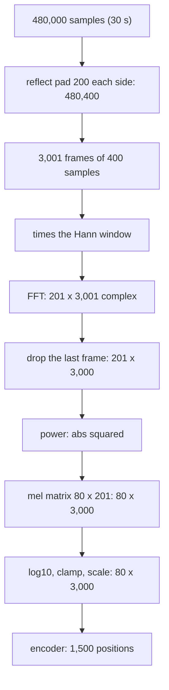

## 1. The question this idea answers

A speech-to-text model does not read raw samples. Whisper first changes up to 30 s of audio into a table of 80 rows and 3,000 columns. What exactly does the code do to make this table? Which lessons explain each line?

This lesson reads the real code of OpenAI's Whisper. Every step is an idea from part 07: frames, a window and the FFT ([L34](/notes/maths/fft-signal-processing/07-speech-time-frequency/l34-stft-and-spectrogram)), mel filters and a log ([L36](/notes/maths/fft-signal-processing/07-speech-time-frequency/l36-mel-and-log-mel)). In the pipeline of [L38](/notes/maths/fft-signal-processing/08-voice-agents/l38-pipeline-map), this is the front end of the speech-to-text block.

## 2. Mental model

> [!analogy] A form with exactly 3,000 boxes
> The encoder is a clerk who accepts only one form. The form has 80 rows and 3,000 columns, one column for every 10 ms of a 30 s window. Short audio gets blank boxes at the end. Long audio goes on several forms. Each box holds a number that says "how loud was this mel band in this 10 ms", on a log scale.
>
> **Where it stops working:** a blank box on a paper form means "nothing". Here, the blank value is a number, and the network reads it. Also, the "loudness" scale is relative: the code sets the lowest allowed value from the loudest box of the whole input.

## 3. Terms

| Term | Plain meaning |
|---|---|
| front end | The fixed signal-processing code that changes samples into features before the neural network. |
| feature | A number that the model reads, here one value of the log-mel spectrogram. |
| encoder | The part of the speech-to-text network that reads the features and makes one vector for each time position. |
| chunk | The fixed piece of audio that the encoder reads at once. For Whisper it is 30 s. |
| padding | Adding values at the end (or at both ends) of a list to reach a required length. |
| trimming | Cutting a list to a required length. |
| reflect padding | Center padding ([L34](/notes/maths/fft-signal-processing/07-speech-time-frequency/l34-stft-and-spectrogram)) with a mirror copy of the samples next to the edge, without the edge sample itself. |
| periodic Hann window | The Hann window $w[n] = 0.5 - 0.5\cos(2\pi n/N)$ for $n = 0 \dots N-1$, as in [L35](/notes/maths/fft-signal-processing/07-speech-time-frequency/l35-inverse-stft). It is one period of a repeating shape. |
| power spectrogram | The squared magnitude $\lvert X[m,k] \rvert^2$ of every STFT value. |
| mel filter matrix | The table of mel filter weights: one row for each mel band, one column for each FFT bin. |
| dynamic range | The ratio between the loudest and the quietest value that a representation keeps. |
| clamp | Replacing every value below a limit by the limit. |
| stride | The step of a convolution. Stride 2 keeps every second output, so it halves the length. |
| positional embedding | A table of vectors, one for each time position, that the encoder adds to its input. Its size fixes the input length. |

> [!note] Numbers on this page
> Python computed every number on this page. A NumPy copy of the Whisper front end reproduces the official mel filter file to within $1.3 \times 10^{-9}$. "About" marks rounded values.

## 4. The code, line by line

> [!note] Source
> openai/whisper on GitHub, file `whisper/audio.py`, main branch, read on 2026-10-19. The excerpts below are exact copies. Other details come from `whisper/model.py` and `whisper/transcribe.py` in the same repository. The paper is Radford et al., "Robust Speech Recognition via Large-Scale Weak Supervision", arXiv 2212.04356 (2022).

### 4.1 The constants

```python
# whisper/audio.py (excerpts)
SAMPLE_RATE = 16000
N_FFT = 400
HOP_LENGTH = 160
CHUNK_LENGTH = 30
N_SAMPLES = CHUNK_LENGTH * SAMPLE_RATE  # 480000 samples in a 30-second chunk
N_FRAMES = exact_div(N_SAMPLES, HOP_LENGTH)  # 3000 frames in a mel spectrogram input
```

Read each constant in the language of this subject:

| Constant | Value | Meaning | Lesson |
|---|---|---|---|
| `SAMPLE_RATE` | 16,000 | $f_s$ = 16,000 samples per second. $\Delta t$ = 1/16,000 s = 0.0625 ms. Nyquist frequency: 8,000 Hz. | [L6](/notes/maths/fft-signal-processing/02-signals-and-frequency/l6-samples), [L26](/notes/maths/fft-signal-processing/05-reading-spectra/l26-aliasing) |
| `N_FFT` | 400 | window length and FFT size: 400 / 16,000 = 0.025 s = 25 ms | [L34](/notes/maths/fft-signal-processing/07-speech-time-frequency/l34-stft-and-spectrogram) |
| `HOP_LENGTH` | 160 | hop: 160 / 16,000 = 0.010 s = 10 ms, so 100 frames per second | [L34](/notes/maths/fft-signal-processing/07-speech-time-frequency/l34-stft-and-spectrogram) |
| `CHUNK_LENGTH` | 30 | the encoder reads 30 s at a time | section 6 |
| `N_SAMPLES` | 480,000 | 30 × 16,000 samples | |
| `N_FRAMES` | 3,000 | 480,000 / 160 frames. `exact_div` checks that the division has no remainder. | |

Two numbers follow from these constants:

1. **Bin spacing.** $f_s / N = 16{,}000 / 400 = 40$ Hz ([L23](/notes/maths/fft-signal-processing/05-reading-spectra/l23-hertz-and-amplitude)). A real input gives $400/2 + 1 = 201$ useful bins, from 0 Hz (bin 0) to 8,000 Hz (bin 200) ([L24](/notes/maths/fft-signal-processing/05-reading-spectra/l24-the-mirror)).
2. **Overlap.** Each frame shares $400 - 160 = 240$ samples with the next frame: 60 % overlap.

The paper says the same in words: 25 ms windows, a stride of 10 ms, 80 channels, audio at 16,000 Hz, and 30-second segments.

> [!trap] 400 is not a power of 2
> $400 = 2^4 \times 5^2$. A radix-2 FFT ([L19](/notes/maths/fft-signal-processing/04-fft/l19-recursive-fft-code), [L20](/notes/maths/fft-signal-processing/04-fft/l20-iterative-fft-and-bugs)) cannot compute it directly. FFT libraries handle such lengths with mixed-radix algorithms ([L22](/notes/maths/fft-signal-processing/04-fft/l22-other-ffts)). Do not zero-pad to 512 to "fix" this. Then the bins move to 16,000 / 512 = 31.25 Hz spacing, you get 257 bins, and the 80 × 201 mel matrix no longer fits.

### 4.2 Loading the audio

`load_audio` runs the `ffmpeg` program with `-ac 1` (one channel) and `-ar 16000` (resample to 16 kHz). It reads 16-bit integers and divides them by 32768.0. So every sample lies in $-1 \le x[n] < 1$.

> [!example] One sample
> The 16-bit integer −16,384 becomes −16,384 / 32,768 = −0.5. The largest integer, 32,767, becomes 32,767 / 32,768 ≈ 0.99997.

### 4.3 The window

```python
window = torch.hann_window(N_FFT).to(audio.device)
```

`torch.hann_window` has `periodic=True` by default. Its documented formula divides by $N - 1$. With `periodic=True`, the documentation says that $N$ is the window length plus 1, so the divisor is 400. So Whisper uses

$$
w[n] = 0.5\left(1 - \cos\frac{2\pi n}{400}\right), \qquad n = 0, 1, \dots, 399.
$$

Substitute three values: $w[0] = 0.5(1 - \cos 0) = 0$. $w[100] = 0.5(1 - \cos(\pi/2)) = 0.5$. $w[200] = 0.5(1 - \cos \pi) = 1$. The sum of all 400 values is exactly 200, because the cosine terms sum to zero over one full period.

The window reduces leakage ([L25](/notes/maths/fft-signal-processing/05-reading-spectra/l25-leakage-and-windows)). Speech rarely fits a 25 ms frame with a whole number of cycles, so a rectangular frame would spread energy over many bins.

### 4.4 The STFT

```python
stft = torch.stft(audio, N_FFT, HOP_LENGTH, window=window, return_complex=True)
```

This is the STFT of [L34](/notes/maths/fft-signal-processing/07-speech-time-frequency/l34-stft-and-spectrogram). The call does not pass `center`, so it uses the defaults of `torch.stft`: `center=True` and `pad_mode="reflect"`. The code of `torch.stft` then pads `n_fft // 2` = 200 samples on each side.

> [!example] Reflect padding on a short list
> Reflect padding by 2 on $[1, 2, 3, 4]$ gives $[3, 2, \mathbf{1, 2, 3, 4}, 3, 2]$. The mirror does not repeat the edge sample.

With center padding, frame $t$ covers the original samples $160t - 200$ to $160t + 199$. Its middle is sample $160t$. The PyTorch documentation gives the number of frames for `center=True`:

$$
T = 1 + \left\lfloor \frac{L}{\text{hop}} \right\rfloor
$$

Here $L$ is the number of samples. For 30 s: $T = 1 + 480{,}000/160 = 3{,}001$ frames. Each frame gives 201 complex values (the onesided output for real input). So `stft` has shape (201, 3001).

### 4.5 Power, and one dropped frame

```python
magnitudes = stft[..., :-1].abs() ** 2
```

This line does two things:

1. `[..., :-1]` drops the last frame. 3,001 frames become 3,000 = `N_FRAMES`. The last frame has its middle at sample 480,000, one step after the last real sample (number 479,999). Half of its samples come from the reflect padding.
2. `.abs() ** 2` takes the power $\lvert X[m,k] \rvert^2$, not the magnitude. The variable name says "magnitudes", but the values are powers.

> [!note] Magnitude or power?
> The paper text says "log-magnitude". The code squares the magnitude. In the log domain the difference is a factor of 2, because $\log_{10}\lvert X \rvert^2 = 2\log_{10}\lvert X \rvert$. Trust the code when you need to match the numbers.

> [!example] A 440 Hz tone in one frame
> Take $x[n] = 0.5\sin(2\pi \cdot 440\, n / 16{,}000)$. The bin of 440 Hz is $440 / 40 = 11$, exactly. In 25 ms the tone makes $440 \times 0.025 = 11$ whole cycles.
>
> For a tone exactly on bin $k$, the windowed DFT gives $\lvert X[k] \rvert = \frac{A}{2} \sum_n w[n] = \frac{0.5}{2} \times 200 = 50$ ([L23](/notes/maths/fft-signal-processing/05-reading-spectra/l23-hertz-and-amplitude), [L25](/notes/maths/fft-signal-processing/05-reading-spectra/l25-leakage-and-windows)). The Hann window also puts half of that, 25, into bins 10 and 12. All other bins are 0.
>
> Powers: bin 10: $25^2 = 625$. Bin 11: $50^2 = 2{,}500$. Bin 12: 625.

### 4.6 The mel filter matrix

```python
mel_spec = filters @ magnitudes
```

`filters` is an 80 × 201 matrix ([L36](/notes/maths/fft-signal-processing/07-speech-time-frequency/l36-mel-and-log-mel)). The product of (80 × 201) and (201 × 3,000) has shape (80, 3,000). Each output value is a weighted sum of the bin powers of one frame. Per frame, this costs 80 × 201 = 16,080 multiplications.

Whisper does not compute the matrix at run time. It loads it from the file `assets/mel_filters.npz`. The docstring of `mel_filters` says that the file holds `librosa.filters.mel(sr=16000, n_fft=400, n_mels=80)` and the same with `n_mels=128`. The librosa defaults then apply:

1. `htk=False`: the Slaney mel scale. It is linear below 1,000 Hz (one mel step is 200/3 Hz) and logarithmic above 1,000 Hz. The other common formula, $2595 \log_{10}(1 + f/700)$, is the HTK scale.
2. `norm="slaney"`: each triangle has height $2 / (\text{right edge} - \text{left edge})$, so every filter has the same area.
3. `fmin=0` and `fmax=8000` Hz (half the sample rate).

The 82 edge frequencies have equal steps on the Slaney mel scale, from 0 to 45.25 mel (8,000 Hz). Below 1,000 Hz they are 37.24 Hz apart. The first filter runs from 0 to 74.48 Hz, with its peak at 37.24 Hz. The last filter runs from 7,408.5 to 8,000 Hz.

> [!key] The 25 ms frame limits the low mel bands
> The FFT bins are 40 Hz apart, but the low mel filters are only 37.24 Hz apart. So each of the lowest filters touches only one or two bins. In the 80-band matrix, 34 filters touch at most 2 bins, and 3 filters touch exactly 1 bin. A longer frame gives finer bins but worse time resolution and more delay ([L33](/notes/maths/fft-signal-processing/06-fourier-family-and-duality/l33-uncertainty), [L42](/notes/maths/fft-signal-processing/08-voice-agents/l42-latency)).

> [!example] The 440 Hz tone through the mel matrix
> Band 11 has its peak at 446.9 Hz. It has weight 0.021899 on bin 11 and weight 0.002964 on bin 12. Its value:
>
> $$
> 0.021899 \times 2{,}500 + 0.002964 \times 625 = 54.75 + 1.85 = 56.60 \text{ (rounded)}
> $$
>
> Bands 9, 10 and 12 get 4.34, 24.83 and 14.93. All other bands get 0.

### 4.7 Log, clamp and scale

```python
log_spec = torch.clamp(mel_spec, min=1e-10).log10()
log_spec = torch.maximum(log_spec, log_spec.max() - 8.0)
log_spec = (log_spec + 4.0) / 4.0
```

Three steps, in order:

1. **Clamp, then log10.** Values below $10^{-10}$ become $10^{-10}$. So $\log_{10}$ never sees 0 and never returns $-\infty$. The lowest possible result is −10.
2. **Dynamic-range clamp.** `log_spec.max()` is the largest value of the whole input, over all bands and all frames. Every value more than 8 below it rises to max − 8. A step of 1 in $\log_{10}$ of power is 10 dB, so the code keeps 80 dB of dynamic range.
3. **Scale.** $(x + 4)/4$ maps the log values to a small range. The paper says: "we globally scale the input to be between -1 and 1 with approximately zero mean across the pre-training dataset".

> [!example] The 440 Hz tone, finished
> The largest mel value is 56.60 (band 11). $\log_{10} 56.60 = 1.7528$. So max − 8 = −6.2472.
>
> | Band | Mel value | $\log_{10}$ | After the clamp | After $(x+4)/4$ |
> |---|---|---|---|---|
> | 11 | 56.60 | 1.7528 | 1.7528 | 1.4382 |
> | 10 | 24.83 | 1.3950 | 1.3950 | 1.3487 |
> | 0 | 0 → $10^{-10}$ | −10 | −6.2472 | −0.5618 |
>
> 76 of the 80 bands of this frame sit at the floor value −0.5618.

> [!trap] The floor depends on the whole input
> The clamp uses the maximum of the whole input. The same quiet sound gets a different value when a loud sound appears elsewhere in the 30 s. Compute the maximum once, over all bands and frames, not per frame.

## 5. The shapes from samples to the encoder



> [!example] Shapes for 1 s and for 30 s
> Call `log_mel_spectrogram` directly, with no padding.
>
> | Audio | Samples $L$ | STFT frames $1 + \lfloor L/160 \rfloor$ | After dropping the last frame | Output shape |
> |---|---|---|---|---|
> | 1 s | 16,000 | 1 + 100 = 101 | 100 | (80, 100) |
> | 30 s | 480,000 | 1 + 3,000 = 3,001 | 3,000 | (80, 3,000) |
>
> With `n_mels=128` (large-v3), the first number becomes 128.

> [!note] 128 mel bands for large-v3
> The model card of `openai/whisper-large-v3` on Hugging Face says: "The spectrogram input uses 128 Mel frequency bins instead of 80". The code supports only these two values: it asserts that `n_mels` is 80 or 128.

## 6. Why the encoder needs exactly 30 s

The encoder in `whisper/model.py` starts with two convolutions over time. The first has kernel size 3, padding 1 and stride 1. The second has kernel size 3, padding 1 and stride 2. The paper calls this a "small stem" of two convolution layers with the GELU activation.

A convolution with kernel $k$, padding $p$ and stride $s$ changes $L$ positions into $\lfloor (L + 2p - k)/s \rfloor + 1$ positions:

1. First layer: $\lfloor (3000 + 2 - 3)/1 \rfloor + 1 = 2999 + 1 = 3000$.
2. Second layer: $\lfloor (3000 + 2 - 3)/2 \rfloor + 1 = \lfloor 1499.5 \rfloor + 1 = 1500$.

Then the encoder adds its positional embedding and checks the shape:

```python
assert x.shape[1:] == self.positional_embedding.shape, "incorrect audio shape"
```

The positional embedding has one row for each of the 1,500 positions. A comment in `transcribe.py` confirms the ratio: 2 mel frames for each output position. So the encoder accepts exactly 3,000 frames, which is exactly 30 s. Each encoder position covers 2 × 10 ms = 20 ms. The code names this `TOKENS_PER_SECOND`: 16,000 / 320 = 50.

> [!key] Fixed window, fixed cost
> The encoder always reads 3,000 frames. One second of speech costs the same encoder work as 30 s. This is one reason why a Whisper-style model fits batch processing better than streaming ([L38](/notes/maths/fft-signal-processing/08-voice-agents/l38-pipeline-map), [L42](/notes/maths/fft-signal-processing/08-voice-agents/l42-latency)).

### 6.1 What padding does

`transcribe()` prepares the features in three steps:

1. It calls `log_mel_spectrogram(audio, ..., padding=N_SAMPLES)`. This adds 480,000 zero samples (30 s of silence) after the audio, before the STFT.
2. It counts the content frames: all frames minus 3,000.
3. It cuts a segment of at most 3,000 content frames and calls `pad_or_trim` on it. `pad_or_trim` pads the segment with zeros, in the log-mel domain, up to 3,000 frames.

> [!example] 1 s of speech through transcribe()
> Samples: 16,000 + 480,000 = 496,000. STFT frames: $1 + 496{,}000/160 = 3{,}101$. After dropping one: 3,100. Content frames: 3,100 − 3,000 = 100.
>
> The segment holds 100 frames. `pad_or_trim` adds 2,900 frames of the value 0. The encoder then reads (80, 3,000).

Note two different "silences" here:

1. **Zero samples before the STFT.** Their mel value is 0, so the clamps send them to the floor, max − 8. For the 440 Hz tone, that is −0.5618 after scaling.
2. **Zeros added after the scale.** The value 0 after $(x+4)/4$ means $\log_{10} = -4$, a power of $10^{-4}$. This is not the floor value.

The network reads these padded frames like any other input. The point for an engineer: padding is not "nothing". It is a specific input that the model sees.

## 7. Graphs

The periodic Hann window of 400 samples. It starts at 0, reaches 1 at sample 200, and returns toward 0.

```plot
{
  "title": "Periodic Hann window, 400 samples (gold)",
  "xAxis": { "label": "sample n", "domain": [0, 400] },
  "yAxis": { "label": "w[n]", "domain": [-0.1, 1.1] },
  "disableZoom": true,
  "data": [
    { "fn": "0.5*(1-cos(6.2832*x/400))", "color": "#B8860B" }
  ]
}
```

The first eight Whisper mel filters (gold and ink, in turn) and the FFT bins (blue dots, 40 Hz apart). Each filter catches only one or two bins.

```plot
{
  "title": "Mel filters 0 to 7 (gold and ink) and FFT bin positions (blue dots)",
  "xAxis": { "label": "frequency (Hz)", "domain": [0, 340] },
  "yAxis": { "label": "filter weight", "domain": [-0.003, 0.03] },
  "disableZoom": true,
  "data": [
    { "points": [[0, 0], [37.24, 0.02685], [74.48, 0]], "fnType": "points", "graphType": "polyline", "color": "#B8860B", "skipTip": true },
    { "points": [[37.24, 0], [74.48, 0.02685], [111.72, 0]], "fnType": "points", "graphType": "polyline", "color": "#100D12", "skipTip": true },
    { "points": [[74.48, 0], [111.72, 0.02685], [148.96, 0]], "fnType": "points", "graphType": "polyline", "color": "#B8860B", "skipTip": true },
    { "points": [[111.72, 0], [148.96, 0.02685], [186.2, 0]], "fnType": "points", "graphType": "polyline", "color": "#100D12", "skipTip": true },
    { "points": [[148.96, 0], [186.2, 0.02685], [223.44, 0]], "fnType": "points", "graphType": "polyline", "color": "#B8860B", "skipTip": true },
    { "points": [[186.2, 0], [223.44, 0.02685], [260.67, 0]], "fnType": "points", "graphType": "polyline", "color": "#100D12", "skipTip": true },
    { "points": [[223.44, 0], [260.67, 0.02685], [297.91, 0]], "fnType": "points", "graphType": "polyline", "color": "#B8860B", "skipTip": true },
    { "points": [[260.67, 0], [297.91, 0.02685], [335.15, 0]], "fnType": "points", "graphType": "polyline", "color": "#100D12", "skipTip": true },
    { "points": [[0, 0], [40, 0], [80, 0], [120, 0], [160, 0], [200, 0], [240, 0], [280, 0], [320, 0]], "fnType": "points", "graphType": "scatter", "attr": {"r": 3}, "color": "#1E6091", "skipTip": true }
  ]
}
```

One frame (frame 50) of the 440 Hz tone after the full front end. Bands 9 to 12 rise above the floor. All other bands sit at −0.5618.

```plot
{
  "title": "Normalized log-mel of one frame of a 440 Hz tone (blue dots)",
  "xAxis": { "label": "mel band", "domain": [-1, 80] },
  "yAxis": { "label": "value after (x + 4) / 4", "domain": [-1, 2] },
  "disableZoom": true,
  "data": [
    { "points": [[0, -0.562], [1, -0.562], [2, -0.562], [3, -0.562], [4, -0.562], [5, -0.562], [6, -0.562], [7, -0.562], [8, -0.562], [9, 1.159], [10, 1.349], [11, 1.438], [12, 1.294], [13, -0.562], [14, -0.562], [15, -0.562], [16, -0.562], [17, -0.562], [18, -0.562], [19, -0.562], [20, -0.562], [25, -0.562], [30, -0.562], [35, -0.562], [40, -0.562], [45, -0.562], [50, -0.562], [55, -0.562], [60, -0.562], [65, -0.562], [70, -0.562], [75, -0.562], [79, -0.562]], "fnType": "points", "graphType": "polyline", "color": "#1E6091", "skipTip": true },
    { "points": [[0, -0.562], [1, -0.562], [2, -0.562], [3, -0.562], [4, -0.562], [5, -0.562], [6, -0.562], [7, -0.562], [8, -0.562], [9, 1.159], [10, 1.349], [11, 1.438], [12, 1.294], [13, -0.562], [14, -0.562], [15, -0.562], [16, -0.562], [17, -0.562], [18, -0.562], [19, -0.562], [20, -0.562], [25, -0.562], [30, -0.562], [35, -0.562], [40, -0.562], [45, -0.562], [50, -0.562], [55, -0.562], [60, -0.562], [65, -0.562], [70, -0.562], [75, -0.562], [79, -0.562]], "fnType": "points", "graphType": "scatter", "attr": {"r": 3}, "color": "#1E6091", "skipTip": true }
  ]
}
```

The plot shows every band from 0 to 20, then every fifth band. The skipped bands also sit at the floor.

## 8. Code

Write `whisper_log_mel(audio, n_mels=80)` in NumPy, with no PyTorch. Follow the eight steps of sections 4.3 to 4.7:

1. Reflect-pad 200 samples on each side (`np.pad(..., mode="reflect")`).
2. Make $1 + \lfloor L/160 \rfloor$ frames of 400 samples, hop 160.
3. Multiply each frame by the periodic Hann window of 400 samples.
4. Take the real FFT of each frame: 201 bins.
5. Drop the last frame, and take the power.
6. Multiply by Whisper's mel matrix.
7. Clamp at $10^{-10}$, take $\log_{10}$, and clamp at max − 8.
8. Scale with $(x + 4)/4$.

Load the mel matrix from the official file. In a lab, fetch it from `https://raw.githubusercontent.com/openai/whisper/main/whisper/assets/mel_filters.npz` with `pyodide.http.pyfetch`, then read it with `np.load`. The keys are `mel_80` and `mel_128`.

Also write `pad_or_trim(x, length)`, which pads zeros at the end or cuts the end.

Acceptance tests:

- The output shape is (80, 100) for 1 s of audio and (80, 3000) for 30 s.
- For $x[n] = 0.5\sin(2\pi \cdot 440\,n/16000)$ over 1 s: the maximum is 1.4382 and the minimum is −0.5618 (both within 1e-4). In every frame except frame 0, the strongest band is 11.
- `pad_or_trim(np.ones(5), 8)` is `[1, 1, 1, 1, 1, 0, 0, 0]`, and `pad_or_trim(np.ones(5), 3)` has length 3.
- On a computer with PyTorch and `openai-whisper`: `np.abs(mine - whisper.audio.log_mel_spectrogram(audio).numpy()).max() < 1e-3` for 3 random 5 s signals. Whisper computes in float32, so do not ask for float64 agreement.

[Open a lab for this lesson](/labs/new?note=maths/fft-signal-processing/08-voice-agents/l39-speech-to-text-front-end) · [FFT explorer lab](/labs/new?template=fft-explorer)

```check
{
  "question": "Stuck on the frames?",
  "hint": "After padding, frame t starts at index 160·t of the padded array. Build an index table with shape (number of frames, 400).",
  "answer": "Pad 200 on both sides. The start indices are 160·t for t = 0 … L//160. Add np.arange(400) to each start (broadcast a column of starts plus a row of offsets). Index the padded array with this table to get all frames at once."
}
```

```check
{
  "question": "Your maximum is right, but the floor is wrong. What is the usual cause?",
  "hint": "Where does the max in max − 8 come from?",
  "answer": "You took the maximum per frame (or per band). Whisper takes one maximum over the whole (80, frames) array. Another cause: natural log instead of log10."
}
```

## 9. Common mistakes

1. **A frame count with an error of one.** With `center=True`, the STFT gives $1 + \lfloor L/160 \rfloor$ frames. Whisper then drops the last one.
2. **A symmetric Hann window.** `np.hanning(400)` is symmetric (its formula divides by 399). Whisper uses the periodic window (it divides by 400).
3. **Magnitude instead of power.** The code squares the magnitude before the mel matrix.
4. **Natural log instead of $\log_{10}$.** The 8 and the 4 in the code are in $\log_{10}$ units.
5. **The clamp per frame.** The max − 8 floor uses the maximum of the whole input.
6. **Zero padding to 512.** That changes the bins and breaks the 80 × 201 mel matrix.
7. **HTK mel instead of Slaney mel.** The two scales give different triangles. Whisper's file holds the Slaney version with Slaney area normalization.
8. **Audio at the wrong rate.** Resample a 44.1 kHz file to 16 kHz first. Otherwise every bin has the wrong frequency.
9. **"Padding is nothing."** The encoder sees the padded frames as real input values.

## 10. One-minute explanation

Whisper's front end changes audio into an 80 × 3,000 log-mel table. It reads audio at 16 kHz and scales it to the range −1 to 1. It cuts 25 ms frames of 400 samples every 10 ms. It uses a periodic Hann window and reflect padding, so the middle of frame $t$ is sample 160t. An FFT of each frame gives 201 bins, 40 Hz apart. The code squares the magnitudes, drops the last frame, and multiplies by a fixed 80 × 201 Slaney mel matrix. Then it takes $\log_{10}$, keeps 80 dB below the loudest value, and maps the result with (x + 4)/4. The encoder's convolutions halve 3,000 frames to 1,500 positions, and the positional embedding fixes that size. So the code pads or cuts every input to exactly 30 s.

## 11. Check questions

```check
{
  "question": "Give Whisper's sample rate, FFT size, hop length and chunk length. Convert the FFT size and the hop into milliseconds.",
  "hint": "Divide samples by the sample rate.",
  "answer": "SAMPLE_RATE = 16,000, N_FFT = 400, HOP_LENGTH = 160, CHUNK_LENGTH = 30 s. Window: 400 / 16,000 = 0.025 s = 25 ms. Hop: 160 / 16,000 = 0.010 s = 10 ms."
}
```

```check
{
  "question": "You call log_mel_spectrogram directly on 12 s of audio at 16 kHz, with n_mels = 80. What is the output shape? Show the frame count.",
  "hint": "Frames with center=True: 1 + L // hop. Then the code drops one.",
  "answer": "L = 12 × 16,000 = 192,000 samples. STFT frames: 1 + 192,000 / 160 = 1 + 1,200 = 1,201. After dropping the last frame: 1,200. Shape: (80, 1200)."
}
```

```check
{
  "question": "Which FFT bin holds 1,000 Hz in Whisper's STFT? What is the frequency of bin 200?",
  "hint": "Bin spacing = f_s / N.",
  "answer": "Bin spacing = 16,000 / 400 = 40 Hz. 1,000 Hz is bin 1,000 / 40 = 25. Bin 200 is 200 × 40 = 8,000 Hz, the Nyquist frequency."
}
```

```check
{
  "question": "Why does the encoder reject a log-mel input of 2,000 frames? Use the convolution length formula.",
  "hint": "Compute the length after the stride-2 convolution and compare it with the positional embedding.",
  "answer": "First convolution (k = 3, p = 1, s = 1): ⌊(2000 + 2 − 3)/1⌋ + 1 = 2000. Second (s = 2): ⌊(2000 + 2 − 3)/2⌋ + 1 = ⌊999.5⌋ + 1 = 1000. The positional embedding has 1,500 rows, so the assert 'incorrect audio shape' fails. The input must be 3,000 frames."
}
```

```check
{
  "question": "A recording has a loud click whose mel value is 10^4. Elsewhere, quiet speech has mel values near 10^-5. What does the clamp do to the speech, and why is this a problem?",
  "hint": "Compute max − 8 in log10 units.",
  "answer": "The maximum log10 value is 4, so the floor is 4 − 8 = −4. The speech has log10 values near −5, below the floor. The clamp raises all of them to −4, so the speech details disappear: every quiet bin gets the same value. One loud click in the 30 s window removed the dynamic range for everything else."
}
```

## 12. Links

- Previous: [L38: The voice-agent pipeline](/notes/maths/fft-signal-processing/08-voice-agents/l38-pipeline-map)
- Next: [L40: Enhancement](/notes/maths/fft-signal-processing/08-voice-agents/l40-enhancement)
- [L34: The STFT and the spectrogram](/notes/maths/fft-signal-processing/07-speech-time-frequency/l34-stft-and-spectrogram)
- [L36: Mel and log-mel](/notes/maths/fft-signal-processing/07-speech-time-frequency/l36-mel-and-log-mel)
- [L22: Other FFTs](/notes/maths/fft-signal-processing/04-fft/l22-other-ffts)
- [L25: Leakage and windows](/notes/maths/fft-signal-processing/05-reading-spectra/l25-leakage-and-windows)
- [L33: Uncertainty](/notes/maths/fft-signal-processing/06-fourier-family-and-duality/l33-uncertainty)
- [Capstone: An audio front end from scratch](/notes/maths/fft-signal-processing/08-voice-agents/capstone-audio-front-end)
- [08 Voice agents](/notes/maths/fft-signal-processing/08-voice-agents)
