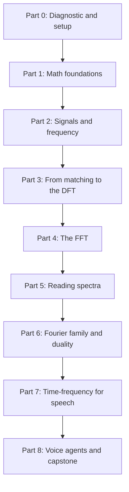

## The map

## Parts

| Part | Folder | Sessions | Content |
|---|---|---|---|
| 0 | [00 Progress](/notes/maths/fft-signal-processing/00-progress) | 1 | A short diagnostic, one question at a time |
| 1 | [01 Math foundations](/notes/maths/fft-signal-processing/01-math-foundations) | 0 to 6 | Radians, sums, dot product, complex numbers, Euler's formula, roots of unity |
| 2 | [02 Signals and frequency](/notes/maths/fft-signal-processing/02-signals-and-frequency) | 2 to 3 | Signals, period, frequency, amplitude, phase, samples |
| 3 | [03 Matching to DFT](/notes/maths/fft-signal-processing/03-matching-to-dft) | 5 to 6 | Matching score, basis, the DFT, the inverse DFT |
| 4 | [04 FFT](/notes/maths/fft-signal-processing/04-fft) | 6 to 8 | Even–odd split, butterfly, recursion, the FFT in code |
| 5 | [05 Reading spectra](/notes/maths/fft-signal-processing/05-reading-spectra) | 3 to 4 | Hertz, amplitude, mirror, leakage, windows, aliasing |
| 6 | [06 Fourier family and duality](/notes/maths/fft-signal-processing/06-fourier-family-and-duality) | 5 to 6 | Fourier series, Fourier transform, duality, convolution, uncertainty |
| 7 | [07 Speech time–frequency](/notes/maths/fft-signal-processing/07-speech-time-frequency) | 4 | STFT, spectrogram, mel features |
| 8 | [08 Voice agents](/notes/maths/fft-signal-processing/08-voice-agents) | 4 and a capstone | The voice-agent pipeline |

The plan has about 35 to 45 sessions. A **lesson** is one idea. A **session** is one sitting.

Part 1 is "just in time". A math lesson comes just before the first lesson that needs it. If the diagnostic shows that I know the idea, one check question is enough.

The plan goes from discrete to continuous. The DFT is a finite sum, so you can compute it by hand and in a for-loop. The Fourier series and the Fourier transform use integrals. An integral is the limit of a sum.

## How each session works

1. **Recall.** One or two questions on old lessons.
2. **Problem.** The question that the idea answers.
3. **Intuition.** A picture or an analogy, and the point where the analogy stops working.
4. **Video.** One exact clip from the course.
5. **Animation.** A new animation, only for a gap that the course video does not cover.
6. **Math.** Every symbol defined, real numbers substituted, every step shown.
7. **Calculation.** A small result by hand.
8. **Code.** I write the code myself. Hints come in three levels: idea, pseudocode, partial code.
9. **Check and explain back.** Check questions, then I teach the idea back.
10. **Close.** Session report and notes update.

> [!key] Gate rule
> A gate passes only when I answer the check questions correctly in my own words. "I understand" does not pass a gate.
