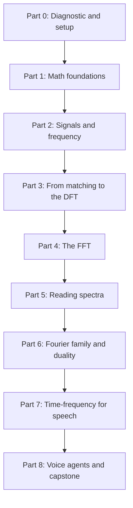

## The map

## Parts

| Part | Folder | Sessions | Content |
|---|---|---|---|
| 0 | [00 Progress](/notes/maths/fft-signal-processing/00-progress) | 1 | A short diagnostic, one question at a time |
| 1 | [01 Math foundations](/notes/maths/fft-signal-processing/01-math-foundations) | 0 to 6 | Radians, sums, dot product, complex numbers, Euler's formula, roots of unity |
| 2 | [02 Signals and frequency](/notes/maths/fft-signal-processing/02-signals-and-frequency) | 2 to 3 | Signals, period, frequency, amplitude, phase, samples |
| 3 | [03 Matching to DFT](/notes/maths/fft-signal-processing/03-matching-to-dft) | 5 to 6 | Matching score, basis, the DFT, the inverse DFT |
| 4 | [04 FFT](/notes/maths/fft-signal-processing/04-fft) | 6 to 8 | Even–odd split, butterfly, recursion, the FFT in code |
| 5 | [05 Reading spectra](/notes/maths/fft-signal-processing/05-reading-spectra) | 3 to 4 | Hertz, amplitude, mirror, leakage, windows, aliasing |
| 6 | [06 Fourier family and duality](/notes/maths/fft-signal-processing/06-fourier-family-and-duality) | 5 to 6 | Fourier series, Fourier transform, duality, convolution, uncertainty |
| 7 | [07 Speech time–frequency](/notes/maths/fft-signal-processing/07-speech-time-frequency) | 4 | STFT, spectrogram, mel features |
| 8 | [08 Voice agents](/notes/maths/fft-signal-processing/08-voice-agents) | 4 and a capstone | The voice-agent pipeline |

The plan has about 35 to 45 sessions. A **lesson** is one idea. A **session** is one sitting.

Part 1 is "just in time". A math lesson comes just before the first lesson that needs it. If the diagnostic shows that I know the idea, one check question is enough.

The plan goes from discrete to continuous. The DFT is a finite sum, so you can compute it by hand and in a for-loop. The Fourier series and the Fourier transform use integrals. An integral is the limit of a sum.

## How each session works

1. **Recall.** One or two questions on old lessons.
2. **Problem.** The question that the idea answers.
3. **Intuition.** A picture or an analogy, and the point where the analogy stops working.
4. **Video.** One exact clip from the course.
5. **Animation.** A new animation, only for a gap that the course video does not cover.
6. **Math.** Every symbol defined, real numbers substituted, every step shown.
7. **Calculation.** A small result by hand.
8. **Code.** I write the code myself. Hints come in three levels: idea, pseudocode, partial code.
9. **Check and explain back.** Check questions, then I teach the idea back.
10. **Close.** Session report and notes update.

> [!key] Gate rule
> A gate passes only when I answer the check questions correctly in my own words. "I understand" does not pass a gate.

## Study order

Study the lessons in this order. Each math lesson (F) comes just before the first lesson that needs it. L27 is the gate before part 06.

1. [F1: Reading graphs](/notes/maths/fft-signal-processing/01-math-foundations/f1-graphs)
2. [L1: What a signal is](/notes/maths/fft-signal-processing/02-signals-and-frequency/l1-what-a-signal-is)
3. [L2: Period and frequency](/notes/maths/fft-signal-processing/02-signals-and-frequency/l2-period-and-frequency)
4. [L3: Amplitude](/notes/maths/fft-signal-processing/02-signals-and-frequency/l3-amplitude)
5. [F2: Radians and the unit circle](/notes/maths/fft-signal-processing/01-math-foundations/f2-radians-and-the-unit-circle)
6. [L4: Phase](/notes/maths/fft-signal-processing/02-signals-and-frequency/l4-phase)
7. [L5: Two domains](/notes/maths/fft-signal-processing/02-signals-and-frequency/l5-two-domains)
8. [L6: Samples](/notes/maths/fft-signal-processing/02-signals-and-frequency/l6-samples)
9. [F3: Σ notation](/notes/maths/fft-signal-processing/01-math-foundations/f3-sigma-notation)
10. [F4: Vectors and the dot product](/notes/maths/fft-signal-processing/01-math-foundations/f4-vectors-and-the-dot-product)
11. [L7: The matching score](/notes/maths/fft-signal-processing/03-matching-to-dft/l7-matching-score)
12. [L8: Sweep and cancellation](/notes/maths/fft-signal-processing/03-matching-to-dft/l8-sweep-and-cancellation)
13. [L9: Basis and orthogonality](/notes/maths/fft-signal-processing/03-matching-to-dft/l9-basis-and-orthogonality)
14. [F5: Complex numbers](/notes/maths/fft-signal-processing/01-math-foundations/f5-complex-numbers)
15. [F6: Euler's formula](/notes/maths/fft-signal-processing/01-math-foundations/f6-eulers-formula)
16. [L10: The complex probe](/notes/maths/fft-signal-processing/03-matching-to-dft/l10-the-complex-probe)
17. [F7: Roots of unity](/notes/maths/fft-signal-processing/01-math-foundations/f7-roots-of-unity)
18. [L11: The DFT formula](/notes/maths/fft-signal-processing/03-matching-to-dft/l11-the-dft-formula)
19. [L12: Rotating vectors](/notes/maths/fft-signal-processing/03-matching-to-dft/l12-rotating-vectors)
20. [L13: The inverse DFT](/notes/maths/fft-signal-processing/03-matching-to-dft/l13-inverse-dft)
21. [L14: The cost of the direct DFT](/notes/maths/fft-signal-processing/04-fft/l14-cost-of-the-direct-dft)
22. [L15: The even–odd split](/notes/maths/fft-signal-processing/04-fft/l15-even-odd-split)
23. [L16: Two facts that make the FFT fast](/notes/maths/fft-signal-processing/04-fft/l16-two-facts)
24. [L17: The butterfly](/notes/maths/fft-signal-processing/04-fft/l17-the-butterfly)
25. [F8: Clock arithmetic, log₂ and binary](/notes/maths/fft-signal-processing/01-math-foundations/f8-clock-arithmetic-log-binary)
26. [L18: Recursion and the network](/notes/maths/fft-signal-processing/04-fft/l18-recursion-and-the-network)
27. [L19: Recursive FFT code](/notes/maths/fft-signal-processing/04-fft/l19-recursive-fft-code)
28. [L20: Iterative FFT and bugs](/notes/maths/fft-signal-processing/04-fft/l20-iterative-fft-and-bugs)
29. [L21: Why the FFT is fast](/notes/maths/fft-signal-processing/04-fft/l21-why-it-is-fast)
30. [L22: Other FFTs](/notes/maths/fft-signal-processing/04-fft/l22-other-ffts)
31. [L23: Hertz and amplitude](/notes/maths/fft-signal-processing/05-reading-spectra/l23-hertz-and-amplitude)
32. [L24: The mirror](/notes/maths/fft-signal-processing/05-reading-spectra/l24-the-mirror)
33. [L25: Leakage and windows](/notes/maths/fft-signal-processing/05-reading-spectra/l25-leakage-and-windows)
34. [L26: Aliasing](/notes/maths/fft-signal-processing/05-reading-spectra/l26-aliasing)
35. [L27: The final gate](/notes/maths/fft-signal-processing/05-reading-spectra/l27-final-gate)
36. [L28: Fourier series](/notes/maths/fft-signal-processing/06-fourier-family-and-duality/l28-fourier-series)
37. [L29: The Fourier transform](/notes/maths/fft-signal-processing/06-fourier-family-and-duality/l29-fourier-transform)
38. [L30: The four members of the family](/notes/maths/fft-signal-processing/06-fourier-family-and-duality/l30-the-four-members)
39. [L31: Duality pairs](/notes/maths/fft-signal-processing/06-fourier-family-and-duality/l31-duality-pairs)
40. [L32: The convolution theorem](/notes/maths/fft-signal-processing/06-fourier-family-and-duality/l32-convolution-theorem)
41. [L33: Uncertainty](/notes/maths/fft-signal-processing/06-fourier-family-and-duality/l33-uncertainty)
42. [L34: The STFT and the spectrogram](/notes/maths/fft-signal-processing/07-speech-time-frequency/l34-stft-and-spectrogram)
43. [L35: The inverse STFT](/notes/maths/fft-signal-processing/07-speech-time-frequency/l35-inverse-stft)
44. [L36: Mel and log-mel](/notes/maths/fft-signal-processing/07-speech-time-frequency/l36-mel-and-log-mel)
45. [L37: MFCC and pitch](/notes/maths/fft-signal-processing/07-speech-time-frequency/l37-mfcc-and-pitch)
46. [L38: The voice-agent pipeline](/notes/maths/fft-signal-processing/08-voice-agents/l38-pipeline-map)
47. [L39: The speech-to-text front end](/notes/maths/fft-signal-processing/08-voice-agents/l39-speech-to-text-front-end)
48. [L40: Enhancement](/notes/maths/fft-signal-processing/08-voice-agents/l40-enhancement)
49. [L41: The text-to-speech back end](/notes/maths/fft-signal-processing/08-voice-agents/l41-text-to-speech-back-end)
50. [L42: Latency](/notes/maths/fft-signal-processing/08-voice-agents/l42-latency)
51. [Capstone: An audio front end from scratch](/notes/maths/fft-signal-processing/08-voice-agents/capstone-audio-front-end)
