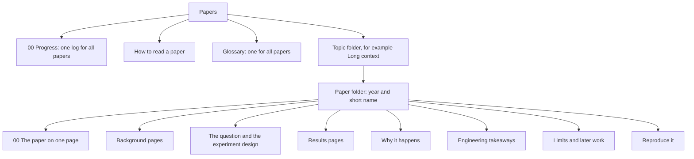

## Purpose

Each paper folder explains one research paper from first principles. It also tells what the paper changes for an AI engineer. Use these notes for revision, and to explain a paper to another person.

## How this area is built

1. A paper goes in the topic folder of its main question. Tags show its other topics.
2. A paper folder name starts with the year, for example `2023-lost-in-the-middle`.
3. Every paper folder uses the same set of pages. [How to read a paper](/notes/papers/reading-method) gives the set and the method.
4. All papers share one [Glossary](/notes/papers/glossary), because many papers use the same terms.
5. All papers share one [00 Progress](/notes/papers/00-progress) folder: one session log, one mistakes page and one weak-areas page.
6. The media for a paper goes in `/notes/media/papers/<paper folder>/`. The media path does not include the topic, so a paper can move to a different topic without broken media.

## Topics

| Topic | The main question |
|---|---|
| [Long context](/notes/papers/long-context) | How do language models use long inputs, and how can we make them use long inputs well? |
| [Reasoning models](/notes/papers/reasoning-models) | How do models that write a long chain of thought behave, why do they fail, and how do we run them well? |
| [LLM serving](/notes/papers/llm-serving) | How do we serve large language models fast and cheaply: how do we manage GPU memory, batch requests and schedule them? |

## Catalog

| Paper | Year | Topic | Main finding | Status |
|---|---|---|---|---|
| [Lost in the Middle](/notes/papers/long-context/2023-lost-in-the-middle) | 2023 | Long context | Models use information at the start and at the end of the context best. Accuracy falls when the information is in the middle. | not started |
| [Why Reasoning Models Loop](/notes/papers/reasoning-models/2025-why-reasoning-models-loop) | 2025 | Reasoning models | Reasoning models repeat the same text at low temperature, because of errors in learning. Temperature reduces the loops but does not fix the errors. | not started |
| [PagedAttention](/notes/papers/llm-serving/2023-pagedattention) | 2023 | LLM serving | Earlier systems used only 20.4% to 38.2% of their KV cache memory for token states. KV blocks with a block table per request cut the waste to under 4%. vLLM serves 2 to 4 times the throughput at the same latency. | not started |
| [SGLang and RadixAttention](/notes/papers/llm-serving/2023-sglang-radixattention) | 2023 | LLM serving | A radix tree of token runs keeps the KV cache of finished requests and reuses it for every later request with the same first tokens, with LRU leaf eviction and a cache-aware request order. Up to 6.4 times the throughput on LM programs. | not started |

## Reading queue

These papers continue the ideas of the papers in the catalog. The "Limits and later work" page of each paper explains them: [Lost in the Middle](/notes/papers/long-context/2023-lost-in-the-middle/10-limits-and-later-work), [Why Reasoning Models Loop](/notes/papers/reasoning-models/2025-why-reasoning-models-loop/13-limits-and-later-work), [PagedAttention](/notes/papers/llm-serving/2023-pagedattention/10-limits-and-later-work). For PagedAttention, [page 02](/notes/papers/llm-serving/2023-pagedattention/02-background-llm-serving-before-vllm) also explains the earlier work.

| Paper | Year | Topic | Why read it |
|---|---|---|---|
| Efficient Streaming Language Models with Attention Sinks | 2023 | Long context | The first tokens get strong attention, also when they carry no meaning. |
| RULER: What's the Real Context Size of Your Long-Context Language Models? | 2024 | Long context, evaluation | A benchmark that tests if a model can use its full context window. |
| Found in the Middle: Calibrating Positional Attention Bias Improves Long Context Utilization | 2024 | Long context | It measures a U-shaped attention bias inside the model and removes it. |
| Make Your LLM Fully Utilize the Context | 2024 | Long context, fine-tuning | It trains a model with the important information at random positions. |
| Context Rot: How Increasing Input Tokens Impacts LLM Performance | 2025 | Long context, evaluation | Accuracy falls as the input gets longer, in 18 recent models. |
| The Pitfalls of Next-Token Prediction | 2024 | Reasoning models | The star-graph task: next-token training can fail to learn the first step of a plan. |
| Word Salad Chopper | 2025 | Reasoning models | A small classifier on hidden states detects useless self-repetition during generation, and a cut saves tokens. |
| Circular Reasoning: Understanding Self-Reinforcing Loops in Large Reasoning Models | 2026 | Reasoning models, evaluation | A loop benchmark, the point where loops start, and early detection of loops. |
| Quantized Reasoning Models Think They Need to Think Longer, but They Do Not | 2026 | Reasoning models, model serving | Quantized models write longer chains with more "wait" and "but". A penalty on such words shortens them. |
| Token Budget Saturation and Mechanistic Early Detection of Reasoning Non-Convergence | 2026 | Reasoning models, evaluation | Greedy runs that do not converge reach the budget and are almost always wrong. Probes predict them early, but weakly. |
| Orca: A Distributed Serving System for Transformer-Based Generative Models | 2022 | LLM serving | Iteration-level scheduling: requests join and leave the batch after every iteration. vLLM keeps this scheduling and changes the memory management. |
| Splitwise: Efficient generative LLM inference using phase splitting | 2023 | LLM serving | The prompt phase and the token phase run on separate machines. |
| DistServe: Disaggregating Prefill and Decoding for Goodput-optimized Large Language Model Serving | 2024 | LLM serving | Prefill and decode run on separate GPUs, to serve the most requests within latency targets. |
| Taming Throughput-Latency Tradeoff in LLM Inference with Sarathi-Serve | 2024 | LLM serving | Chunked prefills and stall-free scheduling: a long prompt no longer stalls the running decodes. |
| vAttention: Dynamic Memory Management for Serving LLMs without PagedAttention | 2024 | LLM serving | The KV cache stays contiguous in virtual memory, and the CUDA driver attaches physical pages on demand. |
| Mooncake: A KVCache-centric Disaggregated Architecture for LLM Serving | 2024 | LLM serving | Separate prefill and decode clusters, with a KV cache in the CPU memory and SSDs of the GPU servers. |
| FlashInfer: Efficient and Customizable Attention Engine for LLM Inference Serving | 2025 | LLM serving | Attention kernels with a block-sparse format for paged KV caches, used in SGLang, vLLM and MLC-Engine. |
| LMCache: An Efficient KV Cache Layer for Enterprise-Scale LLM Inference | 2025 | LLM serving | A KV cache layer outside the engine that stores and reuses the KV caches of vLLM and SGLang. |
| Hydragen: High-Throughput LLM Inference with Shared Prefixes | 2024 | LLM serving | Decode attention over a shared prefix runs as one matrix-matrix product for the whole batch, merged exactly with the suffix by log-sum-exp. |
| Preble: Efficient Distributed Prompt Scheduling for LLM Serving | 2024 | LLM serving | A distributed scheduler that balances KV reuse against load over many GPUs. |
| CacheBlend: Fast Large Language Model Serving for RAG with Cached Knowledge Fusion | 2024 | LLM serving, RAG | Reuse of the KV caches of retrieved chunks that are not a prefix, with a partial recomputation. |
| The Early Bird Catches the Leak: Unveiling Timing Side Channels in LLM Serving Systems | 2024 | LLM serving, security | Shared KV caches and semantic caches leak system prompts and other users' prompts through response times. |
| Marconi: Prefix Caching for the Era of Hybrid LLMs | 2024 | LLM serving | Prefix caching for models that mix attention and SSM layers, where only exact SSM states can be reused. |
| Tail-Optimized Caching for LLM Inference | 2025 | LLM serving | An eviction policy for the prefix cache that targets the tail of the time to the first token. |
