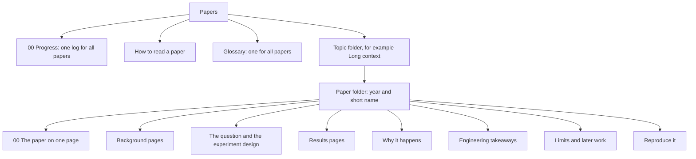

## Purpose

Each paper folder explains one research paper from first principles. It also tells what the paper changes for an AI engineer. Use these notes for revision, and to explain a paper to another person.

## How this area is built

1. A paper goes in the topic folder of its main question. Tags show its other topics.
2. A paper folder name starts with the year, for example `2023-lost-in-the-middle`.
3. Every paper folder uses the same set of pages. [How to read a paper](/notes/papers/reading-method) gives the set and the method.
4. All papers share one [Glossary](/notes/papers/glossary), because many papers use the same terms.
5. All papers share one [00 Progress](/notes/papers/00-progress) folder: one session log, one mistakes page and one weak-areas page.
6. The media for a paper goes in `/notes/media/papers/<paper folder>/`. The media path does not include the topic, so a paper can move to a different topic without broken media.

## Topics

| Topic | The main question |
|---|---|
| [Long context](/notes/papers/long-context) | How do language models use long inputs, and how can we make them use long inputs well? |

## Catalog

| Paper | Year | Topic | Main finding | Status |
|---|---|---|---|---|
| [Lost in the Middle](/notes/papers/long-context/2023-lost-in-the-middle) | 2023 | Long context | Models use information at the start and at the end of the context best. Accuracy falls when the information is in the middle. | not started |

## Reading queue

These papers continue the ideas of the papers in the catalog. The [Limits and later work](/notes/papers/long-context/2023-lost-in-the-middle/10-limits-and-later-work) page explains each one.

| Paper | Year | Topic | Why read it |
|---|---|---|---|
| Efficient Streaming Language Models with Attention Sinks | 2023 | Long context | The first tokens get strong attention, also when they carry no meaning. |
| RULER: What's the Real Context Size of Your Long-Context Language Models? | 2024 | Long context, evaluation | A benchmark that tests if a model can use its full context window. |
| Found in the Middle: Calibrating Positional Attention Bias Improves Long Context Utilization | 2024 | Long context | It measures a U-shaped attention bias inside the model and removes it. |
| Make Your LLM Fully Utilize the Context | 2024 | Long context, fine-tuning | It trains a model with the important information at random positions. |
| Context Rot: How Increasing Input Tokens Impacts LLM Performance | 2025 | Long context, evaluation | Accuracy falls as the input gets longer, in 18 recent models. |
