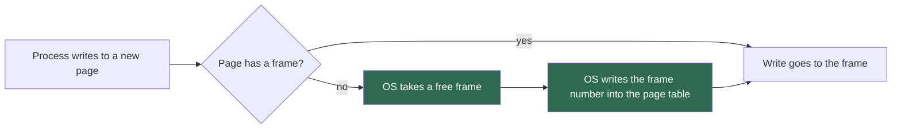

## 1. The question this page answers

The paper names its own source of inspiration. PagedAttention is "an attention algorithm inspired by the classical virtual memory and paging techniques in operating systems" (Abstract). The paper also gives the key to the analogy: "one can think of blocks as pages, tokens as bytes, and requests as processes" (§1).

So the first question in an interview is often: "Why is it called *paged* attention?" To answer it, you must know what an operating system does with memory, and why. This page answers four questions:

1. What problem did operating systems have when each program needed one contiguous piece of memory?
2. How do pages, frames and a page table solve that problem? How does one address translate, step by step?
3. Which extra tricks does paging allow: allocation on demand, sharing, copy-on-write and swapping?
4. Which of these ideas did vLLM copy, and where does the analogy stop?

Page 03 shows that LLM serving in 2023 had exactly the problem of question 1. Page 04 shows how attention changes so that it can work with pages.

## 2. Mental model

> [!analogy] A long report in a cabinet of identical drawers
> You write a long report, one page at a time. A cabinet has many identical drawers, and each drawer holds exactly one page. You put each new page into any free drawer, not the next drawer. A small index card lists, in order, the drawer of page 1, the drawer of page 2, and so on. To read the report in order, you follow the card. You never need a run of empty drawers next to each other. When the report is finished, you free its drawers one by one, and anyone can use them.
>
> **Where it stops working:** a person who opens drawers in a random order loses a lot of time. A computer loses only a little time: one extra lookup in the card for each page. Computers make this lookup fast in two different ways. An operating system uses special hardware. PagedAttention does the lookup inside its own GPU code (page 04).

## 3. Terms

| Term | Plain meaning |
|---|---|
| byte | 8 bits. The smallest unit of memory that has its own address. |
| memory address | The number of one byte in memory. Addresses start at 0 and count up. |
| process | A running program. Each process needs memory for its code and its data. |
| contiguous | Next to each other with no gap. A contiguous region of memory is one unbroken run of addresses. |
| physical memory | The real memory chips. A physical address is the real position of a byte in them. |
| virtual address | The address that a program uses. The hardware translates it into a physical address. |
| page | A fixed-size piece of a program's virtual address space. A typical size is 4 KiB (4096 bytes). |
| frame | A fixed-size slot of physical memory, the same size as a page. One frame holds one page. |
| page table | A table for one process that gives, for each virtual page, the frame that holds it. |
| virtual page number (VPN) | The number of the page that holds a virtual address: $\lfloor \text{address} / P \rfloor$ for page size $P$. |
| offset | The position of a byte inside its page: $\text{address} \bmod P$. Translation does not change it. |
| memory management unit (MMU) | The part of the processor that translates virtual addresses into physical addresses. |
| TLB | Translation lookaside buffer. A small hardware cache of recent translations inside the MMU. |
| internal fragmentation | Memory that is allocated to a process but never used, inside its own region. |
| external fragmentation | Free memory that exists but is split into gaps too small for a new request. |
| allocation on demand | Giving a page a frame only when the program first uses that page. |
| copy-on-write | Two processes share one frame until one of them writes. Only then does the system make a private copy. |
| swapping | Moving pages from memory to disk to make room, and moving them back later. |
| page fault | The event when a program uses a page that has no frame in physical memory at that moment. |

All terms are also in the [Glossary](/notes/papers/glossary).

## 4. Memory, addresses and processes

### 4.1 Memory is a long row of numbered bytes

A **byte** is 8 bits. Memory is a very long row of bytes. Each byte has a number, its **memory address**. The first byte has address 0, the next has address 1, and so on. To read a value, a program gives an address and receives the bytes that start there. For bits, bytes, KB and KiB, read [L4: Numbers in memory](/notes/ai/llm-systems/01-math-and-hardware/l4-numbers-in-memory).

This guide writes binary sizes with "i": 1 KiB = 1024 bytes, 1 MiB = 1024 KiB, 1 GiB = 1024 MiB. Decimal sizes have no "i": 1 KB = 1000 bytes, 1 GB = $10^9$ bytes. Many sources, and the paper, write "KB" or "GB" for both. These notes say which one a number uses.

### 4.2 A process needs memory

A **process** is a running program. A computer runs many processes at the same time: a browser, an editor, a server. Each process needs memory for its code and its data. Its needs change while it runs: a process can ask for more memory, and it frees memory when it no longer needs it.

The operating system (OS) decides which process gets which memory. It must solve one problem again and again: give each process the memory it asks for, without waste, and without letting one process damage another.

### 4.3 The simple approach: one contiguous region for each process

The simplest rule gives each process one **contiguous** region: an unbroken run of addresses, from a start address to an end address. The process uses addresses inside its region only.

This rule is easy for the hardware. To find byte number $n$ of the region, add $n$ to the start address. But it has three problems:

1. **The size must be known in advance.** The OS must reserve the whole region when the process starts. A process that may need a lot of memory must reserve a lot, even if it never uses it.
2. **Growth is hard.** If the process needs more memory, the bytes after its region may belong to another process.
3. **Gaps form.** When processes finish, they leave gaps of different sizes between the regions that remain.

Problems 1 and 3 have names: internal and external fragmentation.

## 5. Fragmentation: two kinds of waste

### 5.1 External fragmentation

**External fragmentation** is free memory that exists but is split into gaps that are too small for a new request. The OSTEP textbook describes it this way: "the free space gets chopped into little pieces of different sizes and is thus fragmented" (OSTEP, free-space chapter).

> [!example] Worked example: 40 KB free, but a 30 KB request fails
> A toy memory has 100 KB. Each process gets one contiguous region.
>
> 1. Process A takes 0 to 30 KB (30 KB). Process B takes 30 to 50 KB (20 KB). Process C takes 50 to 80 KB (30 KB). The range 80 to 100 KB is free (20 KB).
> 2. Process B finishes. Its range 30 to 50 KB becomes free (20 KB).
> 3. Free memory in total: $20 + 20 = 40$ KB.
> 4. A new process D asks for 30 KB in one piece.
> 5. The largest free gap is 20 KB. $20 < 30$, so the request fails.
>
> 40 KB is free, but D cannot use any of it. The free space is real but useless for D. That is external fragmentation.

A fix is **compaction**: move processes so that the gaps join into one large gap. Compaction copies a lot of memory and stops the processes while it runs. The paper rejects it for the KV cache: "performing compaction in a performance-sensitive LLM serving system is impractical due to the massive KV cache" (§3.1).

### 5.2 Internal fragmentation

**Internal fragmentation** is memory that a region holds but never uses. It happens when an allocator gives more memory than the process uses. OSTEP calls it "any unasked for (and thus unused) space in such a chunk".

A common cause is an allocator that only gives out certain sizes. The **buddy allocator** gives out only powers of two. OSTEP explains that it "recursively divides free space by two until a block that is big enough to accommodate the request is found". The paper names the buddy allocator as a source of external fragmentation in earlier LLM serving systems (§3.1).

> [!example] Worked example: the buddy allocator and a 33 KB request
> Free memory is one region of 128 KB. A process asks for 33 KB.
>
> 1. Halve 128 KB: 64 KB. Is 64 KB big enough? Yes, $64 \ge 33$.
> 2. Halve again: 32 KB. Is 32 KB big enough? No, $32 < 33$.
> 3. So the allocator gives the 64 KB piece.
> 4. Internal fragmentation: $64 - 33 = 31$ KB, which is $31 / 64 \approx 48.4\%$ of the piece.

> [!key] The two kinds of waste in one sentence each
> External fragmentation: free memory between regions that nobody can use. Internal fragmentation: memory inside a region that its owner never uses. Contiguous allocation of variable sizes produces both.

## 6. Virtual memory and paging

### 6.1 The idea: every process sees its own addresses

With **virtual memory**, a process does not use physical addresses. It uses **virtual addresses**: its own private numbering that starts at 0. The hardware translates each virtual address into a **physical address**, the real position in the memory chips. The process never sees the translation.

This one level of indirection has a big effect. The virtual addresses of a process are contiguous. The physical memory behind them does not need to be contiguous.

### 6.2 Pages and frames

**Paging** cuts memory into pieces of one fixed size.

1. The virtual address space of each process is divided into **pages**. OSTEP: "we divide it into fixed-sized units, each of which we call a page."
2. Physical memory is divided into **frames** of the same size. OSTEP: "we view physical memory as an array of fixed-sized slots called page frames".
3. Any page can live in any frame.

A typical page size is 4 KiB, which is 4096 bytes. OSTEP uses "a typical 32-bit address space, with 4KB pages" as its main example.

### 6.3 The page table

The OS keeps one **page table** for each process. OSTEP describes it as "a per-process data structure known as a page table", whose job is to "store address translations for each of the virtual pages of the address space".

One entry of the page table is a **page table entry** (PTE). It holds the **frame number** (PFN, physical frame number) and some flag bits. OSTEP lists these bits:

| Bit | What it says |
|---|---|
| valid | Is this translation valid at all? |
| protection | May the process read, write or execute this page? |
| present | Is the page in physical memory now, or on disk? |
| dirty | Has the page changed since the OS brought it into memory? |
| reference (accessed) | Has the process used the page recently? |

### 6.4 Address translation, step by step

Let $P$ be the page size. A virtual address $a$ has two parts:

$$
\text{VPN} = \left\lfloor \frac{a}{P} \right\rfloor, \qquad \text{offset} = a \bmod P
$$

The page table gives the frame number of that page: $\text{PFN} = \text{table}[\text{VPN}]$. The physical address is:

$$
\text{physical address} = \text{PFN} \times P + \text{offset}
$$

The offset does not change, because a page and a frame have the same size and the same internal layout. When $P$ is a power of two, the split is a split of bits. The low $\log_2 P$ bits are the offset, and the high bits are the VPN. No division is necessary.


> [!example] Worked example: a toy machine with 16-byte pages
> The virtual address space has 64 bytes, so a virtual address has 6 bits ($2^6 = 64$). The page size is $P = 16$ bytes ($2^4$), so the offset has 4 bits and the VPN has $6 - 4 = 2$ bits. Physical memory has 128 bytes: 8 frames of 16 bytes.
>
> The page table of the process has four entries. VPN 0 → frame 3. VPN 1 → frame 7. VPN 2 → frame 5. VPN 3 → not valid.
>
> Translate the virtual address 45.
>
> 1. In binary, 45 is `101101`.
> 2. VPN: the top 2 bits, `10`, which is 2. Check: $\lfloor 45 / 16 \rfloor = 2$.
> 3. Offset: the low 4 bits, `1101`, which is 13. Check: $45 \bmod 16 = 13$.
> 4. Page table: VPN 2 → frame 5.
> 5. Physical address: $5 \times 16 + 13 = 93$. In binary: frame `101` joined with offset `1101` gives `1011101`, which is 93.
>
> A use of the virtual address 50 fails: $\lfloor 50/16 \rfloor = 3$, and VPN 3 has no valid entry.

> [!example] Worked example: a 32-bit address with 4 KiB pages
> $P = 4096 = 2^{12}$, so the offset has 12 bits and the VPN has $32 - 12 = 20$ bits. In hexadecimal, each digit is 4 bits, so the last 3 hex digits are the offset.
>
> 1. Virtual address `0x00403A7C`, which is 4,209,276.
> 2. VPN: `0x00403`, which is 1027. Offset: `0xA7C`, which is 2684.
> 3. Suppose that the page table maps VPN 1027 to frame `0x1F2`, which is 498.
> 4. Physical address: $498 \times 4096 + 2684 = 2{,}042{,}492$, which is `0x1F2A7C`.
>
> The page table of one such process has $2^{20} = 1{,}048{,}576$ entries. With 4 bytes per entry, it needs $4{,}194{,}304$ bytes, which is 4 MiB. OSTEP calls this "an immense 4MB of memory needed for each page table!" Real systems use multi-level page tables to make the table smaller.

### 6.5 The cost of the indirection

Each memory access now needs a translation first. OSTEP: "paging requires us to perform one extra memory reference in order to first fetch the translation". It adds that these extra references "will likely slow down the process by a factor of two or more".

The help is hardware. The **memory management unit (MMU)** of the processor does the translation. Inside it, the **TLB** keeps recent translations. OSTEP defines the TLB as "a hardware cache of popular virtual-to-physical address translations". Most accesses find their translation in the TLB and pay almost nothing.

> [!note] Keep this in mind for page 04
> A GPU attention kernel cannot use the CPU's MMU for the KV cache. PagedAttention reads its own table (the block table) in its own code. The paper accepts a cost for this: "extra overhead of memory indirection and non-contiguous block memory" (§8). Page 04 explains why the cost stays small.

## 7. Why paging removes external fragmentation

All frames have the same size. So any free frame fits any page. A request for $n$ pages succeeds whenever at least $n$ frames are free, wherever they are. OSTEP states the result directly: paging "does not lead to external fragmentation, as paging (by design) divides memory into fixed-sized units."

> [!example] Worked example: the failed request of §5.1, now with pages
> Use the same 100 KB memory, with pages of 10 KB. Physical memory has 10 frames: frame 0 is 0 to 10 KB, frame 1 is 10 to 20 KB, and so on.
>
> 1. A has frames 0, 1, 2. B had frames 3, 4. C has frames 5, 6, 7. Frames 8, 9 are free.
> 2. B finishes. Free frames: 3, 4, 8, 9. That is 4 frames, 40 KB.
> 3. D asks for 30 KB, which is 3 pages.
> 4. The OS gives D the frames 3, 4 and 8. D's page table: VPN 0 → frame 3, VPN 1 → frame 4, VPN 2 → frame 8.
> 5. D sees addresses 0 to 30 KB, contiguous. Its frames are not contiguous: frame 8 is far from frame 4. D does not know or care.
>
> The request that failed in §5.1 succeeds now.

Internal fragmentation does not disappear completely. A region whose size is not a multiple of $P$ wastes part of its last page. A process that needs 23 KB with 10 KB pages gets 3 pages, 30 KB. It wastes $30 - 23 = 7$ KB, all of it in the last page. The waste of one region is always less than one page: at most $P - 1$ bytes.

> [!key] Paging changes the waste problem
> With contiguous variable-size regions, waste can be large and it is hard to predict. With paging, external fragmentation is zero and internal fragmentation is less than one page per region. The price is one table lookup per page access.

## 8. Four more tricks that paging allows

The table between virtual and physical addresses gives the OS freedom. Four tricks use that freedom. PagedAttention copies all four.

### 8.1 Allocation on demand

The OS does not need to give a frame to a page before the process uses it. With **allocation on demand**, a new page gets only a table entry that marks it as not yet usable. OSTEP describes it: the OS "puts an entry in the page table that marks the page inaccessible", and "If the process never accesses the page, all such work is avoided."



So a process that reserves a large virtual range but uses only a small part of it costs only the frames that it uses.

### 8.2 Sharing

Two page tables can give the same frame number. Then two processes read the same physical memory. Each sees the memory at its own virtual address. OSTEP's example is library code: "any sort of shared library can be mapped copy-on-write into the address spaces of many processes". One copy of a library in memory serves every process that uses it.

### 8.3 Copy-on-write

When a process makes a copy of itself (on Unix, with `fork`), the copy starts with the same data. Copying every page at once is slow and often useless. **Copy-on-write** delays the copy:

1. The OS maps each page of the parent into the child as well, and marks it read-only in both. OSTEP: "it can map it into the target address space and mark it readonly in both address spaces."
2. As long as both processes only read, they share the frames.
3. When one of them writes, the hardware stops the write and calls the OS. OSTEP: "it will trap into the OS".
4. The OS then does the copy: it will "allocate a new page, fill it with the data, and map this new page into the address space of the faulting process."
5. The write continues on the private copy.

Only pages that one of the processes changes are ever copied. To know when a frame is shared, the system must count how many page tables use it. Interpretation of these notes: an OS keeps such a count for each shared frame. The paper states this part explicitly for its own blocks: "we introduce a reference count for each physical block" (§4.4).

### 8.4 Swapping

When physical memory is full, the OS can move some pages to disk. OSTEP describes **swap space** as space that lets the OS "reserve some space on the disk for moving pages back and forth."

1. The OS chooses a page to remove. OSTEP calls this choice the "page-replacement policy".
2. It writes the page to swap space and clears the present bit in the page table entry.
3. Later, the process uses that page. OSTEP: "The act of accessing a page that is not in physical memory is commonly referred to as a page fault."
4. The OS reads the page from disk into a free frame and updates the table.

Disk is far slower than memory. OSTEP warns that a bad choice "can cause a program to run at disk-like speeds instead of memory-like speeds".

## 9. From operating systems to PagedAttention

The paper takes each of these ideas into GPU memory for the KV cache. A **KV block** holds the key and value vectors of a fixed number of tokens, $B$ (§4.1). The paper's default is $B = 16$ (§7.2). Page 04 explains the attention side, and page 05 explains the block manager.


| Operating system | PagedAttention and vLLM | What the paper says |
|---|---|---|
| byte | the key and value vectors of one token | "tokens as bytes" (§1) |
| page | a logical KV block of $B$ tokens | "blocks as pages" (§1) |
| frame | a physical KV block in GPU memory | "fixed-size KV blocks, like pages in virtual memory" (§4.2) |
| process | a request | "requests as processes" (§1) |
| page table | the block table of a request | "the mapping between logical and physical KV blocks of each request" (§4.2) |
| virtual address | the position of a token in its sequence | Interpretation of these notes, from the block definition in §4.1 |
| allocation on demand | a new physical block only when the last block is full | "allocating them on demand" (§1) |
| shared library | a shared prompt prefix | "as how OS handles shared library across processes" (§4.4) |
| copy-on-write after `fork` | copy-on-write of a block, with reference counts | "similar to the copy-on-write technique in OS virtual memory" (§4.4) |
| swap to disk | swap blocks to CPU memory | "copy the evicted pages to a swap space on the disk" (§4.5, about the OS) |
| no counterpart | recompute the evicted KV cache | "not feasible in OS" (§8) |

A block table entry holds two things: the physical block number, and "the number of filled positions" (§4.2). The second field has no exact OS counterpart. It tells the system how many token slots of the block hold data. The paper's own words: "The last KV block's unfilled positions are reserved for future generations" (§4.2).

> [!example] Worked example: translate a token position
> Use the paper's example of §4.3 (Figure 6). The block size is $B = 4$. The block table of one request has three entries. Logical block 0 → physical block 7. Logical block 1 → physical block 1. Logical block 2 → physical block 3. The prompt is "Four score and seven years ago our" (7 tokens). The model then generates "fathers" and "brought". Count positions from 0, as code does.
>
> 1. "brought" has position 8. Logical block: $\lfloor 8 / 4 \rfloor = 2$. Offset: $8 \bmod 4 = 0$.
> 2. Block table: logical block 2 → physical block 3.
> 3. If the pool numbers its slots from 0, the flat slot is $3 \times 4 + 0 = 12$.
> 4. "fathers" has position 7: logical block $\lfloor 7/4 \rfloor = 1$, offset 3, physical block 1, flat slot $1 \times 4 + 3 = 7$.
>
> This is the same arithmetic as §6.4, with the page size $P$ replaced by the block size $B$, and bytes replaced by tokens. The paper numbers positions from 1, so its block $j$ holds positions $(j-1)B + 1$ to $jB$ (§4.1). Page 04 uses that numbering.

> [!key] The analogy in one line
> A request's tokens are contiguous in its own logical view. Its KV blocks can be anywhere in GPU memory. The block table translates one view into the other, exactly as a page table does.

## 10. Where the analogy stops

The analogy is strong but not exact. An interviewer who knows operating systems will test these differences.

1. **Who translates.** An OS translates with hardware: the MMU and its TLB. PagedAttention translates in software. The attention kernel reads the block table and computes each block's address itself (page 04).
2. **No page faults inside attention.** An OS can stop a process at any access and fetch a missing page. The attention kernel needs every block of a sequence in GPU memory before it starts. So vLLM moves a sequence's blocks in or out all together. The paper calls this "an all-or-nothing eviction policy" (§4.5). It explains why: "processing a request requires all of its corresponding token states" (§8).
3. **Recomputation.** A lost OS page cannot be rebuilt: its data exists only in that page. A lost KV block can be rebuilt by running the model again on the tokens. The paper uses recomputation as an alternative to swapping, which is "not feasible in OS" (§8). Page 07 compares the two.
4. **The size of one "byte".** In the OS, the unit is one byte. Here the unit is one token, and one token's keys and values are large. For OPT-13B, one token needs 819,200 bytes, which is 800 KiB, across all 40 layers (page 03). A block of 16 tokens is then $16 \times 819{,}200 = 13{,}107{,}200$ bytes, which is 12.5 MiB, across all layers.
5. **The purpose.** An OS also uses virtual memory to isolate processes from each other. vLLM uses the idea only to manage memory. All its blocks belong to one serving process.
6. **The source of the pool.** vLLM reserves one large region of GPU memory and cuts it into blocks itself. The paper: "a block engine allocates a contiguous chunk of GPU DRAM and divides it into physical KV blocks" (§4.2). The same happens "on CPU RAM for swapping" (§4.2).

> [!note] A different design that uses real virtual memory
> Later work asked: why not use the GPU's own virtual memory hardware, so that the attention kernel sees contiguous addresses? vAttention (2024) does this with CUDA virtual memory APIs. Page 10 covers it.

### Exercises

1. **Write `translate(va, page_size, page_table)`.** It returns the physical address, or raises an error for a page with no entry. Acceptance test: `translate(45, 16, {0: 3, 1: 7, 2: 5})` returns 93, `translate(0x00403A7C, 4096, {0x403: 0x1F2})` returns `0x1F2A7C`, and virtual address 50 in the toy table raises an error.
   - Hint 1: Python's `divmod(a, b)` returns the quotient and the remainder together.
   - Hint 2: The offset does not change. Only the page number changes.
2. **Write `token_slot(t, block_size, block_table)`.** It returns the physical block, the offset and the flat slot of token position `t` (counted from 0). Acceptance test: `token_slot(8, 4, [7, 1, 3])` returns `(3, 0, 12)`, and `token_slot(7, 4, [7, 1, 3])` returns `(1, 3, 7)`.
   - Hint 1: This is `translate` with tokens in place of bytes.
   - Hint 2: The flat slot is the physical block times the block size, plus the offset.

Write your code in `C:\Users\ASohi\Downloads\AI\agent-harness-lab\llm-systems\`.

## 11. Common mistakes

1. **"Paging makes memory faster."** Paging adds a translation step, so each access costs a little more. Its benefit is less waste and more flexibility, not speed.
2. **"Paging removes all fragmentation."** It removes external fragmentation. Internal fragmentation remains in the last page of each region, but it is less than one page.
3. **"Virtual memory means using the disk as memory."** Swapping to disk is one use of virtual memory. The core idea is the translation between virtual and physical addresses. PagedAttention uses the translation and swaps to CPU memory, not to disk.
4. **"The page table stores the data."** The page table stores only frame numbers and flag bits. The data stays in the frames.
5. **"In PagedAttention, a token is stored in pieces across pages."** Each token's key and value vectors stay whole inside one block. Only different blocks are scattered.
6. **"vLLM uses the operating system's paging for the GPU."** The original vLLM manages its own blocks and its own block tables in software. The attention kernel does the translation.

## 12. One-minute explanation

An operating system once gave each program one contiguous region of memory. That caused two kinds of waste: external fragmentation, free memory split into gaps too small to use, and internal fragmentation, memory reserved but never used. Paging fixed this: memory is cut into fixed-size pages, and any page can sit in any physical frame. A page table for each process translates virtual page numbers into frame numbers. The address splits into a page number and an offset, and only the page number changes. Because all frames have the same size, external fragmentation disappears, and internal fragmentation is less than one page. The table also allows allocation on demand, sharing, copy-on-write and swapping. PagedAttention copies all of this for the KV cache: blocks are pages, tokens are bytes, requests are processes, and each request has a block table. The difference is that the translation happens in software inside the attention kernel, and a lost block can be recomputed.

## 13. Check questions

```check
{
  "question": "A machine has 4 KiB pages and 32-bit virtual addresses. How many bits are the offset and how many are the virtual page number? How many entries does one flat page table have?",
  "hint": "4 KiB is a power of two. Which power?",
  "answer": "$4096 = 2^{12}$, so the offset has 12 bits. The VPN has $32 - 12 = 20$ bits. A flat page table has one entry per virtual page: $2^{20} = 1{,}048{,}576$ entries. With 4-byte entries it needs 4 MiB per process."
}
```

```check
{
  "question": "Translate the virtual address 21 on the toy machine of §6.4 (16-byte pages; VPN 0 → frame 3, VPN 1 → frame 7, VPN 2 → frame 5).",
  "hint": "Compute the VPN with a division and the offset with a remainder.",
  "answer": "VPN $= \\lfloor 21/16 \\rfloor = 1$, offset $= 21 \\bmod 16 = 5$. VPN 1 → frame 7. Physical address $= 7 \\times 16 + 5 = 117$. In binary: 21 is `010101`, VPN `01`, offset `0101`, frame `111`, so the result is `1110101` = 117."
}
```

```check
{
  "question": "A memory has free gaps of 10 KB, 5 KB and 20 KB. A request needs 25 KB in one contiguous piece. Does it succeed? What is this kind of waste called? What would paging with 5 KB pages change?",
  "answer": "It fails: $10 + 5 + 20 = 35$ KB is free, but the largest gap is 20 KB, and $20 < 25$. This is external fragmentation. With 5 KB pages, all memory is whole frames. The gaps are $10/5 = 2$, $5/5 = 1$ and $20/5 = 4$ free frames: 7 in total. The request needs $25/5 = 5$ pages, and any 5 of the 7 free frames can hold them, wherever they are. Paging removes external fragmentation."
}
```

```check
{
  "question": "Interview follow-up: The paper says 'one can think of blocks as pages, tokens as bytes, and requests as processes'. Map the address translation formula of paging onto a token position. Use the block table [7, 1, 3], block size 4 and token position 10 (counted from 0).",
  "hint": "Replace the page size P with the block size B.",
  "answer": "Logical block $= \\lfloor 10 / 4 \\rfloor = 2$, offset $= 10 \\bmod 4 = 2$. The block table maps logical block 2 to physical block 3. Flat slot $= 3 \\times 4 + 2 = 14$. The token's key and value vectors are in physical block 3, slot 2. Note: in the paper's example (§4.3) only 9 tokens exist at the last step shown, so position 10 would need two more generated tokens first."
}
```

```check
{
  "question": "Interview follow-up: An OS translates addresses with the MMU and the TLB. Who translates in PagedAttention, and what does that cost?",
  "hint": "Think about which code reads the block table.",
  "answer": "The attention kernel translates in software. For each block, it reads the physical block number from the block table and computes the block's address. The paper names the cost: 'extra overhead of memory indirection and non-contiguous block memory' (§8). It measured 20-26% higher attention kernel latency than FasterTransformer's kernel (§7.1). The cost stays small because one table entry serves a whole block of tokens (page 04)."
}
```

```check
{
  "question": "Interview follow-up: Why can vLLM recompute a KV block that it removed, but an OS cannot recompute a page that it removed? What does vLLM do instead of a page fault?",
  "answer": "A KV block is a function of the tokens and the model weights: the model can compute it again from the token IDs. An OS page holds data that exists nowhere else, so it must be saved to swap space. The paper notes that recomputation is 'not feasible in OS' (§8). vLLM has no page faults inside attention: the kernel needs all blocks of a sequence in GPU memory, so vLLM evicts and restores a sequence's blocks all together ('all-or-nothing', §4.5)."
}
```

```check
{
  "question": "Interview follow-up: Copy-on-write in an OS and in vLLM: what is shared, what triggers the copy, and what extra field must the system keep?",
  "answer": "OS: after `fork`, parent and child share frames marked read-only. A write traps into the OS, which allocates a new frame, copies the data and maps the copy into the writer's table. vLLM: several samples of one prompt share the prompt's physical blocks. When a sample must write a new token into a shared block, vLLM copies that block first. Both need a count of users per frame or block: the paper adds 'a reference count for each physical block' (§4.4). When the count is 1, the writer can write in place."
}
```

```check
{
  "question": "Exercise 1 and 2: show a reference solution",
  "answer": "```python\n# Exercise solutions for page 01 (must run)\ndef translate(va, page_size, page_table):\n    \"\"\"Return the physical address of virtual address va, or raise on an invalid page.\"\"\"\n    vpn, offset = divmod(va, page_size)        # split the address\n    if vpn not in page_table:\n        raise LookupError(f\"page fault: virtual page {vpn} has no frame\")\n    pfn = page_table[vpn]                      # one lookup in the table\n    return pfn * page_size + offset            # same offset inside the frame\n\ndef token_slot(t, block_size, block_table):\n    \"\"\"Return (physical block, offset, flat slot) for 0-based token position t.\"\"\"\n    logical, offset = divmod(t, block_size)\n    physical = block_table[logical]\n    return physical, offset, physical * block_size + offset\n\ntable = {0: 3, 1: 7, 2: 5}                     # virtual page 3 is not mapped\nassert translate(45, 16, table) == 93\nassert translate(0x00403A7C, 4096, {0x403: 0x1F2}) == 0x1F2A7C\ntry:\n    translate(50, 16, table)\nexcept LookupError as e:\n    print(e)\nassert token_slot(8, 4, [7, 1, 3]) == (3, 0, 12)\nassert token_slot(7, 4, [7, 1, 3]) == (1, 3, 7)\nprint(\"all tests pass\")\n```\n\n`divmod` gives the page number and the offset in one step. Only the page number goes through the table. The offset is added back unchanged, because a page and a frame have the same layout. `token_slot` is the same function with tokens in place of bytes."
}
```

## 14. Links

- Next: [02 Background: LLM serving before vLLM](/notes/papers/llm-serving/2023-pagedattention/02-background-llm-serving-before-vllm)
- The paper on one page: [00 The paper on one page](/notes/papers/llm-serving/2023-pagedattention/00-paper-on-one-page)
- The waste in LLM serving: [03 The question: where does KV cache memory go?](/notes/papers/llm-serving/2023-pagedattention/03-the-question)
- The attention side: [04 PagedAttention: the algorithm](/notes/papers/llm-serving/2023-pagedattention/04-pagedattention-the-algorithm)
- The block manager: [05 The KV cache manager and block tables](/notes/papers/llm-serving/2023-pagedattention/05-the-kv-cache-manager)
- Copy-on-write for blocks: [06 Sharing: parallel sampling, beam search and shared prefixes](/notes/papers/llm-serving/2023-pagedattention/06-decoding-scenarios-and-sharing)
- Swapping and recomputation: [07 Scheduling, preemption and distributed execution](/notes/papers/llm-serving/2023-pagedattention/07-scheduling-and-preemption)
- vAttention and later work: [10 Limits and later work](/notes/papers/llm-serving/2023-pagedattention/10-limits-and-later-work)
- Bytes and units: [L4: Numbers in memory: FP32, BF16, FP8, INT4](/notes/ai/llm-systems/01-math-and-hardware/l4-numbers-in-memory)
- GPU memory: [L5: GPUs, memory and bandwidth](/notes/ai/llm-systems/01-math-and-hardware/l5-gpus-memory-and-bandwidth)
- The paper folder: [PagedAttention (2023)](/notes/papers/llm-serving/2023-pagedattention), [How to read a paper](/notes/papers/reading-method), [Glossary](/notes/papers/glossary)

### Sources

- Kwon et al., "Efficient Memory Management for Large Language Model Serving with PagedAttention", SOSP 2023, arXiv 2309.06180: https://arxiv.org/abs/2309.06180 (Abstract, §1, §3.1, §4.1, §4.2, §4.4, §4.5, §7.2, §8, checked on 2026-10-15)
- Arpaci-Dusseau and Arpaci-Dusseau, *Operating Systems: Three Easy Pieces* (OSTEP), free online chapters (checked on 2026-10-15):
  - Free-space management: https://pages.cs.wisc.edu/~remzi/OSTEP/vm-freespace.pdf
  - Paging: https://pages.cs.wisc.edu/~remzi/OSTEP/vm-paging.pdf
  - TLBs: https://pages.cs.wisc.edu/~remzi/OSTEP/vm-tlbs.pdf
  - Swapping: https://pages.cs.wisc.edu/~remzi/OSTEP/vm-beyondphys.pdf
  - Complete virtual memory systems (copy-on-write, demand zeroing): https://pages.cs.wisc.edu/~remzi/OSTEP/vm-complete.pdf
