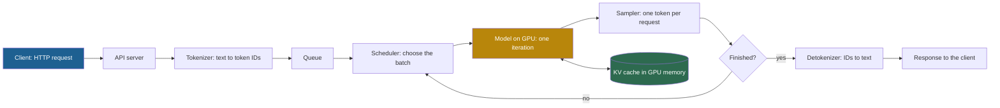

## 1. The question this page answers

PagedAttention did not appear in empty space. It improved on the serving systems of 2022 and early 2023. The paper compares vLLM with two of them (§6.1): FasterTransformer from NVIDIA, and Orca (OSDI 2022), whose authors are from Seoul National University and FriendliAI. To explain what vLLM changed, you must know what these systems already did well and what they did badly.

This page answers four questions:

1. What does an LLM serving system do, from a request to a response?
2. Why does the batch size decide throughput, especially during decode?
3. What is the difference between static batching and iteration-level scheduling?
4. How did these systems store the KV cache, and why in one contiguous chunk of the maximum length?

The answer to question 4 is the problem that page 03 measures and page 04 solves.

## 2. Mental model

> [!analogy] A ferry and an escalator, with reserved rows
> Static batching is a ferry. It leaves with a full group of passengers and returns only when the last passenger has reached the far shore. A passenger who arrives a minute after departure waits for the whole round trip. Iteration-level scheduling is an escalator. At every step, people can step on and step off. Nobody waits for strangers to finish their trip.
>
> Now add memory. On both, each passenger books a whole row of seats for the longest trip that anyone could take, before the trip starts. Most passengers use one or two seats. The empty seats in the booked rows are the waste that vLLM attacks.
>
> **Where it stops working:** on an escalator, people move independently. In a GPU, all requests in a batch move together: one iteration produces one token for every running request at the same moment. Also, the "seats" of a request must form one unbroken row, which has no real counterpart on a ferry.

## 3. Terms

| Term | Plain meaning |
|---|---|
| serving system | The software that receives requests, runs the model on GPUs and returns responses. |
| request | One prompt from a client, with its settings, for example the maximum number of output tokens. |
| prefill | The first phase of a request: the model processes the whole prompt at once. The paper calls it the prompt phase. |
| decode | The second phase: the model generates one new token per iteration. The paper calls it the autoregressive generation phase. |
| iteration | One forward pass of the model over the current batch. In decode, it gives one new token to each running request. |
| batch | The set of requests that the GPU processes together in one forward pass. |
| batch size | The number of requests in a batch. |
| throughput | The amount of work per second, for example output tokens per second or requests per second. |
| latency | The time from the arrival of a request to its last output token. |
| normalized latency | The paper's measure: the mean, over requests, of end-to-end latency divided by output length (§6.1). |
| static batching | Batching at the request level: a batch starts together and ends when its last request ends. |
| iteration-level scheduling | Batching at the iteration level: requests join and leave the batch after any iteration. Today it is often called continuous batching. |
| padding | Extra dummy tokens that make sequences of different lengths the same length. |
| KV cache | The stored key and value vectors of earlier tokens, kept so that later iterations do not compute them again. |
| contiguous chunk | One unbroken region of memory. Earlier systems stored each request's KV cache in one. |
| maximum sequence length | The largest number of tokens (prompt plus output) that a request may reach. 2048 for the OPT models in the paper. |
| FasterTransformer | An NVIDIA library of optimized transformer kernels. Its development moved to TensorRT-LLM. |
| Orca | A serving system (OSDI 2022) that introduced iteration-level scheduling. |

All terms are also in the [Glossary](/notes/papers/glossary).

## 4. What a serving system does

### 4.1 From a request to a response

A client sends a prompt over HTTP. The serving system returns the generated text, often as a stream of pieces. Between those two moments, the system does these steps:



The **scheduler** decides which requests run in the next iteration. The **KV cache** lives in GPU memory next to the model weights. Two parts of this loop decide most of the performance: how the scheduler forms batches, and how the system manages KV cache memory. This page covers both, as they were before vLLM. For the full path of one request today, read [L1: The life of a request](/notes/ai/llm-systems/04-inference/l1-the-life-of-a-request).

### 4.2 Two phases: prefill and decode

The paper describes two phases (§2.2).

1. **Prefill.** "The prompt phase takes the whole user prompt $(x_1, \dots, x_n)$ as input" and "computes the probability of the first new token". It also computes the key and value vectors of all prompt tokens. The model processes all prompt tokens together, so "the computation of the prompt phase can be parallelized using matrix-matrix multiplication operations".
2. **Decode.** "The autoregressive generation phase generates the remaining new tokens sequentially." At iteration $t$, "the model takes one token $x_{n+t}$ as input" and computes the probability of the next token. Each iteration handles one token per request, so it "often uses matrix-vector multiplication, which is less efficient". The paper concludes that "this phase severely underutilizes GPU computation and becomes memory-bound".

Decode stops "when the sequence reaches a maximum length" or "when an end-of-sequence (<eos>) token is emitted" (§2.2). For the details of both phases, read [L2: Prefill and decode](/notes/ai/llm-systems/03-kv-cache/l2-prefill-and-decode).

### 4.3 The KV cache in two sentences

In each layer, attention compares the newest token's query vector with the key vectors of all earlier tokens, and mixes their value vectors. In the paper's words: "the key and value vectors of existing tokens are often cached for generating future tokens, known as KV cache" (§2.2). One more sentence matters for sharing later: "Note that the KV cache of one token depends on all its previous tokens" (§2.2).

The size per token is $2 \times L \times d \times s$ bytes for a model with $L$ layers, hidden size $d$ and $s$ bytes per number (without grouped-query attention). For OPT-13B in FP16: $2 \times 40 \times 5120 \times 2 = 819{,}200$ bytes per token, which the paper calls "800 KB" (§3). Page 03 uses this number. The derivation is in [L3: The KV cache size formula](/notes/ai/llm-systems/03-kv-cache/l3-the-kv-cache-size-formula).

### 4.4 What "good" means for a serving system

A serving system has two goals that pull against each other.

1. **High throughput.** Many tokens or requests per second for each GPU. GPUs are expensive. The paper notes that "processing an LLM request can be 10× more expensive than a traditional keyword query" (§1).
2. **Low latency.** Each user waits as little as possible.

The paper measures both together. Its metric is **normalized latency**: "the mean of every request's end-to-end latency divided by its output length" (§6.1). It then raises the request rate and checks how high the rate can go before normalized latency explodes: "A high-throughput serving system should retain low normalized latency against high request rates" (§6.1). Page 09 reads those curves. For all metrics, read [L2: Latency and throughput metrics](/notes/ai/llm-systems/04-inference/l2-latency-and-throughput-metrics).

## 5. Why batching decides throughput

### 5.1 One weight read serves the whole batch

In a decode iteration, the GPU must read every weight of the model from GPU memory (HBM, the large memory on the GPU board). With one request, it reads all the weights to produce one token. With $b$ requests in the batch, it reads the weights once and produces $b$ tokens. The paper: "the overhead of moving weights is amortized across the requests in a batch" (§2.3).

> [!example] Worked example: weight reads alone for OPT-13B on an A100 40 GB
> These numbers are an upper-bound estimate computed in these notes. They count only the weight reads and ignore the KV cache reads and all compute.
>
> 1. Weights: about 13 billion parameters at 2 bytes each, which is 26 GB. The paper's Table 1 lists "26 GB" for the 13B model.
> 2. Bandwidth of an A100 40 GB: 1,555 GB/s (NVIDIA datasheet).
> 3. Time to read all weights once: $26 / 1555 \approx 0.01672$ s, which is about 16.7 ms.
> 4. Batch 1: one token per 16.7 ms, so about $1 / 0.01672 \approx 59.8$ tokens per second.
> 5. Batch 8: eight tokens per 16.7 ms, about 478 tokens per second.
> 6. Batch 32: about 1,914 tokens per second.
>
> The iteration time barely changes, but the tokens per iteration grow with the batch. So, in the memory-bound decode phase, throughput grows almost in proportion to the batch size, until compute or memory becomes the limit.

This is why the batch size is the main dial of a serving system. And the batch size has a hard ceiling: every request in the batch needs its own KV cache in GPU memory. Page 03 shows that this ceiling, not compute, limited the systems of 2023. For the roofline view of the same idea, read [L3: Compute-bound vs memory-bound](/notes/ai/llm-systems/04-inference/l3-compute-bound-vs-memory-bound).

### 5.2 Why batching LLM requests is hard

Batching images for a classifier is easy: all inputs have the same shape, and each needs one forward pass. LLM requests are different. The paper gives two reasons (§2.3):

1. "First, the requests may arrive at different times." A simple batch must "make earlier requests wait for later ones" or "delay the incoming requests until earlier ones finish".
2. "the requests may have vastly different input and output lengths". A simple batch must "pad the inputs and outputs of the requests to equalize their lengths, wasting GPU computation and memory".

The output length is the harder part. Nobody knows it in advance. A request ends when the model emits the end-of-sequence token, and that can happen after 3 tokens or after 2,000.

## 6. Static batching

### 6.1 How it works

Static batching (also called request-level batching) works like this:

1. Wait until enough requests are in the queue, or until a timeout.
2. Form a batch. Pad all prompts to the length of the longest prompt.
3. Run iterations until every request in the batch has finished.
4. Return all results. Only then form the next batch.

The Orca paper names the two costs in its abstract: "requests that have finished earlier than other requests in a batch cannot return to the client", and "newly arrived requests have to wait until the current batch completely finishes".

### 6.2 FasterTransformer

**FasterTransformer** is an NVIDIA library of "highly optimized transformer-based encoder and decoder" components, built on CUDA, cuBLAS and C++ (GitHub README). It focuses on fast kernels for one forward pass, not on scheduling. The PagedAttention paper says that FasterTransformer "does not have its own scheduler" (§6.1). So the authors wrote their own scheduler for it, "with a dynamic batching mechanism similar to the existing serving systems such as Triton" (§6.1). They describe FasterTransformer as "a distributed inference engine highly optimized for latency" (§6.1).

In the paper's results, vLLM sustains much higher request rates than FasterTransformer, partly "as FasterTransformer does not utilize a fine-grained scheduling mechanism" and "inefficiently manages the memory like Orca (Max)" (§6.2). Today, the README says: "FasterTransformer development has transitioned to TensorRT-LLM" (checked on 2026-10-15).

## 7. Iteration-level scheduling (Orca, OSDI 2022)

### 7.1 The idea

Orca (Yu et al., OSDI 2022) changed the unit of scheduling. Its proposal is to "schedule the execution of the engine at the granularity of iteration instead of request" (Orca §3). The PagedAttention paper summarizes it: "After each iteration, completed requests are removed from the batch, and new ones are added" (§2.3). So "a new request can be processed after waiting for a single iteration, not waiting for the entire batch to complete" (§2.3).

The paper calls Orca's method, and the older cellular batching, "fine-grained batching mechanisms" (§2.3). Today most engines and documents call it **continuous batching**. The vLLM README lists "Continuous batching of incoming requests" among its features (checked on 2026-10-15).

### 7.2 Selective batching

Iteration-level scheduling creates a shape problem. In one iteration, one request may be in prefill with 500 tokens, and another in decode with 1 token. Orca solves this with **selective batching**, which "applies batching only to a selected set of operations" (Orca §3):

1. Operations that treat each token separately, such as the linear layers, work on all tokens of all requests at once. They "can be made to work with irregularly shaped tensors by flattening the tensors" (Orca §3).
2. Attention mixes tokens inside one request, so its input shapes differ per request. Orca "splits the batch and processes each request individually for the Attention operation" (Orca §3).

The PagedAttention paper states the same split: all components except attention are "applied independently position-wise" (§2.1). Interpretation of these notes: this is why only the attention kernel must learn about blocks in vLLM. The linear layers never see the KV cache.

### 7.3 The same requests under both schedules

> [!example] Worked example: four requests, then a fifth one
> A GPU runs at most 4 requests per batch. Each request needs a number of decode iterations (its output length). Prefill is ignored to keep the example small. A request that arrives during iteration $a$ can start at iteration $a + 1$.
>
> | Request | Arrives | Iterations needed |
> |---|---|---|
> | A | before iteration 1 | 3 |
> | B | before iteration 1 | 8 |
> | C | before iteration 1 | 2 |
> | D | before iteration 1 | 5 |
> | E | during iteration 2 | 4 |
>
> **Static batching.**
>
> 1. Batch 1 = A, B, C, D. It runs until B finishes: iterations 1 to 8.
> 2. C finishes at iteration 2, A at 3, D at 5. Their slots stay empty until iteration 8.
> 3. E can start at iteration 3, but it must wait for batch 1. It runs alone in iterations 9 to 12.
> 4. E waits $8 - 2 = 6$ iterations (iterations 3 to 8).
> 5. Slot-iterations in batch 1: $4 \times 8 = 32$. Useful: $3 + 8 + 2 + 5 = 18$. Empty: $32 - 18 = 14$, which is $43.75\%$.
> 6. Batch 2 has 1 request in 4 slots for 4 iterations: $3 \times 4 = 12$ empty slot-iterations. In total: $14 + 12 = 26$ empty.
> 7. All 22 tokens take 12 iterations: $22 / 12 \approx 1.83$ tokens per iteration.
>
> **Iteration-level scheduling.**
>
> 1. Iterations 1 and 2: A, B, C, D. C finishes at iteration 2.
> 2. Iteration 3: E takes C's slot at once. E runs in iterations 3 to 6. It waits 0 iterations.
> 3. A finishes at 3, D at 5, E at 6, B at 8.
> 4. All 22 tokens take 8 iterations: $22 / 8 = 2.75$ tokens per iteration. Empty slot-iterations: $4 \times 8 - 22 = 10$.
>
> The same work finishes in 8 iterations instead of 12, and E's response arrives at iteration 6 instead of 12.


Orca reports a "36.9× throughput improvement at the same level of latency" compared to FasterTransformer, for the GPT-3 175B model (Orca abstract). That number is from Orca's own setup. It is not a result of the PagedAttention paper.

> [!key] What iteration-level scheduling solved, and what it did not
> It removed the waiting and the empty slots of static batching. It did not change how much memory each request reserves. So the number of slots in the batch, the batch size, stayed limited by memory. The paper's words: "the number of requests that can be batched together is still constrained by GPU memory capacity" (§3).

## 8. How these systems stored the KV cache

### 8.1 One contiguous chunk per request

Before vLLM, each request's KV cache was one contiguous tensor. The paper explains why: "Since most operators in current deep learning frameworks [33, 39] require tensors to be stored in contiguous memory, previous LLM serving systems [31, 60] also store the KV cache of one request as a contiguous tensor across the different positions" (§3.1). Reference [31] is FasterTransformer and [60] is Orca.

A contiguous tensor can grow in place only if the memory after it is free. Nobody can promise that. So the systems reserved the whole chunk in advance, at the largest size that the request could ever need. The paper: "Due to the unpredictable output lengths from the LLM, they statically allocate a chunk of memory for a request based on the request's maximum possible sequence length, irrespective of the actual input or eventual output length of the request" (§3.1).

Orca's own paper describes the same rule. When a request is scheduled for the first time, the Orca scheduler "uses the request's max_tokens attribute to reserve max_tokens slots of GPU memory for storing the keys and values in advance" (Orca §4.2).

### 8.2 What a contiguous cache looks like in code

This short NumPy excerpt shows the design for one layer of one request. It is a model of the idea, not code from any of these systems.

```python
import numpy as np

max_len, d = 2048, 4                 # toy width; OPT-13B has 5120 per layer
k_cache = np.zeros((max_len, d), dtype=np.float16)   # reserved when the request starts
v_cache = np.zeros((max_len, d), dtype=np.float16)
length = 0                           # rows that hold real tokens

def append(k, v):
    global length
    k_cache[length] = k              # row address = start + length * row size
    v_cache[length] = v
    length += 1

for t in range(7):                   # a 7-token prompt
    append(np.full(d, t), np.full(d, t))

print("reserved bytes:", k_cache.nbytes + v_cache.nbytes)
print("rows used:", length, "of", max_len, f"({100 * length / max_len:.2f}%)")
print("row size in bytes:", k_cache.strides[0])
```

```text
reserved bytes: 32768
rows used: 7 of 2048 (0.34%)
row size in bytes: 8
```

The important lines:

1. `np.zeros((max_len, d))` reserves all 2048 rows when the request starts. The memory is taken even though only 7 rows hold data.
2. `k_cache[length] = k` writes the new key at row `length`. The address is the start address plus `length` times the row size. That simple arithmetic is the attraction of a contiguous chunk: the attention kernel can find any token with one multiplication.
3. `k_cache.strides[0]` is 8: one row of 4 FP16 numbers is 8 bytes. The rows sit next to each other.

For the real OPT-13B, one layer of this cache reserves $2048 \times 5120 \times 2 \times 2 = 41{,}943{,}040$ bytes, which is 40 MiB. Across 40 layers, that is 1,600 MiB, which is 1.5625 GiB, for every request, at admission. For a full treatment of preallocated caches, read [L4: Implementing a KV cache](/notes/ai/llm-systems/03-kv-cache/l4-implementing-a-kv-cache).

### 8.3 How much to reserve: the three Orca baselines

Orca is not open source. The paper says: "Since Orca is not publicly available for use, we implement our own version of Orca" (§6.1). The authors test three versions that differ only in how much space they reserve for the output (§6.1):

| Baseline | Space reserved for a request | Possible in practice? |
|---|---|---|
| Orca (Max) | "always reserves the space up to the maximum sequence length of the model, i.e., 2048 tokens" | Yes |
| Orca (Pow2) | At most 2 times the true output length. The paper's example: a true output length of 25 reserves 32 positions. | No: it needs the true length |
| Orca (Oracle) | Exactly the true output length: it uses "the knowledge of the lengths of the outputs that will be actually generated" | No: the true length is unknown |

The paper also states: "We assume Orca uses the buddy allocation algorithm to determine the memory address to store KV cache" (§6.1). Page 01 explains the buddy allocator. Orca (Oracle) and Orca (Pow2) are idealized baselines. They show how much a perfect length predictor could help. Page 03 shows that even Orca (Oracle) wastes most of its KV memory.

### 8.4 Why sharing was impossible

Some decoding methods produce several outputs for one prompt: parallel sampling and beam search (page 06). All outputs share the same prompt, so they could share the prompt's KV cache. With one contiguous chunk per sequence, they cannot. The paper: "the existing systems cannot exploit the opportunities for memory sharing" because "the KV cache of the sequences is stored in separate contiguous spaces" (§1).

## 9. What vLLM keeps and what it changes

The paper does not replace iteration-level scheduling. It calls the two ideas "complementary techniques" (§9). "Orca achieves it by scheduling and interleaving the requests so that more requests can be processed in parallel, while vLLM is doing so by increasing memory utilization so that the working sets of more requests fit into memory" (§9). vLLM also schedules per iteration: "for each decoding iteration, vLLM first selects a set of candidate sequences for batching" (§4.3).

The paper also notes that the two ideas interact: "the fine-grained scheduling and interleaving of the requests like in Orca makes memory management more challenging" (§9). With requests that join and leave at every iteration, memory is allocated and freed all the time, in sizes that nobody knows in advance.

| | FasterTransformer (in the paper) | Orca | vLLM |
|---|---|---|---|
| Unit of scheduling | Request (custom dynamic batching) | Iteration | Iteration |
| KV cache layout | One contiguous chunk per request | One contiguous chunk per request | Fixed-size blocks anywhere in a pool |
| Reservation | Maximum length ("like Orca (Max)", §6.2) | Maximum length (`max_tokens`) | One block at a time, on demand |
| Sharing between sequences | No | No | Yes, by block, with copy-on-write |

> [!key] The starting point of the paper
> By 2023, scheduling was already fine-grained. Memory was not. Every request still reserved one contiguous chunk for its longest possible future. That reservation, not the GPU's compute, limited the batch size, and so the throughput.

### Exercises

1. **Simulate both schedules.** Write `simulate(requests, max_batch, policy)` for `policy` in `"static"` and `"iteration"`. Each request is `(name, arrival, length)`. It returns the start and finish iteration of each request, the total number of iterations and the number of empty slot-iterations. Acceptance test: with the five requests of §7.3 and `max_batch = 4`, static gives E start 9, finish 12, 12 iterations, 26 empty slot-iterations. Iteration-level gives E start 3, finish 6, 8 iterations, 10 empty.
   - Hint 1: Keep a dictionary of running requests and the iterations they still need.
   - Hint 2: The policies differ in two places. Static admits new requests only when the batch is empty. It frees slots only when all requests in the batch have finished.

## 10. Common mistakes

1. **"vLLM invented continuous batching."** Orca (OSDI 2022) introduced iteration-level scheduling, and cellular batching was earlier still. vLLM's contribution is memory management that makes large, changing batches possible.
2. **"Iteration-level scheduling fixes memory waste."** It fixes waste in time: waiting and empty slots. Each request still reserved memory for its maximum length.
3. **"The paper's Orca results are Orca's own numbers."** Orca was not public. The paper re-implemented it in three versions, Max, Pow2 and Oracle (§6.1).
4. **"Static batching is only bad because of padding."** Padding is one cost. The larger costs are requests that wait for a whole batch, and slots that stay empty after their request finishes.
5. **"Earlier systems used contiguous memory by mistake."** It was a reasonable choice: frameworks require contiguous tensors for most operators, and a contiguous cache gives simple, fast address arithmetic. The cost appeared only at high load.
6. **"A larger batch always makes decode faster for each user."** A larger batch raises throughput. Each iteration can take a little longer, so each user's token rate can drop slightly.

## 11. One-minute explanation

An LLM serving system receives prompts, runs prefill over each prompt, and then runs decode iterations that produce one token per request each time. Decode is memory-bound: each iteration reads all the weights, so throughput grows almost in proportion to the batch size. Batching is hard because requests arrive at different times and have unknown output lengths. Static batching waits for the slowest request, so slots stay empty and new requests wait. Orca's iteration-level scheduling, now called continuous batching, lets requests join and leave after every iteration, which removes that waste. But every system before vLLM, including FasterTransformer and Orca, stored each request's KV cache as one contiguous tensor. Because the output length is unknown, they reserved the maximum length, for example 2048 tokens, at admission. That reservation limited how many requests fit in GPU memory. vLLM keeps iteration-level scheduling and changes only how the KV cache memory is managed.

## 12. Check questions

```check
{
  "question": "Name the two phases of a request and say which kind of matrix operation each one uses and why.",
  "answer": "Prefill (the paper's prompt phase) processes all prompt tokens at once, so it uses matrix-matrix multiplication and keeps the GPU busy. Decode (the autoregressive generation phase) processes one new token per request per iteration, so it uses matrix-vector multiplication. The paper says decode \"severely underutilizes GPU computation and becomes memory-bound\" (§2.2)."
}
```

```check
{
  "question": "Give the two reasons from §2.3 why batching LLM requests is harder than batching images for a classifier.",
  "answer": "1. Requests arrive at different times, so a simple batch makes early requests wait for late ones, or makes new requests wait for the batch to finish. 2. Requests have very different input and output lengths, so a simple batch must pad them to the same length, which wastes compute and memory. The output length is also unknown in advance."
}
```

```check
{
  "question": "Four requests need 6, 2, 2 and 4 decode iterations. All arrive at once and the batch has 4 slots. Under static batching, how many slot-iterations are empty? What fraction is that?",
  "hint": "The batch lasts as long as its longest request.",
  "answer": "The batch runs $6$ iterations, so it has $4 \\times 6 = 24$ slot-iterations. Useful: $6 + 2 + 2 + 4 = 14$. Empty: $24 - 14 = 10$, which is $10/24 \\approx 41.7\\%$."
}
```

```check
{
  "question": "Interview follow-up: Orca introduced iteration-level scheduling. Why did it also need selective batching? What does selective batching batch, and what does it not batch?",
  "hint": "Think about the shapes of a prefill request and a decode request in the same iteration.",
  "answer": "With iteration-level scheduling, one iteration can hold requests in different states: one in prefill with hundreds of tokens, others in decode with one token each. Their tensors have different shapes. Selective batching flattens the tokens of all requests into one list for the operations that treat each token separately (the linear layers, normalization, activations). It does not batch attention, because attention mixes tokens within one request: Orca \"splits the batch and processes each request individually for the Attention operation\". Interpretation of these notes: this is also why, in vLLM, only the attention kernel must know about KV blocks."
}
```

```check
{
  "question": "Interview follow-up: Why did FasterTransformer and Orca store each request's KV cache contiguously and at the maximum length? Give the technical reasons, not only 'it was simpler'.",
  "answer": "1. Most operators in deep learning frameworks require contiguous tensors (§3.1), and attention kernels of that time read K and V as one strided tensor per sequence. 2. With a contiguous tensor, the address of token $t$ is the start address plus $t$ times the row size: no table is needed. 3. A contiguous tensor cannot grow in place if the next memory is used, and a copy to a larger region would move the whole cache. 4. The output length is unknown, so the only safe size is the maximum. Orca's scheduler reserves `max_tokens` slots at admission (Orca §4.2). The cost: reserved but unused memory, internal and external fragmentation, and no sharing between sequences."
}
```

```check
{
  "question": "Interview follow-up: Estimate the decode throughput of OPT-13B on one A100 40 GB at batch 1 and batch 16, from weight reads alone. Then name two things that make the real number lower.",
  "hint": "Time per iteration is about bytes of weights divided by memory bandwidth.",
  "answer": "Weights about 26 GB, bandwidth 1,555 GB/s. One iteration reads the weights once: $26/1555 \\approx 16.7$ ms. Batch 1: about $1/0.01672 \\approx 60$ tokens/s. Batch 16: about $16 \\times 59.8 \\approx 957$ tokens/s. Real numbers are lower because (1) each iteration also reads every request's KV cache, which grows with batch and length (about 800 KiB per token for OPT-13B), (2) kernels do not reach peak bandwidth, and (3) compute, sampling and scheduling take time. Also, the batch can only grow while the KV caches fit in memory, which is the problem of page 03."
}
```

```check
{
  "question": "Interview follow-up: The paper calls Orca's scheduling and PagedAttention 'complementary'. Explain what each one improves, and why the first makes the second more necessary.",
  "answer": "Both raise GPU utilization by running more requests at once. Orca does it in time: requests join and leave after every iteration, so no slot waits for a slow request (§9). vLLM does it in space: blocks remove reservation and fragmentation, so more requests fit in memory. Fine-grained scheduling makes memory harder: requests start and end at every iteration, with unknown lengths, so memory is allocated and freed all the time. The paper says it \"makes memory management more challenging\" (§9). Contiguous max-length chunks handle that badly. Fixed-size blocks handle it well."
}
```

```check
{
  "question": "Exercise 1: show a reference solution",
  "answer": "```python\ndef simulate(requests, max_batch, policy):\n    \"\"\"requests: list of (name, arrival, length). A request that arrives at\n    iteration a can start at iteration a + 1. policy: \"static\" or \"iteration\".\"\"\"\n    pending = sorted(requests, key=lambda r: r[1])\n    left = {}                      # name -> iterations left (0 = finished)\n    start, finish = {}, {}\n    it, idle = 0, 0\n    while pending or left:\n        it += 1\n        if policy == \"iteration\" or not left:      # static admits only into an empty batch\n            ready = [r for r in pending if r[1] < it][: max_batch - len(left)]\n            for name, _, length in ready:\n                left[name] = length\n                start[name] = it\n            pending = [r for r in pending if r[0] not in start]\n        active = [n for n in left if left[n] > 0]\n        idle += max_batch - len(active)            # empty slots in this iteration\n        for n in active:\n            left[n] -= 1\n            if left[n] == 0:\n                finish[n] = it\n        if policy == \"iteration\" or all(v == 0 for v in left.values()):\n            left = {n: v for n, v in left.items() if v > 0}   # free finished slots\n    return start, finish, it, idle\n\nreqs = [(\"A\", 0, 3), (\"B\", 0, 8), (\"C\", 0, 2), (\"D\", 0, 5), (\"E\", 2, 4)]\ns1, f1, t1, i1 = simulate(reqs, 4, \"static\")\ns2, f2, t2, i2 = simulate(reqs, 4, \"iteration\")\nassert (s1[\"E\"], f1[\"E\"], t1, i1) == (9, 12, 12, 26)\nassert (s2[\"E\"], f2[\"E\"], t2, i2) == (3, 6, 8, 10)\nprint(\"static\", f1, t1, i1)\nprint(\"iteration\", f2, t2, i2)\n```\n\nThe only difference between the policies is in two lines. Static admits new requests only when `left` is empty, and removes finished requests only when all requests in the batch have finished. Iteration-level does both after every iteration. Empty slot-iterations are counted in each iteration as `max_batch` minus the number of requests that still need work."
}
```

## 13. Links

- Previous: [01 Background: virtual memory and paging](/notes/papers/llm-serving/2023-pagedattention/01-background-virtual-memory-and-paging)
- Next: [03 The question: where does KV cache memory go?](/notes/papers/llm-serving/2023-pagedattention/03-the-question)
- The paper on one page: [00 The paper on one page](/notes/papers/llm-serving/2023-pagedattention/00-paper-on-one-page)
- Results against these baselines: [09 Results](/notes/papers/llm-serving/2023-pagedattention/09-results)
- The KV cache: [L1: Why the KV cache exists](/notes/ai/llm-systems/03-kv-cache/l1-why-the-kv-cache-exists), [L2: Prefill and decode](/notes/ai/llm-systems/03-kv-cache/l2-prefill-and-decode), [L3: The KV cache size formula](/notes/ai/llm-systems/03-kv-cache/l3-the-kv-cache-size-formula), [L4: Implementing a KV cache](/notes/ai/llm-systems/03-kv-cache/l4-implementing-a-kv-cache)
- Inference: [L1: The life of a request](/notes/ai/llm-systems/04-inference/l1-the-life-of-a-request), [L3: Compute-bound vs memory-bound](/notes/ai/llm-systems/04-inference/l3-compute-bound-vs-memory-bound), [L4: Batching and scheduling](/notes/ai/llm-systems/04-inference/l4-batching-and-scheduling), [L10: Serving engines](/notes/ai/llm-systems/04-inference/l10-serving-engines)
- Earlier notes: [Attention, the KV cache and the cost of length](/notes/ai/context-engineering/01-foundations/l4-attention-and-the-cost-of-length)
- The paper folder: [PagedAttention (2023)](/notes/papers/llm-serving/2023-pagedattention), [Glossary](/notes/papers/glossary)

### Sources

- Kwon et al., "Efficient Memory Management for Large Language Model Serving with PagedAttention", SOSP 2023, arXiv 2309.06180: https://arxiv.org/abs/2309.06180 (§1, §2.1 to §2.3, §3, §3.1, §4.3, §6.1, §6.2, §9, checked on 2026-10-15)
- Yu et al., "Orca: A Distributed Serving System for Transformer-Based Generative Models", OSDI 2022: https://www.usenix.org/conference/osdi22/presentation/yu (abstract, §3, §4.2, checked on 2026-10-15)
- NVIDIA FasterTransformer README: https://github.com/NVIDIA/FasterTransformer (checked on 2026-10-15)
- vLLM README: https://github.com/vllm-project/vllm (checked on 2026-10-15)
- NVIDIA A100 datasheet (memory bandwidth 1,555 GB/s for the 40 GB models): https://www.nvidia.com/content/dam/en-zz/Solutions/Data-Center/a100/pdf/nvidia-a100-datasheet-us-nvidia-1758950-r4-web.pdf (checked on 2026-10-15)
