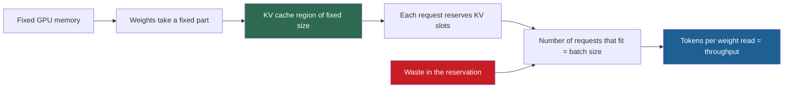

## 1. The question this page answers

The paper's first contribution is a diagnosis, not a solution: "We identify the challenges in memory allocation in serving LLMs and quantify their impact on serving performance" (§1). Its central number: "only 20.4% - 38.2% of the KV cache memory is used to store the actual token states in the existing systems" (§1).

This page rebuilds that diagnosis step by step. It answers five questions:

1. How does GPU memory divide between the model weights, the KV cache and everything else?
2. How large is the KV cache of one token and of one request? How do we derive the formula?
3. Why does the KV cache decide the batch size, and why does the batch size decide throughput?
4. What are the three kinds of waste in earlier systems? How large is each one?
5. Why could earlier systems not fix the waste inside their own design?

In an interview, this is the answer to "What problem does PagedAttention solve?" A strong answer names the waste, gives numbers and explains why waste costs throughput.

## 2. Mental model

> [!analogy] A parking garage that books a full row for every car
> A garage has room for 15,700 cars. Its rule: each arriving car books a full row of 2,048 spaces, in one unbroken line. The reason: the driver may later bring a convoy of friends. Most drivers bring a few friends at most, and nobody knows in advance how many. After 7 cars, the garage is "full", although almost every space is empty. The empty spaces in the booked rows are useless to new cars. Gaps between rows, too short for a full row, are also useless.
>
> **Where it stops working:** a car does not grow, but a request's KV cache grows by one token in every iteration. And part of a booked row is not waste in the end: the friends who arrive later do use some of it. The paper calls that part "reservation", and it separates it from the part that nobody ever uses.

## 3. Terms

| Term | Plain meaning |
|---|---|
| GPU memory | The large memory on the GPU board (HBM). It holds the weights, the KV cache and temporary data. An A100 has 40 GB or 80 GB. |
| model weights | The learned numbers of the model, also called parameters. They do not change during serving. |
| activations | Temporary tensors that one forward pass creates and then discards. |
| KV cache | The stored key and value vectors of all earlier tokens of each running request, in every layer. |
| token state | The paper's name for the KV cache of one real token. |
| KV cache slot | Space for the key and value vectors of one token. The paper's Table 1 counts memory in slots. |
| maximum sequence length | The largest number of tokens (prompt plus output) that a request may reach. 2048 for the OPT models in the paper. |
| reservation | Slots reserved for tokens that the request will generate later. They are used in the end, but they are blocked now. |
| internal fragmentation | Slots inside a request's chunk that no token ever uses, because the request ends before the chunk is full. |
| external fragmentation | Free memory between chunks that is too small, or the wrong shape, for any new chunk. |
| effective memory | The paper's term for the share of KV cache memory that holds token states. |
| batch size | The number of requests that run together in one iteration. |
| memory-bound | Limited by memory: the GPU has unused compute, but no room or no bandwidth for more work. |
| OPT-13B | An open model from Meta with 13 billion parameters, 40 layers and hidden size 5120. The paper's main example. |
| Orca (Max), (Pow2), (Oracle) | The paper's three versions of the Orca system. They reserve 2048 slots, up to twice the true output length, or exactly the true output length. |

All terms are also in the [Glossary](/notes/papers/glossary).

## 4. The memory of one GPU

### 4.1 Figure 1: a 13B model on an A100 40 GB

The paper opens with a measurement of where GPU memory goes. "Approximately 65% of the memory is allocated for the model weights, which remain static during serving" (§1). "Close to 30% of the memory is used to store the dynamic states of the requests" (§1). The rest is for activations: "A small amount of memory (yellow) is used ephemerally for activation" (Figure 1 caption). The labels in Figure 1 read "Parameters (26GB, 65%)" and "KV Cache (>30%)".

The paper's Table 1 gives the same budget in gigabytes for the 13B model on one A100. Total GPU memory: 40 GB. Parameter size: 26 GB. Memory for KV cache: 12 GB.

> [!example] Worked example: the memory budget of the 13B model
> 1. Weights: 13 billion parameters at 2 bytes each (FP16) is about 26 GB. $26 / 40 = 0.65$, so 65%.
> 2. KV cache: 12 GB. $12 / 40 = 0.30$, so 30%.
> 3. The rest: $40 - 26 - 12 = 2$ GB, so 5%, for activations and other data. This subtraction is computed in these notes. The paper does not print the 2 GB.


### 4.2 Only one part of the budget can change

The weights are fixed: a 13B model in FP16 always needs about 26 GB. Activations are small. So the KV cache region decides how many requests fit. The paper: "Since the model weights are constant and the activations only occupy a small fraction of the GPU memory, the way the KV cache is managed is critical in determining the maximum batch size" (§1).

> [!key] The first idea of the paper
> On a GPU that serves an LLM, the KV cache is the only large, changing part of memory. How well the system packs it decides how many requests run at once.

## 5. How large is the KV cache?

### 5.1 One token of OPT-13B: 800 KB

Every layer stores, for every token, one key vector and one value vector. In OPT-13B, each of these vectors has the size of the hidden state: 5120 numbers. (OPT-13B has 40 attention heads of 128 numbers each, and $40 \times 128 = 5120$. All heads keep their own keys and values.) Each number is FP16: 2 bytes.

The paper's formula: "the KV cache of a single token demands 800 KB of space, calculated as 2 (key and value vectors) × 5120 (hidden state size) × 40 (number of layers) × 2 (bytes per FP16)" (§3).

> [!example] Worked example: the KV cache of one OPT-13B token, factor by factor
> 1. Key and value: 2 vectors.
> 2. Each vector: 5120 numbers. So $2 \times 5120 = 10{,}240$ numbers per layer.
> 3. 40 layers: $10{,}240 \times 40 = 409{,}600$ numbers per token.
> 4. 2 bytes per FP16 number: $409{,}600 \times 2 = 819{,}200$ bytes.
> 5. In binary units: $819{,}200 / 1024 = 800$ KiB exactly. In decimal units: 819.2 KB.
>
> So the paper's "800 KB" is exactly 800 KiB. For comparison, the whole text of a token is a few bytes.

The general formula, for a model with $L$ layers, $H_{kv}$ key-value heads of $d_h$ numbers and $s$ bytes per number:

$$
\text{bytes per token} = 2 \times L \times H_{kv} \times d_h \times s
$$

For OPT-13B: $2 \times 40 \times 40 \times 128 \times 2 = 819{,}200$. For a modern model with grouped-query attention, $H_{kv}$ is smaller than the number of query heads. Llama-3.1-8B has $H_{kv} = 8$, which gives $2 \times 32 \times 8 \times 128 \times 2 = 131{,}072$ bytes = 128 KiB per token. The full derivation and a table of models are in [L3: The KV cache size formula](/notes/ai/llm-systems/03-kv-cache/l3-the-kv-cache-size-formula). Why some models have fewer KV heads: [L5: MHA, MQA, GQA and MLA](/notes/ai/llm-systems/03-kv-cache/l5-mha-mqa-gqa-and-mla).

### 5.2 One request at the maximum length: 1.6 GB

OPT models accept at most 2048 tokens (the `max_position_embeddings` of the OPT-13B config is 2048). The paper: "the memory required to store the KV cache of one request can be as much as 1.6 GB" (§3).

> [!example] Worked example: a 2048-token request of OPT-13B
> 1. Exact bytes: $2048 \times 819{,}200 = 1{,}677{,}721{,}600$ bytes.
> 2. In GiB: $1{,}677{,}721{,}600 / 2^{30} = 1.5625$ GiB.
> 3. In GB: $1{,}677{,}721{,}600 / 10^9 \approx 1.68$ GB.
> 4. The paper's 1.6 GB is $2048 \times 800 = 1{,}638{,}400$ "KB", read as 1.6 "GB". It mixes the binary KB of step 1 with a decimal step to GB. The exact value lies between 1.56 GiB and 1.68 GB.
>
> In an interview, say "about 1.6 GB, exactly 1.5625 GiB".

### 5.3 How many tokens fit: 15.7K slots

The paper's Table 1 lists, for the 13B model on one A100: "Memory for KV cache 12 GB" and "Max. # KV cache slots 15.7K". A slot holds one token.

> [!example] Worked example: from 12 GB to 15.7K slots
> 1. If 12 GB means $12 \times 2^{30} = 12{,}884{,}901{,}888$ bytes: $12{,}884{,}901{,}888 / 819{,}200 \approx 15{,}728.6$ slots. That rounds to 15.7K.
> 2. If 12 GB means $12 \times 10^9$ bytes: $12 \times 10^9 / 819{,}200 \approx 14{,}648$ slots, which would round to 14.6K.
> 3. So the 12 GB of Table 1 is 12 GiB. This reading is an interpretation of these notes that matches the printed 15.7K.
>
> With 15,728 slots and 2048 slots per request, at most $15{,}728.6 / 2048 \approx 7.68$, so 7 full-length reservations fit.

The paper states the general conclusion: "Even if all available memory was allocated to KV cache, only a few tens of requests could be accommodated" (§3).

### 5.4 The hardware trend makes it worse

The paper adds a trend: "the GPU's computation speed grows faster than the memory capacity" (§3). Its example: "from NVIDIA A100 to H100, The FLOPS increases by more than 2x, but the GPU memory stays at 80GB maximum" (§3). Interpretation of these notes: each new GPU can serve more requests per second with its compute, but memory for their KV caches grows more slowly. So efficient memory use becomes more important with each generation. GPUs released after the paper have more memory. For current numbers, read [L5: GPUs, memory and bandwidth](/notes/ai/llm-systems/01-math-and-hardware/l5-gpus-memory-and-bandwidth).

## 6. Why memory limits throughput

### 6.1 The chain of causes

Page 02 showed that decode throughput grows with the batch size, because one weight read serves the whole batch. Iteration-level scheduling made it easy to run large batches. So what stops the batch from growing? The paper's answer: "the number of requests that can be batched together is still constrained by GPU memory capacity. In other words, the serving system's throughput is memory-bound" (§3).



Every slot that holds no token is a slot that another request could use. Waste in the KV cache region becomes a smaller batch, and a smaller batch becomes lower throughput.

### 6.2 A numeric estimate

> [!example] Worked example: 7 requests vs 31 requests on the same GPU
> This estimate is computed in these notes. It uses a simple model: the time of one decode iteration is the bytes read (weights plus KV cache) divided by the memory bandwidth. It ignores compute time and kernel efficiency. Assume that every running request has about 500 tokens in its cache.
>
> Inputs: weights 26 GB, A100 40 GB bandwidth 1,555 GB/s (NVIDIA datasheet), 819,200 bytes per token, 15,728 KV slots.
>
> 1. **Max-length reservation.** 2048 slots per request: $\lfloor 15{,}728.6 / 2048 \rfloor = 7$ requests.
>    - KV bytes read per iteration: $7 \times 500 \times 819{,}200 \approx 2.87$ GB.
>    - Time: $(26 + 2.87) / 1555 \approx 18.6$ ms for 7 tokens.
>    - Throughput: $7 / 0.01856 \approx 377$ tokens per second.
> 2. **No waste.** 500 slots per request: $15{,}728.6 / 500 \approx 31.5$, so 31 requests.
>    - KV bytes read per iteration: $31 \times 500 \times 819{,}200 \approx 12.70$ GB.
>    - Time: $(26 + 12.70) / 1555 \approx 24.9$ ms for 31 tokens.
>    - Throughput: $31 / 0.02489 \approx 1{,}246$ tokens per second.
> 3. Ratio: $1246 / 377 \approx 3.3$.
>
> The iteration takes about 34% longer, but it produces more than 4 times as many tokens. The paper measures "2-4×" higher throughput at the same latency (Abstract). This simple model lands inside that range, but it is only an estimate. Page 09 has the measured results.

```plot
{
  "title": "Estimated decode throughput of OPT-13B on one A100 40 GB vs batch size, 500 cached tokens per request (blue, approximate model of these notes)",
  "xAxis": { "label": "batch size (requests)", "domain": [0, 33] },
  "yAxis": { "label": "output tokens per second", "domain": [0, 1400] },
  "disableZoom": true,
  "data": [
    { "points": [[1, 59], [4, 225], [7, 377], [10, 517], [15, 726], [20, 910], [25, 1073], [31, 1246]], "fnType": "points", "graphType": "polyline", "color": "#1E6091" },
    { "points": [[1, 59], [4, 225], [7, 377], [10, 517], [15, 726], [20, 910], [25, 1073], [31, 1246]], "fnType": "points", "graphType": "scatter", "color": "#1E6091" }
  ]
}
```

Read the plot from left to right. At batch 7, the limit of max-length reservation, the estimate is about 377 tokens per second. At batch 31, the limit without waste, it is about 1,246. The curve bends because each extra request adds its own KV cache reads. For the general roofline model, read [L3: Compute-bound vs memory-bound](/notes/ai/llm-systems/04-inference/l3-compute-bound-vs-memory-bound).

### 6.3 Utilization over the life of one request

A request's KV cache is not a fixed size. It starts at the prompt length and grows by one token per iteration. The paper stresses this: the KV cache "dynamically grows and shrinks over time as the model generates new tokens, and its lifetime and length are not known a priori" (§1). So the useful share of a reservation changes during the request.

> [!example] Worked example: one request of mean ShareGPT length
> Take a request with a 161-token prompt and 338 output tokens, about the ShareGPT means of §7.6.
>
> 1. Under Orca (Max), the chunk is 2048 slots for the whole life of the request.
> 2. At the first decode iteration, the cache holds 161 tokens: $161 / 2048 \approx 7.9\%$ of the chunk.
> 3. At the end, it holds $161 + 338 = 499$ tokens: $499 / 2048 \approx 24.4\%$.
> 4. Averaged over the 339 moments from 0 to 338 generated tokens, the cache holds $161 + 338/2 = 330$ tokens: $330 / 2048 \approx 16.1\%$.
> 5. With 16-token blocks allocated on demand, the same request holds $\lceil (161 + t)/16 \rceil$ blocks after $t$ generated tokens. Averaged over its life, about 97.5% of its allocated slots hold tokens.
>
> Both averages are computed in these notes for this one request. The paper measures 20.4% for Orca (Max) and 96.3% for vLLM over its real workloads (Figure 2). Interpretation of these notes: the measured Orca (Max) value is higher than 16.1%. One reason: long requests stay in memory longer, so they count more in a time average.

```plot
{
  "title": "One request with a 161-token prompt and 338 output tokens: slots that hold tokens (blue), slots allocated in 16-token blocks (gold), slots reserved by Orca (Max) (red)",
  "xAxis": { "label": "output tokens generated so far", "domain": [0, 350] },
  "yAxis": { "label": "KV cache slots", "domain": [0, 2200] },
  "disableZoom": true,
  "data": [
    { "points": [[0, 2048], [338, 2048]], "fnType": "points", "graphType": "polyline", "color": "#C81D25" },
    { "points": [[0, 2048], [338, 2048]], "fnType": "points", "graphType": "scatter", "color": "#C81D25" },
    { "points": [[0, 176], [50, 224], [100, 272], [150, 320], [200, 368], [250, 416], [300, 464], [338, 512]], "fnType": "points", "graphType": "polyline", "color": "#B8860B" },
    { "points": [[0, 176], [50, 224], [100, 272], [150, 320], [200, 368], [250, 416], [300, 464], [338, 512]], "fnType": "points", "graphType": "scatter", "color": "#B8860B" },
    { "points": [[0, 161], [50, 211], [100, 261], [150, 311], [200, 361], [250, 411], [300, 461], [338, 499]], "fnType": "points", "graphType": "polyline", "color": "#1E6091" },
    { "points": [[0, 161], [50, 211], [100, 261], [150, 311], [200, 361], [250, 411], [300, 461], [338, 499]], "fnType": "points", "graphType": "scatter", "color": "#1E6091" }
  ]
}
```

The gap between the red line and the blue line is the reservation and the internal fragmentation of this request. The gap between the gold line and the blue line is never more than 15 slots: the unfilled part of the last block.

### 6.4 The same problem at today's scale

The paper's models accept 2048 tokens. Current models accept far longer contexts, which makes max-length reservation much worse. The next example is computed in these notes, with an assumed KV region.

> [!example] Worked example: Llama-3.1-8B with a 128K-token maximum
> Llama-3.1-8B needs 128 KiB per token (§5.1). Assume a KV region of 50 GiB on one 80 GB GPU.
>
> 1. One reservation for a 131,072-token maximum: $131{,}072 \times 128 \text{ KiB} = 16$ GiB.
> 2. Requests that fit: $50 / 16 = 3.125$, so 3.
> 3. A typical chat request of 2,000 tokens actually needs $2{,}000 \times 131{,}072 = 262{,}144{,}000$ bytes, which is 250 MiB.
> 4. Requests that fit by actual size: $50 \times 1024 / 250 = 204.8$, so 204.
>
> Max-length reservation would serve 3 requests where actual-size allocation serves about 204. This is why every major serving engine today allocates KV memory in blocks (page 10).

## 7. Where the memory goes: three kinds of waste

### 7.1 Contiguous chunks at the maximum length

Page 02 showed why earlier systems stored each request's KV cache as one contiguous chunk. The paper summarizes: "Due to the unpredictable output lengths from the LLM, they statically allocate a chunk of memory for a request based on the request's maximum possible sequence length, irrespective of the actual input or eventual output length of the request" (§3.1).

Then: "The chunk pre-allocation scheme in existing systems has three primary sources of memory wastes: reserved slots for future tokens, internal fragmentation due to over-provisioning for potential maximum sequence lengths, and external fragmentation from the memory allocator like the buddy allocator" (§3.1).

### 7.2 The three kinds, one by one

| Kind of waste | What it is | Used in the end? | When is it known? |
|---|---|---|---|
| Reservation | Slots for tokens that the request will generate later | Yes, by the request's own later tokens | Known only in hindsight |
| Internal fragmentation | Slots after the request's final length | Never | "only realized after a request has finished sampling" (§3.1) |
| External fragmentation | Gaps between chunks, left by the allocator | Never, for this request | "known before serving a request" (§3.1) |

1. **Reservation.** The paper: "Although the reserved memory is eventually used, reserving this space for the entire request's duration, especially when the reserved space is large, occupies the space that could otherwise be used to process other requests" (§3.1). A slot for token 400 is blocked from the first iteration, although it holds data only after 400 iterations.
2. **Internal fragmentation.** The request ends before its chunk is full. The slots after its last token never hold anything. The paper: "This can result in severe internal fragmentation, since the request's actual length can be much shorter than its maximum length" (§1).
3. **External fragmentation.** Chunks have different sizes and start and end at different times. The allocator leaves gaps between them. The paper: "external memory fragmentation can also be significant, since the preallocated size can be different for each request" (§1).

The paper groups the last two: "They are both pure memory waste" (§3.1).

> [!trap] Reservation is waste in time, not in space
> Interviewers test this distinction. Reserved slots do hold tokens before the request ends. The waste is that they are blocked too early. Internal and external fragmentation are slots that never hold any token of that request.

### 7.3 The paper's Figure 3, in numbers

Figure 3 of the paper draws two requests at one moment. "Fig. 3 illustrates two requests: request A with 2048 maximum possible sequence length and request B with a maximum of 512" (§3.1). The figure's labels give these slot counts:

| | Request A | Request B |
|---|---|---|
| Prompt tokens (KV cache states) | 7 | 3 |
| Generated token, current iteration | 1 | 1 |
| Reserved: "future used" | 2 | 1 |
| "never used (internal fragmentation)" | 2038 | 507 |
| Total chunk | $7 + 1 + 2 + 2038 = 2048$ | $3 + 1 + 1 + 507 = 512$ |

The figure also shows a gap between the two chunks, labeled "External fragmentation". Its token row reads "Four score and seven years ago our fathers brought forth <eos>" for A and "You only live once <eos>" for B.

> [!example] Worked example: the effective memory of Figure 3
> 1. Allocated slots: $2048 + 512 = 2560$, plus the external gap.
> 2. Token states now: $8 + 4 = 12$. Effective memory now: $12 / 2560 \approx 0.47\%$.
> 3. Token states at the end, when the reserved slots are used: $10 + 5 = 15$. Effective at best: $15 / 2560 \approx 0.59\%$.
> 4. Never used: $2038 + 507 = 2545$ slots, about $99.4\%$ of the chunks.
>
> Figure 3 is a drawing with short requests, so its waste is extreme. The measured averages of §7.5 are less extreme, but still large.

### 7.4 A small pool with all three kinds


> [!example] Worked example: a toy pool of 32 slots
> The toy system reserves chunks in one unbroken run. Its maximum sequence length is 12 tokens.
>
> 1. Request A has a chunk of 12 slots (slots 0 to 11). It holds 5 tokens now (3 prompt, 2 generated). Its final length will be 7. So: 5 token states, $7 - 5 = 2$ reserved, $12 - 7 = 5$ internal fragmentation.
> 2. Slots 12 to 15 are a gap of 4 slots, left by a short request that finished. No 12-slot chunk fits in it.
> 3. Request B has a chunk of 8 slots (slots 16 to 23), from a power-of-two rule. It holds 3 tokens and will end at 4. So: 3 token states, 1 reserved, $8 - 4 = 4$ internal fragmentation.
> 4. Slots 24 to 31 are free: 8 slots.
> 5. Request C arrives and needs a 12-slot chunk. Free slots in total: $4 + 8 = 12$. The largest free run is 8. $8 < 12$, so C must wait. The 4-slot gap is external fragmentation.
>
> Count every slot: token states 8, reserved 3, internal fragmentation 9, external fragmentation 4, free 8. Total: $8 + 3 + 9 + 4 + 8 = 32$. Effective memory of the allocated chunks: $8 / 20 = 40\%$.

Now cut the same pool into blocks of $B = 4$ slots, as page 04 does. A needs $\lceil 5/4 \rceil = 2$ blocks. B needs $\lceil 3/4 \rceil = 1$ block. C, with a 3-token prompt, needs 1 block. All three fit in 4 of the 8 blocks, and 4 blocks stay free. Each request wastes at most $B - 1 = 3$ slots, all in its last block. No request reserves slots for its maximum length.

```video
{
  "src": "/notes/media/papers/2023-pagedattention/manim/p01-contiguous-allocation-waste.mp4",
  "caption": "Contiguous chunks reserved for the maximum length leave reserved slots, internal fragmentation and external gaps, while 4-slot blocks fit the same requests."
}
```

### 7.5 Figure 2: the measured waste

The paper measured the waste of each system during its experiments of §6.2 (Figure 2 caption: "Average percentage of memory wastes in different LLM serving systems during the experiment in §6.2"). Figure 2 prints these numbers:

| System | Token states | Reservation | Internal fragmentation | External fragmentation and others | Sum |
|---|---|---|---|---|---|
| Orca (Max) | 20.4% | 13.3% | 57.3% | 8.9% | 99.9% |
| Orca (Pow2) | 26.8% | 17.9% | 13.6% | 41.6% | 99.9% |
| Orca (Oracle) | 38.2% | 25.2% | (none printed) | 36.6% | 100.0% |
| vLLM | 96.3% | (not printed) | (not printed) | (not printed) | 96.3% |

> [!note] How these notes read Figure 2
> The paper's text confirms two numbers directly: "only 20.4% - 38.2%" (§1) and "can be as low as 20.4%" (§3.1). The other numbers are labels inside the stacked bars. These notes assign them to the bars in the order that the figure prints them. The legend order is Token states, Reservation, Internal frag., External frag. & Others. Each group sums to about 100%, which supports this reading. Orca (Oracle) has no internal fragmentation label, which fits its definition: it knows the true output length. vLLM's remaining 3.7% has no printed split.

What the table says, in plain words:

1. **Orca (Max)** reserves 2048 slots for every request. Only 20.4% of its KV memory holds tokens. Its largest waste is internal fragmentation, 57.3%: most requests end long before 2048 tokens.
2. **Orca (Pow2)** reserves up to twice the true output length. Internal fragmentation falls to 13.6%. But chunks of many different sizes create external fragmentation of 41.6%.
3. **Orca (Oracle)** knows each output length exactly, which no real system can. It still uses only 38.2%. Reservation (25.2%) and external fragmentation (36.6%) remain.
4. **vLLM** stores token states in 96.3% of its KV memory. The paper's claim: "near-zero waste in KV cache memory" (§1).

> [!key] Even a perfect length predictor is not enough
> Orca (Oracle) shows that the problem is not only unknown lengths. As long as each request needs one contiguous chunk, reservation and external fragmentation remain. The fix must change the layout of memory, not only the size of the reservation.

The vLLM team's launch post (June 20, 2023) states the same finding in round numbers: "We find that existing systems waste 60% – 80% of memory due to fragmentation and over-reservation." With paging, "memory waste only happens in the last block of a sequence", which "results in near-optimal memory usage, with a mere waste of under 4%."

Check against the table: $100 - 20.4 = 79.6\%$ and $100 - 38.2 = 61.8\%$ waste, so "60% – 80%". And $100 - 96.3 = 3.7\%$, so "under 4%".

### 7.6 The lengths of real requests

How short are real requests? The paper's two workloads use real conversations and instructions (§6.1). Their mean lengths, printed in Figure 11:

| Dataset | Mean input tokens | Mean output tokens | Mean total |
|---|---|---|---|
| ShareGPT | 161.31 | 337.99 | 499.30 |
| Alpaca | 19.31 | 58.45 | 77.76 |

The paper: "the ShareGPT dataset has 8.4× longer input prompts and 5.8× longer outputs on average than the Alpaca dataset, with higher variance" (§6.1). Check: $161.31 / 19.31 \approx 8.35$ and $337.99 / 58.45 \approx 5.78$.

> [!example] Worked example: how much of a 2048-slot chunk a mean request uses
> 1. ShareGPT: $499.30 / 2048 \approx 24.4\%$ of the chunk at the end of the request.
> 2. Alpaca: $77.76 / 2048 \approx 3.8\%$.
>
> These are ratios of mean lengths, computed in these notes. They are not the paper's measured waste, which also depends on the time that each request spends at each length.

### 7.7 Why variable sizes create external fragmentation

Figure 2 shows external fragmentation of 8.9% for Orca (Max), but 41.6% for Orca (Pow2) and 36.6% for Orca (Oracle). Why do the smarter baselines fragment more? The paper assumes that Orca places chunks with a buddy allocator (§6.1). Page 01 explains it: it gives out only power-of-two sizes, and it joins two free neighbors ("buddies") only when both are free.

> [!example] Worked example: a buddy allocator with 4096 slots
> This example is constructed for these notes. It shows the mechanism, not the paper's measurement.
>
> 1. Four requests arrive. A gets 1024 slots at [0, 1024). B gets 512 at [1024, 1536). D gets 512 at [1536, 2048). C gets 2048 at [2048, 4096).
> 2. A and D finish. Free: [0, 1024) and [1536, 2048). That is $1024 + 512 = 1536$ free slots.
> 3. The block [0, 1024) cannot join its buddy [1024, 2048), because B still uses part of it.
> 4. A new request needs 1100 slots. The buddy allocator rounds this to 2048. The largest free block is 1024.
> 5. The request waits, although 1536 slots are free. Those 1536 slots are external fragmentation for this request.
>
> Under Orca (Max), every chunk has the same size, 2048. A finished chunk leaves a hole that exactly fits the next request. That is why its external fragmentation is small. Its waste moves to internal fragmentation instead.

Interpretation of these notes: the baselines trade one kind of waste for another. Smaller, better-fitted chunks reduce internal fragmentation but increase external fragmentation. Fixed-size blocks remove external fragmentation and keep internal fragmentation below one block.

## 8. Why the old design could not fix itself

### 8.1 Compaction is too expensive

An OS can move memory to close gaps (page 01). The paper rejects this: "Although compaction [54] has been proposed as a potential solution to fragmentation, performing compaction in a performance-sensitive LLM serving system is impractical due to the massive KV cache" (§3.1). Interpretation of these notes: moving gigabytes of KV cache between iterations would stop the GPU for longer than an iteration takes.

### 8.2 Sharing is impossible

"Even with compaction, the pre-allocated chunk space for each request prevents memory sharing specific to decoding algorithms in existing memory management systems" (§3.1). The paper gives the cases (§3):

1. **Parallel sampling.** Several outputs for one prompt. The prompt's KV cache "can be shared to minimize memory usage". In the paper's experiment, the prompt part accounts "for 12% of the total KV cache memory".
2. **Beam search.** Different beams "can share larger portions (up to 55% memory saving...)". The sharing pattern changes as decoding advances.

With one contiguous chunk per sequence, two sequences cannot point at the same memory for their common prefix. Page 06 shows how blocks make this possible.

### 8.3 Lengths are unknown, and they change

The third challenge of §3 is scheduling. "The requests to an LLM service exhibit variability in their input and output lengths" (§3). And "as the output length of a request grows at decoding, the memory required for its KV cache also expands" (§3). So when memory becomes full, the system must make decisions "such as deleting or swapping out the KV cache of some requests from GPU memory" (§3). Page 07 covers these decisions.

## 9. The question, stated precisely

The paper's diagnosis leads to four requirements for a new design. These notes state them as one question:

> Can a serving system store the KV cache with these four properties?
>
> 1. Memory is taken only when a token arrives.
> 2. Any free piece of memory can hold any request's next tokens.
> 3. Identical prefixes are stored once.
> 4. Attention stays fast.

The paper's answer is to borrow paging (page 01): fixed-size KV blocks, allocated on demand, anywhere in a pool, with a block table per request. Requirement 4 needs a new attention kernel that can read scattered blocks. That kernel is PagedAttention, page 04. The result, in the paper's words, is "(1) near-zero waste in KV cache memory" and "flexible sharing of KV cache within and across requests" (Abstract). vLLM "improves the throughput of popular LLMs by 2-4× with the same level of latency" compared with FasterTransformer and Orca (Abstract).

### Exercises

1. **Break down the waste of a set of requests.** Write `waste_breakdown(requests, reserve)`. Each request is `(current_len, final_len)` at one moment, and `reserve` maps a final length to the number of reserved slots. Return the slots that hold token states, the reserved slots, the internal fragmentation, the allocated total and the used fraction. Acceptance test 1: use the two requests of Figure 3, `[(8, 10), (4, 5)]`, with reservations 2048 and 512. The result is 12 token states, 3 reserved, 2545 internal and 2560 allocated. Acceptance test 2: use `[(100, 300), (40, 60), (500, 900)]`. A reservation of 2048 each gives a used fraction of about 0.104. A power-of-two rule on the final length gives 0.40. An exact reservation gives about 0.508.
   - Hint 1: A request's reservation splits into three parts: `cur`, `final - cur` and `reserve(final) - final`.
   - Hint 2: External fragmentation does not appear here. It depends on where the allocator places each chunk, not on the lengths alone.

## 10. Common mistakes

1. **"The KV cache is small compared with the model."** For OPT-13B, one 2048-token request needs about 1.6 GB. The 12 GB region holds only about 15.7K tokens: 7 full-length requests.
2. **"Reserved slots are pure waste."** They are used in the end. The paper separates them from internal and external fragmentation, which are pure waste.
3. **"Knowing the output length would solve the problem."** Orca (Oracle) knows it and still stores token states in only 38.2% of its KV memory.
4. **"LLM serving is compute-bound, so memory waste does not matter."** Decode is memory-bound, and the batch size is limited by KV memory. Wasted KV memory directly lowers the batch size and the throughput.
5. **"800 KB per token is a rounded number."** $2 \times 5120 \times 40 \times 2 = 819{,}200$ bytes, which is exactly 800 KiB.
6. **"20.4% to 38.2% is the waste."** It is the useful part. The waste is $100\% - 20.4\% = 79.6\%$ to $100\% - 38.2\% = 61.8\%$.

## 11. One-minute explanation

When a 13B model serves on an A100 40 GB, the weights take about 26 GB, 65%, and they never change. The KV cache region, about 12 GB, decides how many requests fit at once. One OPT-13B token needs $2 \times 5120 \times 40 \times 2$ bytes, which is 800 KiB, so the region holds only about 15.7 thousand tokens. Earlier systems gave each request one contiguous chunk for its maximum length, 2048 tokens, because they did not know the output length. That creates three kinds of waste: slots reserved for future tokens, internal fragmentation after the request ends, and external fragmentation between chunks. The paper measured that only 20.4% to 38.2% of KV memory held real token states, even with a perfect length oracle. Because decode is memory-bound, throughput grows with the batch size, and the batch size was limited by this waste. Contiguous chunks also made it impossible to share a common prompt between samples or beams. So the question of the paper is how to store the KV cache with near-zero waste and with sharing, while attention stays fast.

## 12. Check questions

```check
{
  "question": "Compute the KV cache size of one token of OPT-13B in bytes, KiB and KB. Name each factor.",
  "hint": "Key and value, hidden size, layers, bytes per number.",
  "answer": "$2$ (key and value) $\\times 5120$ (hidden size) $\\times 40$ (layers) $\\times 2$ (bytes per FP16 number) $= 819{,}200$ bytes. That is $819{,}200 / 1024 = 800$ KiB exactly, or 819.2 KB in decimal units. The paper writes \"800 KB\"."
}
```

```check
{
  "question": "Name the three kinds of waste of contiguous max-length allocation. For each, say whether the slots are ever used and when the waste becomes known.",
  "answer": "1. Reservation: slots for future tokens of the same request. They are used in the end, but they are blocked from the first iteration. 2. Internal fragmentation: slots after the request's final length. Never used. Known only when the request ends (\"only realized after a request has finished sampling\", §3.1). 3. External fragmentation: gaps between chunks that the allocator leaves. Never used by that request. Known before serving (\"known before serving a request\", §3.1). The paper calls the last two \"pure memory waste\"."
}
```

```check
{
  "question": "Figure 2 shows that Orca (Oracle), which knows every output length, stores token states in only 38.2% of its KV memory. Where does the rest go, and what does that tell you about the fix?",
  "answer": "Reservation 25.2% and external fragmentation and others 36.6% (as these notes read the figure). Oracle reserves the exact final length from the start, so the future part is blocked during the whole request. Its chunks have many different sizes, so the buddy allocator leaves gaps. Neither problem disappears with a perfect length prediction. The fix must stop requiring one contiguous chunk per request: allocate small fixed-size blocks on demand, anywhere."
}
```

```check
{
  "question": "Interview follow-up: Show how the paper's Table 1 numbers for the 13B model (12 GB for KV cache, 15.7K slots) fit together. What unit is the 12 GB?",
  "hint": "Divide the region by the bytes per token. Try both GB and GiB.",
  "answer": "$12 \\times 2^{30} = 12{,}884{,}901{,}888$ bytes, divided by $819{,}200$ bytes per token, gives $15{,}728.6$ slots, which rounds to 15.7K. With $12 \\times 10^9$ bytes the result is $14{,}648$, which would print as 14.6K. So the 12 GB is 12 GiB (an interpretation of these notes that matches the printed number). At 2048 slots per request, only $\\lfloor 15{,}728.6 / 2048 \\rfloor = 7$ max-length reservations fit."
}
```

```check
{
  "question": "Interview follow-up: Explain, as a chain of causes, why wasted KV memory lowers throughput. Use the A100 40 GB and OPT-13B numbers.",
  "answer": "Weights are fixed at about 26 GB, and the KV region is about 12 GiB, 15.7K token slots. Each request must hold its KV cache in that region, so the region limits the batch size. With 2048 slots reserved per request, only 7 requests fit. If each request held only its about 500 real tokens, about 31 would fit. Decode is memory-bound: an iteration reads all weights once, whatever the batch size, so more requests per iteration give more tokens per second. A bandwidth model of these notes gives about 377 tokens/s at batch 7 and about 1,246 tokens/s at batch 31, a ratio of about 3.3. The paper measures 2-4× higher throughput at the same latency."
}
```

```check
{
  "question": "Interview follow-up: An interviewer says 'Just predict the output length, then reserve exactly that.' Give three reasons why this does not solve the problem that PagedAttention solves.",
  "answer": "1. Even exact knowledge (Orca (Oracle)) leaves only 38.2% of KV memory with token states: reservation of the future part and external fragmentation remain. 2. Predictions are never exact. Too short means the request runs out of room and must be moved or restarted. Too long means internal fragmentation again. 3. Contiguous per-sequence chunks still prevent sharing: parallel samples and beams cannot share the prompt's KV cache (§3.1, §3). A block layout solves all three: allocation on demand, no external fragmentation, and sharing by block."
}
```

```check
{
  "question": "Interview follow-up: The paper says the problem gets worse with each GPU generation. Why? And why does grouped-query attention in newer models not make the problem disappear?",
  "answer": "The paper: \"the GPU's computation speed grows faster than the memory capacity\". From the A100 to the H100, FLOPS grew by more than 2× while memory stayed at 80 GB maximum (§3). So the compute can serve more requests, but the memory for their KV caches does not grow as fast. Grouped-query attention reduces the bytes per token (Llama-3.1-8B needs 128 KiB per token instead of the 512 KiB that 32 full KV heads would need), but context lengths and batch sizes grew too. With contiguous max-length reservation, a 128K-token maximum would reserve 16 GiB per request for Llama-3.1-8B. The layout problem is independent of the bytes per token."
}
```

```check
{
  "question": "Interview follow-up: Why does Orca (Max) have little external fragmentation (8.9%) but Orca (Pow2) a lot (41.6%)?",
  "hint": "Compare the sizes of the chunks that each one allocates.",
  "answer": "Orca (Max) allocates every chunk at the same size, 2048 slots. When a request finishes, its hole fits the next request exactly, so few unusable gaps form. Its waste is internal fragmentation instead (57.3%). Orca (Pow2) allocates chunks of many different power-of-two sizes. With a buddy allocator, a free block can join its buddy only if the buddy is also free. A small chunk that is still in use between free blocks keeps them apart, so the free memory splits into pieces too small for new chunks. Smaller, fitted chunks trade internal fragmentation for external fragmentation."
}
```

```check
{
  "question": "Exercise 1: show a reference solution",
  "answer": "```python\ndef waste_breakdown(requests, reserve):\n    \"\"\"requests: list of (current_len, final_len) in tokens, at one moment.\n    reserve: function final_len -> slots reserved for the request.\n    Returns slot counts: token states, reserved (future), internal fragmentation.\"\"\"\n    states = reserved = internal = 0\n    for cur, final in requests:\n        r = reserve(final)\n        assert final <= r, \"a reservation must hold the final length\"\n        states += cur                  # slots that hold a token now\n        reserved += final - cur        # slots that a later token will use\n        internal += r - final          # slots that no token will ever use\n    total = states + reserved + internal\n    return {\"token states\": states, \"reserved\": reserved, \"internal\": internal,\n            \"allocated\": total, \"used fraction\": round(states / total, 4)}\n\ndef pow2(n):\n    p = 1\n    while p < n:\n        p *= 2\n    return p\n\n# Figure 3 of the paper: A has 8 of 10 final tokens, B has 4 of 5.\nprint(waste_breakdown([(8, 10), (4, 5)], {10: 2048, 5: 512}.get))\n# Three requests under three reservation rules\nreqs = [(100, 300), (40, 60), (500, 900)]\nprint(\"Max   \", waste_breakdown(reqs, lambda f: 2048))\nprint(\"Pow2  \", waste_breakdown(reqs, pow2))\nprint(\"Oracle\", waste_breakdown(reqs, lambda f: f))\n```\n\nThe function splits each reservation into its three parts. The power-of-two rule is a simplification of Orca (Pow2), which the paper defines on the output length. External fragmentation needs addresses, so it is not part of this function."
}
```

## 13. Links

- Previous: [02 Background: LLM serving before vLLM](/notes/papers/llm-serving/2023-pagedattention/02-background-llm-serving-before-vllm)
- Next: [04 PagedAttention: the algorithm](/notes/papers/llm-serving/2023-pagedattention/04-pagedattention-the-algorithm)
- Paging and fragmentation: [01 Background: virtual memory and paging](/notes/papers/llm-serving/2023-pagedattention/01-background-virtual-memory-and-paging)
- How blocks remove the waste: [05 The KV cache manager and block tables](/notes/papers/llm-serving/2023-pagedattention/05-the-kv-cache-manager)
- Sharing: [06 Sharing: parallel sampling, beam search and shared prefixes](/notes/papers/llm-serving/2023-pagedattention/06-decoding-scenarios-and-sharing)
- When memory is full: [07 Scheduling, preemption and distributed execution](/notes/papers/llm-serving/2023-pagedattention/07-scheduling-and-preemption)
- The measured results: [09 Results](/notes/papers/llm-serving/2023-pagedattention/09-results)
- The KV cache from first principles: [L1: Why the KV cache exists](/notes/ai/llm-systems/03-kv-cache/l1-why-the-kv-cache-exists), [L3: The KV cache size formula](/notes/ai/llm-systems/03-kv-cache/l3-the-kv-cache-size-formula), [L6: Shrinking the KV cache](/notes/ai/llm-systems/03-kv-cache/l6-shrinking-the-kv-cache)
- Throughput and memory: [L3: Compute-bound vs memory-bound](/notes/ai/llm-systems/04-inference/l3-compute-bound-vs-memory-bound), [L2: Sizing GPUs for a model](/notes/ai/llm-systems/05-cloud-hosting/l2-sizing-gpus)
- Interview drill: [L1: Drill: from attention to PagedAttention](/notes/ai/llm-systems/08-interview-drills/l1-chain-attention-to-pagedattention)
- The paper folder: [PagedAttention (2023)](/notes/papers/llm-serving/2023-pagedattention), [Glossary](/notes/papers/glossary)

### Sources

- Kwon et al., "Efficient Memory Management for Large Language Model Serving with PagedAttention", SOSP 2023, arXiv 2309.06180: https://arxiv.org/abs/2309.06180 (Abstract, §1, Figures 1 to 3, §3, §3.1, §6.1, Table 1, Figure 11, checked on 2026-10-15)
- vLLM launch post, "vLLM: Easy, Fast, and Cheap LLM Serving with PagedAttention", June 20, 2023: https://vllm.ai/blog/2023-06-20-vllm (checked on 2026-10-15)
- OPT-13B configuration (hidden size 5120, 40 layers, 40 heads, 2048 positions): https://huggingface.co/facebook/opt-13b/blob/main/config.json (checked on 2026-10-15)
- NVIDIA A100 datasheet (1,555 GB/s for the 40 GB models): https://www.nvidia.com/content/dam/en-zz/Solutions/Data-Center/a100/pdf/nvidia-a100-datasheet-us-nvidia-1758950-r4-web.pdf (checked on 2026-10-15)
