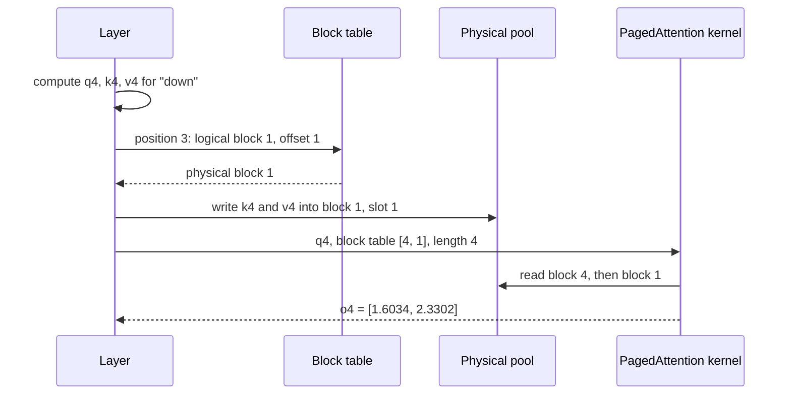

## 1. The question this page answers

Page 03 showed the problem: one contiguous chunk per request wastes most of the KV cache memory. Page 01 showed the classic fix: fixed-size pages anywhere in memory, with a table. But attention reads every key and every value of a request in each decode iteration. Standard attention kernels expect those keys and values as one contiguous tensor.

So the paper must answer these questions, and an interviewer will ask each of them:

1. How do you compute attention when the keys and values are split into blocks that are not next to each other?
2. What does Equation 4 of §4.1 say, symbol by symbol?
3. Is the result exactly the same as normal attention, or an approximation?
4. How does the kernel find the blocks?
5. Why is it still fast on a GPU, and what does it cost?

The paper's own summary: "Unlike the traditional attention algorithms, PagedAttention allows storing continuous keys and values in non-contiguous memory space" (§4.1).

## 2. Mental model

> [!analogy] Counting a vote ballot box by ballot box
> An election has ballots in several boxes, in different rooms. You do not need all ballots in one room to count them. You count each box, write its partial result, and add the partial results at the end. Attention is a weighted vote of value vectors. Each key decides the weight of its value. So the keys and values can sit in different blocks: you visit each block, compute its part, and add the parts. A small index card, the block table, tells you which room holds box 1, box 2 and box 3.
>
> **Where it stops working:** in a normal vote, each box's count is final. In attention, each weight is divided by a grand total over all boxes (the softmax denominator). So a block's partial result is not final until you know that total. The kernel either computes the total first and then visits the blocks again, or it corrects its running result as it goes (§7.4).

## 3. Terms

| Term | Plain meaning |
|---|---|
| query, key, value vectors | Three vectors that each token's hidden state produces in each layer. The query asks, the keys answer, the values are mixed. |
| attention score | The dot product of a query and a key, divided by $\sqrt{d}$. |
| softmax | A function that turns scores into positive weights that sum to 1: $e^{s_j} / \sum_t e^{s_t}$. |
| attention output | The weighted sum of the value vectors: $o_i = \sum_j a_{ij} v_j$. |
| KV block | Storage for the key and value vectors of a fixed number of tokens. |
| block size $B$ | The number of tokens per KV block. The paper's default is 16 (§7.2). |
| key block $K_j$ | The key vectors of the tokens in block $j$, side by side as a matrix. |
| value block $V_j$ | The value vectors of the tokens in block $j$, side by side as a matrix. |
| logical block | Block number $j$ in the request's own order: block 0 holds its first $B$ tokens. |
| physical block | A real block of GPU memory in the pool. Any logical block can live in any physical block. |
| block table | The per-request list that maps each logical block to its physical block (page 05). |
| kernel | A function that runs on the GPU in many threads at once. |
| warp | A group of 32 GPU threads that run the same instruction together. |
| coalesced memory access | Neighboring threads read neighboring addresses, so the GPU serves them with few wide memory transactions. |
| partial block | The last block of a request when the number of tokens is not a multiple of $B$. Its unfilled slots must be ignored. |
| online softmax | A way to compute softmax in one pass over blocks: keep a running maximum and a running sum, and rescale them. |

All terms are also in the [Glossary](/notes/papers/glossary).

## 4. The attention that the paper starts from

### 4.1 Equations 2 and 3 of the paper

The paper writes the input of a layer as hidden states $x_1, \dots, x_n$. Each one becomes three vectors (§2.1, Equation 2):

$$
q_i = W_q x_i, \qquad k_i = W_k x_i, \qquad v_i = W_v x_i
$$

Then attention for position $i$ (§2.1, Equation 3):

$$
a_{ij} = \frac{\exp\left(q_i^\top k_j / \sqrt{d}\right)}{\sum_{t=1}^{i} \exp\left(q_i^\top k_t / \sqrt{d}\right)}, \qquad o_i = \sum_{j=1}^{i} a_{ij} v_j
$$

Read it symbol by symbol:

| Symbol | Meaning |
|---|---|
| $q_i$ | The query vector of the token at position $i$, the token that "asks". |
| $k_j$, $v_j$ | The key and value vectors of the token at position $j$. |
| $q_i^\top k_j$ | The dot product: one number that says how well key $j$ matches query $i$. |
| $\sqrt{d}$ | A scale factor that keeps the scores in a good range for softmax. In the toy example $d = 2$. |
| $a_{ij}$ | The attention weight of position $j$ for query $i$. All weights for one $i$ sum to 1. |
| $\sum_{t=1}^{i}$ | A sum over positions 1 to $i$ only. A token never attends to later tokens (causal attention). |
| $o_i$ | The output for position $i$: a weighted average of the value vectors. |

The paper uses column vectors, so it writes $W_q x_i$. The guide's toy example uses row vectors and writes $x W_Q$. The two are the same computation, transposed. The paper writes $\sqrt{d}$. In a multi-head model, each head computes this with its own head dimension. For the full derivation of the formula, read [L3: Scaled dot-product attention, step by step](/notes/ai/llm-systems/02-attention-and-the-transformer/l3-scaled-dot-product-attention). For multi-head attention, read [L5: Multi-head attention](/notes/ai/llm-systems/02-attention-and-the-transformer/l5-multi-head-attention).

> [!note] The paper's equation numbers
> The printed equation numbers are (1) for the chain rule of probabilities, (2) for the projections, (3) for attention and (4) for the block-wise form. In two places, the paper's text calls the per-token attention formula "Eq. 4" (in §2.1 and in §4.1). These notes follow the printed numbers: Equation 3 is per-token attention, and Equation 4 is the block-wise form.

### 4.2 The toy example, one decode step

The guide uses one small example on every attention page. Four tokens: "the", "cat", "sat", "down". One head, $d = 2$. The cached keys and values (row vectors):

| Token | Position | Key $k$ | Value $v$ |
|---|---|---|---|
| the | 1 | [1, 0] | [2, 3] |
| cat | 2 | [0, 2] | [2, 2] |
| sat | 3 | [0, 1] | [1, 2] |
| down | 4 | [1, 1] | [1, 3] |

The decode step for "down" uses the query $q_4 = [1, 2]$. The raw scores against all four keys are $[1, 4, 2, 3]$. Normal attention gives the weights $[0.0646, 0.5388, 0.1310, 0.2657]$ and the output $o_4 = [1.6034, 2.3302]$. [L4: Causal masking and generation](/notes/ai/llm-systems/02-attention-and-the-transformer/l4-causal-masking-and-generation) computes these numbers step by step. This page computes the same output block by block.

## 5. Splitting the KV cache into blocks

### 5.1 The definition

The paper: PagedAttention "partitions the KV cache of each sequence into KV blocks. Each block contains the key and value vectors for a fixed number of tokens, which we denote as KV block size (B)" (§4.1).

The paper numbers positions from 1. Block $j$ holds positions $(j-1)B + 1$ to $jB$:

$$
K_j = \left(k_{(j-1)B+1}, \dots, k_{jB}\right), \qquad V_j = \left(v_{(j-1)B+1}, \dots, v_{jB}\right)
$$

So $K_j$ is a matrix with the $B$ key vectors of block $j$ side by side as columns: shape $d \times B$. $V_j$ has the same shape. A query at position $i$ needs the blocks 1 to $\lceil i/B \rceil$. The symbol $\lceil \cdot \rceil$ means "round up to the next whole number".

> [!example] Worked example: the toy tokens in blocks of size 2
> 1. Four tokens and $B = 2$: $\lceil 4/2 \rceil = 2$ blocks.
> 2. Block 1 holds positions $(1-1) \cdot 2 + 1 = 1$ to $1 \cdot 2 = 2$: "the" and "cat".
> 3. Block 2 holds positions 3 to 4: "sat" and "down".
> 4. $K_1$ has the columns $k_{\text{the}} = [1, 0]$ and $k_{\text{cat}} = [0, 2]$. $V_1$ has the columns $[2, 3]$ and $[2, 2]$.
> 5. $K_2$ has the columns $[0, 1]$ and $[1, 1]$. $V_2$ has the columns $[1, 2]$ and $[1, 3]$.

The paper's Figure 5 uses the sentence "Four score and seven years ago our fathers brought forth" with $B = 4$. The query token is "forth", the 10th token. It needs $\lceil 10/4 \rceil = 3$ blocks. Figure 5 shows the keys and values of "Four score and seven" in block 0 (the figure numbers blocks from 0). "The key and value vectors are spread across three blocks", and the three blocks "are not contiguous on the physical memory" (§4.1).

### 5.2 What a block holds in a real model

A real model has many layers and many heads. The paper explains its choice in footnote 1 of §4.1: "In Transformer, each token has a set of key and value vectors across layers and attention heads within a layer. All the key and value vectors can be managed together within a single KV block, or the key and value vectors at different heads and layers can each have a separate block and be managed in separate block tables. The two designs have no performance difference and we choose the second one for easy implementation."

The design document of the original vLLM kernel gives the shapes of the cache tensors that the kernel reads. Keys: `[num_blocks, num_kv_heads, head_size/x, block_size, x]`. Values: `[num_blocks, num_kv_heads, head_size, block_size]`. Here `x` is a small number of elements that fill 16 bytes. So one block number selects the keys and values of $B$ tokens for every KV head in these tensors. Interpretation of these notes: each layer has its own pair of such tensors, because each layer runs its own attention.

> [!example] Worked example: the bytes in one block
> 1. OPT-13B, $B = 16$, FP16, one head of 128 numbers: the keys of one head in one block are $16 \times 128 \times 2 = 4{,}096$ bytes.
> 2. OPT-13B, one block, all 40 heads, keys and values, one layer: $16 \times 2 \times 5120 \times 2 = 327{,}680$ bytes, which is 320 KiB.
> 3. Across all 40 layers: $16 \times 819{,}200 = 13{,}107{,}200$ bytes, which is 12.5 MiB per block of 16 tokens.
> 4. Llama-3.1-8B (8 KV heads of 128, 32 layers), one block of 16 tokens, one layer: $16 \times 2 \times 8 \times 128 \times 2 = 65{,}536$ bytes, which is 64 KiB. Across 32 layers: 2 MiB.

## 6. Equation 4, symbol by symbol

### 6.1 The block-wise formula

The paper: "the attention computation in Eq. 4 can be transformed into the following block-wise computation" (§4.1):

$$
A_{ij} = \frac{\exp\left(q_i^\top K_j / \sqrt{d}\right)}{\sum_{t=1}^{\lceil i/B \rceil} \exp\left(q_i^\top K_t \mathbf{1} / \sqrt{d}\right)}, \qquad o_i = \sum_{j=1}^{\lceil i/B \rceil} V_j A_{ij}^\top
$$

| Symbol | Shape | Meaning |
|---|---|---|
| $q_i$ | $d \times 1$ | The query of token $i$. |
| $K_j$ | $d \times B$ | The keys of block $j$, as columns. |
| $q_i^\top K_j$ | $1 \times B$ | The $B$ raw scores of query $i$ against the tokens of block $j$. |
| $\exp(\cdot)$ | $1 \times B$ | Applied to each score separately. |
| $\mathbf{1}$ | $B \times 1$ | A column of ones. Multiplying by it adds the $B$ entries of a row. |
| $\sum_{t=1}^{\lceil i/B \rceil}$ | number | The sum over all blocks that the query needs. |
| $A_{ij}$ | $1 \times B$ | "the row vector of attention score on $j$-th KV block" (§4.1): the final weights of the tokens in block $j$. |
| $V_j$ | $d \times B$ | The values of block $j$, as columns. |
| $V_j A_{ij}^\top$ | $d \times 1$ | The weighted sum of the $B$ values of block $j$: block $j$'s part of the output. |
| $o_i$ | $d \times 1$ | The output: the sum of the parts of all blocks. |

### 6.2 The numerator: one row of exponentials per block

$\exp(q_i^\top K_j / \sqrt{d})$ is a row of $B$ numbers: one exponential for each token of block $j$. It is the same set of numerators as in Equation 3, grouped by block.

### 6.3 The denominator: the grand total over all blocks

The denominator must be the sum of all exponentials of all tokens $1$ to $i$, the same as in Equation 3. Read with care, because the printed notation is ambiguous. The term $\exp(q_i^\top K_t \mathbf{1} / \sqrt{d})$ means: take the $B$ exponentials of block $t$, then add them (the $\mathbf{1}$ does the adding). The outer sum then adds the block totals.

> [!trap] Do not put the sum inside the exponential
> Read literally, $\exp(q_i^\top K_t \mathbf{1} / \sqrt{d})$ could mean "add the $B$ scores first, then take one exponential". That is wrong, because $e^{a} + e^{b} \neq e^{a+b}$. For block 1 of the toy example, the scores are 1 and 4. The correct block total is $e^{1/\sqrt{2}} + e^{4/\sqrt{2}} \approx 2.0281 + 16.9188 = 18.9469$. The wrong reading gives $e^{5/\sqrt{2}} \approx 34.3133$. Interpretation of these notes: the intended meaning is $\exp(q_i^\top K_t / \sqrt{d})\,\mathbf{1}$, the sum of the block's exponentials. The paper does not define $\mathbf{1}$.

### 6.4 The output: a sum of block parts

$V_j A_{ij}^\top$ multiplies each value vector of block $j$ by its weight and adds them. The output $o_i$ adds the parts of all blocks. No step needs two blocks at the same time, except the shared denominator.

### 6.5 Why Equation 4 equals Equation 3 exactly

The blocks $1, \dots, \lceil i/B \rceil$ split the positions $1, \dots, i$ into groups, and each position is in exactly one group. A sum over all positions equals the sum, over groups, of the sums inside each group. So:

1. The denominator of Equation 4 equals the denominator of Equation 3.
2. Each entry of $A_{ij}$ equals the matching weight $a_{i,\cdot}$ of Equation 3.
3. $\sum_j V_j A_{ij}^\top = \sum_j \sum_{\text{positions in } j} a_{i,\cdot} \, v_\cdot = \sum_{t=1}^{i} a_{it} v_t = o_i$.

> [!key] PagedAttention is exact
> Equation 4 is the same arithmetic as Equation 3, grouped by block. It is not an approximation, and it does not change the number of multiplications. It changes only where the kernel reads each key and value from.

### 6.6 The last block may be partial

If $i$ is not a multiple of $B$, the last block holds fewer than $B$ tokens. In decode, its remaining slots are empty, "reserved for future generations" (§4.2). The formula writes full blocks, so an implementation must ignore the slots after position $i$. Interpretation of these notes: real kernels compute the number of valid tokens from the sequence length and skip or mask the other slots.

> [!example] Worked example: the query of "sat" with $B = 2$ (a partial block)
> "sat" is at position 3, so it needs $\lceil 3/2 \rceil = 2$ blocks. $q_3 = [0, 1]$.
>
> 1. Block 1 ("the", "cat"): raw scores $[0, 2]$. Scaled: $[0, 1.4142]$. Exponentials: $[1, 4.1133]$. Block total: $5.1133$.
> 2. Block 2: only slot 1 is valid ("sat"). Raw score $[1]$. Scaled: $[0.7071]$. Exponential: $[2.0281]$. Block total: $2.0281$.
> 3. Denominator: $5.1133 + 2.0281 = 7.1414$.
> 4. $A_{3,1} = [0.1400, 0.5760]$, $A_{3,2} = [0.2840]$.
> 5. Block parts: $V_1 A_{3,1}^\top = [1.4320, 1.5720]$. $V_2 A_{3,2}^\top = 0.2840 \times [1, 2] = [0.2840, 0.5680]$.
> 6. $o_3 = [1.7160, 2.1400]$. This equals the normal causal result for "sat".
>
> If the kernel did not skip the second slot of block 2, it would add garbage from an empty slot. During decode of "down", that slot holds "down" itself, which "sat" must never see.

## 7. Worked example: the attention of "down", block by block


> [!example] Worked example: Equation 4 for "down" with $B = 2$
> $q_4 = [1, 2]$, $d = 2$, $\sqrt{2} \approx 1.4142$. Two blocks, as in §5.1. All numbers are rounded to 4 decimals, and each step uses the unrounded values of the step before.
>
> 1. **Raw scores, block 1** ("the", "cat"): $q_4 \cdot [1, 0] = 1$ and $q_4 \cdot [0, 2] = 4$. So $q_4^\top K_1 = [1, 4]$.
> 2. **Raw scores, block 2** ("sat", "down"): $q_4 \cdot [0, 1] = 2$ and $q_4 \cdot [1, 1] = 3$. So $q_4^\top K_2 = [2, 3]$.
> 3. **Scale** by $1/\sqrt{2}$: block 1 $[0.7071, 2.8284]$, block 2 $[1.4142, 2.1213]$.
> 4. **Exponentials**: block 1 $[2.0281, 16.9188]$, block 2 $[4.1133, 8.3421]$.
> 5. **Block totals**: block 1 $2.0281 + 16.9188 = 18.9469$. Block 2 $4.1133 + 8.3421 = 12.4554$.
> 6. **Denominator** (the sum over blocks): $18.9469 + 12.4554 = 31.4023$.
> 7. **Weights**: $A_{4,1} = [2.0281, 16.9188] / 31.4023 = [0.0646, 0.5388]$. $A_{4,2} = [4.1133, 8.3421] / 31.4023 = [0.1310, 0.2657]$.
> 8. **Block part 1**: $V_1 A_{4,1}^\top = 0.0646 \times [2, 3] + 0.5388 \times [2, 2] = [1.2067, 1.2713]$.
> 9. **Block part 2**: $V_2 A_{4,2}^\top = 0.1310 \times [1, 2] + 0.2657 \times [1, 3] = [0.3966, 1.0589]$.
> 10. **Output**: $o_4 = [1.2067 + 0.3966, 1.2713 + 1.0589] = [1.6034, 2.3302]$.
>
> The weights $[0.0646, 0.5388, 0.1310, 0.2657]$ and the output $[1.6034, 2.3302]$ are exactly those of normal attention (§4.2).

Two more checks, computed in these notes:

1. **Block size 3.** Block 1 holds "the", "cat", "sat" (total $23.0602$) and block 2 holds "down" (total $8.3421$). The denominator is again $31.4023$, and the output is again $[1.6034, 2.3302]$. The block size changes the grouping, never the result.
2. **Order of the blocks.** Addition does not depend on order. So the kernel may visit the blocks in any order, or in parallel, if it combines the parts correctly.

### 7.1 Numerical stability: subtract the maximum first

Real kernels never compute $e^{s}$ directly, because large scores overflow. They subtract the largest score $m$ first: $e^{s - m}$. The factor $e^{-m}$ appears in every numerator and in the denominator, so it cancels.

> [!example] Worked example: the same step with the maximum subtracted
> 1. Global maximum of the scaled scores: $m = 2.8284$ (the score of "cat", in block 1).
> 2. $e^{s - m}$: block 1 $[0.1199, 1]$, block 2 $[0.2431, 0.4931]$.
> 3. Denominator: $0.1199 + 1 + 0.2431 + 0.4931 = 1.8561$.
> 4. Weights: $0.1199 / 1.8561 = 0.0646$, $1 / 1.8561 = 0.5388$, $0.2431 / 1.8561 = 0.1310$, $0.4931 / 1.8561 = 0.2657$. The same weights.

This needs the global maximum before the exponentials. The original vLLM kernel works in this order. Its design document describes three stages. First, a `qk_max` is reduced across all threads of the thread block. Next, an `exp_sum` of `exp(qk - qk_max)` is computed. Only then does the value part run. So it makes two passes over the scores.

### 7.2 One pass: the online softmax

A kernel can also visit each block only once. It keeps a running maximum $m$, a running sum $\ell$ and a running weighted sum $\mathbf{acc}$. When a new block brings a larger score, it multiplies $\ell$ and $\mathbf{acc}$ by $e^{m_{\text{old}} - m_{\text{new}}}$. This is the online softmax of FlashAttention. [L7: The cost of attention and FlashAttention](/notes/ai/llm-systems/02-attention-and-the-transformer/l7-attention-cost-and-flashattention) derives it. Exercise 2 of §8.5 asks you to implement it on blocks.

```video
{
  "src": "/notes/media/papers/2023-pagedattention/manim/p02-attention-block-by-block.mp4",
  "caption": "The query of \"down\" visits two scattered blocks, adds their exponential totals into one denominator, and sums the two block parts into the same output as normal attention."
}
```

## 8. Where the blocks live: the block table and the physical pool

### 8.1 A pool of physical blocks

vLLM reserves one large region of GPU memory and cuts it into physical blocks: "a block engine allocates a contiguous chunk of GPU DRAM and divides it into physical KV blocks" (§4.2). Each request has a **block table** that maps its logical blocks to physical blocks (page 05 covers the manager). The paper: "Each block table entry records the corresponding physical blocks of a logical block and the number of filled positions" (§4.2).


> [!example] Worked example: the toy request in a pool of 6 blocks
> The pool of one layer has 6 physical blocks of $B = 2$ slots. Another request uses physical blocks 0 and 2. Blocks 3 and 5 are free. Our request's block table is $[4, 1]$: logical block 0 → physical block 4, logical block 1 → physical block 1. Count positions from 0, as code does.
>
> | Token | Position $t$ | Logical block $\lfloor t/2 \rfloor$ | Offset $t \bmod 2$ | Physical block |
> |---|---|---|---|---|
> | the | 0 | 0 | 0 | 4 |
> | cat | 1 | 0 | 1 | 4 |
> | sat | 2 | 1 | 0 | 1 |
> | down | 3 | 1 | 1 | 1 |
>
> The request's tokens are in order in its logical view. Physical block 1 comes before physical block 4 in memory, and block 2 between them belongs to another request. Attention does not care.

### 8.2 One decode iteration, one layer

In each decode iteration, each layer does these steps for the new token. The paper describes the first step as one fused kernel: "In every Transformer layer, the new KV cache are split into blocks, reshaped to a memory layout optimized for block read," and then saved at the positions that the block table gives (§5.1).



The prompt itself uses normal attention. In §4.3, vLLM "generates the KV cache of the prompts and the first output token with a conventional self-attention algorithm (e.g., [13])", where [13] is FlashAttention. The decode steps then use PagedAttention: "vLLM generates the new token with the PagedAttention algorithm on physical blocks 7 and 1" (§4.3).

### 8.3 PagedAttention in NumPy

This excerpt implements the pool, the block table and Equation 4 for one layer and one head. It is a model of the algorithm, not vLLM's code.

```python
import numpy as np

# The toy example of this guide: K and V rows of "the", "cat", "sat", "down"
K = np.array([[1, 0], [0, 2], [0, 1], [1, 1]], dtype=float)
V = np.array([[2, 3], [2, 2], [1, 2], [1, 3]], dtype=float)
q4 = np.array([1, 2], dtype=float)                  # query of "down"

def dense_attention(q, K, V):
    s = K @ q / np.sqrt(q.shape[0])                  # one score per cached token
    w = np.exp(s - s.max())
    return (w / w.sum()) @ V                         # softmax, then weighted sum

# One layer's physical pool: 6 blocks of B = 2 slots, d = 2 numbers per vector
B, num_blocks, d = 2, 6, 2
k_pool = np.full((num_blocks, B, d), np.nan)         # NaN marks slots without a token
v_pool = np.full((num_blocks, B, d), np.nan)
block_table = [4, 1]                                 # logical 0 -> physical 4, logical 1 -> physical 1

def write_kv(t, k, v):
    phys = block_table[t // B]                       # translate the position
    k_pool[phys, t % B] = k
    v_pool[phys, t % B] = v

def paged_attention(q, length):
    nblocks = -(-length // B)                        # ceil(length / B)
    scores, vals = [], []
    for j in range(nblocks):                         # pass 1: scores, block by block
        n = min(B, length - j * B)                   # valid slots in logical block j
        phys = block_table[j]                        # translate: logical -> physical
        scores.append(k_pool[phys, :n] @ q / np.sqrt(d))
        vals.append(v_pool[phys, :n])
    m = max(s.max() for s in scores)                 # global maximum, for stability
    exps = [np.exp(s - m) for s in scores]           # numerators, times one constant
    total = sum(e.sum() for e in exps)               # denominator of Equation 4
    return sum(e @ Vj for e, Vj in zip(exps, vals)) / total   # sum of V_j A_ij^T

for t in range(4):
    write_kv(t, K[t], V[t])
print("paged:", paged_attention(q4, 4).round(4))
print("dense:", dense_attention(q4, K, V).round(4))
print("physical block 1:", k_pool[1].tolist())
```

```text
paged: [1.6034 2.3302]
dense: [1.6034 2.3302]
physical block 1: [[0.0, 1.0], [1.0, 1.0]]
```

The important lines:

1. `k_pool = np.full((num_blocks, B, d), np.nan)` is the physical pool: one array for all requests. NaN in an unused slot makes any wrong read visible, because NaN spreads through arithmetic.
2. `phys = block_table[t // B]` and `t % B` are the translation of page 01: logical block number and offset.
3. `n = min(B, length - j * B)` handles the partial last block. Without it, an empty slot would enter the sum.
4. `k_pool[phys, :n] @ q` reads one block. The $n$ keys of a block sit next to each other, so this read is contiguous.
5. `m = max(...)` is the global maximum. `total` is the denominator of Equation 4: a sum of block totals.
6. `e @ Vj` is $V_j A_{ij}^\top$ before the division. The final `/ total` turns the numerators into weights.

### 8.4 What changes for a batch

In a batch, each sequence has its own block table and its own length. The kernel receives a two-dimensional table: one row per sequence. FlashAttention's API, which later added paged KV cache support, documents the same shape: "block_table [optional]: (batch_size, max_num_blocks_per_seq), dtype torch.int32" (flash-attention README, checked on 2026-10-15). The paper adds that its kernel supports "variable sequence lengths within a request batch" (§5.1).

### 8.5 Exercises

1. **A paged KV store for many requests.** Write a class `PagedKV(num_blocks, B, d)` with `append(req, k, v)` and `attention(req, q)`. It keeps a free list of physical blocks and a block table per request. It takes a new block only when the last block of the request is full. Acceptance test: use $B = 16$, $d = 8$ and three requests of 37, 16 and 70 random tokens, appended in an interleaved order. For each request, `attention` matches dense attention (`np.allclose`). The requests hold 3, 1 and 5 blocks.
   - Hint 1: A new block is needed exactly when `length % B == 0` before the append.
   - Hint 2: Reuse the loop of `paged_attention`. The only new parts are the free list and one table per request.
2. **One pass with online softmax.** Write `online_paged_attention(q, k_pool, v_pool, block_table, length, B)` that visits each block once. Acceptance test: it returns $[1.6034, 2.3302]$ for the toy example with $B = 2$, and the same result with $B = 1$.
   - Hint 1: Keep `m`, `l` and `acc`. Start with `m = -inf`, `l = 0`, `acc = 0`.
   - Hint 2: When the maximum grows from `m` to `m_new`, multiply `l` and `acc` by `exp(m - m_new)` before you add the new block.

## 9. Why it is still fast on a GPU

### 9.1 Decode attention is limited by memory reads

In a decode iteration, each sequence has one query vector. Attention multiplies it with every cached key and value: about one multiply-add for each number read. So decode attention is memory-bound. Its time depends on how many bytes the kernel reads and how efficiently it reads them, not on arithmetic. For the roofline argument, read [L3: Compute-bound vs memory-bound](/notes/ai/llm-systems/04-inference/l3-compute-bound-vs-memory-bound) and [L5: GPUs, memory and bandwidth](/notes/ai/llm-systems/01-math-and-hardware/l5-gpus-memory-and-bandwidth).

Paging changes where the bytes are, not how many there are. It adds only the block table entries.

> [!example] Worked example: the cost of the table
> Llama-3.1-8B, $B = 16$, one layer.
>
> 1. K and V data of one block, all 8 KV heads: $16 \times 2 \times 8 \times 128 \times 2 = 65{,}536$ bytes.
> 2. The block table entry for that block: one 32-bit integer, 4 bytes.
> 3. Extra bytes: $4 / 65{,}536 \approx 0.0061\%$.
>
> The table is read once per block and per sequence. Its cost in bytes is negligible.

### 9.2 Each block is contiguous inside

A GPU reads memory fastest when the 32 threads of a warp read neighboring addresses together: a **coalesced** access. A block keeps $B$ tokens next to each other, so the reads inside a block are coalesced. The paper: "To ensure coalesced memory access, we assign a GPU warp to read each block" (§5.1).

The vLLM design document gives the details of the original kernel (it calls itself "a historical document" that "no longer describes the code used in vLLM today", checked on 2026-10-15):

1. One thread block handles "one head, one sequence, and" one partition of the sequence.
2. "each warp processes the calculation between one query token and key tokens of one entire block at a time". With several warps, "warp 0 handles the 0th, 4th blocks, warp 1 handles the 1st, 5th blocks", and so on.
3. Each thread reads a "vec" of elements sized so that each access is 16 bytes. "neighboring threads like thread 0 and thread 1 can read neighbor memory". A warp then reads $32 \times 16 = 512$ bytes per load.
4. The key address starts at `k_cache + physical_block_number * kv_block_stride`. The block table gives the physical block number.

> [!example] Worked example: how many loads one block needs
> 1. Keys of one KV head in one block, $B = 16$, 128 numbers in FP16: $16 \times 128 \times 2 = 4{,}096$ bytes.
> 2. One coalesced warp load: $32 \times 16 = 512$ bytes.
> 3. Loads per block: $4{,}096 / 512 = 8$.
>
> So one table lookup is followed by 8 wide, contiguous loads. The jump between blocks costs little compared with the reads inside a block.

### 9.3 The measured cost

The paper measured the kernel against FasterTransformer's attention kernel: "this leads to 20–26% higher attention kernel latency, compared to the highly-optimized FasterTransformer implementation" (§7.1). The reasons: "extra overheads of accessing the block table, executing extra branches, and handling variable sequence lengths" (§7.1). The authors judge it small: "it only affects the attention operator but not the other operators in the model, such as Linear" (§7.1).

Interpretation of these notes: a slower attention kernel is a good trade when it allows a batch that is several times larger. Page 03 estimated about 3.3 times more tokens per iteration for OPT-13B, and the paper measures 2-4× throughput end to end (page 09).

### 9.4 The block size is a trade-off

The paper tested block sizes in §7.2:

1. Too small: "If the block size is too small, vLLM may not fully utilize the GPU's parallelism for reading and processing KV cache."
2. Too large: "If the block size is too large, internal fragmentation increases and the probability of sharing decreases."
3. Results: "In the ShareGPT trace, block sizes from 16 to 128 lead to the best performance." On Alpaca, 16 and 32 work well, and larger blocks perform worse because many sequences are shorter than one block.
4. Choice: "Accordingly, vLLM sets its default block size as 16."

> [!key] Why the design works
> The table adds one small read per block. Each block is a contiguous run of $B$ tokens, so the reads inside it stay coalesced. Decode attention was already limited by bytes, and paging adds almost no bytes. The kernel is 20-26% slower in isolation, but it lets the batch grow by several times.

## 10. What PagedAttention is not

1. **Not an approximation.** It computes exactly the result of Equation 3 (§6.5).
2. **Not fewer FLOPs.** The arithmetic is the same. Only the addresses change.
3. **Not FlashAttention.** FlashAttention reduces memory traffic for long attention matrices by tiling in fast on-chip memory. PagedAttention changes where K and V are stored. They solve different problems and can be combined: the flash-attention README lists "Paged KV cache" in version 2.5 and links the PagedAttention paper (checked on 2026-10-15).
4. **Not used for the prompt in the paper.** The prompt uses conventional attention. PagedAttention reads the cache during decode (§4.3).
5. **Not a memory manager by itself.** The kernel only reads blocks through a table. Allocating, freeing, sharing and swapping blocks is the job of the KV cache manager and the scheduler (pages 05 to 07).

The vLLM design document says that its description of the original kernel "no longer describes the code used in vLLM today" (checked on 2026-10-15). The idea of a block table, however, is now standard in attention kernels. Page 10 covers what replaced the original kernel.

## 11. Common mistakes

1. **"PagedAttention approximates attention to save memory."** It is exact. It saves memory because the cache manager can allocate small blocks on demand. The attention math is unchanged.
2. **"Each block computes its own softmax."** The weights use one denominator over all blocks. A block's exponentials are divided by the grand total, not by the block total.
3. **"The paper's $\exp(q_i^\top K_t \mathbf{1} / \sqrt{d})$ sums the scores inside the exponential."** That reading gives wrong numbers. The block total is the sum of the block's exponentials.
4. **"Non-contiguous memory makes the GPU slow."** Each block is contiguous inside, so a warp reads it with coalesced loads. Only the jump between blocks is new, and it costs one table read per block.
5. **"The last block is always full."** It is often partial. The kernel must use the sequence length to ignore the unfilled slots.
6. **"Block size does not matter."** It does not change the result. It changes performance: small blocks use the GPU badly, large blocks waste memory and share less. The default is 16.

## 12. One-minute explanation

PagedAttention is attention that reads the KV cache from fixed-size blocks of $B$ tokens, 16 by default, instead of one contiguous tensor. Each request has a block table that maps its logical blocks to physical blocks anywhere in GPU memory. Equation 4 of the paper rewrites attention as a sum over blocks. For each block, the kernel multiplies the query with the block's keys and takes the exponentials. It divides by one shared total over all blocks, then adds each block's weighted values. Because the blocks only group the same positions, the result is exactly normal attention, with the same FLOPs. In the toy example, two blocks give the totals 18.9469 and 12.4554, a denominator of 31.4023, and the normal output [1.6034, 2.3302]. The kernel reads the block table, then reads each block with one warp, and each block is contiguous inside, so the loads stay coalesced. Decode attention is memory-bound, and the table adds almost no bytes. The paper measured a 20 to 26% slower attention kernel, but the batch can grow several times, which gives 2 to 4 times the throughput.

## 13. Check questions

```check
{
  "question": "Write Equation 4 of the paper and say what each of $K_j$, $A_{ij}$, $\\mathbf{1}$ and $\\lceil i/B \\rceil$ means.",
  "answer": "$$A_{ij} = \\frac{\\exp(q_i^\\top K_j/\\sqrt{d})}{\\sum_{t=1}^{\\lceil i/B\\rceil} \\exp(q_i^\\top K_t \\mathbf{1}/\\sqrt{d})}, \\qquad o_i = \\sum_{j=1}^{\\lceil i/B\\rceil} V_j A_{ij}^\\top$$\n\n$K_j$ is the matrix of the $B$ key vectors of block $j$ (positions $(j-1)B+1$ to $jB$). $A_{ij}$ is the row vector of the final attention weights of query $i$ on the tokens of block $j$. $\\mathbf{1}$ is a column of ones that adds the $B$ exponentials of a block (the paper does not define it, and the intended reading is the sum of the exponentials). $\\lceil i/B \\rceil$ is the number of blocks that hold positions 1 to $i$."
}
```

```check
{
  "question": "With block size 4, how many blocks does a query at position 10 need? Which positions does each block hold, and how many slots of the last block are valid?",
  "answer": "$\\lceil 10/4 \\rceil = 3$ blocks. Block 1: positions 1 to 4. Block 2: positions 5 to 8. Block 3: positions 9 to 12, of which only 9 and 10 are valid. The kernel must ignore slots 11 and 12. This is the paper's Figure 5: the query \"forth\" is the 10th token of \"Four score and seven years ago our fathers brought forth\"."
}
```

```check
{
  "question": "Compute the attention output of \"down\" with block size 3 (block 1 = the, cat, sat; block 2 = down). Give the block totals and the denominator.",
  "hint": "The scaled scores are 0.7071, 2.8284, 1.4142 and 2.1213.",
  "answer": "Exponentials: 2.0281, 16.9188, 4.1133 and 8.3421. Block 1 total: $2.0281 + 16.9188 + 4.1133 = 23.0602$. Block 2 total: $8.3421$. Denominator: $31.4023$, the same as with $B = 2$. Weights: $[0.0646, 0.5388, 0.1310]$ and $[0.2657]$. Block parts: $[1.3377, 1.5333]$ and $0.2657 \\times [1, 3] = [0.2657, 0.7970]$. Output: $[1.6034, 2.3302]$, the same as normal attention."
}
```

```check
{
  "question": "Interview follow-up: Prove that PagedAttention gives exactly the result of normal attention. Then say what it changes and what it does not change.",
  "answer": "The blocks split the positions $1, \\dots, i$ into groups, and each position is in exactly one group. So the sum of exponentials over all positions equals the sum over blocks of the block totals: the denominators of Equations 3 and 4 are equal. Each entry of $A_{ij}$ is then the same weight $a_{it}$ as in Equation 3. Finally, $\\sum_j V_j A_{ij}^\\top = \\sum_j \\sum_{t \\in j} a_{it} v_t = \\sum_{t=1}^{i} a_{it} v_t = o_i$. Unchanged: the result, the FLOPs, the softmax. Changed: where the kernel reads each key and value (through the block table), and the extra work of reading the table, branching and handling variable lengths, which cost 20-26% kernel latency in the paper (§7.1). Floating-point sums in a different order can differ in the last bits, but the math is the same."
}
```

```check
{
  "question": "Interview follow-up: The interviewer says 'Scattered memory is slow on GPUs. Why is PagedAttention not slow?' Answer with numbers.",
  "answer": "1. Decode attention is memory-bound: about one multiply-add per number read. So what matters is the bytes read and how efficiently they are read. 2. Paging adds very few bytes: one 4-byte table entry per block. For Llama-3.1-8B with $B = 16$, one block of one layer holds $16 \\times 2 \\times 8 \\times 128 \\times 2 = 65{,}536$ bytes of K and V, so the table adds about 0.006%. 3. Inside a block, tokens are contiguous, so the reads are coalesced. The paper assigns one warp per block (§5.1). One head's keys in one block are $16 \\times 128 \\times 2 = 4{,}096$ bytes, which is 8 warp loads of 512 bytes. 4. The measured cost is 20-26% higher latency of the attention kernel only, not of the linear layers (§7.1). The larger batch more than pays for it: 2-4× throughput."
}
```

```check
{
  "question": "Interview follow-up: Why does the kernel need the global maximum or an online softmax? What would go wrong if each block normalized by its own total?",
  "answer": "The softmax weight of a token is its exponential divided by the sum over all tokens of the sequence, in all blocks. If each block divided by its own total, the weights in each block would sum to 1, and the output would be the sum of several averages, not one weighted average. In the toy example with $B = 2$, block 1 alone gives weights $[0.1070, 0.8930]$ instead of $[0.0646, 0.5388]$. The fix: compute the global maximum and the global sum first (two passes, as the original vLLM kernel does with `qk_max` and `exp_sum`), or keep a running maximum and sum and rescale the partial results when the maximum grows (online softmax, one pass). For the scores of \"down\" visited one token at a time, the maximum grows from 0.7071 to 2.8284 at the second token, and the running sum and accumulator are multiplied by $e^{0.7071 - 2.8284} \\approx 0.1199$."
}
```

```check
{
  "question": "Interview follow-up: In vLLM as described in the paper, which attention runs during prefill and which during decode? Why does the difference make sense?",
  "answer": "Prefill uses a conventional self-attention kernel, for example FlashAttention [13] (§4.3): the prompt's keys and values are computed in this step, so they are available as normal contiguous tensors, and the new KV cache is then written into blocks. Decode uses PagedAttention: each iteration has one query per sequence that must read the whole cache from blocks. Interpretation of these notes: prefill is compute-bound and needs a kernel tuned for many queries at once, while decode is memory-bound and needs a kernel that reads scattered blocks efficiently. Later systems with prefix caching and chunked prefill also need prefill kernels that read cached blocks (page 10)."
}
```

```check
{
  "question": "Interview follow-up: What is a sensible block size, and what goes wrong at 1 and at 512?",
  "answer": "The paper's default is 16 (§7.2). On ShareGPT, sizes from 16 to 128 performed best; on Alpaca, 16 and 32. Block size 1: every token needs its own table entry and its own address computation, and a warp per block would read only one token's keys, so GPU parallelism and coalescing suffer (the paper: too small blocks \"may not fully utilize the GPU's parallelism\"). Block size 512: up to 511 empty slots per sequence (internal fragmentation), most Alpaca requests would be shorter than one block, and two sequences share a block only if all its tokens are identical, so sharing drops (\"internal fragmentation increases and the probability of sharing decreases\")."
}
```

```check
{
  "question": "Exercise 1: show a reference solution",
  "answer": "```python\nimport numpy as np\n\nclass PagedKV:\n    \"\"\"One layer, one KV head. A pool of physical blocks shared by many requests.\"\"\"\n    def __init__(self, num_blocks, B, d):\n        self.B, self.d = B, d\n        self.k = np.zeros((num_blocks, B, d))\n        self.v = np.zeros((num_blocks, B, d))\n        self.free = list(range(num_blocks))[::-1]        # free list of physical blocks\n        self.tables, self.lengths = {}, {}\n\n    def append(self, req, k, v):\n        table = self.tables.setdefault(req, [])\n        t = self.lengths.get(req, 0)\n        if t % self.B == 0:                              # last block full: allocate on demand\n            table.append(self.free.pop())\n        phys = table[t // self.B]\n        self.k[phys, t % self.B] = k\n        self.v[phys, t % self.B] = v\n        self.lengths[req] = t + 1\n\n    def attention(self, req, q):\n        table, length = self.tables[req], self.lengths[req]\n        scores, vals = [], []\n        for j, phys in enumerate(table):\n            n = min(self.B, length - j * self.B)         # mask the unfilled slots\n            scores.append(self.k[phys, :n] @ q / np.sqrt(self.d))\n            vals.append(self.v[phys, :n])\n        m = max(s.max() for s in scores)\n        exps = [np.exp(s - m) for s in scores]\n        total = sum(e.sum() for e in exps)\n        return sum(e @ vb for e, vb in zip(exps, vals)) / total\n\ndef dense(q, K, V):\n    s = K @ q / np.sqrt(q.shape[0])\n    w = np.exp(s - s.max())\n    return (w / w.sum()) @ V\n\nrng = np.random.default_rng(0)\nB, d = 16, 8\nstore = PagedKV(num_blocks=64, B=B, d=d)\ndata = {}\nlengths = {\"r1\": 37, \"r2\": 16, \"r3\": 70}\nfor step in range(max(lengths.values())):                # interleave the requests\n    for r, L in lengths.items():\n        if step < L:\n            k, v = rng.normal(size=d), rng.normal(size=d)\n            data.setdefault(r, ([], []))\n            data[r][0].append(k); data[r][1].append(v)\n            store.append(r, k, v)\nfor r in lengths:\n    q = rng.normal(size=d)\n    Kr, Vr = np.array(data[r][0]), np.array(data[r][1])\n    assert np.allclose(store.attention(r, q), dense(q, Kr, Vr))\n    print(r, \"blocks\", store.tables[r])\nassert len(store.tables[\"r1\"]) == 3 and len(store.tables[\"r2\"]) == 1 and len(store.tables[\"r3\"]) == 5\nprint(\"free blocks left:\", len(store.free))\n```\n\nThe store keeps one free list for all requests and one block table per request. `append` takes a new block only when the request's last block is full, so each request wastes at most $B - 1$ slots. `attention` is the `paged_attention` of §8.3 with the request's own table and length. Because the appends are interleaved, the blocks of one request are scattered in the pool, and the test shows that the result still equals dense attention."
}
```

```check
{
  "question": "Exercise 2: show a reference solution",
  "answer": "```python\nimport numpy as np\n\ndef online_paged_attention(q, k_pool, v_pool, block_table, length, B):\n    \"\"\"One pass over the blocks: keep a running max m, a running sum l and a\n    running weighted sum acc. Rescale them when a larger score appears.\"\"\"\n    d = q.shape[0]\n    m, l, acc = -np.inf, 0.0, np.zeros(v_pool.shape[-1])\n    for j, phys in enumerate(block_table):\n        n = min(B, length - j * B)\n        if n <= 0:\n            break\n        s = k_pool[phys, :n] @ q / np.sqrt(d)\n        m_new = max(m, s.max())\n        scale = np.exp(m - m_new)                  # 0 on the first block, because m = -inf\n        p = np.exp(s - m_new)\n        l = l * scale + p.sum()\n        acc = acc * scale + p @ v_pool[phys, :n]\n        m = m_new\n    return acc / l\n\n# Check on the toy example: block size 2 and the block table [4, 1]\nK = np.array([[1, 0], [0, 2], [0, 1], [1, 1]], float)\nV = np.array([[2, 3], [2, 2], [1, 2], [1, 3]], float)\nq = np.array([1, 2], float)\nB = 2\nk_pool = np.zeros((6, B, 2)); v_pool = np.zeros((6, B, 2))\ntable = [4, 1]\nfor t in range(4):\n    k_pool[table[t // B], t % B] = K[t]; v_pool[table[t // B], t % B] = V[t]\nout = online_paged_attention(q, k_pool, v_pool, table, 4, B)\nprint(out.round(4))\nassert np.allclose(out, [1.60336091, 2.33023845])\n\n# Block size 1: the maximum grows at the second block, so a rescale happens\nk1 = K.reshape(4, 1, 2); v1 = V.reshape(4, 1, 2)\nout1 = online_paged_attention(q, k1, v1, [0, 1, 2, 3], 4, 1)\nassert np.allclose(out1, out)\nprint(\"block size 1:\", out1.round(4))\n```\n\n`scale = exp(m - m_new)` corrects everything accumulated so far when a larger score appears. On the first block, `m = -inf`, so `scale = 0` and the empty start values vanish. With $B = 1$ on the toy example, the maximum grows at the second token, so this line really runs. The result equals the two-pass version and dense attention."
}
```

## 14. Links

- Previous: [03 The question: where does KV cache memory go?](/notes/papers/llm-serving/2023-pagedattention/03-the-question)
- Next: [05 The KV cache manager and block tables](/notes/papers/llm-serving/2023-pagedattention/05-the-kv-cache-manager)
- Paging and translation: [01 Background: virtual memory and paging](/notes/papers/llm-serving/2023-pagedattention/01-background-virtual-memory-and-paging)
- The kernels in detail: [08 Implementation: the vLLM system and its kernels](/notes/papers/llm-serving/2023-pagedattention/08-implementation)
- Kernel and block-size measurements: [09 Results](/notes/papers/llm-serving/2023-pagedattention/09-results)
- What replaced the original kernel: [10 Limits and later work](/notes/papers/llm-serving/2023-pagedattention/10-limits-and-later-work)
- Build it yourself: [11 Reproduce it](/notes/papers/llm-serving/2023-pagedattention/11-reproduce-it)
- Attention: [L3: Scaled dot-product attention, step by step](/notes/ai/llm-systems/02-attention-and-the-transformer/l3-scaled-dot-product-attention), [L4: Causal masking and generation](/notes/ai/llm-systems/02-attention-and-the-transformer/l4-causal-masking-and-generation), [L5: Multi-head attention](/notes/ai/llm-systems/02-attention-and-the-transformer/l5-multi-head-attention), [L7: The cost of attention and FlashAttention](/notes/ai/llm-systems/02-attention-and-the-transformer/l7-attention-cost-and-flashattention)
- KV cache: [L4: Implementing a KV cache](/notes/ai/llm-systems/03-kv-cache/l4-implementing-a-kv-cache), [L9: Prefix caching and KV reuse](/notes/ai/llm-systems/04-inference/l9-prefix-caching-and-kv-reuse)
- Interview drill: [L1: Drill: from attention to PagedAttention](/notes/ai/llm-systems/08-interview-drills/l1-chain-attention-to-pagedattention)
- The paper folder: [PagedAttention (2023)](/notes/papers/llm-serving/2023-pagedattention), [Glossary](/notes/papers/glossary)

### Sources

- Kwon et al., "Efficient Memory Management for Large Language Model Serving with PagedAttention", SOSP 2023, arXiv 2309.06180: https://arxiv.org/abs/2309.06180 (§2.1, §4.1 to §4.3, §5.1, §7.1, §7.2, checked on 2026-10-15)
- vLLM design document "Paged Attention" (historical description of the original kernel): https://docs.vllm.ai/en/latest/design/paged_attention/ (checked on 2026-10-15)
- flash-attention README (`flash_attn_with_kvcache`, `block_table`, version 2.5 "Paged KV cache"): https://github.com/Dao-AILab/flash-attention (checked on 2026-10-15)
