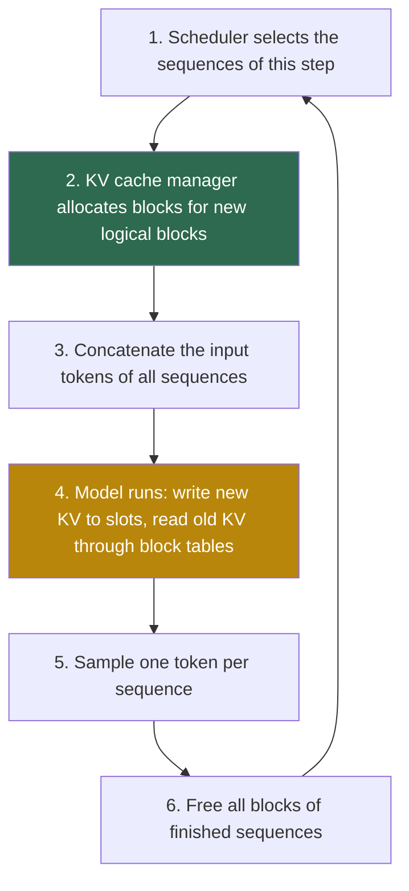

## 1. The question this page answers

Page 04 showed that the PagedAttention kernel can compute attention over KV blocks that sit anywhere in GPU memory. That leaves a bookkeeping problem. Some part of the system must decide which physical block holds which tokens of which request. It must know when a request needs a new block, and when a block becomes free again. For token 8 of request A, it must answer one question: "at which address are your key and value?"

In vLLM, this part is the **KV cache manager**. This page explains §4.2 ("KV Cache Manager") and §4.3 ("Decoding with PagedAttention and vLLM") of the paper. After this page you can trace every step of the paper's example and write the address formula. You can also prove the waste bound and explain how the code stores the tables.

## 2. Mental model

> [!analogy] A hotel for tour groups
> A hotel has many identical rooms with 4 beds each. A tour group arrives with 7 people. The front desk gives the group 2 rooms, for example room 7 and room 1. It writes a card for the group: "room 7, 4 beds used; room 1, 3 beds used". When an eighth person arrives, the free bed in room 1 takes them. When a ninth person arrives, the desk takes the next free room from its list and adds a line to the card. When the group leaves, all its rooms return to the free list. The rooms of one group can be on any floor. Only the last room of a group can have empty beds.
>
> **Where it stops working:** hotel guests can take any bed, but vLLM fills the slots of a block strictly from left to right. A hotel room never holds two groups, but in vLLM one physical block can belong to several sequences at once (page 06). Also, one block number names the same place in every layer of the model and on every GPU worker. So one "room" is really dozens of rooms with the same number.

## 3. Terms

| Term | Plain meaning |
|---|---|
| KV block | A fixed-size part of the KV cache. It holds the keys and values of B consecutive tokens. |
| block size $B$ | The number of token slots in one KV block. The paper's example uses 4. The vLLM default is 16. |
| slot | The place for the key and value of one token inside a block. |
| logical KV block | Block number $j$ of one sequence, in token order. It covers positions $jB$ to $jB + B - 1$. It is only a number, not memory. |
| physical KV block | A real piece of GPU memory, with a number from 0 to $N - 1$. |
| block table | A table per sequence. For each logical block, it stores the physical block number and the number of filled slots. |
| # filled | The number of slots in a block that already hold the key and value of a token. |
| block engine | The part of a GPU worker that allocates one contiguous chunk of GPU DRAM and divides it into physical blocks. |
| KV cache manager | The part of the scheduler that owns the block tables and decides when to allocate and free blocks. |
| block allocator | The object that gives a free physical block to a sequence and receives freed blocks again. |
| free block queue | The list of physical blocks that no sequence uses at the moment. |
| allocation on demand | The rule "take a new block only when a sequence needs it", instead of reserving memory in advance. |
| slot number | Physical block number $\times B +$ offset. The position of a slot in the whole pool of slots. |
| internal fragmentation | Memory inside an allocated block that no token uses. |
| prefill | The first step of a request. The model processes all prompt tokens at once and stores their keys and values. |
| decode step | A later step. The model processes one new token per sequence. |
| sequence | One stream of generated tokens. One request can have several sequences (page 06). |
| profiling run | One forward pass at start time that measures the peak memory of the model, so that the rest can become KV blocks. |

All terms are also in the [Glossary](/notes/papers/glossary).

## 4. From page tables to block tables

Page 01 explained virtual memory. A process sees contiguous virtual pages. A page table maps each virtual page to any free physical frame. The paper applies the same idea to the KV cache: "The key idea behind vLLM's memory manager is analogous to the virtual memory [25] in operating systems" (§4.2). Reference [25] is Kilburn et al. (1962), "One-level storage system", the first virtual memory design.

| Operating system | vLLM |
|---|---|
| process | sequence (one stream of tokens of a request) |
| virtual page | logical KV block |
| physical page frame | physical KV block |
| byte | token (its key and value vectors) |
| page table | block table |
| page size, for example 4 KiB | block size $B$, counted in tokens |
| free frame list | free block queue |
| page fault, then a new frame | last block full, then a new block |
| swap to disk | swap to CPU RAM (page 07) |
| shared pages and copy-on-write after `fork` | shared blocks with reference counts (page 06) |

> [!note] Where the analogy differs
> An OS page has a fixed size in bytes. A KV block has a fixed size in tokens, and its size in bytes depends on the model. An OS translates addresses in hardware (the MMU). vLLM translates in software: the scheduler builds the tables in Python, and the GPU kernel reads them (page 04 and page 08). An OS page fault can happen at any memory access. A vLLM sequence needs a new block at an exactly known moment: after every $B$ tokens.

## 5. The parts of the KV cache manager (§4.2)

### 5.1 The pool of physical blocks

The paper states: "On GPU workers, a block engine allocates a contiguous chunk of GPU DRAM and divides it into physical KV blocks" (§4.2). The same "is also done on CPU RAM for swapping" (§4.2, see page 07).

So at start time, the KV cache is one large tensor area. The system cuts it into $N$ equal blocks and numbers them $0, 1, \dots, N - 1$. It never allocates GPU memory for KV again while it serves requests. Allocation in vLLM means "take a free block number", not "call the CUDA memory allocator".

**What one physical block holds.** One block holds the key vector and the value vector of $B$ tokens, for every layer and every KV head. Its size in bytes follows from the KV cache size formula of [part 03 L3](/notes/ai/llm-systems/03-kv-cache/l3-the-kv-cache-size-formula):

$$
\text{block bytes} = 2 \times L \times H_{kv} \times d_h \times B \times s
$$

Here 2 counts keys and values. $L$ is the number of layers and $H_{kv}$ the number of KV heads. $d_h$ is the head size and $s$ the bytes per number.

> [!example] Worked example: the size of one block
> 1. OPT-13B: $L = 40$, 40 heads of size $d_h = 128$ (hidden size 5120), FP16 so $s = 2$, and $B = 16$.
> 2. Per token: $2 \times 40 \times 5120 \times 2 = 819{,}200$ bytes $= 800$ KiB. The paper states: "the KV cache of a single token demands 800 KB of space" (§3). Here "KB" equals KiB, because $819{,}200 = 800 \times 1{,}024$.
> 3. Per block: $16 \times 819{,}200 = 13{,}107{,}200$ bytes $= 12.5$ MiB.
> 4. Llama-3.1-8B: $2 \times 32 \times 8 \times 128 \times 2 = 131{,}072$ bytes $= 128$ KiB per token. A block of 16 tokens is $2{,}097{,}152$ bytes $= 2$ MiB.

**How the code stores the pool.** Examine the open-source code of that time: vLLM v0.2.0, published on 2023-09-28. Its cache engine creates two tensors per layer. The key tensor has the shape `[num_blocks, num_kv_heads, head_size/x, block_size, x]`. The value tensor has the shape `[num_blocks, num_kv_heads, head_size, block_size]`. The block number is the index into the first dimension of every one of these tensors. So block 7 means "index 7 in the key and value tensors of all 40 layers". Page 08 explains the inner dimensions and the number `x`.

**How many blocks.** The paper does not give the formula. The v0.2.0 code runs one profiling run with dummy inputs, measures the peak memory, and then computes:

$$
N_{gpu} = \left\lfloor \frac{\text{total GPU memory} \times \text{gpu\_memory\_utilization} - \text{peak memory}}{\text{block bytes}} \right\rfloor
$$

The default of `gpu_memory_utilization` was 0.90 in v0.2.0. In v0.31.0 the default is 0.92 (checked on 2026-10-15). The CPU pool is `swap_space` divided by the block bytes, with a default `swap_space` of 4 GiB per GPU in v0.2.0.

> [!example] Worked example: the blocks of Table 1
> Table 1 of the paper (§6.1) lists OPT-13B on one A100 with 40 GB: parameters 26 GB, memory for KV cache 12 GB, "Max # KV cache slots" 15.7K.
> 1. Slots: $12 \times 1024^3 / 819{,}200 = 15{,}728.64$, so 15.7K slots. The table's "12 GB" gives 15.7K only if you read it as 12 GiB. With $12 \times 10^9$ bytes the result is $14{,}648$.
> 2. Blocks of 16 tokens: $12 \times 1024^3 / 13{,}107{,}200 = 983.04$, so 983 whole blocks.
> 3. Token slots in whole blocks: $983 \times 16 = 15{,}728$.
>
> These are computed in these notes. The paper gives only the slot count.

### 5.2 Logical blocks

The paper states: "A request's KV cache is represented as a series of logical KV blocks, filled from left to right" (§4.2). The rule is simple. Position $p$ of a sequence (counted from 0) lies in logical block $\lfloor p / B \rfloor$, at offset $p \bmod B$. With $B = 4$, positions 0 to 3 are in logical block 0. Positions 4 to 7 are in logical block 1, and position 8 is in logical block 2.

A logical block uses no GPU memory. It is only an index. The model and the attention math see positions $0, 1, 2, \dots$ in order. Only the KV cache manager knows that the data is in scattered physical blocks.

### 5.3 The block table

The paper states: "Each block table entry records the corresponding physical blocks of a logical block and the number of filled positions" (§4.2). Figure 6 of the paper draws the table with two columns: "Physical block number" and "# filled".

In the v0.2.0 code the same information sits in two places. The block table is a Python list of physical block objects, one per logical block (`BlockTable = List[PhysicalTokenBlock]` in `vllm/core/block_manager.py`). The fill count lives in the logical block object of the sequence (`LogicalTokenBlock.num_tokens` in `vllm/block.py`). Before each step, the scheduler converts the table into a plain list of integers for the workers.

The table is tiny. A sequence of 2,048 tokens with $B = 16$ needs $2048 / 16 = 128$ entries. With 4-byte integers this is 512 bytes, against about 1.68 GB of KV data for OPT-13B.

### 5.4 Address translation

The kernel needs the slot of every position. The translation has three steps:

1. **Logical block and offset:** $j = \lfloor p / B \rfloor$ and $o = p \bmod B$.
2. **Physical block:** $b = \text{table}[j]$.
3. **Slot number:** $\text{slot} = b \times B + o$.

The v0.2.0 worker computes exactly this for every input token. The three middle lines below are from `_prepare_inputs` in `vllm/worker/worker.py`, where the block size is `self.block_size`. Here they sit in a small function, so that you can run them:

```python
def slot_for(position, block_table, block_size):
    block_number = block_table[position // block_size]
    block_offset = position % block_size
    slot = block_number * block_size + block_offset
    return slot

print(slot_for(7, [7, 1, 3], 4), slot_for(8, [7, 1, 3], 4))   # 7 12
```

The list of slots for all input tokens of a step is called `slot_mapping`. The kernel that writes new keys and values uses it (page 08).

> [!example] Worked example: two addresses in request A
> The block table of request A is $[7, 1, 3]$ and $B = 4$.
> 1. Position 7: $j = \lfloor 7/4 \rfloor = 1$, $o = 7 \bmod 4 = 3$, $b = \text{table}[1] = 1$, slot $= 1 \times 4 + 3 = 7$.
> 2. Position 8: $j = \lfloor 8/4 \rfloor = 2$, $o = 0$, $b = \text{table}[2] = 3$, slot $= 3 \times 4 + 0 = 12$.
> 3. Position 0: $j = 0$, $o = 0$, $b = 7$, slot $= 28$.
>
> Neighboring positions 7 and 8 are 5 slots apart in memory. Positions 3 and 4 (slots 31 and 4) are even in reverse order. The attention result does not change, because the kernel reads each key through the table (page 04).

### 5.5 The free block queue

The allocator keeps the numbers of all free physical blocks. To allocate, it removes one number and sets the block's reference count to 1. To free, it lowers the count by 1. When the count reaches 0, the number returns to the free list. Both operations take constant time, $O(1)$, whatever the number of blocks.

The v0.2.0 code keeps a Python list `free_blocks` and takes blocks with `pop()`, so the last freed block is the first reused. When the list is empty, `allocate()` raises `ValueError("Out of memory! No free blocks are available.")`. The scheduler checks for free blocks before it calls `allocate()`, so this error should not happen in normal operation (section 9).

The current vLLM (the V1 engine) keeps all blocks as `KVCacheBlock` objects in a block pool. Each object has a `ref_cnt` and pointers that form a doubly linked "free block queue". The vLLM design document states that allocation takes blocks from the head of this queue. Freed blocks go to its tail (checked on 2026-10-15). Page 10 and [part 04 L9](/notes/ai/llm-systems/04-inference/l9-prefix-caching-and-kv-reuse) explain why V1 needs this order: freed blocks can still serve as a prefix cache.

> [!key] The core of §4.2
> Logical blocks give each sequence a contiguous view of its tokens. Physical blocks are interchangeable pieces of one pool. The block table connects the two. The paper states the benefit: "Separating logical and physical KV blocks allows vLLM to dynamically grow the KV cache memory without reserving it for all positions in advance" (§4.2).

## 6. The example of §4.3, step by step

The paper traces one request with the prompt "Four score and seven years ago our". The prompt has 7 tokens. The text does not name the block size, but it stores "the KV cache of the first 4 tokens in logical block 0", so $B = 4$. Figure 6 of the paper shows the outputs "fathers" and then "brought".


### 6.1 Step 1: prefill

The paper states: "In the prefill step, vLLM generates the KV cache of the prompts and the first output token with a conventional self-attention algorithm (e.g., [13])" (§4.3). Reference [13] is FlashAttention. The prompt is complete at this point, so ordinary attention over contiguous tensors is enough. The new keys and values are then written into the blocks.

The manager needs $\lceil 7/4 \rceil = 2$ blocks. The paper: "vLLM maps the first 2 logical KV blocks (0 and 1) to 2 physical KV blocks (7 and 1, respectively)." Logical block 0 holds "Four score and seven" (4 filled). Logical block 1 holds "years ago our" (3 filled). "The remaining slot is reserved for the subsequent autoregressive generation phase" (§4.3). The model samples the first output token, "fathers".

Note the contrast with earlier systems. The paper: "vLLM does not require reserving the memory for the maximum possible generated sequence length initially. Instead, it reserves only the necessary KV blocks to accommodate the KV cache generated during prompt computation" (§4.3).

### 6.2 Step 2: the first decode step

The input of this step is "fathers", at position 7. Its key and value do not exist yet. The model computes them in this step, in every layer.

The paper: "In the first autoregressive decoding step, vLLM generates the new token with the PagedAttention algorithm on physical blocks 7 and 1. Since one slot remains available in the last logical block, the newly generated KV cache is stored there, and the block table's #filled record is updated" (§4.3). So the KV of "fathers" goes to slot 7, and "# filled" of logical block 1 changes from 3 to 4. No allocation happens. The output token of this step is "brought".

### 6.3 Step 3: the second decode step

The input is "brought", at position 8. The paper: "At the second decoding step, as the last logical block is full, vLLM stores the newly generated KV cache in a new logical block; vLLM allocates a new physical block (physical block 3) for it and stores this mapping in the block table" (§4.3). The new row is logical 2, physical 3, 1 filled. The KV of "brought" goes to slot 12.

### 6.4 The trace in one table

| Step | Input tokens (positions) | KV cache manager | Block table after the step | Slots written | Output |
|---|---|---|---|---|---|
| 1 prefill | 7 prompt tokens (0 to 6) | allocate $\lceil 7/4 \rceil = 2$ blocks: 7 and 1 | 0 → 7 (4), 1 → 1 (3) | 28 to 31, 4 to 6 | "fathers" |
| 2 decode | "fathers" (7) | free slot in logical block 1, no allocation | 0 → 7 (4), 1 → 1 (4) | 7 | "brought" |
| 3 decode | "brought" (8) | logical block 1 full, allocate block 3 | 0 → 7 (4), 1 → 1 (4), 2 → 3 (1) | 12 | next token |
| 4 to 6 | one token each (9 to 11) | free slots in block 3 | row 2 fills to 4 | 13 to 15 | three tokens |
| 7 | one token (12) | block 3 full, allocate the next free block | a fourth row appears | first slot of the new block | one token |

Rows 4 to 7 extend the paper's example with the same rule. They are not in the paper.

> [!trap] The newest token has no KV yet
> At the end of a step, the token that the model just sampled has no key and value in the cache. Its KV is computed in the next step, when it is the input. So after step 3, the cache holds 9 tokens ("Four" to "brought"), and the token sampled in step 3 waits for step 4. Interviewers like this detail, because it explains why a decode step writes exactly one slot per sequence.

### 6.5 The same trace in code

This short Python model of the KV cache manager reproduces the trace. It is written for these notes. It follows the logic of the v0.2.0 block manager, but it is much smaller. The free queue starts in an order that gives the block numbers of the paper's figures.

```python
from collections import deque


class BlockAllocator:
    """The physical blocks of one device: a free queue and a reference count per block."""

    def __init__(self, free_order):
        self.free = deque(free_order)         # free physical block numbers, in order
        self.ref = {}                         # physical block -> reference count

    def allocate(self):
        if not self.free:
            raise MemoryError("no free KV block")
        b = self.free.popleft()               # O(1): take the first free block
        self.ref[b] = 1
        return b

    def release(self, b):
        self.ref[b] -= 1
        if self.ref[b] == 0:                  # no sequence uses the block now
            del self.ref[b]
            self.free.append(b)               # O(1): back to the end of the queue


class KVCacheManager:
    def __init__(self, block_size, allocator):
        self.B = block_size
        self.alloc = allocator
        self.tables = {}                      # seq id -> [[physical block, filled], ...]

    def allocate_prompt(self, seq, n_tokens):
        table = []
        while n_tokens > 0:                   # ceil(n / B) blocks for the prompt
            filled = min(self.B, n_tokens)
            table.append([self.alloc.allocate(), filled])
            n_tokens -= filled
        self.tables[seq] = table

    def append_slot(self, seq):
        """Reserve the slot for the KV of one more token. Return the slot number."""
        table = self.tables[seq]
        if table[-1][1] == self.B:            # the last block is full
            table.append([self.alloc.allocate(), 0])
        entry = table[-1]
        offset = entry[1]
        entry[1] += 1                         # update "# filled"
        return entry[0] * self.B + offset     # slot = physical block * B + offset

    def free(self, seq):
        for b, _ in self.tables.pop(seq):
            self.alloc.release(b)


alloc = BlockAllocator(free_order=[7, 1, 3, 5, 2, 0, 4, 6, 8])
mgr = KVCacheManager(block_size=4, allocator=alloc)

mgr.allocate_prompt("A", 7)                   # step 1: prefill of 7 prompt tokens
print("step 1:", mgr.tables["A"], "free:", list(alloc.free))
print("step 2: slot of 'fathers' =", mgr.append_slot("A"), mgr.tables["A"])
print("step 3: slot of 'brought' =", mgr.append_slot("A"), mgr.tables["A"])
mgr.allocate_prompt("B", 6)                   # request B: 6 prompt tokens
print("B:", mgr.tables["B"], "free:", list(alloc.free))
mgr.free("A")                                 # request A finishes
print("A freed, free:", list(alloc.free))
```

Output:

```text
step 1: [[7, 4], [1, 3]] free: [3, 5, 2, 0, 4, 6, 8]
step 2: slot of 'fathers' = 7 [[7, 4], [1, 4]]
step 3: slot of 'brought' = 12 [[7, 4], [1, 4], [3, 1]]
B: [[5, 4], [2, 2]] free: [0, 4, 6, 8]
A freed, free: [0, 4, 6, 8, 7, 1, 3]
```

Line by line, the important parts:

1. `BlockAllocator.free` is a queue of free block numbers. `allocate()` takes the first one in $O(1)$ and sets its reference count to 1. Page 06 uses counts above 1.
2. `release()` lowers the count. Only at 0 does the block return to the queue. With one sequence per block, this is the same as "free immediately".
3. `allocate_prompt()` takes $\lceil n/B \rceil$ blocks. Every block except the last is full. The last one has `filled = n - (blocks - 1) * B`.
4. `append_slot()` is the whole rule of allocation on demand. If the last block is full, take one new block. Then use the next slot of the last block and increase "# filled".
5. The return value `entry[0] * self.B + offset` is the slot number of section 5.4. A real engine sends it to the GPU in `slot_mapping`.
6. `free()` returns every block of a finished sequence. After request A finishes, blocks 7, 1 and 3 are at the end of the queue.

```video
{
  "src": "/notes/media/papers/2023-pagedattention/manim/p03-block-table-filling.mp4",
  "caption": "Request A fills its block table step by step: two blocks at prefill, one free slot used at the first decode step, a new block at the second decode step, then request B takes blocks from the same pool."
}
```

## 7. Many requests at once

### 7.1 Two requests in one pool (Figure 7)

The paper: "In Fig. 7, we show an example of vLLM managing the memory for two sequences. The logical blocks of the two sequences are mapped to different physical blocks within the space reserved by the block engine in GPU workers. The neighboring logical blocks of both sequences do not need to be contiguous in physical GPU memory" (§4.3). The text does not list the physical blocks of request B. The figure shows request B, "It was the best of times", with "It was the best" in physical block 5 and "of times" in physical block 2. These two numbers are read from the figure.


Count the memory in this picture. Five blocks are allocated, so 20 slots. Request A uses 9 slots and request B uses 6, so 15 slots hold tokens. The 5 empty slots are all in the last block of a request: 3 for A and 2 for B.

### 7.2 One iteration of the engine

The paper describes what vLLM does "Globally, for each decoding iteration" (§4.3). It first "selects a set of candidate sequences for batching", then "allocates the physical blocks for the newly required logical blocks". Then it "concatenates all the input tokens of the current iteration" and "feeds it into the LLM". During the computation, it "uses the PagedAttention kernel to access the previous KV cache stored in the form of logical KV blocks and saves the newly generated KV cache into the physical KV blocks".



Step 2 always happens before step 4. The slot for each new token must exist before the model writes into it.

### 7.3 What the GPU receives in each step

The workers do not receive Python objects. Before each step, the v0.2.0 worker turns the block tables into a few integer tensors (`_prepare_inputs` in `vllm/worker/worker.py`). For a decode step:

| Tensor | Shape | Meaning |
|---|---|---|
| `input_tokens` | [number of sequences] | the input token ID of each sequence |
| `input_positions` | [number of sequences] | the position of that token |
| `slot_mapping` | [number of sequences] | where to write the new key and value |
| `context_lens` | [number of sequences] | how many tokens each sequence attends to, including the new one |
| `block_tables` | [number of sequences, max blocks per sequence] | the physical block numbers, padded with 0 to the longest table |

> [!example] Worked example: the tensors of one decode step
> Requests A and B are both in the decode phase. A's input is at position 9, B's input is at position 6. $B = 4$.
> 1. A: logical block $\lfloor 9/4 \rfloor = 2$, offset 1, physical block 3, slot $3 \times 4 + 1 = 13$. Context length $9 + 1 = 10$.
> 2. B: logical block $\lfloor 6/4 \rfloor = 1$, offset 2, physical block 2, slot $2 \times 4 + 2 = 10$. Context length 7.
> 3. `slot_mapping = [13, 10]`, `context_lens = [10, 7]`.
> 4. `block_tables = [[7, 1, 3], [5, 2, 0]]`. B's table has only 2 blocks, so it gets one padding entry.
>
> The padding value 0 is also a real block number. The kernel never reads it, because B's context length 7 needs only $\lceil 7/4 \rceil = 2$ blocks.

The v0.2.0 worker also pads the token and position lists to a multiple of 8. The code comment says: "This is required for utilizing the Tensor Cores in NVIDIA GPUs."

> [!note] Prefill and decode in the v0.2.0 code
> In v0.2.0, one step is either a prompt step or a decode step. The scheduler output has a flag `prompt_run`. New requests start in a prompt step of their own. Later versions mix prefill and decode tokens in one step (chunked prefill). See [part 04 L4](/notes/ai/llm-systems/04-inference/l4-batching-and-scheduling).

## 8. How much memory is wasted?

### 8.1 The bound and its proof

The paper states: "vLLM limits all the memory wastes for a request within one block" (§4.3). The reason is also in the text: "As all the blocks are filled from left to right and a new physical block is only allocated when all previous blocks are full", vLLM "can effectively utilize all the memory" (§4.3).

**Proof.** Take a sequence with $n \ge 1$ stored tokens. Allocation on demand gives it exactly $\lceil n/B \rceil$ blocks. The first $\lceil n/B \rceil - 1$ blocks are full, because a new block appears only when the previous one is full. So only the last block can have empty slots. It holds at least 1 token, so at most $B - 1$ slots are empty. The number of empty slots is:

$$
\text{empty slots} = \left\lceil \frac{n}{B} \right\rceil B - n \le B - 1
$$

> [!example] Worked example: the waste bound in bytes
> OPT-13B, $B = 16$, 800 KiB per token.
> 1. Worst case: $15 \times 819{,}200 = 12{,}288{,}000$ bytes, about 12.3 MB (11.7 MiB) per sequence.
> 2. A sequence of 300 tokens: $\lceil 300/16 \rceil = 19$ blocks $= 304$ slots, so $4$ empty slots $= 3{,}276{,}800$ bytes (about 3.3 MB).
> 3. If the last block's fill level is uniform from 1 to 16, the mean number of empty slots is $(0 + 1 + \dots + 15)/16 = 7.5$, about 5.9 MiB. This assumption is an interpretation of these notes, not a measurement.

### 8.2 Against a contiguous reservation

Earlier systems reserved one contiguous chunk for the maximum length (page 03). Compare one OPT-13B request of 300 tokens, with a maximum of 2,048 tokens:

| | Contiguous, reserved for 2,048 tokens | Paged, $B = 16$ |
|---|---|---|
| Slots held | 2,048 | 304 (19 blocks) |
| Bytes held | 1,677,721,600 (about 1.68 GB) | 249,036,800 (about 249 MB) |
| Empty slots | 1,748 | 4 |
| Empty bytes | 1,431,961,600 (about 1.43 GB) | 3,276,800 (about 3.3 MB) |

Paging removes three kinds of waste of page 03. **Reserved slots** do not exist, because a block appears only when the sequence needs it. **External fragmentation** does not exist, because all blocks have the same size, so any free block fits any sequence. **Internal fragmentation** remains, but only in the last block, and at most $B - 1$ slots.

### 8.3 The block size trade-off

A larger $B$ makes the bound larger. The paper names the other side of the trade-off: "Storing multiple tokens within a KV block (block size > 1) enables the PagedAttention kernel to process the KV cache across more positions in parallel. However, a larger block size also increases memory fragmentation" (§4.3). §7.2 tests block sizes and chooses 16 as the default. Page 08 explains the choice, and page 09 shows the measurement.

## 9. Admission, and what happens when blocks reach the limit

### 9.1 How the v0.2.0 scheduler checks for blocks

Allocation on demand creates a new risk. A request starts with only its prompt blocks, so the system does not know if it can finish. The v0.2.0 scheduler uses two checks before it calls the allocator. These details are from the code, not from the paper.

1. **New request (`can_allocate`).** Admit it only if, after the prompt blocks, at least a "watermark" of free blocks remains. The default watermark is 1% of the GPU blocks. The code comment says: "Use watermark to avoid frequent cache eviction."
2. **Running sequence (`can_append_slot`).** Continue a sequence group only if the number of free blocks is at least the number of its running sequences. The code calls this a "simple heuristic". It is conservative: it asks for one free block per sequence even if the sequence still has a free slot.

If a check fails for a running sequence, the scheduler preempts a request (page 07).

### 9.2 Why allocation on demand raises throughput

The paper: "This allows more requests to fit into memory for batching—hence improving the throughput" (§4.3). The next example shows the size of the effect.

> [!example] Worked example: how many requests fit
> Assume that 55 GiB of an H100 is free for the KV cache of Llama-3.1-8B, with $B = 16$ (2 MiB per block). This memory budget is an assumption of these notes.
> 1. Blocks: $55 \times 1024 / 2 = 28{,}160$. Token slots: $28{,}160 \times 16 = 450{,}560$.
> 2. Contiguous reservation for a maximum of 8,192 tokens: $450{,}560 / 8{,}192 = 55$ requests.
> 3. Paged, if each request really uses 1,000 tokens: $\lceil 1000/16 \rceil = 63$ blocks per request, so $\lfloor 28{,}160 / 63 \rfloor = 446$ requests.
>
> The batch can be about 8 times larger. A larger batch reads the model weights once for more sequences, so the throughput rises (see [part 04 L3](/notes/ai/llm-systems/04-inference/l3-compute-bound-vs-memory-bound)). The cost: if all 446 requests grow, the pool reaches its limit, and the scheduler must preempt some of them (page 07).

## 10. The design in code: v0.2.0 and today

| Paper concept | vLLM v0.2.0 (2023) | vLLM V1 design document (checked on 2026-10-15) |
|---|---|---|
| KV cache manager | `BlockSpaceManager` in `vllm/core/block_manager.py` | KV cache manager with a block pool |
| physical block | `PhysicalTokenBlock` with `block_number` and `ref_count` | `KVCacheBlock` with `block_id`, `ref_cnt` and `block_hash` |
| logical block, "# filled" | `LogicalTokenBlock` with `token_ids` and `num_tokens` | not described as a separate class |
| free block list | `BlockAllocator.free_blocks`, a Python list | "Free Block Queue", a doubly linked list |
| block table | `Dict[seq_id, List[PhysicalTokenBlock]]` | "Request blocks: Mapping from request ID to allocated block IDs" |
| block engine on the worker | `CacheEngine` in `vllm/worker/cache_engine.py` | not covered on this page |

The vLLM repository marks its old PagedAttention design page as historical: "It no longer describes the code used in vLLM today" (checked on 2026-10-15). The ideas of this page remain: block tables, a free queue and reference counts. Page 10 describes what changed.

### Exercises

Write your code in `C:\Users\ASohi\Downloads\AI\agent-harness-lab\llm-systems\pagedattention_05.ipynb`.

1. **Address translation.** Write `slot_of(block_table, pos, B)`. It returns the slot number of position `pos`, and it raises `IndexError` if the logical block does not exist. Acceptance test: `[slot_of([7, 1, 3], p, 4) for p in range(9)]` equals `[28, 29, 30, 31, 4, 5, 6, 7, 12]`, and `slot_of([7, 1, 3], 12, 4)` raises `IndexError`.
   - Hint 1: use `divmod(pos, B)`.
   - Hint 2: compare the logical block number with `len(block_table)`.
2. **Waste: contiguous vs paged.** Write `held_slots(lengths, B, max_len)`. It returns three numbers. The first is the slots held with a contiguous reservation of `max_len` per request. The second is the slots held with paging, and the third is the slots that hold tokens. Acceptance test: `held_slots([300, 1000, 7, 2048], 16, 2048)` returns `(8192, 3376, 3355)`.
   - Hint 1: paging holds $\lceil n/B \rceil \times B$ slots per sequence.
   - Hint 2: use `math.ceil`, not `int(n / B) + 1`. The second is wrong when $n$ is a multiple of $B$.
3. **Requests that fit.** Write `requests_that_fit(num_blocks, B, slots_per_request)`. Acceptance test: with 28,160 blocks and $B = 16$, the result is 55 for 8,192 slots per request and 446 for 1,000.
   - Hint 1: first compute the blocks per request.
   - Hint 2: use integer division, because a request needs whole blocks.

## 11. Common mistakes

1. **"vLLM reserves the full context length for each request."** It reserves only the blocks of the prompt. It adds one block whenever the last block is full.
2. **"The block table stores tokens or KV data."** It stores only physical block numbers and fill counts. The KV data is in the pool of blocks. The table of a 2,048-token sequence is about 512 bytes.
3. **"A physical block belongs to one layer."** One block number names the same index in the key and value tensors of every layer. It covers all KV heads of the worker.
4. **"Paging removes all waste."** Internal fragmentation remains in the last block: at most $B - 1$ slots per sequence. The v0.2.0 scheduler also keeps a watermark of 1% of the blocks free.
5. **"Logical blocks are memory."** They are only indexes. They give the sequence a contiguous view.
6. **"Blocks 7 and 1 were chosen for a reason."** Any free blocks work. The figure uses scattered numbers to show that the blocks need not be contiguous.
7. **"A decode step stores the KV of the token that it outputs."** It stores the KV of its input token, which is the token sampled in the previous step.

## 12. One-minute explanation

vLLM manages the KV cache like virtual memory. At start time it cuts the free GPU memory into equal physical blocks, each with room for B tokens in every layer. Each sequence sees its tokens as logical blocks, filled from left to right. A block table per sequence maps each logical block to a physical block number and records how many slots are filled. The KV of position p sits in logical block p divided by B, at offset p modulo B, inside the physical block from the table. At prefill, vLLM allocates only the blocks of the prompt, and in decoding it takes a new block only when the last block is full. It frees all blocks when the sequence finishes, so at most B minus 1 slots per sequence are empty. In the paper's example, a 7-token prompt with block size 4 takes blocks 7 and 1, and the ninth token gets block 3. No memory is reserved for future tokens, so more sequences fit into one batch and the throughput rises.

## 13. Check questions

```check
{
  "question": "Why does the separation of logical and physical blocks remove the need to reserve memory in advance?",
  "hint": "What does a contiguous allocation need to know at the start?",
  "answer": "A sequence needs contiguous positions only in its logical view. The block table can map the next logical block to any free physical block at the moment it is needed. So nothing has to be reserved next to the existing data. The paper: \"Separating logical and physical KV blocks allows vLLM to dynamically grow the KV cache memory without reserving it for all positions in advance\" (§4.2)."
}
```
```check
{
  "question": "Interview follow-up: the block table of a sequence is [7, 1, 3, 6] and B = 4. Which slot holds the key and value of position 13? Show each step.",
  "hint": "Divide by B, read the table, multiply back.",
  "answer": "1. Logical block: $\\lfloor 13/4 \\rfloor = 3$. Offset: $13 \\bmod 4 = 1$.\n2. Physical block: table[3] = 6.\n3. Slot: $6 \\times 4 + 1 = 25$.\n\nThe kernel reads the key of position 13 from block 6, offset 1, in every layer."
}
```
```check
{
  "question": "Interview follow-up: prove that paging wastes at most B − 1 slots per sequence, and compute the worst case in bytes for OPT-13B with B = 16.",
  "hint": "Which blocks can be partly empty?",
  "answer": "A new block is allocated only when all previous blocks are full, so a sequence with $n$ tokens has $\\lceil n/B \\rceil$ blocks and all of them except the last are full. The last block holds at least one token. So the empty slots are $\\lceil n/B \\rceil B - n \\le B - 1$.\n\nOPT-13B stores $2 \\times 40 \\times 5120 \\times 2 = 819{,}200$ bytes per token. Worst case: $15 \\times 819{,}200 = 12{,}288{,}000$ bytes, about 12.3 MB (11.7 MiB). A contiguous reservation for 2,048 tokens can waste up to about 1.68 GB for the same request."
}
```
```check
{
  "question": "Interview follow-up: OPT-13B has 12 GiB for its KV cache. How many blocks of 16 tokens fit, and how many tokens is that? What changes with B = 32?",
  "hint": "Total capacity hardly depends on B. What does depend on B?",
  "answer": "Block bytes with $B = 16$: $16 \\times 819{,}200 = 13{,}107{,}200$ (12.5 MiB). Blocks: $\\lfloor 12 \\times 1024^3 / 13{,}107{,}200 \\rfloor = 983$, so $983 \\times 16 = 15{,}728$ token slots (Table 1 of the paper says 15.7K slots).\n\nWith $B = 32$ a block is 25 MiB, so $\\lfloor 491.52 \\rfloor = 491$ blocks and $491 \\times 32 = 15{,}712$ slots. The total capacity is almost the same. What changes is the waste per sequence (up to 31 empty slots instead of 15) and the chance that whole blocks can be shared (page 06)."
}
```
```check
{
  "question": "At step 2 of the paper's example, which token's key and value does vLLM write, and into which slot? Why does it not allocate a block?",
  "hint": "Which token is the input of a decode step?",
  "answer": "It writes the KV of \"fathers\", the token sampled at prefill, which is the input of step 2 at position 7. Position 7 is in logical block 1 at offset 3. Logical block 1 maps to physical block 1, which has 3 filled slots, so slot $1 \\times 4 + 3 = 7$ is free. No new block is needed. \"# filled\" changes from 3 to 4."
}
```
```check
{
  "question": "What happens in vLLM when a running sequence needs a new block and the free block queue is empty?",
  "hint": "Allocation on demand has a risk. How does the scheduler handle it?",
  "answer": "The allocator cannot give a block. The scheduler checks this before the step (in v0.2.0 with `can_append_slot`) and preempts one or more sequence groups: the latest arrived requests first. Their blocks are either copied to CPU memory (swapping) or dropped and recomputed later (recomputation). Page 07 explains both."
}
```
```check
{
  "question": "Interview follow-up: why not choose B = 1? Then internal fragmentation is zero.",
  "hint": "Think about the kernel, the table and the copies.",
  "answer": "Three costs grow when blocks are tiny.\n\n1. The kernel processes fewer positions in parallel per block, and it reads the block table once per token. The paper: \"If the block size is too small, vLLM may not fully utilize the GPU's parallelism for reading and processing KV cache\" (§7.2).\n2. The block table has one entry per token, so it becomes as long as the sequence.\n3. Swapping copies one block per call in v0.2.0, so tiny blocks mean many tiny PCIe transfers. §7.3 measures that \"swapping incurs excessive overhead with small block sizes\".\n\nThe paper finds that 16 is \"large enough to efficiently utilize the GPU and small enough to avoid significant internal fragmentation in most workloads\" (§7.2)."
}
```
```check
{
  "question": "Exercise 1: show a reference solution.",
  "answer": "```python\ndef slot_of(block_table, pos, B):\n    logical, offset = divmod(pos, B)\n    if logical >= len(block_table):\n        raise IndexError(f\"position {pos} has no logical block {logical}\")\n    return block_table[logical] * B + offset\n\nassert [slot_of([7, 1, 3], p, 4) for p in range(9)] == [28, 29, 30, 31, 4, 5, 6, 7, 12]\n```"
}
```
```check
{
  "question": "Exercise 2: show a reference solution.",
  "answer": "```python\nimport math\n\ndef held_slots(lengths, B, max_len):\n    contiguous = max_len * len(lengths)                 # reserve the maximum for each\n    paged = sum(math.ceil(n / B) * B for n in lengths)  # whole blocks only\n    used = sum(lengths)\n    return contiguous, paged, used\n\nassert held_slots([300, 1000, 7, 2048], 16, 2048) == (8192, 3376, 3355)\n```\n\nHere the contiguous reservation wastes 59.0% of its slots, and paging wastes 0.62%."
}
```
```check
{
  "question": "Exercise 3: show a reference solution.",
  "answer": "```python\nimport math\n\ndef requests_that_fit(num_blocks, B, slots_per_request):\n    return num_blocks // math.ceil(slots_per_request / B)\n\nassert requests_that_fit(28160, 16, 8192) == 55\nassert requests_that_fit(28160, 16, 1000) == 446\n```"
}
```

## 14. Links

- Previous: [04 PagedAttention: the algorithm](/notes/papers/llm-serving/2023-pagedattention/04-pagedattention-the-algorithm)
- Next: [06 Sharing: parallel sampling, beam search and shared prefixes](/notes/papers/llm-serving/2023-pagedattention/06-decoding-scenarios-and-sharing)
- Virtual memory and page tables: [01 Background: virtual memory and paging](/notes/papers/llm-serving/2023-pagedattention/01-background-virtual-memory-and-paging)
- The waste that this design removes: [03 The question: where does KV cache memory go?](/notes/papers/llm-serving/2023-pagedattention/03-the-question)
- Preemption when blocks reach the limit: [07 Scheduling, preemption and distributed execution](/notes/papers/llm-serving/2023-pagedattention/07-scheduling-and-preemption)
- The kernels and the memory layout: [08 Implementation: the vLLM system and its kernels](/notes/papers/llm-serving/2023-pagedattention/08-implementation)
- What changed later: [10 Limits and later work](/notes/papers/llm-serving/2023-pagedattention/10-limits-and-later-work)
- Block size formula: [L3: The KV cache size formula](/notes/ai/llm-systems/03-kv-cache/l3-the-kv-cache-size-formula)
- A cache without pages: [L4: Implementing a KV cache](/notes/ai/llm-systems/03-kv-cache/l4-implementing-a-kv-cache)
- Prefix caching on top of blocks: [L9: Prefix caching and KV reuse](/notes/ai/llm-systems/04-inference/l9-prefix-caching-and-kv-reuse)
- Interview drill: [L1: Drill: from attention to PagedAttention](/notes/ai/llm-systems/08-interview-drills/l1-chain-attention-to-pagedattention)
- The paper card: [PagedAttention (2023)](/notes/papers/llm-serving/2023-pagedattention) and the [Glossary](/notes/papers/glossary)

### Sources

- Kwon et al., "Efficient Memory Management for Large Language Model Serving with PagedAttention", SOSP 2023: https://arxiv.org/abs/2309.06180 (§4.2, §4.3, §6.1 Table 1, §7.2)
- vLLM v0.2.0 source: https://github.com/vllm-project/vllm/blob/v0.2.0/vllm/core/block_manager.py, https://github.com/vllm-project/vllm/blob/v0.2.0/vllm/block.py, https://github.com/vllm-project/vllm/blob/v0.2.0/vllm/worker/cache_engine.py, https://github.com/vllm-project/vllm/blob/v0.2.0/vllm/worker/worker.py, https://github.com/vllm-project/vllm/blob/v0.2.0/vllm/engine/arg_utils.py
- vLLM 0.2.0 release date: https://pypi.org/project/vllm/0.2.0/
- vLLM v0.31.0 cache configuration: https://github.com/vllm-project/vllm/blob/v0.31.0/vllm/config/cache.py
- vLLM design documents: https://github.com/vllm-project/vllm/blob/main/docs/design/prefix_caching.md and https://github.com/vllm-project/vllm/blob/main/docs/design/paged_attention.md

(checked on 2026-10-15)
