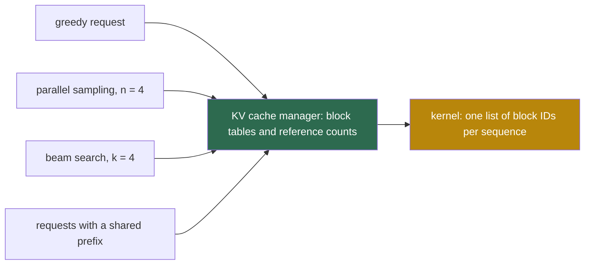

## 1. The question this page answers

Many sequences in a serving system start with the same tokens. A request can ask for 4 samples of one prompt. Beam search keeps several candidates that share most of their history. Thousands of requests can start with the same system prompt. For the common part, all these sequences have exactly the same keys and values.

Earlier systems stored one private copy of the KV cache per sequence. How can a server store the common part once and still let every sequence grow on its own? And how does it make sure that one sequence never overwrites the data of another? This page explains the answer of §4.4 ("Application to Other Decoding Scenarios") and the savings that §6.3 measures.

## 2. Mental model

> [!analogy] A shared binder of printed pages
> Four students work from one binder of printed pages. Nobody writes on a shared page. Each page has a small counter: how many students use it. A student who wants to write on a shared page first photocopies that one page. The student writes on the copy and lowers the counter of the original by one. When a student leaves, the counters of all their pages go down by one. A page with counter 0 goes to the recycling box.
>
> **Where it stops working:** in vLLM the "page" is a block of B tokens. A sequence only ever writes into its last block, never into old blocks. Also, sharing is only possible for a common prefix: the first tokens must be identical, from position 0. Two documents that share a paragraph in the middle cannot share it as KV cache.

## 3. Terms

| Term | Plain meaning |
|---|---|
| parallel sampling | One prompt, several independent random samples of the output. The OpenAI-style parameter `n` asks for it. |
| beam search | A decoding method that keeps the $k$ most probable partial outputs at every step and extends each of them. |
| beam width $k$ | The number of candidates that beam search keeps after each step. |
| candidate | One partial output of beam search. |
| reference count | The number of logical blocks, over all sequences, that map to one physical block. |
| copy-on-write | Share data until someone writes. Before the write, copy the shared part, then write into the copy. |
| fork | Create a new sequence from an existing one. It copies the block table and adds 1 to the reference count of each block. |
| shared prefix | The same first tokens in many requests, for example a system prompt with instructions and examples. |
| system prompt | A fixed text that a service puts before every user input. |
| sequence group | All sequences of one request: the samples of parallel sampling or the candidates of beam search. |
| memory saving | In §6.3: the blocks saved by sharing, divided by the blocks needed without sharing. |
| immutable block | A full block that no sequence will write into again. Only the last block of a sequence can receive new tokens. |
| process tree | In an OS, the tree of processes that `fork` creates. The paper compares beam search to it. |

All terms are also in the [Glossary](/notes/papers/glossary).

## 4. Why identical prefixes have identical keys and values

In a causal model, the hidden state at position $i$ depends only on the tokens at positions $0$ to $i$. [L1: Why the KV cache exists](/notes/ai/llm-systems/03-kv-cache/l1-why-the-kv-cache-exists) proves this layer by layer. The key and value of position $i$ are projections of that hidden state, so they also depend only on tokens $0$ to $i$.

So take two sequences with the same tokens at positions $0$ to $m - 1$. In every layer and every head, their keys and values at those positions are equal. One stored copy can serve both sequences. The attention result of each sequence does not change, because each still reads exactly the numbers that it would have computed itself.

Two consequences follow:

1. **Sharing works only for prefixes.** Suppose two sequences differ at position $i$. Then their keys and values differ at every position $j \ge i$, because position $j$ attends to position $i$. So sequences share a common start, never a common middle.
2. **Sharing is exact, not an approximation.** All sharers read the same stored bytes. Interpretation of these notes: a sequence that computed its own copy in a different batch could see tiny floating-point differences. Sharing itself adds no error.

> [!key] What makes sharing cheap in vLLM
> A sequence writes only into its last block. Every earlier block is full and never changes again. So blocks can be shared freely. A copy is needed at most for one block: the last, partly filled block at the point where sequences separate.

## 5. Reference counts and copy-on-write

The paper: "we introduce a reference count for each physical block" (§4.4). The count says how many logical blocks, over all sequences, map to that physical block. Three rules keep the counts correct:

1. **Fork.** A new sequence copies the block table of its parent. Every block in the table gets $+1$. No KV data moves.
2. **Free.** When a sequence finishes or leaves the beam, each of its blocks gets $-1$. A block with count 0 returns to the free queue.
3. **Write.** A sequence writes only into its last block. If that block has count 1, it writes in place. If the count is above 1, it first gets a new block and copies the old block into it. Then it lowers the old count by 1 and writes into the new block. This is copy-on-write.

An operating system uses the same mechanism after `fork()`. Parent and child share all memory pages, marked read-only. A page is copied only when one process writes to it (page 01).

In the v0.2.0 code, `fork()` in `vllm/core/block_manager.py` copies the block table and increases `ref_count` for every block. Its comment: "fork does not allocate a new physical block. Thus, it is always safe from OOM." The function `append_slot()` checks the last block. If its `ref_count` is above 1, it allocates a new block and frees one reference to the old block. It returns the pair (old block number, new block number). The scheduler collects these pairs in `blocks_to_copy`, and each worker copies them before the model runs.

## 6. Parallel sampling, step by step

### 6.1 The idea

The paper: "In LLM-based program assistants, an LLM generates multiple sampled outputs for a single input prompt" (§4.4). So "one request includes multiple samples sharing the same input prompt, allowing the KV cache of the prompt to be shared as well" (§4.4). And: "Since both outputs share the same prompt, we only reserve space for one copy of the prompt's state at the prompt phase" (§4.4).

### 6.2 The example of Figure 8

The prompt is again "Four score and seven years ago our" (7 tokens, $B = 4$). Two samples, A1 and A2, share it. The paper: "the logical block 0 and 1 of both sequences are mapped to physical blocks 7 and 1, respectively. In this case, the reference counts for physical blocks 7 and 1 are both 2" (§4.4).

The first sample writes. The paper: "when sample A1 needs to write to its last logical block (logical block 1)", vLLM "recognizes" that the block is shared. It "allocates a new physical block (physical block 3)", "instructs the block engine to copy the information from physical block 1", and "decreases the reference count to 1" (§4.4). Then A2 writes: "the reference count is already reduced to 1; thus A2 directly writes its newly generated KV cache to physical block 1" (§4.4).


| Step | Event | A1 table | A2 table | Counts (7, 1, 3) | Data movement |
|---|---|---|---|---|---|
| prefill | one prompt, 7 tokens. Each sample draws its first token: "fathers" for A1, "mothers" for A2 (tokens of Figure 8). | [7, 1] | [7, 1] | 2, 2, — | none |
| decode 1, A1 | A1 writes the KV of "fathers" into logical block 1. Count of block 1 is 2. | [7, 3] | [7, 1] | 2, 1, 1 | copy block 1 → block 3 |
| decode 1, A2 | A2 writes the KV of "mothers". Count of block 1 is now 1. | [7, 3] | [7, 1] | 2, 1, 1 | none |
| later steps | each sample fills its own last block, then gets new private blocks | grows | grows | block 7 stays at 2 | none |

Block 7, the full block "Four score and seven", stays shared for the whole life of the request. Only the partly filled block 1 was copied, and only once.

### 6.3 The same steps in code

This code extends the model of page 05 with `fork` and copy-on-write. It is written for these notes and follows the logic of the v0.2.0 block manager.

```python
from collections import deque


class BlockAllocator:
    def __init__(self, free_order):
        self.free = deque(free_order)
        self.ref = {}

    def allocate(self):
        b = self.free.popleft()
        self.ref[b] = 1
        return b

    def release(self, b):
        self.ref[b] -= 1
        if self.ref[b] == 0:
            del self.ref[b]
            self.free.append(b)


class KVCacheManager:
    def __init__(self, block_size, allocator):
        self.B, self.alloc, self.tables, self.filled = block_size, allocator, {}, {}

    def allocate_prompt(self, seq, n_tokens):
        n_blocks = -(-n_tokens // self.B)                 # ceil(n / B)
        self.tables[seq] = [self.alloc.allocate() for _ in range(n_blocks)]
        self.filled[seq] = n_tokens                       # tokens stored so far

    def fork(self, parent, child):
        self.tables[child] = list(self.tables[parent])    # copy the table, not the KV data
        self.filled[child] = self.filled[parent]
        for b in self.tables[child]:
            self.alloc.ref[b] += 1                        # one more user of each block

    def append_slot(self, seq):
        """Reserve one slot. Return (slot, copy) where copy is (src, dst) or None."""
        table, n = self.tables[seq], self.filled[seq]
        copy = None
        if n % self.B == 0:                               # all blocks full: new block
            table.append(self.alloc.allocate())
        elif self.alloc.ref[table[-1]] > 1:               # shared last block: copy-on-write
            src, dst = table[-1], self.alloc.allocate()
            self.alloc.release(src)                       # one user less on the old block
            table[-1] = dst
            copy = (src, dst)                             # the block engine copies src -> dst
        self.filled[seq] = n + 1
        return table[-1] * self.B + n % self.B, copy

    def free(self, seq):
        for b in self.tables.pop(seq):
            self.alloc.release(b)
        del self.filled[seq]


alloc = BlockAllocator(free_order=[7, 1, 3, 0, 2, 4, 5, 6, 8])
mgr = KVCacheManager(4, alloc)
mgr.allocate_prompt("A1", 7)                          # one copy of the prompt
mgr.fork("A1", "A2")                                  # the second sample shares it
print("after fork:", mgr.tables, "ref:", alloc.ref)
print("A1 writes:", mgr.append_slot("A1"), mgr.tables, "ref:", alloc.ref)
print("A2 writes:", mgr.append_slot("A2"), mgr.tables, "ref:", alloc.ref)
```

Output:

```text
after fork: {'A1': [7, 1], 'A2': [7, 1]} ref: {7: 2, 1: 2}
A1 writes: (15, (1, 3)) {'A1': [7, 3], 'A2': [7, 1]} ref: {7: 2, 1: 1, 3: 1}
A2 writes: (7, None) {'A1': [7, 3], 'A2': [7, 1]} ref: {7: 2, 1: 1, 3: 1}
```

Line by line, the important parts:

1. `fork()` copies the list of block numbers, not the KV data. The loop adds 1 to the count of each block. It allocates nothing, so it can never fail for lack of memory.
2. In `append_slot()`, `n % self.B == 0` means that the last block is full (or that no block exists yet). Then the sequence simply takes a new private block. No copy is needed, because nobody writes into a full block.
3. Otherwise the last block has free slots. If its count is above 1, other sequences still read it. So the code takes a new block `dst`, releases one reference to `src` and returns the pair `(src, dst)`. The real system copies the KV data of `src` into `dst` before the model step.
4. The slot number is `table[-1] * B + n % B`, the formula of page 05. A1 writes slot $3 \times 4 + 3 = 15$. A2 writes slot $1 \times 4 + 3 = 7$.

```video
{
  "src": "/notes/media/papers/2023-pagedattention/manim/p04-copy-on-write.mp4",
  "caption": "Two samples share the prompt blocks with reference count 2, the first write into the shared last block triggers a copy of one block, and the second sample then writes in place."
}
```

### 6.4 What a copy costs

A copy moves one block. For OPT-13B with $B = 16$, one block is 12.5 MiB over all 40 layers. The GPU reads it and writes it again, so it moves $2 \times 13{,}107{,}200 = 26{,}214{,}400$ bytes. At about 2.0 TB/s (A100 80 GB) this takes about 13 µs. This is an estimate of these notes from the peak bandwidth, not a measurement of the paper.

Many sequences can need a copy in the same step, and the copies are scattered across memory. vLLM therefore uses a fused block copy kernel that does all copies of a step in one kernel launch (page 08).

### 6.5 How much parallel sampling saves

Interpretation of these notes: a simple model shows the source of the saving. Let a prompt have $p$ tokens, and let each of $n$ samples generate $o$ tokens, with block size $B$.

1. Without sharing, each sample needs $\lceil (p + o)/B \rceil$ blocks.
2. With sharing, the $\lfloor p/B \rfloor$ full prompt blocks are stored once. The partly filled prompt block is copied by every sample except one at its first write, so it gives no lasting saving.
3. Saved fraction:

$$
\text{saving} = \frac{(n - 1) \lfloor p/B \rfloor}{n \lceil (p + o)/B \rceil}
$$

> [!example] Worked example: two prompt lengths
> $B = 16$, $n = 4$ samples.
> 1. $p = 161$, $o = 338$ (the mean input and output lengths of ShareGPT in Figure 11 of the paper are 161.31 and 337.99). Full prompt blocks: $\lfloor 161/16 \rfloor = 10$. Blocks per sample: $\lceil 499/16 \rceil = 32$. Without sharing: $4 \times 32 = 128$. With sharing: $10 + 4 \times 22 = 98$. Saving: $30/128 = 23.4\%$.
> 2. $p = 10$, $o = 50$: $\lfloor 10/16 \rfloor = 0$ full prompt blocks, so the saving is 0. A prompt shorter than one block shares nothing.
>
> The paper measured 6.1% to 9.8% on Alpaca and 16.2% to 30.5% on ShareGPT (section 10). Alpaca prompts are short (mean 19.31 tokens in Figure 11), so many of them have no full block to share. This model explains the order of the numbers. It does not reproduce them, because real lengths vary and the paper averages over a whole trace.

## 7. Beam search

### 7.1 The idea

The paper: "Beam search [49] is widely used to decode the most probable output sequence from an LLM" (§4.4). "The algorithm relies on the beam width parameter $k$, which determines the number of top candidates retained at every step" (§4.4). At each step, every candidate proposes its best next tokens. The algorithm keeps the $k$ best extended candidates over all proposals. Some old candidates have several children. Others have none and leave the beam.

So candidates share more than the prompt. The paper: "Unlike parallel decoding, beam search facilities sharing not only the initial prompt blocks but also other blocks across different candidates, and the sharing patterns dynamically change as the decoding process advances, similar to the process tree in the OS created by compound forks" (§4.4). The word "facilities" is the paper's own spelling. It means "facilitates".

### 7.2 The example of Figure 9

The paper uses $k = 4$. "Prior to the iteration illustrated as the dotted line, each candidate sequence has used 4 full logical blocks. All beam candidates share the first block 0 (i.e., prompt). Candidate 3 digresses from others from the second block. Candidates 0-2 share the first 3 blocks and diverge at the fourth block" (§4.4).

After the iteration, "the top-4 probable candidates all originate from candidates 1 and 2" (§4.4). So "As the original candidates 0 and 3 are no longer among the top candidates, their logical blocks are freed". vLLM "frees all physical blocks whose reference counts reach 0 (blocks 2, 4, 5, 8)" and "allocates new physical blocks (blocks 9-12) to store the new KV cache from the new candidates. Now, all candidates share blocks 0, 1, 3; candidates 0 and 1 share block 6, and candidates 2 and 3 further share block 7" (§4.4).


The text gives the set of freed blocks, but not which old candidate owned which of them. The layout of Figure 9 places blocks 2, 4 and 8 in one row. So these notes read the figure as follows: candidate 3 owned 2, 4 and 8, and candidate 0 owned 5. The text also does not say which new candidate gets which of blocks 9 to 12.

| Block | Count before | Users before | Count after | Users after |
|---|---|---|---|---|
| 0 | 4 | all 4 candidates | 4 | all 4 new candidates |
| 1, 3 | 3 each | candidates 0, 1, 2 | 4 each | all 4 new candidates |
| 5 | 1 | candidate 0 | freed | — |
| 6 | 1 | candidate 1 | 2 | new 0, new 1 |
| 7 | 1 | candidate 2 | 2 | new 2, new 3 |
| 2, 4, 8 | 1 each | candidate 3 | freed | — |
| 9, 10, 11, 12 | — | — | 1 each | one new candidate each |

Count the memory. Before the step: 16 logical blocks (4 candidates × 4 blocks) use 9 physical blocks. After the step: 20 logical blocks use 9 physical blocks. Without sharing, the saving would be $1 - 9/16 = 43.75\%$ before and $1 - 9/20 = 55\%$ after. These two numbers are computed in these notes for this example.

### 7.3 The same steps in code

This continues the code of section 6.3. It rebuilds the state before the step and forks the four new candidates from old candidates 1 and 2. Then it frees the four old candidates and lets each new candidate write one token.

```python
alloc = BlockAllocator(free_order=[9, 10, 11, 12])   # blocks 0-8 are in use
mgr = KVCacheManager(4, alloc)
before = {"c0": [0, 1, 3, 5], "c1": [0, 1, 3, 6], "c2": [0, 1, 3, 7], "c3": [0, 2, 4, 8]}
for seq, table in before.items():                   # rebuild the state of Figure 9
    mgr.tables[seq], mgr.filled[seq] = list(table), 16
    for b in table:
        alloc.ref[b] = alloc.ref.get(b, 0) + 1
print("ref before:", dict(sorted(alloc.ref.items())))

# The new top-4 candidates all descend from old candidates 1 and 2.
for parent, child in [("c1", "n0"), ("c1", "n1"), ("c2", "n2"), ("c2", "n3")]:
    mgr.fork(parent, child)
for old in ["c0", "c1", "c2", "c3"]:
    mgr.free(old)
print("free queue:", list(alloc.free))
print("ref after fork and free:", dict(sorted(alloc.ref.items())))
for seq in ["n0", "n1", "n2", "n3"]:
    print(seq, mgr.append_slot(seq), mgr.tables[seq])
print("ref after the new tokens:", dict(sorted(alloc.ref.items())))
```

Output:

```text
ref before: {0: 4, 1: 3, 2: 1, 3: 3, 4: 1, 5: 1, 6: 1, 7: 1, 8: 1}
free queue: [9, 10, 11, 12, 5, 2, 4, 8]
ref after fork and free: {0: 4, 1: 4, 3: 4, 6: 2, 7: 2}
n0 (36, None) [0, 1, 3, 6, 9]
n1 (40, None) [0, 1, 3, 6, 10]
n2 (44, None) [0, 1, 3, 7, 11]
n3 (48, None) [0, 1, 3, 7, 12]
ref after the new tokens: {0: 4, 1: 4, 3: 4, 6: 2, 7: 2, 9: 1, 10: 1, 11: 1, 12: 1}
```

The order matters. The code forks the children before it frees the parents. Suppose it freed candidate 1 first. Then the count of block 6 would reach 0, and the block would return to the free queue while its data is still needed. Every new candidate gets a private block for its fifth logical block, because all fourth blocks are full. No copy is needed in this example.

### 7.4 Against earlier systems

The paper: "Previous LLM serving systems require frequent memory copies of the KV cache across the beam candidates" (§4.4). In vLLM, "most blocks of different beam candidates can be shared. The copy-on-write mechanism is applied only when the newly generated tokens are within an old shared block, as in parallel decoding. This involves only copying one block of data" (§4.4).

> [!example] Worked example: copies in a contiguous design
> Interpretation of these notes, with assumed numbers. A contiguous design gives each candidate its own buffer. When old candidate 1 has two children, the second child needs a full copy of candidate 1's cache. With 64 stored tokens at 800 KiB each (OPT-13B), one such copy moves $64 \times 819{,}200 = 52{,}428{,}800$ bytes (50 MiB). In vLLM, the same fork moves 0 bytes when the last block is full. It moves at most one block (12.5 MiB with $B = 16$) when it is not.

## 8. Shared prefixes

### 8.1 The idea

The paper: "Commonly, the LLM user provides a (long) description of the task including instructions and example inputs and outputs, also known as system prompt" (§4.4). Figure 10 shows a machine translation prompt. The shared prefix is "Translate English to French:" followed by three examples, such as "sea otter => loutre de mer". Each request then adds its own task input, for example "cheese =>".

### 8.2 How vLLM shares it

The paper describes three steps (§4.4):

1. **Reserve.** The service provider can reserve "a set of physical blocks for a set of predefined shared prefixes", "as how OS handles shared library across processes".
2. **Map.** "A user input prompt with the shared prefix can simply map its logical blocks to the cached physical blocks (with the last block marked copy-on-write)."
3. **Compute less.** "The prompt phase computation only needs to execute on the user's task input."

So the prefix costs memory once and computation once, not once per request.

> [!example] Worked example: the two prefixes of §6.4
> The experiment of §6.4 uses a one-shot prefix of 80 tokens and a five-shot prefix of 341 tokens (Figure 16 caption). Take $B = 16$ and 800 KiB of KV per token (the OPT-13B size).
> 1. 80 tokens: $80 / 16 = 5$ full blocks and no partial block. Every request maps the same 5 blocks. Its own tokens start in a new block, so no copy is ever needed.
> 2. 341 tokens: $\lfloor 341/16 \rfloor = 21$ full blocks plus 5 tokens in block 22. Block 22 is marked copy-on-write, so each request copies it once when it adds its task input.
> 3. Memory not stored again per request: $341 \times 819{,}200 = 279{,}347{,}200$ bytes, about 279 MB.
> 4. Prefill work not done again per request: about $2 \times 13 \times 10^9 \times 341 \approx 8.9 \times 10^{12}$ FLOPs for a 13B model (the rule of 2 FLOPs per parameter per token).
>
> The paper reports that vLLM reaches 1.67× the throughput of Orca (Oracle) with the one-shot prefix and 3.58× with the five-shot prefix (§6.4). Page 09 explains the setup.

> [!note] Predefined in the paper, automatic later
> In the paper, the provider defines the shared prefixes in advance. Later versions of vLLM find shared prefixes automatically. Each full block gets a hash of its tokens and of all tokens before it. A new request reuses any block with the same hash. See [L9: Prefix caching and KV reuse](/notes/ai/llm-systems/04-inference/l9-prefix-caching-and-kv-reuse) and page 10.

## 9. Mixed decoding methods in one batch

Earlier systems handle each decoding method with its own memory logic. A batch that mixes them is hard. The paper calls this "the simultaneous processing of requests with different decoding preferences, which existing systems cannot efficiently do" (§4.4).

vLLM separates the two concerns. The KV cache manager handles all sharing through "a common mapping layer that translates logical blocks to physical blocks" (§4.4). "The LLM and its execution kernel only see a list of physical block IDs for each sequence and do not need to handle sharing patterns across sequences" (§4.4). So one batch can hold a greedy request, a request with 4 samples, a beam search with $k = 4$ and requests with a shared prefix. This "broadens the batching opportunities for requests with different sampling requirements" (§4.4).



## 10. How much sharing saves (§6.3)

The paper measures the memory saving as "the number of blocks we saved by sharing divided by the number of total blocks without sharing" (§6.3). Figure 15 shows the average saving for OPT-13B on the Alpaca trace.

| Method | Setting | Saving on Alpaca (Figure 15) |
|---|---|---|
| parallel sampling | 2 output sequences | 6.09% |
| parallel sampling | 4 output sequences | 8.53% |
| parallel sampling | 6 output sequences | 9.79% |
| beam search | beam width 2 | 37.56% |
| beam search | beam width 4 | 53.13% |
| beam search | beam width 6 | 55.16% |

```plot
{
  "title": "Memory saving (%) on Alpaca with OPT-13B, Figure 15 bar labels: parallel sampling (blue), beam search (red)",
  "xAxis": {
    "label": "number of output sequences or beam width",
    "domain": [
      1,
      7
    ]
  },
  "yAxis": {
    "label": "memory saving (%)",
    "domain": [
      0,
      60
    ]
  },
  "disableZoom": true,
  "data": [
    {
      "points": [
        [
          2,
          6.09
        ],
        [
          4,
          8.53
        ],
        [
          6,
          9.79
        ]
      ],
      "fnType": "points",
      "graphType": "polyline",
      "color": "#1E6091",
      "skipTip": true
    },
    {
      "points": [
        [
          2,
          6.09
        ],
        [
          4,
          8.53
        ],
        [
          6,
          9.79
        ]
      ],
      "fnType": "points",
      "graphType": "scatter",
      "color": "#1E6091"
    },
    {
      "points": [
        [
          2,
          37.56
        ],
        [
          4,
          53.13
        ],
        [
          6,
          55.16
        ]
      ],
      "fnType": "points",
      "graphType": "polyline",
      "color": "#C81D25",
      "skipTip": true
    },
    {
      "points": [
        [
          2,
          37.56
        ],
        [
          4,
          53.13
        ],
        [
          6,
          55.16
        ]
      ],
      "fnType": "points",
      "graphType": "scatter",
      "color": "#C81D25"
    }
  ]
}
```

On ShareGPT, the paper reports "16.2% - 30.5% memory saving on parallel sampling and 44.3% - 66.3% on beam search" (§6.3). The text does not restate the model for these ShareGPT numbers. It says only "In the same experiments with the ShareGPT dataset".

Why the numbers differ, as interpreted in these notes:

1. **Beam search saves much more than parallel sampling.** Beam candidates share blocks of the generated output too, not only of the prompt (section 7).
2. **ShareGPT saves more than Alpaca.** ShareGPT prompts are longer (mean 161.31 tokens against 19.31 in Figure 11), so they have more full blocks to share.
3. **More samples save more, but with diminishing returns.** With $n$ samples, the prompt is stored once instead of $n$ times. So the saved fraction of the prompt part is $(n - 1)/n$: 1/2, 3/4 and 5/6 for 2, 4 and 6.

The saved memory turns into throughput. The paper: the improvement of vLLM over Orca (Oracle) "goes from 1.3× in basic sampling to 2.3× in beam search with a width of 6" (§6.3, OPT-13B on Alpaca). Page 09 has the full results.

## 11. Limits of sharing in the paper

1. **Only exact prefixes from position 0.** A shared paragraph in the middle of two prompts cannot be shared (section 4).
2. **Block granularity.** Only full blocks are shared for the whole request. The partly filled block at the point of separation is copied once per sequence that writes into it.
3. **Predefined prefixes.** In the paper, the provider defines the shared prefixes. Automatic detection came later (section 8 and page 10).
4. **A copy needs a free block.** Copy-on-write calls the allocator. If no block is free, the scheduler must preempt (page 07). The v0.2.0 check `can_append_slot` therefore asks for one free block per running sequence of a group.
5. **The code assumed one prompt per group.** A comment in the v0.2.0 block manager says: "Here we assume that all sequences in the group share the same prompt."

### Exercises

Write your code in `C:\Users\ASohi\Downloads\AI\agent-harness-lab\llm-systems\pagedattention_06.ipynb`.

1. **Copy-on-write.** Extend your block manager of page 05 with `fork(parent, child)` and a copy-on-write rule in `append_slot`. Acceptance test: replay Figure 8. After the two writes, A1 has the table `[7, 3]`, A2 has `[7, 1]`, the counts are `{7: 2, 1: 1, 3: 1}`, and exactly one copy `(1, 3)` was requested.
   - Hint 1: a write needs a copy only if the last block is not full and its count is above 1.
   - Hint 2: release one reference to the old block, but do not free it. The other sequence still uses it.
2. **Saving formula.** Write `sharing_saving(prompt_len, out_len, n, B)` for the model of section 6.5. Acceptance test: `sharing_saving(161, 338, 4, 16) == 30 / 128` and `sharing_saving(10, 50, 4, 16) == 0`.
   - Hint 1: only $\lfloor p/B \rfloor$ blocks stay shared.
   - Hint 2: count the blocks with and without sharing, then take one minus their ratio.
3. **Beam search replay.** Rebuild the state before the step of Figure 9 and apply the step. Acceptance test: the blocks 2, 4, 5 and 8 return to the free queue, and the final counts are `{0: 4, 1: 4, 3: 4, 6: 2, 7: 2, 9: 1, 10: 1, 11: 1, 12: 1}`.
   - Hint 1: fork the new candidates before you free the old ones.
   - Hint 2: give the allocator only the free blocks 9 to 12 at the start.

## 12. Common mistakes

1. **"Each sample needs its own copy of the prompt's KV cache."** All samples map to the same physical blocks. Only the last, partly filled prompt block is copied when a sample first writes into it.
2. **"Copy-on-write copies the whole sequence."** It copies one block. Full blocks never change, so they never need a copy.
3. **"Sequences can share any identical text."** They can share only an identical prefix that starts at position 0, because every key and value depends on all earlier tokens.
4. **"A block is freed when its sequence finishes."** A block is freed when its reference count reaches 0. Other sequences can still use it.
5. **"Sharing changes the attention result a little."** All sharers read the same stored numbers that they would have computed themselves. The result is exactly the same.
6. **"The kernel must know about sharing."** The kernel sees only a list of block IDs per sequence. All sharing logic is in the KV cache manager.

## 13. One-minute explanation

In a causal model, the keys and values of a position depend only on the tokens up to it. So sequences with the same prefix share the same KV cache for it. vLLM stores that prefix once and gives each physical block a reference count: the number of logical blocks that map to it. A fork copies only the block table and adds 1 to each count. A sequence writes only into its last block, and vLLM copies that block first if it is shared: copy-on-write at block granularity. In parallel sampling, all samples share the prompt blocks. In beam search, candidates share whole subtrees of blocks, and blocks of dropped candidates return to the free queue when their count reaches 0. For shared system prompts, requests map their first logical blocks to cached physical blocks and skip that part of the prefill. The kernel sees only block IDs, so one batch can mix all these methods. On Alpaca with OPT-13B, sharing saves 6.1% to 9.8% of the KV memory for parallel sampling and 37.6% to 55.2% for beam search.

## 14. Check questions

```check
{
  "question": "Why can two sequences that share their first m tokens share the KV cache of those tokens, but not of any later token?",
  "hint": "On which tokens does the hidden state of position i depend?",
  "answer": "In a causal model, the key and value of position i depend only on the tokens at positions 0 to i. So for i < m, both sequences compute exactly the same keys and values in every layer. After the first different token, every later position attends to that token, so all later keys and values differ."
}
```
```check
{
  "question": "Interview follow-up: trace parallel sampling with 2 samples, a 7-token prompt and B = 4. Give the block tables, the reference counts and every copy after both samples write their first generated token.",
  "hint": "Which block is full, and which is shared and not full?",
  "answer": "1. Prefill: one copy of the prompt in blocks 7 and 1 (4 and 3 tokens). Both samples have the table [7, 1]. Counts: block 7 = 2, block 1 = 2.\n2. A1 writes into logical block 1. Block 1 is not full and its count is 2, so vLLM allocates block 3, copies block 1 into it, sets A1's table to [7, 3] and lowers block 1 to count 1. A1 writes slot $3 \\times 4 + 3 = 15$.\n3. A2 writes into logical block 1. Its count is now 1, so A2 writes in place, slot $1 \\times 4 + 3 = 7$.\n\nFinal counts: block 7 = 2, block 1 = 1, block 3 = 1. One block was copied."
}
```
```check
{
  "question": "Interview follow-up: in the beam search example of Figure 9, why are blocks 2, 4, 5 and 8 freed, and why must vLLM fork the new candidates before it frees the old ones?",
  "hint": "What does a reference count of 0 mean for the free queue?",
  "answer": "The new top-4 candidates all descend from old candidates 1 and 2. Old candidates 0 and 3 leave the beam, so their references are removed. Blocks 2, 4 and 8 (candidate 3 alone) and block 5 (candidate 0 alone) reach count 0 and return to the free queue. Blocks 0, 1 and 3 keep users.\n\nIf vLLM freed old candidate 1 before it forked its two children, block 6 would reach count 0 and could be given to another sequence while the children still need its data. Forking first raises the count of block 6 to 3, and freeing the parent lowers it to 2."
}
```
```check
{
  "question": "Interview follow-up: derive the fraction of blocks saved by sharing for n samples with prompt length p, output length o and block size B. Compute it for p = 161, o = 338, n = 4, B = 16.",
  "hint": "The partly filled prompt block is copied, so it does not count as shared.",
  "answer": "Without sharing: $n \\lceil (p + o)/B \\rceil$ blocks. With sharing, the $\\lfloor p/B \\rfloor$ full prompt blocks are stored once, and every sample has the rest privately: $\\lfloor p/B \\rfloor + n(\\lceil (p + o)/B \\rceil - \\lfloor p/B \\rfloor)$. The difference is $(n - 1)\\lfloor p/B \\rfloor$, so\n\n$$\\text{saving} = \\frac{(n - 1)\\lfloor p/B \\rfloor}{n\\lceil (p + o)/B \\rceil}.$$\n\nWith the numbers: $\\lfloor 161/16 \\rfloor = 10$, $\\lceil 499/16 \\rceil = 32$, so $3 \\times 10 / (4 \\times 32) = 30/128 = 23.4\\%$. This is a model of these notes. The paper measured 16.2% to 30.5% for parallel sampling on ShareGPT."
}
```
```check
{
  "question": "Why does beam search save much more memory than parallel sampling in Figure 15?",
  "hint": "What else do beam candidates have in common besides the prompt?",
  "answer": "Parallel samples share only the prompt. Their outputs are independent, so every generated block is private. Beam candidates share the prompt and also the generated blocks of their common ancestors in the beam tree. So a larger part of all blocks is shared: 37.56% to 55.16% saving for beam widths 2 to 6, against 6.09% to 9.79% for 2 to 6 parallel samples on Alpaca."
}
```
```check
{
  "question": "Interview follow-up: how does the PagedAttention kernel handle a batch that mixes greedy decoding, parallel sampling and beam search?",
  "hint": "What does the kernel receive per sequence?",
  "answer": "It does not need to know. The KV cache manager translates all sharing into block tables. The paper: \"The LLM and its execution kernel only see a list of physical block IDs for each sequence and do not need to handle sharing patterns across sequences\" (§4.4). Shared blocks simply appear in several tables. Copies requested by copy-on-write are done before the step by a separate copy kernel. So all requests can run in one batch."
}
```
```check
{
  "question": "Exercise 1: show a reference solution.",
  "answer": "Use the `KVCacheManager` of section 6.3, then replay Figure 8:\n\n```python\nalloc = BlockAllocator(free_order=[7, 1, 3, 0, 2, 4, 5, 6, 8])\nmgr = KVCacheManager(4, alloc)\nmgr.allocate_prompt(\"A1\", 7)\nmgr.fork(\"A1\", \"A2\")\nslot1, copy1 = mgr.append_slot(\"A1\")\nslot2, copy2 = mgr.append_slot(\"A2\")\nassert mgr.tables == {\"A1\": [7, 3], \"A2\": [7, 1]}\nassert alloc.ref == {7: 2, 1: 1, 3: 1}\nassert (copy1, copy2) == ((1, 3), None)\nassert (slot1, slot2) == (15, 7)\n```"
}
```
```check
{
  "question": "Exercise 2: show a reference solution.",
  "answer": "```python\nimport math\n\ndef sharing_saving(prompt_len, out_len, n, B):\n    per_sample = math.ceil((prompt_len + out_len) / B)  # blocks of one sample alone\n    shared = prompt_len // B                            # full prompt blocks, stored once\n    without = n * per_sample\n    with_sharing = shared + n * (per_sample - shared)\n    return (without - with_sharing) / without\n\nassert sharing_saving(161, 338, 4, 16) == 30 / 128\nassert sharing_saving(10, 50, 4, 16) == 0\n```"
}
```
```check
{
  "question": "Exercise 3: show a reference solution.",
  "answer": "Use the code of section 7.3. Its output shows the free queue `[9, 10, 11, 12, 5, 2, 4, 8]` after the old candidates are freed, so blocks 2, 4, 5 and 8 are free again. The last line shows the counts `{0: 4, 1: 4, 3: 4, 6: 2, 7: 2, 9: 1, 10: 1, 11: 1, 12: 1}`. Add these checks:\n\n```python\nassert sorted(list(alloc.free)) == [2, 4, 5, 8]\nassert dict(sorted(alloc.ref.items())) == {0: 4, 1: 4, 3: 4, 6: 2, 7: 2, 9: 1, 10: 1, 11: 1, 12: 1}\n```\n\nAt the end, blocks 9 to 12 are in use, so only 2, 4, 5 and 8 remain in the queue."
}
```

## 15. Links

- Previous: [05 The KV cache manager and block tables](/notes/papers/llm-serving/2023-pagedattention/05-the-kv-cache-manager)
- Next: [07 Scheduling, preemption and distributed execution](/notes/papers/llm-serving/2023-pagedattention/07-scheduling-and-preemption)
- Copy-on-write in an OS: [01 Background: virtual memory and paging](/notes/papers/llm-serving/2023-pagedattention/01-background-virtual-memory-and-paging)
- The fused block copy kernel: [08 Implementation: the vLLM system and its kernels](/notes/papers/llm-serving/2023-pagedattention/08-implementation)
- The measured throughput gains: [09 Results](/notes/papers/llm-serving/2023-pagedattention/09-results)
- Automatic prefix caching: [10 Limits and later work](/notes/papers/llm-serving/2023-pagedattention/10-limits-and-later-work) and [L9: Prefix caching and KV reuse](/notes/ai/llm-systems/04-inference/l9-prefix-caching-and-kv-reuse)
- Why past keys and values never change: [L1: Why the KV cache exists](/notes/ai/llm-systems/03-kv-cache/l1-why-the-kv-cache-exists)
- Sampling and the parameter n: [L5: Sampling and structured output](/notes/ai/llm-systems/04-inference/l5-sampling-and-structured-output)
- Provider prompt caching: [L7: Prompt caching](/notes/ai/context-engineering/01-foundations/l7-prompt-caching)
- Exercises to rebuild it: [11 Reproduce it](/notes/papers/llm-serving/2023-pagedattention/11-reproduce-it)
- The paper card: [PagedAttention (2023)](/notes/papers/llm-serving/2023-pagedattention) and the [Glossary](/notes/papers/glossary)

### Sources

- Kwon et al., "Efficient Memory Management for Large Language Model Serving with PagedAttention", SOSP 2023: https://arxiv.org/abs/2309.06180 (§4.4, §6.3, §6.4, Figures 8 to 11, 15 and 16)
- vLLM v0.2.0 block manager and scheduler: https://github.com/vllm-project/vllm/blob/v0.2.0/vllm/core/block_manager.py and https://github.com/vllm-project/vllm/blob/v0.2.0/vllm/core/scheduler.py
- NVIDIA A100 datasheet (memory bandwidth): https://www.nvidia.com/content/dam/en-zz/Solutions/Data-Center/a100/pdf/a100-80gb-datasheet-update-a4-nvidia-1485612-r12-web.pdf

(checked on 2026-10-15)
