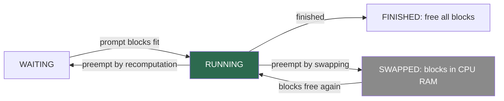
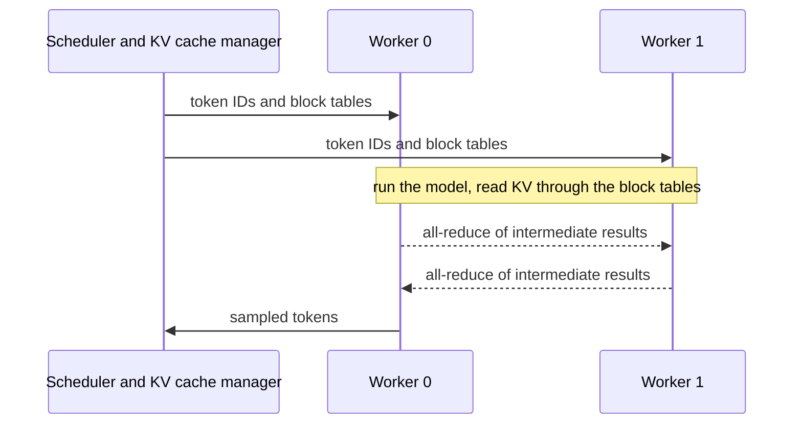

## 1. The question this page answers

Allocation on demand (page 05) lets many requests start with only their prompt blocks. But nobody knows how long each output will become. After some steps, a running sequence can need a new block when no block is free. Which request must then stop? What happens to its KV cache? How does it continue later without losing its work?

A second question concerns large models. A 175B model does not fit on one GPU, so the model runs on several GPUs at once. Does each GPU need its own block manager, and how do they agree on the block numbers? This page explains §4.5 ("Scheduling and Preemption") and §4.6 ("Distributed Execution") of the paper.

## 2. Mental model

> [!analogy] A restaurant with a fixed number of tables
> Guests are seated in order of arrival. Each party grows during the meal, and a growing party needs another table. When no table is free, the manager asks the party that arrived last to leave the room. The party either packs its food into boxes and waits in the lounge (swapping). Or it throws the food away and orders the same dishes again later (recomputation). While a party waits in the lounge, no new guests are seated. Every waiter works from one seating plan that the manager hands out at the start of each course.
>
> **Where it stops working:** a whole party must leave together with all its tables. A sequence cannot run with only part of its KV cache. Also, "cooking again" is faster than the first time. Recomputation processes all known tokens in one parallel step. The first time took one step per generated token.

## 3. Terms

| Term | Plain meaning |
|---|---|
| scheduler | The part of the engine that decides, at every step, which sequences run. |
| first-come-first-serve (FCFS) | The policy that serves requests in order of arrival. |
| starvation | A request that waits forever because others always go first. |
| preemption | Stopping a running request to free its memory for others. |
| eviction | Removing the blocks of a preempted request from GPU memory. |
| all-or-nothing eviction | Evict all blocks of a sequence or none of them. |
| sequence group | All sequences of one request, for example the candidates of one beam search. |
| gang scheduling | Scheduling all members of a group together: they run, stop and continue as one unit. |
| swapping | Copying evicted blocks to CPU memory and copying them back later. |
| swap space | The CPU memory reserved for swapped blocks. |
| recomputation | Dropping evicted blocks and computing the KV cache again from the tokens later. |
| PCIe | The bus between the CPU and the GPU. Swapped blocks travel over it. |
| tensor parallelism | Splitting each layer's weight matrices across GPUs, so all GPUs work on every token. |
| Megatron-LM | A system and paper (Shoeybi et al., 2019) that defines the common tensor-parallel split of Transformers. |
| SPMD | Single Program Multiple Data: every GPU runs the same program on its own part of the data. |
| all-reduce | A collective operation: every GPU contributes a tensor and every GPU receives the sum. |
| worker | One process that controls one GPU and holds one shard of the model. |
| control message | The data that the scheduler sends to all workers at the start of each step. |

All terms are also in the [Glossary](/notes/papers/glossary).

## 4. The problem: memory for an unknown future

The paper names the special difficulty of LLM serving: "the input prompts for an LLM can vary significantly in length, and the resulting output lengths are not known a priori, contingent on both the input prompt and the model" (§4.5). Allocation on demand gives memory only for tokens that exist. So "As the number of requests and their outputs grow, vLLM can run out of the GPU's physical blocks to store the newly generated KV cache" (§4.5).

Interpretation of these notes: this is a form of overcommitment. The system admits more requests than it could serve if all of them reached the maximum length. The bet pays off on average, because most outputs are short. Preemption is the safety net for the cases where the bet fails.

## 5. Which request stops: FCFS

The paper: "When the request traffic surpasses the system's capacity, vLLM must prioritize a subset of requests" (§4.5). "In vLLM, we adopt the first-come-first-serve (FCFS) scheduling policy for all requests, ensuring fairness and preventing starvation" (§4.5). "When vLLM needs to preempt requests, it ensures that the earliest arrived requests are served first and the latest requests are preempted first" (§4.5).

Why this order? Interpretation of these notes: the oldest requests have waited longest and already hold the most generated tokens. Preempting them would waste the most work and hurt the latency of the users who waited longest. The latest request has the least work to lose.

**How the v0.2.0 code implements it.** The scheduler in `vllm/core/scheduler.py` keeps three queues: `waiting`, `running` and `swapped`. At each step:

1. If the `swapped` queue is empty, it admits waiting requests in arrival order, as long as their prompt blocks fit (page 05).
2. It sorts `running` by arrival time. For each group, in that order, it checks `can_append_slot`. If the check fails, it removes the last group of the list (the latest arrival) and preempts it: `victim_seq_group = self.running.pop(-1)`. If no other group remains, it preempts the current group itself.
3. If no group was preempted in this step, it swaps groups back in, oldest first, while blocks are free.



A request preempted by recomputation returns to the front of the waiting queue. The code comment says: "For FCFS, we insert the preempted sequence group to the front of the waiting queue."

## 6. Which blocks to evict: all or nothing

The paper asks the two classic questions of memory management: "(1) Which blocks should it evict? (2) How to recover evicted blocks if needed again?" (§4.5).

An operating system usually evicts single pages. The paper: "Typically, eviction policies use heuristics to predict which block will be accessed furthest in the future and evict that block" (§4.5). vLLM does not need a guess: "Since in our case we know that all blocks of a sequence are accessed together, we implement an all-or-nothing eviction policy" (§4.5). It will "either evict all or none of the blocks of a sequence".

Why is partial eviction useless? Every decode step computes attention over all earlier tokens of the sequence. So the next step reads every block of the sequence. If even one block is missing, the sequence cannot run at all. Evicting half of its blocks frees memory but keeps the sequence stuck, so the remaining half is wasted memory.

The same logic covers groups. "Furthermore, multiple sequences within one request (e.g., beam candidates in one beam search request) are gang-scheduled as a sequence group. The sequences within one sequence group are always preempted or rescheduled together due to potential memory sharing across those sequences" (§4.5). Interpretation of these notes: suppose one beam candidate were evicted alone. Its shared blocks would stay in GPU memory for the other candidates, so the eviction would free little. Beam search also needs all $k$ candidates at every step to pick the next top $k$.

## 7. How to recover: swapping or recomputation

The paper: "To answer the second question of how to recover an evicted block, we consider two techniques" (§4.5).


### 7.1 Swapping

"This is the classic technique used by most virtual memory implementations which copy the evicted pages to a swap space on the disk" (§4.5). vLLM copies to CPU RAM instead of disk: "In our case, we copy evicted blocks to the CPU memory" (§4.5). "vLLM includes a CPU block allocator to manage the physical blocks swapped to CPU RAM" (§4.5).

The flow, from the paper:

1. "When vLLM exhausts free physical blocks for new tokens, it selects a set of sequences to evict and transfer their KV cache to the CPU."
2. "Once it preempts a sequence and evicts its blocks, vLLM stops accepting new requests until all preempted sequences are completed."
3. "Once a request completes, its blocks are freed from memory, and the blocks of a preempted sequence are brought back in to continue the processing of that sequence."

Rule 2 bounds the CPU memory that swapping needs. The paper: "the number of blocks swapped to the CPU RAM never exceeds the number of total physical blocks in the GPU RAM, so the swap space on the CPU RAM is bounded by the GPU memory allocated for the KV cache" (§4.5).

**In the v0.2.0 code.** `swap_out()` in the block manager gives each GPU block of the group a new CPU block and frees the GPU block. A block that several sequences of the group share is copied only once. The code keeps a mapping from GPU block to CPU block. For the second user of a block, it only raises the count of the CPU block. The worker then copies the data before the model step. For every layer, it copies the key blocks and the value blocks, with one `cudaMemcpyAsync` call per block. The pinned CPU tensors (`pin_memory=True`) allow fast direct transfers.

> [!example] Worked example: the default swap space
> v0.2.0 reserves `swap_space` = 4 GiB of CPU memory per GPU by default.
> 1. OPT-13B, $B = 16$: one block is 12.5 MiB. $4 \times 1024 / 12.5 = 327.68$, so 327 CPU blocks, which is $327 \times 16 = 5{,}232$ tokens.
> 2. Llama-3.1-8B, $B = 16$: one block is 2 MiB. $4 \times 1024 / 2 = 2{,}048$ CPU blocks, which is 32,768 tokens.
>
> If a swap needs more CPU blocks than are free, v0.2.0 stops with the error "Aborted due to the lack of CPU swap space. Please increase the swap space to avoid this error."

### 7.2 Recomputation

"In this case, we simply recompute the KV cache when the preempted sequences are rescheduled" (§4.5). The text you need is still known: the prompt and every token generated so far. So "the tokens generated at decoding can be concatenated with the original user prompt as a new prompt", and "their KV cache at all positions can be generated in one prompt phase iteration" (§4.5).

That is why "recomputation latency can be significantly lower than the original latency" (§4.5). The first time, a sequence of 1,000 generated tokens needed 1,000 decode steps, each limited by memory bandwidth. Recomputation processes all those tokens in one prefill, where the GPU works on matrix-matrix products and runs near its compute limit ([L2: Prefill and decode](/notes/ai/llm-systems/03-kv-cache/l2-prefill-and-decode)).

The sampled tokens are kept as text. So recomputation rebuilds exactly the same KV cache, up to floating-point rounding, and the output continues where it stopped.

### 7.3 The two costs in numbers

The paper: "The performances of swapping and recomputation depend on the bandwidth between CPU RAM and GPU memory and the computation power of the GPU" (§4.5). A simple model of these notes makes this concrete. Let a sequence hold $n$ tokens.

$$
t_{\text{swap, one way}} \approx \frac{n \times \text{KV bytes per token}}{\text{PCIe bandwidth}} \qquad
t_{\text{recompute}} \approx \frac{2 \times \text{parameters} \times n}{\text{GPU FLOP/s} \times \text{utilization}}
$$

> [!example] Worked example: OPT-13B, a sequence of 1,000 tokens
> 1. KV data: $1000 \times 819{,}200 = 819{,}200{,}000$ bytes, about 819 MB (781 MiB).
> 2. PCIe 4.0 x16, one direction: $16 \times 10^9$ transfers per second per lane $\times$ 16 lanes $\times 128/130$ (line coding) $/ 8$ bits $\approx 31.5$ GB/s. The A100 datasheet lists "PCIe Gen4 64 GB/s", which counts both directions together.
> 3. Swap time at that peak: $819.2 / 31.5 \approx 26$ ms out, and about 26 ms back in.
> 4. Recomputation: $2 \times 13 \times 10^9 \times 1000 = 2.6 \times 10^{13}$ FLOPs. At 312 TFLOPS (A100, FP16 dense): about 83 ms. At 50% utilization: about 167 ms. The attention FLOPs are ignored here.
>
> Both are peak-rate estimates of these notes. They show that the two costs have the same order of magnitude, tens of milliseconds per 1,000 tokens. So the winner depends on the real transfer speed and the real compute speed.

The block size changes the real transfer speed. In v0.2.0, each `cudaMemcpyAsync` call moves one block of one layer for keys or for values. For OPT-13B and 1,000 tokens:

| Block size | Blocks | Copy calls (40 layers × 2 × blocks) | Bytes per call |
|---|---|---|---|
| 1 | 1,000 | 80,000 | 10 KiB |
| 4 | 250 | 20,000 | 40 KiB |
| 16 | 63 | 5,040 | 160 KiB |
| 64 | 16 | 1,280 | 640 KiB |
| 256 | 4 | 320 | 2,560 KiB |

```plot
{
  "title": "Copy calls to swap out 1,000 OPT-13B tokens in v0.2.0, by block size (blue). Computed: 80 x ceil(1000 / B)",
  "xAxis": {
    "label": "block size B (tokens)",
    "domain": [
      0,
      270
    ]
  },
  "yAxis": {
    "label": "cudaMemcpyAsync calls",
    "domain": [
      0,
      85000
    ]
  },
  "disableZoom": true,
  "data": [
    {
      "points": [
        [
          1,
          80000
        ],
        [
          2,
          40000
        ],
        [
          4,
          20000
        ],
        [
          8,
          10000
        ],
        [
          16,
          5040
        ],
        [
          32,
          2560
        ],
        [
          64,
          1280
        ],
        [
          128,
          640
        ],
        [
          256,
          320
        ]
      ],
      "fnType": "points",
      "graphType": "polyline",
      "color": "#1E6091",
      "skipTip": true
    },
    {
      "points": [
        [
          1,
          80000
        ],
        [
          2,
          40000
        ],
        [
          4,
          20000
        ],
        [
          8,
          10000
        ],
        [
          16,
          5040
        ],
        [
          32,
          2560
        ],
        [
          64,
          1280
        ],
        [
          128,
          640
        ],
        [
          256,
          320
        ]
      ],
      "fnType": "points",
      "graphType": "scatter",
      "color": "#1E6091"
    }
  ]
}
```

Each call has a fixed start cost, and a small transfer cannot use the full bus speed. §7.3 of the paper measures exactly this effect: "swapping incurs excessive overhead with small block sizes", because small blocks give "numerous small data transfers between CPU and GPU, which limits the effective PCIe bandwidth". In contrast, "the overhead of recomputation remains constant across different block sizes, as recomputation does not utilize the KV blocks" (§7.3).

The measured conclusion (§7.3): "recomputation is more efficient when the block size is small, while swapping is more efficient when the block size is large", and "For medium block sizes from 16 to 64, the two methods exhibit comparable end-to-end performance". The paper also writes that "recomputation overhead is never higher than 20% of swapping's latency". Interpretation of these notes: even where swapping wins, recomputation is at most about 20% slower in that measurement. Page 09 shows the figure.

### 7.4 What the code chose, then and now

The paper describes both options but does not say which one is the default. The v0.2.0 scheduler chooses per group. Its comment says: "We use recomputation by default since it incurs lower overhead than swapping. However, when the sequence group has multiple sequences (e.g., beam search), recomputation is not currently supported. In such a case, we use swapping instead."

The current vLLM documentation states: "In vLLM V1, the default preemption mode is `RECOMPUTE` rather than `SWAP`, as recomputation has lower overhead in the V1 architecture" (checked on 2026-10-15). It also lists the remedies for frequent preemption, for example a higher `gpu_memory_utilization`, a lower `max_num_seqs` or `max_num_batched_tokens`, or more tensor parallelism.

## 8. A preemption trace

The following trace is the output of a small simulation written for these notes (exercise 1). It uses the policy of §4.5 and the step structure of the v0.2.0 code, where a prefill step and a decode step are separate. The pool has 7 blocks of $B = 4$ slots. Three requests arrive in order: R1 (prompt 7, output 4 tokens), R2 (prompt 6, output 6) and R3 (prompt 5, output 5). The simulation knows the output lengths, the scheduler does not. "R1:9" means that R1 has 9 tokens in its KV cache.

| Step | Free blocks after | Running after | Events |
|---|---|---|---|
| 1 | 1 | R1:7, R2:6, R3:5 | prefill of all three: 2 + 2 + 2 blocks |
| 2 | 1 | R1:8, R2:7, R3:6 | every sequence fills one slot |
| 3 | 0 | R1:9, R2:8, R3:7 | R1 needs a third block, the last free one |
| 4 | 4 | R2:9 | R2 needs a block, none is free: preempt R3 (latest), its 2 blocks return. R1 then finishes and returns 3 blocks. |
| 5 | 2 | R2:9, R3:8 | recomputation: prefill of R3 with 5 + 3 = 8 tokens. R2 waits in this step. |
| 6 | 4 | R2:10 | R3 needs and gets a block, then finishes |
| 7 | 7 | none | R2 finishes |

With swapping instead, step 4 copies R3's 2 blocks to CPU memory. Step 5 copies them back and runs a normal decode step for R2 and R3 together, and all requests finish at step 6. In this tiny example, swapping saves one step. The price is two PCIe transfers of 2 blocks each. Note also that R1 finished in step 4 anyway: the scheduler preempted R3 one step before memory became free. The scheduler cannot know output lengths in advance.

## 9. Distributed execution (§4.6)

### 9.1 Why and how a model is split

"Many LLMs have parameter sizes exceeding the capacity of a single GPU" (§4.6). Table 1 of the paper runs OPT-175B (346 GB of parameters) on 8 A100-80GB GPUs. vLLM uses "the widely used Megatron-LM style tensor model parallelism strategy on Transformers [47]" (§4.6).

The paper describes the strategy as an "SPMD (Single Program Multiple Data) execution schedule, wherein the linear layers are partitioned to perform block-wise matrix multiplication, and the the GPUs constantly synchronize intermediate results via an allreduce operation" (§4.6, "the the" as printed). For attention, "the attention operator is split on the attention head dimension, each SPMD process takes care of a subset of attention heads in multi-head attention" (§4.6). [L8: Parallelism](/notes/ai/llm-systems/04-inference/l8-parallelism) explains the column-parallel and row-parallel split and the two all-reduce operations per layer.

### 9.2 What each GPU stores

"We observe that even with model parallel execution, each model shard still processes the same set of input tokens, thus requiring the KV Cache for the same positions" (§4.6). So each GPU stores the KV of every token, but only for its own heads. "Although each GPU worker has the same physical block IDs, a worker only stores a portion of the KV cache for its corresponding attention heads" (§4.6).

> [!example] Worked example: OPT-175B on 8 GPUs
> OPT-175B: 96 layers, 96 heads of size 128, hidden size 12,288, FP16.
> 1. KV per token, all GPUs together: $2 \times 96 \times 12{,}288 \times 2 = 4{,}718{,}592$ bytes $= 4.5$ MiB.
> 2. Each GPU holds 12 of the 96 heads: $4{,}718{,}592 / 8 = 589{,}824$ bytes $= 576$ KiB per token.
> 3. One block of 16 tokens on one GPU: $16 \times 589{,}824 = 9{,}437{,}184$ bytes $= 9$ MiB.
> 4. Table 1 gives 264 GB of KV memory and 60.1K slots. Per token, $264 \times 1024^3 / 4{,}718{,}592 = 60{,}074.7$, so 60.1K, again with GB read as GiB.
> 5. Per GPU: $264 / 8 = 33$ GiB, and $33 \times 1024^3 / 589{,}824 = 60{,}074.7$ slots. Every GPU has the same number of token slots, so one block table fits all of them.

> [!example] Worked example: Llama-3.1-70B with grouped-query attention
> 80 layers, 8 KV heads of size 128, BF16, so 320 KiB per token in total.
> 1. TP = 4: 2 KV heads per GPU, $2 \times 80 \times 2 \times 128 \times 2 = 81{,}920$ bytes $= 80$ KiB per token per GPU.
> 2. TP = 8: 1 KV head per GPU, 40 KiB per token per GPU.
> 3. TP = 16 is not possible with a plain head split, because 8 KV heads cannot be divided over 16 GPUs. Engines then copy each KV head to several GPUs. The paper's OPT models use classic multi-head attention, so this case does not appear in the paper. See [L5: MHA, MQA, GQA and MLA](/notes/ai/llm-systems/03-kv-cache/l5-mha-mqa-gqa-and-mla).

### 9.3 One manager, one control message

"vLLM features a single KV cache manager within the centralized scheduler" (§4.6). "Different GPU workers share the manager, as well as the mapping from logical blocks to physical blocks. This common mapping allows GPU workers to execute the model with the physical blocks provided by the scheduler for each input request" (§4.6).


The paper describes each step (§4.6):



1. "In each step, the scheduler first prepares the message with input token IDs for each request in the batch, as well as the block table for each request."
2. "Next, the scheduler broadcasts this control message to the GPU workers."
3. "Then, the GPU workers start to execute the model with the input token IDs."
4. "In the attention layers, the GPU workers read the KV cache according to the block table in the control message."
5. "During execution, the GPU workers synchronize the intermediate results with the all-reduce communication primitive without the coordination of the scheduler."
6. "In the end, the GPU workers send the sampled tokens of this iteration back to the scheduler."

The key design point: "GPU workers do not need to synchronize on memory management as they only need to receive all the memory management information at the beginning of each decoding iteration along with the step inputs" (§4.6). The vLLM implementation uses NCCL for the communication between workers (§5).

> [!example] Worked example: the size of the control message
> Assume 256 sequences of 2,048 tokens with $B = 16$. These numbers are assumptions of these notes. Each block table has $2048/16 = 128$ entries. With 4-byte integers: $256 \times 128 \times 4 = 131{,}072$ bytes $= 128$ KiB per step, plus 256 token IDs. That is small against the gigabytes of KV data that the workers read in the same step.

Interpretation of these notes: one central manager gives one source of truth for block numbers, and the workers stay simple. The cost is that every step passes through one Python scheduler on the CPU. That scheduler overhead became an important topic for later versions of vLLM (page 10).

### Exercises

Write your code in `C:\Users\ASohi\Downloads\AI\agent-harness-lab\llm-systems\pagedattention_07.ipynb`.

1. **A preemption simulator.** Write `run(num_blocks, B, requests, mode)` with FCFS, all-or-nothing preemption of the latest running request, and the modes `"recompute"` and `"swap"`. Keep prefill steps and decode steps separate, and admit no new request while one is swapped out. Acceptance test: use 7 blocks, $B = 4$ and the requests R1 (7, 4), R2 (6, 6) and R3 (5, 5). Recomputation finishes at step 7 and swapping at step 6. In both modes, R3 is preempted at step 4.
   - Hint 1: a sequence needs a new block when its number of stored tokens is a multiple of $B$.
   - Hint 2: in recomputation mode, put the victim at the front of the waiting queue. Its new prompt is the old prompt plus the tokens generated so far.
2. **Cost model.** Write `swap_time_ms(n_tokens, kv_bytes_per_token, pcie_bytes_per_s)` and `recompute_time_ms(n_tokens, n_params, flops_per_s, utilization)`. Acceptance test: for OPT-13B and 1,000 tokens, the swap time per direction at 31.5 GB/s is about 26.0 ms. The recomputation time at 312 TFLOPS is about 83.3 ms.
   - Hint 1: KV bytes per token for OPT-13B: $2 \times 40 \times 5120 \times 2$.
   - Hint 2: a prefill needs about 2 FLOPs per parameter per token.
3. **KV per GPU.** Write `kv_bytes_per_token_per_gpu(L, H_kv, d_h, s, tp)`. It raises `ValueError` if `tp` does not divide `H_kv`. Acceptance test: OPT-175B with TP = 8 gives 589,824, Llama-3.1-70B with TP = 4 gives 81,920, and Llama-3.1-70B with TP = 16 raises `ValueError`.
   - Hint 1: tensor parallelism divides the heads, not the tokens or the layers.
   - Hint 2: use the integer division `H_kv // tp` after the check.

## 10. Common mistakes

1. **"vLLM evicts the least recently used blocks."** It evicts whole sequences, and whole sequence groups, in reverse arrival order. A partial eviction would leave the sequence unable to run.
2. **"Swapping is always faster than recomputation."** It depends on the block size and the hardware. §7.3 measures that recomputation wins for small blocks and swapping for large blocks, with similar results for 16 to 64.
3. **"Recomputation repeats the generation token by token."** It runs one prefill over the prompt plus all generated tokens. This is much faster than the original decode steps.
4. **"Each GPU worker has its own block manager."** One manager in the central scheduler owns all block tables. Workers receive the tables with every step.
5. **"With tensor parallelism, each GPU stores the KV cache of some of the tokens."** Each GPU stores all tokens, but only for its own heads. So all GPUs use the same block numbers.
6. **"Swap space can grow without limit."** The paper bounds it by the GPU memory of the KV cache, because no new request starts while a sequence is swapped out. The v0.2.0 code stops with an error when its swap space is full.

## 11. One-minute explanation

Allocation on demand admits more requests than the memory could hold at their maximum lengths, so vLLM needs a plan for a full block pool. It schedules first-come-first-serve, and when a running sequence needs a missing block, it preempts the latest arrived request. It evicts all blocks of that sequence and of its group, because the next step would need all of them. Swapping copies the blocks over PCIe to CPU memory and back later, and no new request starts while something is swapped out. Recomputation drops the blocks and later runs one prefill over the prompt plus the generated tokens. Both cost tens of milliseconds per thousand tokens for a 13B model. The paper measures that recomputation wins with small blocks and swapping with large ones. For models on several GPUs, vLLM uses Megatron-style tensor parallelism, so each GPU stores the KV cache of its own heads for all tokens. That is why one central block manager can send the same block tables to every worker at each step. The workers never coordinate memory among themselves.

## 12. Check questions

```check
{
  "question": "Why does vLLM evict all blocks of a sequence instead of the least recently used blocks?",
  "hint": "What does the next decode step of that sequence read?",
  "answer": "Every decode step computes attention over all earlier tokens, so it reads every block of the sequence. A sequence with even one missing block cannot run. Partial eviction would free some memory but leave the rest of the sequence's blocks useless. The paper: \"Since in our case we know that all blocks of a sequence are accessed together, we implement an all-or-nothing eviction policy\" (§4.5)."
}
```
```check
{
  "question": "Interview follow-up: estimate the cost of swapping and of recomputing a 1,000-token sequence of OPT-13B. Then explain why the measured winner depends on the block size.",
  "hint": "Compare bytes over PCIe with FLOPs on the GPU, then count the copy calls.",
  "answer": "KV data: $1000 \\times 819{,}200 \\approx 819$ MB. At about 31.5 GB/s per direction (PCIe 4.0 x16), swapping out takes about 26 ms and swapping in another 26 ms. Recomputation is one prefill: $2 \\times 13 \\times 10^9 \\times 1000 = 2.6 \\times 10^{13}$ FLOPs, about 83 ms at 312 TFLOPS peak and more at real utilization. Same order of magnitude.\n\nThe block size changes the real swap speed. The v0.2.0 code copies one block of one layer per `cudaMemcpyAsync` call, so 1,000 tokens need $40 \\times 2 \\times \\lceil 1000/B \\rceil$ calls: 80,000 calls of 10 KiB for $B = 1$, but 320 calls of 2.5 MiB for $B = 256$. Small transfers cannot use the full PCIe bandwidth. Recomputation does not touch blocks, so its cost does not depend on $B$. That gives the result of §7.3: recomputation wins with small blocks, swapping with large blocks."
}
```
```check
{
  "question": "Why is recomputation faster than the original generation of the same tokens?",
  "hint": "Compare a decode step with a prefill step.",
  "answer": "The original generation produced the tokens one per decode step. Each decode step is limited by memory bandwidth, because it reads all weights for one token per sequence. Recomputation knows all tokens already, so it processes them in one prefill step as a matrix-matrix product, which runs near the compute limit of the GPU. The paper: \"their KV cache at all positions can be generated in one prompt phase iteration\" (§4.5)."
}
```
```check
{
  "question": "Interview follow-up: with tensor parallelism on 8 GPUs, what part of the KV cache does each GPU store for OPT-175B, and why can all workers use one block table?",
  "hint": "Does tensor parallelism split the tokens or the heads?",
  "answer": "Each GPU computes attention for 12 of the 96 heads, for every token. So it stores the keys and values of all tokens, but only for its 12 heads: $589{,}824$ bytes (576 KiB) per token, one eighth of 4.5 MiB. Because every GPU stores every token position, block $b$ on worker 0 and block $b$ on worker 7 hold the same tokens, for different heads. So one block table, built by one central KV cache manager, is valid on all workers. The paper: \"Although each GPU worker has the same physical block IDs, a worker only stores a portion of the KV cache for its corresponding attention heads\" (§4.6)."
}
```
```check
{
  "question": "Interview follow-up: why does vLLM stop admitting new requests while a sequence is swapped out, and what does this guarantee?",
  "hint": "Think about CPU memory and about starvation.",
  "answer": "If new requests could start, they could take the blocks that the swapped sequences need to come back, and more sequences could be swapped out. Then CPU swap space could grow without limit, and a swapped request could wait forever. With the rule, swapped sequences return as soon as blocks are free. The paper states the guarantee: \"the number of blocks swapped to the CPU RAM never exceeds the number of total physical blocks in the GPU RAM\" (§4.5). It also keeps the FCFS order: older, swapped requests go before newer ones."
}
```
```check
{
  "question": "Interview follow-up: in the v0.2.0 code, which preemption mode does the scheduler choose for a beam search request, and why?",
  "hint": "Read the comment of `_preempt` in `vllm/core/scheduler.py`.",
  "answer": "Swapping. The code uses recomputation by default for groups with one sequence, \"since it incurs lower overhead than swapping\". For groups with several sequences, such as beam search, the comment says \"recomputation is not currently supported\", so it uses swapping. A beam group shares blocks between candidates, and recomputing it would need one prefill per candidate path or a special kernel. The current vLLM documentation states that V1 uses `RECOMPUTE` as the default mode (checked on 2026-10-15)."
}
```
```check
{
  "question": "Exercise 1: show a reference solution.",
  "answer": "```python\nimport math\n\ndef run(num_blocks, B, requests, mode):\n    \"\"\"FCFS with preemption. requests: (name, prompt_len, output_len) in arrival order.\"\"\"\n    order = [name for name, _, _ in requests]\n    free = num_blocks\n    waiting = [{\"name\": n, \"prompt\": p, \"out\": o, \"done\": 0, \"kv\": 0} for n, p, o in requests]\n    running, swapped, log = [], [], []\n    nblk = lambda r: math.ceil(r[\"kv\"] / B)            # blocks held = ceil(stored tokens / B)\n    while waiting or running or swapped:\n        ev = []\n        need = lambda r: math.ceil((r[\"prompt\"] + r[\"done\"]) / B)\n        if not swapped and waiting and need(waiting[0]) <= free:\n            while waiting and need(waiting[0]) <= free:  # prefill step (prompt + tokens so far)\n                r = waiting.pop(0)\n                r[\"kv\"] = r[\"prompt\"] + r[\"done\"]\n                free -= nblk(r)\n                r[\"done\"] += 1                         # prefill also samples one token\n                running.append(r)\n                ev.append(f\"prefill {r['name']} ({r['kv']} tokens)\")\n        else:                                          # decode step\n            while swapped and nblk(swapped[0]) <= free:\n                r = swapped.pop(0); free -= nblk(r); running.append(r)\n                ev.append(f\"swap in {r['name']}\")\n            running.sort(key=lambda r: order.index(r[\"name\"]))\n            for r in list(running):\n                if r not in running:\n                    continue                           # it was preempted in this step\n                if r[\"kv\"] % B == 0:                   # the next KV needs a new block\n                    while free == 0:\n                        victim = running.pop()         # the latest arrival goes first\n                        free += nblk(victim)\n                        if mode == \"recompute\":\n                            victim[\"kv\"] = 0\n                            waiting.insert(0, victim)\n                        else:\n                            swapped.append(victim)\n                        ev.append(f\"preempt {victim['name']} by {mode}\")\n                    if r not in running:\n                        continue\n                    free -= 1\n                r[\"kv\"] += 1                           # store the KV of the newest token\n                r[\"done\"] += 1                         # and sample the next token\n            for r in list(running):\n                if r[\"done\"] == r[\"out\"]:\n                    running.remove(r); free += nblk(r); r[\"kv\"] = 0\n                    ev.append(f\"{r['name']} finished\")\n        state = \" \".join(f\"{r['name']}:{r['kv']}\" for r in running)\n        log.append((len(log) + 1, free, state, \"; \".join(ev)))\n    return log\n\nfor mode in [\"recompute\", \"swap\"]:\n    print(mode)\n    for step, free, state, events in run(7, 4, [(\"R1\", 7, 4), (\"R2\", 6, 6), (\"R3\", 5, 5)], mode):\n        print(f\"  step {step}: free={free} running=[{state}] {events}\")\n```\n\nOutput:\n\n```text\nrecompute\n  step 1: free=1 running=[R1:7 R2:6 R3:5] prefill R1 (7 tokens); prefill R2 (6 tokens); prefill R3 (5 tokens)\n  step 2: free=1 running=[R1:8 R2:7 R3:6] \n  step 3: free=0 running=[R1:9 R2:8 R3:7] \n  step 4: free=4 running=[R2:9] preempt R3 by recompute; R1 finished\n  step 5: free=2 running=[R2:9 R3:8] prefill R3 (8 tokens)\n  step 6: free=4 running=[R2:10] R3 finished\n  step 7: free=7 running=[] R2 finished\nswap\n  step 1: free=1 running=[R1:7 R2:6 R3:5] prefill R1 (7 tokens); prefill R2 (6 tokens); prefill R3 (5 tokens)\n  step 2: free=1 running=[R1:8 R2:7 R3:6] \n  step 3: free=0 running=[R1:9 R2:8 R3:7] \n  step 4: free=4 running=[R2:9] preempt R3 by swap; R1 finished\n  step 5: free=2 running=[R2:10 R3:8] swap in R3\n  step 6: free=7 running=[] R2 finished; R3 finished\n```"
}
```
```check
{
  "question": "Exercises 2 and 3: show a reference solution.",
  "answer": "```python\nimport math\n\ndef swap_time_ms(n_tokens, kv_bytes_per_token, pcie_bytes_per_s):\n    \"\"\"One direction: the bytes of the sequence over PCIe at peak rate.\"\"\"\n    return n_tokens * kv_bytes_per_token / pcie_bytes_per_s * 1e3\n\ndef recompute_time_ms(n_tokens, n_params, flops_per_s, utilization=1.0):\n    \"\"\"One prefill over all tokens, at 2 FLOPs per parameter per token (attention ignored).\"\"\"\n    return 2 * n_params * n_tokens / (flops_per_s * utilization) * 1e3\n\npcie = 16e9 * 16 * (128 / 130) / 8          # PCIe 4.0 x16, one direction, bytes/s\nprint(round(pcie / 1e9, 2), \"GB/s\")\nprint(round(swap_time_ms(1000, 819_200, pcie), 1), \"ms per direction\")\nprint(round(recompute_time_ms(1000, 13e9, 312e12), 1), \"ms at peak\")\nprint(round(recompute_time_ms(1000, 13e9, 312e12, 0.5), 1), \"ms at 50%\")\n\ndef kv_bytes_per_token_per_gpu(L, H_kv, d_h, s, tp):\n    if H_kv % tp != 0:\n        raise ValueError(f\"{H_kv} KV heads cannot be split evenly over {tp} GPUs\")\n    return 2 * L * (H_kv // tp) * d_h * s\n\nprint(kv_bytes_per_token_per_gpu(96, 96, 128, 2, 8))     # OPT-175B, TP = 8\nprint(kv_bytes_per_token_per_gpu(80, 8, 128, 2, 4))      # Llama-3.1-70B, TP = 4\ntry:\n    kv_bytes_per_token_per_gpu(80, 8, 128, 2, 16)\nexcept ValueError as e:\n    print(\"ValueError:\", e)\nassert kv_bytes_per_token_per_gpu(96, 96, 128, 2, 8) == 589_824\nassert kv_bytes_per_token_per_gpu(80, 8, 128, 2, 4) == 81_920\n```"
}
```

## 13. Links

- Previous: [06 Sharing: parallel sampling, beam search and shared prefixes](/notes/papers/llm-serving/2023-pagedattention/06-decoding-scenarios-and-sharing)
- Next: [08 Implementation: the vLLM system and its kernels](/notes/papers/llm-serving/2023-pagedattention/08-implementation)
- Swapping in an OS: [01 Background: virtual memory and paging](/notes/papers/llm-serving/2023-pagedattention/01-background-virtual-memory-and-paging)
- Allocation on demand and the free queue: [05 The KV cache manager and block tables](/notes/papers/llm-serving/2023-pagedattention/05-the-kv-cache-manager)
- The measurements of §7.3: [09 Results](/notes/papers/llm-serving/2023-pagedattention/09-results)
- Later changes to scheduling: [10 Limits and later work](/notes/papers/llm-serving/2023-pagedattention/10-limits-and-later-work)
- Prefill and decode costs: [L2: Prefill and decode](/notes/ai/llm-systems/03-kv-cache/l2-prefill-and-decode)
- Batching and preemption in engines: [L4: Batching and scheduling](/notes/ai/llm-systems/04-inference/l4-batching-and-scheduling)
- Tensor parallelism in detail: [L8: Parallelism: tensor, pipeline, data and expert](/notes/ai/llm-systems/04-inference/l8-parallelism)
- GPU bandwidth and PCIe: [L5: GPUs, memory and bandwidth](/notes/ai/llm-systems/01-math-and-hardware/l5-gpus-memory-and-bandwidth)
- The paper card: [PagedAttention (2023)](/notes/papers/llm-serving/2023-pagedattention) and the [Glossary](/notes/papers/glossary)

### Sources

- Kwon et al., "Efficient Memory Management for Large Language Model Serving with PagedAttention", SOSP 2023: https://arxiv.org/abs/2309.06180 (§4.5, §4.6, §5, §6.1 Table 1, §7.3)
- vLLM v0.2.0 scheduler, block manager, cache engine and cache kernels: https://github.com/vllm-project/vllm/blob/v0.2.0/vllm/core/scheduler.py, https://github.com/vllm-project/vllm/blob/v0.2.0/vllm/core/block_manager.py, https://github.com/vllm-project/vllm/blob/v0.2.0/vllm/worker/cache_engine.py, https://github.com/vllm-project/vllm/blob/v0.2.0/csrc/cache_kernels.cu
- vLLM optimization documentation (preemption): https://github.com/vllm-project/vllm/blob/main/docs/configuration/optimization.md
- NVIDIA A100 datasheet (PCIe Gen4 64 GB/s, 312 TFLOPS FP16 dense): https://www.nvidia.com/content/dam/en-zz/Solutions/Data-Center/a100/pdf/a100-80gb-datasheet-update-a4-nvidia-1485612-r12-web.pdf
- OPT model sizes (Table 1): https://arxiv.org/abs/2205.01068

(checked on 2026-10-15)
