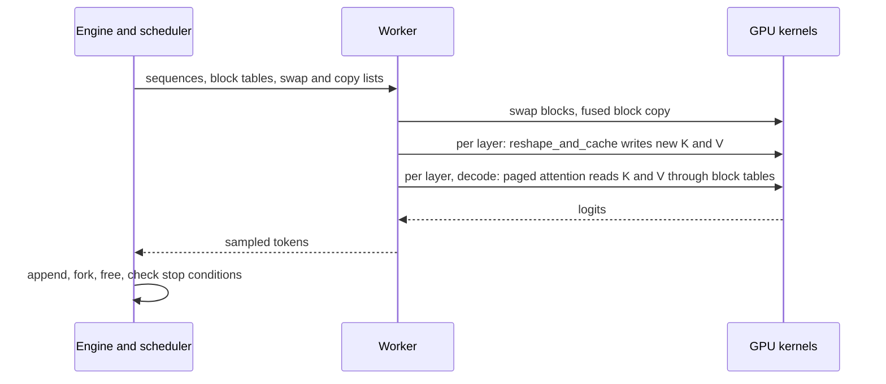

## 1. The question this page answers

Pages 04 to 07 describe ideas: an attention algorithm over blocks, block tables, sharing and preemption. An interviewer who hears "PagedAttention" will ask how it is really built. Which parts run in Python and which on the GPU? Which GPU kernels did the authors write, and why? Why is reading scattered blocks still fast? What is the reason for the block size of 16?

This page answers these questions from §4 (the overview and Figure 4), §5 ("Implementation"), §7.1 and §7.2 of the paper. It adds details from the open-source code of the same period, vLLM v0.2.0 (published on 2023-09-28). Every code detail is labeled as such, because the paper does not show code.

## 2. Mental model

> [!analogy] A warehouse office and its forklifts
> The office decides which pallet goes to which shelf. It keeps the shelf lists and prints one pick list for every round. The forklifts never decide anything. They read the pick list and move the pallets, many at the same time. To save trips, one forklift run does several moves at once.
>
> **Where it stops working:** in vLLM the "pick list" (the block tables) is read by thousands of GPU threads in parallel, not by a few drivers. Also, the forklifts do more than move data: the attention kernel computes while it reads, so moving and computing are one operation.

## 3. Terms

| Term | Plain meaning |
|---|---|
| control plane | The code that decides: scheduling, block allocation, preemption. In vLLM it is Python. |
| data plane | The code that touches the tensors: the model and the kernels on the GPU. |
| frontend | The HTTP server that receives requests and returns outputs. |
| FastAPI | A Python web framework for HTTP APIs. vLLM's frontend uses it. |
| OpenAI-compatible API | An HTTP API with the same paths and JSON fields as the OpenAI API, for example `/v1/completions`. |
| engine | The object that runs the loop: schedule, execute the model, process the outputs. |
| cache engine | The part of a worker that holds the GPU and CPU KV blocks and performs swaps and copies. |
| CUDA kernel | A function that runs on the GPU in many threads at once. |
| kernel launch | The call from the CPU that starts a kernel. Each launch has a fixed cost of a few microseconds. |
| kernel fusion | Doing several operations in one kernel, so that data and launches are not repeated. |
| warp | A group of 32 GPU threads that execute the same instruction together. |
| thread block | A group of threads (several warps) that share fast on-chip memory and run on one streaming multiprocessor. |
| grid | All thread blocks of one kernel launch. |
| coalesced memory access | Neighboring threads read neighboring addresses, so the GPU can serve them with few wide memory transactions. |
| slot mapping | The list of slot numbers where the new keys and values of a step go. |
| NCCL | The NVIDIA Collective Communications Library, for operations such as all-reduce between GPUs. |
| xFormers | A library of attention kernels. The v0.2.0 code uses it for the prompt step. |

All terms are also in the [Glossary](/notes/papers/glossary).

## 4. The architecture (Figure 4)

The paper describes the system in one sentence: "vLLM adopts a centralized scheduler to coordinate the execution of distributed GPU workers" (§4). "The KV cache manager effectively manages the KV cache in a paged fashion, enabled by PagedAttention. Specifically, the KV cache manager manages the physical KV cache memory on the GPU workers through the instructions sent by the centralized scheduler" (§4). Figure 4 of the paper labels these parts: Scheduler, KV Cache Manager, Block tables, CPU Block Allocator and GPU Block Allocator. It also shows Worker 0 to Worker N − 1, each with a "Model Shard" and a "Cache Engine".


| Part | What it does | Language |
|---|---|---|
| Frontend | receives HTTP requests, streams results | Python (FastAPI) |
| Scheduler | picks the sequences of each step, preempts (page 07) | Python |
| KV cache manager | block tables, GPU and CPU block allocators (pages 05 and 06) | Python |
| Worker | runs one shard of the model on one GPU | Python (PyTorch) |
| Cache engine | holds the KV blocks of the worker, swaps and copies them | Python with CUDA kernels |
| Custom kernels | PagedAttention, block write, block copy | C++/CUDA |

The size of the code, from §5: "The vLLM engine is written in 8.5K lines of Python and 2K lines of C++/CUDA code." The split follows the work: "We develop control-related components including the scheduler and the block manager in Python while developing custom CUDA kernels for key operations such as PagedAttention" (§5). "For the model executor, we implement popular LLMs such as GPT [5], OPT [62], and LLaMA [52] using PyTorch [39] and Transformers [58]. We use NCCL [32] for tensor communication across the distributed GPU workers" (§5).

> [!key] Control plane in Python, data plane on the GPU
> The decisions happen once per step for the whole batch: a few thousand Python operations. The data work happens once per token, per layer, per head: billions of operations. So the authors write the decisions in Python, where they are easy to change, and only the heavy data movement in CUDA. Interpretation of these notes: this split works because one step of a large batch takes milliseconds on the GPU, which hides the Python cost. At very small batches or very fast GPUs, the Python scheduler can become the bottleneck, and later versions worked on that (page 10).

## 5. One step, end to end (v0.2.0 code)

The paper describes the step in words (pages 05 and 07). The v0.2.0 code shows the exact order. `LLMEngine.step()` in `vllm/engine/llm_engine.py`:

1. **Schedule.** The scheduler returns the sequence groups of this step and three lists: `blocks_to_swap_in`, `blocks_to_swap_out` and `blocks_to_copy` (page 06 and page 07).
2. **Execute.** Every worker runs `execute_model()` with the same arguments.
3. **Process the outputs.** The engine appends the sampled tokens, forks and frees sequences (section 10), and checks the stop conditions.

Inside `Worker.execute_model()` in `vllm/worker/worker.py`:

1. The cache engine starts the swaps in, the swaps out and the block copies. Swaps run on a separate CUDA stream, with one event per layer, so a layer waits only for its own data.
2. `_prepare_inputs()` builds the input tensors: token IDs, positions, `slot_mapping`, `context_lens` and the padded `block_tables` (page 05).
3. The model runs. In a prompt step, each attention layer computes attention on the contiguous prompt tensors with xFormers `memory_efficient_attention_forward`. In both kinds of step, the layer then waits for its cache event. Then it writes the new keys and values into their slots (kernel 1, section 7). In a decode step, the layer then runs the PagedAttention kernel (kernel 2, section 8), called `single_query_cached_kv_attention` in v0.2.0.
4. The sampler draws the next token of each sequence.



## 6. The memory layout of the cache

The cache engine creates two tensors per layer (`vllm/worker/cache_engine.py` in v0.2.0):

```text
key cache:   [num_blocks, num_kv_heads, head_size / x, block_size, x]
value cache: [num_blocks, num_kv_heads, head_size, block_size]
x = 16 // bytes per element        (8 for FP16 or BF16, 4 for FP32)
```


**Why the key layout has the extra dimension `x`.** A key vector of 128 FP16 numbers is cut into 16 chunks of 8 numbers. Each chunk is 16 bytes. Inside one chunk row, the chunks of token 0, token 1, and so on lie next to each other. The design document of vLLM explains the goal: "each thread group can fetch and calculate 16 bytes of data at a time", and "neighboring threads like thread 0 and thread 1 can read neighbor memory, achieving the memory coalescing to improve performance". So every memory read is wide, and the threads of a warp read one continuous area.

**Why the value layout is transposed.** In the value tensor, one row holds one dimension of all $B$ tokens. After the softmax, the kernel multiplies each value by the weight of its token and sums over the tokens. A thread reads 8 neighboring tokens of one dimension (16 bytes in FP16) and multiplies them with 8 neighboring softmax weights in one step.

> [!example] Worked example: the bytes of one OPT-13B block
> FP16, $B = 16$, 40 heads of size 128, 40 layers, so $x = 16 / 2 = 8$.
> 1. Key tensor of one layer: `[num_blocks, 40, 16, 16, 8]`. Value tensor: `[num_blocks, 40, 128, 16]`.
> 2. Keys of one block, one head, one layer: $16 \times 128 \times 2 = 4{,}096$ bytes (4 KiB). Values: the same.
> 3. One block, one layer, all heads: $40 \times 2 \times 4$ KiB $= 320$ KiB.
> 4. One block, all 40 layers: $40 \times 320$ KiB $= 12{,}800$ KiB $= 12.5$ MiB, the block size of page 05.

## 7. Kernel 1: fused reshape and block write

The paper: "In every Transformer layer, the new KV cache are split into blocks, reshaped to a memory layout optimized for block read, then saved at positions specified by the block table. To minimize kernel launch overheads, we fuse them into a single kernel" (§5.1).

In v0.2.0 this kernel is `reshape_and_cache` in `csrc/cache_kernels.cu`. It receives the new keys and values of the step, with the shape `[num_tokens, num_heads, head_size]`, and the `slot_mapping`. Each GPU thread block handles one token. It reads the token's slot, computes the block number and offset, and its threads write every element of the token to its target index:

$$
\text{key index} = \Big(\big((\text{block} \cdot H_{kv} + h) \cdot \tfrac{d_h}{x} + \lfloor e/x \rfloor\big) \cdot B + \text{offset}\Big) \cdot x + (e \bmod x)
$$

$$
\text{value index} = \big((\text{block} \cdot H_{kv} + h) \cdot d_h + e\big) \cdot B + \text{offset}
$$

Here $h$ is the head and $e$ the element inside the head. The NumPy code below does the same writes for request A of page 05. Then it checks that the 5-dimensional view of the code puts each number where the shapes say. It uses FP32, so $x = 4$.

```python
import numpy as np

rng = np.random.default_rng(0)
num_blocks, H, d, B = 9, 2, 8, 4                 # small sizes for the demo
x = 16 // np.dtype(np.float32).itemsize          # 16 bytes / 4 bytes = 4 elements
k_flat = np.zeros(num_blocks * H * d * B, np.float32)
v_flat = np.zeros_like(k_flat)

block_table = [7, 1, 3]                          # request A of Figure 6
T = 9                                            # 9 stored tokens: positions 0..8
k = rng.standard_normal((T, H, d)).astype(np.float32)
v = rng.standard_normal((T, H, d)).astype(np.float32)

# Fused reshape and block write: one slot per token, then the index formulas.
slot_mapping = [block_table[p // B] * B + p % B for p in range(T)]
for t, slot in enumerate(slot_mapping):
    blk, off = divmod(slot, B)
    for h in range(H):
        for e in range(d):
            ki = (((blk * H + h) * (d // x) + e // x) * B + off) * x + e % x
            vi = ((blk * H + h) * d + e) * B + off
            k_flat[ki], v_flat[vi] = k[t, h, e], v[t, h, e]

k_cache = k_flat.reshape(num_blocks, H, d // x, B, x)   # the 5-D view of the code
v_cache = v_flat.reshape(num_blocks, H, d, B)

# Check: the 5-D view puts every number where the shapes say.
for t, slot in enumerate(slot_mapping):
    blk, off = divmod(slot, B)
    assert np.array_equal(k_cache[blk, :, :, off, :].reshape(H, d), k[t])
    assert np.array_equal(v_cache[blk, :, :, off], v[t])
print("x =", x, "slot_mapping =", slot_mapping, "layout check passed")
```

Output:

```text
x = 4 slot_mapping = [28, 29, 30, 31, 4, 5, 6, 7, 12] layout check passed
```

Line by line, the important parts:

1. `x = 16 // itemsize` is the number of elements in 16 bytes, as in `get_key_block_shape()` of the v0.2.0 cache engine.
2. `slot_mapping` is built from the block table exactly as on page 05. Positions 0 to 3 go to block 7 (slots 28 to 31), and position 8 goes to block 3 (slot 12).
3. The two index formulas are the formulas of the kernel. The loops over `h` and `e` are the threads of the kernel's thread block.
4. The final `reshape` shows that the flat indices agree with the tensor shapes of the code. A real cache is one tensor per layer, so no reshape happens at run time.

Why fuse? Without fusion, one layer would run separate kernels to split, to reshape and to scatter the new keys, and the same for the values. Each launch costs a few microseconds, and each intermediate result travels through GPU memory. With 40 layers per step, these costs add up. Interpretation of these notes: one fused kernel per layer reads each new number once and writes it once.

## 8. Kernel 2: block read fused with attention

### 8.1 What the paper states

"We adapt the attention kernel in FasterTransformer [31] to read KV cache according to the block table and perform attention operations on the fly. To ensure coalesced memory access, we assign a GPU warp to read each block. Moreover, we add support for variable sequence lengths within a request batch" (§5.1).

### 8.2 How the work is divided

The vLLM repository keeps a design document of this kernel. It warns: "This is a historical document based on the original paper for vLLM. It no longer describes the code used in vLLM today" (checked on 2026-10-15). It is still the best description of the paper's kernel:

1. **Grid.** The grid shape is `(num_heads, num_seqs, max_num_partitions)`. So "each thread block only handles the calculation for one head, one sequence, and one partition". Without partitions, one thread block computes the attention of one query token, for one head, over the whole context.
2. **Warps.** In the words of the document, "each warp processes the calculation between one query token and key tokens of one entire block at a time". The warps take the blocks in turn: "if there are 4 warps and 6 blocks for one context, the assignment would be like warp 0 handles the 0th, 4th blocks, warp 1 handles the 1st, 5th blocks, warp 2 handles the 2nd block and warp 3 handles the 3rd block."
3. **Thread groups.** A thread group is a small set of threads that computes the dot product of the query with one key token. The vector size is chosen "so that each thread group can fetch and calculate 16 bytes of data at a time".
4. **Softmax.** Each thread group writes its scores into `logits` in shared memory and tracks the largest score. Then the kernel reduces `qk_max` over the warps and over the thread block, computes `exp(qk - qk_max)`, reduces `exp_sum`, and divides. This is the subtract-the-max softmax of [L3: Scaled dot-product attention](/notes/ai/llm-systems/02-attention-and-the-transformer/l3-scaled-dot-product-attention).
5. **Values.** Each thread reads value vectors of 16 bytes and multiplies them with the matching softmax weights. It accumulates the result for its dimensions in registers (`accs`). A last reduction over the warps gives the output vector.
6. **Variable lengths.** A slot after the end of the sequence gets no score: `const bool mask = token_idx >= context_len;`. So one batch can hold sequences of any length, read from `context_lens`.

### 8.3 The same work division in NumPy

The function below follows the structure of one thread block. It is written for these notes. The loops over warps and blocks are parallel on the GPU. Here they run one after the other.

```python
import math

def paged_attention_one_head(q, k_cache, v_cache, block_table, context_len, h, num_warps=4):
    """What one thread block does: one query, one head, one sequence."""
    num_blocks_total, H, d_over_x, B, x = k_cache.shape
    d = d_over_x * x
    n_blocks = math.ceil(context_len / B)
    logits = np.full(n_blocks * B, -np.inf)          # lives in shared memory
    for warp in range(num_warps):
        for j in range(warp, n_blocks, num_warps):   # warp w takes blocks w, w + 4, ...
            phys = block_table[j]                    # one table lookup per block
            for off in range(B):                     # one thread group per key token
                t = j * B + off
                if t >= context_len:                 # mask: slot after the end
                    continue
                k = k_cache[phys, h, :, off, :].reshape(d)
                logits[t] = q @ k / math.sqrt(d)
    m = logits.max()                                 # reduction 1: qk_max
    p = np.exp(logits - m)                           # exp(-inf) = 0 for masked slots
    p /= p.sum()                                     # reduction 2: exp_sum
    out = np.zeros(d)
    for warp in range(num_warps):
        for j in range(warp, n_blocks, num_warps):
            v_block = v_cache[block_table[j], h]     # shape [d, B]
            out += v_block @ p[j * B:(j + 1) * B]    # weights of this block's tokens
    return out                                       # reduction 3: sum over warps
# Continue after the code of section 7: compare with dense attention.
q = rng.standard_normal((H, d)).astype(np.float32)
paged = np.stack([paged_attention_one_head(q[h], k_cache, v_cache, block_table, T, h)
                  for h in range(H)])
s = np.einsum("hd,thd->ht", q, k) / np.sqrt(d)
w = np.exp(s - s.max(axis=1, keepdims=True))
w /= w.sum(axis=1, keepdims=True)
dense = np.einsum("ht,thd->hd", w, v)
print("max difference:", np.abs(paged - dense).max())
```

Output:

```text
max difference: 5.7260892138977226e-08
```

Line by line, the important parts:

1. `range(warp, n_blocks, num_warps)` is the round-robin assignment of blocks to warps.
2. `phys = block_table[j]` is the only extra work of paging: one table lookup per block, shared by the $B$ tokens of the block.
3. `k_cache[phys, h, :, off, :]` collects the $d_h / x$ chunks of one key token. On the GPU, the threads of a thread group read these chunks, 16 bytes each.
4. `t >= context_len` is the mask for slots after the end of the sequence. The score stays $-\infty$, so its weight is exactly 0.
5. `logits.max()` and `p.sum()` are the two reductions of the softmax over the whole thread block.
6. The value loop again visits block by block. The result equals dense attention up to float rounding (about $6 \times 10^{-8}$ here).

### 8.4 Why scattered blocks are still fast

Inside a block, all data is contiguous: 16 tokens × 128 dimensions = 2,048 numbers per head and block (4 KiB in FP16). A warp reads this area with wide, coalesced reads. The table lookup happens once per block, not once per number. So paging changes where each 4 KiB piece starts, but not how efficiently each piece is read.

The overhead is still measurable. §7.1: "this leads to 20–26% higher attention kernel latency, compared to the highly-optimized FasterTransformer implementation." The reason: "extra overheads of accessing the block table, executing extra branches, and handling variable sequence lengths." The paper adds: "We believe the overhead is small as it only affects the attention operator but not the other operators in the model, such as Linear." Page 09 shows the end-to-end effect. The larger batches more than pay for the slower attention kernel.

> [!note] Prefill used a different kernel
> The paper's decode kernel handles one query token per sequence. The prompt step used "a conventional self-attention algorithm (e.g., [13])" (§4.3), and v0.2.0 used xFormers for it. Later attention libraries, such as FlashAttention and FlashInfer, read paged KV caches through block tables in prefill and decode. See [L7: The cost of attention and FlashAttention](/notes/ai/llm-systems/02-attention-and-the-transformer/l7-attention-cost-and-flashattention) and page 10.

## 9. Kernel 3: fused block copy

The paper: "Block copy operations, issued by the copy-on-write mechanism, may operate on discontinuous blocks. This can lead to numerous invocations of small data movements if we use the cudaMemcpyAsync API. To mitigate the overhead, we implement a kernel that batches the copy operations for different blocks into a single kernel launch" (§5.1).

In v0.2.0, this kernel is `copy_blocks_kernel` in `csrc/cache_kernels.cu`. Its grid is `(num_layers, num_pairs)`, so each thread block copies one (source, destination) pair in one layer, first the keys and then the values. The scheduler's `blocks_to_copy` becomes one array of pairs.

> [!example] Worked example: copies in one step
> Assume that 8 sequences need a copy-on-write in one step of OPT-13B (40 layers). This number is an assumption of these notes.
> 1. With `cudaMemcpyAsync`: one call per block, per layer, for keys and for values: $8 \times 40 \times 2 = 640$ calls.
> 2. With the fused kernel: 1 launch with a grid of $40 \times 8 = 320$ thread blocks.

Swapping did not get this treatment in v0.2.0. Its `swap_blocks` function still calls `cudaMemcpyAsync` once per block. A code comment says: "This can be slow if the number of blocks is large." This is the mechanism behind the small-block result of §7.3 (page 07).

## 10. Supporting decoding algorithms: fork, append, free

The paper: "vLLM implements various decoding algorithms using three key methods: fork, append, and free" (§5.2).

| Method | Paper (§5.2) | v0.2.0 code |
|---|---|---|
| fork | "The fork method creates a new sequence from an existing one." | `Scheduler.fork_seq` calls `BlockSpaceManager.fork`: copy the block table, raise every reference count |
| append | "The append method appends a new token to the sequence." | `Sequence.append_token_id` adds the token, `append_slot` reserves its slot, with copy-on-write if needed |
| free | "Finally, the free method deletes the sequence." | `Scheduler.free_seq` calls `BlockSpaceManager.free`: lower the counts, return blocks at 0 |

The paper gives parallel sampling as the example: "vLLM creates multiple output sequences from the single input sequence using the fork method. It then adds new tokens to these sequences in every iteration with append, and deletes sequences that meet a stopping condition using free" (§5.2). "The same strategy is also applied in beam search and prefix sharing by vLLM. We believe future decoding algorithms can also be supported by combining these methods" (§5.2).

| Decoding method | fork | append | free |
|---|---|---|---|
| parallel sampling with $n$ samples | $n - 1$ times from the prompt sequence | every step, for every sample | when a sample stops |
| beam search with width $k$ | for each kept child of a candidate | every step, for every candidate | for every candidate that leaves the beam |
| shared prefix | map the prefix blocks into the new request | every step | when the request ends, the prefix blocks keep their other references |

Interpretation of these notes: the three methods are the whole interface between decoding algorithms and memory. The decoding code never sees block numbers, and the block manager never sees probabilities.

## 11. The frontend

The paper: "vLLM is an end-to-end serving system with a FastAPI [15] frontend and a GPU-based inference engine. The frontend extends the OpenAI API [34] interface, allowing users to customize sampling parameters for each request, such as the maximum sequence length and the beam width $k$" (§5).

In v0.2.0, the OpenAI-compatible server (`vllm/entrypoints/openai/api_server.py`) has the routes `/v1/models`, `/v1/completions` and `/v1/chat/completions`. Its completion request accepts the OpenAI fields, such as `n` and `best_of`, plus fields that it marks as "Additional parameters supported by vLLM", such as `top_k` and `use_beam_search`. Two example request bodies for `/v1/completions` in v0.2.0:

```json
{
  "model": "facebook/opt-13b",
  "prompt": "Four score and seven years ago our",
  "max_tokens": 32,
  "n": 2,
  "temperature": 0.8
}
```

```json
{
  "model": "facebook/opt-13b",
  "prompt": "Four score and seven years ago our",
  "max_tokens": 32,
  "n": 4,
  "best_of": 4,
  "use_beam_search": true,
  "temperature": 0
}
```

The first body asks for parallel sampling: 2 samples share the prompt blocks (page 06). The second asks for beam search with width 4. The v0.2.0 code requires `best_of` greater than 1, `temperature` 0, `top_p` 1 and `top_k` −1 for beam search (`_verify_beam_search` in `vllm/sampling_params.py`). These field names belong to v0.2.0. Check the current documentation before you use them today.

## 12. Choosing the block size (§7.2)

The paper names both sides of the trade-off: "If the block size is too small, vLLM may not fully utilize the GPU's parallelism for reading and processing KV cache. If the block size is too large, internal fragmentation increases and the probability of sharing decreases" (§7.2).

The experiment uses "the ShareGPT and Alpaca traces with basic sampling under fixed request rates" (§7.2). Figure 18(b) tests block sizes 1, 2, 4, 8, 16, 32, 64, 128 and 256. The results:

1. "In the ShareGPT trace, block sizes from 16 to 128 lead to the best performance."
2. "In the Alpaca trace, while the block size 16 and 32 work well, larger block sizes significantly degrade the performance since the sequences become shorter than the block sizes."
3. "In practice, we find that the block size 16 is large enough to efficiently utilize the GPU and small enough to avoid significant internal fragmentation in most workloads. Accordingly, vLLM sets its default block size as 16."

> [!example] Worked example: why large blocks hurt on Alpaca
> Figure 11 of the paper gives the mean lengths of Alpaca: input 19.31 and output 58.45 tokens. Take a sequence of 78 tokens as an illustration of these notes.
> 1. $B = 16$: $\lceil 78/16 \rceil = 5$ blocks $= 80$ slots, so $78/80 = 97.5\%$ of the slots hold tokens.
> 2. $B = 32$: 3 blocks $= 96$ slots, so 81.3%.
> 3. $B = 256$: 1 block $= 256$ slots, so 30.5%. About 70% of the KV memory of this sequence is empty.
>
> With ShareGPT (mean 161.31 input and 337.99 output tokens), sequences are several times longer, so blocks up to 128 still fill well.

What the code allowed: in v0.2.0, the server flag `--block-size` accepted only 8, 16 or 32, with 16 as the default. In v0.31.0, the cache configuration still has `DEFAULT_BLOCK_SIZE = 16`. But if the user does not set a block size, the platform code can choose another size. It picks a size that the selected attention backend prefers (checked on 2026-10-15).

## 13. From the paper's code to vLLM today

The vLLM documentation now marks the kernel description of section 8 as historical. The ideas stayed, but the code changed a lot. Page 10 covers the details. In short:

1. The V1 engine has a new KV cache manager with a block pool and a free block queue. Its blocks carry a hash for automatic prefix caching ([L9: Prefix caching and KV reuse](/notes/ai/llm-systems/04-inference/l9-prefix-caching-and-kv-reuse)).
2. Attention runs through backends such as FlashAttention and FlashInfer, which read paged KV caches.
3. Prefill and decode tokens share one step (chunked prefill), and recomputation is the default preemption mode in V1 (page 07).

[L10: Serving engines](/notes/ai/llm-systems/04-inference/l10-serving-engines) compares vLLM with other engines that also use paged KV caches.

### Exercises

Write your code in `C:\Users\ASohi\Downloads\AI\agent-harness-lab\llm-systems\pagedattention_08.ipynb`.

1. **The block write.** Implement the two index formulas of section 7. Write the keys and values of 9 tokens into flat arrays. Use the block table `[7, 1, 3]`, $B = 4$, 2 heads of size 8 and FP32. Acceptance test: `slot_mapping == [28, 29, 30, 31, 4, 5, 6, 7, 12]`, and the 5-dimensional view `k_flat.reshape(9, 2, 2, 4, 4)` returns the key of every token at `[block, :, :, offset, :]`.
   - Hint 1: compute `x = 16 // 4 = 4` first, then `head_size // x = 2`.
   - Hint 2: build the index from the outside to the inside: block, head, chunk, offset, element in the chunk.
2. **The kernel structure.** Write `paged_attention_one_head` with a round-robin loop of 4 warps over the blocks. Add a mask for slots after the end and the two softmax reductions. Acceptance test: for both heads, the result equals dense attention within $10^{-6}$.
   - Hint 1: fill a score array with $-\infty$, so that masked slots get weight 0 automatically.
   - Hint 2: read the value block as `v_cache[phys, h]`, shape `[d, B]`, and multiply it by the slice of weights of that block.
3. **Block size and fill rate.** Write `fill_rate(n_tokens, B)` that returns the fraction of allocated slots that hold tokens. Acceptance test: `fill_rate(78, 16) == 0.975` and `fill_rate(78, 256) == 78 / 256`.
   - Hint 1: the allocated slots are $\lceil n/B \rceil \times B$.
   - Hint 2: use `math.ceil`.

## 14. Common mistakes

1. **"vLLM is a CUDA project."** Most of the engine is Python: 8.5K lines of Python and 2K lines of C++/CUDA (§5). The scheduler and the block manager are Python.
2. **"The PagedAttention kernel computes the prefill too."** In the paper's system, the prefill used a conventional attention kernel, and the paged kernel served the decode steps.
3. **"Paging makes attention as fast as before."** The paged kernel was 20% to 26% slower than FasterTransformer's kernel (§7.1). The system is faster because the batch is larger.
4. **"Each block is a separate memory allocation."** All blocks of a layer are slices of one large tensor per layer. A block number is an index into its first dimension.
5. **"Block size 16 is a hardware constant."** It is a measured trade-off (§7.2). Other block sizes work, and current versions can choose another size for some attention backends.
6. **"Copy-on-write calls cudaMemcpy for every block."** That is the slow path that the fused block copy kernel avoids. In v0.2.0, only swapping still used one `cudaMemcpyAsync` per block.

## 15. One-minute explanation

vLLM splits the work into a Python control plane and a CUDA data plane. A FastAPI frontend with an OpenAI-compatible API feeds a centralized scheduler that owns the KV cache manager and all block tables. GPU workers each hold a model shard and a cache engine, which stores the KV blocks as one large tensor per layer. At each step the scheduler sends token IDs, block tables and swap and copy lists to every worker. The first custom kernel writes the new keys and values into their slots, in a layout with 16-byte chunks for coalesced reads. The second, the PagedAttention kernel, adapts FasterTransformer's kernel: one thread block per head and sequence, one warp per KV block. The third batches all copy-on-write copies of a step into one launch. Decoding algorithms use only fork, append and free. The attention kernel is 20% to 26% slower than FasterTransformer's, but larger batches more than pay for it. Block size 16 was chosen by measurement: large enough for GPU parallelism, small enough for little fragmentation.

## 16. Check questions

```check
{
  "question": "Why did the authors write the scheduler and the block manager in Python but the attention and copy operations in CUDA?",
  "hint": "Count how often each part runs per step.",
  "answer": "The scheduler and the block manager run once per step for the whole batch, so their cost is small next to the GPU work of a step, and Python makes them easy to change. The paper: \"We develop control-related components including the scheduler and the block manager in Python while developing custom CUDA kernels for key operations such as PagedAttention\" (§5). Attention, the block write and block copies touch every number of the KV cache, so they must run on the GPU in fused kernels."
}
```
```check
{
  "question": "Interview follow-up: how does the PagedAttention kernel divide its work among GPU threads, and where exactly does the block table enter?",
  "hint": "Grid, thread block, warp, thread group: what is each one responsible for?",
  "answer": "The grid has one thread block per (head, sequence), plus an optional partition dimension. Inside a thread block, each warp processes one KV block at a time, and the warps take the blocks in turn (warp 0: blocks 0, 4, ..., warp 1: blocks 1, 5, ...). For each block, the warp reads the physical block number from the sequence's row of `block_tables`: one lookup per block. Thread groups then compute the query-key dot products for the tokens of the block with 16-byte reads. The kernel reduces the maximum score and the sum of exponentials over the thread block, normalizes the weights, and accumulates the weighted values, again block by block through the table. Slots after `context_len` are masked."
}
```
```check
{
  "question": "Interview follow-up: why does the key cache use the shape [num_blocks, num_kv_heads, head_size/x, block_size, x] with x = 16 / bytes per element?",
  "hint": "Think about how wide one memory read should be.",
  "answer": "So that each read is 16 bytes wide and neighboring threads read neighboring memory. A key vector is cut into chunks of x elements (8 for FP16). Inside one chunk row, the chunks of the B tokens of the block lie next to each other. A thread group reads one chunk of one token in one 16-byte access, and the threads of a warp read one continuous area, which gives coalesced memory access. The value cache uses [num_blocks, num_kv_heads, head_size, block_size], so a thread can read 8 tokens of one dimension at once and multiply them with 8 softmax weights."
}
```
```check
{
  "question": "Interview follow-up: the paged attention kernel is 20% to 26% slower than FasterTransformer's kernel. Why does vLLM still give 2 to 4 times the throughput?",
  "hint": "Compare the cost of one operator with the gain in batch size.",
  "answer": "The slowdown comes from \"extra overheads of accessing the block table, executing extra branches, and handling variable sequence lengths\" (§7.1), and it affects only the attention operator, \"not the other operators in the model, such as Linear\". Paging removes most KV memory waste, so many more sequences fit into one batch. In the decode phase, a larger batch reads the weights once for more tokens, which raises throughput far more than the slower attention kernel costs. Page 09 shows the end-to-end measurements."
}
```
```check
{
  "question": "What do the three methods fork, append and free do, and how do they express beam search?",
  "hint": "Look at the table of section 10.",
  "answer": "Fork creates a new sequence from an existing one: it copies the block table and raises the reference counts, without moving KV data. Append adds a new token to a sequence: it reserves a slot, with copy-on-write if the last block is shared. Free deletes a sequence: it lowers the counts and returns blocks with count 0. Beam search forks each kept child from its parent candidate, appends one token per candidate each step, and frees every candidate that leaves the beam."
}
```
```check
{
  "question": "Interview follow-up: why did the authors choose block size 16, and why do large blocks hurt the Alpaca trace?",
  "hint": "Compute the fill rate of a short sequence for several block sizes.",
  "answer": "§7.2: blocks that are too small do not use the GPU's parallelism when reading the KV cache. Blocks that are too large increase internal fragmentation and reduce the chance of sharing. On ShareGPT, sizes 16 to 128 work best. On Alpaca, 16 and 32 work well and larger sizes degrade, \"since the sequences become shorter than the block sizes\". Alpaca's mean lengths are 19.31 input and 58.45 output tokens. A 78-token sequence fills 97.5% of its slots with B = 16, but only 30.5% with B = 256. So the authors chose 16: \"large enough to efficiently utilize the GPU and small enough to avoid significant internal fragmentation in most workloads\"."
}
```
```check
{
  "question": "Exercise 1: show a reference solution.",
  "answer": "```python\nimport numpy as np\n\nrng = np.random.default_rng(0)\nnum_blocks, H, d, B = 9, 2, 8, 4                 # small sizes for the demo\nx = 16 // np.dtype(np.float32).itemsize          # 16 bytes / 4 bytes = 4 elements\nk_flat = np.zeros(num_blocks * H * d * B, np.float32)\nv_flat = np.zeros_like(k_flat)\n\nblock_table = [7, 1, 3]                          # request A of Figure 6\nT = 9                                            # 9 stored tokens: positions 0..8\nk = rng.standard_normal((T, H, d)).astype(np.float32)\nv = rng.standard_normal((T, H, d)).astype(np.float32)\n\n# Fused reshape and block write: one slot per token, then the index formulas.\nslot_mapping = [block_table[p // B] * B + p % B for p in range(T)]\nfor t, slot in enumerate(slot_mapping):\n    blk, off = divmod(slot, B)\n    for h in range(H):\n        for e in range(d):\n            ki = (((blk * H + h) * (d // x) + e // x) * B + off) * x + e % x\n            vi = ((blk * H + h) * d + e) * B + off\n            k_flat[ki], v_flat[vi] = k[t, h, e], v[t, h, e]\n\nk_cache = k_flat.reshape(num_blocks, H, d // x, B, x)   # the 5-D view of the code\nv_cache = v_flat.reshape(num_blocks, H, d, B)\n\n# Check: the 5-D view puts every number where the shapes say.\nfor t, slot in enumerate(slot_mapping):\n    blk, off = divmod(slot, B)\n    assert np.array_equal(k_cache[blk, :, :, off, :].reshape(H, d), k[t])\n    assert np.array_equal(v_cache[blk, :, :, off], v[t])\nprint(\"x =\", x, \"slot_mapping =\", slot_mapping, \"layout check passed\")\n```\n\nOutput:\n\n```text\nx = 4 slot_mapping = [28, 29, 30, 31, 4, 5, 6, 7, 12] layout check passed\n```"
}
```
```check
{
  "question": "Exercise 2: show a reference solution.",
  "answer": "Run it after the code of exercise 1.\n\n```python\nimport math\n\ndef paged_attention_one_head(q, k_cache, v_cache, block_table, context_len, h, num_warps=4):\n    \"\"\"What one thread block does: one query, one head, one sequence.\"\"\"\n    num_blocks_total, H, d_over_x, B, x = k_cache.shape\n    d = d_over_x * x\n    n_blocks = math.ceil(context_len / B)\n    logits = np.full(n_blocks * B, -np.inf)          # lives in shared memory\n    for warp in range(num_warps):\n        for j in range(warp, n_blocks, num_warps):   # warp w takes blocks w, w + 4, ...\n            phys = block_table[j]                    # one table lookup per block\n            for off in range(B):                     # one thread group per key token\n                t = j * B + off\n                if t >= context_len:                 # mask: slot after the end\n                    continue\n                k = k_cache[phys, h, :, off, :].reshape(d)\n                logits[t] = q @ k / math.sqrt(d)\n    m = logits.max()                                 # reduction 1: qk_max\n    p = np.exp(logits - m)                           # exp(-inf) = 0 for masked slots\n    p /= p.sum()                                     # reduction 2: exp_sum\n    out = np.zeros(d)\n    for warp in range(num_warps):\n        for j in range(warp, n_blocks, num_warps):\n            v_block = v_cache[block_table[j], h]     # shape [d, B]\n            out += v_block @ p[j * B:(j + 1) * B]    # weights of this block's tokens\n    return out                                       # reduction 3: sum over warps\n\n# Continue after the code of section 7: compare with dense attention.\nq = rng.standard_normal((H, d)).astype(np.float32)\npaged = np.stack([paged_attention_one_head(q[h], k_cache, v_cache, block_table, T, h)\n                  for h in range(H)])\ns = np.einsum(\"hd,thd->ht\", q, k) / np.sqrt(d)\nw = np.exp(s - s.max(axis=1, keepdims=True))\nw /= w.sum(axis=1, keepdims=True)\ndense = np.einsum(\"ht,thd->hd\", w, v)\nprint(\"max difference:\", np.abs(paged - dense).max())\n```\n\nOutput:\n\n```text\nmax difference: 5.7260892138977226e-08\n```"
}
```
```check
{
  "question": "Exercise 3: show a reference solution.",
  "answer": "```python\nimport math\n\ndef fill_rate(n_tokens, B):\n    return n_tokens / (math.ceil(n_tokens / B) * B)\n\nassert fill_rate(78, 16) == 0.975\nassert fill_rate(78, 256) == 78 / 256\nprint(fill_rate(78, 32))   # 0.8125\n```"
}
```

## 17. Links

- Previous: [07 Scheduling, preemption and distributed execution](/notes/papers/llm-serving/2023-pagedattention/07-scheduling-and-preemption)
- Next: [09 Results](/notes/papers/llm-serving/2023-pagedattention/09-results)
- The block-wise attention formula: [04 PagedAttention: the algorithm](/notes/papers/llm-serving/2023-pagedattention/04-pagedattention-the-algorithm)
- Block tables and slot numbers: [05 The KV cache manager and block tables](/notes/papers/llm-serving/2023-pagedattention/05-the-kv-cache-manager)
- Copy-on-write and reference counts: [06 Sharing: parallel sampling, beam search and shared prefixes](/notes/papers/llm-serving/2023-pagedattention/06-decoding-scenarios-and-sharing)
- What changed after the paper: [10 Limits and later work](/notes/papers/llm-serving/2023-pagedattention/10-limits-and-later-work)
- Rebuild it yourself: [11 Reproduce it](/notes/papers/llm-serving/2023-pagedattention/11-reproduce-it)
- Warps, shared memory and bandwidth: [L5: GPUs, memory and bandwidth](/notes/ai/llm-systems/01-math-and-hardware/l5-gpus-memory-and-bandwidth)
- Memory layout and strides: [L3: Tensors, shapes and batches](/notes/ai/llm-systems/01-math-and-hardware/l3-tensors-shapes-and-batches)
- Tiling and online softmax: [L7: The cost of attention and FlashAttention](/notes/ai/llm-systems/02-attention-and-the-transformer/l7-attention-cost-and-flashattention)
- Engines today: [L10: Serving engines: vLLM, SGLang, TensorRT-LLM and others](/notes/ai/llm-systems/04-inference/l10-serving-engines)
- The paper card: [PagedAttention (2023)](/notes/papers/llm-serving/2023-pagedattention) and the [Glossary](/notes/papers/glossary)

### Sources

- Kwon et al., "Efficient Memory Management for Large Language Model Serving with PagedAttention", SOSP 2023: https://arxiv.org/abs/2309.06180 (§4, Figure 4, §5, §5.1, §5.2, §7.1, §7.2, Figure 11)
- vLLM v0.2.0 source: https://github.com/vllm-project/vllm/blob/v0.2.0/csrc/cache_kernels.cu, https://github.com/vllm-project/vllm/blob/v0.2.0/vllm/worker/cache_engine.py, https://github.com/vllm-project/vllm/blob/v0.2.0/vllm/worker/worker.py, https://github.com/vllm-project/vllm/blob/v0.2.0/vllm/model_executor/layers/attention.py, https://github.com/vllm-project/vllm/blob/v0.2.0/vllm/engine/llm_engine.py, https://github.com/vllm-project/vllm/blob/v0.2.0/vllm/engine/arg_utils.py, https://github.com/vllm-project/vllm/blob/v0.2.0/vllm/entrypoints/openai/protocol.py, https://github.com/vllm-project/vllm/blob/v0.2.0/vllm/sampling_params.py
- vLLM PagedAttention design document (historical): https://github.com/vllm-project/vllm/blob/main/docs/design/paged_attention.md and https://docs.vllm.ai/en/latest/design/paged_attention/
- vLLM v0.31.0 cache configuration: https://github.com/vllm-project/vllm/blob/v0.31.0/vllm/config/cache.py and the platform code https://github.com/vllm-project/vllm/blob/v0.31.0/vllm/platforms/interface.py

(checked on 2026-10-15)
