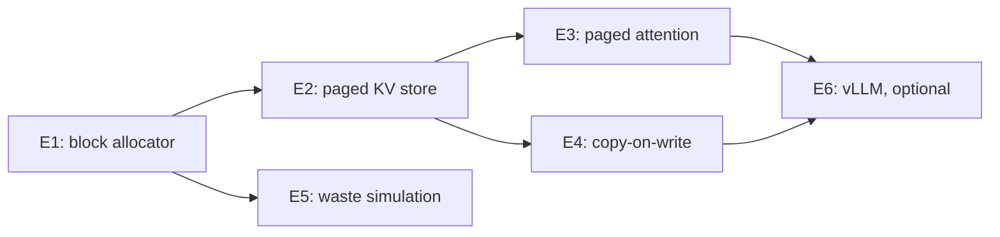

## 1. The question this page answers

Can you build the core of PagedAttention yourself, from an empty notebook? Can you show, with your own code, that block-wise attention gives the same numbers as normal attention? Can you measure why paging fits more requests than a reservation for the maximum length? And can you find the paged cache inside a real vLLM server?

> [!key] The rule for these exercises
> You write the code. This page gives the specification, the acceptance tests and two levels of hints. The reference solution of each exercise is hidden in a check block. Open it only after your own code passes the tests, or after a real attempt. If AI writes any part of your code, you must explain every line, or the exercise is not complete.

## 2. Mental model

> [!analogy] A flight simulator before the real cockpit
> Pilots train each instrument on the ground first, where every reading has one correct value. Then they fly a simulator, which shows how the whole aircraft behaves. Only then do they sit in the real cockpit. E1 to E4 are the instruments: an allocator, a paged store, a paged attention function and copy-on-write, each with exact tests. E5 is the simulator: it shows why paging fits more requests. E6 is the cockpit: a real vLLM server with real metrics.
>
> **Where it stops working:** a flight simulator models the physics of flight. E5 models only memory. It counts steps and requests, but it has no GPU, no kernel time and no cost for recomputation. So E5 can show why the batch grows, but not by how much the latency changes.

## 3. Terms

| Term | Plain meaning |
|---|---|
| physical block | One fixed-size piece of the KV cache memory, with room for `B` tokens. It has a number, the block id. |
| logical block | The $j$-th group of `B` tokens of one request, in the request's own order. |
| block table | The list that maps each logical block of a request to a physical block id. |
| free list | The list of physical block ids that nobody uses. Allocation takes one, freeing returns one. |
| reference count | The number of owners of a physical block. The block is free only when this number is 0. |
| slot | The place of one token inside the cache: physical block id × `B` + offset. |
| fork | Make a new sequence that shares all blocks of an existing sequence, by raising reference counts. |
| copy-on-write | Before a write to a shared block, copy the block and write into the copy. |
| reservation | Memory that a request holds but has not filled yet. |
| utilization | Slots that hold a token ÷ slots that are reserved. |
| internal fragmentation | Empty slots inside the last block of a request. |
| preemption | Stopping a running request to free its memory, then running it again later. |
| two-pass softmax | Compute all scores first, then the normalization, then the weighted sum. |
| online softmax | One pass over the blocks with a running maximum and a running sum. |
| acceptance test | A test that your code must pass before you call the exercise complete. |
| seed | A number that fixes a random generator, so that a run repeats exactly. |
| Prometheus metric | A named number that a server exposes at `/metrics` for monitoring. |
| gauge | A metric that can go up and down, for example the KV cache usage. |
| counter | A metric that only grows, for example the number of preemptions. Its exposed name ends with `_total`. |

All terms are also in the [Glossary](/notes/papers/glossary).

## 4. The plan



Work in the lab folder `C:\Users\ASohi\Downloads\AI\agent-harness-lab`, in the notebook folder `llm-systems/`. Suggested layout:

```text
llm-systems/pagedattention/
├── README.md                  the question, your results, the limits
├── e1_allocator.ipynb
├── e2_paged_store.ipynb
├── e3_paged_attention.ipynb
├── e4_copy_on_write.ipynb
├── e5_waste_simulation.ipynb
├── e6_vllm_metrics.ipynb      optional, needs a GPU
├── pagedkv/                   shared code: allocator.py, store.py, attention.py
└── tests/                     pytest tests for pagedkv
```

Keep the notebooks for exploration. Move code that two notebooks share into `pagedkv/`, with tests.


## 5. The exercises

### Exercises

1. **E1: a block allocator** with a free list and reference counts. Test: exact allocation, sharing and freeing.
2. **E2: block tables and a paged KV store** for many requests. Test: the gathered keys and values equal a dense history.
3. **E3: paged attention in NumPy** that equals dense attention. Test: the toy numbers of "down" and 500 random cases.
4. **E4: copy-on-write** for parallel sampling. Test: the block counts after a fork and after each write.
5. **E5: a waste simulation**: contiguous reservation vs paging for random request lengths. Test: Orca (Max) fits exactly 7 requests.
6. **E6 (optional, needs a GPU)**: serve a small model with vLLM and read its KV cache size, metrics and preemptions.

### E1: a block allocator

**Specification.** Write `BlockAllocator(num_blocks)` and an exception `OutOfBlocks`.

1. `allocate() -> int`: take a free block, set its reference count to 1, return its id. Raise `OutOfBlocks` when no block is free.
2. `incref(block)`: add one owner. Raise `ValueError` if the block is free.
3. `free(block)`: remove one owner. When the count reaches 0, return the block to the free list. Raise `ValueError` on a double free.
4. `num_free() -> int` and a list `ref_count`.
5. Every operation takes constant time. No search over all blocks.

**Acceptance tests.**

1. `BlockAllocator(4)` hands out 4 distinct ids. The fifth `allocate()` raises `OutOfBlocks`.
2. After `incref(2)` and one `free(2)`, block 2 is still in use with count 1. After a second `free(2)`, it is free.
3. A freed block is reused by the next `allocate()`.
4. `free` on a free block raises `ValueError`.
5. Run 10,000 random operations on 64 blocks. After each one, check three facts. A block is in the free list exactly when its count is 0. The free list has no duplicates. The sum of all counts equals the number of owners that your test holds.

> [!example] Hint level 1: the idea
> A Python list used as a stack is a free list: `pop()` and `append()` are constant time. The reference count decides when a block returns to the stack. Nothing else needs to know who the owners are.

> [!example] Hint level 2: pseudocode
> 1. `free_list = [n-1, ..., 1, 0]`, `ref_count = [0] * n`.
> 2. `allocate`: if `free_list` is empty, raise. Else `b = free_list.pop()`, `ref_count[b] = 1`, return `b`.
> 3. `free(b)`: if `ref_count[b] == 0`, raise. Else subtract 1. If it is now 0, `free_list.append(b)`.

```check
{
  "question": "Exercise 1: show a reference solution",
  "answer": "The allocator and its tests. The last test runs 10,000 random operations and checks the invariant after each one.\n\n```python\nclass OutOfBlocks(Exception):\n    \"\"\"Raised when no free physical block is left.\"\"\"\n\n\nclass BlockAllocator:\n    \"\"\"Physical block allocator with a free list and reference counts.\"\"\"\n\n    def __init__(self, num_blocks: int):\n        if num_blocks <= 0:\n            raise ValueError(\"num_blocks must be positive\")\n        self.num_blocks = num_blocks\n        # Pop from the end, so block 0 is handed out first.\n        self.free_list = list(range(num_blocks - 1, -1, -1))\n        self.ref_count = [0] * num_blocks\n\n    def num_free(self) -> int:\n        return len(self.free_list)\n\n    def allocate(self) -> int:\n        if not self.free_list:\n            raise OutOfBlocks(\"no free block\")\n        block = self.free_list.pop()\n        self.ref_count[block] = 1\n        return block\n\n    def incref(self, block: int) -> None:\n        if self.ref_count[block] == 0:\n            raise ValueError(f\"block {block} is free\")\n        self.ref_count[block] += 1\n\n    def free(self, block: int) -> None:\n        if self.ref_count[block] == 0:\n            raise ValueError(f\"double free of block {block}\")\n        self.ref_count[block] -= 1\n        if self.ref_count[block] == 0:\n            self.free_list.append(block)\n\n\ndef test_e1():\n    a = BlockAllocator(4)\n    got = [a.allocate() for _ in range(4)]\n    assert got == [0, 1, 2, 3] and a.num_free() == 0\n    try:\n        a.allocate()\n        raise AssertionError(\"expected OutOfBlocks\")\n    except OutOfBlocks:\n        pass\n    a.incref(2)                      # block 2 is now shared by two owners\n    a.free(2)\n    assert a.num_free() == 0 and a.ref_count[2] == 1\n    a.free(2)\n    assert a.num_free() == 1 and a.ref_count[2] == 0\n    assert a.allocate() == 2         # the freed block is reused first\n    for b in range(4):\n        a.free(b)\n    assert a.num_free() == 4\n    try:\n        a.free(0)\n        raise AssertionError(\"expected double-free error\")\n    except ValueError:\n        pass\n    # invariant after many random operations: free exactly when ref count is 0\n    import random\n    rng = random.Random(0)\n    big, owned = BlockAllocator(64), []\n    for _ in range(10_000):\n        op = rng.random()\n        if op < 0.4 and big.num_free() > 0:\n            owned.append(big.allocate())\n        elif op < 0.6 and owned:\n            b = rng.choice(owned)\n            big.incref(b)\n            owned.append(b)\n        elif owned:\n            big.free(owned.pop(rng.randrange(len(owned))))\n        assert len(set(big.free_list)) == big.num_free()\n        assert sorted(big.free_list) == [b for b in range(64) if big.ref_count[b] == 0]\n        assert sum(big.ref_count) == len(owned)\n    print(\"E1 passed\")\n\n\ntest_e1()\n```\n\nOutput: `E1 passed`.\n\nWhy a stack: `pop()` and `append()` at the end of a Python list take constant time. Why the invariant test: allocator bugs, such as a double free or a lost block, often appear only after many operations."
}
```

### E2: block tables and a paged KV store

**Specification.** Write `PagedKVStore(num_blocks, block_size, num_kv_heads, head_dim)` on top of E1. One layer is enough: a real engine repeats the same structure in every layer.

1. Two arrays `k_cache` and `v_cache` of shape `[num_blocks, block_size, num_kv_heads, head_dim]`.
2. `block_tables`: request id → list of physical block ids. `num_tokens`: request id → number of stored tokens.
3. `append(rid, k, v)`: store the key and value of one new token, shape `[num_kv_heads, head_dim]` each. Allocate a new block only when the last block is full.
4. `gather(rid)`: return the request's keys and values as contiguous arrays `[n, num_kv_heads, head_dim]`.
5. `slot(rid, pos)`: the flat slot index of token `pos`, which is `table[pos // B] * B + pos % B`.
6. `free_request(rid)`: free every block of the request.

**Acceptance tests.**

1. Five requests with random lengths from 1 to 39 and block size 4. Their appends are shuffled together, as in decode steps. `gather` equals each request's dense history exactly.
2. Each request holds exactly $\lceil n / B \rceil$ blocks, and at most $B - 1$ empty slots.
3. For every token, `k_cache.reshape(-1, H, d)[slot(rid, pos)]` equals the token's key.
4. When the cache is full, `append` raises `OutOfBlocks` and changes nothing.
5. After `free_request` for every request, all blocks are free.

> [!example] Hint level 1: the idea
> The position of a token gives everything: the logical block is `pos // B` and the offset is `pos % B`. A new block is needed exactly when `n % B == 0` before the append. Allocate before you write, so a failed allocation leaves no half-written token.

> [!example] Hint level 2: pseudocode
> 1. `append`: `n = num_tokens[rid]`. If `n % B == 0`: `table.append(alloc.allocate())`. Then `block = table[n // B]`, `k_cache[block, n % B] = k`, the same for `v`, and `num_tokens[rid] = n + 1`.
> 2. `gather`: `k_cache[table]` has shape `[len(table), B, H, d]`. Reshape it to `[-1, H, d]` and keep the first `n` rows.

This is the structure of [page 05](/notes/papers/llm-serving/2023-pagedattention/05-the-kv-cache-manager). The `slot` function is the index that the paper's fused "reshape and block write" kernel computes ([page 08](/notes/papers/llm-serving/2023-pagedattention/08-implementation)).

```check
{
  "question": "Exercise 2: show a reference solution",
  "answer": "This solution reuses `BlockAllocator` and `OutOfBlocks` from E1. Run the E1 code first, without its last line `test_e1()`, or import it from `pagedkv/allocator.py`.\n\n```python\nimport numpy as np\n\n\nclass PagedKVStore:\n    \"\"\"A paged KV cache for many requests. One layer, for clarity.\"\"\"\n\n    def __init__(self, num_blocks, block_size, num_kv_heads, head_dim):\n        self.B = block_size\n        self.alloc = BlockAllocator(num_blocks)\n        shape = (num_blocks, block_size, num_kv_heads, head_dim)\n        self.k_cache = np.zeros(shape)\n        self.v_cache = np.zeros(shape)\n        self.block_tables = {}   # request id -> list of physical block ids\n        self.num_tokens = {}     # request id -> number of stored tokens\n\n    def add_request(self, rid):\n        self.block_tables[rid] = []\n        self.num_tokens[rid] = 0\n\n    def slot(self, rid, pos):\n        \"\"\"Flat slot index of token `pos`: block * B + offset.\"\"\"\n        table = self.block_tables[rid]\n        return table[pos // self.B] * self.B + pos % self.B\n\n    def append(self, rid, k, v):\n        \"\"\"Store the key and value of one new token. k, v: [H_kv, d].\"\"\"\n        n = self.num_tokens[rid]\n        table = self.block_tables[rid]\n        if n % self.B == 0:                 # no block yet, or last block full\n            table.append(self.alloc.allocate())   # may raise OutOfBlocks\n        block, offset = table[n // self.B], n % self.B\n        self.k_cache[block, offset] = k\n        self.v_cache[block, offset] = v\n        self.num_tokens[rid] = n + 1\n\n    def gather(self, rid):\n        \"\"\"Return contiguous K and V of one request: [n, H_kv, d] each.\"\"\"\n        n, table = self.num_tokens[rid], self.block_tables[rid]\n        tail = self.k_cache.shape[2:]\n        k = self.k_cache[table].reshape(-1, *tail)[:n]\n        v = self.v_cache[table].reshape(-1, *tail)[:n]\n        return k, v\n\n    def free_request(self, rid):\n        for block in self.block_tables.pop(rid):\n            self.alloc.free(block)\n        del self.num_tokens[rid]\n\n\ndef test_e2(seed=0):\n    rng = np.random.default_rng(seed)\n    H, d, B, N = 2, 3, 4, 64\n    store = PagedKVStore(N, B, H, d)\n    dense = {}\n    lengths = {rid: int(rng.integers(1, 40)) for rid in range(5)}\n    for rid in lengths:\n        store.add_request(rid)\n        dense[rid] = ([], [])\n    # interleave the appends of all requests, as decode steps do\n    todo = [rid for rid, n in lengths.items() for _ in range(n)]\n    rng.shuffle(todo)\n    for rid in todo:\n        k, v = rng.normal(size=(H, d)), rng.normal(size=(H, d))\n        store.append(rid, k, v)\n        dense[rid][0].append(k)\n        dense[rid][1].append(v)\n    used = 0\n    for rid, n in lengths.items():\n        k, v = store.gather(rid)\n        assert np.array_equal(k, np.stack(dense[rid][0]))\n        assert np.array_equal(v, np.stack(dense[rid][1]))\n        blocks = len(store.block_tables[rid])\n        assert blocks == -(-n // B)                 # ceil(n / B)\n        assert blocks * B - n <= B - 1              # waste below one block\n        used += blocks\n        flat_k = store.k_cache.reshape(-1, H, d)\n        for pos in range(n):\n            assert np.array_equal(flat_k[store.slot(rid, pos)], dense[rid][0][pos])\n    assert used + store.alloc.num_free() == N\n    # fill the cache, then check that a failed append changes nothing\n    store.add_request(\"big\")\n    try:\n        while True:\n            store.append(\"big\", np.ones((H, d)), np.ones((H, d)))\n    except OutOfBlocks:\n        pass\n    n_big = store.num_tokens[\"big\"]\n    assert n_big % B == 0 and store.alloc.num_free() == 0\n    for rid in list(store.block_tables):\n        store.free_request(rid)\n    assert store.alloc.num_free() == N\n    print(\"E2 passed:\", lengths, \"tokens of request big:\", n_big)\n\n\ntest_e2()\n```\n\nOutput: `E2 passed: {0: 34, 1: 25, 2: 20, 3: 11, 4: 13} tokens of request big: 144`.\n\nThe five requests hold $9 + 7 + 5 + 3 + 4 = 28$ blocks. The remaining $64 - 28 = 36$ blocks take $36 \\times 4 = 144$ tokens of the request `big` before `OutOfBlocks`. `self.k_cache[table]` uses NumPy fancy indexing: it gathers the blocks in block-table order into a new contiguous array."
}
```

### E3: paged attention in NumPy

**Specification.** For one query vector $q$ (one head, one decode step), compute attention over keys and values that lie in non-contiguous blocks. Write two versions.

1. `paged_attention_two_pass(q, k_cache, v_cache, block_table, n)`. Pass 1: compute the scores $q \cdot k_j / \sqrt{d}$ block by block and one global softmax denominator. Pass 2: add the weighted values block by block. This follows Equation 4 of the paper ([page 04](/notes/papers/llm-serving/2023-pagedattention/04-pagedattention-the-algorithm)).
2. `paged_attention_online(...)`: one pass with a running maximum $m$ and a running sum $\ell$. When a block raises the maximum, multiply the old sum and the old accumulator by $e^{m_{old} - m_{new}}$ ([FlashAttention](/notes/ai/llm-systems/02-attention-and-the-transformer/l7-attention-cost-and-flashattention)).
3. Here `k_cache` has shape `[num_blocks, B, d]`. The last block of a request can be partial: read only its filled slots.

**Acceptance tests.**

1. The toy example of "the", "cat", "sat", "down": keys `[[1,0],[0,2],[0,1],[1,1]]`, values `[[2,3],[2,2],[1,2],[1,3]]`, query $q_4 = [1, 2]$. Block size 2, block table `[7, 2]`: "the" and "cat" in physical block 7, "sat" and "down" in physical block 2.
2. Fill every other part of the cache with `NaN`. A function that reads a wrong slot then returns `NaN`.
3. The weights are $[0.0646, 0.5388, 0.1310, 0.2657]$ and the output is $[1.6034, 2.3302]$ when rounded to 4 decimals. Both versions agree with dense attention within $10^{-12}$.
4. 500 random cases: lengths from 1 to 99, block sizes from 1 to 16, $d = 8$, physical blocks in random order. Both versions equal dense attention within $10^{-12}$.

> [!example] Worked example: the toy case by hand, block by block
> 1. Block 7 ("the", "cat"): raw scores $q \cdot k = [1, 4]$, scaled by $1/\sqrt{2}$: $[0.7071, 2.8284]$.
> 2. Block 2 ("sat", "down"): raw scores $[2, 3]$, scaled: $[1.4142, 2.1213]$.
> 3. Global maximum: 2.8284. The exponentials after subtracting it: $[0.1199, 1, 0.2431, 0.4931]$. Their sum: 1.8561.
> 4. Weights: $[0.0646, 0.5388, 0.1310, 0.2657]$.
> 5. Output: $0.0646 \cdot [2,3] + 0.5388 \cdot [2,2] + 0.1310 \cdot [1,2] + 0.2657 \cdot [1,3] = [1.6034, 2.3302]$.
>
> The blocks are visited in block-table order, not in physical order. Physical block 2 holds the later tokens.

> [!example] Hint level 1: the idea
> Softmax needs one denominator over all positions. In the two-pass version, keep the scores of each block in a list. Take the maximum over all of them, and only then compute the weights. The block table gives the order of the blocks.

> [!example] Hint level 2: pseudocode
> 1. For `j, block in enumerate(table)`: `filled = min(B, n - j*B)`, `s_j = k_cache[block, :filled] @ q / sqrt(d)`.
> 2. `m = max over all s_j`, `denom = sum over j of exp(s_j - m).sum()`.
> 3. For each block again: `out += (exp(s_j - m) / denom) @ v_cache[block, :filled]`.

```check
{
  "question": "Exercise 3: show a reference solution",
  "answer": "Both versions, with the toy test and 500 random tests. The cache is filled with `NaN`, so a read of a wrong slot makes the test fail.\n\n```python\nimport numpy as np\n\n\ndef dense_attention(q, K, V):\n    \"\"\"Reference: one query row against all keys. q: [d], K: [n, d], V: [n, dv].\"\"\"\n    s = K @ q / np.sqrt(q.shape[0])\n    w = np.exp(s - s.max())\n    w = w / w.sum()\n    return w @ V, w\n\n\ndef paged_attention_two_pass(q, k_cache, v_cache, block_table, n):\n    \"\"\"Block-wise attention in the style of Equation 4 of the paper.\n    k_cache, v_cache: [num_blocks, B, d]. Pass 1: all scores and one global\n    denominator. Pass 2: weighted sum of V, block by block.\"\"\"\n    B, d = k_cache.shape[1], q.shape[0]\n    scores = []\n    for j, block in enumerate(block_table):\n        filled = min(B, n - j * B)                  # the last block can be partial\n        scores.append(k_cache[block, :filled] @ q / np.sqrt(d))\n    m = max(s.max() for s in scores)                # subtract the max for safety\n    denom = sum(np.exp(s - m).sum() for s in scores)\n    out = np.zeros(v_cache.shape[2])\n    for j, block in enumerate(block_table):\n        filled = min(B, n - j * B)\n        a_j = np.exp(scores[j] - m) / denom         # the row vector A_ij of block j\n        out += a_j @ v_cache[block, :filled]\n    return out\n\n\ndef paged_attention_online(q, k_cache, v_cache, block_table, n):\n    \"\"\"One pass with a running max m and a running sum l (online softmax).\"\"\"\n    B, d = k_cache.shape[1], q.shape[0]\n    m, l = -np.inf, 0.0\n    acc = np.zeros(v_cache.shape[2])\n    for j, block in enumerate(block_table):\n        filled = min(B, n - j * B)\n        s = k_cache[block, :filled] @ q / np.sqrt(d)\n        m_new = max(m, s.max())\n        scale = np.exp(m - m_new)                   # rescale the old partial sums\n        p = np.exp(s - m_new)\n        l = l * scale + p.sum()\n        acc = acc * scale + p @ v_cache[block, :filled]\n        m = m_new\n    return acc / l\n\n\ndef test_e3():\n    # toy example: keys and values of \"the\", \"cat\", \"sat\", \"down\"\n    K = np.array([[1, 0], [0, 2], [0, 1], [1, 1]], dtype=float)\n    V = np.array([[2, 3], [2, 2], [1, 2], [1, 3]], dtype=float)\n    q = np.array([1.0, 2.0])\n    ref, w = dense_attention(q, K, V)\n    assert np.allclose(np.round(w, 4), [0.0646, 0.5388, 0.1310, 0.2657])\n    assert np.allclose(np.round(ref, 4), [1.6034, 2.3302])\n    # block size 2, two physical blocks that are not next to each other\n    k_cache = np.full((8, 2, 2), np.nan)             # NaN marks memory we never read\n    v_cache = np.full((8, 2, 2), np.nan)\n    table = [7, 2]\n    k_cache[7], v_cache[7] = K[0:2], V[0:2]          # \"the\", \"cat\"\n    k_cache[2], v_cache[2] = K[2:4], V[2:4]          # \"sat\", \"down\"\n    for fn in (paged_attention_two_pass, paged_attention_online):\n        out = fn(q, k_cache, v_cache, table, 4)\n        assert np.allclose(out, ref, atol=1e-12), (fn.__name__, out)\n    # random tests: partial last block, many block sizes\n    rng = np.random.default_rng(1)\n    for _ in range(500):\n        n, B, d = int(rng.integers(1, 100)), int(rng.integers(1, 17)), 8\n        Kr, Vr, qr = rng.normal(size=(n, d)), rng.normal(size=(n, d)), rng.normal(size=d) * 3\n        nb = -(-n // B)\n        num_blocks = nb + 5\n        table = list(rng.permutation(num_blocks)[:nb])\n        kc = np.full((num_blocks, B, d), np.nan)\n        vc = np.full((num_blocks, B, d), np.nan)\n        for j, blk in enumerate(table):\n            rows = slice(j * B, min(n, (j + 1) * B))\n            kc[blk, : rows.stop - rows.start] = Kr[rows]\n            vc[blk, : rows.stop - rows.start] = Vr[rows]\n        ref, _ = dense_attention(qr, Kr, Vr)\n        for fn in (paged_attention_two_pass, paged_attention_online):\n            assert np.allclose(fn(qr, kc, vc, table, n), ref, atol=1e-12)\n    print(\"E3 passed:\", np.round(paged_attention_online(q, k_cache, v_cache, [7, 2], 4), 4))\n\n\ntest_e3()\n```\n\nOutput: `E3 passed: [1.6034 2.3302]`.\n\nIn the online version, `scale = exp(m - m_new)` is 1 when the maximum does not change. For the first block, `m = -inf`, so `scale = 0` and the empty initial sums vanish."
}
```

### E4: copy-on-write for parallel sampling

**Specification.** Extend E2 with `CowKVStore`.

1. `fork(parent, child)`: the child receives a copy of the parent's block table and the same token count. Raise the reference count of every block. Copy no data.
2. `append(rid, k, v)`: check where the token goes. If it goes into the last block and that block has a reference count above 1, copy the block first:
    1. Allocate a new block and copy the old block's contents into it.
    2. Drop one reference to the old block.
    3. Put the new block into this request's table.

    Then write as usual.
3. Count the copies.

**Acceptance tests.** Use a prompt of 7 tokens, block size 4 and three samples A, B and C, forked from the prompt. Then free the prompt sequence.

1. After the fork: 2 physical blocks in use, both with reference count 3.
2. After one decode step in the order A, B, C: exactly 2 copies (A and B), 4 blocks in use. C still holds the original second block, now with count 1, and writes into it in place.
3. After a second decode step: 7 blocks in use. Without sharing, three samples of 9 tokens need $3 \times 3 = 9$ blocks. The memory saving is $(9 - 7)/9 \approx 22.2\%$, with the definition of §6.3.
4. `gather` of each sample equals its own history. All three tables start with the same physical prompt block.
5. After freeing all samples, all blocks are free and the prompt block has count 0.

> [!example] Hint level 1: the idea
> Only the last block of a sequence can receive new tokens. Full blocks never change, so they can stay shared forever. So copy-on-write needs one check, on the last block, and only when it is partial.

> [!example] Hint level 2: pseudocode
> 1. `n = num_tokens[rid]`. If `n % B != 0` and `ref_count[table[-1]] > 1`:
> 2. `new = allocate()`, `k_cache[new] = k_cache[old]`, `v_cache[new] = v_cache[old]`, `free(old)`, `table[-1] = new`.
> 3. Then call the normal `append`.

[Page 06](/notes/papers/llm-serving/2023-pagedattention/06-decoding-scenarios-and-sharing) traces the same mechanism for Figure 8 of the paper.

```check
{
  "question": "Exercise 4: show a reference solution",
  "answer": "This solution reuses `BlockAllocator`, `OutOfBlocks` (E1) and `PagedKVStore` (E2).\n\n```python\nimport numpy as np\n\n\nclass CowKVStore(PagedKVStore):\n    \"\"\"PagedKVStore with fork() and copy-on-write at block granularity.\"\"\"\n\n    def __init__(self, *args, **kwargs):\n        super().__init__(*args, **kwargs)\n        self.copies = 0                      # number of copy-on-write events\n\n    def fork(self, parent, child):\n        \"\"\"The child shares every block of the parent. No data is copied.\"\"\"\n        self.block_tables[child] = list(self.block_tables[parent])\n        self.num_tokens[child] = self.num_tokens[parent]\n        for block in self.block_tables[child]:\n            self.alloc.incref(block)\n\n    def append(self, rid, k, v):\n        n, table = self.num_tokens[rid], self.block_tables[rid]\n        if n % self.B != 0:                  # the token goes into the last block\n            last = table[-1]\n            if self.alloc.ref_count[last] > 1:      # shared: copy it first\n                new = self.alloc.allocate()\n                self.k_cache[new] = self.k_cache[last]\n                self.v_cache[new] = self.v_cache[last]\n                self.alloc.free(last)               # drop one reference\n                table[-1] = new\n                self.copies += 1\n        super().append(rid, k, v)\n\n\ndef test_e4(seed=0):\n    rng = np.random.default_rng(seed)\n    H, d, B, N = 1, 2, 4, 16\n    store = CowKVStore(N, B, H, d)\n    store.add_request(\"prompt\")\n    prompt = [rng.normal(size=(H, d)) for _ in range(7)]\n    for k in prompt:\n        store.append(\"prompt\", k, -k)\n    samples = [\"A\", \"B\", \"C\"]\n    for s in samples:\n        store.fork(\"prompt\", s)\n    store.free_request(\"prompt\")             # the prompt sequence is no longer needed\n    first, second = store.block_tables[\"A\"]\n    assert store.alloc.ref_count[first] == 3 and store.alloc.ref_count[second] == 3\n    assert N - store.alloc.num_free() == 2   # 7 prompt tokens in 2 physical blocks\n    history = {s: list(prompt) for s in samples}\n    for step in range(2):                    # two decode steps, samples in order\n        for s in samples:\n            k = rng.normal(size=(H, d))\n            store.append(s, k, -k)\n            history[s].append(k)\n        if step == 0:\n            # A and B copied the shared partial block. C wrote in place.\n            assert store.copies == 2\n            assert N - store.alloc.num_free() == 4\n            assert store.block_tables[\"C\"][1] == second\n    assert N - store.alloc.num_free() == 7   # 3 more blocks for token 9\n    for s in samples:\n        k, v = store.gather(s)\n        assert np.array_equal(k, np.stack(history[s]))\n        assert np.array_equal(v, -np.stack(history[s]))\n        assert store.block_tables[s][0] == first      # the full prompt block stays shared\n    without_sharing = 3 * -(-9 // B)                  # 3 samples x 3 blocks\n    with_sharing = N - store.alloc.num_free()\n    saving = (without_sharing - with_sharing) / without_sharing\n    assert (without_sharing, with_sharing) == (9, 7)\n    for s in samples:\n        store.free_request(s)\n    assert store.alloc.num_free() == N and store.alloc.ref_count[first] == 0\n    print(f\"E4 passed: copies={store.copies}, saving={saving:.1%}\")\n\n\ntest_e4()\n```\n\nOutput: `E4 passed: copies=2, saving=22.2%`.\n\nThe check `n % self.B != 0` limits copy-on-write to a partial last block. When `n % B == 0`, the parent's `append` allocates a fresh block anyway, so no copy is needed. Sample C writes in place, because A and B already dropped their references to the shared block."
}
```

### E5: contiguous reservation vs paging

**Specification.** Measure the waste of four allocation policies on synthetic requests.

1. Generate 2,000 requests with seed 0. Prompt lengths: a lognormal distribution with median 100, clipped to 1 to 1,024 tokens. Output lengths: a lognormal distribution with median 220, clipped to 1 to 1,024. The means are near 155 and 305 tokens, in the range of ShareGPT. These are not the real ShareGPT lengths.
2. Reservation per request at its final length $L$: **max** 2,048 slots, **pow2** the next power of two $\geq L$, **oracle** exactly $L$, **paged** $\lceil L/B \rceil \times B$ with $B = 16$.
3. Utilization: $\sum L / \sum \text{reservation}$.
4. FCFS fit: how many requests, in arrival order, fit at the same time in 15,729 slots (OPT-13B on one A100, [page 09](/notes/papers/llm-serving/2023-pagedattention/09-results)).
5. A block-size sweep for paging: $B$ = 2, 4, ..., 256. Record the mean waste per request.
6. A step simulation of the first 400 requests, all waiting at time 0. One step adds one output token to every running request. Max reserves 2,048 slots at admission. Paged allocates blocks when needed and preempts the newest request when no block is free. Record the mean number of running requests and the number of preemptions.

**Acceptance tests.**

1. Max fits exactly 7 requests, because $\lfloor 15{,}729 / 2{,}048 \rfloor = 7$.
2. Max utilization equals the mean length ÷ 2,048.
3. Paged waste is at most $B - 1$ slots per request. The mean waste is within 5% of $(B - 1)/2$ for every $B$ in the sweep.
4. Every pow2 reservation is less than 2 times the length.
5. In the step simulation, the paged mean batch is at least 3 times the max mean batch.
6. Write your numbers into your README next to the numbers that these notes measured with seed 0 and NumPy 2.5. Utilization: 22.5% (max), 67.6% (pow2), 98.4% (paged). Fit: 7, 27, 36, 36. Mean batch: 6.95 (max) against 30.99 (paged), with 625 preemptions.

> [!trap] What the simulation omits
> The ratio $30.99 / 6.95 \approx 4.5$ looks close to the $30.42 / 7.00 \approx 4.3$ of Figure 13. Do not claim that you reproduced Figure 13. The lengths are synthetic, and the simulation has no time per step. In a real engine, each of the 625 preemptions would also cost a new prefill. The agreement is partly luck.

> [!example] Hint level 1: the idea
> Policies differ only in one function: the reservation for a request of length $L$. Write that function once, with a `policy` argument, and use NumPy arrays for all 2,000 requests at once. The step simulation needs a queue, a list of running requests, and a count of free blocks.

> [!example] Hint level 2: pseudocode
> 1. `reserved = {"max": 2048, "pow2": 2**ceil(log2(L)), "oracle": L, "paged": ceil(L/B)*B}`.
> 2. Fit: `searchsorted(cumsum(reserved), 15729, side="right")`.
> 3. Step loop: admit from the queue while blocks are free. Grow each running request by one block when it needs one. If no block is free, move the newest running request back to the front of the queue and free its blocks. Then add one token to each running request and remove the finished ones.

```check
{
  "question": "Exercise 5: show a reference solution",
  "answer": "Reservations, utilization, FCFS fit, the block-size sweep and the step simulation.\n\n```python\nimport numpy as np\n\nSLOTS = 15_729        # KV slots of OPT-13B on one A100 40 GB: 12 GiB / 800 KiB\nMAX_LEN = 2048        # maximum sequence length of OPT\n\n\ndef synthetic_lengths(n, seed=0):\n    \"\"\"Synthetic prompt and output lengths. Means near 161 and 338 tokens.\n    These are NOT the real ShareGPT lengths.\"\"\"\n    rng = np.random.default_rng(seed)\n    prompt = np.clip(rng.lognormal(np.log(100), 1.0, n).astype(int), 1, 1024)\n    output = np.clip(rng.lognormal(np.log(220), 0.9, n).astype(int), 1, 1024)\n    return prompt, output\n\n\ndef reserved_slots(total, policy, block_size=16):\n    \"\"\"Slots that one request holds when it reaches its final length `total`.\"\"\"\n    if policy == \"max\":\n        return np.full_like(total, MAX_LEN)\n    if policy == \"pow2\":\n        return 2 ** np.ceil(np.log2(total)).astype(int)\n    if policy == \"oracle\":\n        return total.copy()\n    if policy == \"paged\":\n        return -(-total // block_size) * block_size     # ceil to whole blocks\n    raise ValueError(policy)\n\n\ndef fcfs_fit(reserved, slots=SLOTS):\n    \"\"\"How many requests, in arrival order, fit at the same time.\"\"\"\n    return int(np.searchsorted(np.cumsum(reserved), slots, side=\"right\"))\n\n\ndef simulate(prompt, output, policy, block_size=16, slots=SLOTS):\n    \"\"\"Step-by-step simulation. All requests wait at time 0. One step = one\n    decode iteration: every running request gains one token. Returns the mean\n    number of running requests per step and the number of steps.\"\"\"\n    queue = list(range(len(prompt)))\n    done_tokens = np.zeros(len(prompt), dtype=int)    # output tokens so far\n    running, held, batch_sizes, preemptions = [], {}, [], 0\n    free = slots if policy == \"max\" else slots // block_size\n\n    def need(i):                       # memory unit count for the next token\n        if policy == \"max\":\n            return MAX_LEN\n        return -(-(prompt[i] + done_tokens[i] + 1) // block_size)\n\n    while queue or running:\n        while queue and need(queue[0]) - held.get(queue[0], 0) <= free:\n            i = queue.pop(0)\n            free -= need(i)\n            held[i] = need(i)\n            running.append(i)\n        if policy == \"paged\":\n            idx = 0\n            while idx < len(running):          # grow by one block if needed\n                i = running[idx]\n                extra = need(i) - held[i]\n                while extra > free and running[-1] != i:\n                    victim = running.pop()     # preempt the newest request\n                    free += held.pop(victim)\n                    queue.insert(0, victim)    # recompute later; tokens are kept\n                    preemptions += 1\n                if extra > free:               # i is the newest: preempt i itself\n                    if len(running) == 1:\n                        raise RuntimeError(\"one request is larger than the cache\")\n                    running.pop()\n                    free += held.pop(i)\n                    queue.insert(0, i)\n                    preemptions += 1\n                    continue\n                free -= extra\n                held[i] += extra\n                idx += 1\n        batch_sizes.append(len(running))\n        for i in list(running):\n            done_tokens[i] += 1\n            if done_tokens[i] == output[i]:\n                running.remove(i)\n                free += held.pop(i)\n    return float(np.mean(batch_sizes)), len(batch_sizes), preemptions\n\n\ndef test_e5():\n    prompt, output = synthetic_lengths(2000)\n    total = prompt + output\n    print(f\"mean prompt {prompt.mean():.1f}, mean output {output.mean():.1f}\")\n    for policy in [\"max\", \"pow2\", \"oracle\", \"paged\"]:\n        r = reserved_slots(total, policy)\n        util = total.sum() / r.sum()\n        print(f\"{policy:6s} utilization {util:6.1%}  fit {fcfs_fit(r):4d}\")\n    r_max, r_paged = reserved_slots(total, \"max\"), reserved_slots(total, \"paged\")\n    assert fcfs_fit(r_max) == 7                          # 15,729 // 2048\n    assert np.isclose(total.sum() / r_max.sum(), total.mean() / MAX_LEN)\n    assert np.all(r_paged - total <= 15)                 # waste below one block\n    assert np.all(reserved_slots(total, \"pow2\") < 2 * total)\n    for B in [2, 4, 8, 16, 32, 64, 128, 256]:            # mean waste is about (B - 1) / 2\n        waste = (reserved_slots(total, \"paged\", B) - total).mean()\n        assert abs(waste - (B - 1) / 2) <= 0.05 * (B - 1) / 2, (B, waste)\n    batch = {}\n    for policy in [\"max\", \"paged\"]:\n        mean_batch, steps, pre = simulate(prompt[:400], output[:400], policy)\n        batch[policy] = mean_batch\n        print(f\"{policy:6s} mean batch {mean_batch:6.2f}  steps {steps:6d}  preemptions {pre}\")\n    assert batch[\"paged\"] >= 3 * batch[\"max\"]\n    print(\"E5 passed\")\n\n\ntest_e5()\n```\n\nOutput with seed 0 and NumPy 2.5:\n\n```text\nmean prompt 155.2, mean output 305.4\nmax    utilization  22.5%  fit    7\npow2   utilization  67.6%  fit   27\noracle utilization 100.0%  fit   36\npaged  utilization  98.4%  fit   36\nmax    mean batch   6.95  steps  17675  preemptions 0\npaged  mean batch  30.99  steps   3964  preemptions 625\nE5 passed\n```\n\nThe paged simulation admits requests as soon as their prompt fits, then preempts when they grow. That is why it preempts often. A real engine pays a prefill for each preemption, which this simulation does not count."
}
```

### E6 (optional): read the paged cache of a real vLLM server

You need a machine with an NVIDIA GPU and vLLM installed. The model is `facebook/opt-125m`, a small model of the OPT family of the paper: 12 layers, width 768, FP16. The flags below exist in vLLM 0.31.0 (checked in its source on 2026-10-15). Flags change between versions, so check `vllm serve --help` on your version.

1. **Compute first.** KV bytes per token: $2 \times 12 \times 768 \times 2 = 36{,}864$ bytes $= 36$ KiB. One block of 16 tokens: 589,824 bytes.
2. **Serve.**

```bash
vllm serve facebook/opt-125m --max-model-len 2048 --gpu-memory-utilization 0.5
```

3. **Read the startup log.** vLLM prints "Available KV cache memory: ... GiB" and "GPU KV cache size: ... tokens, Maximum concurrency for 2,048 tokens per request: ...x". Compute the expected token count from the GiB value and compare.
4. **Load it and watch the metrics.** In a second terminal, run the benchmark. In a third, poll `http://127.0.0.1:8000/metrics` once per second and record `vllm:kv_cache_usage_perc`, `vllm:num_requests_running`, `vllm:num_requests_waiting` and the counter `vllm:num_preemptions`.

```bash
vllm bench serve --model facebook/opt-125m --dataset-name random \
  --random-input-len 256 --random-output-len 512 --ignore-eos \
  --num-prompts 200 --request-rate 8
```

5. **Force preemption.** Restart the server with `--num-gpu-blocks-override 64`. The vLLM source describes this option as "Used for testing preemption". 64 blocks hold 1,024 tokens. One request of $256 + 512 = 768$ tokens needs 48 blocks at its end. Up to 3 requests can start with their prompts (17 blocks each), but they cannot all grow to 48 blocks. Run the benchmark again.
6. **Prefix caching.** Send the same prompt of about 1,000 tokens twice to `/v1/completions`. Read the counters `vllm:prefix_cache_queries` and `vllm:prefix_cache_hits`, which count tokens. Restart with `--no-enable-prefix-caching` and repeat.

**Acceptance tests.**

1. The logged token count is within 1% of $\lfloor \text{GiB} \times 2^{30} / 589{,}824 \rfloor \times 16$. The GiB value in the log is rounded, so an exact match is not expected.
2. The logged maximum concurrency is about the token count ÷ 2,048.
3. In step 4, `vllm:kv_cache_usage_perc` stays between 0 and 1, and `vllm:num_requests_running` rises with the load.
4. In step 5, the preemption counter is above 0 and the benchmark reports a lower output throughput than in step 4.
5. In step 6, the second request adds about 992 hit tokens: $\lfloor 1{,}000 / 16 \rfloor \times 16$. With prefix caching disabled, the hits stay at 0.

> [!example] Hint level 1: the idea
> The `/metrics` page is plain text, one metric per line: a name, optional labels in braces, and a value. Counters appear with the suffix `_total`. Sum the values of one name over all label sets.

> [!example] Hint level 2: pseudocode
> 1. `text = urllib.request.urlopen(url).read().decode()`.
> 2. For each line that does not start with `#`: match `name{labels} value`. Remove a trailing `_total` from the name. Add the value to `out[name]`.
> 3. Repeat every second while the benchmark runs. Print the time and the values.

```check
{
  "question": "Exercise 6: show a reference solution",
  "answer": "Start the server and the benchmark with the commands of the exercise. This script computes the expected cache size, parses `/metrics` and polls it. The test at the end runs without a GPU: it builds a sample metrics text with `prometheus_client`, the library that vLLM uses.\n\n```python\nimport re\nimport time\nimport urllib.request\n\nBYTES_PER_TOKEN = 2 * 12 * 768 * 2   # OPT-125M: 12 layers, width 768, FP16 -> 36,864\nBLOCK = 16\n\n\ndef expected_cache_tokens(available_gib, bytes_per_token=BYTES_PER_TOKEN, block=BLOCK):\n    \"\"\"Tokens that fit in the KV memory that vLLM logs, in whole blocks.\"\"\"\n    blocks = int(available_gib * 2**30 // (bytes_per_token * block))\n    return blocks * block\n\n\ndef parse_prometheus(text, names):\n    \"\"\"Sum each metric over its label sets. Counters may carry a _total suffix.\"\"\"\n    out = {}\n    for line in text.splitlines():\n        if line.startswith(\"#\") or not line.strip():\n            continue\n        m = re.match(r\"^([a-zA-Z_:][a-zA-Z0-9_:]*)(\\{[^}]*\\})?\\s+(\\S+)\", line)\n        if not m:\n            continue\n        name, value = m.group(1), float(m.group(3))\n        base = name[:-6] if name.endswith(\"_total\") else name\n        if base in names:\n            out[base] = out.get(base, 0.0) + value\n    return out\n\n\nWATCH = [\"vllm:kv_cache_usage_perc\", \"vllm:num_requests_running\", \"vllm:num_requests_waiting\",\n         \"vllm:num_preemptions\", \"vllm:prefix_cache_queries\", \"vllm:prefix_cache_hits\"]\n\n\ndef poll(url=\"http://127.0.0.1:8000/metrics\", seconds=60, every=1.0):\n    \"\"\"Print the watched metrics once per second while a benchmark runs.\"\"\"\n    for _ in range(int(seconds / every)):\n        text = urllib.request.urlopen(url, timeout=5).read().decode()\n        print(time.strftime(\"%H:%M:%S\"), parse_prometheus(text, WATCH))\n        time.sleep(every)\n\n\ndef test_e6_offline():\n    from prometheus_client import CollectorRegistry, Counter, Gauge, generate_latest\n    reg = CollectorRegistry()\n    Gauge(\"vllm:kv_cache_usage_perc\", \"KV-cache usage\", [\"engine\"], registry=reg).labels(\"0\").set(0.97)\n    c = Counter(\"vllm:num_preemptions\", \"preemptions\", [\"engine\"], registry=reg)\n    c.labels(\"0\").inc(12)\n    sample = generate_latest(reg).decode()\n    assert \"vllm:num_preemptions_total\" in sample      # counters get the _total suffix\n    got = parse_prometheus(sample, WATCH)\n    assert got == {\"vllm:kv_cache_usage_perc\": 0.97, \"vllm:num_preemptions\": 12.0}, got\n    assert BYTES_PER_TOKEN == 36_864\n    assert expected_cache_tokens(1.0) == 29_120         # 1 GiB -> 1,820 blocks of 16\n    print(\"E6 offline checks passed\")\n\n\ntest_e6_offline()\n```\n\nOutput of the offline test: `E6 offline checks passed`.\n\nDuring the benchmark, call `poll(seconds=120)` in a notebook cell. For the expected size, pass the GiB value of the startup log to `expected_cache_tokens`. For example, 1 GiB gives 1,820 blocks of 16, which is 29,120 tokens."
}
```

## 6. Questions to answer in your README

1. In E3, why does the order of the block table matter for the output? Why does the order of the physical blocks in memory not matter?
2. In E4, how many copies happen for $n$ samples of a prompt whose length is a multiple of the block size? Explain.
3. In E5, how does the paged utilization change from block size 16 to 256, and how does this connect to the Alpaca result of §7.2?
4. In E5, what would happen to the max policy for a model with a 131,072-token window?
5. In E6, how close was the logged KV cache size to your formula, and what explains the difference?

## 7. This works. Would you deploy it?

Your store is correct and simple. A production engine needs more. Check each item:

- [ ] Does the store run on the GPU, with one fused kernel for the write ([page 08](/notes/papers/llm-serving/2023-pagedattention/08-implementation))?
- [ ] Does it hold one cache per layer, in a layout that the attention kernel reads fast?
- [ ] Is every allocation and free safe when the scheduler preempts a request in the middle of a step?
- [ ] Does it keep full blocks with a hash for prefix caching, and evict them in LRU order ([page 10](/notes/papers/llm-serving/2023-pagedattention/10-limits-and-later-work))?
- [ ] Does it expose metrics: free blocks, usage, preemptions, cache hits?
- [ ] Do the tests run in CI without a GPU?

## 8. Common mistakes

1. **"Allocate a block on every append."** A new block is needed only when `n % B == 0`. Otherwise the token goes into the last block.
2. **"Write first, then allocate."** If the allocation fails after a write, the store holds a half-written token. Allocate first.
3. **"Read the whole last block."** The last block is often partial. Its empty slots contain old data. The `NaN` test of E3 catches this bug.
4. **"Visit blocks in physical order."** The block table gives the logical order. Physical block 2 can hold later tokens than physical block 7.
5. **"Copy-on-write copies the whole sequence."** It copies one block, the last one, and only when that block is shared and partial.
6. **"Free means delete."** `free` only lowers the reference count. A shared block stays in use until its count reaches 0.
7. **"E5 reproduces Figure 13."** It uses synthetic lengths and no timing. It shows the mechanism, not the paper's numbers.

## 9. One-minute explanation

The exercises rebuild PagedAttention from the bottom. E1 is a block allocator: a free list used as a stack, and a reference count per block, with constant-time operations. E2 puts block tables on top. Each request maps its logical blocks to physical blocks, and a token's slot is the block id times the block size plus the offset. E3 computes attention for one query, block by block, through the block table. In two passes or with an online softmax, it gets exactly the dense result of 1.6034 and 2.3302 for the toy word "down". E4 adds fork and copy-on-write: samples share their prompt blocks and copy only a shared, partial last block. E5 simulates reservations. A 2,048-token reservation fits exactly 7 requests in 15,729 slots, and paging fits about 4.5 times more on synthetic lengths. E6 finds the same structure in a real vLLM server, through its startup log and its metrics.

## 10. Check questions

```check
{
  "question": "A request has 37 tokens, block size 16, and the block table [9, 3, 12]. Which flat slot holds token 35 (0-based)? How many empty slots does the request hold?",
  "answer": "Logical block $\\lfloor 35 / 16 \\rfloor = 2$, offset $35 \\bmod 16 = 3$. The table maps logical block 2 to physical block 12. Slot $= 12 \\times 16 + 3 = 195$. The request holds 3 blocks, $3 \\times 16 = 48$ slots, so $48 - 37 = 11$ slots are empty, all in physical block 12."
}
```

```check
{
  "question": "Interview follow-up: why does block-wise attention give exactly the dense result? Show with the toy numbers what goes wrong if each block is normalized on its own.",
  "hint": "The softmax denominator is a sum over all positions.",
  "answer": "Softmax divides each exponential by the sum over all positions. Splitting the keys into blocks only splits that sum into partial sums, and addition does not care about grouping. So two-pass block-wise attention computes the same numbers, and the online version gets them by rescaling old partial sums by $e^{m_{old} - m_{new}}$.\n\nWrong version, normalized per block: block 7 (\"the\", \"cat\") gets weights $[0.107, 0.893]$, and block 2 (\"sat\", \"down\") gets $[0.3302, 0.6698]$. The weights now sum to 2, not 1, and each block counts equally whatever its scores. The correct weights are $[0.0646, 0.5388, 0.1310, 0.2657]$."
}
```

```check
{
  "question": "Interview follow-up: n samples are forked from a prompt of P tokens, block size B. How many copy-on-write events happen on the first decode step, and how many blocks are in use after it? Check your formula with P = 7, B = 4, n = 3.",
  "answer": "Case 1, $P \\bmod B = 0$: the last prompt block is full, so no copy happens. Each sample allocates one new block. Blocks: $P/B + n$.\n\nCase 2, $P \\bmod B \\neq 0$: the last prompt block is shared and partial. Each writer copies it while its reference count is above 1. The last writer finds a count of 1 and writes in place. So there are $n - 1$ copies, and the blocks in use are $\\lceil P/B \\rceil + (n - 1)$.\n\nCheck: $P = 7$, $B = 4$, $n = 3$: $7 \\bmod 4 = 3$, so $3 - 1 = 2$ copies and $2 + 2 = 4$ blocks. This matches E4."
}
```

```check
{
  "question": "Interview follow-up: derive why the mean waste per request is about (B - 1)/2 slots with paging. Then estimate the utilization for a mean request of 460.6 tokens at B = 16 and at B = 256.",
  "answer": "The waste of a request of length $L$ is $0$ if $L \\bmod B = 0$, else $B - (L \\bmod B)$. If $L \\bmod B$ is spread evenly over $0, \\dots, B-1$, the waste is spread evenly over $0, \\dots, B-1$ too, and its mean is $(B-1)/2$. This needs lengths that vary over many multiples of $B$, which holds for $B \\ll L$.\n\nUtilization $\\approx L / (L + (B-1)/2)$:\n- $B = 16$: $460.6 / 468.1 \\approx 98.4\\%$, as in E5.\n- $B = 256$: $460.6 / 588.1 \\approx 78.3\\%$. E5 measured 78.6%.\n\nFor short requests, such as Alpaca's mean of about 78 tokens, the even spread fails at $B = 256$: almost every request wastes most of one block. That is the \"sequences become shorter than the block sizes\" effect of §7.2."
}
```

```check
{
  "question": "Interview follow-up: in E6 the startup log says \"Available KV cache memory: 10.50 GiB\" for OPT-125M with block size 16 and --max-model-len 2048. What token count and maximum concurrency do you expect?",
  "answer": "1. Bytes per token: $2 \\times 12 \\times 768 \\times 2 = 36{,}864$. Bytes per block: $16 \\times 36{,}864 = 589{,}824$.\n2. Blocks: $10.5 \\times 2^{30} / 589{,}824 = 19{,}114.7$, so 19,114 whole blocks.\n3. Tokens: $19{,}114 \\times 16 = 305{,}824$.\n4. Maximum concurrency at 2,048 tokens per request: $305{,}824 / 2{,}048 \\approx 149.3$, logged as about 149.33x.\n\nThe log rounds the GiB value to two decimals, so expect a small difference."
}
```

```check
{
  "question": "Why must append() allocate the new block before it writes the token? What does the test \"a failed append changes nothing\" protect in a real engine?",
  "answer": "If the store wrote the token first and the allocation then failed, the request would hold a token count that does not match its blocks. In a real engine, a failed allocation is a normal event: the scheduler reacts by preempting a request and retrying. That only works if the failed attempt left every block table, reference count and free list exactly as before. The test makes the operation atomic: it either completes or has no effect."
}
```

## 11. Links

- Previous: [10 Limits and later work](/notes/papers/llm-serving/2023-pagedattention/10-limits-and-later-work)
- The paper card: [PagedAttention (SOSP 2023)](/notes/papers/llm-serving/2023-pagedattention)
- The paper on one page: [00 The paper on one page](/notes/papers/llm-serving/2023-pagedattention/00-paper-on-one-page)
- The algorithm for E3: [04 PagedAttention: the algorithm](/notes/papers/llm-serving/2023-pagedattention/04-pagedattention-the-algorithm)
- Block tables for E2: [05 The KV cache manager and block tables](/notes/papers/llm-serving/2023-pagedattention/05-the-kv-cache-manager)
- Copy-on-write for E4: [06 Sharing: parallel sampling, beam search and shared prefixes](/notes/papers/llm-serving/2023-pagedattention/06-decoding-scenarios-and-sharing)
- Preemption for E5: [07 Scheduling, preemption and distributed execution](/notes/papers/llm-serving/2023-pagedattention/07-scheduling-and-preemption)
- The numbers for E5: [09 Results](/notes/papers/llm-serving/2023-pagedattention/09-results)
- A dense KV cache first: [Implementing a KV cache](/notes/ai/llm-systems/03-kv-cache/l4-implementing-a-kv-cache)
- The size formula for E6: [The KV cache size formula](/notes/ai/llm-systems/03-kv-cache/l3-the-kv-cache-size-formula)
- The online softmax: [The cost of attention and FlashAttention](/notes/ai/llm-systems/02-attention-and-the-transformer/l7-attention-cost-and-flashattention)
- Metrics for E6: [Latency and throughput metrics](/notes/ai/llm-systems/04-inference/l2-latency-and-throughput-metrics)
- The same kind of page for another paper: [Why reasoning models loop: reproduce it](/notes/papers/reasoning-models/2025-why-reasoning-models-loop/14-reproduce-it)

### Sources

All sources were checked on 2026-10-15.

- [Kwon et al., PagedAttention, arXiv 2309.06180 (SOSP 2023)](https://arxiv.org/abs/2309.06180): Equation 4, §4.3 to §4.5, §6.3, Figure 13.
- [Zhang et al., OPT, arXiv 2205.01068](https://arxiv.org/abs/2205.01068): the shape of OPT-125M.
- [vLLM 0.31.0 on PyPI](https://pypi.org/project/vllm/0.31.0/): the flags `--max-model-len`, `--gpu-memory-utilization`, `--num-gpu-blocks-override`, `--enable-prefix-caching`, the `vllm bench serve` options, the startup log lines and the metric names in the source.
- [vLLM docs: quickstart, which uses facebook/opt-125m](https://docs.vllm.ai/en/latest/getting_started/quickstart.html)
- [vLLM docs: metrics design](https://docs.vllm.ai/en/latest/design/metrics.html)
