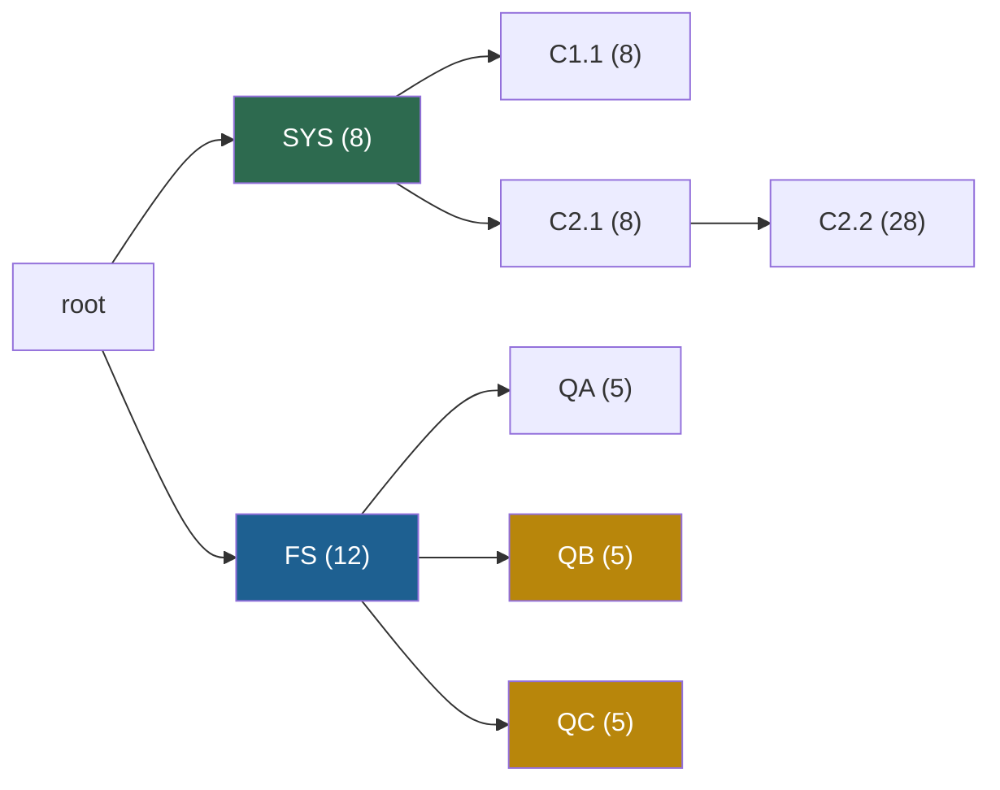

## 1. The claim

LM programs call a model many times, and the calls share long prefixes. The serving engines of 2023 discarded the KV cache of each request when it finished. RadixAttention keeps it, indexes it by its tokens in a radix tree, and reuses it automatically for every later request with the same first tokens. SGLang adds a frontend language, compressed finite state machines and API speculation. On LM programs it reaches up to 6.4 times the throughput and up to 3.7 times lower latency (§6).

## 2. The system in five lines

1. **Keep.** When a request finishes, its prompt and its output stay in the GPU KV pool, in pages of one token.
2. **Index.** A radix tree on the CPU maps runs of tokens to the slot numbers of their KV. A node holds numbers, not tensors.
3. **Match.** A new request walks the tree to its longest cached prefix, locks that path with reference counts, and computes only the rest.
4. **Evict.** Cached tokens and running requests share one pool. When it is full, the least recently used unlocked leaf goes first.
5. **Order.** The scheduler runs the requests with the longest matched prefix first, which visits the tree in depth-first order (Theorem 3.1).

## 3. The picture to remember


The diagram shows the state after step 7 of the running example ([page 04](/notes/papers/llm-serving/2023-sglang-radixattention/04-radixattention-the-tree-of-kv-caches)). Two chats share the system prompt SYS. Three few-shot questions share the examples FS. The numbers are token counts.



In step 7, the questions QB and QC matched FS (blue) and inserted their own leaves (gold). The rest of the tree (green) stayed cached and untouched.

## 4. Ten numbers

| Number | Meaning | Page |
|---|---|---|
| 1 token | The page size of the KV pool in the paper. A match can end at any token, not only at a block boundary. | [04](/notes/papers/llm-serving/2023-sglang-radixattention/04-radixattention-the-tree-of-kv-caches) |
| 6.4x | The best throughput gain over Guidance, vLLM v0.2.5 and LMQL, in programs per second | [09](/notes/papers/llm-serving/2023-sglang-radixattention/09-results) |
| 3.7x | The best latency reduction for one program at a time | [09](/notes/papers/llm-serving/2023-sglang-radixattention/09-results) |
| 50% to 99% | The cache hit rates of the benchmarks: cached prompt tokens over all prompt tokens | [09](/notes/papers/llm-serving/2023-sglang-radixattention/09-results) |
| about 96% | The share of the optimal hit rate that cache-aware scheduling reaches on average | [06](/notes/papers/llm-serving/2023-sglang-radixattention/06-cache-aware-scheduling) |
| 0.2 s of 74.3 s | The cost of the tree with no reuse at all (100 ShareGPT requests): less than 0.3% | [09](/notes/papers/llm-serving/2023-sglang-radixattention/09-results) |
| 52.4% and 74.1% | The hit rates in production on Chatbot Arena, for LLaVA-NeXT-34B and Vicuna-33B, after one month | [09](/notes/papers/llm-serving/2023-sglang-radixattention/09-results) |
| 1.7x | The lower first-token latency of Vicuna-33B in that deployment | [09](/notes/papers/llm-serving/2023-sglang-radixattention/09-results) |
| 1.6x | The throughput gain of the compressed finite state machine on JSON decoding | [08](/notes/papers/llm-serving/2023-sglang-radixattention/08-the-rest-of-sglang) |
| 152 of 236 | The prompt tokens that the nine-step running example of these notes matches, about 64.4% | [04](/notes/papers/llm-serving/2023-sglang-radixattention/04-radixattention-the-tree-of-kv-caches) |

## 5. The mechanisms

| Mechanism | What it does | Why it is needed | Page |
|---|---|---|---|
| Radix tree | Stores token runs on edges, one node per run, a child map keyed by the first token | Finds the longest cached prefix to the exact token | [01](/notes/papers/llm-serving/2023-sglang-radixattention/01-background-tries-and-radix-trees), [04](/notes/papers/llm-serving/2023-sglang-radixattention/04-radixattention-the-tree-of-kv-caches) |
| Split | Cuts a node and its slot list where a match or an insert ends inside an edge | Makes every shared prefix a path of whole nodes | [01](/notes/papers/llm-serving/2023-sglang-radixattention/01-background-tries-and-radix-trees) |
| One shared pool | Cached tokens and running requests use the same GPU slots, with no reserved cache size | The cache uses idle memory and gives it back to the batch | [05](/notes/papers/llm-serving/2023-sglang-radixattention/05-eviction-and-reference-counts) |
| LRU leaf eviction | Evicts the least recently used leaf, then its parent if it became a leaf | A node is useless without its ancestors | [05](/notes/papers/llm-serving/2023-sglang-radixattention/05-eviction-and-reference-counts) |
| Reference counts | A running request locks every node of its path, and only nodes with count zero are evictable | Running requests must not lose their KV | [05](/notes/papers/llm-serving/2023-sglang-radixattention/05-eviction-and-reference-counts) |
| Cache-aware scheduling | Runs the longest matched prefix first (Algorithm 1) | The order decides which prefixes are still cached when they are needed | [06](/notes/papers/llm-serving/2023-sglang-radixattention/06-cache-aware-scheduling) |
| Frontend hint | A `fork` sends the shared prefix first, then the branches | Branches that arrive together would all miss | [07](/notes/papers/llm-serving/2023-sglang-radixattention/07-frontend-hints-and-multi-gpu) |
| Router with a meta-tree | Sends each request to the data-parallel worker that holds its prefix | Each worker has its own pool and tree | [07](/notes/papers/llm-serving/2023-sglang-radixattention/07-frontend-hints-and-multi-gpu) |

> [!key] Prefill only
> A cache hit removes prefill work: the tokens of the matched prefix are not computed again. It does not remove decode work. So the gain is large for programs with long shared prompts and short outputs, and almost zero for chats with long outputs ([page 09](/notes/papers/llm-serving/2023-sglang-radixattention/09-results)).

## 6. What came after

| When | Work | What it adds |
|---|---|---|
| 2024-03 | vLLM 0.4.0, automatic prefix caching | Prefix reuse with a hash of every full 16-token block. On by default in the vLLM V1 engine. |
| 2024 | Hydragen, cascade inference | Decode attention reads a shared prefix once for the whole batch, with an exact log-sum-exp merge |
| 2024-12 | SGLang v0.4 cache-aware router | One approximate radix tree per worker. Up to 1.9x throughput and 3.8x higher hit rate in the blog's test. |
| 2025 | Preble (ICLR 2025), Marconi (MLSys 2025) | Prefix-aware scheduling over many GPUs, and prefix caching for hybrid models with SSM layers |
| 2024 to 2025 | Mooncake, LMCache, SGLang HiCache | The cache extends to host memory and shared storage |
| 2026-10 | SGLang 0.5.22 | `UnifiedRadixCache` with a Rust tree core by default, FCFS scheduling and LRU eviction by default, with `lpm` scheduling and four other eviction policies as options |

[Page 11](/notes/papers/llm-serving/2023-sglang-radixattention/11-limits-and-later-work) gives the dates and the sources. [Page 10](/notes/papers/llm-serving/2023-sglang-radixattention/10-radixattention-in-sglang-today) walks through the SGLang 0.5.22 code.

## 7. What to say in an interview

The interviewer asks: "Tell me about a paper you read." Then he asks in depth: the data structure, the eviction, the scheduling, the cost, what happens in the real code. Prepare two versions. End each one at a point that opens those topics.

### 7.1 The 2-minute version

> I read the SGLang paper, "SGLang: Efficient Execution of Structured Language Model Programs", by Zheng, Sheng and colleagues, published at NeurIPS 2024. Its best-known part is RadixAttention.
>
> The setting is LM programs: agents, few-shot evaluation, multi-turn chat, tree-of-thought search. They call the model many times, and the calls share long prefixes. The KV cache of a prefix depends only on its tokens, so it could be reused exactly. But the engines of 2023, vLLM included, discarded the KV cache of each request when it finished.
>
> RadixAttention keeps it. The KV stays in the GPU pool in pages of one token. A radix tree on the CPU maps runs of tokens to their slot numbers. A new request walks the tree, finds its longest cached prefix, locks that path with reference counts, and computes only the rest. If the match ends inside an edge, the node splits. Cached tokens and running requests share one pool, so when memory is short, the least recently used leaf is evicted first. Leaves first, because a node is useless without its ancestors.
>
> The order of requests matters too. The scheduler runs the longest matched prefix first. The paper proves that this is a depth-first order of the requests' tree. And depth-first order gives the optimal hit rate if the cache holds the longest request.
>
> The result: hit rates from 50% to 99%, and up to 6.4 times the throughput of vLLM v0.2.5, Guidance and LMQL. In production on Chatbot Arena, the hit rate was 52.4% and 74.1%, and first-token latency fell 1.7 times for Vicuna-33B. vLLM added its own automatic prefix caching with block hashes a few months later.

### 7.2 The 30-second version

> RadixAttention is the KV cache reuse system of SGLang, a NeurIPS 2024 paper. Instead of discarding the KV cache after each request, it keeps it and indexes it by tokens in a radix tree. Every new request reuses its longest cached prefix and computes only the rest. Least recently used leaves are evicted when memory is short, reference counts protect running requests, and the scheduler runs the longest shared prefix first. On agent, few-shot and chat workloads, throughput rises up to 6.4 times.

### 7.3 Bridge sentences for the follow-up questions

Each follow-up has a first sentence that links the question to the paper. Say it, then continue with the page in the last column.

| Follow-up | Bridge sentence | Study next |
|---|---|---|
| "Why can you reuse the KV cache at all?" | "Attention is causal, so the key and value of a token depend only on the tokens before it. Two requests with the same first $n$ tokens have the same KV for them." | [02](/notes/papers/llm-serving/2023-sglang-radixattention/02-background-prefix-sharing-in-lm-programs), [L1: Why the KV cache exists](/notes/ai/llm-systems/03-kv-cache/l1-why-the-kv-cache-exists) |
| "What is a radix tree, and why not a hash map?" | "A radix tree is a trie whose single-child chains are merged into runs of tokens. It finds the longest shared prefix to the exact token, while a hash of whole prompts finds only identical prompts." | [01](/notes/papers/llm-serving/2023-sglang-radixattention/01-background-tries-and-radix-trees), [L9: Prefix caching and KV reuse](/notes/ai/llm-systems/04-inference/l9-prefix-caching-and-kv-reuse) |
| "What does a node store?" | "Token ids and the slot numbers of their KV in the GPU pool, plus a reference count and an access time. The K and V tensors stay in the pool." | [04](/notes/papers/llm-serving/2023-sglang-radixattention/04-radixattention-the-tree-of-kv-caches) |
| "How do you evict?" | "LRU over leaves only, and only leaves with reference count zero. A parent becomes a candidate when its last child goes." | [05](/notes/papers/llm-serving/2023-sglang-radixattention/05-eviction-and-reference-counts) |
| "Why does the order of requests matter?" | "With a small pool, arrival order can evict a prefix just before its next use. Longest-shared-prefix-first is a depth-first order, and Theorem 3.1 says that order is optimal." | [06](/notes/papers/llm-serving/2023-sglang-radixattention/06-cache-aware-scheduling) |
| "How does it relate to PagedAttention?" | "RadixAttention is PagedAttention with a block size of one token plus an index across requests. PagedAttention made KV memory non-contiguous, and the tree decides which KV is shared." | [04](/notes/papers/llm-serving/2023-sglang-radixattention/04-radixattention-the-tree-of-kv-caches), [PagedAttention page 10](/notes/papers/llm-serving/2023-pagedattention/10-limits-and-later-work) |
| "How does it work on many GPUs?" | "With tensor parallelism every GPU runs the same tree. With data parallelism a router keeps a tree per worker and sends a request to the worker that holds its prefix." | [07](/notes/papers/llm-serving/2023-sglang-radixattention/07-frontend-hints-and-multi-gpu) |
| "What does SGLang do today?" | "Version 0.5.22 keeps the algorithm in `UnifiedRadixCache` with a Rust tree core. It defaults to FCFS and LRU, and stops every match one token before the end of the prompt." | [10](/notes/papers/llm-serving/2023-sglang-radixattention/10-radixattention-in-sglang-today) |

> [!example] Worked example: the numbers to say for "How much does one shared system prompt save?"
> Take Llama-3.1-8B, 128 KiB of KV per token, and a 2,000-token system prompt.
> 1. KV of the prompt: $2{,}000 \times 131{,}072 = 262{,}144{,}000$ bytes $= 250$ MiB. With reuse, the pool holds it once, not once per request.
> 2. Prefill work per request: about $2 \times 8.03 \times 10^9 \times 2{,}000 \approx 3.2 \times 10^{13}$ FLOPs.
> 3. On an H100 at about 989 TFLOPS dense BF16, that is at least about 32 ms of compute per request. A hit removes it from the time to the first token.

## 8. One-minute explanation

LM programs, such as agents, few-shot evaluations and chats, call a model many times with prompts that share long prefixes. The KV cache of a prefix depends only on its tokens, so it can be reused exactly. But the engines of 2023 discarded it after each request. RadixAttention keeps the KV of finished requests in the GPU pool, in pages of one token. A radix tree of token runs on the CPU indexes it. A new request finds its longest cached prefix in the tree, locks that path with reference counts, and computes only the rest. When a match ends inside an edge, the node splits, so every shared prefix is a path. Cached tokens and running requests share one pool, and when it is full the least recently used unlocked leaf is evicted. The scheduler runs the longest shared prefix first, which is a depth-first order. The paper proves that this order gives the optimal hit rate when the cache holds the longest request. The paper measures hit rates from 50% to 99% and up to 6.4 times the throughput of vLLM v0.2.5, Guidance and LMQL. SGLang 0.5.22 still uses the same algorithm, with FCFS scheduling and LRU eviction as defaults.

## 9. Check questions

```check
{
  "question": "State the problem of the paper and the fix of RadixAttention in three sentences.",
  "answer": "LM programs call a model many times, and the calls share long prefixes, but the engines of 2023 discarded the KV cache of each request when it finished. So every call computed the shared prefix again. RadixAttention keeps the KV of finished requests in the GPU pool, indexes it by its tokens in a radix tree, and reuses the longest cached prefix of every new request, with LRU leaf eviction, reference counts and a cache-aware request order."
}
```

```check
{
  "question": "What does a node of the radix tree store, and where are the keys and values?",
  "hint": "Numbers, not tensors.",
  "answer": "A node stores its edge, a run of token ids, and its value: one slot number per token of the edge. It also has a child map keyed by the first token of each child edge, a parent link, a reference count (`lock_ref` in SGLang) and a last access time. The K and V tensors are not in the node. They are in the GPU KV pool, at the slots that the node lists. The paper: \"The tree structure is stored on the CPU with negligible maintenance overhead.\""
}
```

```check
{
  "question": "Why does RadixAttention evict leaves, and never an internal node first?",
  "answer": "The KV of a node is useful only together with the KV of all its ancestors, because a request must match from the root. If an internal node went first, its descendants would stay in memory but no request could ever reach them: they would be orphans that waste slots. Leaf-first eviction keeps the cached set closed under prefixes. A shared ancestor stays until all its children are gone and it becomes a leaf itself."
}
```

```check
{
  "question": "Compute the hit rate of the nine-step running example and say which step contributes the most matched tokens.",
  "hint": "Add the matched tokens of steps 2 to 9b.",
  "answer": "Matched prompt tokens per step: 0, 16, 8, 16, 0, 24, 16, 12, 60, so $152$ in total. Prompt tokens: $12 + 20 + 12 + 20 + 16 + 32 + 49 + 15 + 60 = 236$. Hit rate $152 / 236 \\approx 64.4\\%$. Step 9b contributes the most: four self-consistency samples each match their 15-token prompt, 60 tokens. In SGLang 0.5.22 each sample would match only 14, because a match stops one token before the end of the prompt."
}
```

```check
{
  "question": "Interview follow-up: Why is longest-shared-prefix-first optimal, and when is it not?",
  "hint": "Lower bound, DFS, cache size.",
  "answer": "Theorem 3.1: for a batch of requests, visiting their radix tree in depth-first order gives the optimal hit rate, if the cache holds at least the longest request. Proof idea: every edge must be computed at least once. In DFS order, once an edge is computed its whole subtree runs next, while the edge stays cached, and the edge is never needed after that. So each edge is computed exactly once, which meets the lower bound. Longest-shared-prefix-first picks the request that shares the most with the cached path, which is a DFS step.\n\nIt is not optimal, or not even fair, in three cases. Requests arrive online, so new arrivals break the DFS order. Output lengths are unknown, so KV can be evicted and recomputed (the paper's footnote). And greedy ordering can starve a request with no shared prefix. SGLang 0.5.22 defaults to FCFS and keeps `lpm` as an option."
}
```

```check
{
  "question": "Interview follow-up: Compare RadixAttention with vLLM's automatic prefix caching.",
  "answer": "| | SGLang radix tree | vLLM hash chain |\n|---|---|---|\n| Index | A radix tree of token runs | A map from block hash to block |\n| Unit | One token (page size 1 in the paper) | One full block, 16 tokens by default |\n| Partial block | Matched to the exact token | Not cached |\n| Lookup | Walk the tree and compare tokens | One hash per block |\n| Eviction | LRU over leaves with reference count zero | LRU over free blocks, chain tails first |\n| Sharing across machines | Needs the token sequences or a router-side tree | Equal content gives an equal hash |\n\nBoth are paging plus an index. The tree matches to the exact token. The hash chain is cheaper to update and to share across servers ([L9](/notes/ai/llm-systems/04-inference/l9-prefix-caching-and-kv-reuse))."
}
```

```check
{
  "question": "Interview follow-up: A chat service has 4-turn conversations with 256 input and 256 output tokens per turn. How much does RadixAttention help, and why does the paper see almost no gain on its long-output chat benchmark?",
  "hint": "A hit removes prefill, not decode.",
  "answer": "Without reuse, turn $k$ prefills the whole history plus the new input: $256, 768, 1{,}280, 1{,}792$ tokens, so $4{,}096$ prefill tokens. With reuse, each turn prefills only its new 256 input tokens: $1{,}024$ (page 03). That is 4 times less prefill. But each turn still decodes 256 tokens one at a time, $1{,}024$ decode steps in total, and reuse removes none of them. When outputs are long, decode dominates the time, so the total gain is small. The paper reports almost no speedup for multi-turn chat with long outputs (256 to 512 tokens)."
}
```

## 10. Links

- Next: [01 Background: tries and radix trees](/notes/papers/llm-serving/2023-sglang-radixattention/01-background-tries-and-radix-trees)
- The paper card: [SGLang and RadixAttention (2023)](/notes/papers/llm-serving/2023-sglang-radixattention)
- The paper before it: [PagedAttention (2023)](/notes/papers/llm-serving/2023-pagedattention), especially [00 The paper on one page](/notes/papers/llm-serving/2023-pagedattention/00-paper-on-one-page)
- The KV cache: [03 The KV cache](/notes/ai/llm-systems/03-kv-cache)
- The other design: [L9: Prefix caching and KV reuse](/notes/ai/llm-systems/04-inference/l9-prefix-caching-and-kv-reuse)
- The interview drill: [L1: Chain from attention to PagedAttention](/notes/ai/llm-systems/08-interview-drills/l1-chain-attention-to-pagedattention)

### Sources

- Zheng et al., SGLang, [arXiv 2312.07104](https://arxiv.org/abs/2312.07104) (version 2) and the [NeurIPS 2024 proceedings page](https://proceedings.neurips.cc/paper_files/paper/2024/hash/724be4472168f31ba1c9ac630f15dec8-Abstract.html)
- LMSYS blog, 2024-01-17: [Fast and Expressive LLM Inference with RadixAttention and SGLang](https://lmsys.org/blog/2024-01-17-sglang)
- LMSYS blog, 2024-12-04: [SGLang v0.4](https://www.lmsys.org/blog/2024-12-04-sglang-v0-4)
- [SGLang 0.5.22 on PyPI](https://pypi.org/project/sglang/0.5.22/) (released 2026-10-16)

All checked on 2026-10-19.
