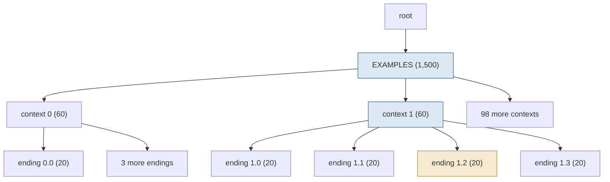

## 1. The question this page answers

Page 01 built the radix tree, the data structure that finds the longest shared prefix. This page asks why anyone needs it. Real applications do not send one prompt and stop. They run **programs** that call the model many times: few-shot benchmarks, agents, searches, chats. These calls build their prompts from the same pieces, so they start with the same tokens again and again.

The questions of this page:

1. Why is the KV cache of a shared prefix **exactly** reusable? When does reuse break?
2. Is the KV of generated tokens reusable too, also after random sampling?
3. What is an LM program, and which sharing patterns does it create?
4. How much prefill work does each pattern repeat? How much memory do the copies take?
5. What did serving engines do with this redundancy before SGLang?

The paper starts from one fact about existing engines. In its words: "In existing inference engines, the KV cache of a request is discarded after processing is completed." So every call recomputes its whole prompt, also the parts that the call before computed.

## 2. Mental model

> [!analogy] A reader's running notes
> A reader reads a book from page 1. For every page, she writes a note that explains the page in the light of all pages before it. Two readers who read the same first 50 pages in the same order write the same 50 notes. So the second reader can copy the first reader's notes and start at page 51. If page 3 is different in her copy of the book, all her notes from page 3 on are different. If the book holds the same chapter at another place, its notes are different too, because another story came before it.
>
> **Where it stops working:** a human reader can write the same note after an unimportant change in an earlier page. A transformer cannot: every later position attends to the changed token, so every later key and value changes at least a little. And the notes of a transformer are large: 128 KiB per token for Llama-3.1-8B.

## 3. Terms

| Term | Plain meaning |
|---|---|
| LM program | A program that calls an LLM several times, with control flow and structured inputs and outputs. |
| LLM call | One request to the model: a prompt goes in, generated tokens come out. |
| shared prefix | The same leading tokens in two or more prompts. |
| KV cache reuse | Use the stored keys and values of a shared prefix instead of computing them again. |
| causal attention | Attention in which a token sees only itself and earlier tokens. |
| prefill | The forward pass over the prompt tokens. It computes their KV and the first output token. |
| redundant prefill | Prefill work on tokens whose KV the engine computed before for the same prefix. |
| few-shot prompt | A prompt that shows several solved examples before the real question. |
| self-consistency | Sample several answers to one prompt, then take a majority vote. |
| multi-turn chat | A conversation in which each turn sends the whole history again. |
| tree of thought | A search in which the model extends partial solutions, which form the branches of a tree. |
| ReAct agent | An agent loop: the model reasons and chooses an action, a tool returns an observation, and the loop repeats. |
| multi-level sharing | Sharing at several depths: one prefix shared by all calls, a longer prefix shared by a subgroup. |
| `fork` | An SGLang primitive that makes parallel copies of the prompt state (page 08). |
| `select` | An SGLang primitive that chooses the highest-probability option from a list (page 08). |
| automatic prefix caching | vLLM's prefix cache with a hash chain over full blocks, released in vLLM 0.4.0. |
| hit rate | The paper's measure: cached prompt tokens divided by prompt tokens (page 06). |

All terms are also in the [Glossary](/notes/papers/glossary).

## 4. Why the KV of a prefix can be reused exactly

### 4.1 The causal argument

In layer $\ell$, the key and value of position $i$ are linear maps of the hidden state of position $i$:

$$
k_i^{(\ell)} = W_K^{(\ell)} h_i^{(\ell-1)}, \qquad v_i^{(\ell)} = W_V^{(\ell)} h_i^{(\ell-1)}
$$

Causal attention lets position $i$ read only positions 1 to $i$. The MLP and the norms work on each position alone. So, by induction over the layers, $h_i^{(\ell)}$ depends only on tokens 1 to $i$ and their positions. Then $k_i^{(\ell)}$ and $v_i^{(\ell)}$ depend only on tokens 1 to $i$ too. The paper states it in Appendix A.1: "the computation of the KV cache only depends on all previous tokens".

> [!key] The reuse rule
> Two requests with the same tokens at positions 1 to $n$ have the same keys and values at positions 1 to $n$, in every layer. The model weights and every other input that changes the values (for example a LoRA adapter or an image) must also be the same. Then the reuse is exact, not an approximation.

[L1: Why the KV cache exists](/notes/ai/llm-systems/03-kv-cache/l1-why-the-kv-cache-exists) proves the induction layer by layer. [L2: Prefill and decode](/notes/ai/llm-systems/03-kv-cache/l2-prefill-and-decode) shows the two phases that compute this KV.

### 4.2 A numeric check

This toy model has two layers of causal attention with random weights and learned position vectors. It prints how much the keys of two requests differ.

```python
import numpy as np

rng = np.random.default_rng(0)
V, P, d, L = 12, 16, 8, 2                          # vocabulary, positions, width, layers
emb, pos = rng.normal(size=(V, d)), rng.normal(size=(P, d))
W = [{k: rng.normal(size=(d, d)) / np.sqrt(d) for k in "qkvo"} for _ in range(L)]

def keys(tokens):
    """Keys of every layer for every position, computed in one causal pass (prefill)."""
    h = emb[tokens] + pos[np.arange(len(tokens))]
    out = []
    for w in W:
        q, k, v = h @ w["q"], h @ w["k"], h @ w["v"]
        out.append(k)
        s = q @ k.T / np.sqrt(d)
        s[np.triu_indices(len(tokens), 1)] = -np.inf   # causal mask: no look at later tokens
        a = np.exp(s - s.max(axis=1, keepdims=True))
        h = h + np.tanh((a / a.sum(axis=1, keepdims=True)) @ v @ w["o"])
    return out

def diff(x, y, cols):
    return max(np.abs(a[cols] - b[cols]).max() for a, b in zip(x, y))

A = [5, 3, 8, 1, 7]
B = [5, 3, 8, 2, 9]                                # same first 3 tokens as A
C = [4, 3, 8, 1, 7]                                # only the first token differs from A
D = [9, 9, 5, 3, 8]                                # A's first 3 tokens, 2 positions later
kA, kB, kC, kD = keys(A), keys(B), keys(C), keys(D)
print("A vs B, positions 0-2:", diff(kA, kB, slice(0, 3)))
print("A vs B, positions 3-4:", round(diff(kA, kB, slice(3, 5)), 3))
print("A vs C, positions 1-4:", round(diff(kA, kC, slice(1, 5)), 3))
print("[5,3,8] at 0-2 in A vs at 2-4 in D:", round(max(np.abs(a[0:3] - b[2:5]).max() for a, b in zip(kA, kD)), 3))
step = [keys(A[:n])[-1][-1] for n in range(1, 6)]  # key of token n from a pass of length n
print("decode vs prefill, last layer:", max(np.abs(s - kA[-1][i]).max() for i, s in enumerate(step)))
```

```text
A vs B, positions 0-2: 0.0
A vs B, positions 3-4: 3.869
A vs C, positions 1-4: 0.9
[5,3,8] at 0-2 in A vs at 2-4 in D: 3.592
decode vs prefill, last layer: 2.220446049250313e-16
```

1. `s[np.triu_indices(...)] = -np.inf` is the causal mask. Without it, position 0 would read position 4, and the first rule would fail.
2. A and B share the tokens [5, 3, 8]. Their keys at positions 0 to 2 are identical in both layers: the difference is 0.0. At positions 3 and 4 they differ.
3. C differs from A only at position 0. The keys at positions 1 to 4 differ too, by up to 0.9, although the tokens there are equal.
4. D holds [5, 3, 8] at positions 2 to 4. Its keys there differ from A's keys at positions 0 to 2. The positions differ, and other tokens came before.
5. The last line computes the key of token $n$ with a pass over only the first $n$ tokens, as decode does for each new token. The values agree up to $2.2 \times 10^{-16}$: equal in math, not always equal in bits (section 4.5).

### 4.3 When reuse breaks

Three cases end the reuse, and each follows from section 4.1:

1. **A different earlier token.** One changed token at position $j$ changes the KV at every position after $j$. The match must stop at $j$.
2. **The same text at another position.** The keys are stored after the rotary position embedding. It rotates each key by an angle that depends on its position ([L1 section 8.3](/notes/ai/llm-systems/03-kv-cache/l1-why-the-kv-cache-exists)). And the text attended to other earlier tokens.
3. **Another adapter or another image.** The tokens are equal, but the values are not. SGLang 0.5.22 keeps such entries apart with `extra_key` (page 01 section 6.4).

> [!example] Worked example: two retrieved documents in another order
> A RAG prompt is [SYS 500][D1 1,000][D2 1,000][Q 50]. The next prompt retrieves the same two documents in the other order: [SYS 500][D2 1,000][D1 1,000][Q' 50].
>
> 1. The match follows SYS: 500 tokens.
> 2. At position 501, the first prompt has D1 and the second has D2. The match stops.
> 3. Reused: 500 of 2,550 tokens. Prefilled again: 2,050 tokens, although D1 and D2 both have cached KV.
>
> A fixed order for retrieved documents, for example sorted by document ID, turns this case into a hit.

### 4.4 Generated tokens are reusable too

A chat turn re-sends the previous answer, which the model generated. Is its cached KV still exact? Yes. The KV of a token depends on the token IDs before it, and not on how they were chosen. Greedy decoding, temperature sampling and top-p sampling only choose **which** token comes next. After the choice, the KV of that token is a fixed function of the token sequence. So RadixAttention inserts prompt **and** output into the tree, and the next turn matches both.

Three practical limits, labeled by source:

1. The client must send back the **same token IDs**. Interpretation of these notes: a chat template can add other markers, or the text can be tokenized again differently. Then the match stops at the first different token.
2. Interpretation of these notes: a token gets its key and value only when it enters the model as input. The last generated token never entered the model. So the next turn computes at least that token again.
3. SGLang 0.5.22 caps every match at the prompt length minus 1: "the matched length is at most 1 less than the input length to enable logprob computation" (SGLang 0.5.22 source, `schedule_batch.py`, `_compute_max_prefix_len`). So a fully cached prompt still prefills one token to obtain its logits.

The worked examples on this page ignore these single tokens, as the paper's examples do.

### 4.5 Exact in math, not always in bits

Interpretation of these notes: the reuse is exact in exact arithmetic. A GPU adds numbers in an order that depends on the kernel and the batch shape. A key computed during decode can differ in the last bits from the same key computed during a prefill. Line 5 of section 4.2 shows such a difference. With greedy decoding, such a tiny difference can very rarely change a chosen token. It does not make reuse an approximation in the sense of a smaller or a sparser computation.

## 5. What an LM program is

### 5.1 The definition

The paper calls them LM programs: programs that schedule and control the generation of an LLM. It names two common properties:

1. "LM programs typically contain multiple LLM calls interspersed with control flow."
2. "LM programs receive structured inputs and produce structured outputs."

Its core idea is to "systematically exploit the multi-call structure in LM programs for efficient execution." RadixAttention is the part of that idea that reuses KV across calls. Page 08 covers the SGLang language, in which `fork`, `select` and `gen` express these calls.

### 5.2 The programs of the paper

The paper evaluates these workloads (§6). The descriptions in the last two columns are the interpretation of these notes.

| Workload | What the program does | Where the prompts share tokens |
|---|---|---|
| MMLU, 5-shot | One question at a time after 5 examples, decodes one token | The examples, across all questions |
| HellaSwag, 20-shot | Scores 4 endings with `select` | The examples, and each context across its 4 endings |
| ReAct agents | Thought, action, observation, repeated | The instructions and the growing history |
| Generative agents | Replayed traces of simulated agents | The instructions and memories of each agent |
| Tree of thought (GSM-8K) | Proposes and checks branches of a search | Each branch with its parent's path |
| Skeleton of thought | Writes an outline, then expands each point in parallel | The question and the outline |
| LLM judge (branch-solve-merge) | Judges an answer in several dimensions, then merges | The question and the answer under judgment |
| JSON decoding | Fills a schema with a regex constraint | The instructions |
| Multi-turn chat | Each turn re-sends the history | The whole history so far |
| DSPy RAG pipeline | Retrieves context, then answers | The instructions and the retrieved context |

### 5.3 A program in outline

A tree-of-thought search, written as pseudo-code of these notes (not SGLang syntax):

```text
state = SYSTEM + PROBLEM                      # 800 tokens, built once
frontier = [state]
for depth in 1..3:
    new_frontier = []
    for s in frontier:
        for b in 1..3:
            thought = llm(s, max_tokens=100)  # one LLM call: prompt s, output thought
            new_frontier.append(s + thought)  # the child prompt extends the parent prompt
    frontier = new_frontier                   # a real search keeps only the best here
```

Every call's prompt is an older prompt plus text that the model generated. That is the source of the sharing. The engine does not see the loop. It sees only a stream of requests, and it must find the shared prefixes by itself.

## 6. The sharing patterns

### 6.1 The four patterns of Figure 9, plus agents

The paper's Figure 9 (Appendix A.1) shows four patterns: few-shot learning, self-consistency, multi-turn chat and tree of thought. Its caption colors shareable prompt parts blue, non-shareable parts green and non-shareable outputs yellow. These notes use their own legend on every page: shared parts blue, unique parts gold.


All worked examples below use one model and one GPU. The token counts are choices of these notes.

| Constant | Value | Source |
|---|---|---|
| KV per token, Llama-3.1-8B, BF16 | $2 \times 32 \times 8 \times 128 \times 2 = 131{,}072$ bytes = 128 KiB | [L3: The KV cache size formula](/notes/ai/llm-systems/03-kv-cache/l3-the-kv-cache-size-formula) |
| Prefill FLOPs per token | about $2 \times 8.03 \times 10^9 \approx 1.606 \times 10^{10}$ | 2 FLOPs per parameter, attention FLOPs omitted |
| H100 dense BF16 peak | about 989 TFLOPS | [L1: The life of a request](/notes/ai/llm-systems/04-inference/l1-the-life-of-a-request) |
| Prefill time per token at peak | $1.606 \times 10^{10} / 9.89 \times 10^{14} \approx 16.2$ µs | Real prefill runs below peak |

### 6.2 Few-shot learning

The same examples come before every question.

```text
request 1:    [ EXAMPLES 2,000 ][ Q1 50 ]   -> answer
request 2:    [ EXAMPLES 2,000 ][ Q2 50 ]   -> answer
...
request 100:  [ EXAMPLES 2,000 ][ Q100 50 ] -> answer
shared: EXAMPLES (2,000 tokens)     unique: each question (50 tokens)
```

> [!example] Worked example: 100 questions after 2,000 tokens of examples
> 1. Without reuse: $100 \times (2{,}000 + 50) = 205{,}000$ prefill tokens.
> 2. With reuse: the examples once, then only the questions: $2{,}000 + 100 \times 50 = 7{,}000$ tokens.
> 3. Redundant: $205{,}000 - 7{,}000 = 198{,}000$ tokens, which is $99 \times 2{,}000$. Ratio: $205{,}000 / 7{,}000 \approx 29.3$.
> 4. Redundant FLOPs: $198{,}000 \times 1.606 \times 10^{10} \approx 3.18 \times 10^{15}$. At 989 TFLOPS: about 3.2 s of an H100 at peak.
> 5. Memory if all 100 requests run at once: without sharing, $205{,}000 \times 128$ KiB $\approx 25.0$ GiB. With sharing, $7{,}000 \times 128$ KiB $= 875$ MiB. The 198,000 duplicate tokens alone take about 24.2 GiB.

### 6.3 Self-consistency

One prompt, several sampled answers, then a vote. The whole prompt is shared. Only the outputs differ.

```text
sample 1:  [ PROMPT 500 ] -> [ S1 200 ]
sample 2:  [ PROMPT 500 ] -> [ S2 200 ]
...
sample 8:  [ PROMPT 500 ] -> [ S8 200 ]
shared: PROMPT (500 tokens)     unique: each sampled answer (200 tokens)
```

> [!example] Worked example: 8 samples of one 500-token prompt
> 1. Without reuse: $8 \times 500 = 4{,}000$ prefill tokens. With reuse: 500.
> 2. Redundant: 3,500 tokens, about $5.62 \times 10^{13}$ FLOPs, about 57 ms at peak.
> 3. Memory while all 8 samples run: without sharing, $8 \times (500 + 200) = 5{,}600$ tokens, 700 MiB. With sharing, $500 + 8 \times 200 = 2{,}100$ tokens, 262.5 MiB. Saved: 437.5 MiB.
> 4. The decode work stays: $8 \times 200 = 1{,}600$ generated tokens in both cases.

PagedAttention already shared this prompt **inside one request** with `n` samples ([PagedAttention 06](/notes/papers/llm-serving/2023-pagedattention/06-decoding-scenarios-and-sharing)). An LM program often sends the samples as separate calls, for example from a `fork`. Then only a cache across requests can share them.

### 6.4 Multi-turn chat

Each turn re-sends the whole history: the system prompt, all earlier user messages and all earlier answers.

```text
turn 1:  [ SYS 500 ][ U1 100 ]                                -> [ R1 300 ]
turn 2:  [ SYS 500 ][ U1 100 ][ R1 300 ][ U2 100 ]            -> [ R2 300 ]
turn 3:  [ SYS 500 ][ U1 100 ][ R1 300 ][ U2 100 ][ R2 300 ][ U3 100 ] -> ...
shared with the turn before: everything except the new user message
```

> [!example] Worked example: 10 turns of 100 user tokens and 300 answer tokens
> 1. Turn $t$ has a prompt of $500 + 400(t-1) + 100$ tokens. Turn 10: $500 + 3{,}600 + 100 = 4{,}200$ tokens.
> 2. Without reuse: $\sum_{t=1}^{10} (600 + 400(t-1)) = 6{,}000 + 400 \times 45 = 24{,}000$ prefill tokens.
> 3. With reuse: turn 1 prefills 600, and turns 2 to 10 prefill only the new user message: $600 + 9 \times 100 = 1{,}500$. The previous answer is already in the tree (section 4.4).
> 4. Redundant: 22,500 tokens, about 0.37 s at peak over the whole chat.
> 5. Time to first token of turn 10, prefill only: $4{,}200 \times 16.2$ µs $\approx 68$ ms without reuse, $100 \times 16.2$ µs $\approx 1.6$ ms with reuse.

The turns of one chat arrive one after another, minutes apart. So the saving needs the history to **survive in the cache** between turns. Page 05 shows what eviction does to it.

### 6.5 Tree of thought

A search extends partial solutions. Each child prompt is its parent's prompt plus the parent's new thought.

```text
depth 1:  [ ROOT 800 ]                  -> T1, T2, T3          (3 calls)
depth 2:  [ ROOT 800 ][ T1 100 ]        -> T1.1, T1.2, T1.3    (9 calls in all)
depth 3:  [ ROOT 800 ][ T1 ][ T1.1 ]    -> T1.1.1, ...         (27 calls in all)
shared: ROOT with every call, each thought with its subtree
```

> [!example] Worked example: 3 branches, depth 3, 100 tokens per thought
> 1. Calls: $3 + 9 + 27 = 39$. A call at depth $d$ has a prompt of $800 + 100(d - 1)$ tokens.
> 2. Without reuse: $3 \times 800 + 9 \times 900 + 27 \times 1{,}000 = 2{,}400 + 8{,}100 + 27{,}000 = 37{,}500$ tokens.
> 3. With reuse: only the root, once: 800 tokens. Every thought was generated by an earlier call and inserted, so every later prompt is fully cached.
> 4. Redundant: 36,700 tokens, about 0.60 s at peak. Ratio: about 46.9.
> 5. The tree after the search stores $800 + 39 \times 100 = 4{,}700$ tokens, 587.5 MiB.

If a call adds glue text, such as "Next step:", those few tokens are new prefill work. If three sibling calls arrive at the same moment, all three can miss, because none of them is finished. Page 07 shows how the frontend hint avoids that.

### 6.6 Agents

A ReAct agent repeats one step: the model writes a thought and an action, a tool runs, and its observation is appended.

```text
step 1:  [ SYS+TOOLS 1,500 ]                                   -> [ O1 80 ]
step 2:  [ SYS+TOOLS 1,500 ][ O1 80 ][ OBS1 300 ]              -> [ O2 80 ]
step 3:  [ SYS+TOOLS 1,500 ][ O1 ][ OBS1 ][ O2 80 ][ OBS2 300 ] -> [ O3 80 ]
new in each step: the tool observation (the model output is already cached)
```

> [!example] Worked example: 8 steps, 80 output tokens, 300 observation tokens
> 1. Step $k$ has a prompt of $1{,}500 + 380(k - 1)$ tokens. Step 8: 4,160 tokens.
> 2. Without reuse: $8 \times 1{,}500 + 380 \times (0 + 1 + \dots + 7) = 12{,}000 + 10{,}640 = 22{,}640$ tokens.
> 3. With reuse: $1{,}500 + 7 \times 300 = 3{,}600$ tokens. The tool observations are new text, so they always need prefill.
> 4. Redundant: 19,040 tokens, about 0.31 s at peak. Step 8 prefills 300 tokens (about 4.9 ms at peak) instead of 4,160 (about 68 ms).

Agents also share **across users**: every user's agent starts with the same 1,500 tokens of instructions and tool definitions.

### 6.7 Sharing in space and sharing in time

Interpretation of these notes: the patterns fall into two groups, and the group decides what reuse saves.

| Group | Patterns | Calls run | Compute saved | Memory saved |
|---|---|---|---|---|
| Sharing in space | Few-shot batch, self-consistency, sibling branches of a tree of thought | At the same time | Yes, if one call computes the prefix first | Yes: one copy of the prefix serves all running calls |
| Sharing in time | Chat turns, agent steps | One after another | Yes, if the prefix survives in the cache | No: only one call runs at a time |

### 6.8 All patterns in one program

This simulator counts prefill tokens with an unbounded, token-exact cache: a radix tree that never evicts. It verifies every number of sections 6.2 to 6.6, and the radix tree numbers of section 7.

```python
def computed_tokens(requests, reuse=True):
    """Prefill tokens for a list of (prompt, output) requests that run one after another.
    The cache is unbounded and token-exact, like a radix tree that never evicts."""
    trie, total = {}, 0
    for prompt, output in requests:
        node, matched = trie, 0
        while reuse and matched < len(prompt) and prompt[matched] in node:
            node = node[prompt[matched]]          # walk the cached prefix
            matched += 1
        total += len(prompt) - matched            # only the unmatched tail is prefilled
        node = trie
        for tok in prompt + output:               # a finished request is inserted
            node = node.setdefault(tok, {})
    return total

def seg(name, n):                                 # n distinct token IDs for one text segment
    return [(name, i) for i in range(n)]

def few_shot():                                   # 2,000 shared tokens, 100 questions of 50
    ex = seg("EX", 2000)
    return [(ex + seg(f"Q{q}", 50), seg(f"A{q}", 1)) for q in range(100)]

def self_consistency():                           # one 500-token prompt, 8 samples of 200
    p = seg("P", 500)
    return [(p, seg(f"S{k}", 200)) for k in range(8)]

def chat():                                       # 500 system, 10 turns of 100 user + 300 answer
    reqs, hist = [], seg("SYS", 500)
    for t in range(10):
        prompt = hist + seg(f"U{t}", 100)
        out = seg(f"R{t}", 300)
        reqs.append((prompt, out))
        hist = prompt + out
    return reqs

def tree_of_thought():                            # 800-token root, 3 branches, depth 3, 100 per thought
    reqs, level = [], [seg("ROOT", 800)]
    for d in range(3):
        nxt = []
        for prefix in level:
            for b in range(3):
                thought = seg(f"T{len(reqs)}", 100)
                reqs.append((prefix, thought))
                nxt.append(prefix + thought)
        level = nxt
    return reqs

def react_agent():                                # 1,500 system+tools, 8 steps: 80 out + 300 observation
    reqs, hist = [], seg("SYS", 1500)
    for k in range(8):
        out = seg(f"O{k}", 80)
        reqs.append((hist, out))
        hist = hist + out + seg(f"OBS{k}", 300)
    return reqs

def hellaswag():                                  # 1,500 examples, 100 contexts of 60, 4 endings of 20
    ex = seg("EX", 1500)
    return [(ex + seg(f"C{q}", 60) + seg(f"E{q}.{j}", 20), []) for q in range(100) for j in range(4)]

KV, FLOP, PEAK = 131072, 2 * 8.03e9, 989e12       # bytes per token, FLOPs per token, H100 BF16 dense
for name, f in [("few-shot", few_shot), ("self-consistency", self_consistency), ("multi-turn chat", chat),
                ("tree of thought", tree_of_thought), ("ReAct agent", react_agent), ("HellaSwag", hellaswag)]:
    reqs = f()
    a, b = computed_tokens(reqs, reuse=False), computed_tokens(reqs)
    r = a - b
    print(f"{name:17s} calls {len(reqs):3d}  no reuse {a:7,d}  reuse {b:6,d}  redundant {r:7,d}"
          f"  x{a / b:5.1f}  {r * FLOP / PEAK:6.3f} s  {r * KV / 2**30:6.2f} GiB")
```

```text
few-shot          calls 100  no reuse 205,000  reuse  7,000  redundant 198,000  x 29.3   3.215 s   24.17 GiB
self-consistency  calls   8  no reuse   4,000  reuse    500  redundant   3,500  x  8.0   0.057 s    0.43 GiB
multi-turn chat   calls  10  no reuse  24,000  reuse  1,500  redundant  22,500  x 16.0   0.365 s    2.75 GiB
tree of thought   calls  39  no reuse  37,500  reuse    800  redundant  36,700  x 46.9   0.596 s    4.48 GiB
ReAct agent       calls   8  no reuse  22,640  reuse  3,600  redundant  19,040  x  6.3   0.309 s    2.32 GiB
HellaSwag         calls 400  no reuse 632,000  reuse 15,500  redundant 616,500  x 40.8  10.011 s   75.26 GiB
```

1. `computed_tokens` walks the cached prefix of each prompt in a trie of nested dictionaries, the same walk as page 01. Only `len(prompt) - matched` tokens are prefilled.
2. The insert covers `prompt + output`. This line makes chat turns, agent steps and tree-of-thought children reuse generated tokens.
3. `seg(name, n)` makes $n$ distinct token IDs for one text segment. Two segments with the same name are the same text.
4. Each builder is the prompt skeleton of one LM program. For example, `chat` appends each answer to the history before the next user message.
5. The last two columns are the redundant prefill time at 989 TFLOPS and the KV of the redundant tokens. The memory column is real only for sharing in space (section 6.7).


## 7. Multi-level sharing

### 7.1 One prefix for all, one prefix for each group

HellaSwag asks the model to choose the best of 4 endings for a context. The program uses `select`, which scores every ending after the same context. With 20 examples in front, the prompts share at two levels:

1. **Level 1:** the examples, shared by all questions.
2. **Level 2:** the context of one question, shared by its 4 endings.

As a radix tree, with the request for ending 2 of question 1 in color (blue = matched, gold = new):



> [!example] Worked example: 100 questions, 1,500 tokens of examples, contexts of 60, endings of 20
> 1. Requests: $100 \times 4 = 400$, each of $1{,}500 + 60 + 20 = 1{,}580$ tokens.
> 2. Without reuse: $400 \times 1{,}580 = 632{,}000$ prefill tokens.
> 3. Level 1 only, as with one predefined shared prefix: $1{,}500 + 400 \times 80 = 33{,}500$ tokens.
> 4. Both levels, a radix tree: $1{,}500 + 100 \times 60 + 400 \times 20 = 15{,}500$ tokens. Ratio to no reuse: about 40.8.
> 5. A hash chain over 16-token blocks finds both levels, but only to block boundaries. It reuses 1,488 of the 1,500 example tokens and 1,552 of the 1,560 tokens that the endings of one question share. Total: $1{,}580 + 99 \times (1{,}580 - 1{,}488) + 300 \times (1{,}580 - 1{,}552) = 1{,}580 + 9{,}108 + 8{,}400 = 19{,}088$ tokens.

> [!key] Why a tree and not one shared prefix
> A single predefined prefix captures only level 1 and prefills 33,500 tokens. The tree captures every level automatically and prefills 15,500. A tree of prompts is the natural shape of an LM program, because programs branch. `select` branches over options, `fork` over copies, and a search over thoughts.

### Exercises

1. **Redundant prefill of a RAG service.** 200 requests each have a 600-token system prompt, one of 5 documents of 1,200 tokens and a 40-token question. Request $r$ uses document $r \bmod 5$. Compute the prefill tokens without reuse and with an unbounded token-exact cache, the redundant tokens, their KV in GiB and their FLOPs for Llama-3.1-8B. Then put the document **before** the system prompt and compute the prefill with reuse again. Acceptance test: 368,000 without reuse, 14,600 with reuse, 353,400 redundant (about 43.14 GiB and $5.68 \times 10^{15}$ FLOPs), and 17,000 with the document first.
   - Hint 1: Take an unbounded cache and requests in sequence. Then the prefill with reuse equals the number of distinct prefix tokens: the nodes of a trie of all prompts.
   - Hint 2: With the document first, the system prompt follows five different documents, so the cache stores it five times.
2. **The radix tree of a tree-of-thought search.** A search has a 600-token root prompt, 2 branches per node, depth 3 and 50 tokens per thought. Run the calls breadth first, insert each finished call (prompt + thought) into the radix tree of page 01, and print the tree. Acceptance test: 14 calls, 15 nodes, 1,300 tokens stored, 9,400 prefill tokens without reuse and 600 with reuse.
   - Hint 1: The prompt of a call at depth $d$ is the root plus the $d - 1$ thoughts on its path.
   - Hint 2: An insert that returns the length already cached also gives the matched part of a prompt.

Build it in a lab: [open a lab for this page](/labs/new?note=papers/llm-serving/2023-sglang-radixattention/02-background-prefix-sharing-in-lm-programs)

## 8. What engines did before RadixAttention

### 8.1 Discard after each request

The paper's description of existing engines: "In existing inference engines, the KV cache of a request is discarded after processing is completed." The next call of the same program prefills its whole prompt again. The paper's baseline is vLLM v0.2.5. It chose this older version because RadixAttention "has been partially integrated as an optional experimental feature" in later vLLM versions (§6).

### 8.2 Sharing inside a request, and predefined prefixes

PagedAttention did share KV, in two narrower ways:

1. **Inside one request.** Parallel samples and beam candidates share the prompt's blocks with copy-on-write ([PagedAttention 06](/notes/papers/llm-serving/2023-pagedattention/06-decoding-scenarios-and-sharing)).
2. **A prefix that the service provider defines.** The PagedAttention paper (§4.4) lets the provider reserve blocks for "a set of predefined shared prefixes". Requests with that prefix map their first blocks to the reserved ones.

Neither finds a prefix by itself. Neither keeps the KV of a finished request for the next call. So neither covers chat turns, agent steps or tree-of-thought children. [PagedAttention 10 section 7](/notes/papers/llm-serving/2023-pagedattention/10-limits-and-later-work) compares the later designs.

### 8.3 The timeline

| Date | Event | Source |
|---|---|---|
| 2023 | PagedAttention (SOSP 2023): blocks, sharing inside a request, predefined prefixes | arXiv 2309.06180 |
| 2023-12-12 | SGLang v1 on arXiv, with RadixAttention: automatic reuse across requests | arXiv 2312.07104 v1 |
| 2024-01-17 | LMSYS blog post on SGLang and RadixAttention | LMSYS blog |
| 2024-03-31 | vLLM 0.4.0 with automatic prefix caching: a hash chain over full blocks | PyPI, release notes |
| 2024-06-06 | SGLang v2 on arXiv, the NeurIPS 2024 version | arXiv 2312.07104 v2 |

So automatic reuse across requests came to vLLM after the first SGLang paper. vLLM's design differs: a hash per full 16-token block instead of a token-level tree ([L9: Prefix caching and KV reuse](/notes/ai/llm-systems/04-inference/l9-prefix-caching-and-kv-reuse)). Model providers sell the same idea as prompt caching ([L7: Prompt caching](/notes/ai/context-engineering/01-foundations/l7-prompt-caching)).

> [!note] Why reuse was not simply always on
> The paper explains that caching across calls "is neither free nor trivial, as it requires additional storage and more complex memory management." The cache competes with the running batch for the same GPU memory. It needs an index that finds prefixes fast, an eviction policy and protection of the KV that running requests use. Pages 03 to 06 answer these needs one by one.

## 9. Common mistakes

1. **"Prefix caching approximates the KV of the prompt."** The reuse is exact: the KV of position $i$ depends only on tokens 1 to $i$. The only differences are floating-point bits from other kernel shapes (section 4.5).
2. **"The same document anywhere in the prompt gives a cache hit."** Only a prefix matches. The same document after other text, or at another position, has other keys and values. The example of section 4.3 reuses 500 of 2,550 tokens.
3. **"The KV of sampled tokens cannot be reused, because sampling is random."** The randomness only chooses the token. Once chosen, its KV is a fixed function of the tokens before it.
4. **"Reuse saves memory in every pattern."** Memory is saved only while several calls with the shared prefix run at the same time. Chat turns and agent steps save compute, not memory (section 6.7).
5. **"A single shared system prompt captures all the sharing."** Programs branch at several levels. In the HellaSwag example, one shared prefix gives 33,500 prefill tokens, and a tree gives 15,500.
6. **"vLLM had cross-request prefix caching when SGLang appeared."** The PagedAttention paper shared only inside a request and for prefixes that the provider defines. Automatic prefix caching came with vLLM 0.4.0 on 2024-03-31, after SGLang v1 on 2023-12-12.
7. **"Reuse removes all prefill work of a matched request."** The unmatched tail still runs, and the tail's attention still reads the whole cached prefix. SGLang 0.5.22 also always computes at least the last prompt token.

## 10. One-minute explanation

The key and value of a token depend only on the tokens before it, because attention is causal. So two requests with the same first $n$ tokens have the same KV for those positions, and a server can reuse it exactly. The reuse stops at the first different token, and the same text at another position does not match. Generated tokens are reusable too, because sampling only chooses the token, and its KV then depends only on the sequence. LM programs make this matter: they call the model many times and build each prompt from shared pieces. The paper's Figure 9 names four patterns: few-shot examples, self-consistency samples, chat histories and tree-of-thought branches, and agents add a fifth. In my example, 100 questions after 2,000 example tokens need 205,000 prefill tokens without reuse and 7,000 with it, about 3.2 H100-seconds less. Programs also share at several levels, so a tree of prefixes beats one predefined prefix: 15,500 versus 33,500 tokens in a HellaSwag example. Before SGLang, engines discarded the KV after each request, and PagedAttention shared only inside a request or for predefined prefixes. vLLM added automatic prefix caching in March 2024, after SGLang's first version.

## 11. Check questions

```check
{"question": "Explain in a few sentences why the KV cache of a shared prefix can be reused exactly. Which property of the transformer makes it work?", "answer": "The key and value of position $i$ in layer $\\ell$ are linear maps of the hidden state $h_i^{(\\ell-1)}$. Causal attention lets position $i$ read only positions 1 to $i$. The MLP and the norms work on each position alone. So, by induction, $h_i^{(\\ell)}$ depends only on tokens 1 to $i$ and their positions. Then two requests with the same first $n$ tokens have the same keys and values at positions 1 to $n$, in every layer. The paper: \"the computation of the KV cache only depends on all previous tokens\" (Appendix A.1). The property is the causal mask. A bidirectional encoder, where early positions read later ones, would not allow it."}
```

```check
{"question": "A cached prompt is [SYS 500][D1 1,000][D2 1,000][Q 50], and the cache never evicts. How many tokens does each new prompt reuse? (a) [SYS][D1][D2][Q2 50], (b) [SYS][D2][D1][Q 50], (c) [D1][SYS][D2][Q], (d) the cached prompt with only token 300 of SYS changed.", "hint": "Walk from position 1 and stop at the first different token.", "answer": "(a) 2,500 tokens: SYS, D1 and D2 match, and Q2 differs from Q at its first token. (b) 500 tokens: only SYS. D2 differs from D1 at position 501. (c) 0 tokens: the first token is already different, although all 2,550 tokens appear in the cache somewhere. (d) 299 tokens: positions 1 to 299. Token 300 differs, so every later key and value differs too, although the text after it is equal. The rule: only a prefix matches."}
```

```check
{"question": "Interview follow-up: A chat model sampled its last answer with temperature 0.8. Is it exact to reuse the cached KV of that answer in the next turn? What can still break the match in practice?", "answer": "**Exact: yes.** Sampling only chooses which token comes next. After the choice, the key and value of that token are a fixed function of the token sequence. So the cached KV equals what a new prefill of the same tokens would compute, up to floating-point bits.\n\n**What can break the match:**\n\n1. The client sends back other token IDs: a chat template that adds other markers, or text that is tokenized again differently. The match stops at the first different ID.\n2. The client changes an early part of the history, for example it trims the oldest messages to fit the context window. Then the prompt differs near position 1, and almost nothing matches.\n3. The system prompt changes per request, for example with a timestamp.\n4. The last generated token has no KV yet, because it never entered the model as input (interpretation of these notes), so it runs again.\n5. SGLang 0.5.22 caps every match at the prompt length minus 1 (`_compute_max_prefix_len`), so at least one token always runs.\n6. The cache evicted the history between the turns (page 05)."}
```

```check
{"question": "Interview follow-up: An agent framework writes the current time, to the minute, in the first line of its 1,500-token system prompt. What does this do to prefix reuse, and how do you fix it?", "answer": "The time sits near position 1, so two requests from different minutes differ at that token. Every later key and value differs too. A request then shares only the few tokens before the time with requests of other minutes. So in each new minute the engine prefills almost all 1,500 tokens again. It also stores a new copy of them, and that copy forces the eviction of useful entries. Agent steps within the same minute still share, but a long agent run crosses many minutes.\n\nThe fix: put stable content first and variable content last. Keep the instructions and the tool definitions at the start, in a fixed order. Move the time into the latest user message or to the end of the prompt. The same rule holds for provider prompt caching ([L7: Prompt caching](/notes/ai/context-engineering/01-foundations/l7-prompt-caching))."}
```

```check
{"question": "Interview follow-up: Why does prefix reuse save GPU memory for self-consistency but not for a chat? Use the numbers of section 6.", "answer": "Memory is saved only while several calls that share a prefix run **at the same time**. Then one copy of the prefix serves them all.\n\n- **Self-consistency (sharing in space):** 8 samples of a 500-token prompt run together. Without sharing they hold $8 \\times 700 = 5{,}600$ tokens (700 MiB). With sharing they hold $500 + 8 \\times 200 = 2{,}100$ tokens (262.5 MiB). Saved: 437.5 MiB, and 3,500 tokens of prefill.\n- **Chat (sharing in time):** the turns run one after another. Only one turn is in the running batch, so there is no second copy to remove. Reuse saves prefill compute: 24,000 → 1,500 tokens over 10 turns. It also saves time to first token: about 68 ms → 1.6 ms for turn 10 at peak. It costs memory: the history must stay in the cache between turns, while it competes with running requests.\n\nThis is why the eviction policy (page 05) decides how much a chat gains."}
```

```check
{"question": "Take the HellaSwag example of section 7. Compute the prefill tokens with one predefined shared prefix, with a radix tree and with a hash chain over 16-token blocks. Explain the gaps.", "answer": "- **No reuse:** $400 \\times 1{,}580 = 632{,}000$.\n- **One predefined prefix (the examples):** $1{,}500 + 400 \\times 80 = 33{,}500$. It misses level 2: each context is prefilled 4 times.\n- **Radix tree:** $1{,}500 + 100 \\times 60 + 400 \\times 20 = 15{,}500$. Each token of the tree is prefilled once.\n- **Hash chain, 16-token blocks:** the examples give $\\lfloor 1{,}500/16 \\rfloor \\times 16 = 1{,}488$ reusable tokens, and a context gives $\\lfloor 1{,}560/16 \\rfloor \\times 16 = 1{,}552$. Total: $1{,}580 + 99 \\times 92 + 300 \\times 28 = 19{,}088$.\n\nThe gap between 33,500 and 15,500 is the second level of sharing. The gap between 15,500 and 19,088 is the block alignment. Up to 15 shared tokens per request fall into a partial block and are prefilled again."}
```

```check
{"question": "Interview follow-up: What could vLLM share at the time of the PagedAttention paper, and why was that not enough for LM programs? What came later, and when?", "answer": "The PagedAttention paper shared KV blocks in two ways. Inside one request, parallel samples and beam candidates shared the prompt's blocks with copy-on-write. Across requests, a service provider could reserve blocks for \"a set of predefined shared prefixes\" (§4.4). Otherwise, as the SGLang paper puts it, \"the KV cache of a request is discarded after processing is completed\".\n\nThat misses most of the sharing in LM programs. The engine did not find shared prefixes by itself, and it did not keep the KV of a finished call for the next call. So chat turns, agent steps, tree-of-thought children and the second level of a few-shot program (a context shared by its endings) were all prefilled again.\n\nSGLang v1 (arXiv, 2023-12-12) introduced RadixAttention: automatic reuse across requests with a radix tree, LRU eviction of leaves and reference counts. vLLM 0.4.0 (2024-03-31) added automatic prefix caching with a hash chain over full blocks. The SGLang paper used vLLM v0.2.5 as its baseline, because RadixAttention \"has been partially integrated as an optional experimental feature\" in later vLLM versions."}
```

```check
{"question": "Interview follow-up: Is the reused KV bit-identical to the KV that a new prefill would compute? Does the difference matter?", "answer": "In exact arithmetic, yes. On a GPU, not always. A kernel adds numbers in an order that depends on the kernel type and the batch shape, and floating-point addition is not associative. A key computed during decode and the same key computed in a prefill can differ in the last bits. The toy model of section 4.2 shows a difference of $2.2 \\times 10^{-16}$ in float64. In BF16 the differences are larger, because the format keeps only 8 bits of precision, about 2 to 3 decimal digits.\n\nInterpretation of these notes: for sampling it does not matter, because the sampling noise is far larger. For greedy decoding, a tiny difference can very rarely flip the choice between two tokens with almost equal logits. So the outputs with and without the cache can differ in rare cases. It is the same class of effect as a different batch size. It does not make prefix caching an approximation: the engine computes the same function, with no tokens skipped."}
```

```check
{"question": "Exercise 1: show a reference solution", "answer": "```python\ndef computed_tokens(requests):\n    \"\"\"Prefill tokens with and without an unbounded, token-exact prefix cache.\"\"\"\n    trie, without, with_reuse = {}, 0, 0\n    for prompt in requests:\n        without += len(prompt)\n        node, matched = trie, 0\n        while matched < len(prompt) and prompt[matched] in node:\n            node, matched = node[prompt[matched]], matched + 1\n        with_reuse += len(prompt) - matched\n        node = trie\n        for tok in prompt:\n            node = node.setdefault(tok, {})\n    return without, with_reuse\n\ndef seg(name, n):\n    return [(name, i) for i in range(n)]\n\nSYS, DOCS = seg(\"SYS\", 600), [seg(f\"DOC{k}\", 1200) for k in range(5)]\ngood = [SYS + DOCS[r % 5] + seg(f\"Q{r}\", 40) for r in range(200)]      # stable part first\nbad = [DOCS[r % 5] + SYS + seg(f\"Q{r}\", 40) for r in range(200)]       # document first\na, b = computed_tokens(good)\n_, c = computed_tokens(bad)\nred = a - b\nprint(\"no reuse\", a, \"| reuse\", b, \"| redundant\", red, \"| document first\", c)\nprint(f\"redundant KV {red * 131072 / 2**30:.2f} GiB, {red * 2 * 8.03e9:.3e} FLOPs, {red * 2 * 8.03e9 / 989e12:.2f} s at peak\")\nassert (a, b, red, c) == (368_000, 14_600, 353_400, 17_000)\n```\n\nOutput:\n\n```text\nno reuse 368000 | reuse 14600 | redundant 353400 | document first 17000\nredundant KV 43.14 GiB, 5.676e+15 FLOPs, 5.74 s at peak\n```\n\nTake requests in sequence and an unbounded cache. Each request then prefills exactly the tokens that no earlier prompt created. So the total with reuse equals the number of distinct prefix tokens: $600 + 5 \\times 1{,}200 + 200 \\times 40 = 14{,}600$. With the document first, the system prompt follows 5 different documents, so its KV exists 5 times: $5 \\times (1{,}200 + 600) + 200 \\times 40 = 17{,}000$. Order the stable parts first."}
```

```check
{"question": "Exercise 2: show a reference solution", "answer": "```python\nclass Node:\n    def __init__(self, toks=()):\n        self.toks, self.kids = list(toks), {}\n\ndef insert(root, seq):\n    \"\"\"Radix tree insert with split (page 01). Returns the length already cached.\"\"\"\n    node, i = root, 0\n    while i < len(seq):\n        child = node.kids.get(seq[i])\n        if child is None:\n            node.kids[seq[i]] = Node(seq[i:])\n            return i\n        n = 0\n        while n < len(child.toks) and i + n < len(seq) and child.toks[n] == seq[i + n]:\n            n += 1\n        if n < len(child.toks):                       # split the edge\n            mid = Node(child.toks[:n])\n            child.toks = child.toks[n:]\n            mid.kids[child.toks[0]] = child\n            node.kids[seq[i]] = mid\n            child = mid\n        node, i = child, i + n\n    return i\n\ndef seg(name, n):\n    return [(name, j) for j in range(n)]\n\ndef show(node, depth=0):\n    for c in node.kids.values():\n        print(\"  \" * depth + f\"{c.toks[0][0]} ({len(c.toks)})\")\n        show(c, depth + 1)\n\ndef count(node):\n    nodes, toks = 0, 0\n    for c in node.kids.values():\n        n, t = count(c)\n        nodes, toks = nodes + 1 + n, toks + len(c.toks) + t\n    return nodes, toks\n\nroot, without, with_reuse, calls = Node(), 0, 0, 0\nlevel = [(\"T\", seg(\"ROOT\", 600))]                    # (name, prompt) of each open branch\nfor depth in range(3):                                # breadth first: parents finish first\n    nxt = []\n    for name, prompt in level:\n        for b in range(2):\n            calls += 1\n            without += len(prompt)\n            with_reuse += len(prompt) - insert(root, prompt)   # match = cached part of the prompt\n            child = name + str(b)\n            insert(root, prompt + seg(child, 50))    # the finished call: prompt + thought\n            nxt.append((child, prompt + seg(child, 50)))\n    level = nxt\nshow(root)\nnodes, tokens = count(root)\nprint(\"calls\", calls, \"nodes\", nodes, \"tokens stored\", tokens,\n      \"prefill without reuse\", without, \"with reuse\", with_reuse)\nassert (calls, nodes, tokens, without, with_reuse) == (14, 15, 1300, 9400, 600)\n```\n\nOutput:\n\n```text\nROOT (600)\n  T0 (50)\n    T00 (50)\n      T000 (50)\n      T001 (50)\n    T01 (50)\n      T010 (50)\n      T011 (50)\n  T1 (50)\n    T10 (50)\n      T100 (50)\n      T101 (50)\n    T11 (50)\n      T110 (50)\n      T111 (50)\ncalls 14 nodes 15 tokens stored 1300 prefill without reuse 9400 with reuse 600\n```\n\nThe breadth-first order makes every parent call finish before its children start, so each child's prompt is fully cached when it runs. The tree has one node for the root prompt and one per thought: $1 + 14 = 15$ nodes, holding $600 + 14 \\times 50 = 1{,}300$ tokens. Without reuse: $2 \\times 600 + 4 \\times 650 + 8 \\times 700 = 9{,}400$. With reuse, only the root prompt is prefilled: 600. The root prompt node has two children, so this tree is fully merged."}
```

## 12. Links

- Previous: [01 Background: tries and radix trees](/notes/papers/llm-serving/2023-sglang-radixattention/01-background-tries-and-radix-trees)
- Next: [03 The question](/notes/papers/llm-serving/2023-sglang-radixattention/03-the-question)
- The tree of KV caches: [04 RadixAttention: the tree of KV caches](/notes/papers/llm-serving/2023-sglang-radixattention/04-radixattention-the-tree-of-kv-caches)
- The `fork` hint for sibling calls: [07 Frontend hints and multi-GPU RadixAttention](/notes/papers/llm-serving/2023-sglang-radixattention/07-frontend-hints-and-multi-gpu)
- The language with `fork` and `select`: [08 The rest of SGLang](/notes/papers/llm-serving/2023-sglang-radixattention/08-the-rest-of-sglang)
- Why the KV cache exists and why it is exact: [L1: Why the KV cache exists](/notes/ai/llm-systems/03-kv-cache/l1-why-the-kv-cache-exists), [L2: Prefill and decode](/notes/ai/llm-systems/03-kv-cache/l2-prefill-and-decode)
- KV bytes per token: [L3: The KV cache size formula](/notes/ai/llm-systems/03-kv-cache/l3-the-kv-cache-size-formula)
- The vLLM side: [L9: Prefix caching and KV reuse](/notes/ai/llm-systems/04-inference/l9-prefix-caching-and-kv-reuse)
- Sharing in PagedAttention: [PagedAttention 06](/notes/papers/llm-serving/2023-pagedattention/06-decoding-scenarios-and-sharing), [PagedAttention 10](/notes/papers/llm-serving/2023-pagedattention/10-limits-and-later-work)
- Provider prompt caching: [L7: Prompt caching](/notes/ai/context-engineering/01-foundations/l7-prompt-caching)
- The paper folder: [SGLang and RadixAttention (2023)](/notes/papers/llm-serving/2023-sglang-radixattention), [Glossary](/notes/papers/glossary)

### Sources

- Zheng et al., "SGLang: Efficient Execution of Structured Language Model Programs", NeurIPS 2024, arXiv 2312.07104 v2, §1, §3, §6, Appendix A.1 and Figure 9: https://arxiv.org/abs/2312.07104 (checked on 2026-10-19)
- The v1 of the same paper, 2023-12-12: https://arxiv.org/abs/2312.07104v1 (checked on 2026-10-19)
- LMSYS blog, 2024-01-17, "Fast and Expressive LLM Inference with RadixAttention and SGLang": https://lmsys.org/blog/2024-01-17-sglang/ (checked on 2026-10-19)
- Kwon et al., "Efficient Memory Management for Large Language Model Serving with PagedAttention", SOSP 2023, §4.4: https://arxiv.org/abs/2309.06180 (checked on 2026-10-19)
- vLLM 0.4.0 on PyPI, released 2024-03-31: https://pypi.org/project/vllm/0.4.0/ (checked on 2026-10-19)
- SGLang 0.5.22 wheel on PyPI, source file `sglang/srt/managers/schedule_batch.py` (`_compute_max_prefix_len`): https://pypi.org/project/sglang/0.5.22/ (checked on 2026-10-19)
