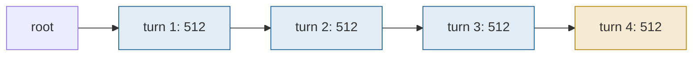

## 1. The question this page answers

Pages 01 and 02 gave the tools: a radix tree, and the ways in which LM programs share prefixes. This page states the problem that the paper solves, before any solution.

The paper studies LM programs: programs that make many LLM calls, with control flow between the calls (page 02). Its core idea, in its own words: "systematically exploit the multi-call structure in LM programs for efficient execution." These notes state the question of the paper in one sentence:

> How can a system make LM programs easy to write and fast to run? Their many calls share structure that no single call can see.

RadixAttention answers one part of that question. That part is the focus of this folder:

> Can the runtime keep the KV cache of every finished call, and reuse it for any later call that starts with the same tokens? It must do this with no manual configuration, and at almost no cost when nothing is shared.

An interviewer who hears "RadixAttention" asks questions like these. This page answers them:

1. Which inefficiencies did the paper find, and which technique answers each one?
2. Why did inference engines discard the KV cache? Why is it hard to keep it?
3. Which design questions must a reuse system answer?
4. Why a tree, and not a table of prompts?
5. How much does reuse save in a multi-turn chat, in tokens, bytes and FLOPs?

## 2. Mental model

> [!analogy] A kitchen that discards its half-made sauces
> A kitchen cooks many dishes that start with the same steps: chop onions, fry them, add tomatoes. Then each dish adds its own steps. The old kitchen cooks every order from zero, and it discards the half-made sauce when the order leaves. A better kitchen keeps each half-made sauce in the fridge, with a label that lists the exact steps that made it. For a new order, the cook finds the sauce whose label matches the longest run of first steps, and continues from there. The fridge shares its space with the counter for the orders in progress. When the kitchen is busy, the cook discards the sauces that nobody used for the longest time.
>
> **Where it stops working:** a sauce is reusable only if every earlier step is identical and in the same order. A sauce that started with garlic is useless for a recipe that starts with onions, even if all later steps match. And a real fridge has its own space. In RadixAttention, cached tokens and running requests use the same GPU memory, so the cache shrinks whenever the running batch needs room.

## 3. Terms

| Term | Plain meaning |
|---|---|
| LM program | A program that makes several LLM calls, with control flow between them and structured inputs and outputs. |
| LLM call | One request to the model: a prompt goes in, generated tokens come out. |
| prefix | The first tokens of a sequence, from position 0 to some position. |
| shared prefix | The same first tokens in two or more calls, for example a system prompt. |
| KV cache reuse | Taking the stored keys and values of a prefix, instead of computing them again in prefill. |
| redundant computation | Prefill work that computes keys and values that the system computed before. |
| frontend | The part of SGLang that the programmer uses: a language embedded in Python. |
| runtime | The part of SGLang that runs the model on the GPU: batching, memory and kernels. |
| hit rate | The paper's measure: cached prompt tokens divided by all prompt tokens. |
| table-based cache | A cache that finds stored KV by an exact key, for example the whole prompt. |
| radix tree | A tree whose edges hold runs of tokens. Page 01 builds one. |
| evict | Remove cached KV from GPU memory to make room for other tokens. |
| continuous batching | Adding requests to the running batch and removing them from it at every iteration. |
| paged layout | KV stored in fixed-size pages anywhere in GPU memory, with an index per request. |
| tensor parallelism | Splitting each layer across several GPUs, each with a part of the attention heads. |

All terms are also in the [Glossary](/notes/papers/glossary).

## 4. The paper's question

### 4.1 LM programs make many related calls

The paper names two common properties of LM programs:

1. "LM programs typically contain multiple LLM calls interspersed with control flow."
2. "LM programs receive structured inputs and produce structured outputs."

Its Figure 2 shows an example: an essay judge. The program adds an image and an essay to the prompt. It asks the model to `select` whether the image and the essay are related. Then it uses `fork` to make three copies of the prompt, and each copy judges one dimension of the essay with `gen`. The program merges the three judgments, writes a summary, gives a grade, and returns JSON that a regular expression constrains. Every call after the first starts with the same image and essay. Page 08 rewrites this program.

The same pattern appears in agents, tree-of-thought search, few-shot benchmarks, multi-turn chat and RAG pipelines. Page 02 shows the four sharing patterns of the paper's Figure 9 with numbers.

### 4.2 Three inefficiencies, and the answer to each

The paper finds three inefficiencies in the systems of its time. It answers each one with a part of SGLang.

| Inefficiency | What goes wrong | Answer in SGLang | Page |
|---|---|---|---|
| 1. Programs are hard to write | String manipulation, prompt tuning, brittle output parsing, multimodal inputs and parallelism are all manual. | A frontend language embedded in Python, with the primitives `gen`, `select`, `extend`, `fork`, `join`, `image` and `video`. | 08 |
| 2. Redundant KV cache computation | "In existing inference engines, the KV cache of a request is discarded after processing is completed." The next call computes the same prefix again. | RadixAttention: keep the KV cache in a radix tree and reuse it automatically across calls. | 04 to 07 |
| 3. Slow constrained decoding | "existing systems only decode one token at a time", even when the format forces the next several tokens. | A compressed finite state machine that decodes a forced run of tokens in one forward pass. | 08 |

A fourth technique serves models that are available only through an API, such as GPT-4: API speculative execution. The first `gen` call continues past its stop condition, and the extra tokens can fill later primitives without a new call (page 08).


The abstract reports the combined result: "up to 6.4x higher throughput compared to state-of-the-art inference systems". Section 6 also reports latency that is up to 3.7x lower. Page 09 explains what these numbers measure.

> [!key] The thesis of the paper
> The calls of an LM program are not independent. They share prefixes, structure and output formats. A system that sees the whole program can reuse work that a system of independent calls repeats.

### 4.3 Why the KV cache is the large waste

A shared prefix gives the same keys and values in every call. The paper states the reason in Appendix A.1: "the computation of the KV cache only depends on all previous tokens". So when two calls start with the same 2,000 tokens, prefill computes the same 2,000 keys and values per layer twice. Page 02 proves this from causal attention.

Interpretation of these notes: this waste grows with the program. A few-shot benchmark repeats its examples in every question. A chat repeats its whole history in every turn. An agent repeats its tools and its trace in every step. So the waste is not a small constant. It grows with the number of calls and the length of the shared part.

## 5. Why automatic reuse is hard

### 5.1 What engines did before

The paper describes the engines of its time with one sentence: "In existing inference engines, the KV cache of a request is discarded after processing is completed."

PagedAttention already shared KV blocks, but only in two cases. It shared blocks between the sequences of one request, such as parallel samples and beams. It also shared a prefix that the service provider reserved in advance ([06 Sharing](/notes/papers/llm-serving/2023-pagedattention/06-decoding-scenarios-and-sharing), section 8). It did not find shared prefixes between unrelated requests by itself.

Automatic prefix caching came to vLLM in version 0.4.0, released on 2024-03-31. The first SGLang paper version is from 2023-12-12. [L9: Prefix caching and KV reuse](/notes/ai/llm-systems/04-inference/l9-prefix-caching-and-kv-reuse) explains the vLLM design in depth.

The order of events matters in an interview, because "what came first" is a common follow-up:

| Date | Event | Source |
|---|---|---|
| 2023-06-20 | vLLM launch post with PagedAttention. Its paper shares KV inside a request and for prefixes that the provider reserves. | [PagedAttention page 03](/notes/papers/llm-serving/2023-pagedattention/03-the-question) |
| 2023-12-12 | SGLang v1 on arXiv: "Efficiently Programming Large Language Models using SGLang", with RadixAttention, LRU leaf eviction and reference counts | arXiv 2312.07104 v1 |
| 2024-01-17 | LMSYS blog: "up to 5 times higher throughput", against vLLM v0.2.5, Guidance v0.1.8 and Hugging Face TGI v1.3.0 | LMSYS blog |
| 2024-03-31 | vLLM 0.4.0 with automatic prefix caching over hashed 16-token blocks | PyPI |
| 2024-06-06 | SGLang v2 on arXiv, the final title and the NeurIPS 2024 version, "up to 6.4x higher throughput" | arXiv 2312.07104 v2 |

The paper itself notes why it compares with vLLM v0.2.5: RadixAttention "has been partially integrated as an optional experimental feature" into later vLLM versions (page 09).

### 5.2 Five design questions

The paper warns that caching across calls "is neither free nor trivial, as it requires additional storage and more complex memory management." These notes divide the difficulty into five design questions. Each later page answers one or two of them.


> [!key] Reuse is not free
> Cached KV takes GPU memory that the running batch also needs, and every request pays for a search. So a reuse system must decide where to store, how to match, what to evict, how to order requests and how the program helps.

### 5.3 Question 1: where is the cached KV stored?

GPU memory holds the weights, the KV of the running requests, and now the cached KV too. A fixed partition for the cache wastes memory when there is little reuse. It also limits the batch when many requests wait. The paper does not partition: "we do not preallocate a fixed-size memory pool as a cache". Cached tokens and running requests share one pool. "When enough waiting requests run, the system will evict all cached tokens in favor of a larger batch size." Page 04 shows the layout and page 05 the eviction.

### 5.4 Question 2: how is the longest match found?

A server can hold thousands of cached sequences. A new request can share any number of first tokens with any of them. The search runs for every request, so it must be cheap. The paper uses a radix tree and states: "The tree structure is stored on the CPU with negligible maintenance overhead." Page 01 teaches the data structure and page 04 applies it.

### 5.5 Question 3: what is kept, and what is evicted?

Memory is finite, so the cache must choose. A prefix that a running request uses must never disappear. A prefix that many requests share is worth more than the end of one conversation. The paper evicts the least recently used leaf first and protects nodes in use with a reference count. Page 05 explains both.

### 5.6 Question 4: in what order do requests run?

With a small cache, the order of requests decides whether a prefix is still cached when its next user runs. The paper sorts the waiting requests by matched prefix length and proves that a depth-first order of the tree is optimal under one condition. Page 06 explains the proof.

### 5.7 Question 5: how can the program help?

The frontend knows the structure of the program before the runtime sees any request. For example, a `fork` creates several calls with one shared prefix. The frontend can send that prefix first, so that the later calls find it in the tree. With several GPUs, a router can send each request to the GPU that holds its prefix. Page 07 covers both.

## 6. Requirements for a reuse system

The sharing patterns of page 02 and the claims of the paper give seven requirements. Every answer to the five questions must keep them.

| Requirement | Why it is needed | How RadixAttention meets it | Page |
|---|---|---|---|
| Exact reuse | A cache that changes the output is not acceptable. | It matches exact token prefixes. The KV of a prefix "only depends on all previous tokens" (Appendix A.1). | 02, 04 |
| Any prefix length | Shared parts end at any token: a system prompt of 8 tokens, examples of 1,000 tokens. | Pages of one token, so a match can end at any position. A node splits where two sequences differ. | 04 |
| Multi-level sharing | All questions share the examples, and the choices of one question share that question. | A tree has one node per shared level. | 01, 02 |
| No manual configuration | Programs change often. A list of prefixes chosen by hand is soon outdated. | Every finished request is inserted into the tree, and every new request is matched. | 04 |
| Negligible cost without hits | Many workloads share nothing. | The paper reports "only negligible memory and time overhead when there is no cache hit": 0.2 s of 74.3 s on 100 ShareGPT requests, "less than 0.3%". | 09 |
| Continuous batching and paging | Modern engines need both for throughput. | The paper names compatibility with "continuous batching" and "paged attention". Cached and running tokens share one paged pool. | 04, 05 |
| Tensor parallelism | Large models run on several GPUs. | "each GPU maintains a sharded KV cache". "There is no need for additional synchronization because the tree operations are the same." | 07 |

> [!key] The bar for an automatic cache
> It must give exact results, match any length at any depth, and need no configuration. It must cost almost nothing when nothing is shared. And it must work with continuous batching, paging and tensor parallelism.

> [!note] Which parts are the paper and which are these notes
> The quotes in the third column are the paper. The division into five questions and seven requirements is the interpretation of these notes. The paper presents the same concerns in its Section 3 and Appendix A, in another order.

## 7. Why a tree, and not a table?

### 7.1 The ablation "No Tree-Structure"

The paper's ablation study (Figure 8) tests seven variants. Their names: No Cache, No Tree-Structure, FCFS Schedule, Random Schedule, No Frontend Parallelism, No Frontend Hint, and Full optimizations. The paper describes No Tree-Structure as a table-based cache. The paper shows that each component is needed for the best result, on LLM Judge, Tree of Thought, MMLU and Multi-Turn Chat (short). The bars carry no printed numbers, so these notes do not quote any.

The paper does not print how its table works. Interpretation of these notes: the simplest table is a dictionary whose key is the whole prompt. It finds a hit only when a new prompt is identical to a stored prompt. A prefix match finds the longest stored beginning, whatever its length.

### 7.2 A small example

> [!example] Worked example: four few-shot prompts, a table against a prefix match
> Four requests arrive in this order: FS+QA, FS+QB, FS+QA again, FS+QC. FS is 12 tokens of shared examples. Each question is 4 tokens. Each answer is 1 token. The cache is large enough for everything.
>
> 1. Prompt tokens in total: $4 \times (12 + 4) = 64$.
> 2. **Table.** Only the repeat of FS+QA has an identical prompt. Hits: $16$. Hit rate: $16 / 64 = 25\%$.
> 3. **Prefix match.** FS+QA: 0, because the cache is empty. FS+QB: 12, the examples. FS+QA again: 16, the whole prompt. FS+QC: 12. Hits: $0 + 12 + 16 + 12 = 40$. Hit rate: $40 / 64 = 62.5\%$.
>
> The prefix match finds every hit that the table finds, plus the shared examples in every new question.

### 7.3 The same comparison in code

The next program counts the hits of both caches. `prefix_hits` scans all stored sequences for the longest common prefix. A radix tree gives the same number with one walk down the tree (page 01). The program also runs the four-turn chat of section 8.

```python
def lcp(a, b):                       # length of the longest common prefix
    n = 0
    while n < len(a) and n < len(b) and a[n] == b[n]:
        n += 1
    return n

def table_hits(requests):            # a dictionary keyed by the whole prompt
    table, hits = set(), 0
    for prompt, output in requests:
        if tuple(prompt) in table:
            hits += len(prompt)
        table.add(tuple(prompt))
    return hits

def prefix_hits(requests):           # the longest stored prefix (what a radix tree finds)
    stored, hits = [], 0
    for prompt, output in requests:
        hits += max((lcp(prompt, s) for s in stored), default=0)
        stored.append(prompt + output)
    return hits

def toks(name, n):
    return [f"{name}{i}" for i in range(n)]

# A 4-turn chat: 256 new input tokens and 256 output tokens per turn
chat, history = [], []
for turn in range(4):
    prompt = history + toks(f"in{turn}_", 256)
    output = toks(f"out{turn}_", 256)
    chat.append((prompt, output))
    history = prompt + output

# Few-shot: 12 shared example tokens, then a 4-token question, 1 answer token
FS = toks("fs", 12)
fewshot = [(FS + toks(q, 4), toks("a" + q, 1)) for q in ("qa", "qb", "qa", "qc")]

for name, reqs in (("chat", chat), ("few-shot", fewshot)):
    total = sum(len(p) for p, _ in reqs)
    print(f"{name:9s} prompt tokens {total:5d}  table hits {table_hits(reqs):5d}"
          f"  prefix hits {prefix_hits(reqs):5d}")
```

```text
chat      prompt tokens  4096  table hits     0  prefix hits  3072
few-shot  prompt tokens    64  table hits    16  prefix hits    40
```

The important lines:

1. `table.add(tuple(prompt))` stores the whole prompt as one key. Two prompts that differ in their last token are two unrelated keys.
2. `stored.append(prompt + output)` stores the generated tokens too. The next turn of a chat starts with the previous prompt and output, so this line makes the chat hits possible.
3. `max((lcp(prompt, s) for s in stored), default=0)` is the longest match against any stored sequence. It costs one comparison per stored sequence. The radix tree removes that factor.
4. In the chat, no prompt ever repeats, because each turn is longer than the one before. The table finds 0 of 4,096 tokens. The prefix match finds 3,072.

### 7.4 The design space

| Index | What a lookup finds | Cost of one lookup | Copies of a shared prefix |
|---|---|---|---|
| Table keyed by the whole prompt | Identical prompts only | One hash of the whole prompt | One per distinct prompt that contains it |
| Scan of all stored sequences | The longest prefix | Comparisons with every stored sequence | One per stored sequence |
| Hash chain over 16-token blocks (vLLM) | The longest prefix, rounded down to a full block | One hash per block of the prompt | One per block |
| Radix tree (SGLang) | The longest prefix, to the exact token | Token comparisons along one path, plus one dictionary access per node | One, in the shared node |

> [!key] Why a tree
> A radix tree stores each shared prefix once, finds the longest match with one walk, and matches to the exact token. A whole-prompt table misses every partial match. A hash chain matches only full blocks. [L9](/notes/ai/llm-systems/04-inference/l9-prefix-caching-and-kv-reuse) section 7.2 compares the tree with the hash chain.

## 8. Worked example: a four-turn chat

A multi-turn chat is the clearest case of reuse across calls. The paper's chat benchmark has 4 turns per conversation. The short variant has 256 to 512 input tokens per turn and 4 to 8 output tokens. The long variant has 256 to 512 output tokens. These notes use one exact shape that resembles the long variant: 4 turns, each with 256 new input tokens and 256 output tokens. The model is Llama-3.1-8B, with 128 KiB of KV per token ([L3: The KV cache size formula](/notes/ai/llm-systems/03-kv-cache/l3-the-kv-cache-size-formula)).

> [!example] Worked example: prefill work of one conversation, without and with reuse
> The prompt of turn $k$ holds all earlier turns plus the new input: $256 + (k - 1) \times (256 + 256)$ tokens.
>
> 1. Prompt lengths: turn 1: 256. Turn 2: $256 + 512 = 768$. Turn 3: $256 + 1{,}024 = 1{,}280$. Turn 4: $256 + 1{,}536 = 1{,}792$.
> 2. **Without reuse**, prefill computes every prompt token: $256 + 768 + 1{,}280 + 1{,}792 = 4{,}096$ tokens.
> 3. **With reuse**, the tree holds the earlier prompts and outputs. Cached tokens per turn: $0, 512, 1{,}024, 1{,}536$, in total $3{,}072$. Prefill computes only the new input: $4 \times 256 = 1{,}024$ tokens.
> 4. Hit rate: $3{,}072 / 4{,}096 = 75\%$. A whole-prompt table: $0\%$, because no prompt repeats.
> 5. KV computed in prefill, at $131{,}072$ bytes per token: without reuse $4{,}096 \times 131{,}072 = 536{,}870{,}912$ bytes $= 512$ MiB. With reuse: $128$ MiB.
> 6. Prefill arithmetic, at about $2 \times 8.03 \times 10^9$ FLOPs per token: without reuse $\approx 6.58 \times 10^{13}$ FLOPs, about 66.5 ms at the H100 dense BF16 peak of about 989 TFLOPS. With reuse: $\approx 1.64 \times 10^{13}$ FLOPs, about 16.6 ms. Real prefill runs below peak, so real times are longer.
> 7. **What reuse costs:** storage between the turns. After turn 4, the conversation holds $4 \times 512 = 2{,}048$ tokens, which is $2{,}048 \times 128$ KiB $= 256$ MiB of the KV pool, while the user writes the next message.
>
> All numbers computed in these notes.

```plot
{
  "title": "Prefill tokens per turn of a 4-turn chat with 256 input and 256 output tokens per turn: without reuse (red), with reuse (blue)",
  "xAxis": { "label": "turn", "domain": [0.5, 4.5] },
  "yAxis": { "label": "tokens computed in prefill", "domain": [0, 2000] },
  "disableZoom": true,
  "data": [
    { "points": [[1, 256], [2, 768], [3, 1280], [4, 1792]], "fnType": "points", "graphType": "polyline", "color": "#C81D25" },
    { "points": [[1, 256], [2, 768], [3, 1280], [4, 1792]], "fnType": "points", "graphType": "scatter", "color": "#C81D25" },
    { "points": [[1, 256], [2, 256], [3, 256], [4, 256]], "fnType": "points", "graphType": "polyline", "color": "#1E6091" },
    { "points": [[1, 256], [2, 256], [3, 256], [4, 256]], "fnType": "points", "graphType": "scatter", "color": "#1E6091" }
  ]
}
```

Read the plot from left to right. Without reuse, the prefill of each turn grows by 512 tokens. With reuse, it stays at 256: only the new message. The gap between the lines is the redundant computation of section 4.2.

In the radix tree, the conversation is one path that grows by one node per turn. Each turn matches the whole path and adds a leaf with its new input and its output:



In this drawing, turn 4 matches the three blue nodes, $3 \times 512 = 1{,}536$ tokens, and inserts the gold node: 256 input and 256 output tokens.

The decode work does not change. Each conversation still generates $4 \times 256 = 1{,}024$ tokens, one decode step each. Each decode step reads all the weights once: about $8.03 \times 10^9 \times 2 \approx 16$ GB in BF16. [L2: Prefill and decode](/notes/ai/llm-systems/03-kv-cache/l2-prefill-and-decode) estimates about 4.9 ms per decode step at batch 1 on an H100. So at batch 1, the 1,024 steps take about 5 s, while reuse saves about 50 ms of ideal prefill time. Interpretation of these notes: when the outputs are long, decode dominates the time, and saving prefill helps little. This agrees with the paper's result that the long multi-turn chat shows almost no speedup (page 09).

> [!key] What reuse saves, and what it does not
> Without reuse, the prompt work of a chat grows with the square of the number of turns. With reuse, it grows linearly: only the new messages run. Decode does not change, and the cache costs memory between the calls.

> [!trap] One token per turn is not cached
> The counts above treat every output token as cached. A real engine has no KV for the last token that it sampled, because the model never processed that token. So the next turn computes one more token. Page 04 shows how SGLang 0.5.22 handles this detail.

### Exercises

1. **A formula for an n-turn chat.** Write `chat_prefill(n, i, o)` for a chat with $n$ turns, $i$ new input tokens and $o$ output tokens per turn. Return the prefill tokens without reuse, with reuse, and the hit rate. Derive a closed form and check it against a loop. Acceptance test: `chat_prefill(4, 256, 256)` returns `(4096, 1024, 0.75)`. `chat_prefill(10, 100, 300)` returns `(19000, 1000, 0.9474)`.
   - Hint 1: The prompt of turn $k$ is $i + (k - 1)(i + o)$ tokens.
   - Hint 2: $\sum_{k=1}^{n} (k - 1) = n(n - 1)/2$.
2. **A tree of thought against a table.** A problem prompt P has 50 tokens and an instruction I has 5 tokens. Three calls with the prompt P+I each generate a thought of 20 tokens. For each thought $T_k$, two calls with the prompt P+I+$T_k$+J generate 20 tokens each, where J is a second 5-token instruction. Count the hits of a whole-prompt table and of a prefix match, as in section 7.3. Acceptance test: 645 prompt tokens, 350 table hits (about 54.3%) and 575 prefix hits (about 89.1%).
   - Hint 1: The two children of one thought have identical prompts, so the table hits there too.
   - Hint 2: The first child of a thought matches P+I+$T_k$, because the parent call stored its output.

Build it in a lab: [open a lab for this page](/labs/new?note=papers/llm-serving/2023-sglang-radixattention/03-the-question)

## 9. Common mistakes

1. **"RadixAttention is a new attention formula."** It is a way to keep and find KV caches: a radix tree, an eviction policy and a scheduling policy. The attention arithmetic does not change (page 04, section 8).
2. **"Prefix caching helps only when a whole prompt repeats."** That describes a whole-prompt table. A radix tree reuses a prefix of any length, so a chat turn reuses all earlier turns.
3. **"Reused KV is an approximation."** The KV of a prefix "only depends on all previous tokens" (Appendix A.1). Reuse gives the same values as recomputation, up to floating-point rounding.
4. **"Caching is free."** The paper says it "is neither free nor trivial". Cached tokens take GPU memory that the running batch also needs. RadixAttention evicts them when the batch needs room.
5. **"The cache holds only prompts."** It also holds generated tokens. The next turn of a chat starts with the previous output, so those tokens give hits too.
6. **"A high hit rate always gives a large speedup."** A hit saves prefill only. When outputs are long, decode dominates. The four-turn chat has a hit rate of 75%, but its 1,024 decode steps do not change.

## 10. One-minute explanation

The SGLang paper studies LM programs: programs that make many LLM calls with control flow, such as agents, few-shot benchmarks and multi-turn chat. It finds three inefficiencies: hard programming, KV caches that each call discards, and constrained decoding of one token per step. RadixAttention answers the second one: the runtime keeps the KV cache of finished calls and reuses it automatically. Reuse is exact, because the KV of a prefix depends only on the earlier tokens. But it is not free, because the cache needs GPU memory that the running batch also needs. A design must decide where to store the cache, how to match, what to evict, how to order requests and how the program helps. A whole-prompt table finds only identical prompts, so it misses every growing chat. A radix tree finds the longest prefix to the exact token and stores each shared prefix once. In a four-turn chat with 256 input and 256 output tokens per turn, reuse cuts prefill from 4,096 to 1,024 tokens. Decode stays the same, so long-output chats gain little.

## 11. Check questions

```check
{
  "question": "Name the three inefficiencies that the SGLang paper finds in the systems of its time, and the part of SGLang that answers each one.",
  "hint": "One is about writing programs, one about memory, one about structured output.",
  "answer": "1. Programs are hard to write: string manipulation, prompt tuning, brittle output parsing, multimodal inputs and parallelism. Answer: the frontend language embedded in Python, with `gen`, `select`, `extend`, `fork`, `join`, `image` and `video` (page 08).\n2. Redundant KV cache computation: \"In existing inference engines, the KV cache of a request is discarded after processing is completed.\" Answer: RadixAttention, automatic KV reuse across calls (pages 04 to 07).\n3. Constrained decoding one token at a time: \"existing systems only decode one token at a time\". Answer: the compressed finite state machine, which decodes a forced run of tokens in one forward pass (page 08).\n\nFor models that are available only through an API, API speculative execution is a fourth technique."
}
```

```check
{
  "question": "Give the paper's definition of the cache hit rate. The prompts are FS+QA, FS+QB, FS+QA, FS+QC, with FS = 12 tokens and 4 tokens per question. Compute the hit rate for a whole-prompt table and for a prefix match.",
  "hint": "Count only prompt tokens. The first request finds an empty cache.",
  "answer": "The paper defines the hit rate as \"number of cached prompt tokens / number of prompt tokens\". There are $4 \\times 16 = 64$ prompt tokens.\n\n- Whole-prompt table: only the repeated FS+QA hits, with 16 tokens. $16/64 = 25\\%$.\n- Prefix match: $0 + 12 + 16 + 12 = 40$ tokens. $40/64 = 62.5\\%$.\n\nThe prefix match also finds the 12 shared example tokens in every new question."
}
```

```check
{
  "question": "Why is the reuse of a cached prefix exact? Give two cases in which the same text does NOT give a hit.",
  "answer": "The paper (Appendix A.1): \"the computation of the KV cache only depends on all previous tokens\". Causal attention lets token $i$ see only tokens $1$ to $i$. So equal prefixes give equal keys and values in every layer, up to floating-point rounding (page 02).\n\nNo hit when:\n1. Any earlier token differs. One changed token in the system prompt changes the keys and values of every later token.\n2. The same text appears at another position, for example a document after a different question. Its earlier tokens differ, and its position embeddings differ too.\n\nThe model weights and every other input that shapes the values, such as a LoRA adapter, must also be the same. SGLang 0.5.22 keeps such entries apart with `extra_key` (page 10)."
}
```

```check
{
  "question": "Interview follow-up: Why does RadixAttention not reserve a fixed part of GPU memory for the prefix cache? What does it do instead, and what is the cost?",
  "hint": "Think of a workload with no reuse and a workload with a long waiting queue.",
  "answer": "A fixed cache partition is wrong in both directions. With little reuse, the partition holds KV that nobody needs, and the running batch is smaller than it could be. With much reuse and a long waiting queue, the partition may be too small, or it takes memory that more running requests need.\n\nThe paper: \"we do not preallocate a fixed-size memory pool as a cache\". Cached tokens and running requests share one pool. \"When enough waiting requests run, the system will evict all cached tokens in favor of a larger batch size.\"\n\nThe cost: the cache size changes all the time. So the system needs an eviction policy (LRU leaves first) and protection for nodes in use (reference counts). An evicted prefix must be computed again if a later request needs it (page 05)."
}
```

```check
{
  "question": "Interview follow-up: An interviewer says: \"Just hash each prompt and keep its KV in a dictionary.\" What does that design lose? Give a workload where it finds nothing, and the hit rate of a prefix match on the same workload.",
  "answer": "A whole-prompt dictionary finds only identical prompts. It misses every partial match, so it loses:\n\n1. Growing prompts. In a chat, each turn's prompt is the earlier prompt plus its output plus a new message. With 4 turns of 256 input and 256 output tokens, the dictionary finds 0 of 4,096 prompt tokens. A prefix match finds 3,072: a hit rate of 75%.\n2. Shared beginnings with different endings: few-shot examples before different questions, a system prompt before different users.\n3. Storage: each distinct prompt stores its own copy of the shared part.\n\nTwo better indexes exist. A hash chain over full blocks (vLLM) finds the longest prefix rounded down to a block. A radix tree (SGLang) finds it to the exact token and stores each shared prefix once. The paper's ablation \"No Tree-Structure\" uses a table-based cache and performs worse than the full system (Figure 8, no numbers printed)."
}
```

```check
{
  "question": "Interview follow-up: Compute what prefix caching saves for one conversation of 4 turns with 256 input and 256 output tokens per turn, for Llama-3.1-8B. Then explain why the end-to-end speedup can still be small.",
  "hint": "Prompt of turn k: 256 + (k - 1) x 512. KV per token: 128 KiB.",
  "answer": "Prompt lengths: 256, 768, 1,280, 1,792. Without reuse, prefill computes $4{,}096$ tokens: $512$ MiB of KV and about $2 \\times 8.03 \\times 10^9 \\times 4{,}096 \\approx 6.58 \\times 10^{13}$ FLOPs (about 66.5 ms at 989 TFLOPS peak). With reuse, only the new messages: $4 \\times 256 = 1{,}024$ tokens, $128$ MiB, about 16.6 ms at peak. Hit rate $3{,}072 / 4{,}096 = 75\\%$.\n\nBut the conversation also generates $1{,}024$ tokens, one decode step each, and every decode step reads all the weights (about 16 GB in BF16). Reuse does not change decode. When outputs are long, decode dominates the time, so the total speedup is small. The paper reports almost no speedup for its long multi-turn chat benchmark (page 09). The price of reuse is storage: after turn 4, the conversation holds $2{,}048$ tokens, 256 MiB, in the pool."
}
```

```check
{
  "question": "Interview follow-up: List the requirements that an automatic prefix cache must meet to be useful in a production engine. For each, give the claim or quote of the paper that shows RadixAttention meets it.",
  "answer": "1. Exact reuse: the KV of a prefix \"only depends on all previous tokens\" (Appendix A.1), and the tree matches exact token prefixes.\n2. Any prefix length: pages of one token, \"a non-contiguous, paged layout, where the size of each page is equivalent to one token\", and node splits at the point of difference.\n3. Multi-level sharing: a tree has one node per shared level (examples, then a question, then its choices).\n4. No manual configuration: every finished request is inserted, and every new request is matched.\n5. Negligible cost without hits: \"only negligible memory and time overhead when there is no cache hit\". Measured: 0.2 s of 74.3 s, \"less than 0.3%\".\n6. Continuous batching and paging: the paper names compatibility with \"continuous batching\" and \"paged attention\", with one shared pool.\n7. Tensor parallelism: \"each GPU maintains a sharded KV cache\", and \"There is no need for additional synchronization because the tree operations are the same.\"\n\nThe list of seven is the interpretation of these notes. The quotes are the paper."
}
```

```check
{
  "question": "Exercise 1: show a reference solution",
  "answer": "```python\ndef chat_prefill(n, i, o):\n    \"\"\"n turns, i new input tokens and o output tokens per turn.\n    Returns (prefill tokens without reuse, with reuse, hit rate).\"\"\"\n    without = sum(i + (k - 1) * (i + o) for k in range(1, n + 1))\n    with_reuse = n * i                        # only the new input of each turn\n    closed = n * i + (i + o) * n * (n - 1) // 2\n    assert without == closed\n    return without, with_reuse, round((without - with_reuse) / without, 4)\n\nprint(chat_prefill(4, 256, 256))\nprint(chat_prefill(10, 100, 300))\nprint(chat_prefill(1, 256, 256))\n```\n\nOutput:\n\n```text\n(4096, 1024, 0.75)\n(19000, 1000, 0.9474)\n(256, 256, 0.0)\n```\n\nThe loop adds the prompt of every turn. The closed form follows from $\\sum_{k=1}^{n} \\left(i + (k-1)(i+o)\\right) = n i + (i+o) \\frac{n(n-1)}{2}$. With reuse, each turn computes only its $i$ new tokens. A one-turn chat has nothing to reuse, so its hit rate is 0. The hit rate tends to 1 as $n$ grows, because the history grows with $n^2$ and the new input only with $n$."
}
```

```check
{
  "question": "Exercise 2: show a reference solution",
  "answer": "```python\ndef lcp(a, b):\n    n = 0\n    while n < len(a) and n < len(b) and a[n] == b[n]:\n        n += 1\n    return n\n\ndef table_hits(requests):\n    table, hits = set(), 0\n    for prompt, output in requests:\n        if tuple(prompt) in table:\n            hits += len(prompt)\n        table.add(tuple(prompt))\n    return hits\n\ndef prefix_hits(requests):\n    stored, hits = [], 0\n    for prompt, output in requests:\n        hits += max((lcp(prompt, s) for s in stored), default=0)\n        stored.append(prompt + output)\n    return hits\n\ndef toks(name, n):\n    return [f\"{name}{i}\" for i in range(n)]\n\nP, I, J = toks(\"p\", 50), toks(\"i\", 5), toks(\"j\", 5)    # problem, two instructions\nreqs = []\nthoughts = [toks(f\"t{k}_\", 20) for k in range(3)]\nfor k in range(3):                                      # level 1: three thoughts\n    reqs.append((P + I, thoughts[k]))\nfor k in range(3):                                      # level 2: two children each\n    for j in range(2):\n        reqs.append((P + I + thoughts[k] + J, toks(f\"u{k}{j}_\", 20)))\ntotal = sum(len(p) for p, _ in reqs)\nprint(\"prompt tokens\", total)\nprint(\"table \", table_hits(reqs), round(table_hits(reqs) / total, 3))\nprint(\"prefix\", prefix_hits(reqs), round(prefix_hits(reqs) / total, 3))\n```\n\nOutput:\n\n```text\nprompt tokens 645\ntable  350 0.543\nprefix 575 0.891\n```\n\nPrompt tokens: $3 \\times 55 + 6 \\times 80 = 645$. The table hits on the second and third level-1 calls ($2 \\times 55$) and on the second child of each thought ($3 \\times 80$): $350$. The prefix match hits $2 \\times 55$ on level 1. Then it hits $75$ for the first child of each thought (P+I+$T_k$, which the parent call stored) and $80$ for the second child. In total: $110 + 3 \\times (75 + 80) = 575$. The table catches identical prompts but none of the growth from parent to child."
}
```

## 12. Links

- Previous: [02 Background: prefix sharing in LM programs](/notes/papers/llm-serving/2023-sglang-radixattention/02-background-prefix-sharing-in-lm-programs)
- Next: [04 RadixAttention: the tree of KV caches](/notes/papers/llm-serving/2023-sglang-radixattention/04-radixattention-the-tree-of-kv-caches)
- The data structure: [01 Background: tries and radix trees](/notes/papers/llm-serving/2023-sglang-radixattention/01-background-tries-and-radix-trees)
- The answers to the five questions: [05 Eviction and reference counts](/notes/papers/llm-serving/2023-sglang-radixattention/05-eviction-and-reference-counts), [06 Cache-aware scheduling and the DFS theorem](/notes/papers/llm-serving/2023-sglang-radixattention/06-cache-aware-scheduling), [07 Frontend hints and multi-GPU RadixAttention](/notes/papers/llm-serving/2023-sglang-radixattention/07-frontend-hints-and-multi-gpu)
- The other inefficiencies: [08 The rest of SGLang](/notes/papers/llm-serving/2023-sglang-radixattention/08-the-rest-of-sglang)
- The measured speedups: [09 Results](/notes/papers/llm-serving/2023-sglang-radixattention/09-results)
- The PagedAttention view of the same problem: [03 The question: where does KV cache memory go?](/notes/papers/llm-serving/2023-pagedattention/03-the-question), [06 Sharing](/notes/papers/llm-serving/2023-pagedattention/06-decoding-scenarios-and-sharing), [10 Limits and later work](/notes/papers/llm-serving/2023-pagedattention/10-limits-and-later-work)
- The KV cache: [L1: Why the KV cache exists](/notes/ai/llm-systems/03-kv-cache/l1-why-the-kv-cache-exists), [L2: Prefill and decode](/notes/ai/llm-systems/03-kv-cache/l2-prefill-and-decode), [L3: The KV cache size formula](/notes/ai/llm-systems/03-kv-cache/l3-the-kv-cache-size-formula)
- Reuse in engines and in provider APIs: [L9: Prefix caching and KV reuse](/notes/ai/llm-systems/04-inference/l9-prefix-caching-and-kv-reuse), [L7: Prompt caching](/notes/ai/context-engineering/01-foundations/l7-prompt-caching)
- The paper folder: [SGLang and RadixAttention (2023)](/notes/papers/llm-serving/2023-sglang-radixattention), [Glossary](/notes/papers/glossary)

### Sources

- Zheng et al., "SGLang: Efficient Execution of Structured Language Model Programs", NeurIPS 2024, arXiv 2312.07104 v2 (Abstract, §1, §3, Figure 2, Figure 8, Section 6, Appendix A.1): https://arxiv.org/abs/2312.07104 (checked on 2026-10-19)
- First version, arXiv 2312.07104 v1, 2023-12-12: https://arxiv.org/abs/2312.07104v1 (checked on 2026-10-19)
- vLLM 0.4.0 release on PyPI, 2024-03-31 (automatic prefix caching): https://pypi.org/project/vllm/0.4.0/ (checked on 2026-10-19)
- SGLang source code: https://github.com/sgl-project/sglang (checked on 2026-10-19)
