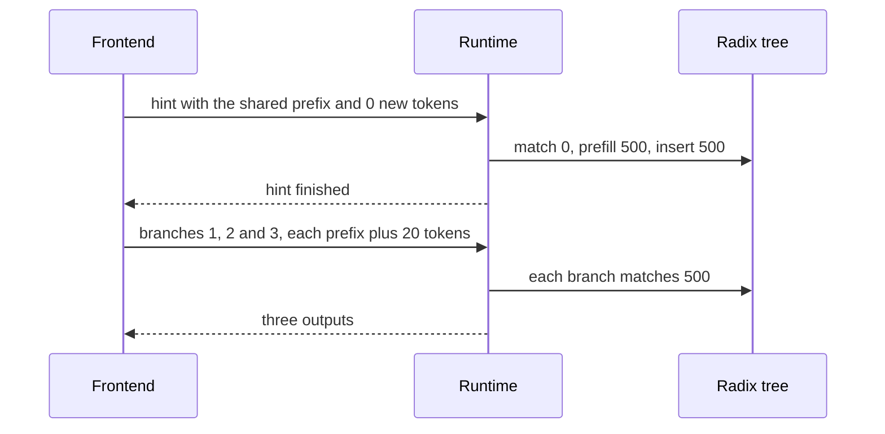

## 1. The question this page answers

Pages 04 to 06 assume one GPU and requests that arrive one after another. A later request then finds the KV of an earlier one in the radix tree. Two common cases break this assumption.

1. **Requests that arrive together.** A `fork` creates several branches that share a prefix, and the program sends them at the same moment. None of them has run yet, so the tree does not hold the shared prefix.
2. **More than one GPU.** A large model runs on several GPUs with tensor parallelism. A busy service runs several copies of the model with data parallelism, and each copy has its own tree.

An interviewer will ask these questions:

1. Why do all branches of a fork miss the cache, even with RadixAttention?
2. What is the frontend hint, and how many prefill tokens does it save?
3. What does the runtime do when no frontend sends a hint?
4. With tensor parallelism, does each GPU need its own tree? Why is no synchronization needed?
5. With data parallelism, how does a router know which worker holds a prefix? What does "weakly consistent" mean?
6. When does a cache-aware router choose the worker with the cache, and when does it choose the shortest queue?

## 2. Mental model

> [!analogy] One soup base for three orders
> A table orders three soups that all need the same two-hour soup base. Three cooks receive the three tickets at the same moment. Nobody has made the base yet, so each cook makes a full pot of it. The head waiter knows that the three tickets belong to one table. So he first gives one cook a fourth ticket: "make only the base". When the base is ready, the three cooks take it, and each adds a different garnish. With several kitchens, a host at the door keeps a notebook of which kitchen has which base. He writes in it what he sends, and he learns about discarded pots only later.
>
> **Where it stops working:** soup is consumed, but KV is not. Any number of requests can read the same slots at the same time. The extra ticket also costs a real round trip, because the branches wait until the base is in the tree. And a wrong line in the host's notebook never gives a wrong soup. It only sends an order to a kitchen that must cook the base again.

## 3. Terms

| Term | Plain meaning |
|---|---|
| frontend | The SGLang language and its interpreter. They run the program on the client side (page 08). |
| runtime | The server that holds the model, the KV pool and the radix tree. |
| `fork` | An SGLang primitive that makes several copies of the current prompt state. |
| branch | One copy after a `fork`. All branches start with the same prefix. |
| frontend hint | A request that holds only the shared prefix. The frontend sends it before the branches, so the runtime inserts the prefix first. |
| in-batch prefix caching | A scheduler rule of SGLang 0.5.22. Among waiting requests that share an uncached prefix, one goes first and the others move to the end of the waiting queue. |
| tensor parallelism (TP) | One copy of the model spread over several GPUs. Each GPU holds some attention heads and their KV. |
| TP rank | One GPU, with its own process, in a tensor-parallel group. |
| data parallelism (DP) | Several independent copies of the model. Each request runs on one copy. |
| worker | One data-parallel copy, with its own KV pool and its own radix tree. |
| router | The process that receives the requests and chooses a worker for each one. |
| meta-tree | The router's tree in the paper. It records which worker holds which prefix. |
| affinity | The preference to send a request to a worker that already holds its prefix. |
| lazy update | The router applies the evictions of the workers late, from a queue, when the system is quiet. |
| weakly consistent | The paper's name for this design: the router's tree can differ from the workers' trees for a while. |
| load | The gateway's count of requests in progress at a worker, as these notes read its source. |
| match rate | In the gateway: the matched characters of a request's text divided by all its characters. |
| cache threshold | The match rate above which the gateway prefers the worker with the cache. |
| shortest-queue routing | Send the request to the worker with the lowest load. |

All terms are also in the [Glossary](/notes/papers/glossary).

## 4. Requests that arrive together

### 4.1 What a fork sends to the runtime

The judge program of the paper's Figure 2 forks its prompt state into three copies, one per judged dimension (page 08 shows the program). Each copy adds its own instruction and calls `gen`. The interpreter runs the three branches in parallel. So the runtime receives three requests at almost the same moment. With the sizes of the worked example below (choices of these notes):

```text
branch 1: [shared prefix: image, essay and question, 500 tokens] [judge dimension 1, 20 tokens]
branch 2: [shared prefix, 500 tokens]                            [judge dimension 2, 20 tokens]
branch 3: [shared prefix, 500 tokens]                            [judge dimension 3, 20 tokens]
```

### 4.2 Why all three branches miss

Recall the lifecycle of page 04: match, lock, prefill the unmatched part, decode, insert. The tree receives new KV only at the insert. In the paper's Algorithm 1, a request is inserted when it finishes (page 06). SGLang 0.5.22 inserts a request's prompt earlier, right after its prefill pass (§4.5). In both cases the insert comes after a prefill.

The scheduler matches the three branches in the same scheduling step, before any of them has run. So each branch finds 0 tokens of the new prefix. The scheduler puts all three in one prefill batch, and the GPU computes the same 500 tokens three times. During that batch, the KV pool holds three copies of the prefix.

> [!key] RadixAttention reuses KV across time, not inside one batch
> The tree can only return KV that an earlier forward pass has computed and inserted. Requests that are scheduled in the same step cannot share a prefix that none of them has computed yet. Something must order them: the frontend (the hint) or the scheduler (in-batch prefix caching).

### 4.3 The frontend hint

The paper describes the fix as an example of frontend-runtime co-design. During `fork`, "the frontend sends the prefix first as a hint, ensuring the prefix is correctly inserted into the tree. It then sends the remaining prompts."



SGLang 0.5.22 still sends this hint. Two short excerpts:

```python
# SGLang 0.5.22, python/sglang/lang/interpreter.py, StreamExecutor.fork (first lines)
        if size > 1 and str(self.text_):
            self.submit(SglCommitLazy())

        self.sync()

# SGLang 0.5.22, python/sglang/lang/backend/runtime_endpoint.py, RuntimeEndpoint
    def commit_lazy_operations(self, s: StreamExecutor):
        data = {"text": s.text_, "sampling_params": {"max_new_tokens": 0}}
        self._add_images(s, data)
        res = http_request(
            self.base_url + "/generate",
```

The important lines:

1. `size > 1 and str(self.text_)`: the frontend sends a hint only for two or more branches and a non-empty prefix. A single copy has nothing to share with.
2. `self.submit(SglCommitLazy())` puts the hint into the prompt's asynchronous stream, after all earlier primitives (page 08 explains the streams).
3. `self.sync()` blocks until the stream has executed everything, the hint included. So the hint has finished before the first branch exists.
4. `commit_lazy_operations` sends the current text to `/generate` with `"max_new_tokens": 0`. This is an ordinary request that only does prefill. When it finishes, the runtime inserts its prompt into the tree.
5. `self._add_images(s, data)` sends the images too, so the image positions of the prefix are also in the tree (page 08, §7).

The 0.5.22 frontend sends the same kind of request in two more places. `select` first sends the prompt with `"max_new_tokens": 0` under the comment "Cache common prefix", then one batch with one prompt per choice (`runtime_endpoint.py`). And `run_program_batch` traces a program that runs on more than one set of arguments. It sends the constant text at the start of the program first, if that text is longer than 64 characters (`cache_program` in `interpreter.py`).

The ablation of the paper's Figure 8(c) has two variants for this part: "No Frontend Hint" and "No Frontend Parallelism". The paper describes them as removing the fork hints and removing the parallelism of the interpreter. Each component is needed for the best result, and no numbers are printed. Interpretation of these notes: without parallelism, the branches run one after another. Later branches then hit the prefix of the first one, but the batches are smaller.

The hint has a cost. It is one more request, and the branches wait for its full round trip. Interpretation of these notes: the prefix prefill must happen before the first branch token anyway. So the extra delay is the round trip and one scheduling step, not a second prefill.

### 4.4 Worked examples

> [!example] Worked example: a fork of 3 with a 500-token prefix
> Choices of these notes: the prefix has 500 tokens and is not cached. Each branch adds 20 tokens. Llama-3.1-8B: 128 KiB of KV per token and about $2 \times 8.03 \times 10^9$ FLOPs per prefill token. H100: about 989 TFLOPS dense BF16.
>
> 1. **No hint.** Three prompts of $500 + 20 = 520$ tokens arrive together. Each matches 0. Prefill: $3 \times 520 = 1{,}560$ tokens. Hit rate: $0 / 1{,}560 = 0\%$.
> 2. **Hint.** The hint prefills 500 tokens. Each branch then matches 500 and prefills 20. Prefill: $500 + 3 \times 20 = 560$ tokens.
> 3. **Hit rate with the hint.** Prompt tokens: $500 + 3 \times 520 = 2{,}060$. Matched: $3 \times 500 = 1{,}500$. Hit rate: $1{,}500 / 2{,}060 \approx 72.8\%$. The hint counts as a request with 0 matched tokens.
> 4. **Saved prefill:** $1{,}560 - 560 = 1{,}000$ tokens, which is $(3 - 1) \times 500$. For $N$ branches and a prefix of $P$ tokens, the hint saves $(N - 1) \times P$ tokens.
> 5. **Duplicate KV avoided:** $1{,}000 \times 131{,}072 = 131{,}072{,}000$ bytes $= 125$ MiB. Without the hint, the pool holds these bytes during the batch.
> 6. **Saved compute:** $1{,}000 \times 2 \times 8.03 \times 10^9 \approx 1.61 \times 10^{13}$ FLOPs, about 16.2 ms of one H100 at peak.

```python
KV_BYTES = 131_072            # Llama-3.1-8B: 2 x 32 layers x 8 KV heads x 128 x 2 bytes
FLOPS_PER_TOKEN = 2 * 8.03e9  # prefill FLOPs per token, about 2 x parameters
H100 = 989e12                 # dense BF16 peak, FLOP/s

def fork_cost(n, prefix, suffix, hint):
    """Prefill tokens and matched tokens when n branches share a new prefix."""
    if hint:
        prompts = [prefix] + [prefix + suffix] * n     # the hint, then the branches
        matched = [0] + [prefix] * n                     # branches find the prefix in the tree
    else:
        prompts = [prefix + suffix] * n                  # all branches arrive at the same time
        matched = [0] * n                                # nobody has inserted the prefix yet
    computed = sum(p - m for p, m in zip(prompts, matched))
    return computed, sum(matched), sum(prompts)

for hint in (False, True):
    computed, matched, prompt = fork_cost(3, 500, 20, hint)
    print(f"hint={hint!s:5} prefill={computed:5} matched={matched:5} "
          f"prompt={prompt:5} hit rate={matched / prompt:.1%}")
saved = fork_cost(3, 500, 20, False)[0] - fork_cost(3, 500, 20, True)[0]
print("saved tokens:", saved)
print("duplicate KV:", saved * KV_BYTES, "bytes =", saved * KV_BYTES / 2**20, "MiB")
print(f"saved prefill time at peak: {saved * FLOPS_PER_TOKEN / H100 * 1e3:.2f} ms")
```

```text
hint=False prefill= 1560 matched=    0 prompt= 1560 hit rate=0.0%
hint=True  prefill=  560 matched= 1500 prompt= 2060 hit rate=72.8%
saved tokens: 1000
duplicate KV: 131072000 bytes = 125.0 MiB
saved prefill time at peak: 16.24 ms
```

The line `matched = [0] * n` is the whole problem: three requests in one step see the same empty tree. The line `prompts = [prefix] + ...` is the whole fix: one extra request that inserts the prefix first.

The running example of page 04 has a hint in step 9. Remove it, and the duplicates also cost memory.

> [!example] Worked example: step 9 of the running example without the hint
> With the hint (page 04): step 9a sends FS+SCQ (15 tokens, 12 matched, 0 output) and evicts QA (5). Step 9b sends the four samples, each matches 15, and QB and QC (5 each) are evicted.
>
> 1. **Without the hint**, the four samples arrive together after step 8. Each prompt has 15 tokens and matches only FS (12).
> 2. Each sample needs $15 - 12 = 3$ prompt slots and 3 output slots. Total: $4 \times 6 = 24$ slots. Free slots after step 8: 0.
> 3. LRU leaf eviction (page 05): QA (last use step 6), then QB and QC (step 7). That frees $5 + 5 + 5 = 15 < 24$ slots. FS is locked by the four samples.
> 4. The next LRU leaf is C1.2+3 (37 tokens, last use step 8). Free: $15 + 37 = 52 \ge 24$. Chat 1 loses 37 tokens of history.
> 5. With the hint, steps 9a and 9b need only $3 + 12 = 15$ slots, so C1.2+3 survives.
> 6. After the batch, the tree keeps one copy of SCQ. The insert frees the three duplicate copies. SGLang 0.5.22 does this in `_insert_cache`, which frees "the duplicates it exposed".
> 7. Hit rate over all steps: with the hint $152 / 236 \approx 64.4\%$. Without it, $128 / 221 \approx 57.9\%$. Computed in these notes with the simulator of page 04.


### 4.5 The runtime side: in-batch prefix caching in SGLang 0.5.22

Not every client uses the SGLang frontend. A client of the OpenAI-compatible API that sends several requests at once sends no hint. SGLang 0.5.22 has a scheduler rule for this case in `srt/managers/schedule_policy.py`, method `_compute_prefix_matches` (source read on 2026-10-19):

1. Reset a temporary radix tree of the waiting queue (`waiting_queue_radix_tree`, a simulated tree without KV).
2. For each waiting request, in queue order, match it against the real cache.
3. If it matches 32 tokens or fewer (`IN_BATCH_PREFIX_CACHING_CHECK_THRESHOLD`, default 32), match it against the temporary tree too.
4. If the temporary tree holds 32 tokens or more of it (`IN_BATCH_PREFIX_CACHING_DEPRIORITIZE_THRESHOLD`, default 32), mark it as deprioritized. Otherwise, insert it into the temporary tree.
5. The `lpm` sort gives deprioritized requests the key infinity, so they go to the end of the waiting queue.

Three conditions matter in an interview:

1. **Only cache-aware policies use it.** The method runs for the cache-aware policies, and the `lpm`, `hrrn` and `shortest-prefill-first` sorts read its result. The default policy `fcfs` never runs it. And `lpm` uses FCFS order when more than 128 requests wait (page 06).
2. **The prefix enters the real tree after one prefill.** In 0.5.22, a running request publishes its prompt right after its prefill pass. The function is `checkpoint_kv_cache` in `srt/mem_cache/common.py`: "Publish what the running request has computed so far". So in the next round, the deprioritized requests match the prefix.
3. **It only reorders.** The admission loop in `scheduler.py` takes requests in the sorted order until a budget stops it. A deprioritized request still enters the same batch if the budget has room.

Both thresholds are environment variables, and a check threshold of -1 disables the rule (a comment in the source). A comment explains why the check threshold is above 0. A long-running engine caches short common prefixes, and the comment gives the prefix "the" as an example. Interpretation of these notes: almost every request then matches a few tokens. With a threshold of 0, such a request would skip the check.

This model of the rule shows the third condition with numbers. It is a model of these notes, not SGLang's code. Its budget is a toy, because the real loop also has chunked prefill and other limits.

```python
CHECK, DEPRIORITIZE = 32, 32        # the two thresholds of SGLang 0.5.22 (defaults)

def lcp(a, b):
    n = 0
    while n < min(len(a), len(b)) and a[n] == b[n]:
        n += 1
    return n

def lpm_order(queue, cached):
    """A model of _compute_prefix_matches plus the lpm sort (not the real code)."""
    waiting_tree, deprioritized = [], set()      # the temporary tree, as a list
    for rid, toks in queue:
        if cached[rid] <= CHECK:                 # small hit in the real cache
            m = max((lcp(toks, s) for s in waiting_tree), default=0)
            if m >= DEPRIORITIZE:
                deprioritized.add(rid)           # another waiting request has the prefix
            else:
                waiting_tree.append(toks)        # this one will compute it
    key = lambda r: float("inf") if r[0] in deprioritized else -cached[r[0]]
    return sorted(queue, key=key), deprioritized  # a stable sort, like list.sort

def admit(order, cached, budget):
    """A toy budget: take requests in order while their new tokens fit."""
    batch, used = [], 0
    for rid, toks in order:
        new = len(toks) - cached[rid]
        if used + new > budget:
            break
        batch.append(rid)
        used += new
    return batch, used

shared = list(range(500))                        # the fork prefix
queue = [("A", shared + [1001] * 20), ("B", shared + [1002] * 20),
         ("C", shared + [1003] * 20), ("D", list(range(5000, 5300)))]
for budget in (2000, 1000):
    cached = {rid: 0 for rid, _ in queue}        # the radix cache is empty
    order, dep = lpm_order(queue, cached)
    batch, used = admit(order, cached, budget)
    print(f"budget {budget}: order {[r for r, _ in order]}, deprioritized {sorted(dep)}")
    print(f"  round 1 runs {batch}, prefill {used} tokens")
    if len(batch) < len(queue):                  # A's prompt is in the tree after round 1
        rest = [r for r in queue if r[0] not in batch]
        cached.update({rid: lcp(toks, queue[0][1]) for rid, toks in rest})
        batch2, used2 = admit(lpm_order(rest, cached)[0], cached, budget)
        print(f"  round 2 runs {batch2}, prefill {used2} tokens, total {used + used2}")
```

```text
budget 2000: order ['A', 'D', 'B', 'C'], deprioritized ['B', 'C']
  round 1 runs ['A', 'D', 'B', 'C'], prefill 1860 tokens
budget 1000: order ['A', 'D', 'B', 'C'], deprioritized ['B', 'C']
  round 1 runs ['A', 'D'], prefill 820 tokens
  round 2 runs ['B', 'C'], prefill 40 tokens, total 860
```

The important lines:

1. `if cached[rid] <= CHECK` limits the check to requests that the real cache barely helps.
2. `waiting_tree.append(toks)` makes A the request that computes the prefix. B and C then match 500 tokens of it and are deprioritized.
3. `float("inf")` moves B and C behind D, an unrelated request.
4. With a budget of 2,000 tokens, all four fit, and B and C compute the prefix again: 1,860 tokens. With 1,000, B and C wait one round and then prefill only 20 tokens each: 860 tokens.

> [!key] The hint and in-batch prefix caching solve the same problem differently
> The hint orders the requests at the source, so it works for any load. In-batch prefix caching only reorders the waiting queue. Interpretation of these notes: it helps most under load, when the queue is longer than one batch. It is off with the default `fcfs` policy.

## 5. Tensor parallelism: one tree, sharded slots

### 5.1 What each GPU stores

Tensor parallelism splits attention by heads, and each GPU stores the KV of its own KV heads for every token ([L8: Parallelism](/notes/ai/llm-systems/04-inference/l8-parallelism), §6.2 and §7.1). The paper: "each GPU maintains a sharded KV cache".

> [!example] Worked example: Llama-3.1-8B with TP = 2
> 1. Llama-3.1-8B has 32 layers and 8 KV heads of 128 numbers. With TP = 2, each GPU holds 4 KV heads.
> 2. KV per token per GPU in BF16: $2 \times 32 \times 4 \times 128 \times 2 = 65{,}536$ bytes = 64 KiB.
> 3. Both GPUs together: $2 \times 64 = 128$ KiB per token, the same as one GPU without TP.
> 4. Take a node of 8 tokens with the slot list [17, 18, ..., 24]. GPU 0 stores heads 0 to 3 of these tokens in its slots 17 to 24: $8 \times 64 = 512$ KiB. GPU 1 stores heads 4 to 7 in its own slots 17 to 24, also 512 KiB.
> 5. On the CPU, each rank's node stores the same 8 integers.

### 5.2 Why the tree needs no synchronization

The paper: "There is no need for additional synchronization because the tree operations are the same." Four facts make this true.

1. **A slot names a token, not a head.** Slot 17 on GPU 0 and slot 17 on GPU 1 hold two halves of one token's KV.
2. **Every rank sees the same requests in the same order.** In SGLang 0.5.22, each TP rank runs its own scheduler with its own radix tree. The request receiver works as its docstring says: "Receive results at tp_rank = 0 and broadcast it to all other TP ranks." (`request_receiver.py`).
3. **The tree code is deterministic.** Equal inputs give equal matches, splits, slot allocations and evictions on every rank.
4. **Attention needs only local heads.** No KV crosses GPUs. The only communication is the usual all-reduce of activations ([L8](/notes/ai/llm-systems/04-inference/l8-parallelism), §6.3).

Two details keep the ranks equal in practice:

1. **Equal pool sizes.** SGLang 0.5.22 sizes the KV pool from the minimum free memory of all GPUs (`srt/utils/common.py`, `get_available_gpu_memory`: "the available memory is the minimum available memory of all GPUs").
2. **Equal decisions.** LRU uses `time.monotonic()` in each process. Interpretation of these notes: the values differ between ranks, but their order is the same. Every rank performs the same operations in the same order. The scheduler code also chooses inputs that "agree across TP ranks" (a comment in `schedule_policy.py`).

> [!trap] Determinism replaces synchronization
> Interpretation of these notes: if one rank made a different decision, for example a different eviction, its slot 17 would hold another token. Its heads would then attend to the wrong KV, and the result would be silently wrong. The design needs no messages, but it needs identical decisions.


The paper's experiments use this mode: Mixtral-8x7B on 8 A10G GPUs and Llama-2-70B on 4 A100 GPUs, both with tensor parallelism ([09 Results](/notes/papers/llm-serving/2023-sglang-radixattention/09-results)).

## 6. Data parallelism: one tree per worker and a router

### 6.1 The problem

Each worker has its own KV pool and its own tree. A prefix cached on worker 0 is a miss on worker 1. A router that ignores the cache spreads related requests over all workers, and the hit rate falls ([L9: Prefix caching and KV reuse](/notes/ai/llm-systems/04-inference/l9-prefix-caching-and-kv-reuse), §10.2).

SGLang 0.5.22 itself can run several workers with `--dp-size`. Its `--load-balance-method` has the choices `auto`, `round_robin`, `follow_bootstrap_room`, `total_requests` and `total_tokens`. The default `auto` resolves to `round_robin` unless the server is a prefill server of a disaggregated setup (source `srt/arg_groups/fields/parallel.py` and `serving_hook.py`, checked on 2026-10-19). None of these methods reads the cache. Cache-aware routing is in the separate gateway (§6.4).

### 6.2 The paper's design: a meta-tree (Appendix A.4)

The paper describes these steps:

1. Each worker keeps its own sub-tree.
2. The router keeps a meta-tree. It is a trie of all the sub-trees, and each node records the workers that hold it.
3. For a new batch of requests, the router matches the prefix in the meta-tree. It dispatches by affinity: the shared-prefix length with each worker, and with the other requests of the group.
4. The router and the workers update their trees independently.
5. A worker's evictions go into a queue. The router applies the queue during low activity: lazy updates.

The paper calls the design "weakly consistent". In an experiment with four workers on MMLU, it reports "linear scaling" and an "optimal cache hit rate" with small overhead. No numbers are printed. The trade-off between data locality and parallel efficiency is left as future work.

What weak consistency means for correctness (interpretation of these notes):

1. **A stale hit.** The router believes that worker 1 holds FS, but worker 1 has evicted it. Worker 1's own tree finds a miss and computes FS again. The cost is prefill time. The answer is still correct.
2. **A missed hit.** Worker 0 holds a prefix that the router has not recorded. The router sends the request elsewhere, and that worker computes the prefix again.
3. **Never wrong KV.** The worker's own tree decides every hit. The router's tree is only advice about where to send work.


### 6.3 The 2024 cache-aware router

The LMSYS blog of 2024-12-04 (SGLang v0.4) describes a cache-aware load balancer written in Rust. The router keeps an approximate radix tree for each worker, "lazily updated with almost no overhead", and it does not synchronize with the workers. The router predicts each worker's tree from the requests that it sends there. The blog reports up to 1.9x throughput and 3.8x higher cache hit rate.

> [!example] Worked example: the blog's benchmark numbers
> Setup: 8 x A100 80 GB, Llama-3.1-8B-Instruct, `--dp-size 8`, the `generated-shared-prefix` dataset. SGLang v0.3 against v0.4.
>
> 1. Throughput: 82,665 to 158,596 tokens/s. Ratio: $158{,}596 / 82{,}665 \approx 1.92$, the blog's 1.9x.
> 2. Hit rate: 20% to 75%. Ratio: $75 / 20 = 3.75$, the blog's 3.8x after rounding.

The blog launches it with this command (checked on 2026-10-19):

```bash
python -m sglang_router.launch_server \
  --model-path meta-llama/Meta-Llama-3.1-8B-Instruct \
  --dp-size 8
```

Compared with the paper's design, the router no longer receives an eviction queue from the workers. It evicts entries of its own trees by LRU, on a timer and with a size limit (the flags `--eviction-interval-secs` and `--max-tree-size`).

### 6.4 SGLang Model Gateway today

Today the router is the "SGLang Model Gateway", the pip package `sglang-router`. Its policies are `random`, `round_robin`, `power_of_two`, `cache_aware` (the default) and `bucket`. The defaults of the cache-aware flags have changed over time:

| Flag | Current docs (checked 2026-10-19) | An older docs page |
|---|---|---|
| `--cache-threshold` | 0.3 | 0.5 |
| `--balance-abs-threshold` | 64 | 32 |
| `--balance-rel-threshold` | 1.5 | 1.0001 |
| `--eviction-interval-secs` | 120 | 60 |
| `--max-tree-size` | 67108864 | 16777216 |

The older docs page describes the decision in steps:

1. The system is **imbalanced** when (max load − min load) > `balance_abs_threshold` AND max load > `balance_rel_threshold` × min load. Then the router uses shortest-queue routing.
2. Otherwise it is **balanced**. If the best prefix match ratio is above `cache_threshold`, the router sends the request to the worker with the highest match.
3. Otherwise, the docs say, it sends the request to the worker with the most available cache capacity.

The gateway source on the main branch (`sgl-model-gateway/src/policies/cache_aware.rs`, checked on 2026-10-19) adds two details. The match rate counts characters of the request text, not tokens: matched characters divided by input characters. And in step 3 the code takes the worker with the minimum load, with random tie-breaking. The file's header comment still describes the worker with the smallest tree. These notes follow the code.

### 6.5 Worked routing example with two workers

The model below follows the documented rules, with the step-3 behavior of the code. The loads and match counts are choices of these notes. The request text has 1,000 characters, and worker W0's tree holds 800 of them.

```python
CURRENT = dict(cache_threshold=0.3, abs=64, rel=1.5)      # docs checked on 2026-10-19
OLDER = dict(cache_threshold=0.5, abs=32, rel=1.0001)     # an older docs page

def route(loads, match_chars, input_chars, cfg):
    """A model of the cache_aware decision, from the docs and the gateway source."""
    hi, lo = max(loads), min(loads)
    if hi - lo > cfg["abs"] and hi > cfg["rel"] * lo:      # both conditions: imbalanced
        return loads.index(lo), "shortest queue"
    best = max(range(len(loads)), key=lambda w: match_chars[w])
    rate = match_chars[best] / input_chars
    if rate > cfg["cache_threshold"]:
        return best, f"cache affinity (match rate {rate:.2f})"
    return loads.index(lo), f"lowest load (match rate {rate:.2f})"

cases = [("W0 busy but balanced", [40, 10], [800, 0]),
         ("W0 overloaded", [90, 10], [800, 0]),
         ("big gap, small ratio", [210, 140], [800, 0]),
         ("weak match", [40, 10], [200, 0]),
         ("gap of 40", [50, 10], [800, 0])]
for name, loads, match in cases:
    for label, cfg in (("current", CURRENT), ("older", OLDER)):
        w, why = route(loads, match, 1000, cfg)
        print(f"{name:22} {label:7} loads={loads} -> W{w}: {why}")

for label, cfg in (("current", CURRENT), ("older", OLDER)):
    first = next(x for x in range(10, 1000) if route([x, 10], [800, 0], 1000, cfg)[0] == 1)
    print(f"{label}: with W1 at load 10, W0 loses affinity at load {first}")
```

```text
W0 busy but balanced   current loads=[40, 10] -> W0: cache affinity (match rate 0.80)
W0 busy but balanced   older   loads=[40, 10] -> W0: cache affinity (match rate 0.80)
W0 overloaded          current loads=[90, 10] -> W1: shortest queue
W0 overloaded          older   loads=[90, 10] -> W1: shortest queue
big gap, small ratio   current loads=[210, 140] -> W0: cache affinity (match rate 0.80)
big gap, small ratio   older   loads=[210, 140] -> W1: shortest queue
weak match             current loads=[40, 10] -> W1: lowest load (match rate 0.20)
weak match             older   loads=[40, 10] -> W1: lowest load (match rate 0.20)
gap of 40              current loads=[50, 10] -> W0: cache affinity (match rate 0.80)
gap of 40              older   loads=[50, 10] -> W1: shortest queue
current: with W1 at load 10, W0 loses affinity at load 75
older: with W1 at load 10, W0 loses affinity at load 43
```

> [!example] Worked example: the arithmetic of each case (current defaults)
> 1. **Loads 40 and 10.** Gap $40 - 10 = 30 \le 64$: balanced. Match rate $800 / 1{,}000 = 0.8 > 0.3$: W0, the cache holder.
> 2. **Loads 90 and 10.** Gap $80 > 64$ and $90 > 1.5 \times 10 = 15$: imbalanced. W1, the shortest queue, although W0 holds 80% of the text.
> 3. **Loads 210 and 140.** Gap $70 > 64$, but $210 > 1.5 \times 140 = 210$ is false. Both conditions must hold, so the system is balanced: W0. With the older defaults, $210 > 1.0001 \times 140 = 140.014$, so the router chooses W1.
> 4. **Weak match.** Balanced, but $200 / 1{,}000 = 0.2 \le 0.3$. The code takes the lowest load: W1.
> 5. **The switch point.** With W1 at load 10, W0 keeps the request while $L_0 - 10 \le 64$, so up to load 74. At 75 both conditions hold. With the older defaults, $L_0 - 10 > 32$ already holds at 43.

Interpretation of these notes: the higher current thresholds keep cache affinity longer. A popular prefix then stays on one worker, and its queue grows further before the router spreads the traffic. Exercise 3 turns the switch point into a formula. At low loads the absolute gap decides, and at high loads the ratio decides.

```video
{"src": "/notes/media/papers/2023-sglang-radixattention/manim/r05-cache-aware-router.mp4", "caption": "A router keeps one approximate tree per worker, sends a request to the worker that holds 80% of its text while the loads stay balanced, and switches to the shortest queue when the gap passes both thresholds."}
```

The same tension appears in Kubernetes routers that add a prefix score to a queue score ([L5: Autoscaling and routing](/notes/ai/llm-systems/05-cloud-hosting/l5-autoscaling-and-routing), §9.4 and §9.6).


### 6.6 Preble: the research line

The SGLang paper names Preble as concurrent work that studies data-parallel scheduling, based on an early SGLang. Preble is "Preble: Efficient Distributed Prompt Scheduling for LLM Serving" (arXiv 2407.00023, ICLR 2025), by Srivatsa, He, Abhyankar, Li and Zhang. It is a distributed serving system that optimizes KV reuse and load balance together. Facts from its abstract and HTML version (checked on 2026-10-19):

1. It uses a hierarchical design: a global, request-level scheduler and a local, iteration-level scheduler on each GPU.
2. The global algorithm is called E2, for exploitation and exploration. It exploits when the shared prefix tokens outnumber the remaining non-shared tokens. To exploit means to send the request to the GPU with the longest matched prefix. Otherwise it explores and balances the load.
3. It runs on vLLM and SGLang as backends.
4. It reports 1.5x to 14.5x lower average latency and 2x to 10x lower p99 latency than state-of-the-art serving systems.

> [!example] Worked example: E2 and the gateway disagree
> A prompt of 1,000 tokens, of which 400 are cached on worker W0. The loads are balanced.
>
> 1. **E2:** shared 400, non-shared $1{,}000 - 400 = 600$. $400 < 600$, so E2 explores and balances the load.
> 2. **Gateway, current defaults:** the gateway counts characters. Assume that the cached part is also 40% of the characters. The match rate is $0.4 > 0.3$, so it chooses W0.
> 3. E2's rule is a match rate above 0.5. The gateway's current threshold is 0.3, and it checks the loads first.

### 6.7 Exercises

1. **Fork calculator.** Write `fork_prefill(n, prefix, suffix, hint)` that returns the prefill tokens, the matched tokens and the prompt tokens of a fork. Acceptance test: `(3, 500, 20, False)` gives `(1560, 0, 1560)`, `(3, 500, 20, True)` gives `(560, 1500, 2060)`, and the saving equals $(n - 1) \times 500$ for $n$ from 1 to 10.
   - Hint 1: the hint is one more request, with the prefix as its whole prompt.
   - Hint 2: with the hint, each branch matches exactly the prefix.
2. **In-batch prefix caching over several rounds.** Write `schedule(queue, budget)` that repeats the rule of §4.5 until the queue is empty. After each round, the prompts of the batch are in the tree. Acceptance test: the queue of §4.5 gives 1,860 tokens with a budget of 2,000 and 860 with 1,000. Add two requests E and F that share 400 tokens and add 10 each. With a budget of 1,000, the total is 1,680, because F enters E's batch.
   - Hint 1: recompute `cached` at the start of every round from the prompts already in the tree.
   - Hint 2: the temporary tree is new in every round. Only requests with 32 cached tokens or fewer enter it.
3. **The switch point as a formula.** Let $L_1$ be the load of the other worker. Find the smallest integer load $L_0$ of the cache holder that makes the router leave it. Acceptance test: your formula equals a brute-force search with `route` for $L_1$ from 0 to 200, for both default sets. It gives 75 and 43 for $L_1 = 10$.
   - Hint 1: write the two conditions of imbalance for integer loads and solve each one for $L_0$.
   - Hint 2: $L_0 > R \cdot L_1$ for integers means $L_0 \ge \lfloor R \cdot L_1 \rfloor + 1$.

Build it in a lab: [open a lab for this page](/labs/new?note=papers/llm-serving/2023-sglang-radixattention/07-frontend-hints-and-multi-gpu)

## 7. Common mistakes

1. **"RadixAttention shares a new prefix among requests in the same batch."** The tree returns only KV that an earlier pass inserted. Requests scheduled in one step all miss a prefix that none of them has computed.
2. **"The frontend hint is a special API."** It is an ordinary generate request with `max_new_tokens` set to 0. The runtime prefills it and inserts its prompt like any other request.
3. **"In-batch prefix caching removes all duplicate prefills."** It only moves the duplicates to the end of the waiting queue. If the batch budget has room, they still run in the same batch. The default `fcfs` policy does not use it at all.
4. **"With tensor parallelism, the GPUs must exchange tree updates."** Every rank runs the same tree code on the same requests. Equal decisions give equal slot numbers, and each GPU's slots hold its own heads.
5. **"A stale router tree can return wrong KV."** The worker's own tree decides every hit. A stale router entry only sends work to a worker that must recompute the prefix.
6. **"`--dp-size` in SGLang is cache-aware by itself."** In 0.5.22 the built-in data-parallel controller uses round robin by default. The cache-aware policy is in the SGLang Model Gateway.
7. **"A cache-aware router always picks the longest match."** It checks the loads first. When both imbalance conditions hold, it uses the shortest queue, whatever the match.

## 8. One-minute explanation

RadixAttention can only reuse KV that an earlier forward pass has inserted into the tree. So when a `fork` sends three branches with a shared 500-token prefix at once, all three miss and the GPU computes the prefix three times. The SGLang frontend first sends the prefix alone as a hint, a request with zero new tokens, and sends the branches after it finishes. That cuts the prefill from 1,560 to 560 tokens, and in general saves $(N - 1) \times P$ tokens. Without a frontend, SGLang 0.5.22 has in-batch prefix caching under cache-aware policies, but it only moves duplicate requests to the end of the queue. With tensor parallelism, every rank runs an identical tree on identical requests, and a slot number names the same token on every GPU. So no synchronization is needed, only determinism. With data parallelism, the paper's router keeps a weakly consistent meta-tree and dispatches by prefix affinity. Today's SGLang Model Gateway keeps an approximate tree per worker and routes by cache match while the loads are balanced. When the load gap passes both thresholds, it uses the shortest queue instead.

## 9. Check questions

```check
{
  "question": "Three branches of a fork share a new 500-token prefix and arrive at the runtime together. Why does each branch match 0 tokens, and how many prompt tokens does the GPU prefill?",
  "hint": "When does the tree receive the KV of a request?",
  "answer": "The tree receives new KV only at the insert, and the insert comes after a request's prefill. In the paper's Algorithm 1 it comes when the request finishes, in SGLang 0.5.22 right after its prefill pass. The scheduler matches all three branches in the same step, before any of them has run, so the tree does not hold the prefix yet. Each branch matches 0 tokens, and all three run in one prefill batch: $3 \\times (500 + 20) = 1{,}560$ tokens with 20-token branch suffixes. The pool also holds three copies of the prefix during that batch."
}
```

```check
{
  "question": "What exactly does the SGLang 0.5.22 frontend send as the fork hint, and when?",
  "answer": "In `StreamExecutor.fork` (`lang/interpreter.py`), if `size > 1` and the prompt text is not empty, it submits `SglCommitLazy()` and then calls `self.sync()`. The backend method `commit_lazy_operations` (`lang/backend/runtime_endpoint.py`) sends the current text, with its images, to `/generate` with `\"max_new_tokens\": 0`. That is an ordinary prefill-only request. `sync()` blocks until it has finished, so the runtime has inserted the prefix before the first branch exists. The frontend does the same for `select` (\"Cache common prefix\"). It also does it for a program that runs on several argument sets. There it sends the constant text prefix, if it is longer than 64 characters."
}
```

```check
{
  "question": "A fork has 5 branches, a new 1,200-token prefix and a 30-token suffix per branch. Compute the prefill tokens and the hit rate with and without the hint.",
  "hint": "The hint is one more request with 0 matched tokens.",
  "answer": "Without the hint: $5 \\times 1{,}230 = 6{,}150$ prefill tokens, 0 matched, hit rate 0%. With the hint: $1{,}200 + 5 \\times 30 = 1{,}350$ prefill tokens. Prompt tokens: $1{,}200 + 6{,}150 = 7{,}350$. Matched: $5 \\times 1{,}200 = 6{,}000$. Hit rate: $6{,}000 / 7{,}350 \\approx 81.6\\%$. Saved: $6{,}150 - 1{,}350 = 4{,}800 = (5 - 1) \\times 1{,}200$ tokens."
}
```

```check
{
  "question": "Interview follow-up: SGLang 0.5.22 has in-batch prefix caching in the scheduler. Why does the SGLang frontend still send hints? Give cases where in-batch prefix caching does not prevent a duplicate prefill.",
  "answer": "In-batch prefix caching (`_compute_prefix_matches` in `schedule_policy.py`) only reorders the waiting queue. Requests that share 32 or more tokens with an earlier waiting request get the sort key infinity. The admission loop in `scheduler.py` still takes them in the same batch if the budget has room. Cases where it does not help:\n\n1. The policy is `fcfs`, the default. Only cache-aware policies run the rule.\n2. The policy is `lpm`, but more than 128 requests wait. Then the scheduler uses FCFS order for that round.\n3. The burst is small and fits one batch. In the model of these notes, a budget of 2,000 tokens admits A, D, B and C together: 1,860 prefill tokens instead of 860.\n4. The shared prefix is shorter than 32 tokens (the deprioritize threshold).\n\nThe hint orders the requests at the source, so it works with any policy and any load. Interpretation of these notes: the two mechanisms complement each other. The hint covers SGLang programs, and the scheduler rule covers plain API clients under load."
}
```

```check
{
  "question": "Interview follow-up: Explain why RadixAttention with tensor parallelism needs no tree synchronization. What must be true, and what would break if it were not?",
  "answer": "Each GPU stores the KV of its own KV heads for every token (\"each GPU maintains a sharded KV cache\"). A slot number names a token, not a head. Slot 17 on GPU 0 and slot 17 on GPU 1 hold two halves of the same token's KV. In SGLang 0.5.22, every TP rank runs its own scheduler and tree, and rank 0 broadcasts the requests to all ranks (`request_receiver.py`). The tree code is deterministic, so equal inputs give equal matches, splits, slot allocations and evictions. Attention needs only local heads, so no KV crosses GPUs.\n\nWhat must be true: equal pool sizes (0.5.22 sizes the pool from the minimum free memory of all GPUs) and identical decisions. LRU uses `time.monotonic()` per process. The values differ, but the order is the same, because the ranks perform the same operations in the same order (interpretation of these notes).\n\nWhat would break (interpretation of these notes): if one rank evicted a different node, its slot 17 would hold another token. Its heads would attend to the wrong KV, and the output would be silently wrong. So the design trades synchronization for determinism."
}
```

```check
{
  "question": "Interview follow-up: The router's tree says that worker 2 holds a prefix, but worker 2 evicted it a minute ago. What happens to the request? Can the user receive a wrong answer?",
  "answer": "The router sends the request to worker 2 because of affinity. Worker 2 matches the request against its own radix tree, finds a shorter match or none, and prefills the missing tokens. The cost is prefill time and a lower hit rate. The answer is correct, because the worker's own tree decides every hit and the router's tree only decides where the work goes. The paper accepts this on purpose. Worker evictions reach the router late, through a queue that the router applies during low activity. The paper calls the design \"weakly consistent\". The 2024 router goes further: it receives no evictions at all and evicts its own approximate trees by LRU on a timer."
}
```

```check
{
  "question": "Interview follow-up: With the gateway's current defaults, worker A holds 90% of a prompt's text and has load 100. Worker B has load 40. Where does the request go? What if B has load 30? And with the older defaults?",
  "hint": "Check both imbalance conditions before the match rate.",
  "answer": "Current defaults (64, 1.5, 0.3). B at 40: gap $100 - 40 = 60 \\le 64$, so the system is balanced. The match rate $0.9 > 0.3$, so the request goes to A. B at 30: gap $70 > 64$ and $100 > 1.5 \\times 30 = 45$, so the system is imbalanced and the request goes to B, the shortest queue. Older defaults (32, 1.0001, 0.5): both cases are imbalanced ($60 > 32$ and $100 > 40.004$, $70 > 32$ and $100 > 30.003$), so the request goes to B both times. The newer defaults keep cache affinity longer."
}
```

```check
{
  "question": "How does Preble's E2 algorithm choose between exploitation and exploration? Compare it with the gateway's rule on a 1,000-token prompt with 400 cached tokens.",
  "answer": "E2 (exploitation and exploration) exploits when the shared prefix tokens outnumber the remaining non-shared tokens. To exploit means to send the request to the GPU with the longest matched prefix. Otherwise it explores and balances the load. With 400 cached tokens: $400 < 600$, so E2 explores. The gateway with current defaults first checks the loads. If they are balanced, it compares the match rate with 0.3: $0.4 > 0.3$, so it chooses the cache holder. E2's rule is equivalent to a match rate above 0.5, in tokens. The gateway counts characters."
}
```

```check
{
  "question": "Exercise 1: show a reference solution",
  "answer": "```python\ndef fork_prefill(n, prefix, suffix, hint):\n    \"\"\"Return (prefill tokens, matched tokens, prompt tokens) for a fork of n branches.\"\"\"\n    prompts = [prefix + suffix] * n\n    matched = [prefix if hint else 0] * n          # with the hint, every branch hits the prefix\n    if hint:\n        prompts.insert(0, prefix)                  # the hint is one more request\n        matched.insert(0, 0)                       # it finds nothing: the prefix is new\n    computed = sum(p - m for p, m in zip(prompts, matched))\n    return computed, sum(matched), sum(prompts)\n\nassert fork_prefill(3, 500, 20, False) == (1560, 0, 1560)\nassert fork_prefill(3, 500, 20, True) == (560, 1500, 2060)\nfor n in range(1, 11):\n    saved = fork_prefill(n, 500, 20, False)[0] - fork_prefill(n, 500, 20, True)[0]\n    assert saved == (n - 1) * 500\nprint(\"all tests pass\")\n```\n\nOutput:\n\n```text\nall tests pass\n```\n\nThe hint is modeled as one more request whose prompt is the prefix. With the hint, every branch matches exactly the prefix, so the saving is $(n - 1) \\times P$: one prefix is computed instead of $n$."
}
```

```check
{
  "question": "Exercise 2: show a reference solution",
  "answer": "```python\nCHECK, DEPRIORITIZE = 32, 32\n\ndef lcp(a, b):\n    n = 0\n    while n < min(len(a), len(b)) and a[n] == b[n]:\n        n += 1\n    return n\n\ndef schedule(queue, budget):\n    \"\"\"Rounds of lpm with in-batch prefix caching. The tree is empty at the start.\"\"\"\n    tree, rounds = [], []                          # tree: prompts already prefilled\n    waiting = list(queue)\n    while waiting:\n        cached = {rid: max((lcp(t, s) for s in tree), default=0) for rid, t in waiting}\n        temp, dep = [], set()\n        for rid, t in waiting:\n            if cached[rid] <= CHECK:\n                if max((lcp(t, s) for s in temp), default=0) >= DEPRIORITIZE:\n                    dep.add(rid)\n                else:\n                    temp.append(t)\n        waiting.sort(key=lambda r: float(\"inf\") if r[0] in dep else -cached[r[0]])\n        batch, used = [], 0\n        for rid, t in waiting:\n            new = len(t) - cached[rid]\n            if used + new > budget:\n                break\n            batch.append(rid)\n            used += new\n        if not batch:\n            raise ValueError(\"a request is larger than the budget\")\n        rounds.append((batch, used))\n        tree += [t for rid, t in waiting if rid in batch]\n        waiting = [r for r in waiting if r[0] not in batch]\n    return rounds\n\nshared = list(range(500))\nqueue = [(\"A\", shared + [1001] * 20), (\"B\", shared + [1002] * 20),\n         (\"C\", shared + [1003] * 20), (\"D\", list(range(5000, 5300)))]\nfor budget in (2000, 1000):\n    rounds = schedule(queue, budget)\n    print(budget, rounds, \"total\", sum(u for _, u in rounds))\nassert sum(u for _, u in schedule(queue, 2000)) == 1860\nassert sum(u for _, u in schedule(queue, 1000)) == 860\ngroup2 = [(\"E\", list(range(7000, 7400)) + [1] * 10), (\"F\", list(range(7000, 7400)) + [2] * 10)]\nrounds = schedule(queue + group2, 1000)\nprint(\"two groups:\", rounds, \"total\", sum(u for _, u in rounds))\n```\n\nOutput:\n\n```text\n2000 [(['A', 'D', 'B', 'C'], 1860)] total 1860\n1000 [(['A', 'D'], 820), (['B', 'C'], 40)] total 860\ntwo groups: [(['A', 'D'], 820), (['B', 'C', 'E', 'F'], 860)] total 1680\n```\n\nEvery round recomputes each waiting request's cached prefix length from the prompts already in the tree. It builds a new temporary tree, sorts duplicates to the end, and admits requests in order until the budget stops. In round 2 of the two-group case, F shares 400 tokens with E and is deprioritized. But the budget still has room, so F enters E's batch and computes the 400 tokens again."
}
```

```check
{
  "question": "Exercise 3: show a reference solution",
  "answer": "```python\nimport math\n\nCURRENT = dict(threshold=0.3, abs=64, rel=1.5)\nOLDER = dict(threshold=0.5, abs=32, rel=1.0001)\n\ndef route(loads, match, total, cfg):\n    hi, lo = max(loads), min(loads)\n    if hi - lo > cfg[\"abs\"] and hi > cfg[\"rel\"] * lo:\n        return loads.index(lo)                      # imbalanced: shortest queue\n    best = max(range(len(loads)), key=lambda w: match[w])\n    if match[best] / total > cfg[\"threshold\"]:\n        return best                                 # cache affinity\n    return loads.index(lo)                          # weak match: lowest load\n\ndef switch_point(l1, cfg):\n    \"\"\"Smallest integer load of W0 (the cache holder) that sends traffic to W1.\"\"\"\n    return max(l1 + cfg[\"abs\"] + 1, math.floor(cfg[\"rel\"] * l1) + 1)\n\nfor cfg in (CURRENT, OLDER):\n    for l1 in range(0, 201):\n        brute = next(x for x in range(l1, 10_000) if route([x, l1], [800, 0], 1000, cfg) == 1)\n        assert brute == switch_point(l1, cfg), (cfg, l1, brute)\nprint(\"current, W1 at 10:\", switch_point(10, CURRENT), \"| older, W1 at 10:\", switch_point(10, OLDER))\nprint(\"current, W1 at 200:\", switch_point(200, CURRENT), \"| older, W1 at 200:\", switch_point(200, OLDER))\nprint(\"formula matches brute force for W1 loads 0 to 200\")\n```\n\nOutput:\n\n```text\ncurrent, W1 at 10: 75 | older, W1 at 10: 43\ncurrent, W1 at 200: 301 | older, W1 at 200: 233\nformula matches brute force for W1 loads 0 to 200\n```\n\nThe two conditions are $L_0 - L_1 > A$, so $L_0 \\ge L_1 + A + 1$, and $L_0 > R \\cdot L_1$, so $L_0 \\ge \\lfloor R \\cdot L_1 \\rfloor + 1$. Both must hold, so the switch point is the larger of the two. For the current defaults, the gap decides up to $L_1 = 128$ and the ratio decides above it."
}
```

## 10. Links

- Previous: [06 Cache-aware scheduling and the DFS theorem](/notes/papers/llm-serving/2023-sglang-radixattention/06-cache-aware-scheduling)
- Next: [08 The rest of SGLang: the language, compressed FSMs and API speculation](/notes/papers/llm-serving/2023-sglang-radixattention/08-the-rest-of-sglang)
- The request lifecycle and the running example: [04 RadixAttention: the tree of KV caches](/notes/papers/llm-serving/2023-sglang-radixattention/04-radixattention-the-tree-of-kv-caches)
- LRU leaf eviction: [05 Eviction and reference counts](/notes/papers/llm-serving/2023-sglang-radixattention/05-eviction-and-reference-counts)
- SGLang 0.5.22 in depth: [10 RadixAttention in SGLang today](/notes/papers/llm-serving/2023-sglang-radixattention/10-radixattention-in-sglang-today)
- Later work on distributed caches: [11 Limits and later work](/notes/papers/llm-serving/2023-sglang-radixattention/11-limits-and-later-work)
- Parallelism: [L8: Parallelism](/notes/ai/llm-systems/04-inference/l8-parallelism)
- Routing: [L5: Autoscaling and routing](/notes/ai/llm-systems/05-cloud-hosting/l5-autoscaling-and-routing), [L9: Prefix caching and KV reuse](/notes/ai/llm-systems/04-inference/l9-prefix-caching-and-kv-reuse)
- The paper folder: [SGLang and RadixAttention (2023)](/notes/papers/llm-serving/2023-sglang-radixattention), [Glossary](/notes/papers/glossary)

### Sources

- Zheng et al., "SGLang: Efficient Execution of Structured Language Model Programs", NeurIPS 2024, arXiv 2312.07104 v2: https://arxiv.org/abs/2312.07104 (frontend hint, tensor parallelism, Appendix A.4, Figure 8, checked on 2026-10-19)
- SGLang 0.5.22 on PyPI (`lang/interpreter.py`, `lang/backend/runtime_endpoint.py`, `srt/managers/schedule_policy.py`, `srt/managers/scheduler.py`, `srt/mem_cache/common.py`, `srt/managers/scheduler_components/request_receiver.py`, `srt/utils/common.py`, `srt/arg_groups/fields/parallel.py`): https://pypi.org/project/sglang/0.5.22/ (checked on 2026-10-19)
- LMSYS blog, "SGLang v0.4: Zero-Overhead Batch Scheduler, Cache-Aware Load Balancer, Faster Structured Outputs", 2024-12-04: https://lmsys.org/blog/2024-12-04-sglang-v0-4/ (checked on 2026-10-19)
- SGLang Model Gateway docs: https://docs.sglang.io/docs/advanced_features/sgl_model_gateway (checked on 2026-10-19)
- Older SGLang router docs: https://docs.sglang.ai/advanced_features/router.html (checked on 2026-10-19)
- Gateway source, `cache_aware.rs` on the main branch: https://github.com/sgl-project/sglang/blob/main/sgl-model-gateway/src/policies/cache_aware.rs (checked on 2026-10-19)
- Srivatsa et al., "Preble: Efficient Distributed Prompt Scheduling for LLM Serving", ICLR 2025, arXiv 2407.00023: https://arxiv.org/abs/2407.00023 (checked on 2026-10-19)
