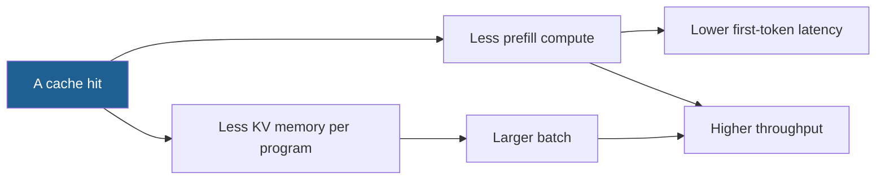

## 1. The question this page answers

The paper claims up to 6.4 times higher throughput than other systems. Against which systems, on which models and on which GPUs? Which numbers are printed, and which exist only as bars in a figure? Why does one workload gain a lot while another gains almost nothing? A hit rate of 75% sounds better than 60%, so why can the 75% workload be slower to accelerate?

In an interview, the first follow-up to "6.4x" is always "compared to what?". This page gives you the exact setup, the exact numbers, and a small cost model that explains the spread between workloads.

> [!key] The result in one sentence
> On eleven workloads of LM programs, SGLang reached up to 6.4 times the throughput and up to 3.7 times lower latency. The baselines were vLLM v0.2.5, Guidance v0.1.8 and LMQL v0.7.3. Most workloads gain from KV cache reuse, with hit rates from 50% to 99%. JSON decoding gains from the compressed FSM, and tree and skeleton of thought also gain from parallel calls (§6.2).

## 2. Mental model

> [!analogy] A print shop that keeps its plates
> A print shop prints booklets for many customers. Many booklets start with the same 20 pages. A shop that destroys its printing plates after each job must make the same plates again for every booklet. A shop that keeps the plates prints the shared pages at once. The gain depends on the booklet. A booklet with the 20 shared pages and one new page is ready many times faster. A booklet with 20 shared pages and 300 pages of handwriting gains almost nothing, because the handwriting takes most of the time. The shared pages are the prompt prefix, and the handwriting is the decode phase.
>
> **Where it stops working:** the plates of a print shop take no space on the press. A cached KV takes GPU memory that the running batch also needs. So reuse has a second effect that the analogy hides: shared KV frees memory, and a larger batch raises the throughput.

## 3. Terms

| Term | Plain meaning |
|---|---|
| LM program | A program that makes several LLM calls with control flow between them, for example an agent loop or a few-shot benchmark. |
| throughput | Here: whole programs finished per second, with a large batch of programs in the system. |
| latency | Here: the time to finish one program that runs alone, without batching. The paper reports the average. |
| hit rate | Cached prompt tokens divided by prompt tokens. A cached prompt token needs no prefill. |
| optimal hit rate | The best hit rate that any order of the same requests can reach. Page 06 proves when a DFS order reaches it. |
| baseline | An earlier system that the paper compares with. |
| ablation | An experiment that removes one part of the design and keeps all other parts. |
| A10G | The NVIDIA GPU of AWS EC2 G5 instances, with 24 GB of memory. |
| tensor parallelism | One model divided over several GPUs. Each GPU holds a part of every layer. |
| first-token latency | The time from the arrival of a request to its first output token. Prefill controls most of it. |
| prefill share $f$ | The fraction of the total time that prefill takes when nothing is reused. A quantity of these notes. |
| cost ratio $r$ | The time of one decode token divided by the time of one prefill token. A quantity of these notes. |
| Amdahl's law | A speedup of one part of the work is limited by the share of that part in the total time. |
| Chatbot Arena | A public website where users chat with LLMs and compare them. The authors served models there with SGLang. |
| llava-bench-in-the-wild | The image benchmark of Table 2. Several of its questions are about the same image. |

All terms are also in the [Glossary](/notes/papers/glossary).

## 4. The setup (§6.1 and Appendix C)

### 4.1 Models and GPUs

The paper uses Llama-2 models from 7B to 70B, Mixtral-8x7B, LLaVA-v1.5-7B for images and LLaVA-NeXT-34B for video. All open models run in float16. GPT-3.5 serves as the API model for the speculative execution test (page 08).

| Experiment | Model | GPUs | Parallelism |
|---|---|---|---|
| Figures 5 and 6 | Llama-7B | 1 x A10G 24 GB | none |
| Figure 7 | Mixtral-8x7B | 8 x A10G | tensor parallelism |
| Figure 12 | Llama-2-70B | 4 x A100 80 GB | tensor parallelism |
| Table 2 | LLaVA-v1.5-7B | 1 x A10G | none |
| Table 2 | LLaVA-NeXT-34B | 1 x A100 80 GB | none |
| API speculative execution | GPT-3.5 | the OpenAI API | not applicable |

The GPUs of most results are AWS EC2 G5 instances with the A10G. The implementation uses PyTorch with custom CUDA kernels from FlashInfer and Triton. The paper disables optimizations that change the results, for fairness. For the larger models, §6.2 says that the speedups follow a trend similar to the small models.

> [!example] Worked example: how small the KV pool of an A10G is
> 1. A 7B model in float16 needs about $7 \times 10^9 \times 2 = 14 \times 10^9$ bytes for its weights.
> 2. The A10G has 24 GB. So about $24 - 14 = 10$ GB remain for the KV cache and the activations.
> 3. Llama-2-7B uses full multi-head attention: 512 KiB $= 524{,}288$ bytes of KV per token ([L3: The KV cache size formula](/notes/ai/llm-systems/03-kv-cache/l3-the-kv-cache-size-formula)).
> 4. KV pool: at most $10 \times 10^9 / 524{,}288 \approx 19{,}073$ tokens, and less after the activations.
>
> Computed in these notes from the nominal model size. The point: one GPU holds only about 19,000 tokens. Every shared token that the pool does not store twice is room for more programs in the batch.

### 4.2 Baselines

| Baseline | Version | Backend | Note |
|---|---|---|---|
| vLLM | v0.2.5 | its own engine | no automatic prefix caching in this version |
| Guidance | v0.1.8 | llama.cpp | omitted from some benchmarks and from all tensor-parallel runs |
| LMQL | v0.7.3 | Hugging Face Transformers | omitted from some benchmarks and from all tensor-parallel runs |
| Multimodal baseline | the model authors' code | Hugging Face | used only for Table 2 |

> [!trap] Why such an old vLLM?
> The paper explains the choice: RadixAttention "has been partially integrated as an optional experimental feature" into later vLLM versions. So the authors compared with v0.2.5, which has no prefix cache. vLLM 0.4.0 added automatic prefix caching on 2024-03-31 ([L9: Prefix caching and KV reuse](/notes/ai/llm-systems/04-inference/l9-prefix-caching-and-kv-reuse)). Interpretation of these notes: the 6.4x measures "reuse against no reuse" much more than "radix tree against hash chain".

The first version of the paper (December 2023) reported up to 5x. The LMSYS blog of 2024-01-17 also says "up to 5 times higher throughput". The blog used vLLM v0.2.5, Guidance v0.1.8 and Hugging Face TGI v1.3.0 as baselines, with Llama-7B on one A10G and Mixtral-8x7B on 8 A10G.

### 4.3 The workloads, in figure order

The paper lists eleven workloads. The last column paraphrases §6.2, which names the source of the gain for most of them.

| # | Workload | Shape | Source of the gain (§6.2) |
|---|---|---|---|
| 1 | MMLU | 5-shot, decodes one token | reuse of the 5 examples, a larger batch, a lower first-token latency |
| 2 | ReAct agents | an agent loop | reuse of the agent template and of earlier calls |
| 3 | Generative agents | traces replayed | reuse of the agent template and of earlier calls |
| 4 | Tree of thought | GSM-8K | parallel calls inside one program, and reuse |
| 5 | Skeleton of thought | tip generation | parallel calls inside one program, and reuse |
| 6 | LLM judge | branch-solve-merge | no separate sentence in §6.2. Interpretation: the branches of a `fork` share a prefix (page 07) |
| 7 | HellaSwag | 20-shot, `select` | two-level reuse: the examples, and the question prefix of the choices |
| 8 | JSON decoding | regex constraint | the compressed FSM decodes several tokens in one step (page 08) |
| 9 | Multi-turn chat, short | 4 turns, input 256 to 512 per turn, output 4 to 8 | reuse of the chat history |
| 10 | Multi-turn chat, long | the same, output 256 to 512 | almost no speedup |
| 11 | DSPy RAG pipeline | retrieval and generation | reuse of the shared context examples |

Page 02 draws the main sharing patterns of these workloads as trees.

### 4.4 The metrics

1. **Throughput.** The paper runs a sufficiently large batch of program instances and reports programs per second (§6.1, paraphrase). The batch keeps the GPU busy, so this number shows the capacity of the system.
2. **Latency.** The paper runs one program at a time, without batching, and reports the average (§6.1, Figure 6).
3. **Hit rate.** Cached prompt tokens divided by prompt tokens (§3).

> [!trap] The two speedups have different causes
> A latency run has no batch, so memory sharing cannot help it. Its gain comes only from skipped work: prefill that a hit avoids, parallel calls, and fewer decode steps with the compressed FSM. A throughput run gains from the same skipped work and also from a larger batch. That is one reason why the throughput number (6.4x) is larger than the latency number (3.7x). See [L2: Latency and throughput metrics](/notes/ai/llm-systems/04-inference/l2-latency-and-throughput-metrics).


## 5. The headline numbers

### 5.1 What "up to 6.4x" means

The abstract says "up to 6.4x higher throughput compared to state-of-the-art inference systems". §6.2 adds that latency drops by up to 3.7 times. Three facts limit how you can use these numbers:

1. **"Up to" means the best case.** It is the largest ratio over all workloads, models and baselines. It is not an average.
2. **The bars have no printed values.** The result figures show one bar per system and workload. The paper prints no value inside the bars. So you cannot quote "MMLU gained 5x" from the paper. These notes do not estimate bar heights.
3. **Not every baseline runs every workload.** Guidance and LMQL are omitted from some benchmarks and from all tensor-parallel runs.

> [!key] What to say in an interview
> "On eleven LM-program workloads, mostly with Llama-7B on one A10G, SGLang reached up to 6.4 times the throughput of vLLM v0.2.5, Guidance and LMQL, and up to 3.7 times lower latency. Hit rates were 50% to 99%. A hit removes prefill and frees memory for a larger batch. So the gain shrinks when decoding dominates, and the paper saw almost no speedup for chat with long outputs."

### 5.2 Two effects of one cache hit

The paper explains the MMLU result with two effects. Sharing the KV cache reduces the total memory use, so the batch can be larger. And the skipped prefill reduces the first-token latency (§6.2, paraphrase).



The latency runs see only the left path. The throughput runs see both. Figure 8 (a, b) of the paper shows the second path directly. For tree of thought, a higher hit rate gave a larger batch, a higher throughput and a lower latency.

### 5.3 Why long multi-turn chat gains almost nothing

The two chat workloads have the same input: 4 turns of 256 to 512 new input tokens each. Only the output length differs: 4 to 8 tokens per turn, or 256 to 512. The paper reports almost no speedup for the long outputs. Its reason: there is not much sharing between different chat sessions, and the decoding time dominates (§6.2, paraphrase).

The cost model below makes the second reason exact. Assume that each turn resends the whole history, and that reuse keeps the whole history of a session in the cache.

> [!example] Worked example: prefill and decode tokens of one chat session
> Use the midpoints: 384 new input tokens per turn, and 6 (short) or 384 (long) output tokens per turn. These sizes are choices of these notes.
> 1. Prompt of turn $k$ without reuse: $k \times 384 + (k - 1) \times \text{out}$, because the history holds all earlier inputs and outputs.
> 2. Short: prompts 384, 774, 1,164, 1,554. Sum $P_0 = 3{,}876$ prefill tokens.
> 3. Long: prompts 384, 1,152, 1,920, 2,688. Sum $P_0 = 6{,}144$ prefill tokens.
> 4. With reuse, each turn prefills only its 384 new tokens: $P_1 = 4 \times 384 = 1{,}536$ in both cases.
> 5. Hit rate $h = (P_0 - P_1) / P_0$. Short: $2{,}340 / 3{,}876 \approx 60.4\%$. Long: $4{,}608 / 6{,}144 = 75\%$.
> 6. Decode tokens $D$: short $4 \times 6 = 24$, long $4 \times 384 = 1{,}536$.

The long chat has the higher hit rate. But compare the work that the hit removes with the work that stays. Measure time in "prefill-token units", and let one decode token cost $r$ units. A decode step produces one token per sequence, but it reads all weights and the whole KV cache. So $r$ is well above 1 when decoding is memory-bound ([L3: Compute-bound vs memory-bound](/notes/ai/llm-systems/04-inference/l3-compute-bound-vs-memory-bound)).

$$
\text{speedup} = \frac{P_0 + r D}{P_1 + r D}
$$

| $r$ | Short chat: speedup | Long chat: speedup | Long chat: prefill share $f$ |
|---|---|---|---|
| 1 | 2.50 | 2.50 | 0.80 |
| 5 | 2.41 | 1.50 | 0.44 |
| 10 | 2.32 | 1.27 | 0.29 |
| 20 | 2.16 | 1.14 | 0.17 |
| 50 | 1.86 | 1.06 | 0.07 |

All values computed in these notes with the token counts above. With $r = 1$ both workloads gain 2.5 times, because then a token is a token. As soon as decode tokens cost more, the long chat loses its gain, while the short chat keeps most of it. Interpretation of these notes: "almost no speedup" fits a cost ratio of about 20 or more in this model. The paper's first reason, little sharing between sessions, adds to it.

> [!key] The hit rate is not the speedup
> A hit removes prefill work only. If prefill is a small share of the total time, a high hit rate still gives a small speedup. Always ask two questions: what fraction of the prompt is cached, and what fraction of the time is prefill?

### 5.4 The bound behind the table

The table follows from one line of algebra. Let $T$ be the time without reuse and $f$ the prefill share of $T$. A hit rate $h$ removes the fraction $h$ of the prefill tokens, so it removes $f h T$ of the time.

$$
T' = T - f h T = T (1 - f h), \qquad S = \frac{T}{T'} = \frac{1}{1 - f h}
$$

This is Amdahl's law with the "accelerated part" removed completely. Check it on the long chat with $r = 10$: $f = 6{,}144 / 21{,}504 \approx 0.286$ and $h = 0.75$, so $S = 1 / (1 - 0.214) \approx 1.27$, the same as the table.

> [!trap] The bound holds for a fixed batch only
> In a throughput run, reuse also frees KV memory, so more programs run at once (section 5.2). That effect is outside the formula. So a measured throughput gain can be larger than $1/(1 - f h)$. A latency run has no batch, so the formula is a fair model for it.

## 6. Hit rates and the optimal hit rate

The paper reports hit rates from 50% to 99% across the benchmarks (§6.2). Figure 13 compares the achieved hit rate with the optimal hit rate per benchmark. On average, cache-aware scheduling reaches about 96% of the optimal hit rate. The text names no separate procedure for the optimal value. Interpretation of these notes: it is the hit rate of the depth-first order of Theorem 3.1 ([page 06](/notes/papers/llm-serving/2023-sglang-radixattention/06-cache-aware-scheduling)).

> [!example] Worked example: why 96% of optimal is a larger gap than it looks
> Assume an optimal hit rate of 80% for one benchmark. This value is a choice of these notes.
> 1. Achieved: $0.96 \times 80\% = 76.8\%$.
> 2. Missed prompt tokens: $20\%$ at the optimum, $23.2\%$ achieved.
> 3. Prefill work: $23.2 / 20 = 1.16$, so 16% more prefill than the optimum.
>
> A gap of 4% in hit rate is a gap of 16% in prefill work, because the work follows the misses, not the hits.

The running example of these notes reaches a hit rate of 152 of 236 prompt tokens, about 64.4%, over nine steps ([page 04](/notes/papers/llm-serving/2023-sglang-radixattention/04-radixattention-the-tree-of-kv-caches)).

## 7. Ablations and overhead

### 7.1 Hit rate against performance (Figure 8 a, b)

The authors varied the hit rate of tree of thought by disabling matched tokens at runtime. A higher hit rate gave a larger batch, a higher throughput and a lower latency. The figure has no printed values.

### 7.2 Which component matters (Figure 8 c)

The paper removes one component at a time and runs LLM Judge, Tree of Thought, MMLU and Multi-Turn Chat (short). The paper concludes that each component is needed for the best result. No values are printed.

| Variant | What it removes | Explained on |
|---|---|---|
| No Cache | all KV reuse | [page 03](/notes/papers/llm-serving/2023-sglang-radixattention/03-the-question) |
| No Tree-Structure | the radix tree. A table-based cache replaces it | [page 03](/notes/papers/llm-serving/2023-sglang-radixattention/03-the-question) |
| FCFS Schedule | longest-shared-prefix-first. Requests run in arrival order | [page 06](/notes/papers/llm-serving/2023-sglang-radixattention/06-cache-aware-scheduling) |
| Random Schedule | longest-shared-prefix-first. Requests run in a random order | [page 06](/notes/papers/llm-serving/2023-sglang-radixattention/06-cache-aware-scheduling) |
| No Frontend Parallelism | the parallel execution of the calls of one program (interpretation of the name) | [page 07](/notes/papers/llm-serving/2023-sglang-radixattention/07-frontend-hints-and-multi-gpu) |
| No Frontend Hint | the hint that sends the shared prefix of a `fork` first | [page 07](/notes/papers/llm-serving/2023-sglang-radixattention/07-frontend-hints-and-multi-gpu) |
| Full optimizations | nothing | this page |

### 7.3 The overhead when nothing is reused

A cache must not slow down a workload that never hits. The paper tests this on ShareGPT, with 100 requests. The run takes 74.3 s, and the RadixAttention operations take 0.2 s of it. The paper calls this "less than 0.3%".

> [!example] Worked example: the overhead in numbers
> 1. Share: $0.2 / 74.3 \approx 0.00269$, so about 0.27%.
> 2. Per request: $0.2 / 100 = 0.002$ s, so about 2 ms of tree operations per request.
>
> Interpretation of these notes: the tree works on token IDs on the CPU. A match compares at most one integer per prompt token. The GPU does billions of operations per token. So the tree cost hides in the noise unless the request rate is very high (page 11 discusses that limit).

The blog of January 2024 reported the same finding: "no noticeable overhead even in the absence of cache hits".

## 8. Multimodal results (Table 2)

| Model | GPU | Baseline throughput | SGLang throughput | Ratio (computed) |
|---|---|---|---|---|
| LLaVA-v1.5-7B | 1 x A10G | 0.18 image/s | 1.15 image/s | $1.15 / 0.18 \approx 6.39$ |
| LLaVA-NeXT-34B | 1 x A100 80 GB | 0.02 frame/s | 0.10 frame/s | $0.10 / 0.02 = 5$ |

The paper summarizes Table 2 as up to 6 times higher throughput. The cause is reuse. In llava-bench-in-the-wild, several questions concern the same image, so the runtime reuses the KV of that image. The radix tree uses a hash of the image as its key (§6).

> [!trap] The baseline is not a serving engine
> The multimodal baseline is the model authors' original Hugging Face implementation, not vLLM. So Table 2 mixes the effect of reuse with the effect of a serving runtime against research code. Interpretation of these notes: read the 6.39x as "SGLang against the reference code", not as the value of RadixAttention alone.

## 9. Production: Chatbot Arena

The authors ran one SGLang worker per model on Chatbot Arena. After one month, they observed:

1. A RadixAttention hit rate of 52.4% for LLaVA-NeXT-34B.
2. A hit rate of 74.1% for Vicuna-33B.
3. For Vicuna-33B, a first-token latency 1.7 times lower on average.

The paper names three sources of hits: common system messages, example images that users reuse, and multi-turn chat histories.

> [!example] Worked example: hit rate against first-token latency
> 1. Suppose the first-token latency were proportional to the prefilled tokens. A hit rate of 74.1% leaves $25.9\%$ of the tokens.
> 2. The best possible gain is then $1 / (1 - 0.741) \approx 3.86$ times.
> 3. The paper measured 1.7 times on average.
>
> Interpretation of these notes: the first-token latency also contains queueing, scheduling and the last prompt token, which always runs. Also, the hit rate counts tokens, while the latency is an average over requests. So the bound of step 2 is only an upper limit.

## 10. All printed claims in one table

| Claim | Where | Compared with |
|---|---|---|
| up to 5x throughput | v1 (2023-12-12) and the blog of 2024-01-17 | vLLM v0.2.5, Guidance v0.1.8, TGI v1.3.0 (blog) |
| up to 6.4x throughput | abstract (v2) | vLLM v0.2.5, Guidance v0.1.8, LMQL v0.7.3 |
| up to 3.7x lower latency | §6.2 | the same, one program at a time |
| hit rates 50% to 99% | §6.2 | not a comparison |
| about 96% of the optimal hit rate | §6.2, Figure 13 | the optimal hit rate |
| less than 0.3% overhead (0.2 s of 74.3 s) | §6 | no reuse at all |
| up to 6x multimodal (6.39x and 5x) | Table 2 | the authors' Hugging Face code |
| hit rates 52.4% and 74.1%, 1.7x first-token latency | Chatbot Arena | an observation over one month |
| JSON decoding +1.6x, 2.4x lower without FSM reuse | page 08 | page 08 explains the comparison |
| input token cost about 3 times lower | API speculative execution, page 08 | the same program without speculation |


## 11. What the paper does not show

These points are interpretation of these notes.

1. **No values in the bars.** The per-workload speedups are only bars. Only the maximum, 6.4x, is in the text.
2. **No modern prefix cache as a baseline.** vLLM v0.2.5 has no prefix caching. The paper does not compare a radix tree with a block hash chain, such as vLLM's automatic prefix caching from version 0.4.0.
3. **Small GPUs for most results.** The A10G has 24 GB. A small KV pool makes memory sharing more valuable, so the gains may be smaller on an 80 GB GPU.
4. **No study of fairness or tail latency.** The paper notes that greedy cache-aware scheduling can starve requests. It leaves fair scheduling for future work (page 06) and reports no p99 latency.
5. **Latency without load.** The latency runs use one program at a time. Real servers see queueing.
6. **Offline throughput.** The throughput runs use a large batch of programs, not a stream of requests with arrival times.
7. **A small overhead test.** The 0.3% is the result of one run of 100 ShareGPT requests.

[Page 11](/notes/papers/llm-serving/2023-sglang-radixattention/11-limits-and-later-work) discusses the limits of the design and the work that followed.

### Exercises

1. **A speedup bound from a hit rate.** Write `speedup_bound(f, h)` that returns $1 / (1 - f h)$. Then write `chat_speedup(turns, inp, out, r)` that builds the token counts of section 5.3 and returns the speedup. Acceptance test: `speedup_bound(0.9, 0.75)` is about 3.077. `chat_speedup(4, 384, 384, 10)` is about 1.273 and agrees with `speedup_bound` for the same $f$ and $h$. The smallest $h$ that gives 6.4x with $f = 1$ is 0.84375.
   - Hint 1: a hit removes $h P_0$ prefill tokens and nothing else.
   - Hint 2: for the smallest $h$, solve $1 / (1 - h) = 6.4$ for $h$.
2. **The token counts of the chat benchmark.** Write `chat_tokens(turns, inp, out)` that returns $(P_0, P_1, D, h)$. Acceptance test: `chat_tokens(4, 384, 384)` returns `(6144, 1536, 1536, 0.75)`. `chat_tokens(4, 384, 6)` returns `(3876, 1536, 24, h)` with $h \approx 0.6037$. Then show that for $r = 10$ the speedup of a 4-turn chat approaches 1.15, not 1, as the output length grows. Explain why.
   - Hint 1: the prompt of turn $k$ holds $k$ inputs and $k - 1$ outputs.
   - Hint 2: the outputs enter the history of the next turns, so reuse also saves their prefill.

Build it in a lab: [open a lab for this page](/labs/new?note=papers/llm-serving/2023-sglang-radixattention/09-results)

## 12. Common mistakes

1. **"SGLang is 6.4 times faster."** It is up to 6.4 times higher throughput: the best ratio over all workloads, not a typical one. The long chat gained almost nothing.
2. **"A higher hit rate always gives a higher speedup."** The long chat has a hit rate of 75% and almost no speedup. A hit removes only prefill work, so the prefill share of the time limits the gain.
3. **"The baseline vLLM had prefix caching."** vLLM v0.2.5 had none. Automatic prefix caching came to vLLM 0.4.0 on 2024-03-31.
4. **"The latency gain comes from larger batches."** The latency runs have no batch. Their gain comes only from skipped prefill, parallel calls and the compressed FSM.
5. **"96% means the scheduler misses 4% of the tokens."** It means 96% of the optimal hit rate. The missed tokens grow by much more than 4%, because the work follows the misses (section 6).
6. **"Table 2 measures RadixAttention against vLLM."** It measures SGLang against the Hugging Face code of the model authors.
7. **"The overhead test proves the tree is free at any scale."** It shows 0.2 s of 74.3 s for 100 requests. At very high request rates, the CPU work of the tree can matter (page 11).

## 13. One-minute explanation

The paper evaluates SGLang on eleven LM-program workloads, from 5-shot MMLU to agents, tree of thought, JSON decoding, chat and a DSPy RAG pipeline. Most runs use Llama-7B on one A10G with 24 GB, with Mixtral-8x7B and Llama-2-70B on several GPUs with tensor parallelism. The baselines are vLLM v0.2.5 without prefix caching, Guidance v0.1.8 and LMQL v0.7.3. Throughput is programs per second with a large batch, and latency is one program at a time. SGLang reaches up to 6.4 times the throughput and up to 3.7 times lower latency, but the bars have no printed values. Hit rates range from 50% to 99%, and cache-aware scheduling reaches about 96% of the optimal hit rate. The gain grows with the share of shared prefill in the work. It is almost zero for chat with long outputs, because a hit removes only prefill and decoding dominates there. With no reuse at all, the tree costs 0.2 s of a 74.3 s run, under 0.3%. In production on Chatbot Arena, hit rates were 52.4% and 74.1%, and Vicuna-33B saw a 1.7 times lower first-token latency.

## 14. Check questions

```check
{
  "question": "What exactly do the two headline numbers, up to 6.4x and up to 3.7x, measure? Why is the throughput number larger?",
  "hint": "How many programs run at once in each measurement?",
  "answer": "**6.4x** is the largest throughput ratio over all workloads: programs per second with a large batch of program instances. **3.7x** is the largest latency ratio: one program at a time, without batching, averaged.\n\nThe latency run has no batch, so it gains only from skipped work. That is prefill that a hit avoids, parallel calls inside a program, and fewer decode steps with the compressed FSM. The throughput run gains from the same skipped work, and also from memory: shared KV is stored once, so more programs fit into the batch. The paper says this for MMLU: sharing lowers memory use and allows a larger batch, and the skipped prefill lowers the first-token latency (§6.2). Both numbers are maxima. The per-workload bars have no printed values."
}
```
```check
{
  "question": "Interview follow-up: the interviewer says \"vLLM has prefix caching, so your 6.4x is unfair.\" How do you answer?",
  "hint": "Which vLLM version, and why that one?",
  "answer": "1. The baseline is vLLM **v0.2.5**, which had no automatic prefix caching. The paper chose it on purpose, because RadixAttention \"has been partially integrated as an optional experimental feature\" into later vLLM versions.\n2. vLLM added automatic prefix caching in **0.4.0, on 2024-03-31**, after the first SGLang version (2023-12-12).\n3. So the 6.4x mostly measures reuse against no reuse. It does not compare a radix tree with a block hash chain.\n4. Against a modern hash chain, the differences are smaller. They are token granularity against 16-token blocks, cache-aware scheduling, frontend hints, and the compressed FSM for JSON. The paper has no head-to-head test of these. Page 10 and [L9](/notes/ai/llm-systems/04-inference/l9-prefix-caching-and-kv-reuse) compare the two designs."
}
```
```check
{
  "question": "Interview follow-up: the long-chat benchmark has a higher hit rate than the short one, yet almost no speedup. Explain it with numbers.",
  "hint": "Count prefill tokens and decode tokens for 4 turns of 384 input tokens.",
  "answer": "Take 4 turns of 384 new input tokens, with 6 (short) or 384 (long) output tokens per turn.\n\n| | Short | Long |\n|---|---|---|\n| Prefill without reuse $P_0$ | 3,876 | 6,144 |\n| Prefill with reuse $P_1$ | 1,536 | 1,536 |\n| Hit rate | 60.4% | 75% |\n| Decode tokens $D$ | 24 | 1,536 |\n\nA hit removes prefill only. If one decode token costs $r$ prefill tokens of time, the speedup is $(P_0 + rD)/(P_1 + rD)$. With $r = 10$: short $4{,}116 / 1{,}776 \\approx 2.32$, long $21{,}504 / 16{,}896 \\approx 1.27$. With $r = 20$ the long chat gains only 1.14x. The paper gives two reasons: little sharing between different chat sessions, and decoding time that dominates (§6.2). The model of these notes shows the second reason."
}
```
```check
{
  "question": "Interview follow-up: derive the speedup bound from the hit rate h and the prefill share f. When can a measured throughput gain exceed it?",
  "hint": "What fraction of the total time does a hit remove?",
  "answer": "Let $T$ be the time without reuse and $f$ the share of prefill in it. A hit rate $h$ removes the fraction $h$ of the prefill tokens, so it removes $f h T$.\n\n$$T' = T(1 - f h), \\qquad S = \\frac{1}{1 - f h}$$\n\nThis is Amdahl's law with the accelerated part removed completely. Even with $f = 1$, a speedup of 6.4x needs $h \\ge 1 - 1/6.4 = 0.84375$.\n\nThe bound assumes a fixed batch. In a throughput run, shared KV also frees memory, so more programs run at once and decode steps are used better. Figure 8 (a, b) shows that a higher hit rate gives a larger batch. That effect can push the measured gain above $1/(1 - fh)$. A latency run has no batch, so the bound fits it better."
}
```
```check
{
  "question": "What does \"about 96% of the optimal hit rate\" mean? Why is the gap larger than it looks?",
  "hint": "Count the misses, not the hits.",
  "answer": "Figure 13 compares, per benchmark, the hit rate of cache-aware scheduling with the optimal hit rate. On average the achieved value is about 96% of the optimal one. The text names no separate procedure for the optimum. Interpretation of these notes: it is the hit rate of the DFS order of Theorem 3.1 (page 06).\n\nThe work follows the misses. With an optimum of 80%, 96% of it is 76.8%. The misses grow from 20% to 23.2% of the prompt tokens, so the prefill work grows by $23.2/20 = 1.16$, that is 16%."
}
```
```check
{
  "question": "How large is the overhead of RadixAttention when nothing is reused, and why is it so small?",
  "hint": "Where does the tree live, and what does it compare?",
  "answer": "On ShareGPT with 100 requests, the run takes 74.3 s and the RadixAttention operations take 0.2 s: $0.2/74.3 \\approx 0.27\\%$, which the paper reports as \"less than 0.3%\". That is about 2 ms per request.\n\nInterpretation of these notes: the tree lives on the CPU and works on token IDs. A match compares at most one integer per prompt token, and it finds the child of a node with one dictionary lookup. The GPU does billions of operations per token in the same request. So the tree cost is small unless the request rate is very high."
}
```
```check
{
  "question": "Interview follow-up: Table 2 shows 1.15 against 0.18 image/s for LLaVA-v1.5-7B. What causes the gain, and why should you not quote it as the value of RadixAttention alone?",
  "hint": "What is the baseline?",
  "answer": "The ratio is $1.15/0.18 \\approx 6.39$. The paper explains it with reuse: in llava-bench-in-the-wild, several questions concern the same image, so the runtime reuses the KV of that image. The radix tree uses a hash of the image as the key.\n\nBut the baseline is the model authors' original Hugging Face implementation, not a serving engine such as vLLM. So the ratio also contains the effect of batching and of a fast runtime against research code. It is \"SGLang against the reference code\", not \"RadixAttention against no RadixAttention\". For LLaVA-NeXT-34B the ratio is $0.10/0.02 = 5$."
}
```
```check
{
  "question": "Which workloads gain from something other than KV reuse, according to §6.2?",
  "hint": "Two other techniques of the paper.",
  "answer": "1. **JSON decoding** gains from the compressed finite state machine. It decodes several tokens in one forward pass when only one continuation is valid (page 08).\n2. **Tree of thought** and **skeleton of thought** gain from parallel calls inside one program, in addition to reuse.\n\nAll other workloads gain mainly from reuse. MMLU reuses the few-shot examples, and HellaSwag reuses them at two levels. The agents reuse the template and earlier calls. Chat reuses the history, and DSPy RAG reuses the shared context examples."
}
```
```check
{
  "question": "Exercise 1: show a reference solution.",
  "answer": "```python\ndef speedup_bound(f, h):\n    \"\"\"Amdahl-style bound: a hit rate h removes the fraction h of the prefill share f.\"\"\"\n    return 1 / (1 - f * h)\n\ndef chat_speedup(turns, inp, out, r):\n    p0 = sum(k * inp + (k - 1) * out for k in range(1, turns + 1))   # prefill, no reuse\n    p1 = turns * inp                                                # prefill, full reuse\n    d = turns * out                                                 # decode tokens\n    return (p0 + r * d) / (p1 + r * d), p0 / (p0 + r * d), (p0 - p1) / p0\n\ns, f, h = chat_speedup(4, 384, 384, 10)\nprint(round(speedup_bound(0.9, 0.75), 3))\nprint(round(s, 3), round(f, 4), h, round(speedup_bound(f, h), 3))\nh_min = 1 - 1 / 6.4                       # solve 1 / (1 - h) = 6.4 with f = 1\nprint(h_min, round(speedup_bound(1.0, h_min), 6))\nassert abs(speedup_bound(0.9, 0.75) - 3.0769) < 1e-3\nassert abs(s - speedup_bound(f, h)) < 1e-12\n```\n\nOutput:\n\n```text\n3.077\n1.273 0.2857 0.75 1.273\n0.84375 6.4\n```"
}
```
```check
{
  "question": "Exercise 2: show a reference solution.",
  "answer": "```python\ndef chat_tokens(turns, inp, out):\n    p0 = sum(k * inp + (k - 1) * out for k in range(1, turns + 1))   # turn k: k inputs, k-1 outputs\n    p1 = turns * inp\n    d = turns * out\n    return p0, p1, d, (p0 - p1) / p0\n\nprint(chat_tokens(4, 384, 384))\nprint(chat_tokens(4, 384, 6))\nassert chat_tokens(4, 384, 384) == (6144, 1536, 1536, 0.75)\nassert chat_tokens(4, 384, 6)[:3] == (3876, 1536, 24)\n\nr = 10\nfor out in (384, 1000, 10_000, 1_000_000):\n    p0, p1, d, h = chat_tokens(4, 384, out)\n    print(out, round((p0 + r * d) / (p1 + r * d), 4))\nprint(\"limit 1 + (T - 1) / (2 r) =\", 1 + (4 - 1) / (2 * r))\n```\n\nOutput:\n\n```text\n(6144, 1536, 1536, 0.75)\n(3876, 1536, 24, 0.6037151702786377)\n384 1.2727\n1000 1.1999\n10000 1.1552\n1000000 1.1501\nlimit 1 + (T - 1) / (2 r) = 1.15\n```\n\nWhy 1.15 and not 1: the output of each turn enters the history of the later turns. Without reuse, turn $k$ prefills $k - 1$ earlier outputs again, $0 + 1 + 2 + 3 = 6$ output lengths in total. With reuse they cost nothing. The decode cost is $4r$ output lengths. So the speedup tends to $(6 + 4r)/(4r) = 1 + 3/(2r)$, which is 1.15 for $r = 10$."
}
```

## 15. Links

- Previous: [08 The rest of SGLang: the language, compressed FSMs and API speculation](/notes/papers/llm-serving/2023-sglang-radixattention/08-the-rest-of-sglang)
- Next: [10 RadixAttention in SGLang today](/notes/papers/llm-serving/2023-sglang-radixattention/10-radixattention-in-sglang-today)
- The sharing patterns of the workloads: [02 Background: prefix sharing in LM programs](/notes/papers/llm-serving/2023-sglang-radixattention/02-background-prefix-sharing-in-lm-programs)
- The optimal hit rate and the DFS order: [06 Cache-aware scheduling and the DFS theorem](/notes/papers/llm-serving/2023-sglang-radixattention/06-cache-aware-scheduling)
- The limits of the design: [11 Limits and later work](/notes/papers/llm-serving/2023-sglang-radixattention/11-limits-and-later-work)
- How the results of a sibling paper were measured: [PagedAttention 09 Results](/notes/papers/llm-serving/2023-pagedattention/09-results)
- Metrics: [L2: Latency and throughput metrics](/notes/ai/llm-systems/04-inference/l2-latency-and-throughput-metrics)
- Why decode tokens cost more: [L3: Compute-bound vs memory-bound](/notes/ai/llm-systems/04-inference/l3-compute-bound-vs-memory-bound)
- vLLM's prefix cache: [L9: Prefix caching and KV reuse](/notes/ai/llm-systems/04-inference/l9-prefix-caching-and-kv-reuse)
- The paper card: [SGLang and RadixAttention (2023)](/notes/papers/llm-serving/2023-sglang-radixattention) and the [Glossary](/notes/papers/glossary)

### Sources

- Zheng et al., "SGLang: Efficient Execution of Structured Language Model Programs", NeurIPS 2024, arXiv 2312.07104 v2: https://arxiv.org/abs/2312.07104 and https://arxiv.org/pdf/2312.07104v2 (§6.1, §6.2, Appendix C, Figures 5 to 8, 12, 13, Table 2)
- arXiv 2312.07104 v1, "Efficiently Programming Large Language Models using SGLang": https://arxiv.org/abs/2312.07104v1
- LMSYS blog, "Fast and Expressive LLM Inference with RadixAttention and SGLang", 2024-01-17: https://lmsys.org/blog/2024-01-17-sglang/
- vLLM 0.4.0 release: https://pypi.org/project/vllm/0.4.0/

(checked on 2026-10-19)
