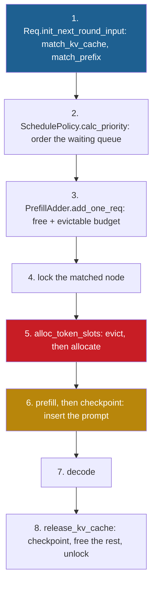

## 1. The question this page answers

The paper describes RadixAttention in a few pages and one algorithm. The code has grown for almost three years since then. What does SGLang 0.5.22 (PyPI, 2026-10-16) do when a request arrives? Which class holds the tree, and what does a node store? Where does the split happen, how are reference counts coded, and what decides the eviction order?

The code also has parts that the paper does not have. Examples are pages larger than one token, namespaces, duplicate freeing, eight eviction keys, a host-memory tier and an FCFS default. In an interview, "I read the code" is a strong answer only if you can name the real functions and their edge cases. This page gives you both.

> [!key] The main idea
> SGLang 0.5.22 keeps the paper's design. A radix tree of token IDs lives on the CPU, and each node holds slot indices into the GPU KV pool. A match splits a node at the exact boundary, a lock walks up to the root, and eviction pops leaves from a heap. The new parts surround this core: page alignment, namespaces, duplicate freeing, pluggable eviction keys and tiers below the GPU.

All statements about the code on this page describe the SGLang 0.5.22 source (the wheel from PyPI, read on 2026-10-19). Paths are relative to `sglang/srt/` in the wheel, which is `python/sglang/srt/` in the repository.

## 2. Mental model

> [!analogy] A warehouse with a card index
> A warehouse stores items in numbered bins: the KV pool and its slots. On the clerk's desk, the CPU, a card index lists the bin numbers of each product line in order. The index never holds an item, only bin numbers. For a new order, the clerk follows the cards as long as the order matches them. If the order agrees with only the first half of a card, the clerk cuts the card in two, so that the boundary is exact. Every card of an order in progress gets a "reserved" clip, up to the first card of the line. When the bins are full, the clerk clears the oldest unclipped card at the end of a line first.
>
> **Where it stops working:** a clerk can discard any card. The tree may evict only leaves, because a card in the middle is useless without the cards before it. And with pages larger than one token, the clerk records only whole crates of 16 items. A half-full crate never gets a card.

## 3. Terms

| Term | Plain meaning |
|---|---|
| `RadixKey` | The key type of the tree: an array of token IDs plus the namespace fields `extra_key` and `cache_salt`. |
| `TreeNode` | One node. Its `key` is the token run of the edge into it. Its `value` holds the slot indices of that run. |
| `RadixCache` | The class in `mem_cache/radix_cache.py` that holds the tree and implements match, insert, lock and evict. |
| `UnifiedRadixCache` | The class that the server builds by default in 0.5.22. It runs the same algorithm for several kinds of model state. |
| TreeCore | The part of `UnifiedRadixCache` that stores the tree. The default is written in Rust, with a Python fallback. |
| `lock_ref` | The code name of the paper's reference counter: how many running requests use a node. |
| evictable size | The tokens in nodes with `lock_ref == 0`. Field `evictable_size_`. |
| protected size | The tokens in nodes with `lock_ref > 0`. Field `protected_size_`. |
| evictable leaf | A node with `lock_ref == 0` and no cached child. Only these nodes enter the eviction heap. |
| page size | The number of tokens per KV page. Keys are cut to whole pages. The default is 1 on NVIDIA GPUs. |
| child key | The dictionary key under which a node stores a child: the first token or first page, plus the namespace. |
| galloping search | A search that compares windows of 1, 2, 4, 8 and more tokens, then searches the first different window by halves. |
| `extra_key` | A namespace string. Requests with different extra keys never share a node. LoRA adapters use it. |
| `cache_salt` | A namespace string for isolation between tenants. It also changes the KV events and the storage keys. |
| checkpoint | The step that inserts the KV of a request into the tree and moves the request's lock to the new last node. |
| HiCache | The hierarchical cache: GPU memory (L1), host memory (L2) and distributed storage (L3) under one tree. |
| write policy | When HiCache copies a node to the next tier: at once, after enough accesses, or at eviction. |

All terms are also in the [Glossary](/notes/papers/glossary).

## 4. Where the code lives

### 4.1 The files

| File (under `sglang/srt/`) | What it holds |
|---|---|
| `mem_cache/radix_cache.py` (832 lines) | `RadixKey`, `TreeNode`, `RadixCache(BasePrefixCache)` |
| `mem_cache/base_prefix_cache.py` | `BasePrefixCache`, `MatchResult`, `InsertParams`, `EvictParams`, `lock()` and `unlock()` |
| `mem_cache/evict_policy.py` | the eviction strategies, from `LRUStrategy` to `TLRUStrategy` |
| `mem_cache/utils.py` | `get_eviction_strategy`, the table from a policy name to its class |
| `mem_cache/common.py` | `match_kv_cache`, `checkpoint_kv_cache`, `release_kv_cache`, `evict_from_tree_cache` |
| `mem_cache/prefill_budget.py` | `PrefillBudget`: free plus evictable tokens, for admission |
| `mem_cache/allocation.py` | `alloc_token_slots`: evict if needed, then allocate |
| `mem_cache/registry.py` | `default_radix_cache_factory`: which cache class the server builds |
| `managers/schedule_policy.py` | `SchedulePolicy` (the order of the waiting queue) and `PrefillAdder` (admission) |
| `managers/schedule_batch.py` | `Req.init_next_round_input`, which matches a request against the tree |

### 4.2 Which class runs by default

> [!trap] `radix_cache.py` is not the default class in 0.5.22
> `default_radix_cache_factory` in `mem_cache/registry.py` returns `create_unified_radix_cache(ctx)` for a normal model. So the server builds `UnifiedRadixCache`, not `RadixCache`. Special cases get other classes, for example a model with only sliding-window layers.

`UnifiedRadixCache` keeps one tree for several "components": the full KV cache, sliding-window KV and Mamba state. It stores the tree in a TreeCore. The environment variable `SGLANG_UNIFIED_RADIX_TREE_CORE_BACKEND` selects it, with the default `"rust"`. A Python `UnifiedTreeCore` replaces the Rust core when the Rust core cannot run, for example on a platform other than Linux.

The algorithm is the same. The Python `UnifiedTreeCore` splits a node at the matched length with `RadixKey.match_at`. Its full-KV component evicts from a heap of evictable leaves, keyed by the same strategy objects. The Rust core is compiled, so these notes did not read it. Its Python adapter passes it the same policy name and parameters. `RadixCache` is still used directly: the scheduler builds one with `RadixCache.create_simulated()` for in-batch prefix caching (section 13.3). It is also the base class of `PureSWARadixCache` and `FlexKVRadixCache`.

So this page reads `radix_cache.py`. It holds the whole algorithm for one component in 832 lines. In an interview, say: "the reference implementation is `RadixCache`, and the default server class `UnifiedRadixCache` runs the same algorithm over several state types, with a Rust tree core."


## 5. `RadixKey`: what the tree is keyed by

### 5.1 The fields

A `RadixKey` has five fields: `token_ids`, `extra_key`, `cache_salt`, `is_bigram` and `limit`. The token IDs are a Python `array` of integers, not a list. `limit` caps the key length without a copy. The scheduler uses it to cap a match at the prompt length minus one (section 7.3). `is_bigram` switches to a view of token pairs for EAGLE speculative decoding. These notes do not cover that mode.

### 5.2 Page alignment

SGLang 0.5.22 source, `mem_cache/radix_cache.py`:

```python
def page_aligned(self, page_size: int) -> RadixKey:
    if page_size == 1:
        return self
    aligned_len = len(self) // page_size * page_size
    return self[:aligned_len]
```

1. With pages of one token, the key is used as it is.
2. Otherwise the key is cut to a multiple of the page size. A 50-token key with pages of 16 becomes 48 tokens. The last 2 tokens are not part of any match or insert (section 9).

### 5.3 The child key

SGLang 0.5.22 source, `mem_cache/radix_cache.py`, the end of `RadixKey.child_key_at`:

```python
t = self.token_ids
if self.is_bigram:
    if page_size == 1:
        plain = (t[offset], t[offset + 1])
    else:
        plain = tuple(
            (t[j], t[j + 1]) for j in range(offset, offset + page_size)
        )
else:
    plain = (
        t[offset] if page_size == 1 else tuple(t[offset : offset + page_size])
    )
if self.cache_salt is not None:
    return ((self.extra_key, self.cache_salt), plain)
return plain if self.extra_key is None else (self.extra_key, plain)
```

1. `plain` is the first token (page size 1) or a tuple of the first page of tokens.
2. A `cache_salt` wraps it in a tuple with `extra_key` and the salt.
3. An `extra_key` alone wraps it with the extra key.

A node finds a child with one dictionary lookup on this key. Two children of one node never have the same child key. If they had, they would share their first page, and an insert would have split them into a common parent. Because the namespace is part of the key, even the children of the root are separate per namespace.

### 5.4 The galloping match

`RadixKey.match_at` finds the first token where two keys differ. A plain loop would run once per token in Python, which is slow for a 100,000-token shared prefix. The code compares slices instead, which runs in C. Its comment: "gallop in doubling windows (one C-level slice compare each), then binary-search the window holding the divergence".

The function below rebuilds lines 193 to 220 of `mem_cache/radix_cache.py` (SGLang 0.5.22) with plain lists and the same variable names. So it runs without the package. Only the bigram branch for EAGLE keys is omitted.

```python
def match_len(a, b, page_size=1):
    """First index where a and b differ, rounded down to whole pages (as RadixKey.match_at)."""
    n = min(len(a), len(b))
    matched_tokens, lo, step, compares = n, 0, 1, 0
    while lo < n:
        hi = lo + step if lo + step < n else n
        compares += 1
        if a[lo:hi] != b[lo:hi]:                 # the divergence is inside [lo, hi)
            while hi - lo > 1:                   # binary search inside the window
                mid = (lo + hi) // 2
                compares += 1
                if a[lo:mid] == b[lo:mid]:
                    lo = mid
                else:
                    hi = mid
            matched_tokens = lo
            break
        lo = hi
        step *= 2                                # windows of 1, 2, 4, 8, ... tokens
    return matched_tokens // page_size * page_size, compares

a = list(range(2000))
b = a[:1500] + [-1] * 500                         # b differs from a at index 1500
print(match_len(a, b))                            # (matched tokens, slice compares)
print(match_len(a, a))                            # identical: no divergence
print(match_len(a, b, page_size=16))              # rounded down to whole pages
print(match_len([1, 2, 3, 4], [1, 2, 9]))
```

Output:

```text
(1500, 21)
(2000, 11)
(1488, 21)
(2, 3)
```

1. `step` doubles every round, so the windows hold 1, 2, 4, 8 and more tokens.
2. One slice comparison checks a whole window at C speed.
3. When a window differs, a binary search inside it finds the first different token.
4. The last line rounds the result down to whole pages, as the source does.

For two keys of 2,000 tokens that differ at position 1,500, the search makes 11 window comparisons and 10 binary-search comparisons. That is 21 Python-level steps instead of 1,500. The machine still compares a few thousand integers, but in C. Interpretation of these notes: the cost is $O(\log n)$ Python steps plus $O(n)$ fast integer compares.

## 6. `TreeNode`: what a node stores

`TreeNode.__init__` in `mem_cache/radix_cache.py` (SGLang 0.5.22) sets these fields, among others. `__lt__` compares `last_access_time`, so nodes sort by recency.

| Field | Meaning | Who uses it |
|---|---|---|
| `children` | dict from child key to child node | match, insert, eviction |
| `parent` | the node above | locks walk up through it |
| `key` | the `RadixKey` of the edge into this node | match, split |
| `value` | a tensor of KV pool indices, one per token | the KV pool, `free_segment` at eviction |
| `lock_ref` | the reference count | `inc_lock_ref`, `dec_lock_ref`, eviction |
| `last_access_time` | refreshed by match and insert | the LRU key, `__lt__` |
| `creation_time` | set once | FIFO and FILO keys |
| `hit_count` | increased when an insert passes through the node | LFU and SLRU keys |
| `hash_value` | hashes of the pages, computed lazily | KV events and storage |
| `priority` | a request priority, the maximum over inserts | the priority key |

Three details matter in an interview:

1. **The node stores indices, not tensors.** The K and V tensors stay in the GPU KV pool (`token_to_kv_pool_allocator`). A node of 8 tokens stores 8 integers.
2. **`evicted` means `value is None`.** The plain `RadixCache` deletes evicted leaves. HiCache can keep a node whose KV is only in host memory.
3. **The root is never evicted.** `reset()` gives it `lock_ref = 1` and the lowest priority, so the eviction loop never pushes it.

## 7. Match: `match_prefix` and `_split_node`

### 7.1 The walk

SGLang 0.5.22 source, `mem_cache/radix_cache.py`:

```python
def _match_prefix_helper(self, node: TreeNode, key: RadixKey):
    access_time = time.monotonic()
    node.last_access_time = access_time

    child_key = key.child_key(self.page_size)

    value = []
    while len(key) > 0 and child_key in node.children.keys():
        child = node.children[child_key]
        child.last_access_time = access_time
        prefix_len = child.key.match(key, page_size=self.page_size)
        if prefix_len < len(child.key):
            new_node = self._split_node(child.key, child, prefix_len)
            value.append(new_node.value)
            node = new_node
            break
        else:
            value.append(child.value)
            node = child
            key = key[prefix_len:]

            if len(key):
                child_key = key.child_key(self.page_size)

    return value, node
```

1. The access time is taken once and written on every node of the path. So the whole matched path becomes "recent" for LRU.
2. `child.key.match(key, ...)` returns the matched length, rounded down to whole pages.
3. If the match ends inside the child's edge, the node is split, and the walk stops at the new node.
4. Otherwise the whole edge matched. Its slots join `value`, and the walk continues with the rest of the key.
5. The caller, `match_prefix`, returns `device_prefix_len = sum(len(v) for v in value)` and the last node.

### 7.2 The split

SGLang 0.5.22 source, `mem_cache/radix_cache.py`:

```python
def _split_node(self, key: RadixKey, child: TreeNode, split_len: int):
    # new_node -> child
    # New node inherits child's priority (represents shared prefix)
    new_node = TreeNode(priority=child.priority)
    new_node.hit_count = child.hit_count
    new_node.children = {key[split_len:].child_key(self.page_size): child}
    new_node.parent = child.parent
    new_node.lock_ref = child.lock_ref
    new_node.key = child.key[:split_len]
    new_node.value = child.value[:split_len].clone()
    child.parent = new_node
    child.key = child.key[split_len:]
    child.value = child.value[split_len:].clone()
    new_node.parent.children[key.child_key(self.page_size)] = new_node
```

1. The new node takes the first `split_len` tokens and their slot indices. The old child keeps the rest.
2. The new node copies the child's `lock_ref`. Every request that held the child also holds the new parent, because a lock covers the whole path to the root.
3. It also copies `hit_count` and `priority`, because it represents the shared part of the old node.
4. The parent's dictionary entry under the same first key now refers to the new node.

> [!trap] A lookup changes the tree
> `match_prefix` is not read-only. The docstring says: "If the lookup ends inside a stored segment the node is split once to expose a precise boundary". The reason: the returned node must end exactly at the matched length. Then `inc_lock_ref` locks exactly the matched tokens, and a later insert adds the new tail as a sibling. No KV is copied. Only the index tensor is divided.

### 7.3 The last prompt token always runs

The scheduler matches a request in `Req.init_next_round_input` (`managers/schedule_batch.py`). It caps the key with `limit` at `Req._compute_max_prefix_len`, which is the prompt length minus one. The source comment: "the matched length is at most 1 less than the input length to enable logprob computation". The model needs a forward pass over at least one token to produce the logits of the next token. vLLM has the same rule ([L9](/notes/ai/llm-systems/04-inference/l9-prefix-caching-and-kv-reuse) section 5.5).

## 8. Insert: `_insert_helper`, duplicate freeing and `checkpoint`

### 8.1 The insert walk

`RadixCache._insert_helper` walks the tree like a match, with the same split rule. It adds the matched lengths in `total_prefix_length`, the number of tokens that the tree already had, and returns it. It increases `hit_count` only for nodes past `inserted_len`, the part that this request inserted before, so one request counts each node once. The end of the function adds the new leaf.

SGLang 0.5.22 source, `mem_cache/radix_cache.py`, the end of `RadixCache._insert_helper`:

```python
if len(key):
    new_node = TreeNode(priority=priority)
    new_node.parent = node
    new_node.key = key
    new_node.value = value.clone()
    if total_prefix_length + len(key) > inserted_len:
        self._inc_hit_count(new_node)
    node.children[child_key] = new_node
    self.evictable_size_ += len(key)
    self._update_leaf_status(node)
    self._update_leaf_status(new_node)
    # Hash will be computed lazily during event emission
    self.kv_events.record_store(new_node)
    node = new_node
return total_prefix_length, node
```

1. The unmatched tail becomes one new leaf with its own slot indices. Its length goes into `evictable_size_`, because no request holds it yet.
2. `_update_leaf_status` fixes the evictable-leaf set for the parent, which is no longer a leaf, and for the new node.
3. `record_store` emits a KV event for external listeners.

### 8.2 Duplicate slots are freed

Two requests can compute the same tokens at the same time. Then both hold their own slots for the same KV. The first insert keeps its slots in the tree. The second insert finds them already present, and `_insert_cache` frees the duplicates.

SGLang 0.5.22 source, `mem_cache/radix_cache.py`, the end of `RadixCache._insert_cache`:

```python
self.token_to_kv_pool_allocator.free_segment(
    kv_indices[req.kv.cache_protected_len : result.prefix_len],
    start_pos=req.kv.cache_protected_len,
)
```

`cache_protected_len` is the part of the request's row that belonged to the tree at admission or at the last checkpoint. `result.prefix_len` is the part that the tree held when this insert ran. The slots between the two were computed by this request but exist in the tree now. They return to the pool.

> [!example] Worked example: two identical prompts in one batch
> Requests A and B have the same 6-token prompt, and the tree is empty. Both match 0 tokens, so `cache_protected_len = 0` for both.
> 1. A computes its KV into slots 0 to 5, and B into slots 6 to 11.
> 2. A inserts first: `prefix_len = 0`, a new leaf holds slots 0 to 5, nothing is freed.
> 3. B inserts: `prefix_len = 6`. It frees `row[0:6]`, which are slots 6 to 11.
> 4. `checkpoint` then matches again and writes slots 0 to 5 into B's row. B reads A's copy from now on.
>
> The pool gets 6 slots back, but the prefill of B was wasted work. For shared prefixes of 32 tokens or more, in-batch prefix caching (section 13.3) avoids that work with a cache-aware policy. It delays B, so that only A computes the shared tokens.

### 8.3 `checkpoint`: insert during the life of a request

`RadixCache.checkpoint(req, up_to=...)` inserts the KV of a request up to row position `up_to`. It calls `_insert_cache` with `split_prompt=True`, matches the key again, and writes the tree's slot indices into the request's row. Then it moves the lock:

```python
self.unlock(req.lock)
req.lock = self.lock(new_last_node)
req.last_node = new_last_node
```

The split at the prompt boundary has a source comment: "Split the leaf at the prompt boundary so eviction can drop the output KV without the prompt". The prompt part also gets a priority one higher than the output part.

The scheduler calls `checkpoint` at three moments:

1. After a prefill, for each request that did not finish (`process_batch_result_prefill` in `managers/scheduler_components/batch_result_processor.py`, through `checkpoint_kv_cache`).
2. For a request whose prefill is split into chunks (`Scheduler.stash_chunked_request`).
3. When a request finishes (`release_kv_cache(req, tree_cache, checkpoint=True)`).

> [!note] A change from the paper
> Algorithm 1 inserts a request when it finishes. SGLang 0.5.22 also inserts the prompt right after its prefill. Interpretation of these notes: a long prompt becomes reusable while its own request still decodes. This helps when many requests with the same prefix arrive close together.

## 9. Pages larger than one token

The paper uses pages of one token, so a match can end at any token. SGLang 0.5.22 resolves `--page-size` to 1 on NVIDIA GPUs when the user gives no value. Some attention backends need larger pages. For example, the FA4 backend on SM100 GPUs forces 128 for models without MLA. The Intel XPU backend accepts only certain sizes, such as 64 and 128.

With a page size $p > 1$, three rules apply:

1. **Keys are cut to whole pages.** `page_aligned` drops the last `len % p` tokens before every match and insert.
2. **A child key is the first page**, a tuple of $p$ tokens.
3. **Match lengths are rounded down** to a multiple of $p$ in `match_at`.

The partial last page of a request is never inserted. The source comment in `checkpoint`: "With page_size > 1 the partial page stays in the request's row but not in the tree". `release_kv_cache` frees it when the request ends.

```python
def reused_tokens(prompt_len, cached_run, page_size):
    """Tokens a new request reuses: the matched run, capped at prompt_len - 1, in whole pages.
    cached_run = how many leading tokens of the prompt the tree holds."""
    limit = prompt_len - 1                          # keep one token to compute (logits)
    key_len = limit // page_size * page_size        # RadixKey.page_aligned
    matched = min(cached_run, key_len)              # the tree walk stops at the first difference
    return matched // page_size * page_size         # match_at rounds down to whole pages

stored = 50 // 16 * 16                              # request A (50 tokens) leaves 48 in the tree
print("stored after A:", stored)
print("same 50 tokens again:", reused_tokens(50, stored, 16))
print("exactly the 48 cached tokens:", reused_tokens(48, stored, 16))
print("first 40 tokens + 10 new ones:", reused_tokens(50, 40, 16))
print("page size 1, same 50 tokens:", reused_tokens(50, 50, 1))
print("page size 1, first 40 + 10 new:", reused_tokens(50, 40, 1))
```

Output:

```text
stored after A: 48
same 50 tokens again: 48
exactly the 48 cached tokens: 32
first 40 tokens + 10 new ones: 32
page size 1, same 50 tokens: 49
page size 1, first 40 + 10 new: 40
```

> [!example] Worked example: a 50-token prompt with pages of 16
> 1. Request A has 50 tokens. The tree keeps $\lfloor 50/16 \rfloor \times 16 = 48$ tokens, 3 pages. The 2-token tail is freed at the end.
> 2. The same 50 tokens again: the cap is $50 - 1 = 49$, page-aligned to 48. Reuse 48, compute 2.
> 3. A prompt of exactly the 48 cached tokens: the cap is 47, page-aligned to 32. Reuse 32, compute 16. The match also splits the 48-token node into 32 and 16.
> 4. The first 40 tokens plus 10 new ones: the walk matches 40, rounded down to 32. Reuse 32, compute 18.
> 5. With page size 1, the same prompt reuses 49 tokens, and the 40-token match reuses 40.


The cost of large pages is up to $p - 1$ lost tokens at the end of each match and each insert. The HiCache design page states the trade-off. Larger pages reduce metadata and improve storage I/O. But they can lower the hit rate when only part of a page matches.

## 10. Namespaces: `extra_key` and `cache_salt`

The KV of a token depends on more than the token IDs. A LoRA adapter changes the weights, so the same tokens give a different KV. Two tenants may also refuse to share a cache for security reasons. SGLang 0.5.22 puts both cases into the key.

1. **`extra_key`.** The source comment: "Namespaces the tree and storage; omitted from KV events." A request's LoRA ID is appended to its extra key (`managers/schedule_batch.py`: "lora_id is concatenated to the extra key"). A client can also send an `extra_key` field with the request.
2. **`cache_salt`.** The source comment: "Namespaces the tree, storage and KV events." A client sends it as the `cache_salt` field of a request.
3. **No mixing.** Both fields are part of the child key, so two namespaces never share a node, not even under the root. As a safety check, `RadixKey._check_compatible` raises a `ValueError` if a match compares keys of different namespaces.

The `match_prefix` docstring states the intent: "Entries that share identical leading token ids but have *different* ``extra_key`` values are intentionally kept disjoint and never share prefix nodes."

> [!example] Worked example: the cost of isolation
> Two tenants send the same 2,000-token system prompt to Llama-3.1-8B, with 128 KiB of KV per token.
> 1. One namespace: one copy, $2{,}000 \times 128$ KiB $= 256{,}000$ KiB $= 250$ MiB. The second tenant prefills 0 of these tokens.
> 2. Two salts: two copies, 500 MiB. The second tenant prefills all 2,000 tokens again.
>
> Isolation costs memory and prefill. It removes a timing side channel: without it, a fast first token can reveal that another user sent the same prefix ([page 11](/notes/papers/llm-serving/2023-sglang-radixattention/11-limits-and-later-work)).

## 11. Reference counts: `inc_lock_ref` and `dec_lock_ref`

SGLang 0.5.22 source, `mem_cache/radix_cache.py`:

```python
def inc_lock_ref(self, node: TreeNode) -> IncLockRefResult:
    if self.disable:
        return IncLockRefResult(delta=0)

    delta = 0
    while node != self.root_node:
        if node.lock_ref == 0:
            self.evictable_size_ -= len(node.key)
            self.protected_size_ += len(node.key)
            delta -= len(node.key)
        node.lock_ref += 1
        self._update_leaf_status(node)
        node = node.parent
    return IncLockRefResult(delta=delta)
```

1. The loop walks from the matched node up to the root and increments `lock_ref` on every node. A request needs the KV of the whole path, so the whole path must stay.
2. When a node goes from 0 to 1, its tokens move from `evictable_size_` to `protected_size_`.
3. `delta` collects the tokens that stopped being evictable. It is negative or zero. This is the `delta` of Algorithm 1: `available_size ← available_size + delta` shrinks the budget.
4. `_update_leaf_status` removes a locked node from the set of evictable leaves.

`dec_lock_ref` is the mirror image: a node that goes from 1 to 0 becomes evictable again, with a positive delta. `BasePrefixCache.lock(node)` wraps `inc_lock_ref` in a `TreeLock` with a receipt, and `unlock(lock)` replays it with `dec_lock_ref`. [Page 05](/notes/papers/llm-serving/2023-sglang-radixattention/05-eviction-and-reference-counts) works through the counts on the running example.

`_update_leaf_status` keeps the set `evictable_leaves` current. A node is an evictable leaf only if it holds KV, has `lock_ref == 0`, and has no child that holds KV. The set changes in four places: after a lock, an unlock, an insert and a leaf deletion. So eviction never needs to search the whole tree for leaves.

## 12. Evict: a heap of leaves

SGLang 0.5.22 source, `mem_cache/radix_cache.py`, in `RadixCache.evict`:

```python
num_tokens = params.num_tokens
leaves = list(self.evictable_leaves)
eviction_heap = [
    (self.eviction_strategy.get_priority(node), node) for node in leaves
]
heapq.heapify(eviction_heap)

num_evicted = 0
while num_evicted < num_tokens and len(eviction_heap):
    _priority, x = heapq.heappop(eviction_heap)

    # Tree values are page-aligned copies of a kv row: page-exact segment.
    self.token_to_kv_pool_allocator.free_segment(x.value, start_pos=0)
    num_evicted += len(x.value)
    self._delete_leaf(x)

    if len(x.parent.children) == 0 and x.parent.lock_ref == 0:
        new_priority = self.eviction_strategy.get_priority(x.parent)
        heapq.heappush(eviction_heap, (new_priority, x.parent))

    self.kv_events.record_remove(x)
```

1. The heap holds every evictable leaf, keyed by the strategy's priority. The smallest key leaves first.
2. Each pop frees the leaf's slots with `free_segment` and deletes the leaf from its parent.
3. If the parent now has no children and no lock, it becomes a leaf and enters the heap. So eviction can climb a branch from the bottom, as the paper describes.
4. The loop removes whole nodes, so it can free more tokens than asked. A 29-token leaf is freed completely, even if 1 token would be enough.
5. The root has `lock_ref = 1`, so it never enters the heap.

`_delete_leaf` does not merge a parent with its only remaining child. A node with a single child is legal in this tree ([page 01](/notes/papers/llm-serving/2023-sglang-radixattention/01-background-tries-and-radix-trees)).

The strategies in `mem_cache/evict_policy.py` define the heap key:

| Policy | Key of `get_priority(node)`, smallest evicted first | On the command line |
|---|---|---|
| LRU | `last_access_time` | `lru`, the default |
| LFU | `(hit_count, last_access_time)` | `lfu` |
| SLRU | `(is_protected, last_access_time)`, protected when `hit_count >= protected_threshold` (default 2) | `slru` |
| Priority | `(priority, last_access_time)` | `priority` |
| TLRU | `(-1 if tel_safe else 0, last_access_time)`, Tail-Optimized LRU (arXiv 2510.15152) | `tlru` |
| FIFO | `creation_time` | not a choice |
| MRU | `-last_access_time` | not a choice |
| FILO | `-creation_time` | not a choice |

The factory table in `mem_cache/utils.py` has all eight. The command-line choices in `arg_groups/choices.py` are only `lru`, `lfu`, `slru`, `priority` and `tlru`. `--radix-eviction-policy-config` passes a JSON object to the strategy, for example `{"protected_threshold": 4}` for SLRU. [Page 05](/notes/papers/llm-serving/2023-sglang-radixattention/05-eviction-and-reference-counts) explains when each policy helps.

## 13. The path of a request through the scheduler

### 13.1 The steps



| Algorithm 1 (Appendix A.2) | SGLang 0.5.22 |
|---|---|
| `T.match_prefix(req.input_tokens)` for each waiting request | `Req.init_next_round_input` calls `match_kv_cache` (`mem_cache/common.py`). Cache-aware policies also match in `SchedulePolicy._compute_prefix_matches`. |
| sort by `prefix_len`, longest first | `_sort_by_longest_prefix` with policy `lpm`. The default policy is `fcfs`. |
| `available_size ← T.evictable_size() + P.available_size()` | `PrefillBudget._available_and_evictable()` returns `allocator.available_size() + evictable` |
| `req.size() + current_size < available_size` | `check_prefill` tests `total_tokens < self.remaining_total`. `reserve()` adds each admitted request to `total_offset`. |
| `delta ← T.increase_ref_counter(req.prefix_node)` | `_commit_prefill_admission`: `req.lock = self.tree_cache.lock(req.last_node)` |
| `P.alloc`, then `T.evict(needed_size)` on failure | `alloc_token_slots` calls `evict_from_tree_cache` first. The allocator evicts the shortfall with `evict_for_alloc`. |
| no branch if the second allocation fails | `alloc_token_slots` raises `RuntimeError` with "Out of memory. Try to lower your batch size." |
| finished: decrease the counter, insert | `release_kv_cache`: `checkpoint`, then `free_kv_row` for the rest of the row, then `unlock` |

SGLang 0.5.22 source, `mem_cache/prefill_budget.py`:

```python
def _available_and_evictable(self):
    evictable = (
        self.tree_cache.full_evictable_size()
        if self.tree_cache.supports_mamba()
        else self.tree_cache.evictable_size()
    )
    return self.allocator.available_size() + evictable

@property
def remaining_total(self):
    return self._available_and_evictable() - self.total_offset
```

Two gaps of the printed Algorithm 1 are closed here. `total_offset` grows with every admitted request, which is the missing `current_size` update ([page 06](/notes/papers/llm-serving/2023-sglang-radixattention/06-cache-aware-scheduling)). And the delta is not added by hand: `add_one_req` locks the matched node during the admission check. The source comment: "The temporary pin excludes this prefix from the evictable budget." The live `evictable_size()` then already excludes the locked tokens.

### 13.2 The default order is FCFS

`--schedule-policy` defaults to `fcfs`. The cache-aware choices are `lpm`, `dfs-weight`, `hrrn` and `shortest-prefill-first`. Two rules can turn `lpm` into FCFS:

SGLang 0.5.22 source, `managers/schedule_policy.py`:

```python
def _determine_active_policy(self, waiting_queue: List[Req]) -> Policy:
    if (
        self.policy
        in (
            CacheAwarePolicy.LPM,
            CacheAwarePolicy.HRRN,
        )
        and len(waiting_queue) > WAITING_QUEUE_PREFIX_MATCH_MAX
    ):
        # Turn off the expensive prefix matching and sorting when the #queue is large.
        return CacheAgnosticPolicy.FCFS
    return self.policy
```

1. With more than 128 waiting requests (`WAITING_QUEUE_PREFIX_MATCH_MAX = 128`), `lpm` and `hrrn` use FCFS for that round. Matching and sorting a long queue every round costs CPU time.
2. If the radix cache is disabled, a cache-aware policy becomes FCFS (`_validate_and_adjust_policy`).

### 13.3 In-batch prefix caching

This step runs only with a cache-aware policy, so not with the default `fcfs`. Take a waiting request that matches 32 tokens or fewer in the cache. The scheduler matches it against a temporary radix tree of the waiting queue, built with `RadixCache.create_simulated()`. If it shares 32 tokens or more with a request already in that tree, it is deprioritized. Otherwise it is inserted into that tree. So only one of the requests computes the shared prefix first, and the others hit it later. The environment variables `IN_BATCH_PREFIX_CACHING_CHECK_THRESHOLD` and `IN_BATCH_PREFIX_CACHING_DEPRIORITIZE_THRESHOLD` set the two thresholds, with the default 32. [Page 06](/notes/papers/llm-serving/2023-sglang-radixattention/06-cache-aware-scheduling) and [page 07](/notes/papers/llm-serving/2023-sglang-radixattention/07-frontend-hints-and-multi-gpu) relate it to the paper.

## 14. HiCache: tiers below the GPU

The paper's Section 8 names a memory hierarchy, for example DRAM and disk, as future work. SGLang added it as HiCache. The design page states: "HiCache organizes GPU memory as L1, host memory as L2, and distributed storage as L3." L1 and L2 are private to one server instance. Only L3 can be shared across instances.

The tree becomes a HiRadixTree. Each node records where its KV lives: GPU memory, host memory, L3, or several of them. For local tiers it keeps the exact addresses. It does not store L3 metadata and asks the storage backend when needed (HiCache design page).

The workflow of a request, from the design page:

1. Match the tokens against the tree. This finds hits in L1 and then in L2, with no data copy.
2. For the rest, query the L3 metadata. If the L3 hit reaches the threshold, 256 tokens by default, prefetch those KV pages into L2.
3. Load the hits into the GPU for the prefill.
4. After the prefill, new KV may be written to L2 or L3, according to the write policy.

| Setting | Flag | Default in 0.5.22 | Choices |
|---|---|---|---|
| enable HiCache | `--enable-hierarchical-cache` | off | |
| host pool size | `--hicache-ratio` | 2.0 times the device pool in cache mode | or `--hicache-size` in GB |
| write policy | `--hicache-write-policy` | `write_through` | `write_back`, `write_through`, `write_through_selective` |
| prefetch stop policy | `--hicache-storage-prefetch-policy` | `timeout` | `best_effort`, `wait_complete`, `timeout` |
| host memory layout | `--hicache-mem-layout` | `page_first` | `layer_first`, `page_first`, `page_first_direct`, `page_first_kv_split`, `page_head` |
| L3 backend | `--hicache-storage-backend` | none | `file`, `mooncake`, `hf3fs`, `nixl`, `aibrix` and more |

The design page defines the policies. `write_through` copies to the next tier at once. `write_through_selective` waits until the access count passes a threshold. `write_back` copies only when the upper tier evicts the node. For prefetch, `best_effort` stops when the GPU can start the prefill, `wait_complete` waits for all of it, and `timeout` stops at a time limit. The source checks the threshold in `mem_cache/hybrid_cache/hybrid_cache_controller.py`: it skips the prefetch when the hit is below `prefetch_threshold`.

> [!example] Worked example: the size of the host tier
> Llama-3.1-8B, 128 KiB $= 131{,}072$ bytes of KV per token. Assume a device KV pool of 50 GiB, a choice of these notes.
> 1. L1: $50 \times 1024^3 / 131{,}072 = 409{,}600$ tokens.
> 2. L2 with the default ratio 2.0: 100 GiB of host memory, $819{,}200$ tokens.
> 3. Together: $1{,}228{,}800$ tokens, three times what the GPU alone can keep.


## 15. Hash chain versus radix tree, at the level of the code

[L9 section 7.2](/notes/ai/llm-systems/04-inference/l9-prefix-caching-and-kv-reuse) compares the two designs. The code adds these rows:

| Detail | vLLM hash chain | SGLang 0.5.22 radix tree |
|---|---|---|
| Index | a map from block hash to block | a tree of `TreeNode` objects on the CPU |
| Unit of matching | a full block, 16 tokens by default | a page, 1 token by default on NVIDIA GPUs |
| Cost of a lookup | one hash and one map query per block | one dict lookup per node and a galloping compare per edge |
| Partial last unit | never hashed, never shared | cut by `page_aligned`, freed at release |
| Last prompt token | always recomputed | always recomputed: the key is capped at the prompt length minus one |
| Two requests compute the same KV | both copies stay until a request ends | the second insert frees its duplicates at once |
| Insert time | when a block becomes full | after the prefill, and again when the request finishes |
| Eviction | LRU over a free queue, tail blocks first | a heap of evictable leaves with 5 command-line keys |
| Namespaces | extra keys inside the hash | `extra_key` and `cache_salt` inside the child key |
| Sharing across servers | equal content gives equal hashes | per-page `hash_value` for KV events and storage, and a router-side tree |

Interpretation of these notes: the two designs grew closer. SGLang added pages and per-page hashes for storage. vLLM is a flat map, but its chained hashes still encode the whole prefix, so it finds the same longest match at block granularity.

## 16. How to run it

The commands below need a GPU. They were not run in these notes. The module and flag names were checked in the 0.5.22 wheel.

| Flag | Default (0.5.22) | Meaning |
|---|---|---|
| `--disable-radix-cache` | off, so the radix cache is on | "Disable RadixAttention for prefix caching." |
| `--radix-eviction-policy` | `lru` | the eviction key: `lru`, `lfu`, `slru`, `priority`, `tlru` |
| `--radix-eviction-policy-config` | none | JSON arguments for the policy |
| `--schedule-policy` | `fcfs` | also `lpm`, `random`, `dfs-weight`, `lof`, `priority`, `routing-key`, `hrrn`, `shortest-prefill-first` |
| `--page-size` | 1 on NVIDIA GPUs | tokens per KV page |
| `--enable-hierarchical-cache` | off | HiCache with a host tier |
| `--enable-metrics` | off | Prometheus metrics, including `sglang:cache_hit_rate` |
| `--enable-cache-report` | off | cached tokens in `usage.prompt_tokens_details` of OpenAI responses |

```bash
# The recommended entry point of 0.5.22
sglang serve --model-path meta-llama/Llama-3.1-8B-Instruct \
  --schedule-policy lpm --radix-eviction-policy lru --enable-metrics

# The module entry point still works, with a warning that recommends `sglang serve`
python -m sglang.launch_server --model-path meta-llama/Llama-3.1-8B-Instruct \
  --schedule-policy lpm --radix-eviction-policy lru --page-size 1
```

The wheel defines the console script `sglang = sglang.cli.main:main`, and `sglang.launch_server` prints: "'python -m sglang.launch_server' is still supported, but 'sglang serve' is the recommended entrypoint." To see the cache at work, read the scheduler log. Each prefill batch prints `#new-token` (tokens computed) and `#cached-token` (tokens reused). The metric `sglang:cache_hit_rate` is hit tokens divided by hit plus new tokens, the paper's definition.

### Exercises

1. **Lock bookkeeping.** Write `inc_lock_ref` and `dec_lock_ref` for nodes with `length`, `parent` and `lock_ref`, and keep `evictable` and `protected` totals. Use the path SYS (8 tokens) → C1.1 (8) → C1.2 (29). Acceptance test: lock C1.2, lock C1.1, unlock C1.2 and unlock C1.1 return the deltas $-45$, $0$, $+29$ and $+16$. The totals end at 45 evictable and 0 protected.
   - Hint 1: only the transitions 0 → 1 and 1 → 0 move tokens.
   - Hint 2: a second lock on a shared node changes only its count.
2. **Duplicate freeing.** Model the tree as a dict from a token prefix (a tuple) to the slot of its last token. Write `insert_and_free(tree, tokens, row, protected_len)` that inserts and returns the slots to free and the new row. Acceptance test: two requests with the prompt `[5, 6, 7, 8, 9, 10]` and rows `[0..5]` and `[6..11]`: the second frees `[6, 7, 8, 9, 10, 11]` and gets the row `[0, 1, 2, 3, 4, 5]`. With a 4-token prefix in the tree and `protected_len = 4`, the second of two requests frees exactly 2 slots.
   - Hint 1: count the leading tokens that the tree already holds. That is `prefix_len`.
   - Hint 2: free `row[protected_len:prefix_len]`.
3. **A mirror of `RadixCache`.** Rebuild match with split, insert, `inc_lock_ref`, `dec_lock_ref` and a heap eviction over evictable leaves, with integer slot lists as values. Repeat the `__main__` demo of `radix_cache.py`: insert `[1,2,3]` twice, `[1,2,4,5]`, `[1,2,4,5,6,7]` and `[8,9,10,11,12]`. Acceptance test: the tree has the edges `[1,2]`, `[3]`, `[4,5]`, `[6,7]` and `[8..12]`. A match of `[1,2,3,13,14]` returns 3 tokens. A match of `[1,2,4,5,6,9]` returns 5 tokens and splits `[6,7]`. With that path locked, `evict(4)` frees the 5-token leaf `[8..12]`.
   - Hint 1: the split must copy `lock_ref` to the new parent.
   - Hint 2: after deleting a leaf, push its parent if the parent has no children and no lock.

Build it in a lab: [open a lab for this page](/labs/new?note=papers/llm-serving/2023-sglang-radixattention/10-radixattention-in-sglang-today)

## 17. Common mistakes

1. **"SGLang's server runs `radix_cache.py`."** In 0.5.22 the default class is `UnifiedRadixCache` with a Rust tree core. `RadixCache` is the single-component reference and serves the waiting-queue tree.
2. **"The tree stores the KV tensors."** A node stores a tensor of slot indices. The K and V tensors stay in the KV pool, and eviction frees slots with `free_segment`.
3. **"Matching is read-only."** A match can split a node and refreshes the access time of the whole path.
4. **"A lock protects only the matched node."** `inc_lock_ref` walks up to the root and increments every node, because a request needs the whole prefix.
5. **"SGLang sorts by the longest prefix by default."** The default `--schedule-policy` is `fcfs`. And `lpm` uses FCFS in rounds with more than 128 waiting requests.
6. **"With pages of 16, a 48-token prompt that is fully cached reuses 48 tokens."** It reuses 32. The key is capped at 47 tokens and cut to whole pages.
7. **"Two tenants with the same system prompt always share its KV."** Not if they send different `cache_salt` values. The salt is part of the child key.
8. **"`fifo` is a valid `--radix-eviction-policy`."** The factory knows FIFO, MRU and FILO, but the command line accepts only `lru`, `lfu`, `slru`, `priority` and `tlru`.

## 18. One-minute explanation

In SGLang 0.5.22, as in the paper, the tree of token IDs is a Python structure in CPU memory. Each `TreeNode` holds a tensor of slot indices into the GPU KV pool, not the KV itself. That small tensor sits on the GPU next to the pool. A `RadixKey` carries the token IDs plus two namespaces, `extra_key` for LoRA adapters and `cache_salt` for tenants, and both are part of every child key. A match walks the tree with a galloping slice compare, refreshes the access times, and splits a node when the match ends inside an edge. The scheduler caps the key at the prompt length minus one and, with pages larger than one token, cuts it to whole pages. Admission counts free plus evictable tokens, as in Algorithm 1, and locks the matched path with `inc_lock_ref`, which moves tokens from evictable to protected. Eviction pops leaves from a heap keyed by LRU or another policy and pushes a parent when it becomes a leaf. The prompt is inserted after prefill and the output when the request finishes, and duplicate slots are freed at insert. The default server class is `UnifiedRadixCache` with a Rust tree core, and HiCache can add host memory and shared storage under the same tree. The defaults are FCFS scheduling and LRU eviction, with `--schedule-policy lpm` to get the paper's order.

## 19. Check questions

```check
{
  "question": "What does a `TreeNode` store in SGLang 0.5.22, and what does it not store?",
  "hint": "Where do the K and V tensors live?",
  "answer": "It stores `children`, a dict keyed by the first token or first page plus the namespace. It stores `parent` and `key`, the `RadixKey` of its edge. `value` is a tensor of KV pool indices, one per token. The other fields are `lock_ref`, `last_access_time`, `creation_time`, `hit_count`, `hash_value` (per page) and `priority`.\n\nIt does **not** store the K and V tensors. They stay in the GPU KV pool, managed by `token_to_kv_pool_allocator`. A node of 8 tokens holds 8 integers. Eviction calls `free_segment(x.value)` to return those slots. `evicted` is simply `value is None`."
}
```
```check
{
  "question": "Interview follow-up: why does `match_prefix` split a node when the match ends inside an edge? What would break without the split?",
  "hint": "What does the scheduler do with the returned node next?",
  "answer": "The returned node is the anchor for two later steps.\n\n1. **Locking.** `inc_lock_ref(last_node)` locks every node from the anchor to the root. Without the split, the anchor would be the whole node. The lock would also protect the unmatched tokens of that edge, and the evictable count would be wrong.\n2. **Inserting.** The request's new tokens must hang below the exact boundary as a sibling of the old tail. Without a node at the boundary there is no place for them.\n\nThe split copies `lock_ref`, `hit_count` and `priority` to the new parent and divides the index tensor. It copies no KV. The docstring calls it a structural refinement that \"does not duplicate data\". Interpretation of these notes: the cost is that a lookup is not read-only, so the tree needs one writer at a time."
}
```
```check
{
  "question": "Interview follow-up: request R1 matches a path of three nodes with 8, 8 and 29 tokens, all unlocked. Then R2 matches only the first two nodes. Trace `lock_ref`, `evictable_size_`, `protected_size_` and the deltas, through both locks and both unlocks.",
  "hint": "Only the transitions 0 to 1 and 1 to 0 move tokens.",
  "answer": "Start: evictable 45, protected 0.\n\n| Step | lock_ref (8, 8, 29) | delta | evictable | protected |\n|---|---|---|---|---|\n| lock R1 at the 29-token node | 1, 1, 1 | -45 | 0 | 45 |\n| lock R2 at the middle node | 2, 2, 1 | 0 | 0 | 45 |\n| unlock R1 | 1, 1, 0 | +29 | 29 | 16 |\n| unlock R2 | 0, 0, 0 | +16 | 45 | 0 |\n\nThe negative delta is the `delta` of Algorithm 1: the locked tokens leave the evictable budget. In 0.5.22 the admission code reads `evictable_size()` live, after a temporary lock, so the budget shrinks without adding the delta by hand."
}
```
```check
{
  "question": "Interview follow-up: with `--page-size 16`, a user sends a 48-token prompt that is fully in the cache, and the log shows only 32 cached tokens. Explain it step by step.",
  "hint": "Two caps apply before the walk.",
  "answer": "1. `Req.init_next_round_input` caps the key at the prompt length minus one, so the forward pass has at least one token to produce logits: $48 - 1 = 47$.\n2. `RadixKey.page_aligned(16)` cuts the key to whole pages: $\\lfloor 47/16 \\rfloor \\times 16 = 32$.\n3. The walk matches 32 tokens. Because the cached node holds 48 tokens, the match also splits it into 32 and 16.\n4. The request computes $48 - 32 = 16$ tokens, one whole page, to get the logits of its last token.\n\nWith page size 1 the same prompt reuses 47 tokens. vLLM has the same effect with 16-token blocks: a fully cached 64-token prompt reuses 48."
}
```
```check
{
  "question": "Interview follow-up: two tenants send the same 2,000-token system prompt. How does SGLang 0.5.22 keep their caches apart, and what does it cost on Llama-3.1-8B?",
  "hint": "Which fields of the key take part in the child key?",
  "answer": "Each tenant sends a different `cache_salt`. The child key becomes `((extra_key, cache_salt), first_token)`, so the two namespaces never share a node, not even under the root. The source comment on `cache_salt`: \"Namespaces the tree, storage and KV events.\" LoRA adapters use `extra_key` in the same way.\n\nCost with 128 KiB per token: one shared copy is $2{,}000 \\times 128$ KiB $= 250$ MiB. With two salts there are two copies, 500 MiB, and the second tenant prefills all 2,000 tokens again. The gain: a fast first token can no longer reveal that another tenant sent the same prefix. That is a known timing side channel (page 11)."
}
```
```check
{
  "question": "Which eviction policies can you choose with `--radix-eviction-policy` in 0.5.22, and what is the heap key of each?",
  "hint": "The factory knows more names than the command line accepts.",
  "answer": "| Choice | Key, smallest evicted first |\n|---|---|\n| `lru` (default) | `last_access_time` |\n| `lfu` | `(hit_count, last_access_time)` |\n| `slru` | `(is_protected, last_access_time)`, protected when `hit_count >= protected_threshold`, default 2 |\n| `priority` | `(priority, last_access_time)` |\n| `tlru` | `(-1 if tel_safe else 0, last_access_time)` |\n\nThe factory in `mem_cache/utils.py` also has `fifo` (`creation_time`), `mru` (`-last_access_time`) and `filo` (`-creation_time`), but the command-line choices list only the five above. `--radix-eviction-policy-config` passes JSON arguments, for example `{\"protected_threshold\": 4}`."
}
```
```check
{
  "question": "Interview follow-up: you start SGLang with `--schedule-policy lpm`, but under heavy load the hit rate looks like FCFS. Give two reasons from the 0.5.22 source.",
  "hint": "Read `_determine_active_policy` and `_validate_and_adjust_policy`.",
  "answer": "1. **Long queue.** With more than 128 waiting requests (`WAITING_QUEUE_PREFIX_MATCH_MAX = 128`), `lpm` and `hrrn` use FCFS for that round. The source comment says: \"Turn off the expensive prefix matching and sorting when the #queue is large.\" Under heavy load the queue is long, so LPM is off exactly then.\n2. **Disabled cache.** With `--disable-radix-cache`, a cache-aware policy becomes FCFS.\n\nA third, smaller effect: under FCFS, in-batch prefix caching does not run either, because it lives in `_compute_prefix_matches`, which only cache-aware policies call. Interpretation of these notes: the cap trades the paper's DFS-like order for a bounded CPU cost per scheduling round."
}
```
```check
{
  "question": "The printed Algorithm 1 never increases `current_size` and has no branch for a failed second allocation. What does SGLang 0.5.22 do in both places?",
  "hint": "Read `PrefillBudget.reserve` and `alloc_token_slots`.",
  "answer": "1. **`current_size`.** `PrefillBudget.reserve` adds every admitted request to `total_offset`: its page-rounded new tokens, one page, extra reserves, and its expected new tokens. `remaining_total` is free plus evictable tokens minus `total_offset`, so each admission shrinks the budget for the next one.\n2. **Failed allocation.** `alloc_token_slots` first calls `evict_from_tree_cache`, which evicts the shortfall with `evict_for_alloc`. If `allocator.alloc` still returns `None`, it logs and raises `RuntimeError` with \"Out of memory. Try to lower your batch size.\" The admission budget is meant to make this case impossible."
}
```
```check
{
  "question": "What are the three tiers of HiCache, which tier is shared across server instances, and when does a prefetch from L3 start?",
  "hint": "The design page has one sentence for the tiers.",
  "answer": "\"HiCache organizes GPU memory as L1, host memory as L2, and distributed storage as L3.\" L1 and L2 are private to one instance. Only L3 is shared. The HiRadixTree records for each node where its KV lives.\n\nA request first matches L1 and L2 in the tree, which copies no data. For the remaining tokens it queries the L3 metadata. If the L3 hit reaches the prefetch threshold, 256 tokens by default, the KV is prefetched into L2. Then the hits load into the GPU for the prefill. The default write policy is `write_through`, and the default prefetch stop policy is `timeout`."
}
```
```check
{
  "question": "Exercise 1: show a reference solution.",
  "answer": "```python\nclass Node:\n    def __init__(self, length, parent=None):\n        self.length, self.parent, self.lock_ref = length, parent, 0\n\nclass Sizes:\n    \"\"\"evictable_size_ and protected_size_ of a tree, updated by locks.\"\"\"\n    def __init__(self, nodes):\n        self.evictable = sum(n.length for n in nodes)\n        self.protected = 0\n\n    def inc_lock_ref(self, node):\n        delta = 0\n        while node is not None:                      # None stands for the root\n            if node.lock_ref == 0:                   # 0 -> 1: evictable becomes protected\n                self.evictable -= node.length\n                self.protected += node.length\n                delta -= node.length\n            node.lock_ref += 1\n            node = node.parent\n        return delta\n\n    def dec_lock_ref(self, node):\n        delta = 0\n        while node is not None:\n            if node.lock_ref == 1:                   # 1 -> 0: protected becomes evictable\n                self.evictable += node.length\n                self.protected -= node.length\n                delta += node.length\n            node.lock_ref -= 1\n            node = node.parent\n        return delta\n\nsys_p = Node(8)\nc11 = Node(8, sys_p)\nc12 = Node(29, c11)\ns = Sizes([sys_p, c11, c12])\nsteps = [(\"lock C1.2\", s.inc_lock_ref(c12)), (\"lock C1.1\", s.inc_lock_ref(c11)),\n         (\"unlock C1.2\", s.dec_lock_ref(c12)), (\"unlock C1.1\", s.dec_lock_ref(c11))]\nfor name, d in steps:\n    print(f\"{name:12s} delta {d:+d}\")\nprint(\"evictable\", s.evictable, \"protected\", s.protected)\nassert [d for _, d in steps] == [-45, 0, 29, 16]\nassert (s.evictable, s.protected) == (45, 0)\n```\n\nOutput:\n\n```text\nlock C1.2    delta -45\nlock C1.1    delta +0\nunlock C1.2  delta +29\nunlock C1.1  delta +16\nevictable 45 protected 0\n```"
}
```
```check
{
  "question": "Exercise 2: show a reference solution.",
  "answer": "```python\ndef insert_and_free(tree, tokens, row, protected_len):\n    \"\"\"tree maps a token prefix (tuple) to the slot of its last token.\n    Insert tokens with the slots in row. Return the duplicate slots to free and the new row.\"\"\"\n    prefix_len = 0                                   # tokens the tree already holds\n    while prefix_len < len(tokens) and tuple(tokens[:prefix_len + 1]) in tree:\n        prefix_len += 1\n    for i in range(prefix_len, len(tokens)):         # the new tail takes this request's slots\n        tree[tuple(tokens[:i + 1])] = row[i]\n    to_free = row[protected_len:prefix_len]          # computed by us, but the tree had them\n    new_row = [tree[tuple(tokens[:i + 1])] for i in range(len(tokens))]\n    return to_free, new_row\n\nP = [5, 6, 7, 8, 9, 10]\ntree = {}\nprint(\"A:\", insert_and_free(tree, P, [0, 1, 2, 3, 4, 5], 0))\nprint(\"B:\", insert_and_free(tree, P, [6, 7, 8, 9, 10, 11], 0))\n\ntree = {}\ninsert_and_free(tree, P[:4], [30, 31, 32, 33], 0)    # Z left a 4-token prefix\nprint(\"D:\", insert_and_free(tree, P, [30, 31, 32, 33, 40, 41], 4))\nprint(\"C:\", insert_and_free(tree, P, [30, 31, 32, 33, 20, 21], 4))\n```\n\nOutput:\n\n```text\nA: ([], [0, 1, 2, 3, 4, 5])\nB: ([6, 7, 8, 9, 10, 11], [0, 1, 2, 3, 4, 5])\nD: ([], [30, 31, 32, 33, 40, 41])\nC: ([20, 21], [30, 31, 32, 33, 40, 41])\n```\n\nB frees all 6 of its slots and reads A's copy. C frees only the 2 slots past its protected 4 tokens, because the first 4 slots of its row already belonged to the tree."
}
```
```check
{
  "question": "Exercise 3: show a reference solution.",
  "answer": "```python\nimport heapq, itertools\n\nclock = itertools.count(1)                       # stands in for time.monotonic()\n\nclass Key:\n    \"\"\"A small RadixKey: token ids plus the namespace fields.\"\"\"\n    def __init__(self, t, extra_key=None, cache_salt=None):\n        self.t, self.extra_key, self.cache_salt = list(t), extra_key, cache_salt\n    def __len__(self):\n        return len(self.t)\n    def __getitem__(self, s):\n        return Key(self.t[s], self.extra_key, self.cache_salt)\n    def page_aligned(self, p):\n        return self if p == 1 else self[: len(self) // p * p]\n    def child_key(self, p):\n        plain = self.t[0] if p == 1 else tuple(self.t[:p])\n        if self.cache_salt is not None:\n            return ((self.extra_key, self.cache_salt), plain)\n        return plain if self.extra_key is None else (self.extra_key, plain)\n    def match(self, other, p):\n        n = 0\n        while n < min(len(self), len(other)) and self.t[n] == other.t[n]:\n            n += 1\n        return n // p * p\n\nclass Node:\n    def __init__(self):\n        self.children, self.parent, self.key, self.value = {}, None, None, None\n        self.lock_ref, self.last_access_time = 0, next(clock)\n    def __lt__(self, other):\n        return self.last_access_time < other.last_access_time\n\nclass MiniRadixCache:\n    def __init__(self, page_size=1):\n        self.p = page_size\n        self.root = Node()\n        self.root.key, self.root.value, self.root.lock_ref = Key([]), [], 1\n        self.evictable_size_ = self.protected_size_ = 0\n        self.evictable_leaves = set()\n        self.freed = []                           # slots returned to the KV pool\n\n    def match_prefix(self, key):\n        key = key.page_aligned(self.p)\n        node, value, now = self.root, [], next(clock)\n        node.last_access_time = now\n        while len(key) and key.child_key(self.p) in node.children:\n            child = node.children[key.child_key(self.p)]\n            child.last_access_time = now\n            n = child.key.match(key, self.p)\n            if n < len(child.key):                # the match ends inside this edge\n                node = self._split_node(child, n)\n                value += node.value\n                break\n            value += child.value\n            node, key = child, key[n:]\n        return value, node                        # matched slots, last matched node\n\n    def _split_node(self, child, n):\n        new = Node()\n        new.parent, new.lock_ref = child.parent, child.lock_ref\n        new.key, new.value = child.key[:n], child.value[:n]\n        child.key, child.value = child.key[n:], child.value[n:]\n        new.children = {child.key.child_key(self.p): child}\n        new.parent.children[new.key.child_key(self.p)] = new\n        child.parent = new\n        return new\n\n    def insert(self, key, value):\n        key = key.page_aligned(self.p)\n        value = value[: len(key)]\n        node, total, now = self.root, 0, next(clock)\n        while len(key) and key.child_key(self.p) in node.children:\n            node = node.children[key.child_key(self.p)]\n            node.last_access_time = now\n            n = node.key.match(key, self.p)\n            total += n\n            key, value = key[n:], value[n:]\n            if n < len(node.key):\n                node = self._split_node(node, n)\n        if len(key):                              # one new node for the unmatched tail\n            new = Node()\n            new.parent, new.key, new.value = node, key, list(value)\n            node.children[key.child_key(self.p)] = new\n            self.evictable_size_ += len(key)\n            self._update_leaf_status(node)\n            self._update_leaf_status(new)\n        return total                              # tokens that were already in the tree\n\n    def inc_lock_ref(self, node):\n        delta = 0\n        while node is not self.root:\n            if node.lock_ref == 0:                # evictable -> protected\n                self.evictable_size_ -= len(node.key)\n                self.protected_size_ += len(node.key)\n                delta -= len(node.key)\n            node.lock_ref += 1\n            self._update_leaf_status(node)\n            node = node.parent\n        return delta\n\n    def dec_lock_ref(self, node):\n        delta = 0\n        while node is not self.root:\n            if node.lock_ref == 1:                # protected -> evictable\n                self.evictable_size_ += len(node.key)\n                self.protected_size_ -= len(node.key)\n                delta += len(node.key)\n            node.lock_ref -= 1\n            self._update_leaf_status(node)\n            node = node.parent\n        return delta\n\n    def evict(self, num_tokens):\n        heap = [(n.last_access_time, n) for n in self.evictable_leaves]\n        heapq.heapify(heap)\n        evicted = 0\n        while evicted < num_tokens and heap:\n            _, x = heapq.heappop(heap)\n            self.freed += x.value                 # free_segment(x.value)\n            evicted += len(x.value)\n            self._delete_leaf(x)\n            if not x.parent.children and x.parent.lock_ref == 0:\n                heapq.heappush(heap, (x.parent.last_access_time, x.parent))\n        return evicted\n\n    def _delete_leaf(self, node):\n        del node.parent.children[node.key.child_key(self.p)]\n        self.evictable_size_ -= len(node.key)\n        self.evictable_leaves.discard(node)\n        self._update_leaf_status(node.parent)\n\n    def _update_leaf_status(self, node):\n        if node.lock_ref > 0 or node.children:\n            self.evictable_leaves.discard(node)\n        else:\n            self.evictable_leaves.add(node)\n\n    def show(self, node=None, indent=0):\n        node = node or self.root\n        for c in node.children.values():\n            print(\" \" * indent, len(c.key), short(c.key.t), \"slots\", short(c.value), f\"r={c.lock_ref}\")\n            self.show(c, indent + 2)\n\ndef short(xs):\n    return str(xs) if len(xs) <= 6 else f\"[{xs[0]}..{xs[-1]}]\"\n\n\ntree = MiniRadixCache()\nslot = iter(range(100, 200))                      # a toy KV pool: slot numbers 100, 101, ...\nfor seq in ([1, 2, 3], [1, 2, 3], [1, 2, 4, 5], [1, 2, 4, 5, 6, 7], [8, 9, 10, 11, 12]):\n    vals = [next(slot) for _ in seq]              # pretend we computed KV for every token\n    had = tree.insert(Key(seq), vals)\n    tree.freed += vals[:had]                      # duplicates of what the tree already holds\ntree.show()\nprint(\"evictable\", tree.evictable_size_, \"freed duplicates\", tree.freed)\n\nslots, node = tree.match_prefix(Key([1, 2, 3, 13, 14]))\nprint(\"match [1,2,3,13,14] ->\", len(slots), \"tokens, slots\", slots)\nslots, node = tree.match_prefix(Key([1, 2, 4, 5, 6, 9]))   # ends inside the edge [6, 7]\nprint(\"match [1,2,4,5,6,9] ->\", len(slots), \"tokens, slots\", slots)\nprint(\"lock delta\", tree.inc_lock_ref(node), \"evictable\", tree.evictable_size_,\n      \"protected\", tree.protected_size_)\ntree.show()\ntree.freed = []\nprint(\"evict(4) ->\", tree.evict(4), \"tokens, freed slots\", tree.freed)\nprint(\"unlock delta\", tree.dec_lock_ref(node))\ntree.show()\n```\n\nOutput:\n\n```text\n 2 [1, 2] slots [100, 101] r=0\n   1 [3] slots [102] r=0\n   2 [4, 5] slots [108, 109] r=0\n     2 [6, 7] slots [114, 115] r=0\n 5 [8, 9, 10, 11, 12] slots [116, 117, 118, 119, 120] r=0\nevictable 12 freed duplicates [103, 104, 105, 106, 107, 110, 111, 112, 113]\nmatch [1,2,3,13,14] -> 3 tokens, slots [100, 101, 102]\nmatch [1,2,4,5,6,9] -> 5 tokens, slots [100, 101, 108, 109, 114]\nlock delta -5 evictable 7 protected 5\n 2 [1, 2] slots [100, 101] r=1\n   1 [3] slots [102] r=0\n   2 [4, 5] slots [108, 109] r=1\n     1 [6] slots [114] r=1\n       1 [7] slots [115] r=0\n 5 [8, 9, 10, 11, 12] slots [116, 117, 118, 119, 120] r=0\nevict(4) -> 5 tokens, freed slots [116, 117, 118, 119, 120]\nunlock delta 5\n 2 [1, 2] slots [100, 101] r=0\n   1 [3] slots [102] r=0\n   2 [4, 5] slots [108, 109] r=0\n     1 [6] slots [114] r=0\n       1 [7] slots [115] r=0\n```\n\nThe duplicates 103 to 107 and 110 to 113 are the slots of tokens that the tree already held, as `_insert_cache` frees them. The second match splits `[6, 7]` into `[6]` and `[7]`, and the lock covers 5 tokens. The eviction pops the least recently used evictable leaf, `[8..12]`. It frees 5 tokens although 4 were asked, because a node leaves as a whole."
}
```

## 20. Links

- Previous: [09 Results](/notes/papers/llm-serving/2023-sglang-radixattention/09-results)
- Next: [11 Limits and later work](/notes/papers/llm-serving/2023-sglang-radixattention/11-limits-and-later-work)
- The data structure from zero: [01 Background: tries and radix trees](/notes/papers/llm-serving/2023-sglang-radixattention/01-background-tries-and-radix-trees)
- The tree of KV caches and the running example: [04 RadixAttention: the tree of KV caches](/notes/papers/llm-serving/2023-sglang-radixattention/04-radixattention-the-tree-of-kv-caches)
- Locks and eviction policies in depth: [05 Eviction and reference counts](/notes/papers/llm-serving/2023-sglang-radixattention/05-eviction-and-reference-counts)
- Algorithm 1 and the scheduling defaults: [06 Cache-aware scheduling and the DFS theorem](/notes/papers/llm-serving/2023-sglang-radixattention/06-cache-aware-scheduling)
- The router across replicas: [07 Frontend hints and multi-GPU RadixAttention](/notes/papers/llm-serving/2023-sglang-radixattention/07-frontend-hints-and-multi-gpu)
- Hands-on labs: [12 Reproduce it](/notes/papers/llm-serving/2023-sglang-radixattention/12-reproduce-it)
- vLLM's hash chain: [L9: Prefix caching and KV reuse](/notes/ai/llm-systems/04-inference/l9-prefix-caching-and-kv-reuse)
- The block table that a slot index replaces: [PagedAttention 05 The KV cache manager](/notes/papers/llm-serving/2023-pagedattention/05-the-kv-cache-manager)
- Engines compared: [L10: Serving engines](/notes/ai/llm-systems/04-inference/l10-serving-engines)
- The paper card: [SGLang and RadixAttention (2023)](/notes/papers/llm-serving/2023-sglang-radixattention) and the [Glossary](/notes/papers/glossary)

### Sources

- SGLang 0.5.22 wheel on PyPI (released 2026-10-16): https://pypi.org/project/sglang/0.5.22/. The files read are `srt/mem_cache/radix_cache.py`, `base_prefix_cache.py`, `evict_policy.py`, `utils.py`, `common.py`, `prefill_budget.py`, `allocation.py`, `registry.py`, `unified_radix_cache.py`, `unified_cache/tree_core_registry.py`, `unified_cache/components/full.py`, `hybrid_cache/hybrid_cache_controller.py`, `allocator/base.py`, `srt/managers/schedule_policy.py`, `schedule_batch.py`, `scheduler.py`, `scheduler_components/batch_result_processor.py`, `scheduler_components/metrics_reporter.py`, `srt/arg_groups/fields/memory.py`, `fields/schedule.py`, `choices.py`, `overrides.py`, `srt/environ.py`, `launch_server.py`, `cli/main.py`
- SGLang repository: https://github.com/sgl-project/sglang
- HiCache design: https://docs.sglang.io/docs/advanced_features/hicache_design
- Zheng et al., arXiv 2312.07104 v2: https://arxiv.org/abs/2312.07104 (§3, Appendix A.2)
- T-LRU: https://arxiv.org/abs/2510.15152

(checked on 2026-10-19)
