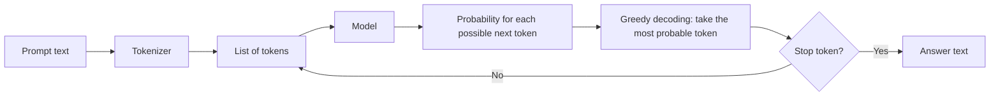
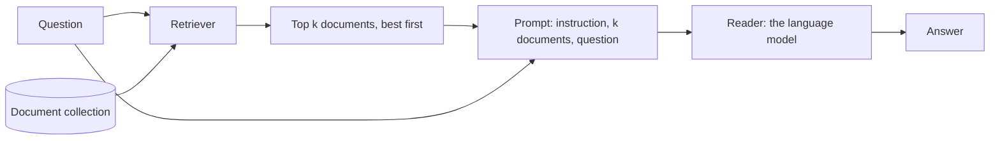

## 1. The question this page answers

What does a language model receive when we give it a long prompt? Why was a long prompt a problem before 2023? Which words must you know to read this paper?

## 2. Mental model

> [!analogy] A desk of index cards
> Each token is one small card. The context window is a desk that holds a fixed number of cards. The model can use only the cards on the desk. Anything that does not fit stays off the desk.
>
> **Where it stops working:** the desk picture says that every card on the desk is equally easy to see. This paper shows that this is false. Cards at the two edges of the desk are easier to use than cards in the middle.

## 3. Terms

| Term | Plain meaning |
|---|---|
| token | The unit of text that a model reads and writes. A token is often a part of a word. |
| tokenizer | The program that changes text into a list of token numbers, and back. Different model families use different tokenizers. |
| language model | A program that gives a probability to each possible next token, from the tokens before it. |
| prompt | All the text that we give to the model before it starts to write. |
| context | All the tokens that the model can use at one step: the prompt and the tokens it has written so far. |
| context window | The largest number of tokens that a model can use at one time. |
| greedy decoding | At each step, the model writes the token with the highest probability. The paper uses only greedy decoding. |
| parametric memory | Knowledge that is stored in the weights of the model from training. |
| base model | A model after pretraining only. It continues text. |
| instruction fine-tuning | More training on pairs of instructions and good responses. The model learns to follow instructions. |
| RLHF | Reinforcement learning from human feedback. More training that rewards the responses that people prefer. |
| retrieval-augmented generation (RAG) | A system that finds documents for a question and puts them in the prompt. The model then writes an answer from the documents. |
| retriever | The part of a RAG system that finds and ranks documents. |
| reader | The part of a RAG system that reads the documents and writes the answer. Here, the language model. |
| closed-book | A test setting with no documents. The model answers from parametric memory only. |
| oracle | A test setting with only the one document that contains the answer. |

All terms are also in the [Glossary](/notes/papers/glossary).

## 4. Tokens

A model does not read letters or words. It reads tokens. The tokenizer changes the text into a list of whole numbers. Each number is the index of one token in a fixed vocabulary.

A common rule of thumb for English: one token is about three quarters of a word. Names, rare words and random strings use more tokens. A random ID such as `9f4a92b9-5f69-4725-ba1e-403f08dea695` uses many tokens, because the tokenizer does not know it as one unit.

The paper measures the length of each input in tokens. Some examples with the GPT-3.5-Turbo tokenizer (from the appendix of the paper):

| Input | Average tokens | Largest input |
|---|---|---|
| Question with no documents (closed-book) | 15.3 | 29 |
| Question and the answer document (oracle) | 156.0 | 449 |
| Question and 10 documents | 1,475.6 | 1,960 |
| Question and 20 documents | 2,946.2 | 3,920 |
| Question and 30 documents | 4,419.2 | 6,101 |

> [!trap] The same text has different lengths for different models
> MPT-30B and LongChat-13B use other tokenizers. For 20 documents, the average is 2,962.4 tokens for MPT-30B and 3,464.6 tokens for LongChat-13B. So one input can fit the window of one model and not the window of another model.

## 5. How a model writes an answer

A language model writes one token at a time. Each new token goes into the context for the next step.



The answer depends on the full context at each step. If the model ignores a part of the context, the answer cannot use that part.

## 6. The context window, and why it was small

The context window is a hard limit. The prompt and the answer must fit in it together.

The usual model is a Transformer. Its attention step compares each token with every other token (page 02 explains attention). For $n$ tokens, one attention head in one layer computes $n \times n$ scores. So the work and the memory grow with $n^2$.

| Tokens $n$ | Scores $n^2$ | Compared with 2,048 tokens |
|---|---|---|
| 512 | 262,144 | 1/16 |
| 2,048 | 4,194,304 | 1 |
| 4,096 | 16,777,216 | 4 times |
| 8,192 | 67,108,864 | 16 times |
| 16,384 | 268,435,456 | 64 times |
| 100,000 | 10,000,000,000 | about 2,384 times |

From 2,048 to 16,384 tokens, the input gets 8 times longer, but the attention scores increase 64 times. For this reason, older Transformer models used windows of 512 to 2,048 tokens.

Faster GPUs with more memory, and better algorithms (for example FlashAttention, which computes exact attention with less memory traffic), made longer windows possible. By 2023, models had windows of 4,096, 32,768 and even 100,000 tokens.

> [!key] The gap that the paper studies
> A model can **accept** a long input. That does not prove that the model **uses** the long input well. This paper measures the use.

## 7. How a model learns to use a context

A model learns in steps:

1. **Pretraining.** The model predicts the next token on a very large amount of text from the Internet and books. The result is a **base model**. It continues text, but it does not follow instructions well.
2. **Instruction fine-tuning.** The model trains on instruction and response pairs. In these pairs, the task is usually at the start of the input.
3. **RLHF** (optional). The model trains to prefer the responses that people rate higher.

Page 07 uses these steps. The authors ask if step 2 causes the problem that they found.

## 8. Retrieval-augmented generation (RAG)

A model knows only what was in its training data. RAG gives it new facts at question time.



1. The retriever ranks the documents by relevance to the question.
2. The system takes the top $k$ documents. The number $k$ is the "top-k" setting.
3. The system puts the $k$ documents and the question in one prompt.
4. The model reads the prompt and writes the answer.

A larger $k$ makes it more likely that the answer is somewhere in the prompt. But a larger $k$ also makes the prompt longer, and it adds more documents that do not help. Page 08 measures this trade-off.

> [!note] The connection to this paper
> In RAG, the useful document can be at any position in the prompt. If the model uses the middle of the prompt badly, a RAG system can fail even when the retriever found the right document.

## 9. Two baselines: closed-book and oracle

A baseline is a reference score. The paper uses two baselines for each model.

| Baseline | What the model gets | What it measures |
|---|---|---|
| Closed-book | The question only | What the model knows without documents. A floor: documents should help, not hurt. |
| Oracle | The question and only the answer document | The best case: the model gets the answer document with no distractors. A ceiling. |

For GPT-3.5-Turbo, closed-book accuracy is 56.1% and oracle accuracy is 88.3%. A result between these two values shows how much the documents help. A result below 56.1% shows that the documents hurt.

## 10. Common mistakes

1. **"A larger context window means better use of context."** The window is a limit on size. It says nothing about use.
2. **"One token is one word."** A token is often a part of a word. Random strings use many tokens.
3. **"Closed-book means the model knows nothing."** Closed-book means that the model has no documents. It still has its parametric memory, and it can be correct.
4. **"The oracle is the real-world case."** The oracle has no distractors. Real RAG prompts have many distractors.

## 11. One-minute explanation

A language model reads tokens and predicts the next token, again and again. The context window is the largest number of tokens that it can use at one time. Attention compares every token with every other token, so the cost grows with the square of the length. For that reason, windows were short until about 2023. RAG puts retrieved documents in the prompt so that the model can answer from them. Two baselines frame every result: closed-book (no documents) and oracle (only the right document). This paper asks if a model with a long window really uses all of the documents in it.

## 12. Check questions

```check
{
  "question": "A model has a context window of 4,096 tokens. The 30-document prompts have an average of 4,419.2 tokens and a maximum of 6,101 tokens with this tokenizer. Can the paper test this model with 30 documents?",
  "hint": "The prompt and the answer must fit in the window together.",
  "answer": "No. Even the average prompt is longer than 4,096 tokens. This is why GPT-3.5-Turbo (4K) has no results for 30 documents. Only GPT-3.5-Turbo (16K) has them."
}
```

```check
{
  "question": "The input grows from 4,096 to 16,384 tokens. By how many times does the number of attention scores in one head of one layer grow?",
  "hint": "The number of scores is $n^2$.",
  "answer": "The length grows 4 times, so the scores grow $4^2 = 16$ times: from 16,777,216 to 268,435,456."
}
```

```check
{
  "question": "GPT-3.5-Turbo gets 56.1% closed-book and 88.3% oracle. With 20 documents, it gets 53.8% at one position. What does 53.8% tell you?",
  "hint": "Compare it with the floor.",
  "answer": "53.8% is lower than the closed-book floor of 56.1%. At that position, the documents hurt the model: it does worse than with no documents at all."
}
```

```check
{
  "question": "In a RAG system, what are the benefit and the cost of a larger top-k?",
  "answer": "Benefit: a higher chance that the answer document is in the prompt (higher retriever recall). Cost: a longer prompt (more tokens, more latency, more money) and more distractors that the model must ignore."
}
```

## 13. Links

- Next: [02 Background: attention and position](/notes/papers/long-context/2023-lost-in-the-middle/02-background-attention-and-position)
- [Lost in the Middle (2023)](/notes/papers/long-context/2023-lost-in-the-middle)
- [Glossary](/notes/papers/glossary)
