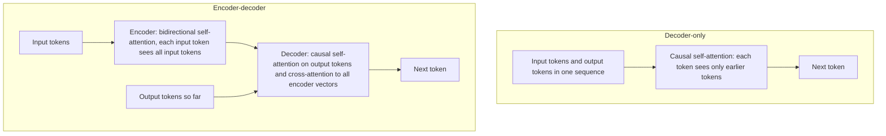

## 1. The question this page answers

How does one token use the information in other tokens? In a decoder-only model, which tokens can each token see? How does a model know the order of its tokens? Pages 05 to 07 need all three answers.

## 2. Mental model

> [!analogy] Attention is a soft search
> Each token asks a question: its **query**. Each token also shows a label: its **key**, and it holds some content: its **value**. A token compares its query with every key that it can see. A good match gives a high weight. The token then takes a weighted average of the values.
>
> **Where it stops working:** a real search returns the best item. Attention returns a blend of all visible items. Also, the queries, keys and values are learned. Nobody writes them. And a model repeats this in many heads and many layers.

## 3. Terms

| Term | Plain meaning |
|---|---|
| vector | A list of numbers. Each token is a vector inside the model. |
| query, key, value | Three vectors that the model computes from each token vector, with three learned matrices. |
| attention score | The dot product of one query and one key, divided by $\sqrt{d}$. A high score means a good match. |
| softmax | A function that changes a list of scores into weights that are positive and add to 1. |
| attention weight | The share of one value in the weighted average. |
| self-attention | Attention where the queries, keys and values all come from the same sequence. |
| head | One copy of the attention step with its own learned matrices. A layer has many heads. |
| contextualization | The change of a token vector when it mixes in information from other tokens. After many layers, each token vector carries its context. |
| causal mask | A rule that stops each token from seeing the tokens after it. |
| decoder-only model | A model with only causal self-attention. GPT-3.5, Claude, MPT, LLaMA and LongChat are decoder-only. |
| encoder-decoder model | A model with two parts. The encoder reads the input with no mask. The decoder writes the output with a causal mask. Flan-T5 and Flan-UL2 are encoder-decoder. |
| bidirectional | Each token can see the tokens before it and after it. |
| positional encoding | Information about the position of each token that the model adds, because attention alone ignores order. |
| RoPE | Rotary position embedding. It rotates each query and key by an angle that grows with the position. |
| ALiBi | Attention with linear biases. It subtracts a penalty from each score. The penalty grows with the distance between the two tokens. |

## 4. Attention, step by step

### The formula

For one token $i$ and every token $j$ that it can see:

$$
s_{ij} = \frac{q_i \cdot k_j}{\sqrt{d}}
\qquad
a_{ij} = \frac{e^{s_{ij}}}{\sum_{m} e^{s_{im}}}
\qquad
o_i = \sum_{j} a_{ij}\, v_j
$$

- $q_i$ is the query vector of token $i$.
- $k_j$ and $v_j$ are the key vector and the value vector of token $j$.
- $d$ is the number of values in each query and key vector. Division by $\sqrt{d}$ keeps the scores in a usable range.
- $s_{ij}$ is the score. $a_{ij}$ is the weight. The sum over $m$ uses every token that token $i$ can see.
- $o_i$ is the output: the new vector for token $i$.

For all tokens at the same time, with a mask matrix $M$:

$$
\text{Attention}(Q, K, V) = \text{softmax}\!\left(\frac{QK^{\top}}{\sqrt{d}} + M\right) V
$$

$M$ holds $0$ where a token can see another token, and $-\infty$ where it cannot. Since $e^{-\infty} = 0$, a blocked token gets a weight of exactly 0.

### Worked example

Three tokens, with $d = 2$. Token 3 reads the sequence. Its query is $q_3 = [1, 0]$.

| Token $j$ | Key $k_j$ | Value $v_j$ | $q_3 \cdot k_j$ | Score $s_{3j}$ | $e^{s}$ | Weight $a_{3j}$ |
|---|---|---|---|---|---|---|
| 1 | [1, 0] | [1, 0] | 1 | 0.707 | 2.028 | 0.401 |
| 2 | [0, 1] | [0, 1] | 0 | 0 | 1.000 | 0.198 |
| 3 | [1, 1] | [0.5, 0.5] | 1 | 0.707 | 2.028 | 0.401 |

1. Scores: $1/\sqrt{2} = 0.707$, $0$, $0.707$.
2. Sum of $e^{s}$: $2.028 + 1.000 + 2.028 = 5.056$.
3. Weights: $2.028/5.056 = 0.401$, $1/5.056 = 0.198$, $0.401$.
4. Output: $o_3 = 0.401 \cdot [1, 0] + 0.198 \cdot [0, 1] + 0.401 \cdot [0.5, 0.5] = [0.602, 0.398]$.

Token 2 has the lowest weight because its key does not match the query. It still has a weight of 0.198. Attention blends. It does not select.

> [!key] Attention can reach any visible token in one step
> The score does not depend on the distance between the two tokens, unless the position method adds a distance effect. So in principle, a token in the middle is as easy to reach as a token at the start. The paper calls this result surprising for this reason.

## 5. The causal mask

A decoder-only model writes from left to right. In training, it learns to predict each token from the tokens before it. So a token must not see the tokens after it. The causal mask blocks them.

Example: token 2 reads with the query $q_2 = [0, 1]$. It can see tokens 1 and 2 only.

| Token $j$ | Score $s_{2j}$ | Weight $a_{2j}$ |
|---|---|---|
| 1 | $0/\sqrt{2} = 0$ | 0.330 |
| 2 | $1/\sqrt{2} = 0.707$ | 0.670 |
| 3 | blocked: $-\infty$ | 0 |

Now examine a real prompt from the paper: an instruction, then the documents, then the question.


Read the figure row by row:

1. The rows of the documents end before the question column. So the model builds its vector for each document **before** it sees the question.
2. The question row and the answer row see every document. So when the model writes the answer, it **can** attend to the answer document at any position.

> [!trap] What the causal mask blocks, and what it does not block
> The causal mask does not hide the documents from the answer. The answer tokens can attend to all documents. The mask stops the documents from "knowing" the question. The model reads each document without knowing which facts will matter. Page 07 tests a fix: put the question before the documents too.

## 6. Decoder-only and encoder-decoder



In an encoder-decoder model, a document token can see the tokens after it, including the question. So the encoder can build each document vector with knowledge of the question and of the later documents. Page 07 uses this difference.

## 7. How a model knows the order of tokens

Attention alone ignores order. The score $q_i \cdot k_j$ uses only the two vectors. If you shuffle the input tokens, each token gets the same output vector as before, in the shuffled order. Without position information, "dog bites man" and "man bites dog" look the same.

So every model adds position information. The models in this paper use four methods.

| Method | How it works | Models in this paper |
|---|---|---|
| Learned absolute positions | Add a learned vector for position $p$ to the token vector. It cannot go past the longest position in training. | Not used by the main models |
| RoPE | Rotate each query and key by an angle that grows with its position. The dot product then depends on the distance $i - j$, not on the two positions. | LLaMA-13B, so also LongChat-13B (16K). Llama-2. |
| ALiBi | Add $-m \cdot (i - j)$ to each score. $m$ is a fixed slope for each head. Far tokens get a lower score before the softmax. | MPT-30B and MPT-30B-Instruct |
| Relative position bias | Add a learned number to each score. The number depends on the distance between the two tokens, put in buckets. | Flan-T5-XXL and Flan-UL2 |

> [!example] ALiBi with numbers
> A model with 8 heads uses the slopes $1/2, 1/4, \dots, 1/256$. In the head with slope $1/2$, a key 10 tokens back gets $-5$ added to its score. A key 1,000 tokens back gets $-500$. That head can almost only see near tokens. The head with slope $1/256$ gets $-3.9$ for 1,000 tokens back, so it can still see far tokens.

> [!note] Condensed RoPE in LongChat-13B (16K)
> LLaMA-13B trained with 2,048 positions. LongChat divides each position by a constant, so that 16,384 positions fit into the range 0 to 2,048 that the model knows. Here the constant is $16{,}384 / 2{,}048 = 8$. Then LongChat fine-tunes the model on sequences of 16,384 tokens.

## 8. Why this page matters for the paper

The paper finds that position changes accuracy a lot. This page gives three facts to explain that result later:

1. Attention can reach any visible token. So the problem is not a hard limit of attention. These notes read it as a learned behavior. Page 07 gives the evidence and the later work.
2. In a decoder-only model, the documents are read before the question. Page 07 tests if this matters.
3. Position methods such as ALiBi give a preference to near tokens. A preference for the end of the context (recency) is then not surprising. A preference for the start (primacy) needs a different reason.

## 9. Common mistakes

1. **"Attention selects the most relevant token."** Attention gives a weight to every visible token and blends the values.
2. **"The causal mask stops the answer from seeing early documents."** The answer tokens can see every earlier token. The mask stops each token from seeing **later** tokens.
3. **"Position information is added once at the input."** That is true for learned absolute positions. RoPE and ALiBi act inside every attention layer.
4. **"A long context window means the model trained on inputs that long."** LongChat trained its base on 2,048 positions and then stretched them. MPT trained mostly on 2,048 tokens and then on 8,192 tokens.

## 10. One-minute explanation

In attention, each token compares its query with the keys of the tokens it can see. The softmax changes the scores into weights, and the token takes a weighted average of the values. In a decoder-only model, a causal mask lets each token see only the tokens before it. So in a prompt with documents first and the question last, the model reads each document without knowing the question. The answer tokens can still see everything. Attention alone ignores order, so models add position information: RoPE rotates queries and keys, ALiBi penalizes distance, and T5-style models add a learned bias for distance.

## 11. Check questions

```check
{
  "question": "Token 3 has the query $[0, 1]$. The keys are $[1, 0]$, $[0, 1]$, $[1, 1]$ and $d = 2$. Compute the three weights.",
  "hint": "Scores: $q \\cdot k / \\sqrt{2}$. Then $e^{s}$, then divide by the sum.",
  "answer": "Dot products: 0, 1, 1. Scores: 0, 0.707, 0.707. $e^{s}$: 1.000, 2.028, 2.028, sum 5.056. Weights: 0.198, 0.401, 0.401."
}
```

```check
{
  "question": "A prompt has 20 documents and then the question, in a decoder-only model. Can the tokens of document 7 attend to the question tokens? Can the answer tokens attend to document 7?",
  "hint": "The causal mask blocks later tokens only.",
  "answer": "No: the question comes after document 7, so the mask blocks it. Yes: document 7 comes before the answer, so the answer tokens can attend to it."
}
```

```check
{
  "question": "Why does a Transformer need position information at all?",
  "answer": "The attention score uses only the query and key vectors. If you shuffle the tokens, each token gets the same output vector, in the shuffled order. So without position information the model cannot tell the order of the words."
}
```

```check
{
  "question": "In an ALiBi head with slope 1/4, how much is added to the score of a key 40 tokens back?",
  "answer": "$-\\frac{1}{4} \\times 40 = -10$. The key gets a much lower score than a near key with the same match."
}
```

## 12. Links

- Previous: [01 Background: language models and context](/notes/papers/long-context/2023-lost-in-the-middle/01-background-language-models)
- Next: [03 The question](/notes/papers/long-context/2023-lost-in-the-middle/03-the-question)
- Uses this page: [07 Why it happens](/notes/papers/long-context/2023-lost-in-the-middle/07-why-it-happens)
- [Glossary](/notes/papers/glossary)
