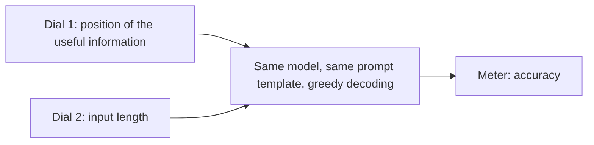

## 1. The question this page answers

In 2023, context windows grew fast. Did the models use those long contexts well? How can you test "use" in a fair way?

## 2. Mental model

> [!analogy] Hide one fact in a stack of pages
> Give a reader a stack of 20 pages and one question. Only one page has the answer. Put that page first, then fifth, then tenth, and so on. Keep everything else the same. If the reader uses the whole stack well, the score is the same for every position.
>
> **Where it stops working:** this test shows **that** the position matters. It does not show **why**. It tests behavior from outside the model. It does not look inside the model.

## 3. Terms

| Term | Plain meaning |
|---|---|
| controlled experiment | An experiment that changes one thing at a time and keeps all other things the same. |
| independent variable | The thing that the experiment changes. Here: the position of the useful information, and the length of the input. |
| dependent variable | The thing that the experiment measures. Here: accuracy. |
| position | The place of the useful information in the context. Position 1 is the first document. |
| input length | The size of the context, here changed by the number of documents or key-value pairs. |
| robust use | Accuracy that changes very little when the position of the useful information changes. |
| primacy bias | Better use of the information at the start of the context. |
| recency bias | Better use of the information at the end of the context. |
| U-shaped curve | A curve that is high at both ends and low in the middle. |
| serial-position effect | In human memory: people recall the first and the last items of a list best. |

## 4. The situation in 2023

1. Models were used for long tasks: legal and scientific documents, long conversations, search results, database results.
2. Context windows grew from 512 to 2,048 tokens to 4,096, 32,768 and 100,000 tokens.
3. Many studies measured long-context models with **perplexity** on web text. Perplexity measures how well a model predicts the next token. A model can predict the next token well from the last few hundred tokens only. So a good perplexity does not prove the use of far context.
4. Older work showed that models use far context only a little:
   - Small LSTM language models used near context sharply and far context only coarsely (Khandelwal et al., 2018: "Sharp nearby, fuzzy far away").
   - Long-range Transformers improved the prediction of only a few tokens with longer context (Sun et al., 2021).
   - Models without instruction training preferred recent tokens (Press et al., 2021).
5. One close study (Ivgi et al., 2023) compared two places: the useful paragraph at the start, or at a random position. This paper moves the useful information through many positions: 1, 5, 10, 15, 20 and more. For GPT-3.5-Turbo with 20 documents, it tests all 20 positions.

## 5. The test of robust use

The authors state a simple rule:

> [!key] The test
> If a model uses its long input context robustly, its accuracy should change very little when the position of the relevant information changes.

This rule gives a new evaluation protocol for long-context models. To claim robust use, show a small difference between the best position and the worst position.

$$
\text{position gap} = \text{accuracy at the best position} - \text{accuracy at the worst position}
$$

A gap near 0 points means robust use. A large gap means that the model depends on where the information is.

## 6. The design: two dials and one meter



1. **Position.** Move the useful information from the start to the end. Keep the length the same.
2. **Length.** Add more useless information. Keep the useful information the same.
3. **Accuracy.** The share of examples where the output contains a correct answer.

## 7. The four research questions

The paper asks four questions. Each question has a page in these notes.

| # | Question | Page |
|---|---|---|
| 1 | In multi-document question answering, does the position of the answer document change accuracy? | [05 Results: multi-document QA](/notes/papers/long-context/2023-lost-in-the-middle/05-results-multi-document-qa) |
| 2 | Can models at least retrieve an exact match from any position? | [06 Results: key-value retrieval](/notes/papers/long-context/2023-lost-in-the-middle/06-results-key-value-retrieval) |
| 3 | Why? Is it the architecture, the place of the question, instruction fine-tuning, or model size? | [07 Why it happens](/notes/papers/long-context/2023-lost-in-the-middle/07-why-it-happens) |
| 4 | In a real retriever and reader system, is more context worth its cost? | [08 The more-context trade-off](/notes/papers/long-context/2023-lost-in-the-middle/08-more-context-trade-off) |

## 8. A link to human memory

In 1913, Ebbinghaus studied memory. In 1962, Murdock measured free recall: a person hears a list and then says all the items that they remember. People recall the first items (primacy) and the last items (recency) best. The items in the middle are recalled worst. This is the **serial-position effect**.

The paper finds a similar U-shaped curve in language models. The authors call this surprising. Self-attention can reach any token in one step (page 02), so a Transformer has no built-in reason to forget the middle.

> [!trap] A similar curve is not a similar cause
> Human memory and a Transformer work in very different ways. The paper does not claim that models "forget" like people. It only notes that the two curves have the same shape.

## 9. Common mistakes

1. **"A long context window answers the question."** The window size is a capacity. The paper measures the use.
2. **"Perplexity proves long-context use."** A model can get good perplexity from near tokens only.
3. **"Change the position and the length together."** Then you cannot tell which change caused the result. Change one dial at a time.

## 10. One-minute explanation

By 2023, models could take very long inputs. Nobody knew if they used all of the input. The authors built a fair test: put one useful piece of information among many useless pieces, and move it from the first position to the last. If the model uses the whole context, accuracy stays the same. They also change the length by adding more useless pieces. Then they ask why the results look as they do, and if more context helps in a real RAG system.

## 11. Check questions

```check
{
  "question": "In this paper, what is the independent variable, and what is the dependent variable?",
  "answer": "Independent variables: the position of the useful information, and the input length (number of documents or key-value pairs). Dependent variable: accuracy."
}
```

```check
{
  "question": "Model A has 70% at its best position and 68% at its worst. Model B has 80% at its best and 60% at its worst. By the test of this paper, which model uses its context more robustly?",
  "hint": "Compute the position gap of each model.",
  "answer": "Model A. Its gap is 2 points. Model B has a gap of 20 points. Model B is more accurate at its best position, but it depends much more on the position."
}
```

```check
{
  "question": "Why is perplexity on web text a weak test of long-context use?",
  "answer": "Perplexity measures next-token prediction. Most next tokens are predictable from the near context. So a model can get a good perplexity and still not use the far context."
}
```

## 12. Links

- Previous: [02 Background: attention and position](/notes/papers/long-context/2023-lost-in-the-middle/02-background-attention-and-position)
- Next: [04 Experiment design](/notes/papers/long-context/2023-lost-in-the-middle/04-experiment-design)
- [How to read a paper](/notes/papers/reading-method)
