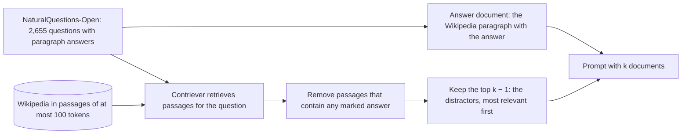

## 1. The question this page answers

How exactly did the authors build their tests? What did they change, what did they keep the same, and what did they measure?

## 2. Mental model

> [!analogy] A lab bench with two dials
> The bench holds one model and one prompt template. Dial 1 moves the useful item to a new position. Dial 2 adds or removes useless items. A meter shows accuracy. The authors turn one dial at a time.
>
> **Where it stops working:** in a real lab, the dials control a physical quantity exactly. Here, the "useless" items are real Wikipedia passages. Some of them can contain a reasonable answer by accident. The authors check this in a robustness test (page 05, section 10).

## 3. Terms

| Term | Plain meaning |
|---|---|
| multi-document question answering (QA) | A task where the model gets a question and $k$ documents, and must answer from the documents. |
| answer document | The one document in the prompt that contains the answer. |
| distractor | A document that looks relevant but does not contain the answer. |
| hard negative | A distractor that a retriever ranks high, so it looks very relevant. The distractors in this paper are hard negatives. |
| NaturalQuestions-Open | A dataset of real questions from Google search, with answers that people marked in Wikipedia. |
| Contriever | A neural retriever. It turns questions and passages into vectors and ranks passages by similarity. Here it is fine-tuned on MS-MARCO. |
| MS-MARCO | A large dataset of search questions and relevant passages, often used to train retrievers. |
| key-value retrieval | A synthetic task: find the value of one given key in a JSON object. |
| UUID | A random 128-bit identifier, written as 32 hex characters in five groups. It has no meaning. |
| accuracy | The percent of examples where any correct answer string appears in the output of the model. |


The figure shows both tasks. The sections below explain each step.

## 4. Task 1: multi-document question answering

### The data

1. **Questions.** From NaturalQuestions-Open: real questions that people typed into Google, with answers that people marked in Wikipedia. The authors keep the 2,655 questions where the marked long answer is a paragraph, not a list or a table.
2. **Documents.** Wikipedia is cut into passages of at most 100 tokens. Each passage is one document, with its title.
3. **Answer document.** For each question, the Wikipedia paragraph that contains the marked answer.
4. **Distractors.** For each question, Contriever retrieves the $k - 1$ passages that are most relevant to the question **and** do not contain any marked answer.
5. **Order.** The distractors appear in order of decreasing relevance.



### The prompt

Each prompt has an instruction, $k$ documents and the question. The instruction is the same for every example.

```text
Write a high-quality answer for the given question using only the provided search results (some of which might be irrelevant).

Document [1](Title: Asian Americans in science and technology) ...
Document [2](Title: List of Nobel laureates in Physics) The first Nobel Prize in Physics was awarded in 1901 to Wilhelm Conrad Röntgen, of Germany, who received ...
Document [3](Title: Scientist) ...

Question: who got the first nobel prize in physics
Answer:
```

The desired answer is "Wilhelm Conrad Röntgen". Here the answer document is at position 2.


### The two dials

1. **Position.** Move the answer document to position 1, 5, 10, 15, 20, and so on. The distractors keep their order. The correct answer does not change.
2. **Length.** Use $k$ = 10, 20 or 30 documents in total. More documents means more distractors. The correct answer does not change.

| $k$ | Approximate tokens | Positions tested |
|---|---|---|
| 10 | about 2,000 | 1, 5, 10 |
| 20 | about 4,000 | 1, 5, 10, 15, 20 |
| 30 | about 6,000 | 1, 5, 10, 15, 20, 25, 30 |

## 5. Task 2: key-value retrieval

The QA task needs two skills: find the right document, and use it to answer. The key-value task tests only the first skill: find an exact match.

### The data

1. Make $k$ key-value pairs. Each key and each value is a new random UUID.
2. Write all pairs as one JSON object.
3. Pick one key. Its value is the correct answer. The other $k - 1$ pairs are distractors.
4. Use $k$ = 75, 140 or 300 pairs. Make 500 examples for each $k$.

### The prompt

This example has 5 pairs. The pair to find is at position 3.

```text
Extract the value corresponding to the specified key in the JSON object below.

JSON data:
{"6513270e-269e-4d37-b2a7-4de452e6b438": "d23f0824-128b-4f33-8c5c-7fd0a6a3a450",
 "9531985d-5d9d-49f8-9818-e811892f902b": "36f675cc-81e7-4ef5-a8e2-5d940ed90475",
 "6b0d549b-6f03-475a-9600-a35a099950d8": "8d116ece-1738-47d9-bd9c-172411e20b8f",
 "90c192cf-d3ac-44af-8f21-ddb66cad4a26": "a170b338-3926-4059-b28c-105d1fb17c23",
 "0fd630f1-f29d-4da9-953f-48f1a09f76b5": "0cb1e29c-658c-4a14-95e6-0af593bd04cf"}

Key: "6b0d549b-6f03-475a-9600-a35a099950d8"
Corresponding value:
```

The desired output is `8d116ece-1738-47d9-bd9c-172411e20b8f`.

### Why random UUIDs

Words carry meaning. A model can use meaning to guess. A model can also be more sensitive to some words than to others. Random UUIDs remove all meaning. Only an exact token match can find the value. So the task isolates one skill.

### The two dials

1. **Position.** Move the pair to find through the JSON object.
2. **Length.** Use 75, 140 or 300 pairs: about 4,000, 8,000 or 16,000 tokens.

## 6. The measure: accuracy

For each example, the authors check if **any** correct answer string appears in the output. Accuracy is the percent of examples that pass.

> [!trap] What this measure accepts and rejects
> - It accepts a long output that contains the answer among other words.
> - It rejects a correct answer in different words, for example "W. C. Röntgen" when the marked answer is "Wilhelm Conrad Röntgen".
> - For key-value retrieval, the value must appear exactly. A model that writes code to find the value, instead of the value, fails.

All models use greedy decoding. So each prompt gives one fixed output.

## 7. The baselines

| Model | Closed-book | Oracle |
|---|---|---|
| LongChat-13B (16K) | 35.0% | 83.4% |
| MPT-30B-Instruct | 31.5% | 81.9% |
| GPT-3.5-Turbo | 56.1% | 88.3% |
| GPT-3.5-Turbo (16K) | 56.0% | 88.6% |
| Claude-1.3 | 48.3% | 76.1% |
| Claude-1.3 (100K) | 48.2% | 76.4% |

Closed-book: the question with no documents. Oracle: the question with only the answer document. The two numbers frame each result on page 05.

## 8. The models

### Main models

| Model | Type | Context window | Notes |
|---|---|---|---|
| MPT-30B-Instruct | open | 8,192 tokens | Pretrained on 1 trillion tokens with 2,048-token sequences, then on 50 billion tokens with 8,192-token sequences. Uses ALiBi. |
| LongChat-13B (16K) | open | 16,384 tokens | LLaMA-13B (2,048 positions) stretched with condensed RoPE, then fine-tuned on 16,384-token sequences. |
| GPT-3.5-Turbo (version 0613) | closed | 4K tokens | OpenAI API. |
| GPT-3.5-Turbo (16K) (version 0613) | closed | 16K tokens | The extended-context version of the same model. |
| Claude-1.3 | closed | 8K tokens | Anthropic API. |
| Claude-1.3 (100K) | closed | 100K tokens | The extended-context version of the same model. |

The pairs of the same model with two window sizes are important. They let the authors ask: does a longer window give better use of the same input?

### Extra models for the analysis

| Model | Used for |
|---|---|
| GPT-4 (8K) | Multi-document QA on 500 random questions with 20 documents. The full set of experiments would cost more than USD 6,000. |
| Llama-2 7B, 13B, 70B, each as base and chat model | The effect of model size and of extra fine-tuning (page 07). |
| Flan-T5-XXL, Flan-UL2 | Encoder-decoder models (page 07). |
| MPT-30B (the base model) | The effect of instruction fine-tuning (page 07). |

### Which settings fit which model

A model can take a setting only if the prompt fits its window. Some token counts (average, with the GPT-3.5-Turbo and Claude tokenizer):

| Setting | Average tokens | Largest |
|---|---|---|
| 30 documents | 4,419.2 | 6,101 |
| 75 key-value pairs | 3,768.7 | 3,844 |
| 140 key-value pairs | 6,992.8 | 7,088 |
| 300 key-value pairs | 14,929.4 | 15,048 |

So GPT-3.5-Turbo (4K) has no result for 30 documents. Only GPT-3.5-Turbo (16K) and Claude-1.3 (100K) have results for 300 key-value pairs. LongChat-13B (16K) has a 16K window, but its own tokenizer makes the 300-pair input 21,467.3 tokens on average. That does not fit.

## 9. Common mistakes

1. **"The distractors are random documents."** They are the most relevant passages that do not contain the answer: hard negatives. Random distractors are a separate robustness test (page 05).
2. **"The position dial changes the order of all documents."** Only the answer document moves. The distractors keep their order.
3. **"Accuracy means exact match."** It means "the output contains a correct answer string".
4. **"Each point on a curve is one prompt."** Each point is the accuracy over all 2,655 questions (or 500 key-value examples) with the answer at that position.

## 10. One-minute explanation

The authors built two tests. In multi-document QA, each prompt has a real Google question, one Wikipedia passage with the answer, and $k - 1$ hard distractors from a retriever. They move the answer passage through the positions, and they use 10, 20 or 30 documents. In key-value retrieval, each prompt is a JSON object of random UUID pairs, and the model must return the value of one key. Random IDs remove meaning, so this test isolates exact lookup. Accuracy counts an output as correct if it contains a correct answer. Closed-book and oracle scores give a floor and a ceiling for each model.

## 11. Check questions

```check
{
  "question": "Why do the authors use the most relevant non-answer passages as distractors, not random passages?",
  "hint": "Think about a real RAG prompt.",
  "answer": "In a real RAG system, the other retrieved passages look relevant. Hard distractors make the test realistic, and the model must tell the answer document apart from similar passages. Random passages would be easy to ignore."
}
```

```check
{
  "question": "Why does the key-value task use random UUIDs and not words?",
  "answer": "Random UUIDs have no meaning. The model cannot guess from meaning, and no word features can change the result. Only an exact match of tokens can find the value. So the task isolates the skill of retrieval from the context."
}
```

```check
{
  "question": "With 20 documents, the answer document moves from position 1 to position 20. Name two things that stay the same.",
  "answer": "Any two of: the question, the answer document, the set of distractors and their order, the instruction, the total length, the model, greedy decoding."
}
```

```check
{
  "question": "A model outputs 'The first winner was W. C. Röntgen.' The only marked answer is 'Wilhelm Conrad Röntgen'. Is it counted as correct?",
  "answer": "No. The measure checks if a marked answer string appears in the output. 'Wilhelm Conrad Röntgen' does not appear, so it fails, even though a person would accept it."
}
```

## 12. Links

- Previous: [03 The question](/notes/papers/long-context/2023-lost-in-the-middle/03-the-question)
- Next: [05 Results: multi-document QA](/notes/papers/long-context/2023-lost-in-the-middle/05-results-multi-document-qa)
- Build it yourself: [11 Reproduce it](/notes/papers/long-context/2023-lost-in-the-middle/11-reproduce-it)
