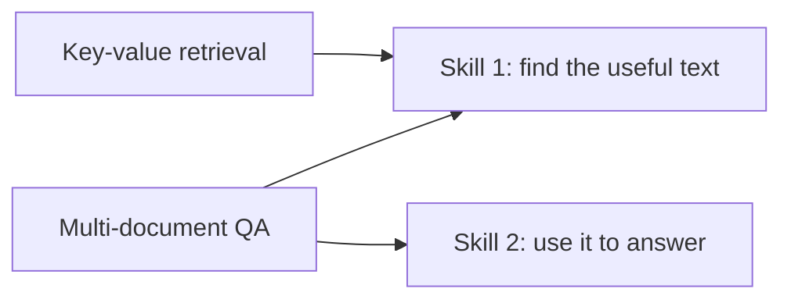

## 1. The question this page answers

Multi-document QA needs two skills: find the answer document, and use it. Key-value retrieval needs only the first skill: find an exact match and copy it. Can models do even that from the middle of a long context?

## 2. Mental model

> [!analogy] A phone book
> You get a long list of names and numbers, and one name. You must give the number. You do not need to understand anything. You only need to find the same name and copy the number next to it.
>
> **Where it stops working:** a person scans the list in order and can use the alphabetical order. The JSON object has no order, and the model does not scan. It must find the match with attention, in one pass for each output token.

## 3. Terms

| Term | Plain meaning |
|---|---|
| synthetic task | A task with generated data, made to test one skill. |
| exact match retrieval | Finding a string in the context that is identical to a given string. |
| key-value pair | Two strings that belong together. Here, two random UUIDs. |

## 4. The results

Read the [experiment design](/notes/papers/long-context/2023-lost-in-the-middle/04-experiment-design) first: 75, 140 or 300 pairs, 500 examples for each setting, the pair to find at different positions.

| Model | Result |
|---|---|
| Claude-1.3 and Claude-1.3 (100K) | Nearly perfect at every length and every position. |
| GPT-3.5-Turbo and GPT-3.5-Turbo (16K) | Lowest accuracy when the pair is in the middle. The drop is largest with 300 pairs. |
| MPT-30B-Instruct | Lowest accuracy when the pair is in the middle. |
| LongChat-13B (16K) | A different shape with 140 pairs. See section 6. |

The paper gives exact numbers for these curves only in figures. The plot below uses values read by eye from the figure, except the minimum of 45.6%, which the text of the paper states.

```plot
{
  "title": "Approximate. 300 key-value pairs: GPT-3.5-Turbo 16K (red), Claude-1.3 100K (blue)",
  "xAxis": { "label": "position of the key to find", "domain": [-10, 310] },
  "yAxis": { "label": "accuracy (%)", "domain": [35, 105] },
  "disableZoom": true,
  "data": [
    { "points": [[1, 100], [50, 97.5], [100, 95], [150, 69.5], [200, 45.6], [250, 73.5], [300, 100]], "fnType": "points", "graphType": "polyline", "color": "#C81D25", "skipTip": true },
    { "points": [[1, 100], [50, 97.5], [100, 95], [150, 69.5], [200, 45.6], [250, 73.5], [300, 100]], "fnType": "points", "graphType": "scatter", "color": "#C81D25", "skipTip": true },
    { "points": [[1, 100], [50, 100], [100, 99.5], [150, 100], [200, 99], [250, 99], [300, 100]], "fnType": "points", "graphType": "polyline", "color": "#1E6091", "skipTip": true },
    { "points": [[1, 100], [50, 100], [100, 99.5], [150, 100], [200, 99], [250, 99], [300, 100]], "fnType": "points", "graphType": "scatter", "color": "#1E6091", "skipTip": true }
  ]
}
```

GPT-3.5-Turbo (16K) finds the value almost every time when the pair is first or last. With the pair at position 200 of 300, it finds the value in only 45.6% of the examples. The task needs no reasoning. The model fails to retrieve tokens that are in its context.

> [!key] The main lesson of this task
> The U-curve is not only a reasoning problem. For some models, even exact copying from the middle of a long context fails. But some models (here, Claude-1.3) do this task perfectly. So this is not a limit of all Transformers.

## 5. Why this result matters



1. In multi-document QA, a failure can come from skill 1 or skill 2.
2. Key-value retrieval tests skill 1 alone.
3. GPT-3.5-Turbo and MPT-30B-Instruct fail skill 1 in the middle of long inputs. This suggests that, for those models, part of the QA failure is a retrieval failure.
4. Claude-1.3 passes skill 1 everywhere, but it still shows lower QA accuracy in the middle (page 05). This suggests that, for Claude-1.3, the QA problem is more in skill 2: using the right document among similar distractors.

> [!note] This connects to page 05
> The random-distractor test on page 05 showed that the problem is not only "finding" the answer document. The key-value test shows that, for some models, finding is also a problem. Both statements are true at the same time, for different models.

## 6. A strange failure of LongChat-13B (16K)

With 140 pairs, LongChat-13B (16K) has a different curve. When the pair is near the start, it often writes code that finds the key, instead of the value itself. The accuracy measure looks for the value in the output, so these outputs count as wrong.

> [!trap] A low score is not always a failure to find
> Here the model may have "understood" the task, but it gave the wrong kind of output. When you evaluate your own system, read some failed outputs. A wrong format, a refusal or code instead of an answer all look like the same number in a table.

## 7. A preview of the fix

On page 07, the authors put the key **before and after** the JSON object. With that change, all models are nearly perfect on all three lengths. GPT-3.5-Turbo (16K) becomes perfect on 300 pairs. Its worst case without the change was 45.6%.

## 8. Common mistakes

1. **"Key-value retrieval is too easy to matter."** It isolates one skill. Some models fail it in the middle, so it shows a real limit.
2. **"All models fail the middle."** Claude-1.3 and Claude-1.3 (100K) are nearly perfect on this task.
3. **"Low accuracy means the model did not find the key."** LongChat often wrote code instead of the value. Read the outputs.

## 9. One-minute explanation

To test pure retrieval, the authors made JSON objects of random UUID pairs and asked for the value of one key. No understanding is needed, only an exact match. Claude-1.3 does this perfectly at every position. GPT-3.5-Turbo and MPT-30B-Instruct are worst when the pair is in the middle. With 300 pairs, GPT-3.5-Turbo (16K) falls to 45.6% at its worst position, and it is nearly perfect at the ends. So for some models, the middle of the context is hard even for simple copying.

## 10. Check questions

```check
{
  "question": "Why do the authors need the key-value task, when they already have multi-document QA?",
  "answer": "QA mixes two skills: finding the answer document and using it. The key-value task needs only finding and copying an exact match. So it tests whether a failure in the middle is a retrieval failure."
}
```

```check
{
  "question": "Claude-1.3 is nearly perfect on key-value retrieval, but its QA accuracy is lower in the middle. What does that suggest about its QA failures?",
  "answer": "Claude-1.3 can find exact matches anywhere. So its QA failures in the middle are more about using the right document among similar distractors (skill 2) than about retrieval (skill 1)."
}
```

```check
{
  "question": "What is the worst-case accuracy of GPT-3.5-Turbo (16K) with 300 key-value pairs, and what happens when the key is also put before the JSON?",
  "answer": "45.6% in the worst case. With the key before and after the JSON (query-aware contextualization), it becomes perfect on 300 pairs."
}
```

## 11. Links

- Previous: [05 Results: multi-document QA](/notes/papers/long-context/2023-lost-in-the-middle/05-results-multi-document-qa)
- Next: [07 Why it happens](/notes/papers/long-context/2023-lost-in-the-middle/07-why-it-happens)
- Build it yourself: [11 Reproduce it](/notes/papers/long-context/2023-lost-in-the-middle/11-reproduce-it)
