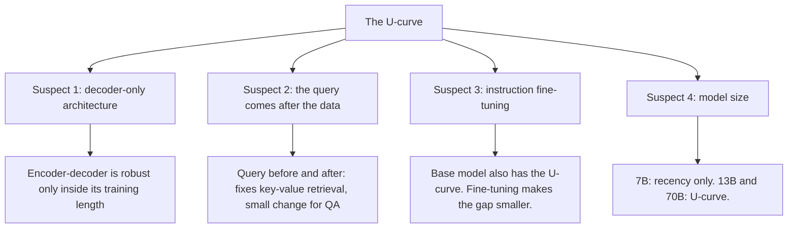

## 1. The question this page answers

Why do models use the middle of the context badly? The authors test four suspects. Which suspects explain the U-curve, and which do not?

## 2. Mental model

> [!analogy] A detective with four suspects
> Each experiment changes one suspect and keeps the rest the same. If the U-curve stays, that suspect is not the main cause. If the U-curve goes away, that suspect is part of the cause.
>
> **Where it stops working:** a crime has one guilty person. A behavior of a model can have several causes that act together. Also, these tests watch behavior from outside. They do not examine the weights or the attention patterns.

## 3. Terms

| Term | Plain meaning |
|---|---|
| training-time sequence length | The longest input length that the model saw in training. |
| extrapolation | Use of a model on inputs longer than in training. |
| query-aware contextualization | Put the query (the question or the key) both before and after the data. |
| base model | A model after pretraining only, before instruction fine-tuning. |
| supervised fine-tuning (SFT) | Training on examples of instructions with good responses. |
| scale | The size of a model, in parameters. 7B means 7 billion parameters. |

## 4. The four suspects



## 5. Suspect 1: the architecture

### The idea

All the main models are decoder-only. Each token sees only earlier tokens (page 02). An encoder-decoder model reads the whole input with bidirectional attention. Each document can then be read together with the documents after it.

### The test

The authors compare two encoder-decoder models with the decoder-only models on multi-document QA.

| Model | Training lengths |
|---|---|
| Flan-T5-XXL | 512 tokens in the encoder and the decoder. |
| Flan-UL2 | 512 tokens, then 100,000 more steps with 1,024 tokens, then instruction fine-tuning with 2,048 tokens in the encoder and 512 in the decoder. |

Both use relative position bias, so in principle they can run on inputs longer than in training. An earlier study found that both can perform well on inputs of up to 8,000 tokens.

### The result

1. **Inside the training length.** The 10-document setting has about 2,000 tokens. This is inside the 2,048-token encoder length of Flan-UL2. Here Flan-UL2 is robust: only 1.9 points between the best and the worst position.
2. **Longer than the training length.** With 20 and 30 documents, Flan-UL2 shows a U-curve. Flan-T5-XXL shows the same trend: longer inputs give a larger drop in the middle.

### The authors' hypothesis

The bidirectional encoder lets the model process each document in the context of the documents that come after it. This can help the model judge which document is important.

> [!key] Verdict on suspect 1
> Partly guilty. The encoder-decoder models are robust, but only on inputs inside their training length. Past that length, they also show the U-curve.

## 6. Suspect 2: the query comes after the data

### The idea

In the prompts, the query is at the end. In a decoder-only model, the data tokens cannot see the query (page 02, section 5). So the model reads each document or each key-value pair without knowing what it must find.

### The test: query-aware contextualization

Put the query **before and after** the data:

```text
Question: who got the first nobel prize in physics      <- new copy, before the data

Document [1](Title: ...) ...
Document [2](Title: ...) ...
...

Question: who got the first nobel prize in physics      <- the usual copy, after the data
Answer:
```


```video
{
  "src": "/notes/media/papers/2023-lost-in-the-middle/manim/causal-attention.mp4",
  "caption": "Why the documents are read without the question in a decoder-only model, and how a second copy of the question at the start changes that."
}
```

### The result

| Task | Effect of query-aware contextualization |
|---|---|
| Key-value retrieval | All models become nearly perfect on 75, 140 and 300 pairs. GPT-3.5-Turbo (16K) becomes perfect on 300 pairs. Without it, its worst case was 45.6%. |
| Multi-document QA | The trends change very little. Accuracy improves a little when the answer document is at position 1, and falls a little at the other positions. |

> [!key] Verdict on suspect 2
> Guilty for exact retrieval. Not the main cause for multi-document QA.

> [!note] Why the effect differs between the two tasks (an interpretation in these notes, not a claim of the paper)
> In key-value retrieval, the task is an exact match. If the model knows the key while it reads the pairs, it can mark the one pair that matches. In QA, the question does not match the answer document word for word, and the distractors are about the same topic. Knowing the question early does not make the answer document stand out much more.

## 7. Suspect 3: instruction fine-tuning

### The idea

In instruction data, the task is usually at the start of the input. So instruction fine-tuning can teach a model to give more weight to the start. That could cause the primacy part of the U-curve.

### The test

Compare MPT-30B (the base model, before instruction fine-tuning) with MPT-30B-Instruct, on multi-document QA with 20 documents.

```plot
{
  "title": "20 documents: MPT-30B-Instruct (gold, exact) and MPT-30B base (ink, approximate)",
  "xAxis": { "label": "position of the answer document", "domain": [0, 21] },
  "yAxis": { "label": "accuracy (%)", "domain": [42, 58] },
  "disableZoom": true,
  "data": [
    { "points": [[1, 53.7], [5, 51.8], [10, 52.2], [15, 52.7], [20, 56.3]], "fnType": "points", "graphType": "polyline", "color": "#B8860B", "skipTip": true },
    { "points": [[1, 53.7], [5, 51.8], [10, 52.2], [15, 52.7], [20, 56.3]], "fnType": "points", "graphType": "scatter", "color": "#B8860B", "skipTip": true },
    { "points": [[1, 48.5], [5, 44.6], [10, 44.4], [15, 43.8], [20, 53.5]], "fnType": "points", "graphType": "polyline", "color": "#100D12", "skipTip": true },
    { "points": [[1, 48.5], [5, 44.6], [10, 44.4], [15, 43.8], [20, 53.5]], "fnType": "points", "graphType": "scatter", "color": "#100D12", "skipTip": true }
  ]
}
```

The base-model values are read by eye from the figure in the paper. The instruct values are exact, from the appendix table.

### The result

1. **Both** models show a U-curve. So instruction fine-tuning is not necessarily the cause: the U-curve appears without it.
2. The instruct model is higher at every position.
3. The gap between the best and the worst position shrinks: from nearly 10 points for the base model to about 4 points for the instruct model.

### The authors' hypothesis

Earlier work found that models without instruction training prefer **recent** tokens. This paper shows that base models also use the **start** of the input. The authors suggest that base models learn this from Internet text with a similar format, for example StackOverflow pages: a question at the top and answers below.

> [!key] Verdict on suspect 3
> Not necessarily guilty. The base model also has the U-curve. Instruction fine-tuning makes the curve higher and flatter.

## 8. Suspect 4: model size

### The test (Appendix E)

Llama-2 in three sizes (7B, 13B and 70B parameters), each as a base model and as a chat model (with supervised fine-tuning and RLHF), on 20 documents. The authors remove 20 of the 2,655 questions, because those prompts are longer than the 4,096-token window of Llama-2.

### The result

| Model size | Shape |
|---|---|
| 7B | Recency only. Little or no primacy, with or without fine-tuning. |
| 13B | U-curve. The base model has a 20-point gap between its best and worst positions. Fine-tuning reduces the worst-case drop to about 10 points. The bias stays large. |
| 70B | U-curve, with or without fine-tuning. Fine-tuning changes the shape very little. |

Fine-tuning improves the accuracy of all sizes a lot.

### The authors' hypothesis

Primacy appears only in large enough models. Older studies used models smaller than 1 billion parameters. This can explain why they found only a recency bias.

> [!key] Verdict on suspect 4
> Size changes the shape. Small models show recency only. Larger models add primacy, which gives the U-curve.

## 9. Summary of the four suspects

| Suspect | Test | Result | Verdict |
|---|---|---|---|
| Decoder-only architecture | Flan-T5-XXL, Flan-UL2 | Robust only inside the training length | Partly |
| Query after the data | Query before and after | Fixes key-value retrieval. Small effect on QA. | For retrieval only |
| Instruction fine-tuning | MPT-30B against MPT-30B-Instruct | Both U-shaped. Gap shrinks from about 10 to about 4 points. | Not necessarily the cause |
| Model size | Llama-2 7B, 13B, 70B | 7B: recency only. 13B and 70B: U-curve. | Changes the shape |

> [!trap] The paper does not find one cause
> These are behavioral tests. They rule some causes out and show what changes the curve. They do not show the mechanism inside the model. The authors call these investigations "preliminary".

## 10. What later work adds (not from this paper)

These results come from later papers. Read them as possible mechanisms, not as findings of this paper.

| Later work | Idea | Possible link to the U-curve |
|---|---|---|
| Xiao et al., 2023, attention sinks | The first tokens get strong attention scores even when they are not semantically important. | A built-in preference for the start: a possible part of primacy. |
| Hsieh et al., 2024, "Found in the Middle" (calibration) | Models show a U-shaped attention bias: tokens at the start and the end get more attention, whatever their relevance. Removing this bias improves RAG by up to 15 points. | A direct measurement of the U-shape inside the attention. |
| Zhang et al., 2024, Ms-PoE | RoPE gives a long-term decay: far tokens tend to get lower scores. Rescaling the positions, with a different scale for each head, helps without fine-tuning. | A possible part of recency, and a fix. |
| An et al., 2024, IN2 training | Usual long-context training does not teach clearly that important information can be at any position. Training with the important information at random positions makes a 7B model robust over a 32K window. | The problem can be trained away, so it is partly learned from data. |

The ALiBi penalty (page 02) also makes far tokens harder to reach in many heads. These notes add this link as a hypothesis. The paper does not test it.

The page [10 Limits and later work](/notes/papers/long-context/2023-lost-in-the-middle/10-limits-and-later-work) gives the sources.

## 11. Common mistakes

1. **"Instruction tuning causes lost in the middle."** The base model has the U-curve too.
2. **"Encoder-decoder models solve the problem."** Only on inputs inside their training length.
3. **"Query-aware contextualization fixes RAG."** It fixes exact key lookup. It changes multi-document QA very little.
4. **"The paper proves the mechanism."** It tests suspects from outside. Later work studies the mechanism.

## 12. One-minute explanation

The authors tested four suspects. Encoder-decoder models are robust to position, but only on inputs inside their training length. Putting the query before and after the data makes exact key-value lookup nearly perfect, because the model reads the data with the query in mind. It helps multi-document QA very little. Instruction fine-tuning is not necessarily the cause: the base model also has the U-curve, and fine-tuning makes the gap smaller. Size matters: the 7B Llama-2 shows only recency, and the 13B and 70B models show the full U-curve. Later work points at a built-in attention bias toward the start and the end.

## 13. Check questions

```check
{
  "question": "Flan-UL2 has a gap of only 1.9 points with 10 documents, but a U-curve with 20 and 30 documents. What explains the difference?",
  "hint": "Compare the input length with the training length of its encoder.",
  "answer": "10 documents is about 2,000 tokens, inside the 2,048-token encoder length of its training. 20 and 30 documents (about 4,000 and 6,000 tokens) are longer than in training. Outside its training length, the model shows the U-curve."
}
```

```check
{
  "question": "Why does putting the query before the data help a decoder-only model, according to the authors?",
  "answer": "With the query only at the end, the causal mask stops the data tokens from attending to the query. So each document or key-value pair is contextualized without knowledge of the query. A copy of the query at the start lets every data token attend to it."
}
```

```check
{
  "question": "How does the MPT-30B experiment show that instruction fine-tuning is not necessarily the cause of the U-curve?",
  "answer": "The base model MPT-30B, which has no instruction fine-tuning, also has a U-curve. Instruction fine-tuning only raises the curve and reduces the gap from nearly 10 points to about 4 points."
}
```

```check
{
  "question": "Llama-2 7B shows only recency. Llama-2 13B shows a U-curve. What hypothesis do the authors give?",
  "answer": "Primacy appears only in models that are large enough. Earlier studies used models smaller than 1 billion parameters, so they saw only recency."
}
```

## 14. Links

- Previous: [06 Results: key-value retrieval](/notes/papers/long-context/2023-lost-in-the-middle/06-results-key-value-retrieval)
- Next: [08 The more-context trade-off](/notes/papers/long-context/2023-lost-in-the-middle/08-more-context-trade-off)
- The causal mask: [02 Background: attention and position](/notes/papers/long-context/2023-lost-in-the-middle/02-background-attention-and-position)
