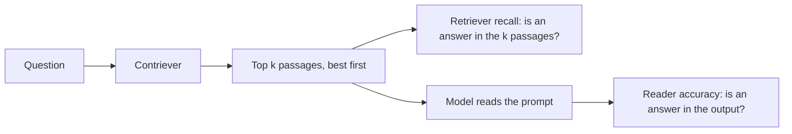

## 1. The question this page answers

In a real RAG system, the retriever returns the top $k$ documents. A larger $k$ makes it more likely that the answer is in the prompt. Does a larger $k$ also give better answers?

## 2. Mental model

> [!analogy] A bigger net and a tired cook
> A bigger net catches more fish, so the right fish is more likely in the basket. But the cook looks closely only at the fish on the top and the bottom of the basket. After some size, a bigger net adds work and almost no better meals.
>
> **Where it stops working:** a cook gets tired over time. The model does not get tired. Its preference for the edges of the context comes from how it weighs the tokens. Page 07 discusses the possible causes.

## 3. Terms

| Term | Plain meaning |
|---|---|
| retriever recall | The percent of questions where at least one of the top $k$ documents contains a correct answer. |
| reader accuracy | The percent of questions where the output of the model contains a correct answer. |
| top-k | The number of retrieved documents that go into the prompt. |
| saturation | The point after which more input gives almost no more improvement. |
| reranking | A second, more careful ranking of the retrieved documents, to put the most useful ones first. |
| ranked list truncation | Cutting the ranked list early: use fewer documents when the extra ones are probably not useful. |
| marginal value | The extra benefit from one more unit, here one more document. |

## 4. The setup

This is not the controlled setup of pages 04 to 06. Here the order of the documents is the real order from the retriever.

1. Questions: NaturalQuestions-Open, the questions whose long answer is a paragraph.
2. Retriever: Contriever, fine-tuned on MS-MARCO.
3. For each $k$ from 5 to 50, put the top $k$ Wikipedia passages in the prompt.
4. Measure two numbers for each $k$: retriever recall and reader accuracy.



In this setup, the number of documents that contain the answer can be zero, one or many.

## 5. The result

```plot
{
  "title": "Approximate. Retriever recall (ink) and reader accuracy of GPT-3.5-Turbo 16K (red)",
  "xAxis": { "label": "number of retrieved documents k", "domain": [0, 52] },
  "yAxis": { "label": "percent", "domain": [45, 95] },
  "disableZoom": true,
  "data": [
    { "points": [[5, 68.2], [10, 77.0], [20, 83.5], [30, 86.3], [40, 87.8], [50, 88.9]], "fnType": "points", "graphType": "polyline", "color": "#100D12", "skipTip": true },
    { "points": [[5, 68.2], [10, 77.0], [20, 83.5], [30, 86.3], [40, 87.8], [50, 88.9]], "fnType": "points", "graphType": "scatter", "color": "#100D12", "skipTip": true },
    { "points": [[5, 54.8], [10, 56.3], [20, 58.3], [30, 58.3], [40, 59.9], [50, 59.7]], "fnType": "points", "graphType": "polyline", "color": "#C81D25", "skipTip": true },
    { "points": [[5, 54.8], [10, 56.3], [20, 58.3], [30, 58.3], [40, 59.9], [50, 59.7]], "fnType": "points", "graphType": "scatter", "color": "#C81D25", "skipTip": true }
  ]
}
```

The values are read by eye from the figure in the paper. The exact numbers in the text of the paper are below.

1. **Recall keeps rising.** More documents put the answer in the prompt more often, up to about 89% at $k = 50$.
2. **Reader accuracy flattens early.** It stays between about 48% and 60% for every model, and it barely moves after $k = 20$.
3. **The exact gain from 20 to 50 documents**, from the text of the paper: about 1.5 points for GPT-3.5-Turbo and about 1 point for Claude-1.3.
4. **The cost does not flatten.** Each extra document adds about 147 tokens with the GPT-3.5-Turbo tokenizer: 20 documents average 2,946.2 tokens and 10 documents average 1,475.6 tokens. More tokens mean more latency and more money for every request.

> [!key] The trade-off
> More retrieved context helps only if the model can use it. Past a point, extra documents raise recall and cost, but not accuracy. The best $k$ depends on the task and on the model, so measure it.

## 6. Why the reader saturates

The paper does not test the cause of the saturation. These three reasons are inferences from the earlier results:

1. **More distractors.** Every extra document that does not contain the answer is a distractor. Page 05 showed that more distractors lower the whole curve.
2. **The middle.** As $k$ grows, more of the prompt is "middle". An answer document at retriever rank 15 is in the middle of a 30-document prompt.
3. **The best documents are already first.** The retriever sorts best first, so the answer is often in the first few documents. The extra documents add answers only in the cases where the first documents missed.

## 7. What the authors suggest

1. **Reranking.** Push the relevant information closer to the start of the context, where models use it best.
2. **Ranked list truncation.** Retrieve fewer documents when that is appropriate.

Page 09 turns these ideas into engineering rules.

## 8. Common mistakes

1. **"Tune top-k by retriever recall."** Recall rises with $k$ almost always. Tune $k$ by the end-to-end accuracy of the full system.
2. **"Recall is the ceiling, so we will reach it."** The reader stays far below the recall. At $k = 50$, recall is about 89%, and reader accuracy is about 60%.
3. **"More context is free."** It costs tokens, latency and money on every request.

## 9. One-minute explanation

The authors ran a normal RAG setup: Contriever retrieves the top $k$ Wikipedia passages, and the model answers from them. As $k$ grows from 5 to 50, retriever recall keeps rising, to about 89%. But reader accuracy flattens early, near 60% for the best model. Going from 20 to 50 documents adds only about 1.5 points for GPT-3.5-Turbo and about 1 point for Claude-1.3, while it more than doubles the prompt. The extra documents add distractors and fill the middle of the context. The authors suggest reranking, to put the best documents first, and retrieving fewer documents.

## 10. Check questions

```check
{
  "question": "From 20 to 50 documents, recall rises a few points but GPT-3.5-Turbo gains only about 1.5 points of accuracy. Give two likely reasons, inferred from the earlier results of the paper.",
  "answer": "1. Each extra document that does not contain the answer is a distractor, and more distractors lower accuracy at every position. 2. A longer prompt has a larger middle, and answer documents at middle positions are used badly."
}
```

```check
{
  "question": "Your RAG system uses k = 50 because recall is highest there. What do you measure before you keep this setting?",
  "answer": "The end-to-end answer accuracy at several values of k (for example 5, 10, 20, 50), together with latency and cost. Keep the smallest k that gives almost the best accuracy."
}
```

```check
{
  "question": "Which two methods do the authors suggest to improve how readers use retrieved documents?",
  "answer": "Reranking, to push the relevant documents closer to the start of the context. Ranked list truncation, to retrieve fewer documents when that is appropriate."
}
```

## 11. Links

- Previous: [07 Why it happens](/notes/papers/long-context/2023-lost-in-the-middle/07-why-it-happens)
- Next: [09 Engineering takeaways](/notes/papers/long-context/2023-lost-in-the-middle/09-engineering-takeaways)
- RAG basics: [01 Background: language models and context](/notes/papers/long-context/2023-lost-in-the-middle/01-background-language-models)
