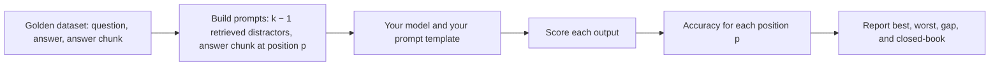
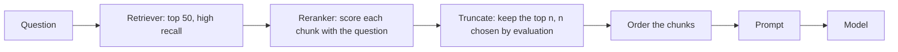

## 1. The question this page answers

You build RAG systems and agents. What do you change because of this paper? How do you test that the change helps?

## 2. Mental model

> [!analogy] Context is a budget, and position is part of the budget
> Every token in the prompt costs money and time. And not every place in the prompt has the same value. The start and the end are prime places. The middle is a cheap place where information is easy to miss.
>
> **Where it stops working:** the value of each place depends on the model. Some models are almost flat for some tasks (Claude-1.3 on key-value retrieval). So measure your model. Do not assume a fixed shape.

## 3. Terms

| Term | Plain meaning |
|---|---|
| context engineering | The design of what goes into the context of a model, in which order, and in which format. |
| reranker | A model that scores each (query, document) pair more carefully than the retriever. A cross-encoder reads the query and the document together. |
| position sweep test | An evaluation that puts the useful information at each position in turn and measures accuracy at each position. |
| edge ordering | An order that puts the most relevant documents at the start and at the end, and the least relevant in the middle. |
| compaction | Replacing a long history in the context with a shorter summary. |
| golden dataset | A fixed set of test questions with known correct answers. |

## 4. Where each rule comes from

| Rule | Source |
|---|---|
| 1. Measure position sensitivity | The evaluation protocol that the paper proposes |
| 2. Retrieve wide, rerank, keep few | The paper suggests reranking and ranked list truncation (page 08) |
| 3. Put the best evidence first, or at the edges | The paper suggests "first". "At the edges" is a common practice built on this paper. |
| 4. Put the query before and after the data | Query-aware contextualization (page 07) |
| 5. Do not choose a model by window size | Finding 4 (page 05) |
| 6. Manage the context of agents | Practice that follows from the paper. Not tested in the paper. |
| 7. Retrieve schema, do not dump it | Practice that follows from the key-value result. Not tested in the paper. |

## 5. Rule 1: measure the position sensitivity of your own system

The paper proposes a protocol: to claim that a system uses long context well, show a small gap between the best and the worst position. Apply it to your own model, prompt and data.



1. Take 100 to 500 questions with a known answer and a known answer chunk.
2. For each question, retrieve distractors with **your** retriever. Remove chunks that contain the answer.
3. Put the answer chunk at positions 1, the quarter point, the middle, the three-quarter point and the end.
4. Run your real prompt template. Use temperature 0 for a stable result.
5. Report the accuracy at each position, the gap, and the closed-book score.
6. Repeat after each change of model, prompt or $k$. Keep the results as a regression test.

> [!key] Do this before you trust a long context
> A vendor's context window says what fits. Your position sweep says what works.

## 6. Rule 2: retrieve wide, rerank, keep few



1. The retriever is fast but rough. Use a large $k$ to get high recall.
2. The reranker is slower but more accurate. It moves the useful chunks to the top.
3. Keep only the top $n$ chunks. Choose $n$ from the end-to-end accuracy, as on page 08. Do not choose it from recall.

## 7. Rule 3: put the best evidence at the start, or at the edges

The start is the best position for GPT-3.5-Turbo and LongChat-13B (16K). Claude-1.3 and MPT-30B-Instruct do best at the end with 20 and 30 documents. The authors suggest reranking that pushes the relevant information toward the start. So a simple first rule is: best evidence first. Then test the end with your position sweep.

Some libraries use **edge ordering**. For example, the `LongContextReorder` transformer in LangChain cites this paper. It puts the most relevant documents at the two ends and the least relevant in the middle.

> [!trap] Edge ordering is not tested in this paper
> The paper measured one answer document at one position. A real prompt has several useful chunks. Edge ordering is a reasonable idea, but test it with your position sweep. For some models, "best first" is better than "best at the edges".

## 8. Rule 4: put the query before and after long data

Repeat the question (or the key, or the task) before the data and after the data. The cost is a few tokens.

| Task type | Expected effect, from page 07 |
|---|---|
| Exact lookup: IDs, keys, codes, names in a long list | Large. Key-value retrieval became nearly perfect. |
| Open question answering over similar documents | Small. A little better for position 1, a little worse elsewhere. |

## 9. Rule 5: do not choose a model by window size

GPT-3.5-Turbo (16K) and Claude-1.3 (100K) used the same inputs no better than the shorter versions. A larger window lets you send more. It does not make the model use more.

Choose a model by its result on your position sweep and your end-to-end evaluation, at the input length that you really use.

## 10. Rule 6: manage the context of agents

An agent adds tool results and old messages to its context at every step. The middle of the context fills with old material.

1. Keep the task, the rules and the constraints in the system prompt, at the start.
2. Restate the current goal and the key facts near the end, close to the next model call.
3. Compact old steps: replace long tool outputs with short summaries.
4. Store large data outside the context, and retrieve only the part that the next step needs.

## 11. Rule 7: retrieve the schema, do not dump it

An NL2SQL agent over a large data catalog can put hundreds of table definitions in the prompt. The key-value result shows that exact lookup of a name in the middle of a long list can fail for some models.

1. Retrieve the few tables and columns that match the question.
2. Put them first, before less related tables.
3. Repeat the question after the schema.
4. Validate every table and column name in the generated SQL against the catalog.

## 12. Production considerations

| Concern | What this paper changes |
|---|---|
| Latency | Fewer, better chunks give shorter prompts and faster answers. |
| Cost | Tokens after the saturation point cost money and add almost no accuracy. |
| Reliability | Accuracy depends on the position. A change of retriever or reranker can move the answer chunk and change accuracy. |
| Monitoring | Log the position of the chunk that the answer cites. Track accuracy by position in production samples. |
| Regression tests | Keep the position sweep in CI for each change of model or prompt. |
| Model upgrades | A new model can have a different curve. Run the sweep before you switch. |

## 13. Design checklist

- [ ] I measured accuracy at several positions, not only on average.
- [ ] I know my closed-book score, so I know if the context helps or hurts.
- [ ] I chose $k$ from end-to-end accuracy, latency and cost, not from recall.
- [ ] A reranker puts the best chunks first.
- [ ] Long data has the query before it and after it.
- [ ] Agent histories are compacted, and the current goal is near the end.
- [ ] The evaluation runs again on every change of model, prompt or retriever.

## 14. Common mistakes

1. **"The new model has 1M tokens, so we can put everything in the prompt."** Window size is not use. Measure.
2. **"We tuned top-k to maximize recall."** Recall always rises with $k$. Tune with end-to-end accuracy.
3. **"Our average accuracy is good, so position does not matter."** An average hides a weak middle. Report accuracy by position.
4. **"Edge ordering is proven by the paper."** The paper suggests reranking toward the start. Edge ordering is a practice to test.

## 15. One-minute explanation

Because models use the start and end of the context best, treat position as part of your design. Measure your own system with a position sweep: put the answer chunk at each position and report the gap. Retrieve many chunks, rerank them, keep only the few that improve end-to-end accuracy, and put the best ones first. Repeat the query before and after long data, especially for exact lookups. Do not pick a model for its window size. In agents, compact old steps and restate the goal near the end. Log positions and accuracy in production, and run the sweep again for each model change.

## 16. Check questions

```check
{
  "question": "A reorder function takes documents ranked 1 to 6 (1 is the most relevant). It reverses the list, then takes the documents one by one: even indices (0, 2, 4) go to the front of the output, odd indices (1, 3, 5) go to the end. What is the output order?",
  "hint": "After the reverse: [6, 5, 4, 3, 2, 1]. Index 0 is 6, index 1 is 5, and so on.",
  "answer": "[2, 4, 6, 5, 3, 1]. Document 1 (most relevant) is last, document 2 is first, and the least relevant (6 and 5) are in the middle. This is the logic of LangChain's LongContextReorder."
}
```

```check
{
  "question": "Your RAG system answers questions about internal policy documents. Average accuracy is 78%. Design a test that shows if position matters for your system.",
  "answer": "A position sweep: take questions with a known answer chunk, add retrieved distractors (without the answer), put the answer chunk at the start, the quarter point, the middle, the three-quarter point and the end, run the real prompt at temperature 0, and report accuracy at each position, the best-worst gap and the closed-book score."
}
```

```check
{
  "question": "Your agent must find one product code in a 20,000-token tool output. Name two cheap changes based on this paper.",
  "answer": "1. Put the question (the code to find) before and after the tool output: query-aware contextualization helped exact lookup a lot. 2. Do not put the full output in the context: filter or retrieve the relevant part first, and put it near the start or the end."
}
```

```check
{
  "question": "A vendor says their new model has a 1M-token window. What does this paper tell you about that claim, and what do you do?",
  "answer": "The window is how much fits, not how well the model uses it. Extended-context models in the paper were no better on the same inputs. Run your own position sweep at the input lengths that you really use before you rely on the window."
}
```

## 17. Links

- Previous: [08 The more-context trade-off](/notes/papers/long-context/2023-lost-in-the-middle/08-more-context-trade-off)
- Next: [10 Limits and later work](/notes/papers/long-context/2023-lost-in-the-middle/10-limits-and-later-work)
- Build the sweep: [11 Reproduce it](/notes/papers/long-context/2023-lost-in-the-middle/11-reproduce-it)
