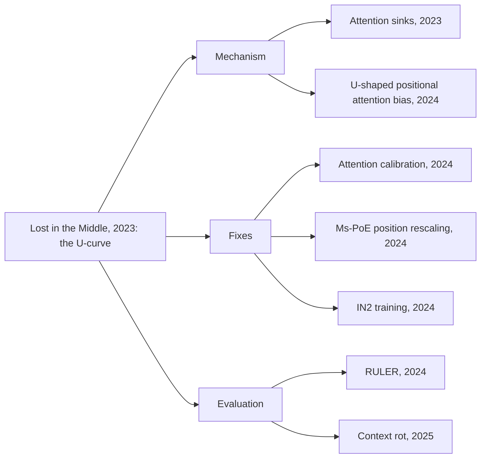

## 1. The question this page answers

The paper tested models from mid-2023. How far can you trust its result today? What did later papers add?

## 2. Mental model

> [!analogy] A map from 2023
> The shape of the land is still mostly right: long inputs are not used evenly. But some roads changed: newer models are much better at simple lookups. Use the map for the shape, and check the roads yourself.
>
> **Where it stops working:** a map changes slowly. Models change with every release. A result for one model version can be wrong for the next version.

## 3. Terms

| Term | Plain meaning |
|---|---|
| threat to validity | A reason why the result of an experiment could be wrong, or could fail to hold in other settings. |
| needle in a haystack | A test that hides one fact (the needle) in a long text (the haystack) and asks for it. |
| attention sink | A token, usually one of the first tokens, that gets strong attention whatever its meaning. |
| positional attention bias | A preference of the attention for some positions, independent of the content. |
| context rot | The drop in the reliability of a model as its input gets longer. |

## 4. What the paper did well

1. **A controlled design.** One dial at a time: position, then length.
2. **Two tasks.** A realistic task (QA with real retrieved distractors) and a pure task (key-value retrieval). Together they separate "find" from "use".
3. **Baselines.** Closed-book and oracle frame every number.
4. **Paired models.** The 4K and 16K versions, and the 8K and 100K versions, isolate the effect of the window size.
5. **Robustness checks.** Ambiguous questions, random distractors, random order, a stronger model.
6. **Open data and code.** The data and scripts are public, so others can repeat the tests.

## 5. Limits

| Limit | Why it matters |
|---|---|
| Models from mid-2023 | Newer models have different training. The size of the effect can be different now. |
| Greedy decoding only | Sampling with a temperature can change the results. The authors leave this for future work. |
| "Contains the answer" accuracy | It accepts long outputs that contain the answer, and it rejects correct answers in other words. |
| Exactly one answer document | Real RAG prompts can have zero, one or several useful documents, and the answer can need facts from two documents. |
| Distractors in order of relevance | A model can learn to trust the first search results. Appendix C tests this and the U-curve stays. |
| Label noise in NaturalQuestions | Some distractors can contain a valid answer. Appendix A tests an unambiguous subset and the result stays. |
| Closed models behind an API | The authors fixed the 0613 versions. API models can change or be retired, so an exact repeat can become impossible. |
| Behavioral analysis only | Page 07 rules causes in or out from outside. It does not show the mechanism inside the model. |
| Position counted in documents | Documents have different lengths. The position in tokens is not exactly proportional to the document number. |

> [!note] A fair reading
> None of these limits removes the main result. They limit how far you can carry the exact numbers to a new model or task. The shape and the method carry over. The numbers do not.

## 6. Later work

| Year | Paper | What it adds |
|---|---|---|
| 2023 | Xiao et al., "Efficient Streaming Language Models with Attention Sinks" (ICLR 2024) | The first tokens get strong attention scores, even when they are not semantically important. Keeping their keys and values lets a sliding-window model work on very long streams. |
| 2024 | Hsieh et al., "Found in the Middle: Calibrating Positional Attention Bias Improves Long Context Utilization" | Measures a U-shaped attention bias: tokens at the start and the end get more attention, whatever their relevance. A calibration removes the bias and improves RAG by up to 15 points. |
| 2024 | Zhang et al., "Found in the Middle: How Language Models Use Long Contexts Better via Plug-and-Play Positional Encoding" (Ms-PoE, NeurIPS 2024) | Rescales the position indices to counter the long-term decay of RoPE, with a different scale for each head. No fine-tuning. Up to 3.8 points average gain on ZeroSCROLLS. |
| 2024 | An et al., "Make Your LLM Fully Utilize the Context" (IN2 training) | Fine-tunes Mistral-7B-Instruct-v0.2 on long contexts (4K to 32K tokens) with short segments of important information at random positions. The result, FILM-7B, retrieves robustly from all positions of its 32K window. |
| 2024 | Hsieh et al., "RULER: What's the Real Context Size of Your Long-Context Language Models?" | A synthetic benchmark with 13 tasks, beyond simple needle tests. Of 17 models that claim 32K tokens or more, only half keep satisfactory performance at 32K. |
| 2025 | Hong, Troynikov and Huber, "Context Rot: How Increasing Input Tokens Impacts LLM Performance" (Chroma technical report) | Tests 18 models, including Claude Opus 4, GPT-4.1, Gemini 2.5 Pro and Qwen3. Performance degrades as input length grows, in every experiment. Lower similarity between the question and the needle, and distractors, make it worse. |



## 7. What is true in 2026

Use these statements with care. They come from the later work above, not from this paper.

1. Long-context models score near-perfectly on the simple needle test, but their scores fall on harder tasks at the same length (RULER, 2024).
2. Performance still falls as the input gets longer, especially when the question and the answer do not share words, and when distractors are present (context rot, 2025).
3. The advertised window is often larger than the length that a model uses well (RULER, 2024).
4. The position effect can be reduced by training (IN2) or by changes at inference time (calibration, Ms-PoE). So it is not a fixed law of Transformers.

> [!key] The lasting lesson
> The exact U-curve belongs to the models of 2023. The method lasts: test the use of long context by moving the useful information, and report the worst case, not only the average.

## 8. Open questions

1. How do the results change with several useful documents that must be combined?
2. Does sampling at a higher temperature make the curve flatter or steeper?
3. Which share of the effect comes from the position method, which from the training data, and which from the attention sinks?
4. Do reasoning models that write long chains of thought lose the middle of their own reasoning?

## 9. Common mistakes

1. **"The paper is old, so the result is gone."** Later work in 2024 and 2025 still finds uneven use of long context.
2. **"The paper is right, so my model has the same U-curve."** The shape depends on the model. Measure your model.
3. **"The limits make the paper wrong."** The limits restrict how far the numbers carry. The main finding survived several checks.

## 10. One-minute explanation

The paper is a strong controlled study with two tasks, clear baselines, paired models and open data. Its limits: 2023 models, greedy decoding only, a lenient accuracy measure, one answer document per prompt, and only behavioral analysis. Later work found mechanisms and fixes. The first tokens act as attention sinks. A U-shaped positional attention bias can be calibrated away. RoPE positions can be rescaled. Training with information at random positions helps. Benchmarks such as RULER (2024) and the context rot report (2025) show that long inputs are still not used evenly. So keep the method, and measure your own model.

## 11. Check questions

```check
{
  "question": "Name two limits of the paper and say how each one could change the result.",
  "answer": "Any two, for example: (1) Only 2023 models: newer models can have a smaller or different position effect. (2) Greedy decoding only: sampling could change the curve. (3) One answer document: real prompts can need several documents, which can make the middle problem worse or different. (4) Lenient accuracy measure: it can count long, vague outputs as correct."
}
```

```check
{
  "question": "Which later papers suggest that the position effect is not a fixed law of Transformers? What do they do?",
  "answer": "IN2 training (2024) fine-tunes a model with the important information at random positions, and the model becomes robust over 32K tokens. Found in the Middle calibration (2024) removes the U-shaped attention bias at inference time. Ms-PoE (2024) rescales RoPE positions without fine-tuning."
}
```

```check
{
  "question": "What did RULER (2024) find about models that claim 32K tokens or more?",
  "answer": "Only half of the 17 tested models keep satisfactory performance at 32K tokens, although all of them claim 32K tokens or more."
}
```

## 12. Sources

- [Lost in the Middle, ACL Anthology (TACL 2024)](https://aclanthology.org/2024.tacl-1.9/)
- [Code and data](https://github.com/nelson-liu/lost-in-the-middle)
- [Efficient Streaming Language Models with Attention Sinks](https://arxiv.org/abs/2309.17453)
- [Found in the Middle: Calibrating Positional Attention Bias](https://arxiv.org/abs/2406.16008)
- [Found in the Middle: Plug-and-Play Positional Encoding (Ms-PoE)](https://arxiv.org/abs/2403.04797)
- [Make Your LLM Fully Utilize the Context](https://arxiv.org/abs/2404.16811)
- [RULER](https://arxiv.org/abs/2404.06654)
- [Context Rot (Chroma)](https://www.trychroma.com/research/context-rot)

## 13. Links

- Previous: [09 Engineering takeaways](/notes/papers/long-context/2023-lost-in-the-middle/09-engineering-takeaways)
- Next: [11 Reproduce it](/notes/papers/long-context/2023-lost-in-the-middle/11-reproduce-it)
- [Papers: reading queue](/notes/papers)
