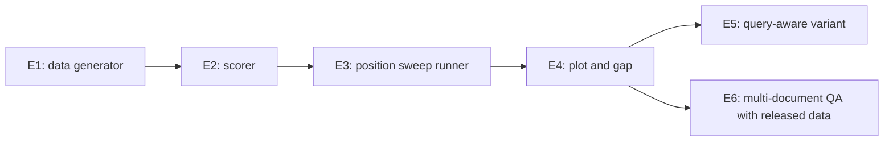

## 1. The question this page answers

Can you rebuild the core experiment yourself, from an empty file, and get the same kind of result on a model that you use today?

> [!key] The rule for these exercises
> You write the code. This page gives the specification, the tests and two levels of hints. Ask in chat for the third level (partial code) only after a real attempt. If AI writes any part, you must explain every line, or the exercise is not complete.

## 2. The plan



Suggested project layout, in its own Git repository:

```text
lost-in-the-middle-repro/
├── README.md              the question, the setup, the results, the limits
├── pyproject.toml         dependencies (for example with uv)
├── .env.example           names of the API keys, never the keys
├── src/litm/
│   ├── data.py            E1
│   ├── score.py           E2
│   ├── sweep.py           E3, E5
│   └── plot.py            E4
├── tests/                 pytest tests for data.py and score.py
├── notebooks/explore.ipynb
└── results/               cached model outputs (JSONL) and plots
```

## 3. E1: the key-value data generator

**Specification.** Write `make_kv_example(k, position, seed)`.

| Input | Meaning |
|---|---|
| `k` | The number of key-value pairs. |
| `position` | Where the pair to find goes: 1 is the first pair, `k` is the last pair. |
| `seed` | A number that makes the example repeatable. |

It returns the prompt text and the expected value. Use the prompt format of [04 Experiment design](/notes/papers/long-context/2023-lost-in-the-middle/04-experiment-design), section 5.

**Tests to write first.**

1. The same `seed` gives the same prompt twice.
2. The JSON part of the prompt parses with `json.loads`, and it has exactly `k` keys.
3. The key to find is at the requested position in the JSON order.
4. The expected value is the value of that key in the parsed JSON.
5. All keys are different. All values are different.
6. `position = 0` and `position = k + 1` raise an error.

> [!example] Hint level 1: the idea
> Make all the pairs first. Decide which pair is the target. Then build the list of pairs in the order that you want, with the target at index `position - 1`. A Python `dict` keeps the order in which you insert the keys.

> [!example] Hint level 2: pseudocode
> 1. Make a random generator from the seed.
> 2. Make `k` keys and `k` values: random UUIDs from that generator.
> 3. Target = the first pair. Others = the remaining `k − 1` pairs.
> 4. Ordered pairs = others with the target inserted at index `position − 1`.
> 5. JSON text = the ordered pairs as one JSON object.
> 6. Prompt = instruction + JSON text + the line with the key.
> 7. Return the prompt and the target value.

> [!trap] Random UUIDs and seeds
> `uuid.uuid4()` does not use your seed, so the examples are not repeatable. Make the UUIDs from a seeded random generator.

## 4. E2: the scorer

**Specification.** Write `is_correct(output, answers)`. It returns `True` if any string in `answers` appears in `output`.

**Tests to write first.**

1. The exact value in the output: `True`.
2. The value inside a sentence: `True`.
3. A different value: `False`.
4. An empty output: `False`.

Then decide, and write in your README: do you normalize case and spaces? The paper's measure is lenient. Write what your choice accepts and rejects.

## 5. E3: the position sweep runner

**Specification.** For one model and one `k`, run `n` examples at each of five positions: 1, `k/4`, `k/2`, `3k/4` and `k` (rounded). Save every output.

**Requirements.**

1. Temperature 0. A maximum output length of about 100 tokens.
2. Cache: write each result as one JSON line (model, k, position, seed, prompt hash, output, correct). Before a call, check the cache. A second run must make no API calls.
3. Retry a failed API call with a growing wait. Do not retry forever.
4. Read the API key from an environment variable. Never write a key in code or in the notebook.
5. Start small: `k = 75`, `n = 20`. Then grow.

> [!example] Hint level 1: the idea
> Two nested loops: positions outside, seeds inside. One function calls the model. One function reads and writes the cache. Keep the three parts separate, so that you can test them alone.

> [!trap] Cost
> Count the tokens before a large run. With `k = 300`, one prompt is about 15,000 tokens. Five positions × 100 examples is 500 prompts, or about 7.5 million input tokens.

## 6. E4: the plot and the gap

1. Plot accuracy (y) against position (x) for each `k`.
2. Compute the best, the worst and the gap.
3. Compare the shape with page 06. Is it a U-curve, a flat line, or a different shape?
4. Read 10 failed outputs. Write the types of failure that you see: wrong value, refusal, code, a partial UUID, and so on.

## 7. E5: the query-aware variant

1. Add an option that puts the key line **before** the JSON as well as after it.
2. Run the same sweep with the option on.
3. Compare the two curves. Page 07 predicts a large improvement for weak positions.

## 8. E6: multi-document QA with the released data

1. Clone [github.com/nelson-liu/lost-in-the-middle](https://github.com/nelson-liu/lost-in-the-middle). Read its `README.md` and `EXPERIMENTS.md`.
2. Inside `qa_data/`, find the files for each setting. For example, `nq-open-20_total_documents_gold_at_0.jsonl.gz` has 20 documents with the answer document at index 0. List the folder to find the other files.
3. Each line is one example with `question`, `answers` and `ctxs` (the documents, each with `title`, `text` and `isgold`).
4. Build the prompt from page 04 yourself. Do not use their prompt code before your own version works.
5. Run 100 questions at gold indices 0, 9 and 19 on a model that you use. Score with your E2 function.
6. Also run closed-book (no documents) on the same 100 questions.

## 9. Questions to answer in your README

1. Did your model show a U-curve, a recency curve, a primacy curve or a flat line?
2. Was the worst position above or below the closed-book score?
3. How much did query-aware contextualization help on key-value retrieval? On QA?
4. What would you change in a production RAG system because of your results?

## 10. This works. Would you deploy it?

Before you call your sweep a tool for your team, answer these:

- [ ] Can a new person run it from the README in one command?
- [ ] Does a run cost a known amount, and can you stop it safely?
- [ ] Are the results tied to an exact model version and prompt version?
- [ ] Do the tests run in CI without API calls?
- [ ] Can it use your real retriever and your real prompt template?

## 11. Check questions

```check
{
  "question": "Why must the cache key include a hash of the prompt, and not only the model, k, position and seed?",
  "answer": "If you change the prompt template (for example the query-aware option), the same model, k, position and seed give a different prompt. Without the prompt hash, the cache would return an old output for a new prompt."
}
```

```check
{
  "question": "Your sweep shows 100% at every position for k = 75. What do you do next?",
  "answer": "Increase the difficulty: larger k (140, 300 or more), more distractor-like keys, or the QA task with retrieved distractors. A flat line at 100% shows only that this setting is too easy for this model."
}
```

## 12. Links

- Previous: [10 Limits and later work](/notes/papers/long-context/2023-lost-in-the-middle/10-limits-and-later-work)
- The task: [04 Experiment design](/notes/papers/long-context/2023-lost-in-the-middle/04-experiment-design)
- The expected shapes: [06 Results: key-value retrieval](/notes/papers/long-context/2023-lost-in-the-middle/06-results-key-value-retrieval)
- Production rules: [09 Engineering takeaways](/notes/papers/long-context/2023-lost-in-the-middle/09-engineering-takeaways)
