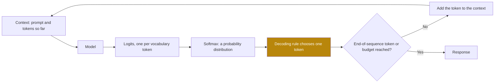
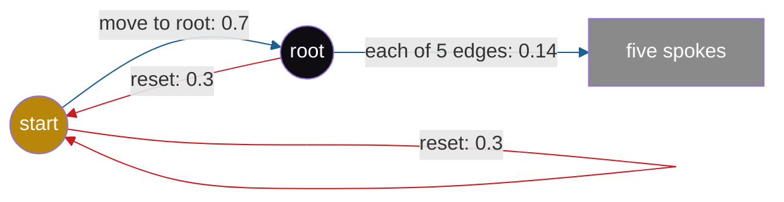

## 1. The question this page answers

A language model writes text one token at a time. At each step, it gives a probability to every possible next token. What is a probability? How does a model compute one? How do we get the probability of a whole step of reasoning, which is many tokens long? And why can the same situation return again and again in a long text?

The paper needs all four answers. Its §3 uses the probability of a chunk of tokens and the logarithm of that probability. Its §3 and §4 use the idea of a state that returns. Page 02 then explains how a rule chooses one token from the probabilities, and how that rule can cause a loop.

## 2. Mental model

> [!analogy] A new spinner at every step
> Imagine a spinner with one slice for each possible next token. A larger slice means a higher probability. At every step, the model makes a new spinner from all the text so far. A rule then chooses one slice, and that token joins the text. The next step makes a new spinner from the longer text.
>
> **Where it stops working:** a spinner is random. The model is not random: it only computes the slice sizes. The choice rule decides if chance plays a part. Greedy decoding never spins: it always takes the largest slice (page 02). Also, a real model has thousands of slices, and most of them are almost zero.

## 3. Terms

| Term | Plain meaning |
|---|---|
| probability | A number from 0 to 1 that says how likely something is. 0 means never, 1 means always. |
| outcome, event | An outcome is one possible result. An event is a set of outcomes, for example "the die shows an even number". |
| probability distribution | One probability for each outcome in a set. All probabilities are 0 or more, and they sum to exactly 1. |
| conditional probability | $P(A \mid B)$: the probability of $A$ when we already know that $B$ is true. |
| chain rule | The probability of a sequence is the product of the probability of each item, given the items before it. |
| logarithm | The power to which you raise a base to get a number. $\log_{10} 1000 = 3$. The natural logarithm $\ln$ uses the base $e \approx 2.71828$. |
| log-probability | The logarithm of a probability. It is 0 for probability 1 and negative for any probability below 1. |
| token | The unit of text that a model reads and writes. Often a part of a word. |
| vocabulary | The fixed, finite list of all tokens that a model knows. |
| language model | A function that takes a list of tokens and returns a probability distribution over the vocabulary for the next token. |
| context | All the tokens that the model uses at one step: the prompt and the tokens it has written so far. The paper also calls it the prefix. |
| logit | The raw score that a model gives to one token before softmax. Any real number. |
| softmax | A function that changes a list of logits into a probability distribution: $p_i = e^{z_i} / \sum_j e^{z_j}$. |
| autoregressive generation | Writing one token at a time. Each new token joins the context. It stops at an end-of-sequence token or at a token budget. |
| state | All the information that decides the next distribution. A model whose state is only its current position is Markovian. |
| action | One step of the process. A progress-making action moves closer to the goal. A cyclic action returns to something already visited. |

All terms are also in the [Glossary](/notes/papers/glossary).

## 4. Probability from zero

### 4.1 A probability is a number from 0 to 1

An **outcome** is one possible result of something uncertain. A die has six outcomes: 1, 2, 3, 4, 5 and 6. An **event** is a set of outcomes. The event "even" is the set {2, 4, 6}.

A **probability** is a number from 0 to 1. It says how likely an event is. Probability 0 means that the event never happens. Probability 1 means that it always happens. If you repeat the same situation many times, the event happens in about that fraction of the repeats.

For a fair die, each outcome has the probability $1/6 \approx 0.1667$. The event "even" has the probability $1/6 + 1/6 + 1/6 = 0.5$. When two outcomes cannot happen together, the probability of "one or the other" is the sum of their probabilities.

### 4.2 A probability distribution over a finite set

A **probability distribution** over a finite set gives one probability to each outcome in the set. It obeys two rules:

1. Each probability is 0 or more.
2. All the probabilities sum to exactly 1. So exactly one of the outcomes happens.

> [!example] Worked example: a distribution over four words
> A model reads "The cat sat on the". It gives these probabilities to the next word (invented numbers): mat 0.50, floor 0.30, sofa 0.15, moon 0.05.
>
> 1. Each number is 0 or more, and $0.50 + 0.30 + 0.15 + 0.05 = 1.00$. Both rules hold.
> 2. The event "mat or floor" has the probability $0.50 + 0.30 = 0.80$.

> [!trap] The total is fixed
> The sum is always 1. So more probability for one outcome means less for at least one other outcome. Page 08 uses this fact: probability divided among many confusable actions gives each one only a small share.

### 4.3 Conditional probability

$P(A \mid B)$ is the probability of $A$ when we already know that $B$ is true. Read it as "the probability of $A$ given $B$". The formula, for $P(B) > 0$:

$$
P(A \mid B) = \frac{P(A \text{ and } B)}{P(B)}
$$

> [!example] Worked example: rain and clouds
> A town records 100 days (invented numbers).
>
> | | Rain | No rain | Total |
> |---|---|---|---|
> | Cloudy | 15 | 15 | 30 |
> | Clear | 7 | 63 | 70 |
> | Total | 22 | 78 | 100 |
>
> 1. With no condition: $P(\text{rain}) = 22/100 = 0.22$.
> 2. Given a cloudy day: $P(\text{rain} \mid \text{cloudy}) = 15/30 = 0.50$.
> 3. Given a clear day: $P(\text{rain} \mid \text{clear}) = 7/70 = 0.10$.
>
> The condition changes the probability from 0.22 to 0.50 or to 0.10. The condition selects a smaller group of days, and we count inside that group only.

Rearrange the formula to get the **multiplication rule**:

$$
P(A \text{ and } B) = P(B) \times P(A \mid B)
$$

Check it on the table: $P(\text{cloudy and rain}) = 0.30 \times 0.50 = 0.15$, and the table gives $15/100 = 0.15$.

A language model gives conditional probabilities. Its output is $P(\text{next token} \mid \text{context})$. The same token can be likely after one context and almost impossible after another. "mat" can have 0.50 after "The cat sat on the" and almost 0 after "The plane landed on the".

### 4.4 The chain rule: the probability of a sequence

Apply the multiplication rule again and again, one item at a time:

$$
P(x_1, x_2, x_3) = P(x_1) \, P(x_2 \mid x_1) \, P(x_3 \mid x_1, x_2)
$$

This is the **chain rule**. Each factor is the probability of one item, given all the items before it.

The paper writes the same rule for a chunk of $k$ tokens that starts at position $t$, after a prefix (§3, "Mapping to language models"):

$$
P_\theta(x_{t:t+k-1} \mid x_{<t}) = \prod_{i=t}^{t+k-1} P_\theta(x_i \mid x_{<i})
$$

- $\theta$ (theta) is the set of parameters of the model: the numbers that training sets.
- $x_i$ is the token at position $i$.
- $x_{<t}$ is the prefix: all tokens before position $t$.
- $x_{t:t+k-1}$ is the chunk: the $k$ tokens from position $t$ to position $t+k-1$.
- $\prod$ means "multiply all the factors".

> [!example] Worked example: the probability of a four-token chunk
> The chunk is " So", ",", " the", " word". The model gives these conditional probabilities (invented numbers): 0.5, 0.8, 0.6, 0.9.
>
> 1. $0.5 \times 0.8 = 0.4$
> 2. $0.4 \times 0.6 = 0.24$
> 3. $0.24 \times 0.9 = 0.216$
>
> The chunk has the probability 0.216. Each factor is 1 or less, so a longer chunk never has a higher probability than its first part.

### 4.5 The logarithm from first principles

A power repeats a multiplication: $10^3 = 10 \times 10 \times 10 = 1000$. The **logarithm** asks the opposite question: "To which power must I raise the base to get this number?" With base 10, $\log_{10} 1000 = 3$.

| Number $x$ | As a power of 10 | $\log_{10} x$ |
|---|---|---|
| 1000 | $10^3$ | 3 |
| 100 | $10^2$ | 2 |
| 10 | $10^1$ | 1 |
| 1 | $10^0$ | 0 |
| 0.1 | $10^{-1}$ | −1 |
| 0.01 | $10^{-2}$ | −2 |

Read the last three rows. $10^0 = 1$, and a negative power means "divide": $10^{-2} = 1/100$. So every number between 0 and 1 has a **negative** logarithm. A probability below 1 always has a negative log-probability. As the probability approaches 0, its logarithm falls toward $-\infty$.

**Why a logarithm changes a product into a sum.** $10^2 \times 10^3$ has two factors of 10 and then three more. That is five factors: $10^{2+3}$. In general $b^m \times b^n = b^{m+n}$. Exponents add when numbers multiply. So:

$$
\log(x \times y) = \log x + \log y
$$

Check: $100 \times 1000 = 100{,}000$, and $2 + 3 = 5 = \log_{10} 100{,}000$.

Machine learning uses the **natural logarithm** $\ln$, with base $e \approx 2.71828$. The rules are the same for every base. The logarithm also keeps order: if $x > y$, then $\ln x > \ln y$. So the token with the highest probability also has the highest log-probability.

```plot
{
  "title": "The natural logarithm ln(p) of a probability p (blue): 0 at p = 1, negative below 1",
  "xAxis": { "label": "probability p", "domain": [0, 1.05] },
  "yAxis": { "label": "ln(p)", "domain": [-4.2, 0.4] },
  "disableZoom": true,
  "data": [
    { "points": [[0.02, -3.912], [0.05, -2.996], [0.1, -2.303], [0.2, -1.609], [0.3, -1.204], [0.4, -0.916], [0.5, -0.693], [0.6, -0.511], [0.7, -0.357], [0.8, -0.223], [0.9, -0.105], [1.0, 0.0]], "fnType": "points", "graphType": "polyline", "color": "#1E6091", "skipTip": true },
    { "points": [[0.02, -3.912], [0.05, -2.996], [0.1, -2.303], [0.2, -1.609], [0.3, -1.204], [0.4, -0.916], [0.5, -0.693], [0.6, -0.511], [0.7, -0.357], [0.8, -0.223], [0.9, -0.105], [1.0, 0.0]], "fnType": "points", "graphType": "scatter", "color": "#1E6091", "skipTip": true }
  ]
}
```

> [!example] Worked example: the log-probability of the chunk
> Use the four probabilities from §4.4: 0.5, 0.8, 0.6, 0.9.
>
> 1. $\ln 0.5 = -0.69315$
> 2. $\ln 0.8 = -0.22314$
> 3. $\ln 0.6 = -0.51083$
> 4. $\ln 0.9 = -0.10536$
> 5. Sum: $-0.69315 - 0.22314 - 0.51083 - 0.10536 = -1.53248$
> 6. Check: $e^{-1.53248} = 0.21600$, the same as the product $0.216$.

**Why computers add logs instead of multiplying probabilities.** The paper gave each reasoning model a budget of 30K tokens (Appendix A). Suppose that each of 30,000 tokens has the probability 0.9. The product is about $1.88 \times 10^{-1373}$. A standard 64-bit floating-point number cannot store a positive number below about $4.9 \times 10^{-324}$. So the product becomes 0.

The sum of the logs is an ordinary number. In Python, `0.9 ** 30000` returns `0.0`, but `30000 * math.log(0.9)` returns `-3160.8154697347886`.

### 4.6 How the paper uses this: actions as chunks (§3)

The paper describes reasoning as a sequence of actions. In its graph task, "An action is simply the choice of the next node to visit from the current node" (§3.1). A cyclic action "takes the walk to an already visited node". A progress-making action "moves the walk closer to the goal node" (§3.1).

For a language model, "an action can be viewed as a short chunk of tokens implementing a logical step" (§3). A cyclic action is then a chunk that repeats something already done, such as a restatement of a fact. The probability of an action is the probability of its chunk, from the chain rule. Its log-probability is "the sum of the per-token log-probabilities" (§3).

The paper then argues: "Because next-token training maximizes this sum over tokens, it also maximizes the log-probability of any such chunk" (§3). So a result about actions also holds for chunks of tokens. Page 03 explains the training, and page 08 explains the result.

> [!note] A preview of page 08
> The paper proves that a learner that cannot tell $n$ hard actions apart spreads their probability evenly. In the graph task, the paper expects the progress-making probability 0.7 to become $0.7/n$ for each of $n$ confusable edges. The easy reset keeps 0.3 (§3.1). With $n = 5$, each edge gets $0.7/5 = 0.14$. In chunk language, the intended chunk loses "a 1/n factor, while an easy cyclic span retains its mass" (§3).

## 5. Tokens, the vocabulary and the language model

### 5.1 Tokens and the vocabulary

A model reads and writes **tokens**, not letters or words. A tokenizer changes text into a list of token numbers. The **vocabulary** is the fixed, finite list of all tokens. So the next token is always one outcome from a finite set. A distribution over the vocabulary obeys the two rules of §4.2.

The vocabulary of the paper's graph task is very small. "Each node is a separate token, and {|, /, =} are separator tokens" (§3.1). Real language models have vocabularies of many thousands of tokens. For more detail, read [LITM 01](/notes/papers/long-context/2023-lost-in-the-middle/01-background-language-models) and [Tokens and tokenizers](/notes/ai/context-engineering/01-foundations/l2-tokens-and-tokenizers).

### 5.2 What a language model computes

A **language model** is a function. Its input is the context: a list of tokens. Its output is a probability distribution over the vocabulary for the next token: $P_\theta(x_i \mid x_{<i})$.

The parameters $\theta$ are numbers that training sets (page 03). The paper's own small Transformer has "≈ 85M parameters" (§3.2). The size in a model name such as OpenThinker3-1.5B counts parameters in billions: about 1.5 billion. The Transformer itself is on [LITM 02](/notes/papers/long-context/2023-lost-in-the-middle/02-background-attention-and-position).

## 6. Logits and softmax

### 6.1 Logits

The last layer of the model gives one number for each token in the vocabulary. This number is a **logit**. A logit can be any real number: negative, zero or positive. A logit is not a probability. It is not limited to 0 to 1, and the logits do not sum to 1.

### 6.2 Softmax

**Softmax** changes the logits $z_1, \dots, z_V$ into a probability distribution:

$$
p_i = \frac{e^{z_i}}{\sum_{j=1}^{V} e^{z_j}}
$$

Each part has a reason:

1. $e^{z}$ is always positive, so every probability is above 0. Rule 1 of §4.2 holds.
2. A larger $z$ gives a larger $e^{z}$, so softmax keeps the order of the logits.
3. Division by the sum makes the results sum to 1. Rule 2 holds.

> [!example] Worked example: softmax over four tokens
> A model has just restated a fact. Four candidate next tokens have these logits: " Wait" 2.0, " So" 1.5, " Therefore" 0.5, " Hmm" −1.0. The numbers are invented, and a real vocabulary has many more tokens.
>
> 1. Exponentials: $e^{2.0} = 7.38906$, $e^{1.5} = 4.48169$, $e^{0.5} = 1.64872$, $e^{-1.0} = 0.36788$.
> 2. Sum: $7.38906 + 4.48169 + 1.64872 + 0.36788 = 13.88735$.
> 3. Divide each exponential by the sum:
>    - " Wait": $7.38906 / 13.88735 = 0.5321$
>    - " So": $4.48169 / 13.88735 = 0.3227$
>    - " Therefore": $1.64872 / 13.88735 = 0.1187$
>    - " Hmm": $0.36788 / 13.88735 = 0.0265$
> 4. Check: $0.5321 + 0.3227 + 0.1187 + 0.0265 = 1.0000$.
>
> Page 02 uses these same four logits for greedy decoding, temperature and sampling.

### 6.3 Two properties that later pages use

**Only differences between logits matter.** Add 10 to every logit. Each exponential gets the same factor $e^{10}$, and the factor cancels in the division. The probabilities do not change. The ratio of two probabilities depends only on the gap between their logits:

$$
\frac{p_i}{p_j} = e^{z_i - z_j}
$$

Check: " Wait" and " So" have a gap of $2.0 - 1.5 = 0.5$. $e^{0.5} = 1.6487$, and $0.5321 / 0.3227 = 1.649$. Page 02 shows that temperature changes exactly this gap.

**The log-probability is the logit minus one shared number.** The logarithm of the softmax is $\ln p_i = z_i - \ln \sum_{j} e^{z_j}$. Check: $\ln 13.88735 = 2.63098$, so $\ln p_{\text{Wait}} = 2.0 - 2.63098 = -0.63098$. And $\ln 0.5321 = -0.631$. Page 03 needs log-probabilities for the training loss.

## 7. Autoregressive generation

A model writes one token at a time. This is **autoregressive generation**:

1. The context starts as the prompt.
2. The model computes the logits and the softmax, and returns a distribution.
3. A decoding rule chooses one token from the distribution (page 02).
4. The chosen token joins the end of the context.
5. Return to step 2. Stop at an end-of-sequence token (a special token that means "the response is complete") or at the token budget.



> [!example] Worked example: three steps of generation
> Invented probabilities. The decoding rule takes the most probable token at each step.
>
> | Step | End of the context | Three most probable next tokens | Chosen |
> |---|---|---|---|
> | 1 | "... so the word is" | " the" 0.62, " always" 0.21, " sorted" 0.09 | " the" |
> | 2 | "... so the word is the" | " pair" 0.48, " two" 0.30, " same" 0.11 | " pair" |
> | 3 | "... the word is the pair" | " sorted" 0.71, "." 0.12, " in" 0.08 | " sorted" |
>
> At step 2, the context contains " the" from step 1. Each choice changes every later step.

Two facts follow from this procedure:

1. **One step per token.** A response of 30,000 tokens takes 30,000 steps.
2. **No undo.** A token stays in the context after the model writes it. Every later step uses it, even if it was a mistake. The paper names this "error accumulation: errors made during generation compound over time" (§5). Page 10 returns to it.

## 8. State, and why the same state can return

### 8.1 What a state is

A **state** is all the information that decides the next distribution. For a language model with fixed parameters, the state is the full context. The same context gives the same logits, so the same distribution. Page 02 explains a small exception: tiny numeric differences in hardware.

### 8.2 A model with a small state

Some models use much less than the full context. The paper describes a **Markovian** student: "its next-action distribution depends only on the current node and not on the full history of the walk" (§3.1). Its state is only the current node of a graph. So each visit to the same node is the same state, with the same distribution.



The diagram shows the probabilities that the paper expects for this student, with $n = 5$ spokes (§3.1). Each node is one state. Pages 06 and 08 explain the graph and why greedy decoding loops on it.

A small state must repeat in a long text. Suppose that only $K$ different states exist. A text of $K + 1$ steps has more steps than states. So at least two steps share a state.

> [!example] Worked example: a state must repeat
> A model sees only the last token. Its vocabulary has 4 tokens: " Wait", " So", " Therefore", " Hmm". So it has only 4 possible states.
>
> 1. It writes 5 tokens: " Wait So Therefore Hmm Wait".
> 2. 5 steps and 4 states: at least one state must appear twice.
> 3. Here, step 1 and step 5 both have the state " Wait".
> 4. At step 5, the model gives exactly the same distribution as at step 1.

### 8.3 A Transformer has a large state, but similar states return

A Transformer reads the whole prefix. In the paper's words, "Transformers, however, are not Markovian as they can condition on the entire prefix" (§3.1). The full context only grows, so it never repeats exactly.

But the part of the context that matters for the next step can look the same. The paper describes this in §1: "When a similar decision point reappears later in the chain, the model tends to reselect the previously favored actions." In Example 1 (§2.1), OpenThinker3-1.5B restates how a two-letter word is formed, again and again. The trace "keeps repeating the exact same statement".

Interpretation of these notes: when the recent text repeats, the new context resembles the old context. The model then gives a similar distribution, and makes a similar choice. Page 10 adds a measured effect: during a loop, the model becomes more confident in the repetition (Appendix E).

> [!key] The idea of this page
> A language model maps its state, the context, to one probability distribution over the next token. The probability of a chunk is the product of its token probabilities, so its log-probability is a sum. When the state that decides the distribution returns, the same distribution returns with it.

## 9. Common mistakes

1. **"Logits are probabilities."** Logits are raw scores and can be any real number. Softmax changes them into probabilities.
2. **"A negative log-probability is an error."** Every probability below 1 has a negative logarithm. A log-probability of 0 means probability 1.
3. **"The probability of a chunk is the average of its token probabilities."** It is the product. Its logarithm is the sum of the token log-probabilities.
4. **"The model chooses the next token."** The model only gives a distribution. A separate decoding rule chooses the token (page 02).
5. **"$P(A \mid B)$ is the same as $P(B \mid A)$."** In the weather table, $P(\text{rain} \mid \text{cloudy}) = 15/30 = 0.50$, but $P(\text{cloudy} \mid \text{rain}) = 15/22 = 0.682$.
6. **"A Transformer cannot repeat a state, because its context always grows."** The exact context never repeats. But similar decision points return, and the paper reports that the model then tends to reselect the same actions (§1).

## 10. One-minute explanation

A probability is a number from 0 to 1, and a distribution gives one probability to each outcome so that they sum to 1. A language model takes the context and returns a conditional distribution over the next token. Inside, it computes one logit per vocabulary token, and softmax changes the logits into probabilities. The chain rule gives the probability of a chunk of tokens as the product of the token probabilities. The logarithm changes that product into a sum, which is why the paper speaks of the log-probability of a chunk. The paper treats one reasoning step as such a chunk and calls it an action. The model writes one token at a time, and each token joins the context for the next step. The state is what decides the next distribution. When the same state returns, or a similar one in a Transformer, the model tends to make the same choice again. Page 02 shows how this becomes a loop.

## 11. Check questions

```check
{
  "question": "Three tokens have the logits 1.0, 0.0 and -1.0. Compute their softmax probabilities.",
  "hint": "Compute $e^{z}$ for each, add them, then divide each by the sum.",
  "answer": "$e^{1} = 2.71828$, $e^{0} = 1$, $e^{-1} = 0.36788$. Sum: $4.08616$. Probabilities: $2.71828/4.08616 = 0.66524$, $1/4.08616 = 0.24473$, $0.36788/4.08616 = 0.09003$. They sum to 1.00000."
}
```

```check
{
  "question": "A chunk has three tokens with the conditional probabilities 0.9, 0.5 and 0.2. Give the probability of the chunk and its natural log-probability.",
  "hint": "Multiply the probabilities. Add the logarithms.",
  "answer": "Probability: $0.9 \\times 0.5 \\times 0.2 = 0.09$. Log-probability: $\\ln 0.9 + \\ln 0.5 + \\ln 0.2 = -0.10536 - 0.69315 - 1.60944 = -2.40795$. Check: $e^{-2.40795} = 0.09$."
}
```

```check
{
  "question": "Use the weather table: 30 cloudy days with 15 rainy, and 70 clear days with 7 rainy. What is the probability that a day was cloudy, given that it rained?",
  "hint": "Count only inside the group of rainy days.",
  "answer": "22 days had rain, and 15 of them were cloudy. $P(\\text{cloudy} \\mid \\text{rain}) = 15/22 = 0.682$. This is not the same as $P(\\text{rain} \\mid \\text{cloudy}) = 0.50$."
}
```

```check
{
  "question": "A model sees only its last token, and its vocabulary has 50 tokens. Is a repeated state certain in a 60-token response? In a 40-token response?",
  "hint": "Compare the number of steps with the number of possible states.",
  "answer": "60 tokens: yes. There are only 50 possible states. So by token 51, at least one state has appeared twice. 40 tokens: no. A repeat is possible but not certain, because 40 steps can all have different states."
}
```

## 12. Links

- Previous: [00 The paper on one page](/notes/papers/reasoning-models/2025-why-reasoning-models-loop/00-paper-on-one-page)
- Next: [02 Background: decoding, greedy, temperature and sampling](/notes/papers/reasoning-models/2025-why-reasoning-models-loop/02-background-decoding-greedy-temperature-sampling)
- Uses this page: [03 Background: training, cross-entropy and distillation](/notes/papers/reasoning-models/2025-why-reasoning-models-loop/03-background-training-cross-entropy-and-distillation), [08 Why 1: risk aversion from hardness of learning](/notes/papers/reasoning-models/2025-why-reasoning-models-loop/08-why-1-risk-aversion)
- [Why Do Reasoning Models Loop? (2025)](/notes/papers/reasoning-models/2025-why-reasoning-models-loop)
- Related: [LITM 01 Background: language models and context](/notes/papers/long-context/2023-lost-in-the-middle/01-background-language-models), [LITM 02 Background: attention and position](/notes/papers/long-context/2023-lost-in-the-middle/02-background-attention-and-position), [What a model does with context](/notes/ai/context-engineering/01-foundations/l1-what-a-model-does-with-context), [Tokens and tokenizers](/notes/ai/context-engineering/01-foundations/l2-tokens-and-tokenizers)
- [Glossary](/notes/papers/glossary)
