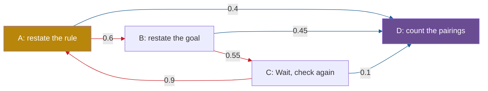

## 1. The question this page answers

Page 01 ended with a distribution over the next token. Something must still choose one token. Which rules exist? What does temperature do to the numbers? Why does a rule without chance repeat the same text forever? And how does the paper decide that a response loops?

The paper starts from this problem. Reasoning models "often get stuck in loops: endlessly repeating the same text in their chain of thought, especially under greedy decoding and low temperatures" (§1). One example: "OpenThinker3-1.5B loops in 30% of its responses with greedy decoding, while its teacher (QwQ-32B) barely loops" (§1). This page gives the tools to read such sentences exactly. Pages 03 and 04 explain teachers, students and reasoning models.

## 2. Mental model

> [!analogy] A walker who always takes the busiest street
> At each crossing, a walker sees how many people take each street. A greedy walker always takes the busiest street. If the busiest streets form a circle, the greedy walker walks the circle forever. A walker with a die sometimes takes a quieter street. Temperature sets how often: at a low temperature almost never, at temperature 1 exactly as often as the crowd does.
>
> **Where it stops working:** a real model reads the whole route so far, not only the current crossing. Also, the die never changes which street is busiest. If the crowd itself prefers the wrong streets, the die helps the walker leave the circle, but the walk stays long. That second point is the paper's view of temperature (page 11).

## 3. Terms

| Term | Plain meaning |
|---|---|
| decoding | The rule that chooses one token from the distribution of the model. It is separate from the model. |
| greedy decoding | Always choose the token with the highest probability. The paper calls it temperature 0. |
| argmax | The position of the largest value in a list. The argmax of [0.53, 0.32, 0.12, 0.03] is position 1. |
| deterministic | Always gives the same output for the same input. No chance is involved. |
| temperature | A number $T > 0$. Divide every logit by $T$ before softmax. $T < 1$ sharpens the distribution, $T > 1$ flattens it. |
| sampling | Choose the next token at random, with the probabilities of the distribution. |
| expected value | The average result over very many repeats of a random process. |
| top-k sampling | Keep only the $k$ most probable tokens, rescale them to sum to 1, then sample. |
| top-p (nucleus) sampling | Keep the smallest set of most probable tokens whose probabilities sum to at least $p$, rescale, then sample. |
| min-p sampling | Keep only the tokens whose probability is at least min_p times the top probability. |
| repetition penalty | A decoding rule that lowers the logits of tokens that are already in the text. A presence penalty is one form. |
| beam search | Keep several best partial sequences at each step, ranked by log-probability. A search for one very likely text. |
| neural text degeneration | Dull, generic or repetitive text from a language model. The name comes from Holtzman et al. (2020). |
| n-gram | A run of $n$ consecutive tokens. |
| loop, looping | A loop is text that repeats again and again. For the paper, a response contains looping if some n-gram appears at least k times. |
| looping fraction | The fraction of sampled responses that contain looping, averaged over problems. |

All terms are also in the [Glossary](/notes/papers/glossary).

## 4. Decoding: from a distribution to one token

The model computes a distribution. The **decoding** rule then chooses one token. The rule is not part of the trained model. The caller configures it for each request. So one model can loop with one rule and not loop with another.

| Rule | What it does | Uses chance? | In the paper's runs |
|---|---|---|---|
| Greedy decoding | Takes the most probable token | No | Yes, as temperature 0 |
| Sampling with temperature $T$ | Rescales the logits, then draws at random | Yes | Yes: $T \in \{0.2, 0.4, 0.6, 0.8, 1.0\}$ |
| Top-k, top-p | Remove unlikely tokens before the draw | Only as part of sampling | Kept at each model's default (Appendix A) |
| Repetition penalty | Lowers the logits of tokens already used | Depends on the rule it modifies | Not used (Appendix A) |
| Beam search | Searches for a very likely whole sequence | No | Not mentioned for its runs |

## 5. Greedy decoding

Greedy decoding takes the **argmax**: the token with the largest probability. Take the four logits of page 01: " Wait" 2.0, " So" 1.5, " Therefore" 0.5, " Hmm" −1.0. Their probabilities are 0.5321, 0.3227, 0.1187 and 0.0265. Greedy decoding writes " Wait". It ignores the other 0.4679 of probability completely.

Softmax keeps the order of the logits (page 01, §6.2). So the argmax of the probabilities is the argmax of the logits. Greedy decoding does not even need softmax. If two tokens tie, the software needs a fixed rule to break the tie.

> [!trap] Greedy decoding does not find the most probable text
> The best token at each step does not always give the best sequence. Example with invented numbers: the first token is A with 0.6 or B with 0.4. After A, the two best next tokens have 0.5 each. After B, one next token has 0.9.
>
> 1. Greedy path: A, then a token with 0.5. Probability $0.6 \times 0.5 = 0.30$.
> 2. Other path: B, then the token with 0.9. Probability $0.4 \times 0.9 = 0.36$.
>
> Greedy decoding chooses the path with 0.30, not the path with 0.36. Beam search keeps several partial paths to reduce this problem.

## 6. Temperature

### 6.1 The formula

Temperature $T$ divides every logit before softmax:

$$
p_i(T) = \frac{e^{z_i / T}}{\sum_{j} e^{z_j / T}}
$$

- $T = 1$ gives the plain softmax of page 01.
- $T < 1$ makes the gaps between logits larger. The top token gains probability.
- $T > 1$ makes the gaps smaller. The distribution becomes flatter.

Holtzman et al. (2020) define temperature sampling in the same way, with the logits divided by $t$ before softmax ([arXiv 1904.09751](https://arxiv.org/abs/1904.09751), checked on 2026-10-14).

### 6.2 Worked examples on the same logits

> [!example] Worked example: temperature 1.0, 0.6 and 0.2
> Logits: " Wait" 2.0, " So" 1.5, " Therefore" 0.5, " Hmm" −1.0.
>
> **$T = 1.0$.** The values $z/T$ are 2.0, 1.5, 0.5, −1.0. Exponentials: 7.38906, 4.48169, 1.64872, 0.36788. Sum: 13.88735. Probabilities: 0.5321, 0.3227, 0.1187, 0.0265.
>
> **$T = 0.6$.** The values $z/T$ are $2.0/0.6 = 3.3333$, $1.5/0.6 = 2.5000$, $0.5/0.6 = 0.8333$, $-1.0/0.6 = -1.6667$. Exponentials: 28.0316, 12.1825, 2.3010, 0.1889. Sum: 42.7040. Probabilities: $28.0316/42.7040 = 0.6564$, $12.1825/42.7040 = 0.2853$, $2.3010/42.7040 = 0.0539$, $0.1889/42.7040 = 0.0044$.
>
> **$T = 0.2$.** The values $z/T$ are 10, 7.5, 2.5, −5. Exponentials: 22026.4658, 1808.0424, 12.1825, 0.0067. Sum: 23846.6974. Probabilities: $22026.4658/23846.6974 = 0.9237$, $1808.0424/23846.6974 = 0.0758$, $12.1825/23846.6974 = 0.0005$, and " Hmm" gets $0.0000003$.
>
> In each case the four probabilities sum to 1.0000.

| Token | Logit | $T = 0.2$ | $T = 0.6$ | $T = 1.0$ | $T = 2.0$ |
|---|---|---|---|---|---|
| " Wait" | 2.0 | 0.9237 | 0.6564 | 0.5321 | 0.4042 |
| " So" | 1.5 | 0.0758 | 0.2853 | 0.3227 | 0.3148 |
| " Therefore" | 0.5 | 0.0005 | 0.0539 | 0.1187 | 0.1909 |
| " Hmm" | −1.0 | 0.0000003 | 0.0044 | 0.0265 | 0.0902 |

The paper used temperatures from 0 to 1.0 only. The column $T = 2.0$ only shows the flattening effect.

```plot
{
  "title": "Softmax of the logits 2.0, 1.5, 0.5, -1.0 as the temperature changes: Wait (red), So (blue), Therefore (gold), Hmm (ink)",
  "xAxis": { "label": "temperature T", "domain": [0, 2.1] },
  "yAxis": { "label": "probability", "domain": [0, 1.05] },
  "disableZoom": true,
  "data": [
    { "points": [[0.05, 1.0], [0.1, 0.9933], [0.2, 0.9237], [0.3, 0.8364], [0.4, 0.763], [0.5, 0.7042], [0.6, 0.6564], [0.8, 0.5841], [1.0, 0.5321], [1.5, 0.4505], [2.0, 0.4042]], "fnType": "points", "graphType": "polyline", "color": "#C81D25", "skipTip": true },
    { "points": [[0.05, 1.0], [0.1, 0.9933], [0.2, 0.9237], [0.3, 0.8364], [0.4, 0.763], [0.5, 0.7042], [0.6, 0.6564], [0.8, 0.5841], [1.0, 0.5321], [1.5, 0.4505], [2.0, 0.4042]], "fnType": "points", "graphType": "scatter", "color": "#C81D25", "skipTip": true },
    { "points": [[0.05, 0.0], [0.1, 0.0067], [0.2, 0.0758], [0.3, 0.158], [0.4, 0.2186], [0.5, 0.259], [0.6, 0.2853], [0.8, 0.3126], [1.0, 0.3227], [1.5, 0.3228], [2.0, 0.3148]], "fnType": "points", "graphType": "polyline", "color": "#1E6091", "skipTip": true },
    { "points": [[0.05, 0.0], [0.1, 0.0067], [0.2, 0.0758], [0.3, 0.158], [0.4, 0.2186], [0.5, 0.259], [0.6, 0.2853], [0.8, 0.3126], [1.0, 0.3227], [1.5, 0.3228], [2.0, 0.3148]], "fnType": "points", "graphType": "scatter", "color": "#1E6091", "skipTip": true },
    { "points": [[0.05, 0.0], [0.1, 0.0], [0.2, 0.0005], [0.3, 0.0056], [0.4, 0.0179], [0.5, 0.0351], [0.6, 0.0539], [0.8, 0.0896], [1.0, 0.1187], [1.5, 0.1657], [2.0, 0.1909]], "fnType": "points", "graphType": "polyline", "color": "#B8860B", "skipTip": true },
    { "points": [[0.05, 0.0], [0.1, 0.0], [0.2, 0.0005], [0.3, 0.0056], [0.4, 0.0179], [0.5, 0.0351], [0.6, 0.0539], [0.8, 0.0896], [1.0, 0.1187], [1.5, 0.1657], [2.0, 0.1909]], "fnType": "points", "graphType": "scatter", "color": "#B8860B", "skipTip": true },
    { "points": [[0.05, 0.0], [0.1, 0.0], [0.2, 0.0], [0.3, 0.0], [0.4, 0.0004], [0.5, 0.0017], [0.6, 0.0044], [0.8, 0.0137], [1.0, 0.0265], [1.5, 0.061], [2.0, 0.0902]], "fnType": "points", "graphType": "polyline", "color": "#100D12", "skipTip": true },
    { "points": [[0.05, 0.0], [0.1, 0.0], [0.2, 0.0], [0.3, 0.0], [0.4, 0.0004], [0.5, 0.0017], [0.6, 0.0044], [0.8, 0.0137], [1.0, 0.0265], [1.5, 0.061], [2.0, 0.0902]], "fnType": "points", "graphType": "scatter", "color": "#100D12", "skipTip": true }
  ]
}
```

### 6.3 Why temperature never changes the order

Page 01 showed that the ratio of two probabilities depends only on the gap between their logits. With temperature, the gap is divided by $T$:

$$
\frac{p_i(T)}{p_j(T)} = e^{(z_i - z_j)/T}
$$

" Wait" and " So" have a gap of 0.5. The ratio of their probabilities at each temperature:

| $T$ | 2.0 | 1.0 | 0.6 | 0.2 | 0.1 | 0.05 |
|---|---|---|---|---|---|---|
| $e^{0.5/T}$ | 1.2840 | 1.6487 | 2.3010 | 12.1825 | 148.41 | 22026.47 |

The ratio is always above 1, because $e$ to a positive power is above 1. So " Wait" stays ahead of " So" at every temperature. Temperature changes how often the lower tokens win. It never changes which token the model ranks first.

### 6.4 The limit $T \to 0$ is greedy decoding

As $T$ falls toward 0, the ratio $e^{0.5/T}$ grows without limit. At $T = 0.05$, " Wait" already has the probability 0.999955. In the limit, all the probability goes to the top token. That is greedy decoding. Division by 0 is not possible, so "temperature 0" is a name for greedy decoding. The paper uses it in this way. Figure 2 has the title "Looping with greedy decoding". Its bars "show the looping fractions at temperature 0".

> [!trap] Temperature does not change what the model learned
> Temperature acts at decoding time, on logits that are already computed. If the model ranks a cyclic token first, it stays first at every temperature. Temperature only gives the other tokens more chances. Page 11 explains why the paper calls temperature "a stopgap rather than a holistic solution" (abstract).

## 7. Sampling, top-k and top-p

### 7.1 Drawing one token

To sample, put the probabilities one after the other on the interval from 0 to 1. Draw a random number $u$ that is equally likely anywhere in that interval. The token whose part contains $u$ wins.

> [!example] Worked example: four draws at $T = 1.0$
> Cumulative sums of 0.5321, 0.3227, 0.1187, 0.0265: 0.5321, 0.8548, 0.9735, 1.0000. So " Wait" owns 0 to 0.5321, " So" owns 0.5321 to 0.8548, " Therefore" owns 0.8548 to 0.9735, and " Hmm" owns the rest.
>
> 1. $u = 0.10$ gives " Wait".
> 2. $u = 0.70$ gives " So".
> 3. $u = 0.90$ gives " Therefore".
> 4. $u = 0.99$ gives " Hmm".

Over many draws, each token wins about as often as its probability. In one simulation of 10,000 draws (Python, seed 0), the counts were " Wait" 5,301, " So" 3,276, " Therefore" 1,173 and " Hmm" 250. The expected counts were 5,321, 3,227, 1,187 and 265.

### 7.2 Top-k and top-p remove the tail

Many tokens have tiny probabilities. A rare bad token can still win a draw. Two filters remove such tokens before the draw:

- **Top-k** keeps the $k$ most probable tokens.
- **Top-p**, also called nucleus sampling, keeps the smallest set of most probable tokens whose probabilities sum to at least $p$. Holtzman et al. (2020) introduced it ([arXiv 1904.09751](https://arxiv.org/abs/1904.09751), checked on 2026-10-14).

Both filters then rescale the kept probabilities so that they sum to 1.

> [!example] Worked example: top-k and top-p at $T = 1.0$
> Probabilities with five decimals: 0.53207, 0.32272, 0.11872, 0.02649.
>
> **Top-k with $k = 2$.** Keep " Wait" and " So". Their sum is $0.53207 + 0.32272 = 0.85479$. New probabilities: $0.53207/0.85479 = 0.6225$ and $0.32272/0.85479 = 0.3775$.
>
> **Top-p with $p = 0.9$.** Running sums: 0.53207 (below 0.9), 0.85479 (below 0.9), 0.97351 (at least 0.9). So keep three tokens. New probabilities: $0.53207/0.97351 = 0.5465$, $0.32272/0.97351 = 0.3315$, $0.11872/0.97351 = 0.1220$. " Hmm" can no longer win.

The filters interact with temperature. At $T = 0.6$, the probabilities are 0.65642, 0.28528, 0.05388, 0.00442. The running sum reaches $0.65642 + 0.28528 = 0.94170$ after two tokens. So top-p with $p = 0.9$ keeps only two tokens: 0.6971 and 0.3029. Here the lower temperature leaves fewer tokens for top-p to keep.

The order of the steps depends on the software. In the Hugging Face transformers library (version 5.19.0, checked on 2026-10-14), the sampling path applies temperature first, then top-k, then top-p. The paper does not say which inference engine its evaluation framework used.

**Min-p** is a third filter. It keeps the tokens whose probability is at least min_p times the probability of the top token. This definition is from the Hugging Face transformers source, version 5.19.0 (checked on 2026-10-14). With min_p = 0, it keeps every token.

### 7.3 What the paper kept fixed

Among the decoding settings, the paper changed only the temperature. Appendix A says: "we kept the default top_k and top_p for each model, taken from its HuggingFace repository. We do not use any repetition penalty as we focus on the role of temperature." The paper does not list the default values for each model. One example: the `generation_config.json` of DeepSeek-R1-Distill-Qwen-1.5B sets temperature 0.6 and top_p 0.95 (checked on 2026-10-14). The paper replaced the temperature with its own values from 0 to 1.0.

A **repetition penalty** lowers the logits of tokens that already appear in the text. The paper mentions this kind of fix only as related work (§4.1). It says that "existing inference-time interventions that explicitly discourage repetition are in a similar vein (Keskar et al., 2019)". Because the paper used no such penalty, its loops come from the model under the chosen temperature and the default filters.

## 8. Why a deterministic rule that returns to a state repeats forever

### 8.1 Greedy decoding is deterministic

With fixed parameters, the same context gives the same logits. The same logits give the same argmax. So greedy decoding is **deterministic**: the next state is a function of the current state. Write $s_t$ for the state at step $t$ and $f$ for "one step of greedy decoding". Then $s_{t+1} = f(s_t)$.

In practice, real systems show small differences between runs. The paper continued one cut trace with QwQ-32B under greedy decoding. It generated 5 continuations "To account for non-determinism" and got "2 distinct traces" (§2.1). The paper does not explain the source. Interpretation of these notes: small floating-point differences on the hardware can change a close argmax.

### 8.2 The argument in four steps

Suppose that the state at step $i$ returns at a later step $j$, so $s_i = s_j$ with $i < j$.

1. $s_{i+1} = f(s_i)$ and $s_{j+1} = f(s_j)$.
2. Because $s_i = s_j$, the function gives the same result: $s_{i+1} = s_{j+1}$.
3. Repeat step 2 for $s_{i+2}$ and $s_{j+2}$, and so on. For every $m \geq 0$: $s_{i+m} = s_{j+m}$.
4. So from step $i$ on, the states repeat with a period of $j - i$ steps, forever.

The loop can stop in only two ways. One: the cycle contains an end-of-sequence token. But then the response would have stopped during the first round. Two: the response reaches the token budget. So a greedy loop normally runs to the budget. Figure 15 (Appendix E) plots two greedy looping traces, and its caption speaks of "plotting 30k time steps". The reasoning models had a 30K token budget (Appendix A).

> [!note] The argument needs a state that truly repeats
> The argument is exact for a model with a small state, such as the Markovian student of page 01. A Transformer's state is its full context, which never repeats exactly. For a Transformer, the argument is a picture, not a proof. The paper reports what happens instead: similar decision points return, and the model "tends to reselect the previously favored actions" (§1). Page 10 adds that the model becomes more confident during a loop (Appendix E).

### 8.3 A toy reasoning loop

The toy has four sentences. Each step writes one whole sentence, which is one action. The state is the last sentence. The probabilities are invented.

- A: "Each word is the pair in alphabetical order."
- B: "So the last word is the largest word."
- C: "Wait, let me check the rule again."
- D: "Count the pairings where the largest word contains G." (the progress-making action)



**Greedy decoding.** At A, 0.6 beats 0.4, so the rule chooses B. At B, 0.55 beats 0.45, so it chooses C. At C, 0.9 beats 0.1, so it chooses A. State A has returned, so by §8.2 the text is A, B, C, A, B, C, ... forever. D never appears, although D has a real chance at every state.

**Sampling at $T = 1$.** The trace stays in the loop for one full round only if it takes the three red edges: $0.6 \times 0.55 \times 0.9 = 0.297$. Ten full rounds have the probability $0.297^{10} = 5.34 \times 10^{-6}$. So the trace almost surely leaves the loop.

> [!example] Worked example: how long does sampling take to reach D?
> Write $E_A$, $E_B$, $E_C$ for the expected number of steps to reach D from each state. From each state the trace takes one step. It needs more steps only if it took a red edge:
>
> 1. $E_A = 1 + 0.6\,E_B$, $E_B = 1 + 0.55\,E_C$ and $E_C = 1 + 0.9\,E_A$.
> 2. Substitute: $E_A = 1 + 0.6 + 0.6 \times 0.55 + 0.297\,E_A = 1.93 + 0.297\,E_A$.
> 3. Solve: $E_A = 1.93 / (1 - 0.297) = 1.93 / 0.703 = 2.745$.
>
> A simulation of 100,000 sampled runs (Python, seed 1) needed 2.74 steps on average. The longest run needed 28 steps.

Temperature also acts here. Take the logits as $z = \ln p$, because the softmax of $\ln p$ gives $p$ back (page 01, §6.3). Then division by $T$ turns each probability into $p^{1/T}$, rescaled to sum to 1. At C with $T = 0.6$: $0.9^{1/0.6} = 0.83895$ and $0.1^{1/0.6} = 0.02154$, so A gets $0.83895 / 0.86050 = 0.9750$ and D gets 0.0250.

| Temperature | Stay for one full round | Expected steps from A to D |
|---|---|---|
| 1.0 | 0.297 | 2.745 |
| 0.6 | 0.377 | 3.287 |
| 0.2 | 0.647 | 7.159 |
| 0 (greedy) | 1 | D is never reached |

A model that ranked D first at A would reach D in 1 step, even with greedy decoding. Interpretation of these notes: in this toy, sampling ends the endless loop, but the trace stays longer than necessary. Page 11 shows the paper's measured version. On its graph task at temperature 1, the trained model had an average response length of 105.5, against 24.8 for a perfect learner (§3.3).

```video
{"src": "/notes/media/papers/2025-why-reasoning-models-loop/manim/m01-greedy-temperature-loop.mp4", "caption": "Temperature reshapes four logits, greedy decoding repeats a toy loop forever, and sampling leaves the loop but takes longer than necessary."}
```

> [!key] The idea of this page
> Greedy decoding is deterministic. If the state returns, the text repeats forever, until the token budget ends it. Temperature and sampling give every exit a chance, so an endless loop becomes very unlikely. But temperature never changes which token the model ranks first.

## 9. Measuring loops: n-grams and the looping fraction

### 9.1 The paper's rule

An **n-gram** is a run of $n$ consecutive tokens. The paper's rule: "We consider a text response to contain looping if it contains any n-gram at least k times. We choose n = 30 and k = 20 for all reasoning models" (§2). The paper adds: "Large n makes it a fairly strict requirement". Instruct models write shorter responses, so for them the paper uses $k = 10$. Appendix A.1 tests other $(n, k)$ pairs, and page 07 gives its results. The paper does not say whether its n-grams count tokens or words. These notes assume tokens.

A detector for this rule needs four steps:

1. Change the response into a list of tokens.
2. Slide a window of $n$ tokens along the list, one position at a time.
3. Count how often each n-gram appears.
4. Report looping if any count is at least $k$.

Page 14 has an exercise to build this detector.

> [!example] Worked example: a toy check with $n = 3$ and $k = 3$
> Use words as tokens. **Text A** is "so the word is the pair sorted ." three times: 24 tokens.
>
> 1. A window of 3 tokens has $24 - 3 + 1 = 22$ positions.
> 2. Six 3-grams appear 3 times each: "so the word", "the word is", "word is the", "is the pair", "the pair sorted", "pair sorted .".
> 3. Two 3-grams appear 2 times: "sorted . so", ". so the".
> 4. The largest count is 3, which is at least $k = 3$. Text A contains looping.
>
> **Text B** is "so the word is the pair sorted . so the last word is the largest word .": 17 tokens and 15 positions. "word is the" appears 2 times. Each other 3-gram appears once. The largest count is 2, below 3. Text B does not contain looping, although it repeats a phrase.

### 9.2 How long must a loop run before the rule fires?

Suppose that a loop repeats the same block of $P$ tokens, with no repeats inside the block. A fixed n-gram in the loop then appears once every $P$ tokens. For $k$ appearances, the repeated region must contain at least $n + (k - 1) \times P$ tokens. These notes count every window position, so overlapping n-grams count. The paper does not say how it counts overlaps.

| Block length $P$ | Shortest region for $n = 30$, $k = 20$ |
|---|---|
| 10 tokens | $30 + 19 \times 10 = 220$ tokens |
| 50 tokens | $30 + 19 \times 50 = 980$ tokens |
| 100 tokens | $30 + 19 \times 100 = 1{,}930$ tokens |

A brute-force count in Python gave the same three values. All three are small next to the 30K budget. So a greedy loop that runs to the budget passes the paper's rule easily.

### 9.3 The looping fraction

The paper uses temperatures $\{0, 0.2, 0.4, 0.6, 0.8, 1.0\}$. "For each triple (problem, model, temperature) ... we sample 20 responses and compute accuracy, looping percentage, and response length", then averages "across problems" (§2). The **looping fraction** is the share of the 20 responses that contain looping, averaged over the problems. Page 06 gives the full design. Why 20 runs matter is on [Pass rates and confidence intervals](/notes/ai/evaluation/02-statistics/l1-pass-rates-and-confidence-intervals).

## 10. Background: neural text degeneration

Loops are older than reasoning models. The paper says that Holtzman et al. (2020) "brought broad attention to this 'neural text degeneration,' showing that low-temperature sampling or beam search can yield generic and repetitive text" (§1.1). The paper lists it as an ICLR 2020 publication.

Holtzman et al. report that beam search "gets stuck in a repetition loop it cannot escape" (their §6.2, checked on 2026-10-14). Their answer was nucleus sampling, the top-p filter of §7.2. Interpretation of these notes: their decoders and this paper's decoders share the same weakness. A rule that always prefers the most probable continuation can stay in a cycle.

The paper then notes that looping became less severe with better instruction data and larger models. "With the rise of reasoning models, however, severe looping has re-emerged" (§1.1). Page 13 covers the full list of earlier work.

## 11. What model providers recommend

The paper notes that "most model providers recommend running them at a sufficiently high temperature to avoid looping" (§1). It names the Hugging Face pages of DeepSeek-R1 and QwQ-32B as examples. The two pages say (checked on 2026-10-14):

| Model page | Recommendation |
|---|---|
| [DeepSeek-R1](https://huggingface.co/deepseek-ai/DeepSeek-R1) | "Set the temperature within the range of 0.5-0.7 (0.6 is recommended) to prevent endless repetitions or incoherent outputs." |
| [QwQ-32B](https://huggingface.co/Qwen/QwQ-32B) | "Use Temperature=0.6, TopP=0.95, MinP=0 instead of Greedy decoding to avoid endless repetitions." It also suggests TopK between 20 and 40, and a presence_penalty between 0 and 2. |

The QwQ-32B page also warns about the presence penalty. A higher value "may result in occasional language mixing and a slight decrease in performance". These pages say what to configure. They do not say why the loops happen. The paper asks exactly that, and it asks if temperature is a cure or "mostly act as a stopgap" (§1). Pages 05 and 11 follow that question.

## 12. Common mistakes

1. **"Temperature 0 means sampling with a little randomness."** It means greedy decoding, with no chance at all. The paper treats temperature 0 as greedy decoding (Figure 2).
2. **"A higher temperature makes the model prefer a different token."** The order of the tokens never changes. Temperature only changes the gaps between their probabilities.
3. **"Greedy decoding gives the most probable response."** It gives the best token at each step. In §5, greedy decoding finds a path with 0.30 and misses a path with 0.36.
4. **"Sampling removes loops."** Sampling makes an endless loop very unlikely. It does not change the learned probabilities, so the text can still be much longer than necessary.
5. **"Any repeated phrase counts as a loop for the paper."** The paper needs one 30-gram at least 20 times. Text B in §9.1 repeats a phrase and does not loop.
6. **"The paper tuned top-p or used a repetition penalty against loops."** It kept each model's default top_k and top_p. It used no repetition penalty (Appendix A).

## 13. One-minute explanation

A model gives a distribution over the next token, and a separate decoding rule chooses one token. Greedy decoding takes the most probable token, so it is deterministic. Temperature divides the logits by $T$ before softmax. A low $T$ sharpens the distribution and a high $T$ flattens it, but the order of the tokens never changes. As $T$ falls to 0, sampling becomes greedy decoding, which the paper calls temperature 0. A deterministic rule that returns to a state must repeat the same steps forever, so a greedy loop runs until the token budget. Sampling gives every exit a chance, so an endless loop becomes very unlikely, but the trace can still be long. The paper kept the default top-k and top-p of each model and used no repetition penalty, so it studies temperature alone. It marks a response as looping when some 30-gram appears at least 20 times. The looping fraction is the share of 20 sampled responses that loop, averaged over problems.

## 14. Check questions

```check
{
  "question": "Compute the softmax of the logits 2.0, 1.5, 0.5 and -1.0 at temperature $T = 0.5$.",
  "hint": "Divide each logit by 0.5 first.",
  "answer": "$z/T$: 4, 3, 1, -2. Exponentials: 54.59815, 20.08554, 2.71828, 0.13534. Sum: 77.53731. Probabilities: 0.7042, 0.2590, 0.0351, 0.0017. The order is the same as at $T = 1$, but the top token now has 0.7042 instead of 0.5321."
}
```

```check
{
  "question": "A model with a small state uses greedy decoding. Its state at step 3 is the same as its state at step 7. Which earlier state is the state at step 15? Will the model ever leave this cycle by itself?",
  "hint": "The period is $j - i$.",
  "answer": "The period is $7 - 3 = 4$. Step 15 is $3 + 12$, three full periods after step 3, so $s_{15} = s_3$. The model never leaves the cycle by itself. Only the token budget ends the response."
}
```

```check
{
  "question": "The tokens are: a b c a b c a b c a. Does the text contain looping under the rule $n = 3$, $k = 3$?",
  "hint": "List the 3-grams at the 8 window positions.",
  "answer": "The 3-grams are: abc, bca, cab, abc, bca, cab, abc, bca. abc appears 3 times and bca appears 3 times, cab 2 times. A count of 3 reaches $k = 3$, so the text contains looping."
}
```

```check
{
  "question": "At $T = 1.0$ the probabilities are 0.5321, 0.3227, 0.1187 and 0.0265. How many tokens does top-p with $p = 0.8$ keep? At $T = 0.2$ the top token has 0.9237. How many tokens does top-p with $p = 0.9$ keep there, and what does that mean?",
  "hint": "Keep the smallest set of top tokens whose sum is at least $p$.",
  "answer": "At $T = 1.0$: 0.5321 is below 0.8, and $0.5321 + 0.3227 = 0.8548$ is at least 0.8, so top-p keeps 2 tokens. At $T = 0.2$: 0.9237 alone is at least 0.9, so top-p keeps 1 token. Sampling then always gives the top token, which is the same as greedy decoding."
}
```

## 15. Links

- Previous: [01 Background: probability and next-token prediction](/notes/papers/reasoning-models/2025-why-reasoning-models-loop/01-background-probability-and-next-token-prediction)
- Next: [03 Background: training, cross-entropy and distillation](/notes/papers/reasoning-models/2025-why-reasoning-models-loop/03-background-training-cross-entropy-and-distillation)
- Uses this page: [06 Experiment design](/notes/papers/reasoning-models/2025-why-reasoning-models-loop/06-experiment-design), [11 Temperature: a stopgap, not a cure](/notes/papers/reasoning-models/2025-why-reasoning-models-loop/11-temperature-stopgap-or-cure), [14 Reproduce it](/notes/papers/reasoning-models/2025-why-reasoning-models-loop/14-reproduce-it)
- [Why Do Reasoning Models Loop? (2025)](/notes/papers/reasoning-models/2025-why-reasoning-models-loop)
- Related: [LITM 01 Background: language models and context](/notes/papers/long-context/2023-lost-in-the-middle/01-background-language-models), [Pass rates and confidence intervals](/notes/ai/evaluation/02-statistics/l1-pass-rates-and-confidence-intervals), [The chat API call](/notes/ai/context-engineering/01-foundations/l3-the-chat-api-call)
- [Glossary](/notes/papers/glossary)
