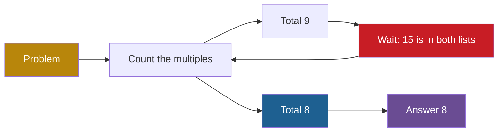
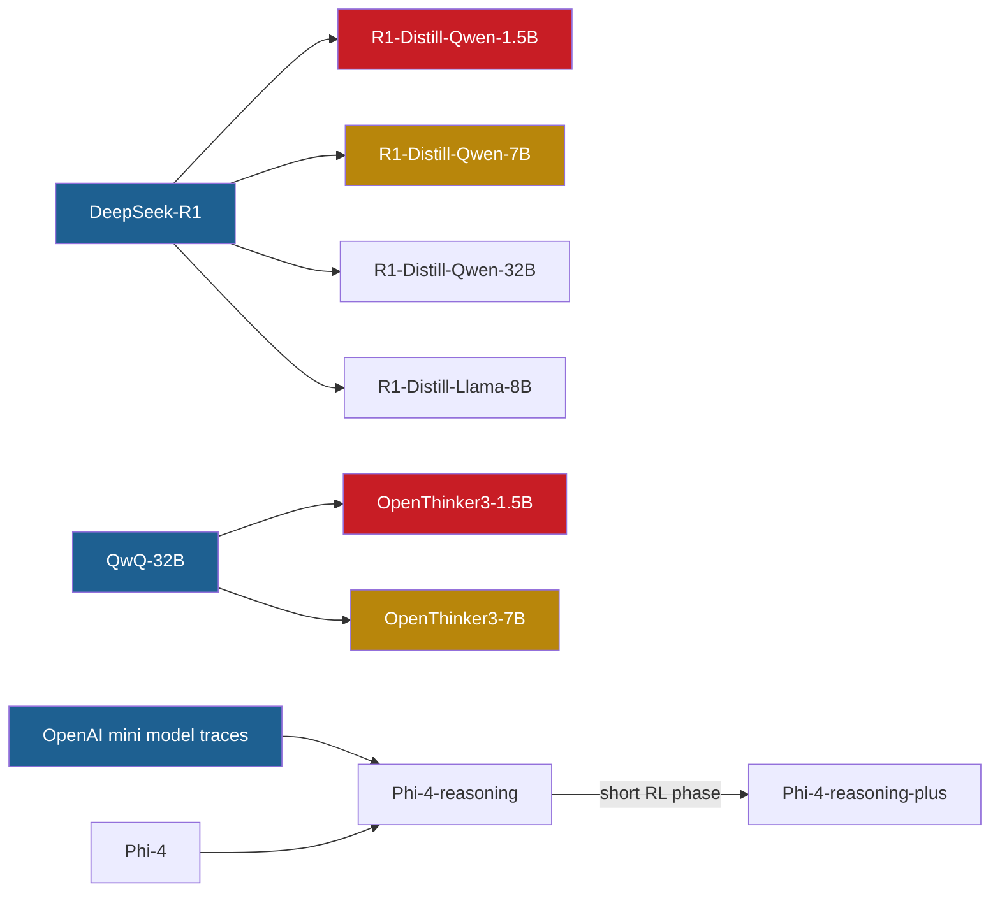

## 1. The question this page answers

What is a reasoning model, and how does its output differ from the answer of an instruct model? Why do its traces contain so many returns to earlier steps? Which models and benchmarks does the paper use, and how was each model made?

## 2. Mental model

> [!analogy] Scratch paper before the final answer
> A reasoning model writes its scratch work before it gives the final answer. Good scratch work tries an idea, checks it, notices an error, and returns to an earlier line to fix it. So good scratch work contains many returns to earlier steps, and each return adds something new.
>
> **Where it stops working:** a person notices when the same line appears for the tenth time, and stops. A model has no separate observer. It only predicts the next token. Also, the scratch paper of the model is its context. Each line that it writes changes what it writes next, so a repeated line can make the next repetition more likely (page 10).

## 3. Terms

| Term | Plain meaning |
|---|---|
| reasoning model | A language model that is trained to write a long chain of thought before its final answer. |
| instruct model | A language model that is trained to follow instructions and to answer fairly directly. The paper also calls these "instruction tuned" or "non-reasoning" models. |
| chain of thought (CoT) | The intermediate steps that a model writes before its final answer. |
| reasoning trace | The full text of one chain of thought: one response of a reasoning model. |
| inference-time compute | The computation spent when the model answers, mostly one pass through the model for each generated token. |
| scaling axis | A quantity that can be increased to get better results, for example training compute or inference-time compute. |
| action | One logical step of a chain of thought: a short chunk of tokens (§3). |
| progress-making action | An action that moves the chain closer to the final goal, for example the next step of a proof. |
| cyclic action | An action that repeats something already done before, for example a restatement of a known fact. |
| backtracking | A return to an earlier point of the solution, to try another way. |
| reflection | A step that reviews the earlier steps, for example to check them. |
| restatement | Saying a known fact or the problem again, with no new content. |
| model family | A group of related models that the paper compares, usually one recipe in different sizes. The OpenThinker3 family also includes their teacher QwQ-32B. |
| token budget | The largest number of tokens that a response can have (the "max tokens" setting). |
| AIME | The American Invitational Mathematics Examination, a high-school math contest. Each answer is a whole number. |
| GPQA Diamond | A set of 198 very hard multiple-choice science questions in biology, physics and chemistry. |

All terms are also in the [Glossary](/notes/papers/glossary).

## 4. Chain of thought

### 4.1 From a direct answer to written steps

Take the question: "How many positive whole numbers below 20 are divisible by 3 or by 5?" The two answers below are an illustration made for these notes. They are not from the paper.

An instruct-style answer is short: "There are 8 such numbers: 3, 5, 6, 9, 10, 12, 15 and 18."

A reasoning-style trace writes its work first:

| Step | Text | Kind of action |
|---|---|---|
| 1 | "Multiples of 3 below 20: 3, 6, 9, 12, 15, 18. That is 6 numbers." | progress-making |
| 2 | "Multiples of 5 below 20: 5, 10, 15. That is 3 numbers." | progress-making |
| 3 | "So the total is 6 + 3 = 9." | progress-making, but wrong |
| 4 | "Wait, 15 is in both lists. I counted it twice." | cyclic: reflection and backtracking |
| 5 | "So the total is 6 + 3 − 1 = 8." | progress-making |
| 6 | "Check by listing: 3, 5, 6, 9, 10, 12, 15, 18. That is 8." | cyclic: reflection (a check) |
| 7 | "The answer is 8." | progress-making |

Steps 4 and 6 return to work that was already done. Step 4 found an error, and step 6 confirmed the result in a second way. These returns are useful, because each one adds new information.

The term "chain of thought" became common with Wei et al. (2022), "Chain-of-Thought Prompting Elicits Reasoning in Large Language Models". They describe it as "a series of intermediate reasoning steps" (arXiv 2201.11903, checked on 2026-10-14). In that work, a few worked examples in the prompt made the model write such steps.

### 4.2 Why written steps can help

Interpretation of these notes: a model does a fixed amount of computation for each token that it writes. A direct answer gives the model only a few tokens of computation. A chain of thought gives it thousands. Also, each written step joins the context (page 01), so later steps can read earlier intermediate results, as a person reads scratch paper.

### 4.3 From prompting to training

A reasoning model does not need worked examples in the prompt. Training makes it write a long chain of thought by itself. The models of the paper learned this behavior in two ways:

1. **Reinforcement learning (RL).** The model writes answers, a reward scores the final answers, and training makes good answers more likely (page 03). The DeepSeek-R1 report describes this for its own models (arXiv 2501.12948, checked on 2026-10-14). The model card of QwQ-32B lists "Supervised Finetuning and Reinforcement Learning" (checked on 2026-10-14).
2. **Distillation.** A student trains with cross-entropy on traces that a reasoning teacher wrote (page 03). Most models in this paper are made in this way (section 8).

The paper cites four reports as examples of reasoning models: OpenAI o1, DeepSeek-R1, Phi-4-reasoning and OpenThoughts (§1). For an example of how one API returns a chain of thought, see the note on [thinking blocks](/notes/ai/llm-apis/02-streaming-and-thinking/l2-thinking-blocks-and-signatures).

## 5. Inference-time compute: a second scaling axis

The paper opens with this point: reasoning models "use extra inference time compute, generating long chains of thought, to solve harder problems" (§1). It continues: "This has opened a complementary scaling axis of inference-time compute, alongside training compute" (§1).

| Scaling axis | What increases | When the cost is paid |
|---|---|---|
| Training compute | More parameters, more data, more training steps | Once, before release |
| Inference-time compute | More tokens of reasoning for each answer | Again for every question |

Each generated token needs one pass through the whole model. So a response of 30,000 tokens costs about 30,000 passes. Also, attention over a longer context costs more for each token (see [attention and the cost of length](/notes/ai/context-engineering/01-foundations/l4-attention-and-the-cost-of-length)). The paper gives reasoning models a budget of 30K tokens, and Qwen2.5-Math-1.5B-Instruct a budget of 3k tokens (Appendix A). That is a factor of $30{,}000 / 3{,}000 = 10$.

The average chain of thought in the OpenThinker family (the two students and QwQ-32B) is long. In Figure 1b, the averages are about 14,000 to 21,000 tokens (approximate, read from the plot).

The paper also explains why loops in small models matter (§1.1). Its reason: "a core promise of this paradigm is to leverage inference-time compute so that even small models can perform well via longer chains". So "scaling alone is not a satisfactory solution for reasoning models" (§1.1). A larger model loops less, but the goal is a small model that thinks longer.

> [!key] A loop wastes inference-time compute
> A reasoning model spends tokens to make progress. A loop spends tokens and makes no progress. A response that never leaves its loop repeats until the token budget ends. So the most expensive responses can be the least useful ones.

## 6. What a reasoning trace contains

### 6.1 Actions, progress-making and cyclic

The paper describes a chain of thought as a sequence of actions. "In a language model, an action can be viewed as a short chunk of tokens implementing a logical step" (§3).

Two kinds of action matter:

1. A **progress-making action** "moves closer to the final goal (e.g., taking the next step in the proof)" (§3.1).
2. A **cyclic action** is "a chunk that repeats something already done before (e.g., restating a previously stated fact)" (§3.1).

Page 06 gives the exact versions of these definitions for the synthetic graph task.

### 6.2 Kinds of cyclic action

The paper names backtracking, reflection and restatement as cyclic actions of reasoning traces (§1.1, §2, §3.3).

| Cyclic action | What it does | Short example |
|---|---|---|
| Backtracking | Returns to an earlier point and tries another way | Step 4 of the table in section 4.1 |
| Reflection | Reviews earlier steps, for example to check them | Step 6 of that table |
| Restatement | Says the problem or a known fact again | "So, the word is the two letters sorted." (Example 1, §2.1) |

In the example traces of the paper, these actions often start with a short marker such as "Wait", "Hmm" or "Alternatively". Example 1 of the paper (§2.1) contains phrases such as "Wait, no, hold on." In the excerpts of Example 1 that the paper prints, the word "Wait" appears 8 times (counted by these notes).

### 6.3 A useful cycle or a loop?

A cyclic action is not an error. Step 4 of section 4.1 saved the answer. The problem appears when the same cyclic action is chosen again and again, and nothing new appears.



Gold is the start, red is the cyclic action, blue is the progress-making action and purple is the goal. In a good trace, the model visits the state "Count the multiples" twice, and the second time it leaves toward "Total 8". In a looping trace, the model takes the red return every time:

```text
Wait, 15 is in both lists. So the multiples of 3 are 3, 6, 9, 12, 15, 18.
Wait, 15 is in both lists. So the multiples of 3 are 3, 6, 9, 12, 15, 18.
Wait, 15 is in both lists. So the multiples of 3 are 3, 6, 9, 12, 15, 18.
```

This looping text is also an illustration made for these notes. The difference between the two traces is not the kind of action. It is that the looping trace never chooses the progress-making exit.

### 6.4 The word "Wait"

The paper does not explain its title. Interpretation of these notes: the title echoes the "Wait" markers that start many restatements in looping traces.

The word has a history in reasoning models. The DeepSeek-R1 report shows an "aha moment" of its RL-trained model with the text "Wait, wait. Wait. That's an aha moment I can flag here." (arXiv 2501.12948v1, Table 3, checked on 2026-10-14). The s1 paper makes a model think longer by "appending "Wait" multiple times" when the model "tries to end" (arXiv 2501.19393, checked on 2026-10-14). So "Wait" is a marker of reflection, and reflection is useful in the right amount.

## 7. Why reasoning traces give fertile ground for loops

The paper connects loops to the cyclic actions in the training data. Chain-of-thought data with backtracking and reflection "provides fertile ground for models to fall into degenerative loops" (§1.1).

The first mechanism of the paper (page 08) needs two ingredients (§3.3). They are "(i) hard-to-learn actions, along with (ii) easy-to-learn cyclic actions present in the training distribution". In the graph task, the paper explains why the reset is easy: it "only requires reading the start node from context" (§3.1). Interpretation of these notes: a restatement is easy in the same way, because it copies text that is already in the context.

Instruct data has few cyclic actions, so the second ingredient is weak. The authors call this "a plausible explanation for why many instruction-tuned models loop less than reasoning models" (§3.3). It is a hypothesis, not a measurement.

The paper measured looping with greedy decoding for each instruct model and a reasoning model of the same base family. Each pair below is a group of Figure 2 (exact bar labels).

| Figure 2 group | Instruct model | Looping fraction | Reasoning model | Looping fraction |
|---|---|---|---|---|
| Qwen 2.5 | Qwen2.5-Math-1.5B-Instruct | 0.05 | DeepSeek-R1-Distill-Qwen-1.5B | 0.76 |
| OpenThinker 3 | Qwen2.5-1.5B-Instruct | 0.19 | OpenThinker3-1.5B | 0.30 |
| Llama 3.1 | Llama-3.1-8B-Instruct | 0.47 | DeepSeek-R1-Distill-Llama-8B | 0.54 |
| Phi-4 | Phi-4 | 0.01 | Phi-4-reasoning | 0.43 |

In every pair, the reasoning model loops more. The gap is large for the Qwen and Phi-4 pairs and small for the Llama pair. Instruct models do not always avoid loops. For Llama-3.1-8B-Instruct and Qwen2.5-1.5B-Instruct, the paper adds: "even there we observe an increase in the looping percentage for the corresponding reasoning models" (§2). Page 07 analyzes these results.

> [!trap] The two columns use different loop definitions
> For reasoning models, a response loops if some 30-gram appears at least 20 times. For instruct models, the paper relaxes this to 10 times, "since instruct models produce shorter responses" (§2). Page 02 explains n-grams and this definition.

## 8. The models of the paper

### 8.1 Reasoning models

The paper tests nine open reasoning models in four families (§2). The column "How it was made" uses the official model cards and reports, checked on 2026-10-14. Where a cell names the paper, it quotes the paper. SFT means supervised fine-tuning: more training with cross-entropy on example responses (page 03).

| Model | Size | How it was made |
|---|---|---|
| DeepSeek-R1-Distill-Qwen-1.5B | 1.5B | Fine-tuned from Qwen2.5-Math-1.5B with "800k samples curated with DeepSeek-R1". Only SFT, no RL stage. |
| DeepSeek-R1-Distill-Qwen-7B | 7B | The same recipe, from Qwen2.5-Math-7B. |
| DeepSeek-R1-Distill-Qwen-32B | 32B | The same recipe, from Qwen2.5-32B. |
| DeepSeek-R1-Distill-Llama-8B | 8B | The same recipe, from Llama-3.1-8B. |
| OpenThinker3-1.5B | 1.5B | SFT only, from Qwen2.5-1.5B-Instruct, on OpenThoughts3-1.2M. QwQ-32B wrote the traces. |
| OpenThinker3-7B | 7B | SFT only, from Qwen2.5-7B-Instruct, on the same data. |
| QwQ-32B | 32.5B | Qwen team. Pretraining, then SFT and RL. The paper: "the teacher for OpenThinker-3 models" (§2). |
| Phi-4-reasoning | 14B | SFT of Phi-4 on chain-of-thought traces. The paper: "a distilled model" (§2). |
| Phi-4-reasoning-plus | 14B | Phi-4-reasoning plus "a short phase of outcome-based reinforcement learning" (arXiv 2504.21318). The paper: "lightly tuned with RL" (§2). |

Sources: the Hugging Face model cards of DeepSeek-R1-Distill-Qwen-1.5B, OpenThinker3-1.5B, OpenThinker3-7B, QwQ-32B and Phi-4-reasoning. Also the DeepSeek-R1 report (arXiv 2501.12948v1) and the Phi-4-reasoning technical report (arXiv 2504.21318). The Phi-4 cards give "14B parameters" in the architecture table and 15B in the file metadata. The Phi-4-reasoning model card names SFT and RL in one sentence. The technical report separates them: SFT for Phi-4-reasoning, and a short RL phase only for the plus version.

> [!note] Which teacher wrote the Phi-4-reasoning traces?
> The paper says that Phi-4-reasoning "has been fine-tuned on OpenAI o4-mini data" (Appendix A). The technical report that the paper cites says "reasoning demonstrations generated using o3-mini" (arXiv 2504.21318, checked on 2026-10-14). These notes cannot resolve the difference.
>
> Both sources agree that the teacher is a different model family from DeepSeek-R1 and QwQ-32B. The paper names this difference as one possible reason why the Phi-4 reasoning models loop more on easy problems. It calls the explanation "only a preliminary attempt" (Appendix A). Page 07 covers this exception.

### 8.2 Instruct models

| Model | Size | How it was made (model card, checked on 2026-10-14) | Token budget in the paper |
|---|---|---|---|
| Qwen2.5-Math-1.5B-Instruct | 1.5B | An instruct model for English and Chinese math problems, with chain of thought or tool use. | 3k |
| Qwen2.5-1.5B-Instruct | 1.54B | Pretraining and post-training. The base of OpenThinker3-1.5B. | 30k |
| Llama-3.1-8B-Instruct | 8B | SFT and RLHF (reinforcement learning from human feedback). | 30k |
| Phi-4 | 14B | SFT and direct preference optimization (DPO), a method that learns from pairs of preferred and rejected answers. The base of Phi-4-reasoning. | 14k |

### 8.3 Who taught whom



Blue nodes are teachers, red nodes are the 1.5B students and gold nodes are the 7B students. "OpenAI mini model" stands for o3-mini or o4-mini (section 8.1).

> [!trap] Only one teacher is measured
> The paper evaluates QwQ-32B, the teacher of the OpenThinker3 models. It does not evaluate DeepSeek-R1, the teacher of the four DeepSeek-R1 distilled models. It does not evaluate the OpenAI teacher of Phi-4-reasoning either. So the direct "student against teacher" comparison exists only for the OpenThinker3 family. For the DeepSeek-R1 distilled models, the paper compares sizes within the family.

## 9. The benchmarks

### 9.1 AIME

The paper describes AIME as "the American Invitational Mathematics Examination (AIME), a high-school math contest" (§1). The Mathematical Association of America (MAA) runs it. Students who do very well on the AMC 10 or AMC 12, earlier contests of the MAA, are invited. "The answer to each question is an integer number between 0 and 999" (maa.org, checked on 2026-10-14). A program can easily compare a whole-number answer with the correct answer.

In 2024 and 2025, the AIME had two papers, AIME I and AIME II. MAA lists the 2025 AIME I on 6 February 2025 and AIME II on 12 February 2025 (checked on 2026-10-14). Each paper has 15 problems. The study uses all four papers: AIME-24-I, AIME-24-II, AIME-25-I and AIME-25-II (§2). That is $4 \times 15 = 60$ problems.

Both example traces of the paper are AIME 2025 problems: Problem I-7 in Example 1 (§2.1) and Problem I-5 in Example 2 (Appendix B).

> [!note] The format changes
> MAA describes the 2027 AIME as one 15-question exam in two parts of 90 minutes each (checked on 2026-10-14). The 2027 AIME has no separate AIME I and AIME II. A replication with later AIME problems must take care with this change.

### 9.2 GPQA Diamond

GPQA is "A Graduate-Level Google-Proof Q&A Benchmark" (Rein et al., arXiv 2311.12022, checked on 2026-10-14). It has 448 multiple-choice questions written by experts in biology, physics and chemistry. Each question has four answer choices. Experts with or working toward a PhD in the field reach 65% accuracy. Skilled non-experts reach 34%, although they spend on average over 30 minutes with full web access.

The Diamond subset has 198 questions. It "includes only questions where both experts answer correctly and the majority of non-experts answer incorrectly" (arXiv 2311.12022). The paper uses it to test if the AIME results transfer to another domain (Appendix A.2). It runs only the OpenThinker3 and DeepSeek-R1 distilled Qwen families on it.

### 9.3 The arithmetic of the study

| Benchmark | Problems | Responses per (problem, model, temperature) | Temperatures | Responses per (model, temperature) |
|---|---|---|---|---|
| AIME 2024 and 2025 | 60 | 20 | 0, 0.2, 0.4, 0.6, 0.8, 1.0 | $60 \times 20 = 1{,}200$ |
| GPQA Diamond | 198 | 4 | 0.0, 0.4, 0.8 | $198 \times 4 = 792$ |

The paper rounds the GPQA count to "≈ 800 responses" (Appendix A.2). On AIME, one reasoning model gives $1{,}200 \times 6 = 7{,}200$ responses, and the nine reasoning models give $9 \times 7{,}200 = 64{,}800$ responses. These totals are computed by these notes. The paper does not state them.

The paper averages accuracy, looping fraction and response length over the problems (§2). For each model, it also splits the problems into 20 hard and 20 easy ones by their accuracy at temperature 0.8. Page 06 describes this split. The evaluations ran in the Eureka ML Insights Framework (Appendix A). The paper does not describe how it extracts the final answer from a response.

## 10. Token budgets and decoding settings

### 10.1 The budgets of the paper

The paper ran all reasoning models with a budget of 30K tokens, the `max_tokens` setting (Appendix A). For each instruct model, the paper sets the budget "based on the max allowed number of tokens for each model" (Appendix A). The budgets are 14k for Phi-4 and 3k for Qwen2.5-Math-1.5B-Instruct. Llama-3.1-8B-Instruct and Qwen2.5-1.5B-Instruct get 30k.

A response that never leaves its loop continues until it reaches the budget. So the budget sets the cost of a loop. One reasoning model on AIME can generate at most $7{,}200 \times 30{,}000 = 216{,}000{,}000$ tokens. This upper limit is computed by these notes. The paper does not say how it scores a response that reaches the budget before a final answer.

The paper keeps the default top-k and top-p settings of each model, "taken from its HuggingFace repository" (Appendix A). It uses no repetition penalty. Page 02 explains these settings.

### 10.2 What the model cards recommend

The paper notes that "most model providers recommend running them at a sufficiently high temperature to avoid looping" (§1). The model cards give these settings (checked on 2026-10-14):

| Model card | Recommended setting | Reason given on the card |
|---|---|---|
| DeepSeek-R1 distilled models | Temperature 0.5 to 0.7, with 0.6 recommended | "to prevent endless repetitions or incoherent outputs" |
| QwQ-32B | Temperature 0.6, top-p 0.95, top-k 20 to 40, "instead of Greedy decoding" | "to avoid endless repetitions" |
| Phi-4-reasoning and Phi-4-reasoning-plus | Temperature 0.8, top-k 50, top-p 0.95, with sampling enabled | "To fully take advantage of the model's capabilities" |
| OpenThinker3-1.5B and 7B | No recommendation on the card | None |

So the makers of two families name endless repetition as the reason to avoid greedy decoding. The paper asks why these models loop, and if temperature fixes the cause or only hides it. Page 11 gives its answer.

## 11. Common mistakes

1. **"A reasoning model is a different kind of network."** The models in this paper are ordinary next-token language models. For example, each DeepSeek-R1 distilled model is a Qwen or Llama model after more training on reasoning traces.
2. **"Every "Wait" is a sign of a loop."** Reflection and backtracking are useful. A loop is the same cyclic action, chosen again and again, with nothing new.
3. **"Larger models do not loop, so size solves the problem."** Larger models loop less, but they still loop. DeepSeek-R1-Distill-Qwen-32B has a greedy looping fraction of 0.37 (Figure 2). Also, the promise of reasoning models is that small models can think longer (§1.1).
4. **"All reasoning models in the paper were trained with RL."** Seven of the nine are distilled models, trained with SFT on the traces of a teacher. QwQ-32B and Phi-4-reasoning-plus include RL.
5. **"The instruct and reasoning looping numbers use the same test."** Instruct models use the looser $k = 10$, and reasoning models use $k = 20$.
6. **"The paper compares every student with its teacher."** It measures only one teacher, QwQ-32B. DeepSeek-R1 is not evaluated.

## 12. One-minute explanation

A reasoning model is a language model that writes a long chain of thought before its final answer. Its traces contain progress-making actions, which move toward the goal, and cyclic actions such as backtracking, reflection and restatement. Cyclic actions are useful when they add something new, but a loop chooses the same cyclic action again and again. Reasoning models spend inference-time compute, a second scaling axis next to training compute, and a loop wastes that compute until the token budget ends. The paper tests nine open reasoning models in four families. They are DeepSeek-R1 distilled Qwen and Llama models, OpenThinker3 students with their teacher QwQ-32B, and Phi-4-reasoning with its RL-tuned plus version. It compares them with four instruct models, which loop less in every pair. The main benchmark is AIME 2024 and 2025: 60 problems with whole-number answers, 20 samples each, at six temperatures. GPQA Diamond, 198 hard science questions, checks that the results transfer. Reasoning models get a budget of 30K tokens for each response.

## 13. Check questions

```check
{
  "question": "The paper's first mechanism needs two ingredients. Name them, and explain why reasoning traces supply the second one more than instruct answers do.",
  "answer": "(i) Hard-to-learn actions and (ii) easy-to-learn cyclic actions in the training data (§3.3). Reasoning traces contain many cyclic actions such as restatement, backtracking and reflection. Instruct answers contain few. The authors call this a plausible explanation for why instruct models loop less."
}
```

```check
{
  "question": "How many responses does the paper generate on AIME for one reasoning model at one temperature? How many at all six temperatures?",
  "hint": "Count the problems of the four AIME papers first.",
  "answer": "4 papers × 15 problems = 60 problems. 60 × 20 samples = 1,200 responses at one temperature. 1,200 × 6 = 7,200 responses at all six temperatures."
}
```

```check
{
  "question": "For which model family can the paper compare students directly with their teacher, and why not for the DeepSeek-R1 distilled models?",
  "answer": "Only for OpenThinker3: the paper evaluates their teacher QwQ-32B. It does not evaluate DeepSeek-R1, the teacher of the distilled Qwen and Llama models. For those, it compares the sizes within the family."
}
```

```check
{
  "question": "A reasoning model with a 30K token budget enters a loop at token 4,000 and never leaves it. How many tokens does it spend inside the loop, and what fraction of the budget is that?",
  "answer": "$30{,}000 - 4{,}000 = 26{,}000$ tokens, which is $26{,}000 / 30{,}000 \\approx 0.867$ of the budget. The response costs almost the full budget and gives no new progress."
}
```

## 14. Links

- Previous: [03 Background: training, cross-entropy and distillation](/notes/papers/reasoning-models/2025-why-reasoning-models-loop/03-background-training-cross-entropy-and-distillation)
- Next: [05 The question](/notes/papers/reasoning-models/2025-why-reasoning-models-loop/05-the-question)
- The paper card: [Wait, Wait, Wait... Why Do Reasoning Models Loop?](/notes/papers/reasoning-models/2025-why-reasoning-models-loop)
- Greedy decoding, temperature and the loop definition: [02 Background: decoding, greedy, temperature and sampling](/notes/papers/reasoning-models/2025-why-reasoning-models-loop/02-background-decoding-greedy-temperature-sampling)
- The study design and the hard and easy split: [06 Experiment design](/notes/papers/reasoning-models/2025-why-reasoning-models-loop/06-experiment-design)
- The results for these models: [07 Results: looping in open models](/notes/papers/reasoning-models/2025-why-reasoning-models-loop/07-results-looping-in-open-models)
- How one API returns a chain of thought: [Thinking blocks and signatures](/notes/ai/llm-apis/02-streaming-and-thinking/l2-thinking-blocks-and-signatures)
- Why sampling 20 runs matters: [Pass rates and confidence intervals](/notes/ai/evaluation/02-statistics/l1-pass-rates-and-confidence-intervals)
- [Glossary](/notes/papers/glossary)
