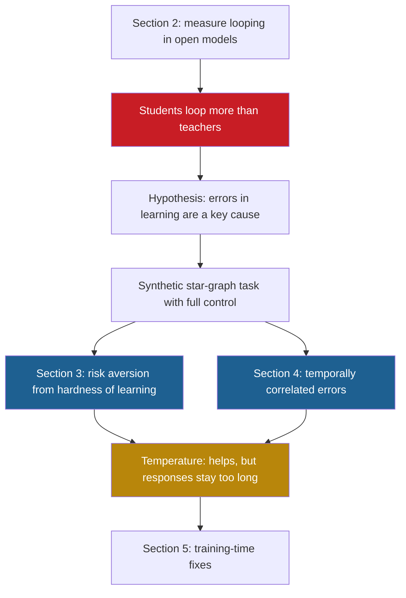

## 1. The question this page answers

Reasoning models often repeat the same text again and again until they reach their token budget. Why does this happen? Providers tell users to run these models at a high temperature. Does temperature remove the cause, or does it only hide the symptom? What does the paper propose as the cause, and how does it plan to test that idea?

## 2. Mental model

> [!analogy] A student who copied a teacher's worked solutions
> A teacher writes worked solutions. They contain progress steps ("now use the next rule") and check steps ("wait, let me restate the problem"). A student learns from these solutions but cannot copy every skill. At a hard step, the student is not sure which progress step is correct. The check step is easy and always available, so it seems the safest choice. A student who always takes the single safest-looking step restates the problem forever. A student who sometimes rolls a die tries a new step and escapes, but wastes time on the way.
>
> **Where it stops working:** a model has no feeling of "safe". It has only the probabilities that training gave it. Also, this story is the hypothesis of the paper, not a measured fact about real students or real models. The paper tests it in a small synthetic task (pages 06, 08 and 09).

## 3. Terms

| Term | Plain meaning |
|---|---|
| loop | A part of a response where the model repeats the same text many times. |
| looping | The behavior of a model that produces loops. The paper counts a response as looping if some 30-gram appears at least 20 times (page 06). |
| reasoning model | A model that writes a long chain of thought before its final answer (page 04). |
| greedy decoding | A decoding rule that always takes the token with the highest probability (page 02). |
| temperature | A number that makes sampling more random (high values) or closer to greedy (low values) (page 02). |
| teacher | The model whose outputs form the training data of another model. |
| student | The model that is trained on the outputs of a teacher (page 03). |
| training distribution | The probabilities of the data that a model is trained on. For a student, the teacher's outputs. |
| errors in learning | A mismatch between the training distribution and the learned model. The paper's name for imperfect learning. |
| progress-making action | A step that moves the reasoning closer to the goal, for example the next step of a proof. |
| cyclic action | A step that returns to something already done, for example restating a known fact or backtracking. |
| stopgap | A fix that hides a problem for now but does not remove its cause. |
| holistic fix | A fix that removes the cause of a problem. |
| deterministic algorithm | A procedure that always does the same steps for the same input. |
| randomized algorithm | A procedure that uses random choices, so it can do different steps for the same input. |

All terms are also in the [Glossary](/notes/papers/glossary).

## 4. The problem: reasoning models repeat themselves

### 4.1 What a loop looks like

A reasoning model writes a chain of thought: many tokens of working before the answer. The paper states that these models "often get stuck in loops: endlessly repeating the same text in their chain of thought, especially under greedy decoding and low temperatures" (§1).

Here is a toy example, written for these notes. It is not from the paper.

```text
So the word is the two letters in order. Wait, so the word is the pair sorted.
So the word is the two letters in order. Wait, so the word is the pair sorted.
So the word is the two letters in order. Wait, so the word is the pair sorted.
...
```

The text makes no progress. Each repeat adds tokens and adds no new fact. In the paper's first example trace, the final loop never ends (§2.1). Page 07 summarizes that trace.

> [!note] Why a loop costs so much
> In the paper, the reasoning models have a budget of 30K tokens per response (Appendix A). Interpretation of these notes: a response that loops early can spend most of that budget on repeats. Every one of those tokens takes compute time, and an API bills each output token.

### 4.2 What providers recommend

The paper notes that "most model providers recommend running them at a sufficiently high temperature to avoid looping" (§1). It gives two examples: the Hugging Face pages of DeepSeek-R1 and QwQ-32B. Page 02 explains what temperature does to the probabilities.

So in practice, engineers use temperature as a repair tool. The paper asks if this repair is correct, or only convenient.

### 4.3 An old problem that returned

Repetition is not new. The paper reviews the history in §1.1:

1. Early language models also repeated text. Holtzman et al. (2020) called this "neural text degeneration". Low-temperature sampling and beam search gave generic, repetitive text.
2. Researchers tried several fixes. Unlikelihood training lowers the probability of repeated continuations (Welleck et al., 2020). Contrastive methods change the token representations, which reduces repetition (Su et al., 2022).
3. Li et al. (2023) found that repetitions in the output were correlated with repetitions in the training corpus.
4. As instruction-tuning data improved and models grew, looping "became less severe" (§1.1). The paper also finds little looping in several instruction-tuned models.
5. With reasoning models, "severe looping has re-emerged" (§1.1).

The authors give a reason for the return. Chain-of-thought data "includes cyclic actions like backtracking and reflection" (§1.1). That data "provides fertile ground for models to fall into degenerative loops" (§1.1).

> [!trap] Larger models are not the answer here
> One idea is to use only large models, because they loop less. The paper rejects this as a full answer. "A core promise of this paradigm is to leverage inference-time compute so that even small models can perform well via longer chains" (§1.1). Interpretation of these notes: a small model that loops wastes exactly the compute that should make it strong.

## 5. The two questions of the paper

### 5.1 Question 1: why do reasoning models loop?

The first question is simple to state: "why do these models loop, and how does temperature help?" (§1). The paper wants a mechanism. A mechanism is a step-by-step account of how a cause produces the behavior. A list of correlations is not a mechanism.

### 5.2 Question 2: is temperature a holistic fix or a stopgap?

The second question is more precise: "does temperature address the root cause or mostly act as a stopgap?" (§1).

The authors also state their ideal. "Ideally, temperature would be a knob we can use to control how much exploration a chain of thought performs, rather than something we must turn up just to avoid looping" (§1). So temperature should be a design choice, not an emergency setting.

| If temperature is a holistic fix | If temperature is a stopgap |
|---|---|
| It removes the cause of loops. | It hides loops, but the cause remains. |
| At a high temperature, responses are as short as needed. | At a high temperature, responses are still longer than needed. |
| No training change is necessary. | A training change is necessary for a real fix. |

The abstract gives the paper's answer in advance: "temperature is a stopgap rather than a holistic solution". Section 5 adds a nuance. Temperature is "a reasonable fix when the errors are small", but "more of a stopgap when they are large" (§5). Page 11 explains both cases.

### 5.3 The deeper question: is randomness necessary?

The paper asks a more basic question: "is randomness a necessary resource for good reasoning models?" (§1). It compares this to a classical question in computer science: are randomized algorithms more powerful than deterministic ones? It cites Motwani and Raghavan (1996) and Vadhan et al. (2012).

A deterministic algorithm always does the same steps for the same input. A randomized algorithm uses random choices. Greedy decoding is a deterministic algorithm: in theory, the same prompt and the same model give the same text. Sampling with a temperature above 0 is a randomized algorithm.

> [!example] Worked example: a deterministic rule in a room with two doors
> This toy is written for these notes. It is not from the paper.
>
> A walker is in a room. Door P (progress) leads to the next room. Door C (cyclic) leads to the same room. The walker's rule gives door C a probability of 0.6 and door P a probability of 0.4. The rule depends only on the room.
>
> 1. **Greedy rule.** Take the door with the highest probability. 0.6 > 0.4, so the walker takes door C. It returns to the same room, with the same probabilities. It takes door C again. It never leaves. This is a loop.
> 2. **Random rule.** Take door P with probability 0.4 at each visit. The probability to still be in the room after 10 visits is $0.6^{10} \approx 0.006$. The walker almost surely leaves.
> 3. **The cost of the random rule.** The expected number of visits until the walker leaves is $1 / 0.4 = 2.5$. So the walker wastes on average $2.5 - 1 = 1.5$ visits.
> 4. **A correct rule.** Suppose that training had given door P the probability 0.7 and door C 0.3. Then the greedy rule takes door P on the first visit: 1 visit, no waste.
>
> Randomness rescues the walker from the loop. But the walker with wrong probabilities still wastes visits. The real fix is the correct probability on door P.

This toy has the shape of the paper's answer. Randomness helps, but it does not correct wrong probabilities. A real Transformer sees its whole history, not only the current "room". So the toy is only an illustration. Pages 08 and 09 show that loops still form in that case.

> [!note] What the paper does not do
> The paper does not answer the complexity-theory question about randomized algorithms. It uses the question as a frame. Its own contribution is about learned models and temperature.

## 6. The proposed answer: errors in learning

### 6.1 What "errors in learning" means

A model learns from a training distribution. For a distilled student, that distribution is the set of traces from the teacher. Training tries to make the model's probabilities equal to the probabilities of the data. If training worked perfectly, the learned model would equal the training distribution.

The paper calls any systematic gap "errors in learning". The abstract defines them as "mismatches between the training distribution and the learned model". The paper also uses the phrases "imperfect learning" and "systematic errors in the learned distribution" (§2).

$$
\text{errors in learning:} \quad \text{learned model} \neq \text{training distribution}
$$

> [!trap] Errors in learning are not bugs in the code
> The word "errors" does not mean a mistake by the engineers. It means that the learned probabilities differ from the probabilities of the data. A perfect training run on a model that is too small can still have errors in learning.

### 6.2 The student-teacher argument

The central argument of §1 and §2 uses distillation. "If a student perfectly learned the teacher, then the amount of looping of the student could not be significantly higher than that of the teacher" (§1).

Why is this true? Suppose that the student gives every next token the same probability as the teacher, after every prefix. Then greedy decoding picks the same token at every step for both models. The two outputs are identical, so the two looping fractions are identical. At any temperature, the two models produce text with the same statistics.

The paper then states the observation that breaks this. "How can it be that OpenThinker3-1.5B loops in 30% of its responses with greedy decoding, while its teacher (QwQ-32B) barely loops?" (§1).

> [!example] Worked example: the argument in numbers
> The greedy looping fractions in Figure 2 are exact bar labels.
>
> 1. OpenThinker3-1.5B (student): 0.30.
> 2. QwQ-32B (its teacher): 0.04.
> 3. Ratio: $0.30 / 0.04 = 7.5$. The student loops 7.5 times as often.
> 4. A perfect student would have a ratio close to 1.
> 5. So the student is not a perfect copy of the teacher. Errors in learning exist.

The logic has a name: the contrapositive. The statement "if A, then B" is equal to "if not B, then not A". Here A is "the student learned the teacher perfectly". B is "the student loops about as much as the teacher". The data show "not B", so "not A" follows.

> [!key] The core claim of the paper
> The authors argue that errors in learning are "a key cause" of looping (abstract). In their account, training traces with many cyclic actions give the material for loops (§3.3). Errors in learning then make the model choose those cyclic actions again and again. The open-model results support this claim. The synthetic task shows how it can work.

> [!trap] What the argument proves, and what it does not
> The argument proves that errors in learning exist. It does not prove which errors exist, or how they cause loops. That is why the paper builds a synthetic task (page 06). Also, "a key cause" is not "the only cause". Section 5 names other forces, for example error accumulation (page 10).

### 6.3 Where errors in learning originate

The paper names several sources (§3.1, §3.3):

1. **Optimization difficulty.** Gradient descent cannot find the correct solution, even when the model is large enough to represent it. This is the source in the star-graph task (§3.1).
2. **Limited capacity.** A small model cannot represent everything that a large teacher does. The authors call this "a plausible explanation for why smaller models loop more within a family trained on the same data" (§3.3).
3. **Under-training.** The training run is too short or uses too little compute (§3.3).

The paper also argues that reinforcement learning does not escape the problem. RL "can be thought of as training the model on best-of-k version of itself" (§3.3). So there is "still a gap between the data generator and the learner" (§3.3). Page 03 explains this view.

## 7. Actions: progress-making and cyclic

The paper describes reasoning as a sequence of actions. An action is one logical step, written as a short chunk of tokens (§3).

| Kind of action | In a math chain of thought | In the star-graph task (page 06) |
|---|---|---|
| progress-making action | The next step of a proof. A new structural insight. | Move to the next node toward the goal. |
| cyclic action | Restate a known fact. Backtrack. Restart the proof. | Return to an already visited node, for example a reset to the start. |

Cyclic actions are not bad in themselves. A good teacher checks its work and backtracks after a mistake. The danger appears when a student repeats a cyclic action without new progress. Then the chain becomes a loop.

The paper's two mechanisms both explain why a student repeats cyclic actions. They have names that later pages use:

1. **Risk aversion from hardness of learning** (§3, page 08). The progress-making action is hard to learn, and an easy cyclic action is available. The student "puts relatively more probability on the cyclic action and gets stuck" (abstract).
2. **Temporally correlated errors** (§4, page 09). Even without a hard action, a Transformer's small errors at a decision point repeat each time that point returns. So "the same few actions keep being chosen and loops appear" (abstract).

## 8. The plan of the paper



| Part of the paper | What it does | Page in these notes |
|---|---|---|
| §2, Appendix A | Measures accuracy, looping and length of open models across temperatures. | [06](/notes/papers/reasoning-models/2025-why-reasoning-models-loop/06-experiment-design) and [07](/notes/papers/reasoning-models/2025-why-reasoning-models-loop/07-results-looping-in-open-models) |
| §3, Appendix C | Proves Proposition 1 and shows risk aversion in the star-graph task. | [08](/notes/papers/reasoning-models/2025-why-reasoning-models-loop/08-why-1-risk-aversion) |
| §4, Appendices B and D | Shows temporally correlated errors in the star-graph task and in a real trace. | [09](/notes/papers/reasoning-models/2025-why-reasoning-models-loop/09-why-2-temporally-correlated-errors) |
| §4.1, Appendix E | Shows that confidence grows inside a loop and makes loops harder to leave. | [10](/notes/papers/reasoning-models/2025-why-reasoning-models-loop/10-the-catalyst-growing-confidence) |
| §3.3, §4.1, §5 | Answers the temperature question and proposes training-time fixes. | [11](/notes/papers/reasoning-models/2025-why-reasoning-models-loop/11-temperature-stopgap-or-cure) |

## 9. What kind of evidence the paper gives

Read each later page with these three kinds of evidence in mind.

| Kind | Example | How strong |
|---|---|---|
| The paper measured | Looping fractions of 13 open models on AIME (page 07). | Direct, but correlational: it shows patterns, not causes. |
| The paper proves or demonstrates | Proposition 1, and loops in Transformers trained on the star-graph task (pages 08 and 09). | Causal inside the synthetic task, because the authors control the data. |
| The authors hypothesize | The same mechanisms act inside real reasoning models. | Supported by example traces and probes (pages 07 and 09), not by a causal test inside a real model. |

> [!note] Interpretation of these notes
> The design is a common one in science. First, find a pattern in the real system. Then, build a small model where you can enable and disable each cause. Then, check that the real system shows the same signs. The weak link is the last step: a match in signs is not proof of the same cause.

## 10. Common mistakes

1. **"Reasoning models loop because they are bad models."** The paper finds that even strong teachers loop a little, and that loops depend on temperature and difficulty. Its claim is narrower: errors in learning, together with cyclic actions in the data, produce loops.
2. **"A high temperature cures looping."** It reduces looping. The paper argues that it does not fix the learned probabilities, so responses stay longer than needed (page 11).
3. **"Errors in learning means wrong labels in the training data."** It means that the learned model differs from the training distribution, even if the data are perfect.
4. **"The student-teacher gap shows the mechanism."** It shows only that errors in learning exist. The synthetic task shows the mechanisms.
5. **"Cyclic actions are mistakes."** Teachers use them to check and to backtrack. The problem is a cyclic action that repeats without progress.

## 11. One-minute explanation

Reasoning models often repeat the same text until their token budget ends, mostly at low temperature. Providers tell users to raise the temperature, and the paper asks why this works and whether it is a real fix. Its main observation is about distillation: OpenThinker3-1.5B loops in 30% of greedy responses, but its teacher QwQ-32B barely loops. A perfect student would loop about as much as its teacher, so the student must have errors in learning. Errors in learning are any mismatch between the training distribution and the learned model. The paper then builds a synthetic star-graph task to find how such errors cause loops. It shows two mechanisms: risk aversion from hardness of learning, and temporally correlated errors. Its answer on temperature is that it helps by exploration but does not fix the learned probabilities. So temperature is a stopgap when the errors are large, and the paper proposes training-time fixes.

## 12. Check questions

```check
{
  "question": "State the two main questions of the paper in your own words.",
  "answer": "1. Why do reasoning models loop, especially at low temperature? 2. Does a higher temperature remove the cause of looping (a holistic fix), or does it only hide the symptom (a stopgap)?"
}
```

```check
{
  "question": "A student model loops in 0.30 of greedy responses. Its teacher loops in 0.04. Explain, step by step, why this proves that the student has errors in learning.",
  "hint": "What would greedy decoding do if the two models had the same probabilities after every prefix?",
  "answer": "If the student had exactly the teacher's next-token probabilities after every prefix, greedy decoding would choose the same token at every step for both models. The outputs would be identical, so the looping fractions would be identical. The fractions differ by a factor of 0.30 / 0.04 = 7.5. So the student's probabilities differ from the teacher's somewhere. That mismatch is an error in learning."
}
```

```check
{
  "question": "In the two-door toy, door P has probability 0.4 and door C (back to the same room) has 0.6. What does greedy decoding do? What is the expected number of visits with random sampling? What would remove the waste?",
  "answer": "Greedy takes door C every time and never leaves: a loop. Random sampling leaves with probability 0.4 per visit, so the expected number of visits is 1 / 0.4 = 2.5, a waste of 1.5 visits. A correct probability on door P (for example 0.7) would let greedy take door P on the first visit. The fix is in the probabilities, not in the randomness."
}
```

```check
{
  "question": "Name the three sources of errors in learning that the paper discusses.",
  "answer": "Optimization difficulty (the star-graph task, where the model is large enough but gradient descent does not find the solution), limited model capacity, and under-training (too little training compute)."
}
```

## 13. Links

- Previous: [04 Background: reasoning models](/notes/papers/reasoning-models/2025-why-reasoning-models-loop/04-background-reasoning-models)
- Next: [06 Experiment design](/notes/papers/reasoning-models/2025-why-reasoning-models-loop/06-experiment-design)
- The paper card: [Why do reasoning models loop? (2025)](/notes/papers/reasoning-models/2025-why-reasoning-models-loop)
- Decoding and temperature: [02 Background: decoding, greedy, temperature and sampling](/notes/papers/reasoning-models/2025-why-reasoning-models-loop/02-background-decoding-greedy-temperature-sampling)
- Distillation: [03 Background: training, cross-entropy and distillation](/notes/papers/reasoning-models/2025-why-reasoning-models-loop/03-background-training-cross-entropy-and-distillation)
- The answer on temperature: [11 Temperature: a stopgap, not a cure](/notes/papers/reasoning-models/2025-why-reasoning-models-loop/11-temperature-stopgap-or-cure)
- [How to read a paper](/notes/papers/reading-method) and the [Glossary](/notes/papers/glossary)
