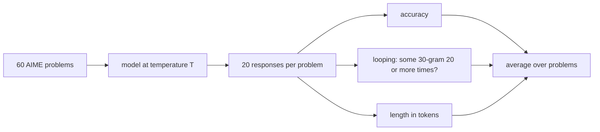
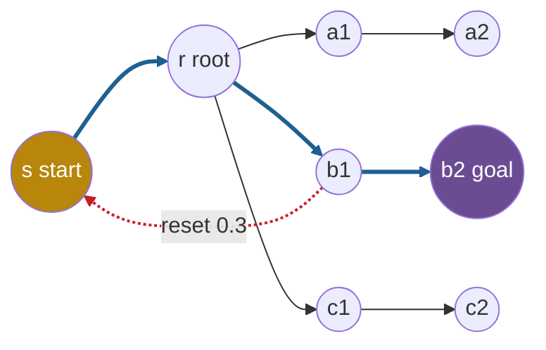

## 1. The question this page answers

How did the authors test their ideas? Which models, problems, temperatures and measures did they use on real models? How did they build a small task where they control everything? What exactly does each measure count?

## 2. Mental model

> [!analogy] A field survey and a wind tunnel
> An engineer who studies why some aircraft shake does two things. First, a field survey: measure many real aircraft, without access to their internals. Then, a wind tunnel: build a small model, change one thing at a time, and see which change causes the shaking. The paper does the same. Part 1 measures real open models. Part 2 trains small Transformers on a synthetic graph task.
>
> **Where it stops working:** a wind tunnel copies the physics of real flight. The star-graph task does not copy language. The authors say that their aim is "to isolate the phenomenon of interest in the simplest setting possible" (§3.1). A mechanism in the small task is a candidate explanation for real models, not a proof.

## 3. Terms

| Term | Plain meaning |
|---|---|
| AIME | American Invitational Mathematics Examination. A high-school math contest. Each paper has 15 problems (page 04). |
| sample | One response that a model generates for one prompt at one temperature. |
| n-gram | A run of $n$ consecutive units of text. |
| looping fraction | The share of responses that loop: some 30-gram appears at least 20 times (at least 10 times for instruct models). |
| response length | The average number of tokens in a response. In the graph task, the average length of the generated walk. |
| directed graph | A set of nodes and a set of edges. Each edge goes from one node to another node, in one direction. |
| star graph $G(n, \ell)$ | A root with $n$ spokes. Each spoke is a path of $\ell - 1$ edges that ends at a leaf. In this paper, a start node joins the root. |
| root | The center node of the star graph. It is the only node with more than one outgoing edge. |
| leaf | The last node of a spoke. It has no outgoing edge. |
| start node | The extra node $s$ with a single edge to the root. Every walk begins here. |
| goal node | The leaf that the walk must reach. It is chosen at random. |
| random walk | A path through a graph where each next node is chosen at random by fixed probabilities. |
| reset | A jump from the current node to the start node. It is a cyclic action, and it is not an edge of the graph. |
| looping count | A count of repeated visits in a generated walk. The paper uses two different definitions (section 5.10). |
| perfect learner | A model that equals the training distribution exactly. The paper uses it as a reference. |
| loss mask | A rule that computes the training loss on some tokens only. Here, only on the walk. |

All terms are also in the [Glossary](/notes/papers/glossary).

## 4. Part 1: the study of open models

### 4.1 The models

The paper tests 9 reasoning models and 4 instruct models (§2). Page 04 explains how each was made.

| Family | Reasoning models | Instruct model in the same group of Figure 2 |
|---|---|---|
| Qwen 2.5 | DeepSeek-R1 Distilled Qwen 1.5B, 7B, 32B | Qwen2.5-Math-1.5B-Instruct |
| OpenThinker 3 | OpenThinker3-1.5B, OpenThinker3-7B (students), QwQ-32B (their teacher) | Qwen2.5-1.5B-Instruct |
| Llama 3.1 | DeepSeek-R1 Distilled Llama 8B | Llama-3.1-8B-Instruct |
| Phi-4 | Phi-4-reasoning, Phi-4-reasoning-plus (lightly tuned with RL) | Phi-4 |

The selection gives the paper three useful contrasts:

1. **Size inside a family.** For example 1.5B, 7B and 32B with the same training data.
2. **Student and teacher.** OpenThinker3 models are students of QwQ-32B.
3. **Training method.** Distillation only (Phi-4-reasoning) against distillation plus light RL (Phi-4-reasoning-plus).

### 4.2 Problems, temperatures and samples

1. **Problems.** AIME 2024 and 2025: four papers (AIME-24-I, AIME-24-II, AIME-25-I, AIME-25-II) of 15 problems each (§2).
2. **Temperatures.** $T \in \{0, 0.2, 0.4, 0.6, 0.8, 1.0\}$ (§2).
3. **Samples.** "For each triple (problem, model, temperature) ... we sample 20 responses" (§2).
4. **Other decoding settings.** The default top_k and top_p of each model, from its Hugging Face repository. No repetition penalty, "as we focus on the role of temperature" (Appendix A).
5. **Token budgets.** 30K tokens for all reasoning models. For instruct models: 14k for Phi-4, 3k for Qwen2.5-Math-1.5B-Instruct, 30k for Llama-3.1-8B-Instruct and Qwen2.5-1.5B-Instruct (Appendix A).
6. **Tool.** The Eureka ML Insights Framework of Microsoft Research ran all evaluations (Appendix A).

> [!example] Worked example: how many responses per model
> 1. Problems: $4 \times 15 = 60$.
> 2. Temperatures: 6.
> 3. Samples per (problem, temperature): 20.
> 4. Responses for one model: $60 \times 6 \times 20 = 7{,}200$.
> 5. At one temperature: $60 \times 20 = 1{,}200$ responses.

> [!note] Why 20 samples even at temperature 0
> Greedy decoding is deterministic in theory. In practice, the paper reports "non-determinism" under greedy decoding and generates several greedy continuations to account for it (§2.1). The paper does not explain the source. Interpretation of these notes: small differences in the order of GPU arithmetic can change a near tie between two tokens.



### 4.3 The looping rule

"We consider a text response to contain looping if it contains any n-gram at least k times" (§2). The values:

| Models | $n$ | $k$ |
|---|---|---|
| Reasoning models | 30 | 20 |
| Instruct models | 30 | 10 |

The authors relax $k$ for instruct models "since instruct models produce shorter responses" (§2). They call the main rule "already very strict" (Appendix A.1). Appendix A.1 tests other pairs: (20,20), (30,30), (30,60) and (40,20). Page 07 gives the results. Page 02 shows how to check the rule on a toy text.

> [!example] Worked example: how much repeated text the rule needs
> Assume that the n-gram counts tokens. The paper does not say whether it counts tokens or words.
>
> 1. A model repeats a cycle of 50 tokens again and again.
> 2. A 30-gram inside the cycle appears once per cycle.
> 3. To reach 20 appearances, the cycle must appear 20 times: $20 \times 50 = 1{,}000$ tokens of loop.
> 4. With the 30K budget, that is $1{,}000 / 30{,}000 \approx 3.3\%$ of the budget.
>
> So the rule ignores a short repeat, like one restated sentence. It catches a loop that continues for a long time.

### 4.4 The three measures

For each (problem, model, temperature), the paper computes three numbers over the 20 responses. Then it averages each number over the problems (§2).

1. **Accuracy.** The share of responses with a correct final answer. The paper does not describe its answer check. The Eureka framework did the evaluation.
2. **Looping fraction.** The share of responses that loop by the rule above. The paper also calls it "looping percentage". These notes use "looping fraction".
3. **Response length.** The average number of tokens in the chain of thought ("Average CoT Length" in the plots).

### 4.5 The hard and easy split

The authors test if harder problems cause more looping (§2, Figure 10). Per model:

1. In each AIME paper of 15 problems, rank the problems by the model's accuracy at $T = 0.8$.
2. Take the 5 easiest and the 5 hardest of each paper.
3. Pool the four papers: 20 easy and 20 hard problems.
4. Compare the looping fraction at $T = 0$ on the two groups.

> [!example] Worked example: which problems take part
> 1. All problems: $4 \times 15 = 60$.
> 2. Used: $4 \times (5 + 5) = 40$.
> 3. Omitted: the middle 5 of each paper, $60 - 40 = 20$ problems.

> [!note] Interpretation of these notes: why two temperatures
> The split measures difficulty at $T = 0.8$ and looping at $T = 0$. At $T = 0.8$, looping is rare (page 07). So accuracy at $T = 0.8$ measures difficulty with little effect from loops. Accuracy at $T = 0$ would mix the two: a problem with many loops has low accuracy because the loops use the budget.

### 4.6 The GPQA check

To test a second domain, the authors use GPQA Diamond: "198 highly challenging questions from biology, physics, and chemistry" (Appendix A.2). They test the DeepSeek-distilled Qwen family and the OpenThinker 3 family.

1. Temperatures: 0.0, 0.4 and 0.8.
2. Samples: 4 responses per (model, problem, temperature).
3. Total: $198 \times 4 = 792$ responses, which the paper rounds to "≈ 800", per (model, temperature).

### 4.7 The probe of example traces

To examine one loop in detail, the paper uses a probe (§2.1, Appendix B):

1. Take a looping trace of the student OpenThinker3-1.5B under greedy decoding.
2. Truncate the trace at the point where a loop begins.
3. Let the teacher (QwQ-32B) and the student each write 5 greedy continuations from that prefix.
4. Sample 50 continuations from each model at $T = 0.7$ and at $T = 1$. The length is 2,000 tokens in Example 1, and 1,000 or 2,000 tokens in Appendix B.
5. Give each continuation to GPT-5 with a criterion. For Example 1, the criterion is a list of "key structural insights". GPT-5 marks a continuation that contains at least one of them.

The count of marked continuations estimates how much probability each model puts on progress-making actions. Interpretation of these notes: at $T = 1$, samples follow the model's own distribution, apart from any top-k or top-p limit. So the estimate is most direct there.

> [!trap] A judge model is also a model
> GPT-5 decides what counts as an insight. The paper does not print the judge prompt or the list of insights. It does not report a check of the judge's accuracy. So treat the counts as strong signs, not as exact probabilities.

## 5. Part 2: the synthetic task


### 5.1 Why a synthetic task

Real reasoning traces are too complex to analyze. The authors need to know the teacher's data distribution and to see how the student changes it. So they "consider a synthetic graph reasoning setup where we have more control over the data distributions" (§3). In this task they choose the training distribution exactly, and they know the correct answer for every instance.

### 5.2 Graphs from first principles

A **graph** is a set of nodes and a set of edges between them. In a **directed graph**, each edge has a direction: the edge $(u, v)$ goes from $u$ to $v$. The **out-degree** of a node is the number of edges that leave it. A **path** is a sequence of nodes where each consecutive pair is an edge.

### 5.3 The star graph of Bachmann and Nagarajan (2024)

The task builds on Bachmann and Nagarajan (2024), "The pitfalls of next-token prediction" (ICML 2024). "A star graph $G(n, \ell)$ is a directed graph with a root r and n simple 'spokes,' each a path of length $\ell - 1$ ending at a distinct leaf" (§3.1). Their paper calls it the path-star task.

In the original task, each training example holds four parts. They are the edge list, a start node (the root), a goal node (a random leaf) and the path from the root to the goal. "Distinct instances are formed by randomly permuting node labels" (§3.1). So a label such as 29 means nothing by itself. The model must read the edge list of each instance. Bachmann and Nagarajan draw labels from a pool "where N can be larger than the actual number of nodes in the path-star graph" (their §5, checked on 2026-10-14).

### 5.4 Why the first edge is hard

"Aside from the root, all nodes have a single outgoing edge" (§3.1). So the only real decision is at the root: which of the $n$ spokes leads to the goal?

Bachmann and Nagarajan explain the failure in two steps (their §4.3 and §4.4, [arXiv 2403.06963](https://arxiv.org/abs/2403.06963), checked on 2026-10-14):

1. **The Clever Hans cheat.** Clever Hans was a horse that seemed to do arithmetic but read cues from its questioner. In training, the model sees the true path so far as input. To predict the next node, it can find the edge that starts at the previous node and copy its end. In their words: "by revealing parts of the answer to the model as input, we allow the model to fit the data by cheating". This lookup works for every node after the root, because each of those nodes has one outgoing edge.
2. **The indecipherable token.** The lookup fails at the root, which has $n$ outgoing edges. One way to choose correctly is to plan: trace the goal's spoke from the goal toward the root. After the cheat is learned, the later nodes give no help to learn this plan. So the first step stays unlearned.

The present paper summarizes the result: "the learned solution places roughly 1/n probability on each outgoing edge from the root while predicting subsequent edges correctly, yielding chance accuracy" (§3.1). Hu et al. (2025) showed that recovering the right solution is then as hard as learning parity. Parity is a question such as: is the number of 1s in a hidden subset of bits even or odd? Learning parity is "conjectured to be hard for gradient-based optimizers" (§3.1).

> [!key] The source of hardness here
> "Here the source of hardness is not model capacity (the models have enough capacity to represent the right solution), but the inability of optimization" (§3.1). The star graph gives a hard progress-making action on purpose, in a known place: the root.

### 5.5 The two changes of this paper

1. **A random walk with resets.** The training trace is not a single path. "At any node, the walk moves forward to the next node on the path towards the goal with probability $1 - p$ and transitions back to the start node with probability $p$" (§3.1). The reset applies "from every node, including the start node itself". The paper uses $p = 0.3$. With $p = 0$, the walk is the original single path.
2. **An explicit start node.** A new node $s$ has a single outgoing edge to the root $r$. The goal is still a leaf. The authors use $G(n, \ell)$ for this modified graph (§3.1). The start node "is not crucial for our results, but it helps illustrate the mechanism better" (§3.1). Page 08 explains why.

> [!example] Worked example: the size of G(5,5), G(5,3) and G(10,5)
> For $G(5, 5)$: $n = 5$ spokes, $\ell = 5$.
>
> 1. Each spoke has $\ell - 1 = 4$ edges, so 4 nodes after the root: 3 inner nodes and 1 leaf.
> 2. Spoke nodes: $5 \times 4 = 20$. Of these, $5 \times 3 = 15$ are inner nodes and 5 are leaves.
> 3. Nodes: 1 start + 1 root + 20 spoke nodes $= 22$.
> 4. Edges: $5 \times 4 = 20$ spoke edges + 1 edge from start to root $= 21$.
> 5. Out-degrees: start 1, root 5, each inner node 1, each leaf 0.
> 6. Shortest walk from start to goal: $s, r$, 3 inner nodes, goal $= 6$ nodes and 5 transitions.
>
> The same steps give $G(5, 3)$: $1 + 1 + 5 \times 2 = 12$ nodes, $5 \times 2 + 1 = 11$ edges, and a shortest walk of 4 nodes. They give $G(10, 5)$: $1 + 1 + 10 \times 4 = 42$ nodes and $10 \times 4 + 1 = 41$ edges.

The diagram shows a smaller graph, $G(3, 3)$, with one reset. The start is gold, the progress path is blue, the goal is purple and the reset is red.



### 5.6 The training string

The paper gives this example instance (§3.1):

```text
11,16|5,42|2,29|...|29,22 / 2,42 = 2,29,22,33,5,2,...,5,42
```

| Part | Text | Meaning |
|---|---|---|
| edge list | `11,16\|5,42\|2,29\|...\|29,22` | All edges of the graph. `11,16` is the edge from node 11 to node 16. |
| start, goal | `2,42` | The start node is 2 and the goal node is 42. |
| random walk | `2,29,22,33,5,2,...,5,42` | The walk from the start to the goal, with resets. |

"Each node is a separate token, and {|, /, =} are separator tokens" (§3.1). The paper does not say whether the comma is a token. A reading of these notes: `2,29` is in the edge list, so 29 is the root. The walk goes $2 \to 29 \to 22 \to 33 \to 5$ and then resets to 2. Later it takes $5 \to 42$ and stops at the goal. From the root to the goal there are 4 edges, which fits $\ell = 5$.

> [!example] Worked example: write one instance and its probability
> This instance of $G(3, 3)$ is written for these notes. Labels: start 7, root 13, spokes $13 \to 4 \to 19$, $13 \to 25 \to 8$ and $13 \to 11 \to 2$. Goal 8.
>
> ```text
> 25,8|13,4|7,13|11,2|13,25|4,19|13,11 / 7,8 = 7,13,25,7,13,25,8
> ```
>
> The walk is $7 \to 13 \to 25$, a reset to 7, then $7 \to 13 \to 25 \to 8$. With $p = 0.3$, each move toward the goal has probability 0.7 and the reset has 0.3.
>
> 1. Moves toward the goal: 5. Resets: 1.
> 2. Probability: $0.7^5 \times 0.3 = 0.16807 \times 0.3 \approx 0.0504$.
> 3. The shortest walk in $G(3, 3)$ has 3 moves and no reset. Its probability is $0.7^3 = 0.343$.
> 4. In $G(5, 5)$ the shortest walk has 5 moves, so its probability is $0.7^5 \approx 0.168$. So $1 - 0.168 \approx 83\%$ of these training walks contain at least one reset.

### 5.7 Actions in the graph

The paper defines the actions of page 05 exactly (§3.1):

1. An **action** is "the choice of the next node to visit from the current node".
2. A **cyclic action** "takes the walk to an already visited node". A reset is a cyclic action.
3. A **progress-making action** "moves the walk closer to the goal node".

"The teacher distribution takes the progress-making action ... with probability 0.7 and takes a cyclic action (reset to the start) with probability 0.3" (§3.1). Here the "teacher" is the random-walk process itself. The Transformer is the student.

### 5.8 The training walks

The paper uses five training walks, plus one bias variant. Each row lists the probabilities at each kind of node.

| Walk | Start node | Root | Inner spoke node | Goal leaf | Other leaf | Section |
|---|---|---|---|---|---|---|
| Random walk with reset | 0.7 to root, 0.3 reset | 0.7 correct child, 0.3 reset | 0.7 next, 0.3 reset | stop | never visited | §3.1, page 08 |
| Exploration variant | 0.7 to root, 0.3 reset | 0.5 correct child, 0.2 other children uniformly, 0.3 reset | 0.7 next, 0.3 reset | stop | reset with probability 1 | §3.2, page 08 |
| Uniform-child walk | 1 to root | $1/n$ to each child | 1 next | stop | return to start | §4, page 09 |
| Margin variant | 1 to root | first visit $1/n$, later each visited child loses $m$ once | 1 next | stop | return to start | §4.1, page 09 |
| Combined variant | 1 to root | 0.5 correct child, 0.5 over four wrong children | 1 next | stop | return to start | Appendix D, page 09 |

In the exploration variant on $G(5, 5)$, each of the 4 other children gets $0.2 / 4 = 0.05$. In the combined variant on $G(5, 5)$, each wrong child gets $0.5 / 4 = 0.125$. On $G(10, 5)$, the 0.5 is divided among only four of the nine wrong children, and the walk never visits the other 5 (Appendix D). The bias variant of Appendix E adds, with probability 0.001, a training trace that loops on purpose (page 10).

> [!example] Worked example: the margin rule with m = 0.1 on G(5,5)
> The paper states the rule (§4.1). The numbers are a reading of these notes.
>
> 1. First visit to the root: each of the 5 children has $1/5 = 0.2$.
> 2. The walk takes child A, reaches a non-goal leaf, and returns to the start.
> 3. Second visit: A gets $0.2 - 0.1 = 0.1$. The removed 0.1 goes uniformly to the 4 unvisited children: $0.2 + 0.1/4 = 0.225$ each.
> 4. Check: $0.1 + 4 \times 0.225 = 1.0$.
> 5. If A and B are both visited: $0.1$ each. The removed $0.2$ goes to 3 children: $0.2 + 0.2/3 \approx 0.267$ each. Check: $2 \times 0.1 + 3 \times 0.2667 \approx 1.0$.
>
> "This reduction is applied once per child" (§4.1). So a third visit to A does not lower it below 0.1.

### 5.9 The student: a small Transformer

"We train a decoder-only Transformer from scratch, with 12 layers, 8 attention heads, and 768 embedding dimension (≈ 85M parameters)" (§3.2). The recipe:

| Setting | Value |
|---|---|
| Optimizer | Adam (page 03) |
| Learning rate | $10^{-4}$ with cosine decay |
| Batch size | 64 sequences |
| Steps | 100k |
| Training sequences | 2M, drawn from the chosen training walk |
| Loss | Cross-entropy for next-token prediction, "applying the loss only to the random-walk portion of the sequence" |

Interpretation of these notes: the loss mask makes sense, because the edge list, the start and the goal are random inputs. Predicting them is impossible and is not the skill under test. A cosine decay lowers the learning rate along a half cosine curve as training proceeds. The paper does not state a warmup or a final value.

> [!example] Worked example: the numbers behind the recipe
> 1. Sequences seen: $100{,}000 \times 64 = 6{,}400{,}000$.
> 2. Passes over the data: $6{,}400{,}000 / 2{,}000{,}000 = 3.2$.
> 3. Parameters: a standard estimate is $12 d^2$ per layer, with $d = 768$ and an MLP four times wider. $12 \times 12 \times 768^2 = 84{,}934{,}656 \approx 85\text{M}$.
>
> Steps 1 and 2 assume one training sequence per batch slot. Step 3 assumes the usual MLP width, which the paper does not state. The estimate omits the small embedding table. It agrees with "≈ 85M".

### 5.10 The test and the measures

"At test time, the model receives new randomly generated instances and, given the edge list, start, and goal, is expected to generate a walk from the start to the goal" (§3.2). The plots use temperatures from 0 to 1 in steps of 0.2 (read from the plot markers). The paper states 500 test instances in §4.1 and Appendix D, and says that the test details of §3 and §4 match.

| Measure | Exact definition | Where |
|---|---|---|
| accuracy | The walk "takes only valid transitions and eventually reaches the goal and stops". | §3.2 |
| looping count of §3 | "The average number of root → start transitions per test instance." | §3.2, Figure 4 |
| looping count of §4 | "For each generated trace, we record how many times each root child is visited and report the maximum over children" and average over 500 test instances. | §4.1, Figure 5, Appendix D |
| response length | The average length of the generated walk. | Figures 4 and 5 |

The paper does not name the unit of response length. It says that at $T = 0$ "the looping count is roughly half the response length, since traces often alternate start → root → start → root" (§3.2). Interpretation of these notes: that fits a count of nodes, one token per node.

> [!example] Worked example: two looping counts on one walk
> A generated walk on $G(5, 5)$, written for these notes. The root has five children. Two of them appear here: A1 and G1. The goal G4 is the leaf of spoke G.
>
> ```text
> s r s r s r A1 A2 A3 A4 s r A1 A2 A3 A4 s r G1 G2 G3 G4
> ```
>
> 1. **Looping count of §3.** Count root → start moves: "r s" appears 2 times. The move "A4 s" starts at a leaf, not at the root, so it does not count. Result: 2.
> 2. **Looping count of §4.** Count visits to each root child: A1 twice, G1 once. The maximum is 2.
> 3. **Response length.** 22 nodes. The shortest walk has 6.
> 4. **Accuracy.** All moves are edges or resets, and the walk ends at the goal G4. Correct.

> [!trap] One name, two definitions
> "Looping count" in §3 counts root → start transitions. A perfect learner has 0 at $T = 0$. "Looping count" in §4 and Appendix D is the largest number of visits to one root child. A walk that goes straight to the goal has 1, not 0. Never compare the two counts directly.

### 5.11 The video

```video
{"src": "/notes/media/papers/2025-why-reasoning-models-loop/manim/m02-star-graph-random-walk.mp4", "caption": "The star graph G(5,5) with its start node: 22 nodes, 21 edges, one hard choice at the root, and a training walk with resets of probability 0.3."}
```

## 6. Common mistakes

1. **"The model must search a maze."** All edges are in the prompt, and every node except the root has one way forward. The only hard decision is which of the $n$ edges to take at the root.
2. **"A reset is an edge of the graph."** A reset is a jump to the start node. It is not in the edge list.
3. **"The node labels tell the model which node is the root."** Labels are permuted at random in each instance. The model must find the roles from the edge list, the start and the goal.
4. **"The root is hard because the model is small."** The paper states that the 85M-parameter model can represent the solution. The cause of the hardness is optimization.
5. **"Looping count means the same thing in every figure."** §3 counts root → start transitions. §4 and Appendix D count the most visits to one root child.
6. **"At T = 0 the 20 AIME samples are identical, so they add nothing."** The paper reports non-determinism under greedy decoding. Also, 20 samples per problem keep the design the same at every temperature.

## 7. One-minute explanation

The paper has two parts. In Part 1, it runs 9 open reasoning models and 4 instruct models on 60 AIME problems. It uses six temperatures from 0 to 1, with 20 samples each. A response loops if some 30-gram appears at least 20 times, and the paper measures accuracy, looping fraction and length. It also splits problems into hard and easy groups by accuracy at temperature 0.8, checks GPQA, and probes single traces with a GPT-5 judge. In Part 2, it trains an 85M-parameter Transformer from scratch on random walks on a star graph with a start node. In $G(5, 5)$ there are 22 nodes and 21 edges, and only the root has a real choice. The training walks add resets with probability 0.3, exploration, a uniform choice at the root, or a margin against repeats. The measures are accuracy, two different looping counts, and response length. Because the authors control the data, they can see which change causes which loop.

## 8. Check questions

```check
{
  "question": "How many nodes and edges does the paper's G(5,3) have, including the start node? How long is the shortest walk from start to goal?",
  "hint": "Each spoke has ℓ − 1 edges. Add the root, the start node and the edge from start to root.",
  "answer": "Each spoke has 3 − 1 = 2 edges and 2 nodes after the root. Nodes: 1 start + 1 root + 5 × 2 = 12. Edges: 5 × 2 + 1 = 11. Shortest walk: s, r, one inner node, goal = 4 nodes."
}
```

```check
{
  "question": "Why do the authors rank problems by accuracy at temperature 0.8, but measure looping at temperature 0?",
  "answer": "At 0.8 looping is rare, so accuracy there measures how hard the problem is with little effect from loops. Accuracy at 0 would be low partly because loops use the token budget, so the difficulty measure would depend on the looping that it is meant to explain. (The paper states the procedure. This reason is the interpretation of these notes.)"
}
```

```check
{
  "question": "A generated walk is: s r s r A1 A2 A3 A4 s r B1 B2 B3 B4 s r A1 A2 A3 A4 s r s r G1 G2 G3 G4. Give the looping count of §3 and the looping count of §4.",
  "answer": "§3 counts root → start moves: r s at the start, and r s near the end: 2. (Leaf → start moves do not count.) §4 counts visits to each root child: A1 twice, B1 once, G1 once, so the maximum is 2."
}
```

```check
{
  "question": "Why does the Clever Hans cheat solve every step of the star-graph path except the first one?",
  "answer": "With teacher forcing, the true previous node is in the input. For every node after the root, there is exactly one edge that starts at the previous node, so the model can copy its end from the edge list. At the root, n edges start at the same node, so the lookup cannot choose. The model must plan from the goal, and the cheat gives no help to learn that plan."
}
```

## 9. Links

- Previous: [05 The question](/notes/papers/reasoning-models/2025-why-reasoning-models-loop/05-the-question)
- Next: [07 Results: looping in open models](/notes/papers/reasoning-models/2025-why-reasoning-models-loop/07-results-looping-in-open-models)
- The paper card: [Why do reasoning models loop? (2025)](/notes/papers/reasoning-models/2025-why-reasoning-models-loop)
- The synthetic results: [08 Why 1: risk aversion](/notes/papers/reasoning-models/2025-why-reasoning-models-loop/08-why-1-risk-aversion) and [09 Why 2: temporally correlated errors](/notes/papers/reasoning-models/2025-why-reasoning-models-loop/09-why-2-temporally-correlated-errors)
- The looping rule on a toy text: [02 Background: decoding](/notes/papers/reasoning-models/2025-why-reasoning-models-loop/02-background-decoding-greedy-temperature-sampling)
- Decoder-only Transformers: [LITM 02 Background: attention and position](/notes/papers/long-context/2023-lost-in-the-middle/02-background-attention-and-position)
- Another experiment design: [LITM 04 Experiment design](/notes/papers/long-context/2023-lost-in-the-middle/04-experiment-design)
- Build it yourself: [14 Reproduce it](/notes/papers/reasoning-models/2025-why-reasoning-models-loop/14-reproduce-it)
