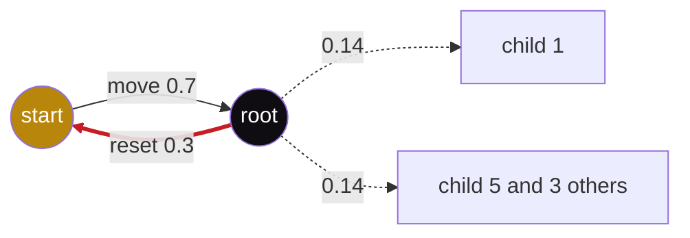

## 1. The question this page answers

Page 07 showed that a distilled student loops much more than its teacher. But the student trained on the teacher's own traces. How can it prefer a cyclic action that the teacher rarely prefers? Section 3 of the paper gives the first answer: risk aversion that comes from hardness of learning. This page proves Proposition 1 from zero, maps it to language models, and follows it into the star-graph task.

## 2. Mental model

> [!analogy] A clerk who cannot read the request type
> A clerk receives five types of request. For each type, the correct reply is a special form for that type 70% of the time, and "start again" 30% of the time. The clerk cannot see the type. So the best shared policy is "start again" 30% of the time and each special form 14% of the time. When the clerk must give the single most likely reply, the reply is always "start again".
>
> **Where it stops working:** in the paper, the learner is blind by assumption (Proposition 1) or because optimization fails (the star graph). A real model is rarely fully blind. On the easier graph G(5,3), the trained model puts more mass on the correct action than on the others.

## 3. Terms

| Term | Plain meaning |
|---|---|
| action | One step of a reasoning chain. In the star graph, the choice of the next node. In a language model, a short chunk of tokens. |
| progress-making action | An action that moves the chain closer to the goal, for example the next step of a proof. |
| cyclic action | An action that returns to something done before, for example a reset to the start or a restatement of a known fact. |
| hardness of learning | An action is hard when the learner cannot tell it apart from $n$ other actions. A larger $n$ means a harder action. |
| risk aversion | The habit of choosing the easy cyclic action instead of the progress-making action. |
| context | Everything before the next action. The learner predicts the action from the context. |
| average cross-entropy | The training loss: the average of $-\log q(\text{correct action})$ over the training data. Lower is better. |
| maximum likelihood | Training that makes the training data as probable as possible. It is the same as minimum average cross-entropy. |
| constraint | A rule that a solution must obey. Here: no probability is negative, and all probabilities add to 1. |
| Lagrange multiplier | A helper number $\mu$ for a minimization with an equality constraint. At the best point, each action has the same marginal value, and that value is $\mu$. |
| KKT conditions | The Karush-Kuhn-Tucker conditions: four tests that a best point of a constrained problem must pass. |
| convex function | A function whose graph is never above a straight chord between two of its points. Each local minimum is a global minimum. |
| Markovian student | A learner whose next-action probabilities depend only on the current node, not on the earlier walk. |
| reset action | The cyclic action of the star-graph task: a jump to the start node. |
| perfect learner | A learner that matches the training distribution exactly. |

All terms are also in the [Glossary](/notes/papers/glossary).

## 4. The mechanism in words

The paper uses distillation as its main case: a student trains on traces that a teacher wrote. Suppose that at one step the teacher's data has two actions: a progress-making action with high probability, and a cyclic action. The progress-making action is hard for the student. The cyclic action is easy. The paper names two components (§3):

1. A hard action occurs together with an easy action. This raises the relative probability of the easy action, so greedy decoding prefers it.
2. The easy action is cyclic. It returns the chain to an earlier state, where the same choice appears again. With its high relative probability, the model then selects it again and again.

## 5. Proposition 1

### 5.1 The statement

The paper defines hardness like this: "We say an action is hard if the model cannot distinguish it from n other actions." Proposition 1 (§3, proof in Appendix C) has these parts:

1. There are $n$ sets of contexts $C_1, \dots, C_n$. They are equally likely in the training data.
2. There are $n$ hard actions $a_1, \dots, a_n$ and one easy action $a_0$.
3. In every context of $C_i$, the training data takes $a_i$ with probability $1 - p$ and $a_0$ with probability $p$.
4. The learner cannot tell the contexts apart. It must give one distribution for all of them.
5. **Result:** the maximum-likelihood learner gives $p$ to $a_0$ and $(1 - p)/n$ to each $a_i$.

For $n = 5$ and $p = 0.3$, the training data looks like this:

| Context set | $a_0$ (easy) | $a_1$ | $a_2$ | $a_3$ | $a_4$ | $a_5$ |
|---|---|---|---|---|---|---|
| $C_1$ | 0.3 | 0.7 | 0 | 0 | 0 | 0 |
| $C_2$ | 0.3 | 0 | 0.7 | 0 | 0 | 0 |
| $C_3$ | 0.3 | 0 | 0 | 0.7 | 0 | 0 |
| $C_4$ | 0.3 | 0 | 0 | 0 | 0.7 | 0 |
| $C_5$ | 0.3 | 0 | 0 | 0 | 0 | 0.7 |
| Average of the 5 rows | 0.3 | 0.14 | 0.14 | 0.14 | 0.14 | 0.14 |

The last row is the answer of Proposition 1. The proof below shows why the learner must choose exactly this row.

### 5.2 The loss of a blind learner

Let $q_0$ be the learner's probability for $a_0$, and $q_1, \dots, q_n$ its probabilities for the hard actions. Here $\log$ is the natural logarithm, and the derivative of $\log q$ is $1/q$.

1. **One context set.** In $C_i$, the data shows $a_0$ a fraction $p$ of the time and $a_i$ a fraction $1-p$ of the time. The cross-entropy is the average of $-\log q$ over these outcomes: $\ell_i = -p \log q_0 - (1-p) \log q_i$.
2. **All context sets.** Each $C_i$ has weight $1/n$. The term $-p \log q_0$ is in every $\ell_i$, so its average is itself:

$$
\ell = \frac{1}{n}\sum_{i=1}^{n} \ell_i = -p \log q_0 - (1-p)\,\frac{1}{n}\sum_{i=1}^{n} \log q_i
$$

3. **The constraint.** $\sum_{j=0}^{n} q_j = 1$ and $q_j \ge 0$. Also $q_j > 0$, because $\log 0 = -\infty$ would make the loss infinite.

> [!example] Worked example: the loss at the claimed answer, n = 5, p = 0.3
> 1. $-0.3 \log 0.3 = 0.3 \times 1.20397 = 0.36119$.
> 2. $-0.7 \log 0.14 = 0.7 \times 1.96611 = 1.37628$.
> 3. $\ell_1 = 0.36119 + 1.37628 = 1.73747$. Each $\ell_i$ has the same value, so $\ell = 1.7375$.

### 5.3 Minimization with a constraint: the Lagrange multiplier

Without the constraint, there is no minimum. Each $-\log q_j$ falls when $q_j$ grows, so the loss falls forever. The constraint forces a trade: mass for one action is mass taken from another action.

**The exchange test.** Move a tiny amount $\varepsilon$ of probability from action $j$ to action $k$. The loss changes by about $\varepsilon \left(\frac{\partial \ell}{\partial q_k} - \frac{\partial \ell}{\partial q_j}\right)$. A partial derivative $\frac{\partial \ell}{\partial q_j}$ is the rate of change of the loss when only $q_j$ changes. If the two rates differ, one direction of the move lowers the loss. So at the best point, all the rates are equal. Call the common rate $-\mu$: the number $\mu$ is the Lagrange multiplier.

The Lagrangian packs this test into one function:

$$
L(q, \mu) = \ell(q) + \mu \left(\sum_{j=0}^{n} q_j - 1\right)
$$

Set $\partial L / \partial q_j = 0$ for every $j$. This gives $\partial \ell / \partial q_j = -\mu$, which is the exchange test. Set $\partial L / \partial \mu = 0$. This gives the constraint again.

**The picture.** With two actions, each point $(q_0, q_1)$ is a candidate. The constraint is the straight line $q_0 + q_1 = 1$. A level curve joins all points with the same loss. The lowest level curve that still touches the line touches it at the best point. There, the curve and the line have the same direction.

```plot
{
  "title": "Two actions: constraint line (ink), loss level 0.611 (purple) touches it at (0.3, 0.7), level 0.70 (red) crosses it twice, level 0.55 (gold) misses it",
  "xAxis": { "label": "q0", "domain": [0.05, 1.05] },
  "yAxis": { "label": "q1", "domain": [0, 1.2] },
  "disableZoom": true,
  "data": [
    { "fn": "1 - x", "color": "#100D12", "graphType": "polyline", "skipTip": true },
    { "fn": "0.41784 * x^(-0.428571)", "color": "#6A4C93", "graphType": "polyline", "skipTip": true },
    { "fn": "0.36788 * x^(-0.428571)", "color": "#C81D25", "graphType": "polyline", "skipTip": true },
    { "fn": "0.45579 * x^(-0.428571)", "color": "#B8860B", "graphType": "polyline", "skipTip": true },
    { "points": [[0.3, 0.7]], "fnType": "points", "graphType": "polyline", "color": "#6A4C93", "skipTip": true },
    { "points": [[0.3, 0.7]], "fnType": "points", "graphType": "scatter", "color": "#6A4C93", "skipTip": true }
  ]
}
```

> [!example] Worked example: two actions, p = 0.3
> Minimize $f = -0.3 \log q_0 - 0.7 \log q_1$ with $q_0 + q_1 = 1$.
> 1. Rates: $\partial f/\partial q_0 = -0.3/q_0$ and $\partial f/\partial q_1 = -0.7/q_1$.
> 2. Set each rate to $-\mu$: $q_0 = 0.3/\mu$ and $q_1 = 0.7/\mu$.
> 3. Constraint: $0.3/\mu + 0.7/\mu = 1/\mu = 1$, so $\mu = 1$.
> 4. Answer: $q_0 = 0.3$, $q_1 = 0.7$, with loss $0.6109$.
> 5. Check without $\mu$: put $q_1 = 1 - q_0$. The rate is $-0.3/q_0 + 0.7/(1 - q_0)$. At $q_0 = 0.3$ it is $-1 + 1 = 0$. The loss values $f(0.1) = 0.7645$, $f(0.2) = 0.6390$, $f(0.3) = 0.6109$, $f(0.4) = 0.6325$, $f(0.5) = 0.6931$ confirm the minimum.

### 5.4 The KKT conditions

The rule $q_j \ge 0$ is an inequality, not an equality. The KKT conditions extend the Lagrange method to inequalities. Each bound $q_j \ge 0$ gets its own multiplier $\lambda_j$. A best point must pass four tests:

1. **Stationarity:** $\frac{\partial \ell}{\partial q_j} + \mu - \lambda_j = 0$ for every $j$.
2. **Primal feasibility:** $\sum_j q_j = 1$ and $q_j \ge 0$.
3. **Dual feasibility:** $\lambda_j \ge 0$. A bound can only raise $q_j$, never lower it.
4. **Complementary slackness:** $\lambda_j q_j = 0$. A bound pushes only when it is active, at $q_j = 0$.

Here every $q_j > 0$. So test 4 gives $\lambda_j = 0$, and test 1 becomes the Lagrange condition $\partial \ell/\partial q_j = -\mu$.

**Why the tests find the one global minimum.** The second derivative of $-\log q$ is $1/q^2 > 0$, so $-\log q$ is convex. A sum of convex functions with positive weights is convex. A mix of two distributions is again a distribution, so the set of candidates is convex. For a convex problem with linear constraints, a point that passes the KKT tests is a global minimum. Every $q_j$ has a positive weight in $\ell$, so $\ell$ is strictly convex, and the minimum is unique. The paper says: "This is a convex minimization problem under linear constraints, so to find the minimizer it suffices to look at the points satisfying the KKT conditions."

### 5.5 The proof, step by step

1. **Rates.** $\dfrac{\partial \ell}{\partial q_0} = -\dfrac{p}{q_0}$ and $\dfrac{\partial \ell}{\partial q_i} = -\dfrac{1-p}{n\,q_i}$ for $i = 1, \dots, n$.
2. **Stationarity.** $\dfrac{p}{q_0} = \mu$ gives $q_0 = \dfrac{p}{\mu}$. $\dfrac{1-p}{n\,q_i} = \mu$ gives $q_i = \dfrac{1-p}{n\,\mu}$.
3. **Constraint.** $\dfrac{p}{\mu} + n \cdot \dfrac{1-p}{n\,\mu} = \dfrac{p + 1 - p}{\mu} = \dfrac{1}{\mu} = 1$, so $\mu = 1$.
4. **Result.** $q_0 = p$ and $q_i = (1-p)/n$ for every hard action.

The same steps work for any targets. A blind learner gives each action its average target probability over the contexts that it cannot tell apart. Page 03 shows this rule on a two-context example.

> [!key] Proposition 1 in one line
> The easy action keeps its probability $p$. The hard action gets $(1-p)/n$, because the learner divides it among $n$ look-alikes. Greedy decoding picks the easy action when $p > (1-p)/n$, that is, when $n > (1-p)/p$.

### 5.6 A numerical check

These notes checked the result for $n = 5$ and $p = 0.3$ in three ways.

1. **Gradient descent.** Six logits started at 0 and passed through a softmax. Learning rate 1.0, 2,000 steps. Final distribution: $q_0 = 0.300000$ and each $q_i = 0.140000$. Loss: 1.737471.
2. **Random search.** 200,000 random distributions over the six actions. The lowest loss was 1.739555, above 1.737471.
3. **Hand-picked alternatives:**

| Candidate | Average cross-entropy |
|---|---|
| $q_0 = 0.30$, each hard action 0.14 | 1.7375 (lowest) |
| $q_0 = 0.25$, each hard action 0.15 | 1.7439 |
| $q_0 = 0.35$, each hard action 0.13 | 1.7431 |
| all six actions $1/6$ | 1.7918 |
| $q_0 = 0.30$, then 0.18, 0.13, 0.13, 0.13, 0.13 | 1.7438 |
| $q_0 = 0.30$, then 0.66, 0.01, 0.01, 0.01, 0.01 | 2.9983 |

The last row is a confident guess on one hard action. In four of five context sets the guess is wrong, and $-\log 0.01 = 4.6$ punishes it hard. Maximum likelihood rewards hedging. The paper says so: training "encourages it to hedge by spreading probability mass across these candidates" (§3).

**The price of blindness.** A learner that can see the context gives 0.7 to the correct hard action. Its loss is $-0.3 \log 0.3 - 0.7 \log 0.7 = 0.6109$. The gap is $1.7375 - 0.6109 = 1.1266$, which equals $(1-p)\log n = 0.7 \times 1.6094$.

### 5.7 When does the easy action win?

The easy action wins under greedy decoding when $p > (1-p)/n$.

1. For $p = 0.3$: $(1-p)/p = 0.7/0.3 = 2.33$. So the easy action wins for every $n \ge 3$.
2. For $n = 5$: $p > (1-p)/5$ means $6p > 1$, so $p > 1/6 \approx 0.167$. A cyclic action with only 17% of the training mass already beats the hard action.

```plot
{
  "title": "Hard progress-making action 0.7/n (blue) against easy cyclic action 0.3 (red). They cross at n = 2.33",
  "xAxis": { "label": "n, number of look-alike actions", "domain": [1, 10] },
  "yAxis": { "label": "learned probability", "domain": [0, 0.8] },
  "disableZoom": true,
  "data": [
    { "fn": "0.7/x", "color": "#1E6091" },
    { "fn": "0.3", "color": "#C81D25", "skipTip": true }
  ]
}
```

```video
{
  "src": "/notes/media/papers/2025-why-reasoning-models-loop/manim/m03-hard-action-mass-diffuses.mp4",
  "caption": "How a blind learner divides the hard action's 0.7 among five look-alikes while the easy reset keeps 0.3, and how greedy decoding then loops between the start node and the root."
}
```

The proposition is an extreme case: the hard actions are fully indistinguishable. The paper says that the same behavior can appear "whenever the student's representation collapses many distinct contexts". Such a collapse can come from limited capacity or from optimization difficulties (§3).

## 6. Mapping to language models

In a language model, an action is a short chunk of tokens, for example one step of a proof. The chain rule (page 01) gives the probability of a chunk $x_{t:t+k-1}$ after the prefix $x_{<t}$:

$$
P_\theta(x_{t:t+k-1} \mid x_{<t}) = \prod_{i=t}^{t+k-1} P_\theta(x_i \mid x_{<i})
\qquad
\log P_\theta(x_{t:t+k-1} \mid x_{<t}) = \sum_{i=t}^{t+k-1} \log P_\theta(x_i \mid x_{<i})
$$

> [!example] Worked example: a chunk of three tokens
> The token probabilities are 0.9, 0.8 and 0.95.
> 1. Logs: $\log 0.9 = -0.10536$, $\log 0.8 = -0.22314$, $\log 0.95 = -0.05129$.
> 2. Sum: $-0.37980$.
> 3. Chunk probability: $e^{-0.37980} = 0.684$, the same as $0.9 \times 0.8 \times 0.95 = 0.684$.

The paper's argument has three steps (§3, "Mapping to language models"):

1. Next-token training maximizes the sum of token log-probabilities over the trace.
2. The log-probability of a chunk is part of that sum. So training also maximizes the log-probability of each chunk.
3. So Proposition 1 applies to chunks. Suppose a progress-making chunk is confusable with $n$ alternative chunks. In the paper's words: "reducing the learned probability on the intended chunk by a 1/n factor, while an easy cyclic span retains its mass."

Interpretation of these notes: this is an argument about the optimum of the training objective. A real model does not reach that optimum, and the paper does not measure chunk probabilities inside real reasoning models.

## 7. The star-graph demonstration

### 7.1 The task in short

In short (page 06 has the details), $G(5,5)$ has a root with 5 spokes. Each spoke is a path of $\ell - 1 = 4$ edges to a leaf. An extra start node $s$ has one edge to the root. These notes count $1 + 1 + 5 \times 4 = 22$ nodes. The training walk moves one step toward the goal with probability $1 - p = 0.7$ and resets to $s$ with probability $p = 0.3$. The reset applies at every node, including $s$ itself.

The paper defines the actions precisely (§3.1). A cyclic action takes the walk to an already visited node. A progress-making action moves the walk closer to the goal.

### 7.2 Why the root is hard and the reset is easy

At every node except the root, there is one outgoing edge. At the root, the learner must choose among $n$ edges, and only one reaches the goal. Bachmann and Nagarajan (2024) showed that Transformers learn the later edges early, and the first edge then becomes the bottleneck. The learned solution places roughly $1/n$ on each outgoing edge of the root.

Hu et al. (2025) formalized this hardness. Once the easy edges are learned, recovering the right solution is as hard as learning parity. Parity asks if a hidden subset of input bits holds an odd number of ones, and it is conjectured to be hard for gradient-based optimizers. The paper stresses that "the source of hardness is not model capacity" but "the inability of optimization." The reset, in contrast, is easy. It "only requires reading the start node from context and jumping to it" (§3.1).

### 7.3 The Markovian student

A Markovian student uses only the current node. Proposition 1 predicts these learned probabilities (§3.1):

| Node | Learned probabilities | Greedy choice |
|---|---|---|
| start $s$ | move to the root 0.7, reset to $s$ 0.3 | move to the root |
| root $r$ | reset 0.3, each of 5 children $0.7/5 = 0.14$ | reset |
| other non-leaf nodes | forward 0.7, reset 0.3 | forward |



Greedy decoding runs: start, root, start, root, and so on, because $0.3 > 0.14$ at the root. The walk never leaves this cycle. The paper notes that the start node does not loop on itself. At $s$, both "move to the root" and "reset" are easy. So the student learns close to 0.7 and 0.3, and greedy moves to the root. In the paper's words: "Loops arise precisely when a hard action at the root coexists with an easy cyclic action."

> [!example] Worked example: the Markovian student at a temperature T (computation of these notes, not in the paper)
> Temperature $T$ divides the logits by $T$ (page 02). This raises each probability to the power $1/T$, then normalizes. At the root the reset probability is $\dfrac{0.3^{1/T}}{0.3^{1/T} + 5 \times 0.14^{1/T}}$.
> 1. $T = 1$: reset 0.300, each child 0.140. Expected resets before a child is taken: $0.3/0.7 = 0.43$.
> 2. $T = 0.5$: reset 0.479, each child 0.104. Expected resets: 0.92.
> 3. $T = 0.2$: reset 0.900, each child 0.020. Expected resets: 9.04.
> 4. $T = 0.1$: reset 0.998, each child 0.0005. Expected resets: 408.
>
> Lower temperature makes the loop much longer. Higher temperature lets the walk leave the root. But the correct child still gets only 0.14 at $T = 1$, the same as each wrong child.

## 8. Results with Transformers (§3.2)

The paper trains a decoder-only Transformer from scratch: 12 layers, 8 heads, 768 dimensions, about 85M parameters (page 06 has the full setup). At test time it writes a walk for new random instances. A walk is accurate if it uses only valid edges, reaches the goal and stops.

> [!trap] Two different "looping counts"
> In §3 (this page) the looping count is the average number of root → start transitions per trace. In §4 (page 09) it is the visit count of the most visited root child, averaged over traces. Do not compare numbers across the two definitions.

The values below are read from the line plots of Figure 4, so they are approximate. The value 105.5 is exact, from the text.

| Setting and measure | T = 0 | 0.2 | 0.4 | 0.6 | 0.8 | 1.0 |
|---|---|---|---|---|---|---|
| G(5,5), accuracy | 0.17 | 0.20 | 0.20 | 0.20 | 0.19 | 0.17 |
| G(5,5), looping count | 32.7 | 14.8 | 4.6 | 4.7 | 5.3 | 6.1 |
| G(5,5), response length | 74.6 | 58.8 | 57.4 | 59.5 | 62.0 | 64.6 |
| G(5,5) with exploration, accuracy | 0.00 | 0.33 | 0.54 | 0.59 | 0.60 | 0.61 |
| G(5,5) with exploration, looping count | 64.0 | 37.1 | 15.6 | 11.8 | 10.0 | 9.1 |
| G(5,5) with exploration, response length | 130.0 | 114.5 | 106.1 | 105.4 | 105.0 | 105.5 |
| G(5,3), looping count | 4.6 | 3.5 | 3.2 | 3.3 | 3.2 | 3.3 |
| G(5,3) with exploration, looping count | 13.6 | 11.6 | 8.4 | 6.3 | 4.9 | 4.0 |

```plot
{
  "title": "Figure 4b, approximate: looping count against temperature for G(5,5) (red), G(5,5) with exploration (gold), G(5,3) (blue), G(5,3) with exploration (ink)",
  "xAxis": { "label": "temperature", "domain": [-0.05, 1.05] },
  "yAxis": { "label": "average root to start transitions", "domain": [0, 70] },
  "disableZoom": true,
  "data": [
    { "points": [[0,32.7],[0.2,14.8],[0.4,4.6],[0.6,4.7],[0.8,5.3],[1,6.1]], "fnType": "points", "graphType": "polyline", "color": "#C81D25", "skipTip": true },
    { "points": [[0,32.7],[0.2,14.8],[0.4,4.6],[0.6,4.7],[0.8,5.3],[1,6.1]], "fnType": "points", "graphType": "scatter", "color": "#C81D25", "skipTip": true },
    { "points": [[0,64.0],[0.2,37.1],[0.4,15.6],[0.6,11.8],[0.8,10.0],[1,9.1]], "fnType": "points", "graphType": "polyline", "color": "#B8860B", "skipTip": true },
    { "points": [[0,64.0],[0.2,37.1],[0.4,15.6],[0.6,11.8],[0.8,10.0],[1,9.1]], "fnType": "points", "graphType": "scatter", "color": "#B8860B", "skipTip": true },
    { "points": [[0,4.6],[0.2,3.5],[0.4,3.2],[0.6,3.3],[0.8,3.2],[1,3.3]], "fnType": "points", "graphType": "polyline", "color": "#1E6091", "skipTip": true },
    { "points": [[0,4.6],[0.2,3.5],[0.4,3.2],[0.6,3.3],[0.8,3.2],[1,3.3]], "fnType": "points", "graphType": "scatter", "color": "#1E6091", "skipTip": true },
    { "points": [[0,13.6],[0.2,11.6],[0.4,8.4],[0.6,6.3],[0.8,4.9],[1,4.0]], "fnType": "points", "graphType": "polyline", "color": "#100D12", "skipTip": true },
    { "points": [[0,13.6],[0.2,11.6],[0.4,8.4],[0.6,6.3],[0.8,4.9],[1,4.0]], "fnType": "points", "graphType": "scatter", "color": "#100D12", "skipTip": true }
  ]
}
```

What the paper observed:

1. **Low-temperature loops on G(5,5).** The looping count is high at $T = 0$ and falls with temperature. At $T = 0$, the paper says the looping count is "roughly half the response length", because traces alternate start → root → start → root. A perfect learner has looping count 0 under greedy decoding.
2. **Accuracy near chance at every temperature.** After bouncing for a while, "the non-Markovian nature of the Transformer kicks in". It commits to one root edge and walks to a leaf. But the choice is close to uniform, so accuracy stays near $1/5 = 0.2$. The training walk never explores wrong paths, so the model learns to take the same path again after each reset.
3. **The exploration variant.** At the root, the walk resets with 0.3 and takes the correct edge with 0.5. With 0.2 in total, it takes one of the other 4 paths ($0.2/4 = 0.05$ each). A non-goal leaf resets with probability 1. Accuracy now rises with temperature, but at $T = 0$ it is near 0. The model bounces between start and root and then stops (for example with an end-of-sequence token). The authors say looping and length are higher "likely because exploration yields longer training traces".
4. **The easier graph G(5,3).** The learned probabilities put more mass on the correct root edge. Accuracy is near perfect at all temperatures (0.97 to 1.00 in both variants, approximate), with only brief early looping. This mirrors §2: easier problems loop less.
5. **Overestimated reset.** On G(5,5) with exploration at $T = 0$, the authors examined 500 generated trajectories and every position at the root. At 94% of these positions the reset probability was above 0.3, with an average of about 0.35. The rest was spread roughly uniformly over the children. The authors hypothesize that the reset is overestimated because it is frequent and easy to learn.

> [!example] Worked example: the exploration root through Proposition 1 (computation of these notes)
> 1. Training mass on children: $0.5 + 0.2 = 0.7$. A blind learner divides it: $0.7/5 = 0.14$ per child, the same as without exploration.
> 2. With the observed reset of about 0.35, each child gets about $(1 - 0.35)/5 = 0.13$.
> 3. Ratio of reset to child: $0.35/0.13 = 2.7$, against $0.3/0.14 = 2.1$ in the ideal case. The overestimate makes the easy cyclic action even stronger.

## 9. Other implications (§3.3)

### 9.1 Sources of hardness, and instruct models

In the star graph, hardness comes from optimization. The paper names two more sources: limited model capacity and limited training compute (under-training). Hardness from capacity is "a plausible explanation" for why smaller models of one family, trained on the same data, loop more (page 07).

The mechanism needs two ingredients: hard actions, and easy cyclic actions in the training data. If cyclic actions are rare in the training traces, heavy looping is less likely. The paper calls this "a plausible explanation" for why many instruction-tuned models loop less than reasoning models. Reasoning traces contain more restatement and backtracking (page 04).

### 9.2 Temperature and the response-length diagnostic

Temperature reduces looping, but the model still gives too little probability to the progress-making action. The paper's diagnostic is the response length at $T = 1$. On G(5,5) with exploration, the learned model averages 105.5. A perfect learner averages 24.8. The ratio is $105.5 / 24.8 = 4.25$, so the perfect learner is "more than four times shorter". Page 11 compares this with the second mechanism.

> [!note] A check of the perfect-learner value 24.8 (computation of these notes)
> Assumptions: G(5,5) with 4 nodes on each spoke after the root, and the exploration walk as in §3.2. One unit of length is one node token, from the first start token to the goal token.
> 1. One attempt begins at $s$. On a spoke, the expected number of tokens is $1 + 0.7 + 0.49 + 0.343 = 2.533$.
> 2. Expected tokens per attempt: $1 + 0.7 \times (1 + 0.7 \times 2.533) = 2.941$.
> 3. Success per attempt: move to the root, take the correct edge, survive 3 forward steps: $0.7 \times 0.5 \times 0.343 = 0.12005$.
> 4. Expected length: $2.941 / 0.12005 = 24.50$. A simulation of 1,000,000 walks agrees (24.53).
>
> The mean of 500 walks has a standard error of about 0.9 tokens, so 24.8 is consistent with 24.5. The paper does not say how it computed 24.8 or which tokens it counts.

### 9.3 Reinforcement learning and distillation

The mechanism can also affect models trained with reinforcement learning. The paper views reinforcement learning, approximately, as sampling several trajectories and training on the correct ones. That is like training on a best-of-$k$ version of the model itself. So a gap between the data generator and the learner still exists. The paper's guiding principle: when the teacher and the student differ in capacity, hardness of learning for the student can amplify looping.

## 10. Common mistakes

1. **"The student learned the wrong data."** The student learned the best distribution that it can represent. The data is correct. The blindness causes the shift.
2. **"If the teacher gives 0.7 to the progress action, the student does too."** A blind student gives $0.7/n$ to each look-alike. Only the easy action keeps its 0.3.
3. **"The cyclic action wins because it is more frequent in training."** In training it has 0.3 against 0.7. It wins only against each divided share, $0.7/n$.
4. **"Proposition 1 is about Transformers."** It holds for any maximum-likelihood learner that cannot tell the hard actions apart.
5. **"Higher temperature repairs the student."** Temperature only samples differently. At $T = 1$ the response length is 105.5, against 24.8 for a perfect learner.

## 11. One-minute explanation

Suppose a teacher's data takes a progress-making action with probability 0.7 and an easy cyclic action with 0.3. If the student cannot tell the correct progress action from $n$ look-alikes, maximum likelihood gives each look-alike $0.7/n$ and keeps 0.3 for the easy action. The proof minimizes average cross-entropy under the rule that probabilities add to 1. A Lagrange multiplier makes every action's marginal value equal, and the constraint then forces $\mu = 1$. For $n = 5$, each candidate gets 0.14, so greedy decoding prefers the cyclic action. On the star graph the cyclic action is the reset, so greedy decoding loops between the start node and the root. A trained Transformer shows this loop at low temperature, and it even overestimates the reset at about 0.35. Higher temperature breaks the loop but does not repair the probabilities. So walks at $T = 1$ stay about four times longer than a perfect learner's.

## 12. Check questions

```check
{
  "question": "A blind learner sees n = 5 context sets with p = 0.1. What does it learn, and does greedy decoding pick the easy action?",
  "hint": "Use $q_0 = p$ and $q_i = (1-p)/n$.",
  "answer": "$q_0 = 0.1$ and each $q_i = 0.9/5 = 0.18$. Since $0.18 > 0.1$, greedy decoding picks a hard action, so this case does not loop. The easy action wins for n = 5 only when p is above 1/6, about 0.167."
}
```

```check
{
  "question": "In the proof, why must the Lagrange multiplier be exactly 1?",
  "answer": "Stationarity gives $q_0 = p/\\mu$ and $q_i = (1-p)/(n\\mu)$. Adding all of them gives $(p + 1 - p)/\\mu = 1/\\mu$. The constraint says the sum is 1, so $\\mu = 1$."
}
```

```check
{
  "question": "Why does the Markovian student loop between the start node and the root, but not loop on the start node itself?",
  "answer": "At the root, the progress action is hard: its 0.7 is divided over 5 children (0.14 each), and the reset keeps 0.3, so greedy resets. At the start node, both actions are easy, so the student learns about 0.7 for moving to the root and 0.3 for the reset, and greedy moves to the root."
}
```

## 13. Links

- Previous: [07 Results: looping in open models](/notes/papers/reasoning-models/2025-why-reasoning-models-loop/07-results-looping-in-open-models)
- Next: [09 Why 2: temporally correlated errors](/notes/papers/reasoning-models/2025-why-reasoning-models-loop/09-why-2-temporally-correlated-errors)
- The paper card: [Why do reasoning models loop?](/notes/papers/reasoning-models/2025-why-reasoning-models-loop)
- Cross-entropy and the averaging rule: [03 Background: training, cross-entropy and distillation](/notes/papers/reasoning-models/2025-why-reasoning-models-loop/03-background-training-cross-entropy-and-distillation)
- Temperature: [02 Background: decoding, greedy, temperature and sampling](/notes/papers/reasoning-models/2025-why-reasoning-models-loop/02-background-decoding-greedy-temperature-sampling)
- The star-graph task: [06 Experiment design](/notes/papers/reasoning-models/2025-why-reasoning-models-loop/06-experiment-design)
- Temperature as a stopgap: [11 Temperature: a stopgap, not a cure](/notes/papers/reasoning-models/2025-why-reasoning-models-loop/11-temperature-stopgap-or-cure)
- [Glossary](/notes/papers/glossary)
