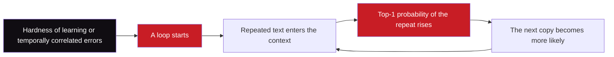

## 1. The question this page answers

Pages 08 and 09 explain how a loop can start: risk aversion from hardness of learning, and temporally correlated errors. This page asks a different question. After a loop starts, why does it become harder to leave? The authors describe a third force, which they call a "catalyst" (§4.1, Appendix E). This page separates three things: what the paper measured, what it showed in a controlled test, and what it only hypothesizes.

## 2. Mental model

> [!analogy] A rut in a dirt road
> The first car on a wet dirt road leaves a shallow track. The next car follows the track and makes it deeper. After many cars, the rut is so deep that a driver cannot leave it. The rut did not choose the route. The first driver chose it. The rut only makes the same route stronger with each car.
>
> **Where it stops working:** a rut is a physical change to the road. The weights of a model do not change during generation. Here the "rut" is the repeated text in the context. Each new copy of the text is new input, and it makes the next copy more probable.

## 3. Terms

| Term | Plain meaning |
|---|---|
| catalyst | The paper's word for a force that does not start a loop, but makes a loop stronger and harder to leave. |
| next-token distribution | The probabilities that the model gives to every token of the vocabulary for the next position. They add to 1. |
| top-1 probability | The largest probability in the next-token distribution. Greedy decoding always takes this token. |
| confidence | On this page: the top-1 probability. A confidence near 1 means that almost all probability is on one token. |
| confidence buildup | The rise of the top-1 probability toward 1 while the model repeats the same text (the title of Figure 15). |
| decoding step | One generated token. The plots of the paper call it a "time step". |
| running average | The average of the most recent values. Figure 15 uses a window of 200 decoding steps. |
| looping bias | A tiny fraction (0.001) of training examples that loop on purpose. The paper adds it in Appendix E.1. |
| trace type | On this page: the kind of training trace that produced a text, "normal trace" or "loop trace". |
| prior | The probability of a trace type before we read the text. |
| posterior | The probability of a trace type after we read the text. |
| error accumulation | Errors made during generation compound over time (§5). |
| exposure bias | A model trains only on correct prefixes, but it generates from its own prefixes, which can contain its own errors. |
| neural text degeneration | The name that Holtzman et al. (2020) use for generic and repetitive text from language models. |

All terms are also in the [Glossary](/notes/papers/glossary).

## 4. What the paper measured in real traces

### 4.1 The setup (Appendix E, Figure 15)

The authors take two looping traces of OpenThinker3-1.5B, made with greedy decoding. Both traces answer AIME 2025 problems. At each decoding step, they record the top-1 probability. The plot shows one dot per step and a running average with a window of 200 steps. A vertical dashed line marks the step where "the final infinite loop begins" (Figure 15 caption).

| Panel | Problem | Trace | What the final loop repeats |
|---|---|---|---|
| (a) | AIME 2025 I-7: six pairs of letters, probability that the last word contains G | Example 1, see page 07 | The statement that a two-letter word is the pair in sorted order |
| (b) | AIME 2025 I-5: eight-digit integers divisible by 22 | Example 2 (Appendix B), see page 09 | The line "Wait, 7 + 6 + 4 = 17, 7 + 5 + 5 = no." |

### 4.2 A running average, step by step

> [!example] Worked example: a running average with a window of 4
> Six top-1 probabilities, one per step: 0.5, 0.9, 0.7, 0.9, 1.0, 1.0.
>
> 1. At step 4, the window holds steps 1 to 4: (0.5 + 0.9 + 0.7 + 0.9) / 4 = 3.0 / 4 = 0.75.
> 2. At step 5, the window holds steps 2 to 5: (0.9 + 0.7 + 0.9 + 1.0) / 4 = 3.5 / 4 = 0.875.
> 3. At step 6, the window holds steps 3 to 6: (0.7 + 0.9 + 1.0 + 1.0) / 4 = 3.6 / 4 = 0.9.
>
> The single values jump. The average moves smoothly and shows the trend. Figure 15 does the same with 200 values per window. The paper does not say if its window holds the last 200 steps or 200 steps centered on each point.

### 4.3 What the plots show

```plot
{
  "title": "Approximate. Running average of the top-1 probability: Problem I-7 (red, loop starts near step 1,800) and Problem I-5 (gold, loop starts near step 11,000)",
  "xAxis": { "label": "decoding step", "domain": [0, 30500] },
  "yAxis": { "label": "running average of top-1 probability", "domain": [0.5, 1.02] },
  "disableZoom": true,
  "data": [
    { "points": [[0, 0.9], [500, 0.8], [1000, 0.68], [1500, 0.66], [1800, 0.7], [2100, 0.61], [2500, 0.73], [3000, 0.84], [4000, 0.94], [5000, 0.97], [7000, 0.99], [10000, 1.0], [20000, 1.0], [30000, 1.0]], "fnType": "points", "graphType": "polyline", "color": "#C81D25", "skipTip": true },
    { "points": [[0, 0.9], [500, 0.8], [1000, 0.68], [1500, 0.66], [1800, 0.7], [2100, 0.61], [2500, 0.73], [3000, 0.84], [4000, 0.94], [5000, 0.97], [7000, 0.99], [10000, 1.0], [20000, 1.0], [30000, 1.0]], "fnType": "points", "graphType": "scatter", "color": "#C81D25", "skipTip": true },
    { "points": [[0, 0.93], [1000, 0.85], [2000, 0.81], [3000, 0.86], [4000, 0.8], [5000, 0.86], [7000, 0.83], [9000, 0.87], [10500, 0.82], [11000, 0.85], [11500, 0.92], [12000, 0.95], [13000, 0.96], [14000, 0.97], [16000, 0.99], [20000, 0.99], [30000, 1.0]], "fnType": "points", "graphType": "polyline", "color": "#B8860B", "skipTip": true },
    { "points": [[0, 0.93], [1000, 0.85], [2000, 0.81], [3000, 0.86], [4000, 0.8], [5000, 0.86], [7000, 0.83], [9000, 0.87], [10500, 0.82], [11000, 0.85], [11500, 0.92], [12000, 0.95], [13000, 0.96], [14000, 0.97], [16000, 0.99], [20000, 0.99], [30000, 1.0]], "fnType": "points", "graphType": "scatter", "color": "#B8860B", "skipTip": true }
  ]
}
```

All values in this plot are read by eye from Figure 15. They are approximate.

| Reading (approximate) | (a) Problem I-7 | (b) Problem I-5 |
|---|---|---|
| Final loop begins | Near step 1,800 | Near step 11,000 |
| Running average before the final loop | Mostly between 0.6 and 0.9 | Mostly between 0.75 and 0.95 |
| Running average 3,000 steps after the loop starts | About 0.97 | About 0.97 |
| Running average at the end | About 1.0 | About 1.0 |
| Last decoding step | About 30,000 | About 30,000 |

Three points, from the paper:

1. **Before the loop, the distribution looks normal.** The paper says that at the start of a loop, the distribution "looks relatively normal" (§4.1).
2. **Inside the loop, confidence grows.** "In both cases, once the loop starts, the top-1 probability rises toward 1" (Figure 15 caption).
3. **Both traces reach the budget.** Both plots continue to about step 30,000. The paper ran all reasoning models with a 30K token budget (Appendix A).

Interpretation of these notes: panel (b) has one line of dots that starts near 0.35 just after the loop begins. It climbs slowly to about 0.9 near step 20,000 (approximate). This line probably belongs to one position inside the repeated text. That position was uncertain at first, and became sure only after thousands of repeats.

> [!key] The measured fact
> In both traces, the top-1 probability rises toward 1 after the final loop begins. The longer the loop runs, the more sure the model is that the loop continues.

> [!trap] Confident does not mean correct
> A top-1 probability near 1 says that the model is sure of its next token. It says nothing about the quality of the reasoning. Here the model is sure of text that makes no progress.

### 4.4 Why a confident loop is hard to leave

This section is a toy calculation of these notes. The paper does not compute escape probabilities.

> [!example] Worked example: the chance to leave a loop within 200 tokens
> Assumptions: at every step, the top-1 token continues the loop with probability $p$. One other token holds the rest, $1 - p$, and that token ends the loop.
>
> 1. Greedy decoding always takes the top-1 token. If $p > 0.5$, the chance to leave is 0.
> 2. Sampling at $T = 1$ with $p = 0.99$: the chance to stay for 200 steps is $0.99^{200} \approx 0.134$. The chance to leave is about $1 - 0.134 = 0.866$.
> 3. Sampling at $T = 1$ with $p = 0.999$: $0.999^{200} \approx 0.819$. The chance to leave falls to about 0.18.
> 4. Sampling at $T = 0.6$ with $p = 0.99$. Temperature raises each probability to the power $1/T$, then normalizes (page 11, section 4 shows why). $0.99^{1/0.6} \approx 0.98339$ and $0.01^{1/0.6} \approx 0.000464$.
> 5. The new top-1 probability is $0.98339 / (0.98339 + 0.000464) \approx 0.99953$. The chance to stay for 200 steps is $0.99953^{200} \approx 0.91$.
>
> So a loop with a top-1 probability near 1 is hard to leave, even with sampling. A temperature below 1 makes it harder.



The diagram shows the role of the catalyst. The two mechanisms of pages 08 and 09 start the loop. The catalyst is the cycle C to E, which uses its own output as its next input.

## 5. The authors' hypothesis: repeated text in pretraining data

The paper does not know the source of the confidence buildup in real models. It offers one possible explanation, and it labels this explanation as a possibility.

1. "One possible explanation for this bias is that pretraining data may contain some repeated sequences" (§4.1).
2. "So once the model has repeated something several times, the most likely continuation conditioned on this history is to repeat further" (§4.1).
3. The authors "leave a thorough analysis of how this bias arises to future work" (Appendix E.1).

"Conditioned on this history" is a conditional probability (page 01). The model computes $P(\text{next chunk} \mid \text{context})$. If the context already holds five copies of a sentence, the training data may contain more examples of "five copies, then a sixth" than of "five copies, then something new".

> [!trap] A hypothesis is not a measurement
> The paper does not examine the pretraining data of any real model. It does not measure how often repeated text appears there. The hypothesis stays untested in real models.

Interpretation of these notes: an earlier finding fits this hypothesis. The paper cites Li et al. (2023) for the insight that "model repetitions were correlated with repetitions in the training corpus" (§1.1). That is a correlation in older models. It is not a test of the catalyst hypothesis.

## 6. A controlled test: add a tiny looping bias (Appendix E.1)

### 6.1 The change to the training data

The authors cannot change the pretraining data of a real model. So they test the idea in the graph task of pages 06, 08 and 09. They add a small amount of looping traces to the training data, and they train the Transformer again.

| Setting | The added looping traces (probability 0.001 per training example) | All other examples |
|---|---|---|
| Risk aversion (§3) | A trace that "deterministically loops between the start and root" | Sampled as before |
| Temporally correlated errors (§4) | A trace that fixes one random non-goal child, then repeats: root, that child, its leaf, start, root, the same child again | Sampled as before |

The paper explains the effect in words. The bias is so small that "it does not noticeably change the learned distribution early in a generation". But after a long loop, "conditioning on this history makes the looping trace much more likely" (Appendix E.1).

### 6.2 Why 0.001 can matter: a calculation with two trace types

This calculation belongs to these notes. It shows the logic of the paper's sentence with numbers. The paper does not make this calculation.

Imagine an ideal learner of the biased data, in the risk-aversion setting. The walk is at the root for the $v$-th time. Before this visit, it went start, root, start, root, and so on. The learner asks: "Which trace type is this?" Then it predicts the next action from the answer.

> [!example] Worked example: the reset probability at root visit 6
> 1. **Priors.** A normal trace has prior 0.999. A loop trace has prior 0.001.
> 2. **Probability of the history under a normal trace.** At the start, the move to the root has probability 0.7. At the root, the reset has probability 0.3. Six moves to the root and five resets give $0.7^6 \times 0.3^5 = 0.117649 \times 0.00243 \approx 0.000286$.
> 3. **Probability of the history under a loop trace.** The loop trace always does exactly this, so the probability is 1.
> 4. **Weights.** Normal: $0.999 \times 0.000286 \approx 0.000286$. Loop: $0.001 \times 1 = 0.001$.
> 5. **Posterior of the loop trace.** $0.001 / (0.001 + 0.000286) \approx 0.778$.
> 6. **Reset probability.** A loop trace resets with probability 1. A normal trace resets with probability 0.3. So $0.778 \times 1 + 0.222 \times 0.3 \approx 0.778 + 0.067 = 0.845$.
>
> At visit 1, the same steps give 0.301. That is almost the 0.3 of the normal traces. By visit 6, the rare trace type explains the history better than the common one.

The key is step 2. Each extra round trip multiplies the probability under a normal trace by $0.7 \times 0.3 = 0.21$. The loop trace keeps probability 1. So the evidence for the loop trace grows by a factor of about $1/0.21 \approx 4.8$ per round trip.

```plot
{
  "title": "Computed by these notes, not paper data. Reset probability at the root for an ideal learner of the biased data (purple) and of the normal data (ink)",
  "xAxis": { "label": "root visit index", "domain": [0, 11] },
  "yAxis": { "label": "probability of the reset", "domain": [0, 1.05] },
  "disableZoom": true,
  "data": [
    { "points": [[1, 0.301], [2, 0.305], [3, 0.322], [4, 0.394], [5, 0.597], [6, 0.844], [7, 0.96], [8, 0.991], [9, 0.998], [10, 1.0]], "fnType": "points", "graphType": "polyline", "color": "#6A4C93", "skipTip": true },
    { "points": [[1, 0.301], [2, 0.305], [3, 0.322], [4, 0.394], [5, 0.597], [6, 0.844], [7, 0.96], [8, 0.991], [9, 0.998], [10, 1.0]], "fnType": "points", "graphType": "scatter", "color": "#6A4C93", "skipTip": true },
    { "points": [[1, 0.3], [10, 0.3]], "fnType": "points", "graphType": "polyline", "color": "#100D12", "skipTip": true },
    { "points": [[1, 0.3], [10, 0.3]], "fnType": "points", "graphType": "scatter", "color": "#100D12", "skipTip": true }
  ]
}
```

### 6.3 Risk-aversion setting: what the paper measured (Figures 16 and 17)

For 500 greedy traces on $G(5,5)$, the authors record the probability of the reset at every visit to the root. The plots call it "source prob".

1. **Without the bias**, the reset probability "stays around its learned value near the teacher's 0.3" (Appendix E.1). In the exploration variant, it stays between about 0.32 and 0.36 (approximate). In the variant without exploration, it decreases slowly, from about 0.36 to about 0.25 near visit 30 (approximate).
2. **With the bias**, the reset probability "quickly climbs toward 1 over successive visits". It reaches about 1.0 near root visit 6 to 8 (approximate).

The toy calculation in section 6.2 reaches 0.84 at visit 6 and 0.96 at visit 7. So the trained Transformer becomes certain after about as many visits as the ideal learner. This comparison is an interpretation of these notes.

The next table gives values read from Figure 17. All values are approximate.

| Model on $G(5,5)$ | Accuracy at $T = 0$ | Accuracy at $T = 0.4$ | Accuracy at $T = 1$ | Looping count at $T = 0$ | Looping count at $T = 0.4$ |
|---|---|---|---|---|---|
| Without exploration | 0.17 | 0.20 | 0.17 | 33 | 5 |
| Without exploration, with bias | 0.00 | 0.07 | 0.18 | 64 | 37 |
| With exploration | 0.00 | 0.54 | 0.61 | 64 | 16 |
| With exploration, with bias | 0.00 | 0.18 | 0.43 | 64 | 42 |

The paper describes the most important change in words. Without the bias, the model without exploration "loops between the start and root for a while and then escapes to some root child". Its greedy accuracy is close to chance, which is $1/5 = 0.2$. With the bias, "the reinforced reset probability keeps it trapped between the start and the root, and greedy-decoding accuracy drops close to zero" (Appendix E.1).

> [!note] Why several models show the same value at $T = 0$ (an interpretation of these notes)
> Three models show a looping count of about 64 and a response length of about 130 at $T = 0$. A walk that only alternates start and root makes one root-to-start transition per two nodes, and $130 / 2 = 65$. The equal values suggest a maximum generation length near 130 nodes. The paper does not state this limit.

### 6.4 Correlated-errors setting: what the paper measured (Figures 18 and 19)

Here the authors take the most visited child at the root for each greedy trace. At every root visit, they record the probability of that child. The plots call it "most visited child prob".

1. **Margin 0, with the bias:** the probability "steadily increases and moves close to 1". It is about 0.2 at visit 1 and about 1.0 by visit 7 (approximate). Without the bias, it stays near 0.21 to 0.26 (approximate).
2. **Margin 0.1, with the bias:** "some trajectories leave the loop early", but for traces that keep looping, the probability "rises toward 1" (Appendix E.1). The average reaches about 0.8 near visit 8 and about 1.0 near visit 15 (approximate).

The next table gives values read from Figure 19. All values are approximate, except 44.7, which is in the text of §4.1.

| Model on $G(5,5)$ | Accuracy at $T = 0$ | Accuracy at $T = 0.2$ | Looping count at $T = 0$ | Response length at $T = 0$ | Response length at $T = 1$ |
|---|---|---|---|---|---|
| Margin 0 | 0.21 | 0.71 | 17 | 106 | 44.7 (exact) |
| Margin 0, with bias | 0.20 | 0.46 | 18 | 107 | 45 |
| Margin 0.1 | 1.00 | 0.99 | 4 | 37 | 27.5 |
| Margin 0.1, with bias | 0.48 | 0.86 | 12.5 | 79 | 27.5 |

The paper says the bias "increases low-temperature looping counts and response lengths, and decreases low temperature accuracy", and that the effect "is especially significant for margin 0.1 setting" (Figure 19 caption). Before, margin 0.1 had only mild looping. With the bias, greedy accuracy falls from about 1.00 to about 0.48 (approximate).

```video
{
  "src": "/notes/media/papers/2025-why-reasoning-models-loop/manim/m05-confidence-buildup.mp4",
  "caption": "Inside a loop, the top-1 probability climbs toward 1, and a tiny looping bias in the training data makes the reset at the root almost certain after a few visits."
}
```

> [!key] What the controlled test shows
> A change to only 0.001 of the training data makes the model almost certain to continue a loop after a few repeats. This bias amplifies both mechanisms. It shows that such a bias is enough to produce confidence buildup in a small Transformer. It does not show where the buildup in real reasoning models comes from.

## 7. Another force: error accumulation (§5, Appendix B)

**Error accumulation** means that "errors made during generation compound over time" (§5). One bad step makes the context worse. A worse context makes the next step worse.

The paper makes three statements about it:

1. The two mechanisms of pages 08 and 09 "show that looping can arise even without such accumulation" (§5).
2. "But in practice error accumulation may act as a catalyst" (§5). The confidence buildup of section 4 is one instance: "the repetition reinforces itself and becomes harder to escape".
3. Past work noted "that looping sequences are often preceded by less natural text", which "is consistent with error accumulation playing a role" (Chiang and Chen, 2021, as cited in §5).

Appendix B gives a second example (details on page 09). The authors restart the teacher, QwQ-32B, from two points of a looping student trace. From the earlier looping point, the teacher repaired the mistake in all 5 greedy continuations. From the later point, after several semantic loops of the student, all 5 greedy teacher continuations become trapped in the same loop as the student. The authors suggest that "in-context learning from a 'confused' history could cause the teacher itself to behave in a more confused, looping way". This is a suggestion, not a tested mechanism.

**Exposure bias** gives background for this idea. It is in the title of the cited paper by Chiang and Chen. With teacher forcing (page 03), a model trains only on correct prefixes. At generation time it reads its own text, with its own errors. So the model can meet contexts that it never saw in training. This background comes from these notes, not from the paper.

The paper calls a precise understanding of error accumulation "a worthwhile direction for future work", for example "using controlled setups similar to ours" (§5).

## 8. Earlier work, as this paper describes it

The confidence buildup is not new. The paper says that "this behavior has also been observed in prior work for earlier generation of language models" (§4.1). The table gives only what this paper says about each work.

| Work | What this paper says about it | Source |
|---|---|---|
| Holtzman et al. (2020), "The curious case of neural text degeneration" | Brought attention to "neural text degeneration": low-temperature sampling or beam search can give "generic and repetitive text" (§1.1). Cited for the buildup (§4.1). | [OpenReview](https://openreview.net/forum?id=rygGQyrFvH) |
| Chiang and Chen (2021), "Relating neural text degeneration to exposure bias" | Cited for the buildup (§4.1), and for less natural text before loops (§5). | [arXiv 2109.08705](https://arxiv.org/abs/2109.08705) |
| Xu et al. (2022), "Learning to break the loop" | Cited for the buildup (§4.1). | [arXiv 2206.02369](https://arxiv.org/abs/2206.02369) |
| Li et al. (2023), "Repetition in repetition out" | Model repetitions correlate with repetitions in the training corpus (§1.1). | [OpenReview](https://openreview.net/forum?id=WjgCRrOgip) |

The arXiv number of Xu et al. is not in the paper's reference list. These notes confirmed it on arXiv on 2026-10-14.

## 9. Measured, shown in a toy task, or hypothesized

| Statement | Kind |
|---|---|
| In two greedy traces of OpenThinker3-1.5B, the top-1 probability rises toward 1 after the final loop begins. | Measured in real traces (Figure 15) |
| A 0.001 looping bias drives the reset probability, or the most-visited-child probability, toward 1. | Measured in the synthetic task (Figures 16 and 18) |
| The bias increases looping and lowers low-temperature accuracy in both settings. | Measured in the synthetic task (Figures 17 and 19) |
| Repeated text in pretraining data causes the buildup in real models. | Hypothesis of the authors (§4.1, Appendix E.1) |
| Error accumulation acts as a catalyst in practice. | Hypothesis of the authors (§5) |
| An ideal learner of the biased data reaches a reset probability of 0.84 at visit 6. | Calculation of these notes |

## 10. Common mistakes

1. **"The model becomes confident because it learns during generation."** The weights do not change during generation. The context changes. Each repeat adds evidence in the context that a loop continues.
2. **"A bias of 0.001 is too small to matter."** At the first visit it changes the reset probability only from 0.3 to about 0.301. By root visit 6, the history favors the loop trace, and the reset probability passes 0.8 (section 6.2).
3. **"The catalyst is a third cause that starts loops."** In the paper's account, hardness of learning and temporally correlated errors start loops. The catalyst makes any loop stronger once it runs.
4. **"The paper proves that pretraining data causes the buildup."** It offers this as "one possible explanation". The controlled test shows only that such a bias is enough in a toy task.
5. **"Sampling always escapes a loop."** When the top-1 probability is near 1, sampling almost always takes the same token. A temperature below 1 makes escape even less likely.

## 11. One-minute explanation

Once a reasoning model starts to loop, it becomes more and more sure of the loop. In two greedy traces of OpenThinker3-1.5B on AIME 2025 problems, the top-1 probability rises toward 1 after the final loop begins. Both traces run to the 30K token budget. The authors call this force a catalyst: it does not start a loop, but it makes a loop harder to leave. They hypothesize that pretraining data contains some repeated text, so a long repeat makes a further repeat the most likely continuation. They do not test this in real models. Instead, they add looping traces to 0.001 of the training data of the graph task. This tiny bias makes the model almost certain to continue a loop after a few repeats, and it amplifies both looping mechanisms. A simple calculation shows why: each round trip multiplies the evidence for the rare loop trace by about 4.8. The paper also names error accumulation as another force for future work.

## 12. Check questions

```check
{
  "question": "In the risk-aversion setting, 0.001 of the training traces loop between the start and the root. Why does this barely change the reset probability at root visit 1, but make it close to 1 after about six round trips?",
  "hint": "Compare the probability of the observed history under a normal trace and under a loop trace.",
  "answer": "At visit 1, the history has probability 0.7 under a normal trace and 1 under a loop trace. This small difference cannot overcome the prior of 0.001, so the reset probability stays about 0.3. Each round trip multiplies the probability of the history under a normal trace by 0.7 × 0.3 = 0.21. The loop trace keeps probability 1. After six visits the loop trace has a posterior of about 0.78, and the reset probability is about 0.78 + 0.22 × 0.3 ≈ 0.84. The paper measured the trained model's reset probability near 1 by about visit 6 to 8 (approximate)."
}
```

```check
{
  "question": "Figure 15 plots the top-1 probability. What is it, and why does a value near 1 make the loop hard to leave even with sampling?",
  "answer": "The top-1 probability is the largest probability in the next-token distribution, the probability of the token that greedy decoding takes. If it is near 1, a sampler almost always draws the same token. For example, with 0.999 per step, the chance to stay in the loop for 200 steps is 0.999^200 ≈ 0.82. A temperature below 1 sharpens the distribution and makes escape even less likely."
}
```

```check
{
  "question": "Sort three statements into measured fact, toy-task result, or hypothesis. (1) Confidence rises toward 1 in two OpenThinker3-1.5B traces. (2) A 0.001 looping bias drives greedy accuracy on G(5,5) without exploration close to zero. (3) Repeated text in pretraining data causes the buildup in real models.",
  "answer": "(1) is a measurement in real traces (Figure 15). (2) is a measurement in the synthetic task (Figure 17, Appendix E.1). (3) is a hypothesis of the authors. The paper does not test it in real models."
}
```

```check
{
  "question": "With the bias, why does greedy accuracy on G(5,5) without exploration drop from close to chance to close to zero?",
  "answer": "Without the bias, the model bounces between the start and the root for a while. Then it commits to an arbitrary root child, so it reaches the goal about 1 time in 5. With the bias, each bounce raises the reset probability, so the reset stays the top choice at the root. The model stays trapped between the start and the root and never commits to a child."
}
```

## 13. Links

- Previous: [09 Why 2: temporally correlated errors](/notes/papers/reasoning-models/2025-why-reasoning-models-loop/09-why-2-temporally-correlated-errors)
- Next: [11 Temperature: a stopgap, not a cure](/notes/papers/reasoning-models/2025-why-reasoning-models-loop/11-temperature-stopgap-or-cure)
- The paper card: [Wait, Wait, Wait... Why Do Reasoning Models Loop?](/notes/papers/reasoning-models/2025-why-reasoning-models-loop)
- Conditional probability: [01 Background: probability and next-token prediction](/notes/papers/reasoning-models/2025-why-reasoning-models-loop/01-background-probability-and-next-token-prediction)
- Temperature and greedy decoding: [02 Background: decoding, greedy, temperature and sampling](/notes/papers/reasoning-models/2025-why-reasoning-models-loop/02-background-decoding-greedy-temperature-sampling)
- Teacher forcing: [03 Background: training, cross-entropy and distillation](/notes/papers/reasoning-models/2025-why-reasoning-models-loop/03-background-training-cross-entropy-and-distillation)
- The trace of Example 1: [07 Results: looping in open models](/notes/papers/reasoning-models/2025-why-reasoning-models-loop/07-results-looping-in-open-models)
- The reset at the root: [08 Why 1: risk aversion from hardness of learning](/notes/papers/reasoning-models/2025-why-reasoning-models-loop/08-why-1-risk-aversion)
- The context as the only memory during generation: [What a model does with context](/notes/ai/context-engineering/01-foundations/l1-what-a-model-does-with-context)
