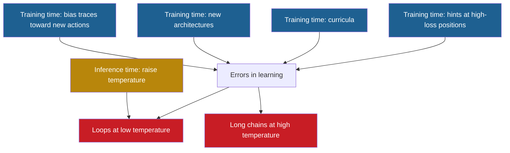

## 1. The question this page answers

The paper asks two questions (§1, page 05). The first is why reasoning models loop. Pages 08 to 10 answer it. The second is whether temperature fixes the cause: "does temperature address the root cause or mostly act as a stopgap?" (§1). This page collects the answer from §3.3, §4.1 and §5. It also lists the training-time fixes that the authors suggest, and it marks which of them the paper tested.

The answer of the paper in one sentence: temperature "is a reasonable fix when the errors are small (as in the temporally correlated errors mechanism), but is more of a stopgap when they are large (as in the hardness-based mechanism)" (§5).

## 2. Mental model

> [!analogy] A walk with a wrong map
> You walk through a city with a map. At one junction, the map shows five streets as equally good, and it marks "return to the hotel" as the best choice. If you always follow the best choice of the map, you walk hotel, junction, hotel, junction, forever. If you throw a die at the junction, you leave this cycle and try streets. After some wrong streets, you reach the goal. The die ends the cycle. It does not repair the map, so you still walk much farther than a person with a correct map.
>
> **Where it stops working:** the die also acts at easy junctions, where the map is correct. There it sometimes sends you back to the hotel for no reason. Also, a person remembers which streets failed. A Transformer has the whole context, but its errors at the junction can repeat (page 09).

## 3. Terms

| Term | Plain meaning |
|---|---|
| stopgap | A fix that removes a symptom for now, but leaves the cause. |
| holistic fix | The paper's term for a fix of the cause itself: here, of the errors in learning. |
| temperature | $T$, the number that divides the logits before the softmax (page 02). A low $T$ sharpens the distribution. A high $T$ flattens it. |
| exploration | Taking actions other than the most probable one, so that the walk tries new paths. |
| errors in learning | Mismatches between the training distribution and the learned model (§1). |
| perfect learner | A model that learns the training distribution exactly. |
| response length | The number of steps in a generated answer: nodes in the graph task, tokens in real models. |
| blowup | On this page: the response length of the learned model divided by the response length of the perfect learner. |
| Markovian student | A student whose next action depends only on the current node (page 08). |
| deterministic algorithm | An algorithm that always does the same thing on the same input. |
| randomized algorithm | An algorithm that makes random choices while it runs. |
| training-time intervention | A fix that changes the training data or the training process. |
| inference-time intervention | A fix that changes only how text is generated from a trained model. |
| curriculum | An order of the training examples, usually from easy to hard. |
| margin variant | The training walk of §4.1 that lowers the probability of an already visited root child by a fixed margin $m$. |

All terms are also in the [Glossary](/notes/papers/glossary).

## 4. What temperature does

### 4.1 One formula, two views

Page 02 defines temperature on the logits $z_i$:

$$
p_i(T) = \frac{e^{z_i / T}}{\sum_j e^{z_j / T}}
$$

There is a second view that uses only the probabilities $p_i$ at $T = 1$. The derivation has three steps.

1. At $T = 1$, $p_i = e^{z_i} / Z$ with $Z = \sum_j e^{z_j}$. So $e^{z_i} = p_i Z$.
2. Then $e^{z_i / T} = (e^{z_i})^{1/T} = (p_i Z)^{1/T} = p_i^{1/T} \cdot Z^{1/T}$.
3. The factor $Z^{1/T}$ is the same for every token, so it cancels in the division.

$$
p_i(T) = \frac{p_i^{1/T}}{\sum_j p_j^{1/T}}
$$

So temperature raises each probability to the power $1/T$, then normalizes. The function $x^{1/T}$ always grows when $x$ grows, for every $T > 0$. So **temperature never changes the order of the tokens**. Equal probabilities stay equal.

### 4.2 Worked example: the root of the Markovian student

Page 08 describes a Markovian student on $G(5,5)$. At the root, it cannot tell the five children apart. So it gives the reset 0.3 and each child $0.7 / 5 = 0.14$.

> [!example] Worked example: the root distribution at four temperatures
> 1. **$T \to 0$ (greedy).** The largest probability wins. $0.3 > 0.14$, so the student always resets. The walk loops start, root, start, root.
> 2. **$T = 0.5$, so $1/T = 2$.** Weights: $0.3^2 = 0.09$ and $0.14^2 = 0.0196$. Sum: $0.09 + 5 \times 0.0196 = 0.188$. Reset: $0.09 / 0.188 \approx 0.479$. Each child: $0.0196 / 0.188 \approx 0.104$.
> 3. **$T = 1$.** No change: reset 0.3, each child 0.14.
> 4. **$T = 2$, so $1/T = 0.5$.** Weights: $\sqrt{0.3} \approx 0.548$ and $\sqrt{0.14} \approx 0.374$. Sum: $0.548 + 5 \times 0.374 \approx 2.419$. Reset: about 0.226. Each child: about 0.155.
>
> Check: at $T = 2$, $0.226 + 5 \times 0.155 = 1.001$, which is 1 within rounding.

| $T$ | Reset | Each of the five children | Correct child against a wrong child |
|---|---|---|---|
| Near 0 | About 1 | About 0 | Equal |
| 0.5 | 0.479 | 0.104 | Equal |
| 1 | 0.3 | 0.14 | Equal |
| 2 | 0.226 | 0.155 | Equal |

> [!key] What temperature can and cannot do
> Temperature moves probability between the reset and the children. So a higher temperature lets the walk leave the start-root loop and explore. But temperature cannot make the correct child more probable than a wrong child. The model did not learn the difference, and temperature cannot add it.

Temperature also acts on the easy decisions. At an inner node of a spoke, the student moves forward with 0.7 and resets with 0.3. At $T = 2$ this becomes about 0.604 and 0.396, so random resets become more frequent. At $T = 0.5$ it becomes about 0.845 and 0.155. This calculation is an interpretation of these notes.

## 5. What temperature does not fix

The paper states the limit directly. "While increasing temperature reduces looping and improves accuracy, it does not remove the underlying learning errors: the model still assigns too little probability to the correct progress-making action" (§3.3).

The table compares the root of the exploration variant (page 06) with a Markovian student. The middle column is the training distribution, which a perfect learner copies. The student spreads the whole child mass, $0.5 + 0.2 = 0.7$, evenly over the five children, as on page 08.

| Root action | Training distribution (perfect learner) | Markovian student |
|---|---|---|
| Reset to the start | 0.3 | 0.3 |
| The correct child | 0.5 | 0.14 |
| Each of the four wrong children | 0.2 / 4 = 0.05 | 0.14 |

The trained Transformer is a little worse than this estimate. In 500 greedy trajectories, it gives the reset more than 0.3 at 94% of the root positions. The average is about 0.35 (§3.2, page 08).

> [!example] Worked example: how many root decisions until the correct child?
> Assume that each visit to the root is an independent draw at $T = 1$. If one try succeeds with probability $q$, the average number of tries is $1/q$. A fair die needs on average $1 / (1/6) = 6$ throws to show a six.
>
> 1. Perfect learner: $q = 0.5$, so on average $1 / 0.5 = 2$ root decisions.
> 2. Markovian student: $q = 0.14$, so on average $1 / 0.14 \approx 7.1$ root decisions.
>
> Each extra decision costs nodes: a reset costs a return to the start, and a wrong child costs a whole spoke. This toy calculation belongs to these notes.

## 6. The diagnostic: response length at temperature 1

### 6.1 Why the comparison uses $T = 1$

The paper calls the response length at high temperature "a simple diagnostic" (§3.3). These notes add the reason for $T = 1$. At $T = 1$, a perfect learner samples exactly the training distribution. So its average response length equals the average length of the training walks. If the learned model is longer at $T = 1$, the extra length comes from errors in learning, not from the choice of temperature.

### 6.2 The two numbers and their ratios

| Setting | Learned model at $T = 1$ | Perfect learner | Ratio, computed here | The paper's words |
|---|---|---|---|---|
| Risk aversion, $G(5,5)$ with exploration (§3.3) | 105.5 | 24.8 | 4.25 | "more than four times shorter", "a ≈ 4× blowup" |
| Temporally correlated errors, $G(5,5)$, margin 0 (§4.1) | 44.7 | 27.7 | 1.61 | "a ≈ 1.5× blowup" |

> [!example] Worked example: the two blowups
> 1. Risk aversion. $24.8 \times 4 = 99.2$. The rest is $105.5 - 99.2 = 6.3$, and $6.3 / 24.8 \approx 0.254$. So $105.5 / 24.8 \approx 4.25$.
> 2. Extra length: $105.5 - 24.8 = 80.7$ steps. Share of the output that is extra: $80.7 / 105.5 \approx 0.765$, so about 76%.
> 3. Correlated errors. $27.7 \times 1.6 = 44.32$. The rest is $44.7 - 44.32 = 0.38$, and $0.38 / 27.7 \approx 0.014$. So $44.7 / 27.7 \approx 1.61$.
> 4. Extra length: $44.7 - 27.7 = 17.0$ steps. Share of the output that is extra: $17.0 / 44.7 \approx 0.38$, so about 38%.
>
> The computed 1.61 is a little above the paper's "≈ 1.5×". The conclusion does not change: the second blowup is much smaller than the first.

```video
{
  "src": "/notes/media/papers/2025-why-reasoning-models-loop/manim/m06-temperature-stopgap.mp4",
  "caption": "Temperature lets the student leave the start-root loop, but all five children keep equal probability, so the walk at temperature 1 stays about four times longer than a perfect learner's."
}
```

### 6.3 Where the perfect-learner numbers come from

The paper does not say how it computed 24.8 and 27.7. It also does not define the unit of response length. These notes checked both numbers with one unit per node, start and goal included.

> [!example] Worked example: the perfect learner on the uniform walk of §4
> 1. Each spoke of $G(5,5)$ has $\ell - 1 = 4$ nodes after the root (page 06).
> 2. One attempt visits the start, the root and one spoke: $1 + 1 + 4 = 6$ nodes.
> 3. The root picks the goal child with probability $1/5$. So the average number of attempts is $1 / (1/5) = 5$.
> 4. Average length: $5 \times 6 = 30$ nodes.

> [!note] A check by these notes
> For the exploration walk of §3, an exact calculation of the expected walk length gives 24.5 nodes. The paper reports 24.8, which is within normal sampling noise for an average over 500 walks. For the uniform walk, the calculation gives 30.0, and the paper reports 27.7. These notes cannot explain this gap. It does not change the conclusions, and this page uses the paper's numbers.

### 6.4 Why the two blowups differ

The paper explains the difference with the size of the errors. In the correlated-errors setting, "the model's distribution at the root is already close to the ideal (roughly uniform over children), with only mild skew" (§4.1). The measured root probabilities are about 0.2 ± 0.05 for $n = 5$, close to the ideal 0.2 (§4.1). In the risk-aversion setting, the correct child gets far less than its 0.5 in the training data.

The paper's conclusion is careful: the contrast "suggests that temperature is a reasonably effective fix when the learning errors are small, whereas when the errors are large, more holistic training-time interventions might be better" (§4.1).

## 7. Accuracy: why temperature helps one variant and not the other

```plot
{
  "title": "Approximate. Accuracy on G(5,5) against temperature: plain walk (ink), exploration variant (gold), chance level 0.2 (purple)",
  "xAxis": { "label": "temperature", "domain": [-0.05, 1.05] },
  "yAxis": { "label": "accuracy", "domain": [-0.02, 0.7] },
  "disableZoom": true,
  "data": [
    { "points": [[0, 0.17], [0.2, 0.2], [0.4, 0.2], [0.6, 0.2], [0.8, 0.19], [1.0, 0.17]], "fnType": "points", "graphType": "polyline", "color": "#100D12", "skipTip": true },
    { "points": [[0, 0.17], [0.2, 0.2], [0.4, 0.2], [0.6, 0.2], [0.8, 0.19], [1.0, 0.17]], "fnType": "points", "graphType": "scatter", "color": "#100D12", "skipTip": true },
    { "points": [[0, 0.0], [0.2, 0.33], [0.4, 0.54], [0.6, 0.6], [0.8, 0.6], [1.0, 0.61]], "fnType": "points", "graphType": "polyline", "color": "#B8860B", "skipTip": true },
    { "points": [[0, 0.0], [0.2, 0.33], [0.4, 0.54], [0.6, 0.6], [0.8, 0.6], [1.0, 0.61]], "fnType": "points", "graphType": "scatter", "color": "#B8860B", "skipTip": true },
    { "points": [[0, 0.2], [1.0, 0.2]], "fnType": "points", "graphType": "polyline", "color": "#6A4C93", "skipTip": true },
    { "points": [[0, 0.2], [1.0, 0.2]], "fnType": "points", "graphType": "scatter", "color": "#6A4C93", "skipTip": true }
  ]
}
```

The curves are read by eye from Figure 4a. The values are approximate.

1. **Plain walk: accuracy stays near chance.** With five children, a random choice is correct with probability $1/5 = 0.2$. The training walk "never explores off-path routes, so the model learns to revisit the same path after each reset" (§3.2). After some bouncing, the model commits to one child, and "the chosen leaf is essentially arbitrary" (§3.2).
2. **Exploration variant: accuracy rises with temperature.** Its training traces visit wrong spokes, and a wrong leaf leads to a reset with probability 1 (§3.2). "Training on such traces increases accuracy with temperature" (§3.2), to about 0.61 at $T = 1$ (approximate).
3. **Exploration variant at $T = 0$: accuracy near 0.** The model "tends to bounce between start and root and terminate eventually (e.g., by emitting EOS) rather than committing to a path" (§3.2). EOS is the end-of-sequence token, which stops the generation.

The correlated-errors setting behaves like the exploration variant. With margin 0, accuracy rises from about 0.21 at $T = 0$ to about 0.89 at $T = 1$ (Figure 5a, approximate).

Interpretation of these notes: in the plain walk, temperature shortens the bouncing, but it does not improve the one choice that decides the result. In the exploration variant, the data taught the model to try again after a failed attempt. Then a higher temperature makes it try different children, so it reaches the goal more often. Temperature raises accuracy only if the training data contain such recovery after failure.

## 8. The evidence in open models (Figure 1)

The paper sees the same pattern in real models. At higher temperatures, "student models such as OpenThinker-3 on average produce longer chains than their teacher" (§1).

```plot
{
  "title": "Approximate. Average chain-of-thought length on AIME 2024 and 2025: OpenThinker3-1.5B (red), OpenThinker3-7B (gold), QwQ-32B teacher (blue)",
  "xAxis": { "label": "temperature", "domain": [-0.05, 1.05] },
  "yAxis": { "label": "tokens", "domain": [13500, 21500] },
  "disableZoom": true,
  "data": [
    { "points": [[0, 20800], [0.2, 20300], [0.4, 19550], [0.6, 18900], [0.8, 19000], [1.0, 19050]], "fnType": "points", "graphType": "polyline", "color": "#C81D25", "skipTip": true },
    { "points": [[0, 20800], [0.2, 20300], [0.4, 19550], [0.6, 18900], [0.8, 19000], [1.0, 19050]], "fnType": "points", "graphType": "scatter", "color": "#C81D25", "skipTip": true },
    { "points": [[0, 16400], [0.2, 16550], [0.4, 16750], [0.6, 16550], [0.8, 16450], [1.0, 16350]], "fnType": "points", "graphType": "polyline", "color": "#B8860B", "skipTip": true },
    { "points": [[0, 16400], [0.2, 16550], [0.4, 16750], [0.6, 16550], [0.8, 16450], [1.0, 16350]], "fnType": "points", "graphType": "scatter", "color": "#B8860B", "skipTip": true },
    { "points": [[0, 14350], [0.2, 14000], [0.4, 14100], [0.6, 14200], [0.8, 14400], [1.0, 14850]], "fnType": "points", "graphType": "polyline", "color": "#1E6091", "skipTip": true },
    { "points": [[0, 14350], [0.2, 14000], [0.4, 14100], [0.6, 14200], [0.8, 14400], [1.0, 14850]], "fnType": "points", "graphType": "scatter", "color": "#1E6091", "skipTip": true }
  ]
}
```

The curves are read by eye from Figure 1b. In the paper, the legend hides part of the 1.5B curve at 0.8 and 1.0, so these two values are rough.

| Model | Role | Looping fraction at $T = 0$ | Looping fraction at $T = 1$ | Length at $T = 1$ (tokens) | Accuracy at $T = 1$ |
|---|---|---|---|---|---|
| OpenThinker3-1.5B | Student | 0.30 (exact) | About 0.01 | About 19,000 | About 0.48 |
| OpenThinker3-7B | Student | 0.10 (exact) | About 0.01 | About 16,400 | About 0.63 |
| QwQ-32B | Teacher | 0.04 (exact) | About 0.00 | About 14,900 | About 0.73 |

The looping fractions at $T = 0$ are bar labels of Figure 2, so they are exact. The other values are read from Figures 1a, 1b and 6a, so they are approximate. At $T = 1$, the 1.5B student is about $19{,}050 / 14{,}850 \approx 1.3$ times as long as its teacher. The 7B student is about $16{,}350 / 14{,}850 \approx 1.1$ times as long.

The authors connect this to their mechanism: the length diagnostic "also explains our observation with open reasoning models" (§3.3). This is their interpretation. The paper does not measure the cause of the extra length in real models.

> [!trap] The 4× blowup is a toy-task number
> In the graph task, the paper compares with a perfect learner. Real models have no perfect learner. The teacher is the reference, and Appendix B shows that the teacher can also loop. Also, the student solves fewer problems, and the paper does not split the extra length by cause. So the real-model gap of about 1.3× and the toy gap of 4.25× measure different things.

## 9. Is randomness a necessary resource? (§1)

The paper asks a deeper question: "is randomness a necessary resource for good reasoning models?" (§1). It compares this with the classical question of "whether randomized algorithms are more powerful than deterministic ones". Page 05 explains this comparison. Page 02 shows why a deterministic decoder that returns to the same state must repeat forever.

The paper states an ideal: "temperature would be a knob we can use to control how much exploration a chain of thought performs" (§1). It should not be "something we must turn up just to avoid looping".

```plot
{
  "title": "Computed by these notes, not paper data. Toy Markov model of the exploration walk on G(5,5): perfect learner (purple) and Markovian student (red)",
  "xAxis": { "label": "temperature", "domain": [0, 2.1] },
  "yAxis": { "label": "expected response length (nodes)", "domain": [0, 140] },
  "disableZoom": true,
  "data": [
    { "points": [[0.2, 6.4], [0.3, 7.3], [0.4, 8.7], [0.5, 10.5], [0.6, 12.7], [0.7, 15.3], [0.8, 18.1], [0.9, 21.2], [1.0, 24.5], [1.2, 31.4], [1.5, 42.0], [2.0, 59.0]], "fnType": "points", "graphType": "polyline", "color": "#6A4C93", "skipTip": true },
    { "points": [[0.2, 6.4], [0.3, 7.3], [0.4, 8.7], [0.5, 10.5], [0.6, 12.7], [0.7, 15.3], [0.8, 18.1], [0.9, 21.2], [1.0, 24.5], [1.2, 31.4], [1.5, 42.0], [2.0, 59.0]], "fnType": "points", "graphType": "scatter", "color": "#6A4C93", "skipTip": true },
    { "points": [[0.2, 126.0], [0.3, 65.1], [0.4, 58.8], [0.5, 61.0], [0.6, 65.5], [0.7, 70.9], [0.8, 76.5], [0.9, 82.1], [1.0, 87.5], [1.2, 97.5], [1.5, 110.5], [2.0, 127.3]], "fnType": "points", "graphType": "polyline", "color": "#C81D25", "skipTip": true },
    { "points": [[0.2, 126.0], [0.3, 65.1], [0.4, 58.8], [0.5, 61.0], [0.6, 65.5], [0.7, 70.9], [0.8, 76.5], [0.9, 82.1], [1.0, 87.5], [1.2, 97.5], [1.5, 110.5], [2.0, 127.3]], "fnType": "points", "graphType": "scatter", "color": "#C81D25", "skipTip": true }
  ]
}
```

This toy model belongs to these notes. It applies temperature to every decision of the exploration walk. The perfect learner uses the training probabilities. The Markovian student gives 0.14 to every child at the root. The paper's Transformer does not follow this model exactly.

Interpretation of these notes, from the toy model:

1. **For the perfect learner, temperature is the knob of the ideal.** Near $T = 0$ it walks straight to the goal in 6 nodes. At $T = 1$ it explores like the training data, with 24.5 nodes on average.
2. **For the student, temperature is a stopgap.** Near $T = 0$ the walk almost never ends: about 4,100 nodes on average at $T = 0.1$. Its best average is about 59 nodes, near $T = 0.4$. In the range of the plot, it stays at least about 2 times as long as the perfect learner.
3. **So randomness is necessary here because of the errors in learning.** A perfect learner needs no randomness to reach the goal.

The paper does not settle the general question. Its settings show only that randomness helps a model that has errors in learning.

> [!note] Background from these notes
> In theoretical computer science, the question of whether randomness adds power to efficient algorithms is still open. The survey "Pseudorandomness" by Vadhan (2012), which the paper cites, covers this topic. This page does not go deeper.

## 10. Beyond temperature: training-time directions (§5)

The paper says that "some errors made by small models are inevitable, since capacity is a bottleneck, but it is unlikely that all of the errors we see today are necessary" (§5). It then lists directions for fixes of the cause.



The gold node acts only on the loops. The blue nodes act on the errors in learning, which cause both symptoms.

| Direction | What it means | Status in this paper |
|---|---|---|
| Targeted data augmentation | Find "points in teacher traces that the student finds hard (e.g., high-loss positions)" and add "brief hints" there (§5). | Suggestion of the authors. Not tested. |
| Better curricula | Train in a better order of examples, to reduce hardness-based errors (§5). | Suggestion of the authors. Not tested. |
| New architectures | "For star-graph style hardness, recent work shows newer architectures can help" (Hu et al., 2025, and Ahn et al., 2025, as cited in §5). | A claim about other papers. Not tested in this paper. |
| Bias traces toward new actions | The margin variant: lower the probability of an already visited root child (§4.1, page 09). | Tested, but only in the synthetic task. |
| Discourage repetition at inference time | Methods "that explicitly discourage repetition" are "in a similar vein" (Keskar et al., 2019, as cited in §4.1). | Not tested. The paper used no repetition penalty (Appendix A). |

**High-loss positions.** The loss of one token is $-\ln q$, where $q$ is the student's probability of the teacher's token (page 03). At the root, the Markovian student gives the correct child $q = 0.14$, so the loss is $-\ln 0.14 \approx 1.97$. At an easy inner node, $q = 0.7$ and the loss is $-\ln 0.7 \approx 0.36$. So the loss marks the hard decision. This example belongs to these notes.

**The margin variant.** In the synthetic task, margins of 0.05 and 0.1 reduce low-temperature looping counts and response lengths, and accuracy "becomes near-perfect across temperatures" (§4.1). But the temporal correlation at the root stays "substantial" (§4.1). Page 09 gives the numbers.

**Repetition penalties.** Keskar et al. (2019) is the CTRL paper. It describes "penalized sampling", which "works by discounting the scores of previously generated tokens", with a suggested parameter of about 1.2 ([arXiv 1909.05858](https://arxiv.org/abs/1909.05858), Section 4.1, checked on 2026-10-14). This background comes from these notes. The paper only names this work as similar in spirit to the margin variant.

> [!key] The paper's answer
> Temperature helps by exploration. It does not repair the learned probabilities. When the errors are small, temperature is a reasonable fix. When they are large, a model at high temperature still produces chains far longer than necessary. A real fix must reduce the errors in learning during training. The authors suggest how, but they test only the margin idea, and only in a toy task.

## 11. Common mistakes

1. **"The model stops looping at $T = 0.6$, so the problem is solved."** The loops stop, but the errors stay. In the risk-aversion task, the learned model at $T = 1$ is still about 4.25 times as long as a perfect learner.
2. **"A higher temperature can make the correct action more likely."** Temperature never changes the order of the probabilities. If the correct child and a wrong child have equal probability, they stay equal at every temperature.
3. **"The 4× blowup applies to real models."** It comes from the synthetic task, where a perfect learner exists. In Figure 1b, the gap between OpenThinker3-1.5B and its teacher at $T = 1$ is about 1.3× (approximate).
4. **"Higher temperature is always better for reasoning."** In the toy model of these notes, the perfect learner is shortest near $T = 0$. Temperature also adds random resets at easy decisions.
5. **"The paper shows that hints and curricula fix looping."** These are suggestions. The paper tests only the margin variant, and only in the graph task.

## 12. One-minute explanation

The paper asks if temperature fixes the cause of loops or only hides it. Temperature raises each probability to the power $1/T$ and normalizes, so it never changes the order of the actions. At the root of the star graph, the student gives the same probability to all five children, and temperature cannot change that. A higher temperature does break the start-root loop, because the reset stops winning every time. But the walk still needs many wrong tries before it finds the goal. At $T = 1$ the learned model has an average response length of 105.5, where a perfect learner has 24.8, a ratio of about 4.25. When the errors are small, as with temporally correlated errors, the ratio is only 44.7 to 27.7, about 1.6. In real models, students still write longer chains than their teacher at high temperature, although they barely loop. So the authors call temperature a stopgap when errors are large. They suggest training-time fixes: hints at hard points, curricula, new architectures and traces that favor new actions.

## 13. Check questions

```check
{
  "question": "Show that temperature cannot make the correct root child more probable than a wrong child for the Markovian student.",
  "hint": "Use the form p_i(T) = p_i^{1/T} / sum_j p_j^{1/T}.",
  "answer": "All five children have the same learned probability 0.14. Temperature maps each probability to 0.14^{1/T}, which is the same number for all five children. After normalization they are still equal. In general, x^{1/T} grows with x, so temperature never changes the order of the probabilities."
}
```

```check
{
  "question": "Compute both blowups of the paper, and say what each one tells you about the size of the errors in learning.",
  "answer": "Risk aversion: 105.5 / 24.8 ≈ 4.25, so about 76% of the output is extra. Temporally correlated errors: 44.7 / 27.7 ≈ 1.61, so about 38% is extra. The paper writes ≈ 4× and ≈ 1.5×. Large errors (the correct child gets far less than its 0.5) give a large blowup. Small errors (root probabilities of about 0.2 ± 0.05 instead of 0.2) give a small blowup."
}
```

```check
{
  "question": "On G(5,5), accuracy rises with temperature in the exploration variant but stays near 0.2 in the plain variant. Why?",
  "answer": "In the plain variant, the training walk never visits a wrong spoke. The model commits to one child after some bouncing, and that first choice decides the result, so accuracy stays near chance, 1/5 = 0.2. In the exploration variant, the training data show a reset after a wrong leaf. So the model tries again, and a higher temperature makes it try different children, which raises accuracy to about 0.61 at T = 1 (approximate)."
}
```

```check
{
  "question": "Which training-time fix did the paper actually test, and where?",
  "answer": "Only the bias toward new actions, as the margin variant (m = 0.05 and m = 0.1), and only in the synthetic star-graph task. Hints at high-loss positions, curricula and new architectures are suggestions in §5."
}
```

## 14. Links

- Previous: [10 The catalyst: confidence that grows inside a loop](/notes/papers/reasoning-models/2025-why-reasoning-models-loop/10-the-catalyst-growing-confidence)
- Next: [12 Engineering takeaways](/notes/papers/reasoning-models/2025-why-reasoning-models-loop/12-engineering-takeaways)
- The paper card: [Wait, Wait, Wait... Why Do Reasoning Models Loop?](/notes/papers/reasoning-models/2025-why-reasoning-models-loop)
- Temperature and the deterministic decoder: [02 Background: decoding, greedy, temperature and sampling](/notes/papers/reasoning-models/2025-why-reasoning-models-loop/02-background-decoding-greedy-temperature-sampling)
- Cross-entropy loss: [03 Background: training, cross-entropy and distillation](/notes/papers/reasoning-models/2025-why-reasoning-models-loop/03-background-training-cross-entropy-and-distillation)
- The two questions of the paper: [05 The question](/notes/papers/reasoning-models/2025-why-reasoning-models-loop/05-the-question)
- The walks and $G(5,5)$: [06 Experiment design](/notes/papers/reasoning-models/2025-why-reasoning-models-loop/06-experiment-design)
- Figure 1 and Figure 2: [07 Results: looping in open models](/notes/papers/reasoning-models/2025-why-reasoning-models-loop/07-results-looping-in-open-models)
- The 105.5 and 24.8: [08 Why 1: risk aversion from hardness of learning](/notes/papers/reasoning-models/2025-why-reasoning-models-loop/08-why-1-risk-aversion)
- The 44.7 and 27.7, and the margin variant: [09 Why 2: temporally correlated errors](/notes/papers/reasoning-models/2025-why-reasoning-models-loop/09-why-2-temporally-correlated-errors)
