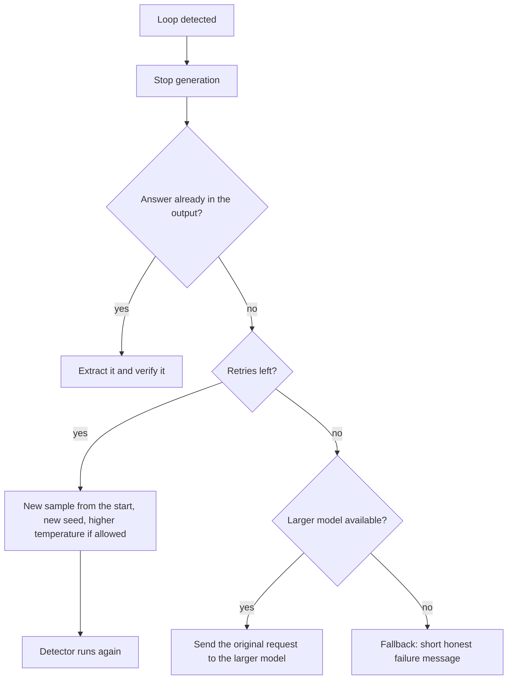

## 1. The question this page answers

You build an agent or a chat service on top of a reasoning model. The model can be Claude behind an API, or DeepSeek-R1 or a Qwen model behind a gateway. What do you change because of this paper? How do you know that the change helps?

The paper does not test production systems. It measures looping in open models and explains it with a synthetic task. So each rule on this page carries a label. The label says if the rule comes from the paper, from a provider, from later work, or from the interpretation of these notes.

## 2. Mental model

> [!analogy] A driver who is unsure at one junction
> A delivery driver knows every road except one hard junction with five exits. At that junction, the driver is not sure which exit is correct. The safe, familiar move is to return to the depot and try again. A driver who always takes the "safest" move drives depot, junction, depot, junction, forever. A coin flip at the junction (temperature) makes the driver leave the circle sooner, but the trip is still long. The engineering fixes are three. A supervisor reads the route log (a loop detector). A fuel limit stops the trip (a token budget). A better-trained driver makes fewer errors (model choice and training).
>
> **Where it stops working:** a route log shows exact repeats. A reasoning model often repeats the same idea in different words, so an exact-text check can miss a loop. And a real driver remembers a failed exit. A Transformer can keep its preference for the same wrong exit (page 09).

## 3. Terms

| Term | Plain meaning |
|---|---|
| looping fraction | The share of responses that loop. The paper marks a response as looping if some 30-gram appears at least 20 times in it. |
| n-gram | A run of $n$ consecutive units of text, for example 30 tokens in a row. |
| loop detector | Code that reads the output while or after it is generated and decides if the output repeats itself. |
| loop period | The length of one repeated block in a loop, in tokens. |
| token budget | The maximum number of output tokens for one response (`max_tokens` in many APIs). The paper used 30K for reasoning models. |
| stop reason | The field in an API response that says why generation ended, for example the end of the turn or the token budget. |
| greedy decoding | Always choose the most probable next token. Temperature 0 means greedy decoding. |
| temperature | A number $T$ that divides the logits before the softmax. A low $T$ sharpens the distribution, a high $T$ flattens it. |
| repetition penalty | A decoding rule that lowers the score of tokens that already appeared. The paper did not use one. |
| top-1 probability | The highest probability in the next-token distribution at one step. |
| distillation | Training a student model on traces that a teacher model wrote. |
| quantization | Storing model weights with fewer bits, for example 2 or 4 bits, to make inference cheaper. |
| fallback | The action that the service takes when the normal path fails, for example a retry or a short error message. |
| Wilson interval | A confidence interval for a rate measured from a small number of trials. |
| hash | A short number computed from a piece of data. Equal data always gives an equal hash, so a hash is a cheap key for counting. |
| embedding | A vector of numbers that represents the meaning of a text, so that similar meanings give close vectors. |

All terms are also in the [Glossary](/notes/papers/glossary).

## 4. Where each rule comes from

| Rule | Source |
|---|---|
| 1. Do not decode reasoning models greedily | The paper measured looping at temperature 0 in every reasoning model. Providers give the same advice. |
| 2. Treat temperature as a stopgap | The paper measured long responses at high temperature (synthetic task and Figure 1b). |
| 3. Detect loops and act | The 30-gram rule is the paper's measurement rule. Use as an online guard is the interpretation of these notes. Later work used a windowed rule. |
| 4. Budget tokens for loops | Interpretation of these notes. The paper used a 30K budget. |
| 5. Choose models with looping in mind | The paper measured it (Figure 2, Figure 10). Later work disagrees in part. |
| 6. Evaluate looping like a pass rate | The protocol of the paper, plus the statistics of the evaluation notes. |
| 7. Check distilled and quantized models | The authors' suggestions, not tested on real models. Later work on quantization. |
| 8. Monitor confidence and repetition | The paper observed growing confidence in two traces (Appendix E). The monitoring design is the interpretation of these notes. |

## 5. Rule 1: do not decode reasoning models greedily

### 5.1 The evidence

The paper measured: "All open reasoning models we tested loop at low temperature, with looping decreasing as temperature increases" (§2). At temperature 0, the looping fraction of every reasoning model was 0.04 or more. The values on the bars of Figure 2 are exact.

| Model | Looping fraction at temperature 0 |
|---|---|
| R1-Distill-Qwen-1.5B | 0.76 |
| R1-Distill-Llama-8B | 0.54 |
| Phi-4-reasoning-plus | 0.45 |
| OpenThinker3-1.5B | 0.30 |
| QwQ-32B | 0.04 |

### 5.2 What the providers say

The paper cites the Hugging Face pages of DeepSeek-R1 and QwQ-32B (§1). These pages say (checked on 2026-10-14):

1. DeepSeek-R1: "Set the temperature within the range of 0.5-0.7 (0.6 is recommended) to prevent endless repetitions or incoherent outputs."
2. QwQ-32B: "Use Temperature=0.6, TopP=0.95, MinP=0 instead of Greedy decoding to avoid endless repetitions."

For Claude, the choice is not yours on new models. The Messages API reference says (checked on 2026-10-14): "Models released after Claude Opus 4.6 do not support setting temperature. A value of 1.0 will be accepted for backwards compatibility, all other values will be rejected with a 400 error." It also says: "even with `temperature` of `0.0`, the results will not be fully deterministic."

### 5.3 Why greedy decoding loops

Greedy decoding is a fixed rule: the same state always gives the same next token (page 02). A hard progress-making step gets its probability diffused over many confusable options (page 08). The easy cyclic action keeps its probability. So the most probable action is often the cyclic one, and greedy decoding chooses it again and again.

> [!trap] "Temperature 0 for stable evaluations" is wrong for reasoning models
> For many non-reasoning tasks, temperature 0 is a normal choice for a stable result. The page on the earlier paper does this ([09 Engineering takeaways](/notes/papers/long-context/2023-lost-in-the-middle/09-engineering-takeaways)). For a reasoning model, temperature 0 measures a decoding setting with heavy looping, not the model that you deploy. Evaluate at the temperature that you deploy.

## 6. Rule 2: treat temperature as a stopgap

The paper measured, in the synthetic task, that a higher temperature reduces looping but does not fix the errors in learning (§3.3, §4.1). The response length at temperature 1 stays above the perfect learner:

| Setting | Learned model | Perfect learner | Ratio |
|---|---|---|---|
| Risk aversion, $G(5,5)$ with exploration | 105.5 | 24.8 | $105.5 / 24.8 = 4.25$ |
| Correlated errors, $G(5,5)$, margin 0 | 44.7 | 27.7 | $44.7 / 27.7 = 1.61$ |

In real models, the students still write longer chains than the teacher at high temperature. At temperature 1.0, Figure 1b shows about 16,300 tokens for OpenThinker3-7B and about 14,800 for QwQ-32B (approximate values read from the plot).

Interpretation of these notes: a model that loops at temperature 0 also wastes tokens at the recommended temperature. The loops become shorter detours, not zero. So plan the budget and the latency for long chains, even when no loop appears.

## 7. Rule 3: detect loops, then act

### 7.1 The paper's rule is a measurement rule

The paper marks a response as looping "if it contains any n-gram at least k times", with $n = 30$ and $k = 20$ for reasoning models (§2). The authors call this "a fairly strict requirement". The ablation in Table 1 shows that other $(n, k)$ values keep the order of the models. The paper does not say if it counts the n-gram in tokens or in words.

The rule was made for offline measurement. Interpretation of these notes: as an online guard, it fires late, because it waits for 20 copies.

### 7.2 How late does the rule fire?

Take an exact loop with a period of $P$ tokens. After the loop starts, the same n-gram appears again every $P$ tokens. The first n-gram reaches $k$ copies when the looping text is $n + (k - 1)P$ tokens long.

> [!example] Worked example: detection delay of two rules
> Paper's rule, $n = 30$, $k = 20$, loop period $P = 40$ tokens:
> $30 + (20 - 1) \times 40 = 30 + 760 = 790$ tokens of looping text.
>
> Same rule, a repeated paragraph with $P = 400$ tokens:
> $30 + 19 \times 400 = 30 + 7{,}600 = 7{,}630$ tokens.
>
> A windowed rule from later work (Alimaskina et al. 2026, arXiv 2606.02011): a 20-gram at least 4 times in the last 1,024 tokens. With $P = 40$:
> $20 + (4 - 1) \times 40 = 20 + 120 = 140$ tokens.
>
> The windowed rule can see a loop only if $20 + 3P \le 1{,}024$, so $P \le 334$ tokens.

```plot
{
  "title": "Tokens of looping text before the rule fires, by loop period (ink: 30-gram 20 times, gold: 20-gram 4 times)",
  "xAxis": {"label": "loop period P (tokens)", "domain": [0, 200]},
  "yAxis": {"label": "looping tokens before detection", "domain": [0, 4000]},
  "disableZoom": true,
  "data": [
    {"fn": "30 + 19 * x", "color": "#100D12"},
    {"fn": "20 + 3 * x", "color": "#B8860B"}
  ]
}
```

### 7.3 Online variants

Interpretation of these notes. Three designs, from cheap to expensive:

1. **Counter of n-gram hashes.** Keep a hash of each new n-gram in a dictionary of counts. One update per new token. Memory grows with the length of the output.
2. **Windowed counter.** Count only the n-grams in the last $W$ tokens. Memory stays fixed. Use a smaller $k$, because the window holds fewer copies.
3. **Semantic check.** Embed each sentence or paragraph and compare it with earlier ones. This also finds loops in different words, as in Example 1 of the paper, where the model "loops (semantically)" (§2.1). It costs an embedding call per chunk.

> [!trap] Legitimate repetition is not a loop
> A table, a list of cases or code can repeat the same phrase many times. Appendix B of the paper shows a model that checks "8 + 6 + 3 = 17" again and again. That is a real loop. But a correct case analysis can repeat similar lines too. Test your thresholds on normal outputs and count the false alarms.

### 7.4 What to do after a detection



| Action | Evidence |
|---|---|
| Stop generation | Interpretation of these notes: every token after the detection is waste. |
| Extract an answer that already appeared | The paper saw Phi-4-reasoning find the answer and then repeat "We'll produce answer in plain text." (Appendix A). Alimaskina et al. (2026) also return an answer that appeared before the loop. |
| Resample from the start | The paper measured looping as a fraction of samples, and far less of it at higher temperature (§2). So a new sample often does not loop. If you control the temperature, use a higher value for the retry, but stay inside the range that the provider recommends. |
| Do not continue from the looped prefix | The paper measured: from the student's looped prefix, 5 of 5 new student continuations looped again (§2.1). In Appendix B, from a later looped prefix, all teacher continuations looped too. |
| Escalate to a larger model | From the first loop point of Example 1, the teacher's 5 greedy continuations avoided looping (§2.1). Interpretation of these notes: send the original request, not the looped text. |

## 8. Rule 4: budget tokens for loops

A loop does not end by itself. It runs until the token budget. The paper used a 30K budget for all reasoning models (Appendix A).

> [!example] Worked example: the cost of loops
> Illustrative numbers, not from the paper: a normal response uses 12,000 output tokens. The budget is 30,000 tokens. The looping fraction is 0.30, the greedy value of OpenThinker3-1.5B.
>
> Expected tokens per request: $0.70 \times 12{,}000 + 0.30 \times 30{,}000 = 8{,}400 + 9{,}000 = 17{,}400$.
>
> Share of tokens spent in looping responses: $9{,}000 / 17{,}400 = 0.517$. So 30% of the requests use about 52% of the tokens.
>
> Now add a detector. Assume that each loop starts at token 6,000 and is detected 790 tokens later. A looping response then costs $6{,}000 + 790 = 6{,}790$ tokens, plus one new normal sample of 12,000 tokens.
>
> Expected tokens: $8{,}400 + 0.30 \times (6{,}790 + 12{,}000) = 8{,}400 + 0.30 \times 18{,}790 = 8{,}400 + 5{,}637 = 14{,}037$.

For hosted thinking models, you pay for thinking that you do not see. The Claude documentation states this (checked on 2026-10-14). Quote: "You're charged for the full thinking tokens generated by the original request, not the summary tokens." On newer Claude models the default thinking display is `"omitted"`, so the raw thinking text is not returned. Then a text detector cannot read the thinking. Watch the stop reason and the token counts instead ([thinking blocks and signatures](/notes/ai/llm-apis/02-streaming-and-thinking/l2-thinking-blocks-and-signatures)).

> [!key] A loop always costs the full budget
> A larger budget does not cure a loop. It only makes each loop more expensive. Detect loops early, and treat the share of responses that reach the budget as a cost metric.

## 9. Rule 5: choose models with looping in mind

The paper measured three patterns (§2, Figure 2, Figure 10):

1. **Larger models loop less inside a family.** R1-Distill-Qwen: 1.5B 0.76, 7B 0.49, 32B 0.37. OpenThinker3: 1.5B 0.30, 7B 0.10, and the teacher QwQ-32B 0.04.
2. **Distilled students loop more than their teacher.** OpenThinker3-1.5B loops at 0.30, its teacher QwQ-32B at 0.04.
3. **Harder problems loop more.** For R1-Distill-Qwen-7B, the 20 hardest problems loop at 0.89 and the 20 easiest at 0.03. Phi-4-reasoning is the exception: 0.29 on hard and 0.62 on easy problems.

Light RL tuning did not remove looping in the one family that the paper tested: Phi-4-reasoning 0.43, Phi-4-reasoning-plus 0.45.

> [!trap] Later work found a different pattern
> Duan et al. (2026, arXiv 2601.05693) report "no significant correlation between repetition susceptibility and model scale or distillation status" on their LoopBench tasks. Their tasks, loop rules and decoding settings differ (page 13). So do not choose a model from a table. Measure looping on your own tasks.

Interpretation of these notes: a small distilled model is cheap per token, but a high looping fraction can erase the saving. Compare models by cost per correct answer, at the temperature that you deploy.

## 10. Rule 6: evaluate looping like a pass rate

The paper's protocol (§2): six temperatures, 20 samples for each (problem, model, temperature), and three measures: accuracy, looping fraction and response length. AIME 2024 and 2025 have 4 papers of 15 problems, so 60 problems.

> [!example] Worked example: the size of the paper's evaluation
> Responses for one model and one temperature: $60 \times 20 = 1{,}200$.
>
> Responses for one model over six temperatures: $1{,}200 \times 6 = 7{,}200$.
>
> Upper bound of output tokens for one model: $7{,}200 \times 30{,}000 = 216{,}000{,}000$.

A looping fraction is a rate from repeated trials, like a pass rate. Use the same statistics ([pass rates and confidence intervals](/notes/ai/evaluation/02-statistics/l1-pass-rates-and-confidence-intervals)).

> [!example] Worked example: why 20 samples per item are not enough alone
> 6 loops in 20 runs: the estimate is $6/20 = 0.30$. The 95% Wilson interval is 0.146 to 0.519.
>
> 360 loops in 1,200 runs: the estimate is also 0.30. The 95% Wilson interval is 0.275 to 0.327.
>
> One task with 20 runs cannot tell 0.15 from 0.50. Many tasks with 20 runs each give a narrow interval for the average. The runs on one problem are correlated, so the true interval is wider than this one.

A minimal looping evaluation for your service:

1. Take 50 to 100 real tasks. Mark each as easy or hard from past accuracy.
2. Run each task 10 to 20 times at the deployed temperature, and at one lower temperature.
3. Record the looping fraction, the accuracy, the output tokens and the stop reason of each run.
4. Report the looping fraction by temperature and by difficulty, with intervals.
5. Repeat for each new model version, prompt version and serving change.

## 11. Rule 7: check distilled, fine-tuned and quantized models

Proposition 1 (page 08) gives a simple test of risk. A hard action confusable with $n$ options gets $(1-p)/n$. The easy cyclic action keeps $p$. Greedy decoding prefers the cyclic action when $p > (1-p)/n$.

> [!example] Worked example: how few confusable options are enough
> With $p = 0.3$: the condition is $n > (1 - 0.3)/0.3 = 0.7/0.3 = 2.33$.
>
> So three confusable options are enough: $0.7/3 = 0.233 < 0.3$.

If you distill your own model, the authors suggest training-time changes (§5). These are suggestions, not tested results on real models:

1. Find points in teacher traces that the student finds hard, for example high-loss positions, and add brief hints there.
2. Use better curricula.
3. Use architectures that handle star-graph hardness (the paper cites Hu et al. 2025 and Ahn et al. 2025).
4. Bias the traces toward new actions. The paper tested this only in the synthetic task (the margin variant, page 09).

Later work on quantization (labeled as later work):

1. Lotfi et al. (2026, arXiv 2606.00206) report that aggressive quantization lowers accuracy and makes chains of thought longer. A logit penalty on words such as "wait", "but" and "alternatively" cut chain length by 12 to 23% in their tests.
2. Alimaskina et al. (2026, arXiv 2606.02011) report repetitive loops in 2-bit Qwen3 models. Their loop rescue raised Qwen3-8B accuracy on MATH-500 from 17.2% to 74.2%.

Interpretation of these notes: a quantized model is an approximation of the original model, much as a student is an approximation of its teacher. So measure the looping fraction again after you quantize.

## 12. Rule 8: monitor confidence and repetition

The paper observed, in two greedy traces of OpenThinker3-1.5B, that the top-1 probability rises toward 1 once the final loop starts (Appendix E, Figure 15). This is an observation on two traces, not a tested detector.

| Signal | Needs | What it tells you |
|---|---|---|
| Share of responses with stop reason "max_tokens" | Any API | Undetected loops and truly long answers together. So it is an upper bound on undetected loops. |
| Spike in the histogram of output tokens at the budget | Any API | Loops collect exactly at the budget. |
| Detector firing rate | Raw output text | Loops that you stopped. Track by model, temperature and task type. |
| Running average of the top-1 probability | Per-token log-probabilities | Growing confidence inside a loop (Appendix E). |
| Repeated identical tool calls | Agent traces | Interpretation of these notes: a cyclic action at the level of the agent. |

The Claude stop reasons include `max_tokens`: "The response reached your max_tokens limit." (checked on 2026-10-14). In an agent, also limit the number of turns ([the agent loop](/notes/ai/claude-agent-sdk/01-foundations/l2-the-agent-loop)).

## 13. Production considerations

| Concern | What to do |
|---|---|
| Latency | A loop holds the request until the budget. Stream the output and run the detector on the stream. |
| Cost | Track the share of tokens in looping responses, not only the share of responses. |
| Reliability | Define a retry policy: new seed, from the start, a fixed number of times, then escalation or a fallback. |
| Correctness | Verify an extracted answer before you return it. A looping model can also repeat a wrong claim. |
| Observability | Log the stop reason, output tokens, detector result and temperature for every call. |
| Regression tests | Keep a looping evaluation in CI for model, prompt and serving changes. Quantization is a serving change. |

## 14. Design checklist

- [ ] The temperature follows the provider's recommendation, not 0.
- [ ] A loop detector runs on the output stream, with thresholds tested on normal outputs.
- [ ] After a detection, the service stops, then extracts, resamples, escalates or uses a fallback.
- [ ] Retries start from the original request, not from the looped text.
- [ ] I know the share of tokens spent in looping responses.
- [ ] I measured the looping fraction by temperature and by difficulty, with intervals.
- [ ] I measure again after each change of model, quantization or prompt.

## 15. Common mistakes

1. **"Temperature 0 makes the evaluation reproducible, so we use it."** For reasoning models, temperature 0 selects a setting with heavy looping. Evaluate at the deployed temperature.
2. **"At the recommended temperature, loops are solved."** The paper shows that temperature removes most loops but not the errors in learning. Chains stay longer than needed.
3. **"A larger token budget prevents loops."** A loop uses the whole budget. A larger budget only makes each loop more expensive.
4. **"The 30-gram rule is a good online guard."** It is a strict offline measurement rule. Online, it fires after about $30 + 19P$ looping tokens.
5. **"After a loop, continue from the same text."** The paper's probes show that a looped prefix tends to cause more looping. In one case, this was true even for the teacher.
6. **"A small model always loops more, so the small model is a bad choice."** The paper measured this inside families. Later work did not find it on other tasks. Measure on your tasks.

## 16. One-minute explanation

Reasoning models loop most under greedy decoding, so run them at the provider's recommended temperature, never at 0. Temperature is a stopgap: it shortens loops into detours, but the chains of small students stay longer than needed. Put a loop detector on the output stream. The paper's 30-gram, 20-copy rule is good for measurement but slow online, so use a windowed n-gram rule or a semantic check. After a detection, stop, extract an answer if one exists, resample from the start, then escalate or use a fallback. Never continue from the looped text. A loop always costs the full token budget, so track the share of tokens in looping responses. Choose models by cost per correct answer, and measure looping by temperature and difficulty with confidence intervals. Measure again after each distillation, quantization or model change.

## 17. Check questions

```check
{
  "question": "A loop repeats a block of 60 tokens. How many looping tokens does the paper's rule (30-gram, 20 copies) need before it fires? And a windowed rule (20-gram, 4 copies)?",
  "hint": "Use n + (k - 1)P.",
  "answer": "Paper's rule: 30 + 19 × 60 = 30 + 1,140 = 1,170 tokens. Windowed rule: 20 + 3 × 60 = 20 + 180 = 200 tokens."
}
```

```check
{
  "question": "Your service sees 25% of responses end with stop reason max_tokens at a 32,000-token budget. Normal responses use about 10,000 tokens. What share of output tokens goes to responses that reach the budget? Name two actions.",
  "answer": "Expected tokens: 0.75 × 10,000 + 0.25 × 32,000 = 7,500 + 8,000 = 15,500. Share: 8,000 / 15,500 = 0.516, so about 52%. Actions: add an online loop detector that stops early and resamples from the start, check that the temperature follows the provider's recommendation, measure the looping fraction by task difficulty, and consider a larger model for hard tasks."
}
```

```check
{
  "question": "A detector fires in the middle of a reasoning trace. A colleague wants to cut the repeated part and let the same model continue from that point. What does the paper suggest about this?",
  "answer": "It is risky. From the looped prefix of Example 1, all 5 new student continuations looped again. In Appendix B, from a later looped prefix, even the teacher's continuations looped. Resample from the original request, or send the original request to a larger model."
}
```

```check
{
  "question": "Why can a team that uses a hosted thinking model not run an n-gram detector on the reasoning text, and what can it watch instead?",
  "answer": "On newer Claude models the default thinking display is omitted, so the raw thinking text is not returned, but the full thinking tokens are still billed. The team can watch the stop reason (max_tokens), the output-token histogram, and the visible final text."
}
```

## 18. Links

- Previous: [11 Temperature: a stopgap, not a cure](/notes/papers/reasoning-models/2025-why-reasoning-models-loop/11-temperature-stopgap-or-cure)
- Next: [13 Limits and later work](/notes/papers/reasoning-models/2025-why-reasoning-models-loop/13-limits-and-later-work)
- The paper card: [Why do reasoning models loop?](/notes/papers/reasoning-models/2025-why-reasoning-models-loop)
- The looping definition: [02 Decoding, greedy, temperature and sampling](/notes/papers/reasoning-models/2025-why-reasoning-models-loop/02-background-decoding-greedy-temperature-sampling)
- The numbers: [07 Results: looping in open models](/notes/papers/reasoning-models/2025-why-reasoning-models-loop/07-results-looping-in-open-models)
- Proposition 1: [08 Why 1: risk aversion](/notes/papers/reasoning-models/2025-why-reasoning-models-loop/08-why-1-risk-aversion)
- Statistics: [Pass rates and confidence intervals](/notes/ai/evaluation/02-statistics/l1-pass-rates-and-confidence-intervals)
- Build it: [14 Reproduce it](/notes/papers/reasoning-models/2025-why-reasoning-models-loop/14-reproduce-it)
