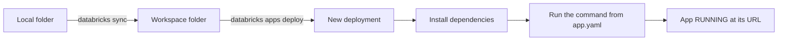

## 1. The question this idea answers

An agent backend must run close to the data and the models. On Databricks, the usual place for it is a Databricks App. You give the platform source code. The platform gives the app a container, a URL, an identity and a small set of environment variables.

The container is managed, so you control only part of it. You cannot choose the operating system. You do not create the identity. And the local file system does not keep its files when the app restarts.

This lesson answers three questions. What exactly does the platform give an app? What do you control through `app.yaml`? And what does a temporary local file system mean for an agent that writes session files to disk?

## 2. Mental model

> [!analogy] A serviced apartment
> A serviced apartment comes furnished. The building gives you an address, a key card and working utilities. You bring only your clothes.
>
> A Databricks App is the same. The platform gives the address (the app URL), the key card (the app service principal) and the utilities (Python, Node.js and environment variables). You bring the source code and `app.yaml`.
>
> When you leave, or when the building moves you to another room, the staff clear the room. Anything that you left there is gone. A restart or a new deployment does the same to the local file system of an app.
>
> **Where it stops working:** a key card belongs to one guest. The app service principal belongs to the app, and every user of the app shares it. Also, a guest has one room, but an app can run in several rooms at once ([L3](/notes/platforms/databricks/01-apps/l3-app-instances)).

## 3. Terms

| Term | Plain meaning |
|---|---|
| Databricks App | A web application that runs as a container service on the Databricks serverless platform. |
| container | An isolated runtime that holds the app process, its libraries and its own file system. |
| system environment | The managed runtime of every app: operating system, Python version and Node.js version. |
| `app.yaml` | The file at the root of the source code. It sets the start command and extra environment variables. |
| `command` | The `app.yaml` key with the start command, written as a list. The platform does not run it in a shell. |
| `env` | The `app.yaml` key with a list of extra environment variables for the app. |
| `valueFrom` | An `env` field that takes its value from an app resource ([L2](/notes/platforms/databricks/01-apps/l2-app-resources-and-secrets)). |
| app service principal | The identity that Databricks creates for each app. All users of the app share it. |
| `DATABRICKS_APP_PORT` | The environment variable with the port number on which the app must listen. |
| compute size | The CPU and memory of the app: Medium, Large or XLarge. |
| deployment | One version of the source code that the platform installs and starts on the app compute. |
| bundle | A project with a `databricks.yml` file. The Databricks CLI deploys the resources that it declares. |
| local file system | The disk inside the app container. Its files are lost when the app restarts. |
| `/logz` | A path on the app URL that shows the current logs of the app. |

## 4. Method and math

### 4.1 What an app is

The key concepts page says (checked on 2026-10-13):

> "A Databricks app is a web application that runs as a containerized service on the Databricks serverless platform."
>
> "Each app includes its own configuration, identity, and isolated runtime environment."

The overview page names the frameworks: "Popular Python frameworks include Streamlit, Dash, and Gradio." and "Node.js frameworks such as React, Angular, Svelte, and Express are also supported." A plain API backend also works. The HTTP headers page shows Flask and FastAPI examples. An app is any web server that listens on the right address and port.

Billing: "Apps are billed per hour of compute time while running, based on provisioned capacity." A stopped app "is not accessible and doesn't incur any costs."

### 4.2 The system environment

| Item | Value (system environment page, checked on 2026-10-13) |
|---|---|
| Operating system | Ubuntu 22.04 LTS |
| Python | 3.11, "running in a dedicated virtual environment" |
| uv | 0.10.2. "Apps that use `uv` can specify a different Python version." |
| Node.js | 22.16. "No Node.js libraries are pre-installed in the Databricks Apps environment." |
| Default CPU and memory | "By default, each app can use up to 2 virtual CPUs (vCPUs) and 6 GB of memory." |

The platform sets exactly six environment variables. The table has six rows (checked on 2026-10-13):

| Variable | Description in the docs |
|---|---|
| `DATABRICKS_APP_NAME` | "The name of the running app." |
| `DATABRICKS_WORKSPACE_ID` | "The unique ID for the Databricks workspace the app belongs to." |
| `DATABRICKS_HOST` | "The URL of the Databricks workspace to which the app belongs." |
| `DATABRICKS_APP_PORT` | "The network port the app should listen on." |
| `DATABRICKS_CLIENT_ID` | "The client ID for the Databricks service principal assigned to the app." |
| `DATABRICKS_CLIENT_SECRET` | "The OAuth secret for the Databricks service principal assigned to the app." |

There is no `DATABRICKS_TOKEN`. The app proves its identity with the client ID and the OAuth secret. Every other value reaches the app through `env` in `app.yaml`.

The best practices page adds one hard rule: "Your app must listen on `0.0.0.0` and use the port specified in the `DATABRICKS_APP_PORT` environment variable."

### 4.3 app.yaml

| Rule | What the docs say (checked on 2026-10-13) |
|---|---|
| File name | "You can use the `.yaml` or `.yml` file extension." The file is in the root of the project. |
| `command` omitted | A Python app runs `python <my-app.py>` with the first `.py` file. A Node.js app runs `npm run start`. |
| No shell | "Because Databricks doesn't run the command in a shell," "environment variables defined outside the app configuration aren't available to your app." |
| Port | "The one exception is `DATABRICKS_APP_PORT`, which is substituted with the actual port number in the command at runtime." |
| `env` | "This top-level key defines an optional list of additional environment variables to pass to your app." |
| `value` or `valueFrom` | Each entry has a `name` and either a `value` or a `valueFrom`, not both. |

This `app.yaml` starts a FastAPI backend from a Python file. The app reads the port from the environment, so the command needs no port syntax.

```yaml
command: ['python', 'main.py']
env:
  - name: 'AGENT_MODEL'
    value: 'claude-sonnet-5'
  - name: 'WAREHOUSE_ID'
    valueFrom: 'sql-warehouse'
```

```python
import os
import uvicorn
from fastapi import FastAPI

app = FastAPI()

@app.get("/health")
def health():
    return {"app": os.environ.get("DATABRICKS_APP_NAME", "local"), "status": "ok"}

if __name__ == "__main__":
    port = int(os.environ["DATABRICKS_APP_PORT"])  # set by the platform
    uvicorn.run(app, host="0.0.0.0", port=port)    # 0.0.0.0, not 127.0.0.1
```

This file ran in the sandbox (FastAPI 0.143.0, uvicorn 0.53.0) with `DATABRICKS_APP_PORT=8123` and `DATABRICKS_APP_NAME=chat-backend`. A request to `/health` returned `{"app":"chat-backend","status":"ok"}`. After `SIGTERM`, the process stopped in 0.21 s and logged `Application shutdown complete.`

> [!trap] No shell in the command
> No shell reads `command`. So shell features such as `&&`, pipes and `$NAME` expansion are not available. The only documented substitution is `DATABRICKS_APP_PORT`. Put every setting in `env`, and read it in code with `os.environ`.

### 4.4 The app service principal

The key concepts page (checked on 2026-10-13):

> "Databricks automatically creates a service principal for each app."
>
> "This service principal acts as the app's identity and is granted permissions by the app developer."
>
> "All users of the app share this identity and have access to the same set of permissions."

The authorization page adds two facts. "The SDKs follow unified authentication and automatically detect credentials in the environment." And: "When you delete the app, Databricks deletes the service principal."

So inside an app, `WorkspaceClient()` with no arguments reads `DATABRICKS_HOST`, `DATABRICKS_CLIENT_ID` and `DATABRICKS_CLIENT_SECRET`. It authenticates as the app service principal with OAuth machine-to-machine (M2M) authentication. [Part 2, L1](/notes/platforms/databricks/02-identity-and-auth/l1-cli-profiles) explains how the SDK searches for credentials. The `App` object of the Apps API has the fields `service_principal_client_id`, `service_principal_id` and `service_principal_name` (Python SDK 0.152.0). Grants to the app use its client ID.

> [!example] Worked example: a token added to app.yaml
> A developer adds `DATABRICKS_TOKEN` to `env`, so that the app can call an API "as me". The test sets the app variables with fake values, adds the token, and calls `Config()` from the Python SDK 0.152.0. The output:
>
> `validate: more than one authorization method configured: oauth and pat`
>
> The SDK refuses to choose between the OAuth secret and the token. Even without this error, a personal token would give the app the developer's rights. Remove the token, and grant the needed rights to the app service principal.

> [!trap] A new app is a new identity
> Deleting an app deletes its service principal. If you delete an app and create it again with the same name, the new app has a new service principal. Every grant on tables, secrets, warehouses and service credentials must be given again.

### 4.5 Compute sizes

| Size | CPU | Memory | Cost per hour | Use (docs, checked on 2026-10-13) |
|---|---|---|---|---|
| Medium | Up to 2 vCPUs | 6 GB | 0.5 DBU | "Most apps work well with this size." |
| Large | Up to 4 vCPUs | 12 GB | 1 DBU | Large in-memory data, high concurrency, heavy computation |
| XLarge | Up to 12 vCPUs | 48 GB | 3 DBU | Apps that exceed the Large size |

"If you don't specify an instance size, Databricks assigns the Medium size by default." The CLI flag is `--compute-size`, with "Supported values: [LARGE, MEDIUM, XLARGE]" (CLI source, v1.20.0, released 2026-10-07).

A size change moves the app to new compute: "After you change the instance size, the app continues to run on the previous instance size until the update to the new instance size finishes." The docs do not say what happens to local files. Treat a size change as a restart.

> [!example] Worked example: the monthly DBU count of one app
> A Medium app runs all day, every day, for 30 days.
>
> - DBU per day: $0.5 \times 24 = 12$
> - DBU per month: $12 \times 30 = 360$
>
> A Large app uses $1 \times 24 \times 30 = 720$ DBU. The price of one DBU depends on the contract, so this lesson gives no USD amount.

### 4.6 Deployment



The commands from the deploy page (checked on 2026-10-13):

```bash
databricks sync --watch . /Workspace/Users/my-email@org.com/my-app

databricks apps deploy my-app-name \
   --source-code-path /Workspace/Users/my-email@org.com/my-app
```

The page also shows deployment from Git, for example `databricks apps deploy my-app --git-branch main`. During a deployment, the platform installs the Python dependencies (and Node.js dependencies if `package.json` exists). Then: "After deployment completes, Databricks starts your app based on the defined" command. A new deployment "applies your latest updates without recreating the app."

The Apps API reports two states (Python SDK 0.152.0):

| Field | Values |
|---|---|
| `app_status.state` | `DEPLOYING`, `RUNNING`, `CRASHED`, `UNAVAILABLE` |
| `compute_status.state` | `STARTING`, `ACTIVE`, `UPDATING`, `STOPPING`, `STOPPED`, `ERROR`, `DELETING` |

A **bundle** declares the app in `databricks.yml`. The docs now call bundles "Declarative Automation Bundles". Older pages use the name Databricks Asset Bundles. A minimal app resource from the bundle tutorial:

```yaml
resources:
  apps:
    hello_world_app:
      name: 'hello-world-app'
      source_code_path: .
      description: 'A Databricks app'
```

> [!trap] bundle deploy does not start the new code
> The tutorial says: "Deploying a bundle doesn't automatically deploy the app to compute." After `databricks bundle deploy`, run `databricks bundle run hello_world_app` to start the app. A script that runs only `bundle deploy` can leave the old code running.

### 4.7 Logs

| Fact | Source (checked on 2026-10-13) |
|---|---|
| The Logs tab shows the app output. | The monitor page: "your app must write output to `stdout` and `stderr`." |
| A log view on the URL | "Append `/logz` to your app URL." |
| Logs are not kept | "Databricks doesn't persist logs when app compute shuts down." |
| Do not write log files | Best practices: "Avoid writing logs to local files." |
| CLI | `databricks apps logs my-app --follow`. It shows the last 200 lines by default (`--tail-lines`). Filters: `--search` and `--source APP` or `SYSTEM`. The CLI source v1.20.0 defines this command. The monitor page does not list it. |
| Shutdown limit | "Your app must shut down within 15 seconds after it receives a `SIGTERM` signal, or it forcibly terminates with `SIGKILL`." |

For logs that must survive, the monitor page suggests external logging services, or Unity Catalog volumes or tables. [Tracing agents](/notes/software-engineering/security-and-operations/02-observability/l1-tracing-agents) covers this for agent runs.

### 4.8 The local file system is temporary

The "App state" section of the key concepts page lists two temporary kinds of storage (checked on 2026-10-13):

| Storage | Text in the docs |
|---|---|
| In memory | "In-memory storage for temporary data within a single session. This data is lost when the app restarts." |
| Local file system | "Local file system for temporary files during app execution. This data is lost when the app restarts." |

It adds: "Apps don't preserve in-memory state after restarts." The persistent options are "Databricks tables", "Workspace files", "Unity Catalog volumes" and "Lakebase database instances".

| Event | Local files after the event |
|---|---|
| Stop, then start | Lost (documented) |
| Crash, then restart | Lost (documented: a restart) |
| New deployment | Treat as lost. The platform starts the app again after each deployment. |
| Compute size change | Treat as lost. The app moves to new compute. |
| A second instance | Not shared. Each instance has its own disk ([L3](/notes/platforms/databricks/01-apps/l3-app-instances)). |

> [!key] The local file system is a cache, never a store
> A Databricks App can lose every local file at any deployment, restart or size change. Write only data that the app can rebuild: temporary files, caches, session files of an agent harness. Keep every record that a user expects to see again in a persistent store, for example Lakebase.

### 4.9 Consequences for an agent that writes session files

The Claude Agent SDK writes each session as a JSONL file under the Claude config directory. In an app, that file is on the temporary local file system. So the design of [Session files on temporary disks](/notes/ai/claude-agent-sdk/04-sessions/l3-session-files-on-temporary-disks) applies directly. Flow 1 resumes when the file exists. Flow 2 rebuilds the context from the database when it does not.

> [!example] Worked example: the cost of one deployment
> A chat service has 40 active chats. A new deployment runs at 14:00, so every session file is gone.
>
> 1. The next message of each chat finds no file. All 40 chats take Flow 2.
> 2. Assume that the rebuilt history of a chat is 30,000 input tokens on average.
> 3. Extra input after the deployment: $40 \times 30{,}000 = 1{,}200{,}000$ tokens, with no prompt cache match for the rebuilt prefixes.
>
> The service stays correct only if Flow 2 is correct. A deployment is a normal event, so Flow 2 is a normal path.

Two more rules follow. Set `CLAUDE_CONFIG_DIR` in `os.environ` to a folder that the app can write. The docs do not name a writable path, so test it in a deployed app (Exercise 1.3). And count Flow 1 and Flow 2 per message, so that a deployment appears as a visible step in the metric.

### 4.10 Production view

| Concern | What to do |
|---|---|
| Correctness | Keep chats, messages and agent results in a persistent store. Use local files only as a cache. |
| Reliability | Stop within 15 seconds of `SIGTERM`. Save in-flight work before that. |
| Security | Do not put tokens in `app.yaml`. Grant rights to the app service principal, one grant at a time. |
| Observability | Log to stdout and stderr. Send important logs and traces to a persistent destination. |
| Cost | Start with Medium (0.5 DBU per hour). Stop apps that nobody uses. |
| Deployments | After `bundle deploy`, run `bundle run`. Check `app_status.state` and `/health` after each deployment. |

## 5. Code

These exercises use a small app folder and the notebook `databricks/01-databricks-apps.ipynb` in the lab.

**Exercise 1.1: a minimal agent backend.** Write `app.yaml` and `main.py` for a FastAPI app with a `/health` endpoint. Deploy it to a development workspace with `databricks sync` and `databricks apps deploy`.

Acceptance tests:

- `/health` returns the value of `DATABRICKS_APP_NAME`.
- The app listens on `0.0.0.0` and on the port from `DATABRICKS_APP_PORT`.
- `command` is a list, and `app.yaml` holds no secret value.

**Exercise 1.2: an environment report.** Add `/env-report`. It returns the names of the six platform variables, and for each one whether it is set. It never returns the value of `DATABRICKS_CLIENT_SECRET`.

Acceptance tests:

- A unit test with `monkeypatch` sets all six variables and checks that the secret value is absent from the response ([pytest fixtures and monkeypatch](/notes/software-engineering/python/03-tooling/l2-pytest-fixtures-and-monkeypatch)).
- A unit test removes `DATABRICKS_APP_PORT` and checks that the report marks it as missing.

**Exercise 1.3: prove the temporary disk.** At startup, the app writes a file with a new boot id and the time. `/boot` returns the current boot id and the boot ids of the files that it found at startup.

Acceptance tests:

- After `databricks apps stop` and `databricks apps start`, `/boot` reports no file from an earlier boot.
- After a new deployment, the same is true.
- Your notebook records each event, the boot ids and the folder that you used.

**Exercise 1.4: graceful shutdown.** Handle `SIGTERM`. Print one line to stdout, finish the current request, and exit.

Acceptance tests:

- A local test sends `SIGTERM` to the process and measures the exit time. It is below 15 seconds.
- The shutdown line appears in the Logs tab after a stop in the workspace.

## 6. Common mistakes

1. **Keeping state on the local file system.** A deployment, restart or size change deletes it. Keep it in Lakebase, tables or volumes.
2. **Listening on 127.0.0.1 or on a fixed port.** The app must listen on `0.0.0.0` and on `DATABRICKS_APP_PORT`.
3. **Shell syntax in `command`.** No shell reads it. Put settings in `env` and read them in code.
4. **A personal token in the app environment.** The SDK rejects two authorization methods, and the token gives the app your rights. Grant rights to the app service principal.
5. **Expecting `bundle deploy` to start the new code.** It does not deploy the app to compute. Run `bundle run`.
6. **Writing logs to files.** They are lost with the disk. Log to stdout and stderr.
7. **Recreating an app and expecting the old grants.** A new app has a new service principal.

## 7. One-minute explanation

A Databricks App is a web service that runs in a managed container on the Databricks serverless platform. The platform gives it Ubuntu 22.04, Python 3.11 and Node.js 22.16. It also sets six environment variables: app name, workspace ID, workspace URL, port, and the client ID and OAuth secret of the app. That identity is the app service principal: created for each app, shared by all users, and deleted with the app. `app.yaml` sets the start command as a list, with no shell, and extra variables with `value` or `valueFrom`. The app must listen on `0.0.0.0` and `DATABRICKS_APP_PORT`, and stop within 15 seconds of `SIGTERM`. You deploy with `databricks apps deploy`, or with a bundle, where `bundle deploy` must be followed by `bundle run`. The platform shows the logs from stdout and stderr, but it does not keep them. Memory and local files are lost on every restart. So the session files of an agent are only a cache, and the database must be able to rebuild every chat.

## 8. Check questions

```check
{
  "question": "Your app runs uvicorn on 127.0.0.1:8000. Locally it works. Deployed, the app never becomes reachable. Why, and what is the fix?",
  "answer": "The platform requires the app to listen on 0.0.0.0 and on the port in DATABRICKS_APP_PORT. On 127.0.0.1 the platform proxy cannot reach the process, and port 8000 may not be the assigned port. Read DATABRICKS_APP_PORT from os.environ and bind to 0.0.0.0."
}
```

```check
{
  "question": "An agent backend writes Claude session files to the local file system. At 10:00 you deploy a new version. What happens to the next message of each open chat, and what must be true for the service to stay correct?",
  "hint": "What does the platform do after a deployment?",
  "answer": "The platform starts the app again after the deployment, and the local files are lost, so each session file is gone. The next message of each chat finds no file and must take Flow 2: a new session with the earlier turns from the database in the prompt. The service stays correct only if Flow 2 is correct and the database holds every turn."
}
```

```check
{
  "question": "A developer adds DATABRICKS_TOKEN with a personal access token to the env list of app.yaml. What happens when the code calls WorkspaceClient() inside the app, and why is the idea wrong even without the error?",
  "answer": "The Python SDK finds two authorization methods in the environment, the OAuth client ID and secret of the app service principal and the token, and fails with: validate: more than one authorization method configured: oauth and pat. Even without the error, the token gives the app the developer's personal rights, and it sits in plain text in app.yaml. Grant the needed rights to the app service principal instead."
}
```

```check
{
  "question": "Your deploy script runs databricks bundle deploy and stops. The app still serves the old code. Why?",
  "answer": "The bundle docs say that deploying a bundle doesn't automatically deploy the app to compute. bundle deploy creates or updates the app resource and the files in the workspace. To start the app with the new code, run databricks bundle run with the resource key of the app, then check the app state and the /health endpoint."
}
```

## 9. Links

- Next: [L2: App resources and secrets](/notes/platforms/databricks/01-apps/l2-app-resources-and-secrets)
- The session file design: [Session files on temporary disks](/notes/ai/claude-agent-sdk/04-sessions/l3-session-files-on-temporary-disks)
- How the SDK finds credentials: [Part 2, L1: CLI profiles](/notes/platforms/databricks/02-identity-and-auth/l1-cli-profiles)
- Several copies of one app: [L3: App instances](/notes/platforms/databricks/01-apps/l3-app-instances)
- A persistent store for chats: [Lakebase as an app resource](/notes/platforms/databricks/05-lakebase/l2-lakebase-as-an-app-resource)
- [Glossary](/notes/platforms/databricks/glossary)
