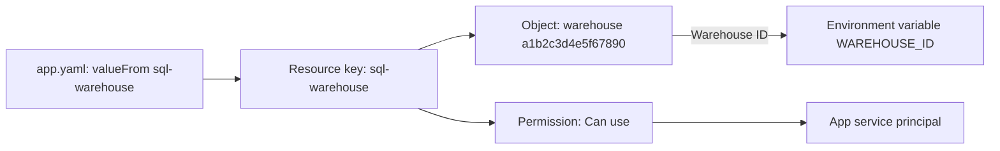

## 1. The question this idea answers

An agent backend needs access to many things. It calls Claude on Microsoft Foundry with an API key. It runs SQL on a warehouse. It reads a Genie space and writes chat rows to Lakebase.

The fast way is to paste the values into `app.yaml`: the warehouse ID, the database host and the API key. The warehouse ID is harmless. The API key is not. `app.yaml` lives in the source folder and usually in a Git repository. Everyone who can read the folder or clone the repository can now call the model on your bill.

Databricks Apps has a better way: **app resources**. A resource gives the app service principal a permission on an existing object. `valueFrom` then injects a value of that object into an environment variable. This lesson explains every resource type and the permission that each one grants. It ends with the exact steps to move a key from plain text into a secret resource.

## 2. Mental model

> [!analogy] Key cards programmed at the front desk
> A hotel guest does not get a master key. The front desk programs the guest's key card for named doors: room 412, the gym, the pool. Each door has a level: enter only, or enter and use the safe.
>
> An app resource is one line on that key card. The front desk is a person with `Can manage` on the app and on the resource. The key card is the app service principal. The app code knows only the label of the door, the resource key, and asks for "the warehouse" or "the Foundry key" by that label.
>
> **Where it stops working:** a key card opens a door, but it does not carry the contents of the room. A secret resource with `valueFrom` does carry the contents: the decrypted value arrives in an environment variable of the app process. Anything that can read that environment can read the secret.

## 3. Terms

| Term | Plain meaning |
|---|---|
| app resource | A declared link from the app to one existing Databricks object, with one permission for the app service principal. |
| resource key | The name of a resource inside the app. `valueFrom` refers to it. |
| resource permission | The permission that the resource grants to the app service principal, for example `Can read` on a secret scope. |
| `valueFrom` | An `env` field in `app.yaml` that takes its value from the resource with the given resource key. |
| secret | A named value, for example an API key, stored encrypted by Databricks. |
| secret scope | A named collection of secrets. Permissions apply to the whole scope. |
| plain text | A value written as readable characters in a file, a screen or a log. |
| Environment page | The page of the app in the workspace UI that shows its environment. Values set with `value` appear there in plain text. |
| Git history | Every earlier version of every file in a repository. A deleted line stays in it. |
| key rotation | Replacing a key with a new one and disabling the old one. |
| least privilege | The rule that an identity gets only the permissions that its task needs. |
| `Can manage` | The permission that a person needs on both the app and the object to add a resource. |

## 4. Method and math

### 4.1 What a resource is

The key concepts page (checked on 2026-10-13):

> "Apps must use existing resources and can't create new ones."
>
> "During deployment, workspace admins review and approve the app's requested access to resources."
>
> "The app's service principal receives the necessary permissions, and the app developer must have permission to grant them."

The resources page adds the rule for people: "The user adding the resource must have the `Can manage` permission on the resource and the app."

A resource separates two things. The code declares a need ("a SQL warehouse, key `sql-warehouse`"). The workspace configuration chooses the object ("warehouse `a1b2c3d4e5f67890`"). The docs give the reason: "This separation between declaration and configuration allows apps to be portable across environments." The same code runs in development with one warehouse and in production with another.



### 4.2 The 15 resource types

The resources page lists the types, their default keys and their permissions. The environment variables page lists the value that `valueFrom` gives. Both checked on 2026-10-13.

| Resource type | Default key | Permissions you can grant | `valueFrom` gives |
|---|---|---|---|
| Databricks app | `app` | Can use | App name |
| Genie Agent | `genie-space` | Can view, Can run, Can edit, Can manage | Space ID |
| Lakebase Autoscaling database | `postgres` | Can connect and create | Endpoint path |
| Lakebase Provisioned database | `database` | Can connect and create | Host |
| Lakeflow job | `job` | Can view, Can manage run, Can manage | Job ID |
| MLflow experiment | `experiment` | Can read, Can edit, Can manage | Experiment ID |
| Model serving endpoint | `model` | Can view, Can query, Can manage | Endpoint name |
| Unity Gateway model service | `model` | Can execute | Model service full name |
| Secret | `secret` | Can read, Can write, Can manage | Decrypted secret value |
| SQL warehouse | `sql-warehouse` | Can use, Can manage | Warehouse ID |
| Unity Catalog connection | `connection` | Use Connection | Connection name |
| Unity Catalog table | `table` | Select, Modify | Table full name |
| User-defined function | `function` | Can execute | Function full name |
| Unity Catalog volume | `volume` | Can read, Can read and write | Volume path |
| AI Search index | `vector-search-index` | Can select | Index full name |

Two default keys differ from the names of their types: `genie-space` for a Genie Agent and `vector-search-index` for an AI Search index. The API also uses the field `genie_space` (Python SDK 0.152.0).

Only one row gives a secret value: **Secret**. Every other row gives an identifier, such as an ID, a name or a path. An identifier is not a credential. The permission on the object, granted to the app service principal, is what gives access.

> [!trap] The key in app.yaml must match the key you chose
> The default key of a SQL warehouse resource is `sql-warehouse`. The example on the environment variables page uses `valueFrom: sql_warehouse`. The resource key is a name that you choose, so the docs show both. Your `valueFrom` must match the key of your resource exactly, including `-` and `_`.

### 4.3 valueFrom

The example from the environment variables page (checked on 2026-10-13):

```yaml
env:
  - name: WAREHOUSE_ID
    valueFrom: sql_warehouse

  - name: SECRET_KEY
    valueFrom: secret
```

The page also states the rule: "never reference secret keys or other sensitive values directly in your app configuration." And: "Only hardcode values when they're static, non-sensitive, and consistent across environments."

The docs do not say when the platform resolves `valueFrom`: at deployment or at start. They also do not say whether a changed secret value reaches a running app. Plan for this: after you change a resource or a secret, deploy again and check the app.

### 4.4 Secret scopes

The secrets page (checked on 2026-10-13): "A secret scope is collection of secrets identified by a name." Scope names "can not exceed 128 characters". The CLI source (v1.20.0) adds limits for `put-secret`: "The maximum allowed secret value size is 128 KB. The maximum number of secrets in a given scope is 1000."

The CLI commands:

```bash
databricks secrets create-scope chat-backend
databricks secrets put-secret chat-backend foundry-api-key
databricks secrets list-secrets chat-backend
databricks secrets put-acl chat-backend <principal> <permission>
```

With no value flag, `put-secret` asks for the value: "Input the secret when prompted interactively (single-line secrets)." A value typed at a prompt does not enter the shell history. A value in `--string-value` or `--json` does.

The permission of a secret resource covers the whole scope, not one secret. The Apps secrets page:

> "**Can read:** Grants the app read access to all secrets in the selected scope."
>
> "Secret permissions apply at the *scope* level, however, not the individual secret."

So the same page recommends: "create a separate secret scope for each app and store only the required secrets in that scope."

> [!trap] One shared scope gives every app every key
> A team keeps all keys in one scope, `team-keys`: the Foundry key, a database password and a Slack token. A chat app gets a secret resource for the Foundry key with `Can read`. The app service principal can now read all three secrets, because the permission covers the scope. Use one scope per app.

### 4.5 Why plain text is a risk

A key written with `value` in `app.yaml` exists in many places at once.

| Place | Who can read the key |
|---|---|
| `app.yaml` in the workspace source folder | Everyone with read access to that folder |
| The Git repository | Everyone who can clone it, and every existing clone |
| Git history | The same people, also after a later commit deletes the line |
| The Environment page of the app | The secrets page: "Secret values injected directly as environment variables appear in plaintext on the app's **Environment** page." |
| Logs and error reports | Anyone who reads them, if the code ever prints its configuration |

> [!example] Worked example: deleting the line is not enough
> A key enters `app.yaml` in commit 12 of a repository. Commit 30 deletes the line. Six developers and one CI runner have clones.
>
> 1. Copies of the key in Git: one in the central repository, plus $6 + 1 = 7$ clones, so 8 copies.
> 2. Copies after commit 30: still 8. `git log -p` shows the line in commit 12 in every copy.
> 3. Only key rotation makes all 8 copies useless. Create a new key, store it as a secret, and disable the old key at the provider.

### 4.6 What valueFrom does not hide

`valueFrom` keeps the key out of `app.yaml`, the repository and the Environment page. At run time, the process still has the decrypted value in an environment variable. The environment variables page says the variable gets the "Decrypted secret value".

Every child process inherits the environment of its parent. This test ran in the sandbox:

```python
import os, subprocess, sys
os.environ["FOUNDRY_API_KEY"] = "fake-key-123"
child = [sys.executable, "-c", "import os; print(os.environ.get('FOUNDRY_API_KEY'))"]
print("child sees, before:", subprocess.run(child, capture_output=True, text=True).stdout.strip())
key = os.environ.pop("FOUNDRY_API_KEY")
print("child sees, after pop:", subprocess.run(child, capture_output=True, text=True).stdout.strip())
```

```text
child sees, before: fake-key-123
child sees, after pop: None
```

This matters for an agent harness. The Claude Agent SDK starts the Claude Code CLI as a child process, and its `env` option is "merged on top of the inherited process environment". If the agent has a shell tool, the model can read the environment of that child. Read the key once at start, keep it in a Python object, and remove it from `os.environ` before the harness starts any child process. Then give the child only the variables that it needs.

> [!key] A resource gives access, valueFrom gives a value
> For every object except a secret, the resource grants a permission to the app service principal, and `valueFrom` gives only an identifier. For a secret, `valueFrom` gives the decrypted value itself. Keep identifiers in `env` freely. Treat the one secret variable as live: read it once, never log it, and remove it before any child process starts.

### 4.7 Migration: from a key in plain text to a secret resource

Start state: `app.yaml` holds `ANTHROPIC_FOUNDRY_API_KEY` with `value`. The `AnthropicFoundry` client reads this variable by default (anthropic 1.13.0 source: "`api_key` from `ANTHROPIC_FOUNDRY_API_KEY`").

```yaml
env:
  - name: 'ANTHROPIC_FOUNDRY_API_KEY'
    value: '<the key in plain text>'
```

1. **Create a new key at the provider.** The old key is in Git history, so it is already exposed. Do not move it. Move a new one.
2. **Create one scope for the app.** `databricks secrets create-scope chat-backend`.
3. **Store the new key.** `databricks secrets put-secret chat-backend foundry-api-key`, and paste the value at the prompt.
4. **Add a secret resource.** In the app, open App resources, then "+ Add resource", then Secret. Choose the scope `chat-backend`, the key `foundry-api-key`, the permission `Can read`, and the resource key `foundry-key`.
5. **Change `app.yaml`.** Replace `value` with `valueFrom`:

```yaml
env:
  - name: 'ANTHROPIC_FOUNDRY_API_KEY'
    valueFrom: 'foundry-key'
```

6. **Deploy again.** Then call an endpoint that makes one model request.
7. **Verify.** The model call works. `app.yaml` and the repository hold no key. The Environment page shows no key value.
8. **Disable the old key** at the provider. Then confirm that a request with the old key fails.
9. **Prevent a repeat.** Add a secret scanner to the pre-commit checks and to CI.

Step 4 can also run through the Apps API. This sketch builds the request with the Python SDK 0.152.0. The objects were built and printed in the sandbox. The API call itself was not run.

```python
from databricks.sdk import WorkspaceClient
from databricks.sdk.service.apps import (
    App, AppResource, AppResourceSecret, AppResourceSecretSecretPermission)

w = WorkspaceClient(profile="dev")
app = w.apps.get("chat-backend")
new = AppResource(name="foundry-key", secret=AppResourceSecret(
    scope="chat-backend", key="foundry-api-key",
    permission=AppResourceSecretSecretPermission.READ))
w.apps.create_update_and_wait(
    app_name="chat-backend", update_mask="resources",
    app=App(name="chat-backend", resources=(app.resources or []) + [new]))
```

> [!trap] apps update replaces the whole app
> The SDK docstring of `apps.update` says: "This is a full replacement: fields omitted from the request are cleared, so send the complete app." A call with only `resources` clears the description and every other field. Use `create_update` with `update_mask="resources"`, or the UI.

### 4.8 Production view

| Concern | What to do |
|---|---|
| Security | Every secret enters the app through a secret resource with `Can read`. No `value` holds a credential. |
| Least privilege | One secret scope per app. Grant the lowest resource permission that works, for example `Can query`, not `Can manage`, on a serving endpoint. |
| Rotation | Rotate each key on a schedule and when a team member leaves. After rotation, deploy again and test one model call. |
| Process hygiene | Read the secret once, remove it from `os.environ`, and pass explicit environments to child processes. |
| Reviews | Check every change to `app.yaml` for `value` entries with names such as `KEY`, `TOKEN`, `SECRET` or `PASSWORD`. |
| Recreated apps | A new app has a new service principal. Add every resource again. |

## 5. Code

These exercises go in the notebook `databricks/02-app-resources-and-secrets.ipynb`. Exercises 2.1 and 2.2 need no workspace.

**Exercise 2.1: find secrets in plain text.** Write `find_plaintext_secrets(app_yaml_text)`. It parses the YAML and returns the names of `env` entries that use `value` and look like credentials, by name or by value.

Acceptance tests:

- An entry `ANTHROPIC_FOUNDRY_API_KEY` with `value` is reported.
- The same entry with `valueFrom` is not reported.
- `WAREHOUSE_ID` with a 16-character hex `value` is not reported.
- An entry `NOTE` whose value starts with `dapi` is reported.

**Exercise 2.2: load a secret once.** Write `load_secret(name)`. It reads the variable, raises a clear error if it is missing or empty, removes it from `os.environ`, and returns the value.

Acceptance tests:

- After the call, a child process started with `subprocess.run` does not see the variable.
- A missing variable raises an error whose message names the variable but contains no value.
- A second call for the same name raises the same error.

**Exercise 2.3: migrate a development app.** Follow the nine steps of section 4.7 for a test key in a development workspace. Record each command and each check in the notebook.

Acceptance tests:

- `git grep` for the old key value finds nothing in the working tree.
- One model call from the deployed app succeeds with the new key.
- A request with the old key fails after step 8.

## 6. Common mistakes

1. **A credential in `value`.** It appears in the repository, in Git history and on the Environment page. Use a secret resource with `valueFrom`.
2. **Deleting the line and keeping the key.** Git history keeps the old key. Rotate it.
3. **One shared scope for many apps.** `Can read` covers the whole scope. Use one scope per app.
4. **A `valueFrom` that does not match the resource key.** `sql-warehouse` and `sql_warehouse` are different keys.
5. **Thinking that `valueFrom` hides the secret at run time.** The process environment holds the decrypted value. Never log it, and remove it before child processes start.
6. **Calling `apps.update` with only the new resource.** It is a full replacement. Use `create_update` with an update mask.
7. **`Can manage` everywhere.** Grant the lowest permission that the app needs.

## 7. One-minute explanation

An app resource links an app to one existing Databricks object and grants one permission on it to the app service principal. A person with `Can manage` on the app and on the object adds it, under a resource key. In `app.yaml`, `valueFrom` with that key injects a value into an environment variable. The value is an ID, a name or a path for most types, and the decrypted value for a secret. There are 15 types, from SQL warehouses and serving endpoints to Lakebase, Genie Agents and secrets. A secret resource grants its permission on the whole secret scope, so each app should have its own scope. A key written with `value` sits in plain text in the source folder, in every Git clone, in Git history and on the Environment page. Deleting the line does not help, so the migration starts with a new key and ends with the old key disabled. At run time the secret is still in the process environment. So read it once, never log it, and remove it before child processes start.

## 8. Check questions

```check
{
  "question": "A chat app gets a secret resource with Can read on the scope team-keys, which holds 12 secrets. How many secrets can the app service principal read, and what should the team change?",
  "answer": "All 12. Secret resource permissions apply at the scope level, not to one secret. The team should create a separate scope for the app, put only the secrets that the app needs in it, and grant Can read on that scope only."
}
```

```check
{
  "question": "A developer deletes the plain text API key from app.yaml in a new commit and pushes. Is the key safe now? What else must happen?",
  "hint": "Where else does the key exist?",
  "answer": "No. The key is still in Git history, in the central repository and in every clone, and maybe on the Environment page and in logs. The team must rotate it: create a new key, store it as a secret with a secret resource and valueFrom, deploy, and disable the old key at the provider."
}
```

```check
{
  "question": "Name one resource type where valueFrom gives a credential and two where it gives only an identifier. Why does the identifier alone not give access?",
  "answer": "Secret gives the decrypted secret value, a credential. SQL warehouse gives the warehouse ID, and model serving endpoint gives the endpoint name: identifiers. Access comes from the permission that the resource grants to the app service principal, such as Can use on the warehouse. Without that permission, the ID is useless."
}
```

```check
{
  "question": "An agent harness reads ANTHROPIC_FOUNDRY_API_KEY through valueFrom and then starts the Claude Code CLI, which has a shell tool. Why is this a risk, and what is the fix?",
  "answer": "The CLI is a child process, and it inherits the environment of the harness, including the decrypted key. The model can run a shell command that prints the environment. The fix is to read the key once, remove it from os.environ before any child process starts, and give the child only the variables it needs."
}
```

## 9. Links

- Previous: [L1: Databricks Apps](/notes/platforms/databricks/01-apps/l1-databricks-apps)
- Next: [L3: App instances](/notes/platforms/databricks/01-apps/l3-app-instances)
- A key with no stored secret at all: [Part 2, L2: Unity Catalog service credentials](/notes/platforms/databricks/02-identity-and-auth/l2-uc-service-credentials)
- The Lakebase resource in detail: [Lakebase as an app resource](/notes/platforms/databricks/05-lakebase/l2-lakebase-as-an-app-resource)
- The Foundry client: [Claude on Microsoft Foundry](/notes/ai/llm-apis/04-providers-and-caching/l1-claude-on-microsoft-foundry)
- [Glossary](/notes/platforms/databricks/glossary)
